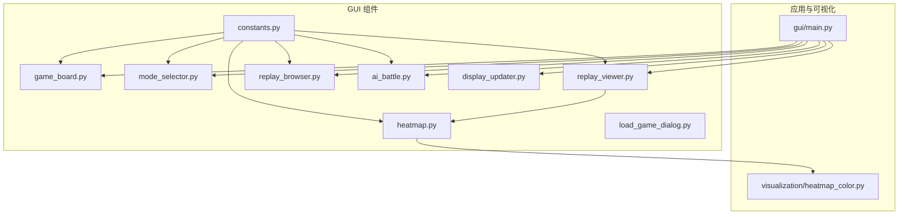
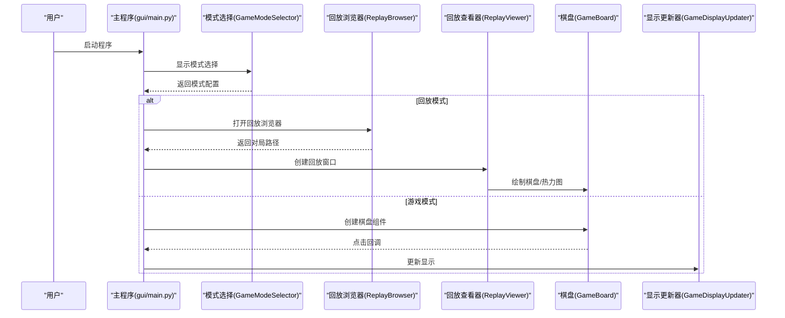
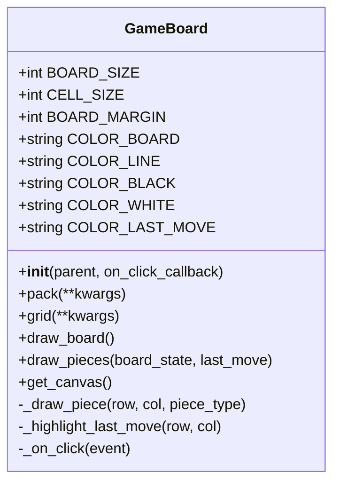
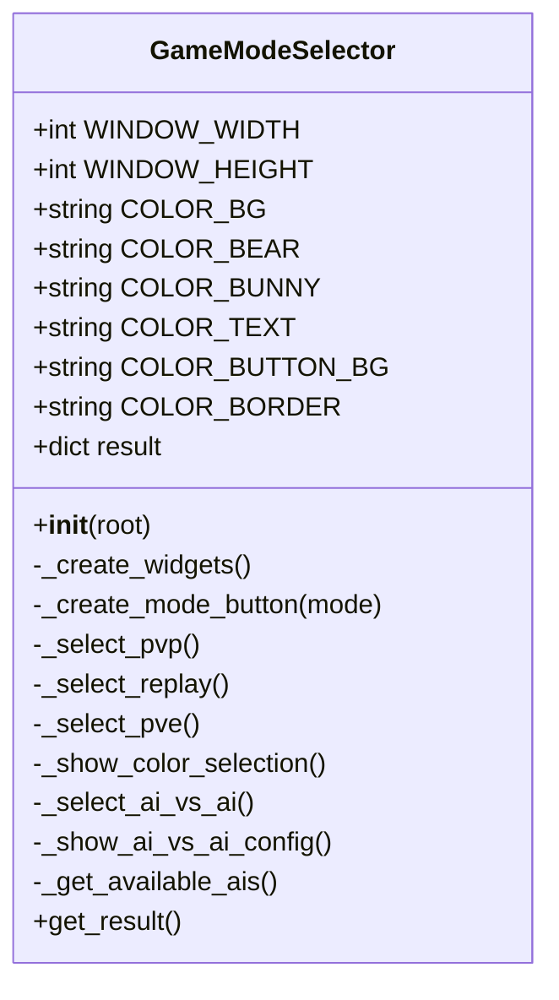
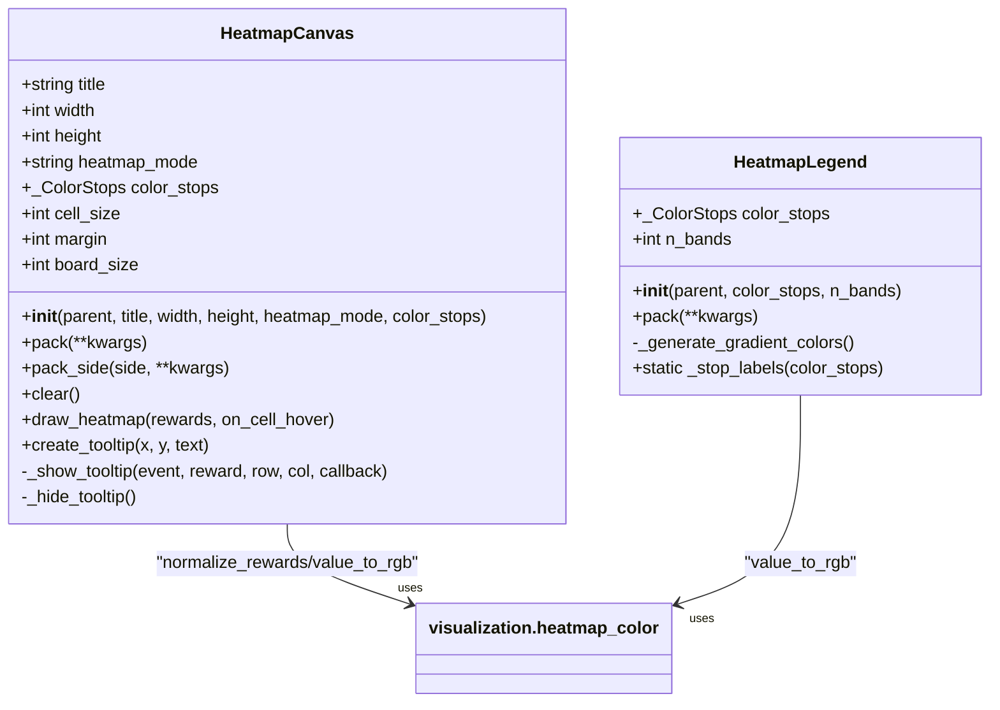
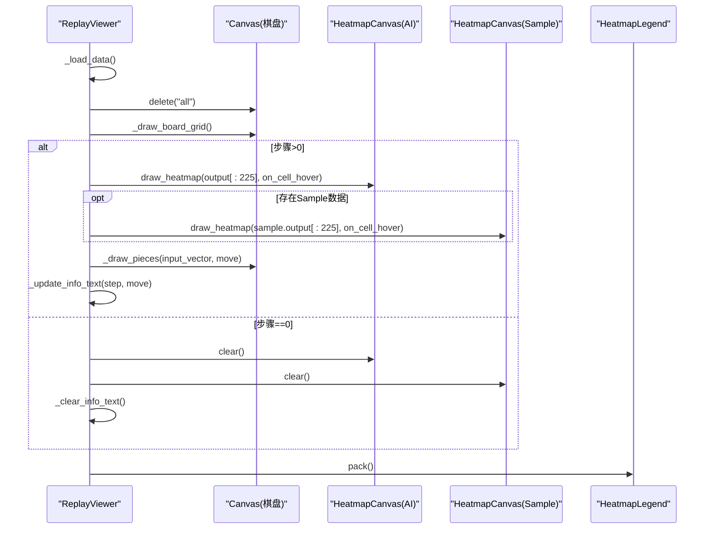
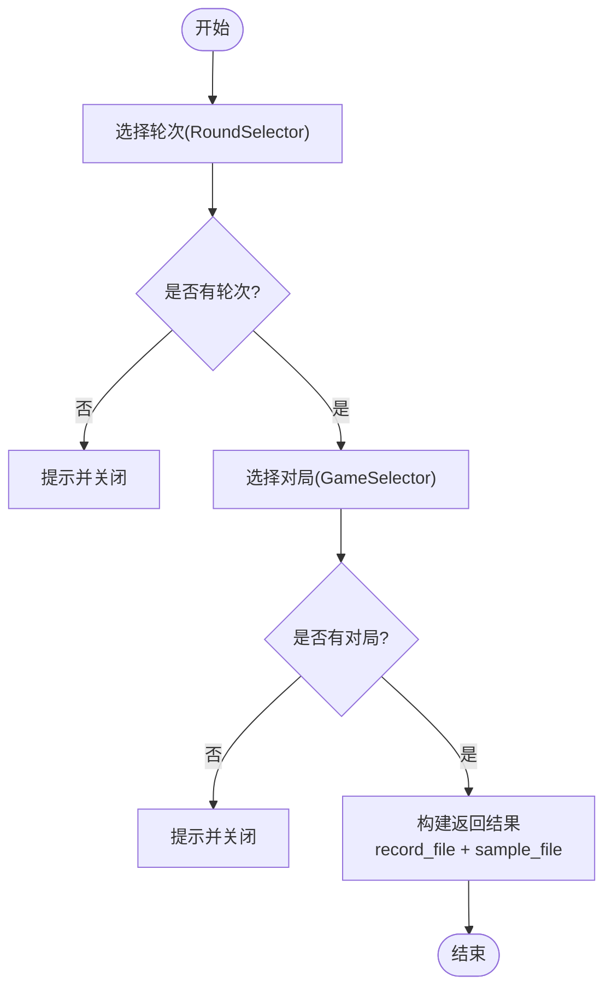
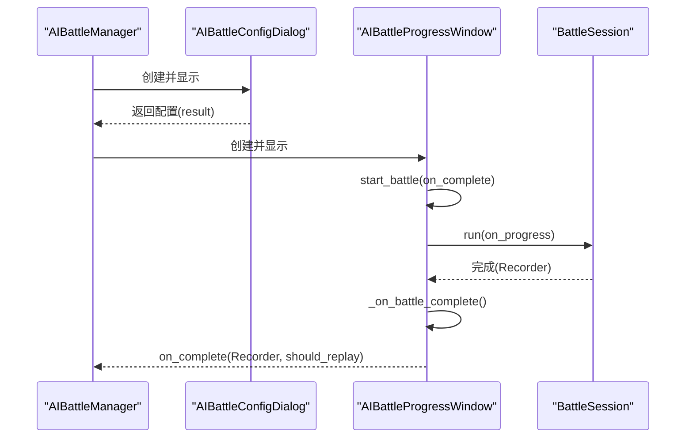
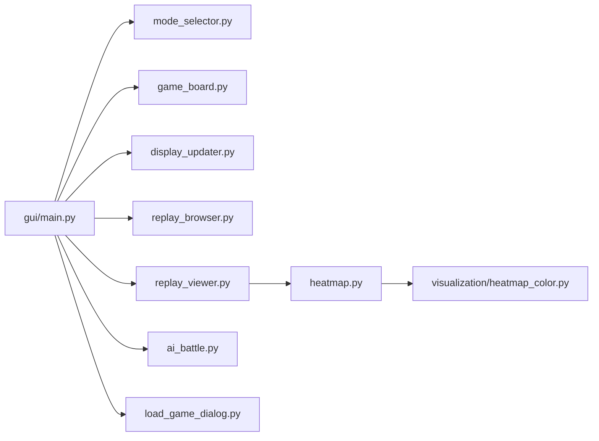

# 组件设计

<cite>
**本文引用的文件**
- [gui/components/__init__.py](file://gui/components/__init__.py)
- [gui/components/constants.py](file://gui/components/constants.py)
- [gui/components/game_board.py](file://gui/components/game_board.py)
- [gui/components/mode_selector.py](file://gui/components/mode_selector.py)
- [gui/components/heatmap.py](file://gui/components/heatmap.py)
- [gui/components/replay_viewer.py](file://gui/components/replay_viewer.py)
- [gui/components/replay_browser.py](file://gui/components/replay_browser.py)
- [gui/components/ai_battle.py](file://gui/components/ai_battle.py)
- [gui/components/load_game_dialog.py](file://gui/components/load_game_dialog.py)
- [gui/display_updater.py](file://gui/display_updater.py)
- [gui/main.py](file://gui/main.py)
- [visualization/heatmap_color.py](file://visualization/heatmap_color.py)
- [design/gui_heatmap_reuse_design.md](file://design/gui_heatmap_reuse_design.md)
</cite>

## 目录
1. [简介](#简介)
2. [项目结构](#项目结构)
3. [核心组件](#核心组件)
4. [架构总览](#架构总览)
5. [详细组件分析](#详细组件分析)
6. [依赖关系分析](#依赖关系分析)
7. [性能考量](#性能考量)
8. [故障排查指南](#故障排查指南)
9. [结论](#结论)
10. [附录](#附录)

## 简介
本设计文档面向五子棋AI项目的GUI组件，系统阐述组件化界面架构的设计理念与实现方式，覆盖游戏棋盘组件、模式选择组件、热力图组件、回放查看器组件等。文档重点解释组件的属性定义、事件处理机制、状态管理与生命周期，给出组件层次结构与数据传递机制，并总结组件可复用性设计（接口标准化、参数配置化、样式主题化）与最佳实践（组件解耦、状态提升、事件冒泡等）。

## 项目结构
GUI组件位于gui/components目录，采用“按功能模块化”的组织方式：
- constants：统一的颜色、尺寸、字体等主题常量
- game_board：棋盘绘制与交互
- mode_selector：启动时的模式选择界面
- heatmap：热力图画布与颜色标尺
- replay_viewer：回放查看器（棋盘+热力图+信息）
- replay_browser：回放浏览器（轮次/对局选择）
- ai_battle：AI内战配置、进度窗口与管理器
- load_game_dialog：加载游戏对话框
- display_updater：统一的状态渲染器
- main：主程序入口与模式选择流程

图表来源
- [gui/main.py:398-462](file://gui/main.py#L398-L462)
- [gui/components/__init__.py:13-41](file://gui/components/__init__.py#L13-L41)
- [gui/components/heatmap.py:30-34](file://gui/components/heatmap.py#L30-L34)
- [visualization/heatmap_color.py:32-39](file://visualization/heatmap_color.py#L32-L39)

章节来源
- [gui/components/__init__.py:1-42](file://gui/components/__init__.py#L1-L42)
- [gui/main.py:398-462](file://gui/main.py#L398-L462)

## 核心组件
- 游戏棋盘组件：负责15×15棋盘绘制、棋子绘制、最后落子高亮、点击事件绑定与回调
- 模式选择组件：提供PvP/PvE/AI vs AI/回放四种模式选择，支持颜色与AI配置
- 热力图组件：基于可视化模块的归一化与颜色映射，绘制15×15格子热力图，支持悬停tooltip
- 回放查看器组件：展示对局历史、棋盘、AI热力图与Sample热力图、颜色标尺与信息文本
- 回放浏览器组件：轮次选择器与对局选择器，串联选择流程
- AI内战组件：配置对话框、进度窗口、管理器，支持多代AI模型与进度回调
- 加载游戏对话框：封装存档选择
- 显示更新器：集中更新棋盘、标签、历史记录与游戏结束弹窗

章节来源
- [gui/components/game_board.py:7-170](file://gui/components/game_board.py#L7-L170)
- [gui/components/mode_selector.py:12-411](file://gui/components/mode_selector.py#L12-L411)
- [gui/components/heatmap.py:68-358](file://gui/components/heatmap.py#L68-L358)
- [gui/components/replay_viewer.py:13-426](file://gui/components/replay_viewer.py#L13-L426)
- [gui/components/replay_browser.py:12-383](file://gui/components/replay_browser.py#L12-L383)
- [gui/components/ai_battle.py:22-346](file://gui/components/ai_battle.py#L22-L346)
- [gui/components/load_game_dialog.py:11-56](file://gui/components/load_game_dialog.py#L11-L56)
- [gui/display_updater.py:13-110](file://gui/display_updater.py#L13-L110)

## 架构总览
GUI采用“组件化 + 主程序编排”的架构：
- 主程序负责模式选择、会话创建、事件路由与窗口切换
- 组件各自封装UI与交互，通过回调与状态提升实现松耦合
- 可视化模块提供热力图颜色映射算法，GUI组件仅做tkinter适配

图表来源
- [gui/main.py:398-462](file://gui/main.py#L398-L462)
- [gui/components/mode_selector.py:176-411](file://gui/components/mode_selector.py#L176-L411)
- [gui/components/replay_browser.py:300-383](file://gui/components/replay_browser.py#L300-L383)
- [gui/components/replay_viewer.py:13-426](file://gui/components/replay_viewer.py#L13-L426)
- [gui/display_updater.py:40-110](file://gui/display_updater.py#L40-L110)

## 详细组件分析

### 游戏棋盘组件（GameBoard）
- 属性定义
  - 棋盘尺寸与间距：BOARD_SIZE、CELL_SIZE、BOARD_MARGIN
  - 颜色方案：棋盘背景、线条、黑白棋子、最后落子高亮
  - 回调：on_click_callback(row, col)
- 事件处理机制
  - Canvas绑定鼠标左键事件，计算点击格子坐标并调用回调
  - 点击边界检查，确保合法范围
- 状态管理与生命周期
  - 初始化创建Canvas并绘制空棋盘
  - draw_board绘制网格与星位
  - draw_pieces绘制棋子与最后落子高亮
  - 提供pack/grid布局方法与get_canvas访问
- 可复用性设计
  - 通过构造参数注入回调，降低与业务耦合
  - 颜色与尺寸通过类常量配置，便于主题化

图表来源
- [gui/components/game_board.py:7-170](file://gui/components/game_board.py#L7-L170)

章节来源
- [gui/components/game_board.py:22-170](file://gui/components/game_board.py#L22-L170)

### 模式选择组件（GameModeSelector）
- 属性定义
  - 窗口尺寸：WINDOW_WIDTH、WINDOW_HEIGHT
  - 颜色方案：从constants导入
  - 结果存储：result字典
- 事件处理机制
  - 按钮点击触发模式选择，部分模式弹出二级配置对话框
  - 二级对话框：人机对战颜色选择、AI对手选择；AI内战局数设置
- 状态管理与生命周期
  - 初始化设置窗口标题、几何尺寸、居中显示
  - _create_widgets构建界面，_select_*系列方法设置result并销毁窗口
- 可复用性设计
  - 通过回调与result返回值实现与主程序解耦
  - 颜色与尺寸来自constants，便于主题化

图表来源
- [gui/components/mode_selector.py:12-411](file://gui/components/mode_selector.py#L12-L411)

章节来源
- [gui/components/mode_selector.py:27-411](file://gui/components/mode_selector.py#L27-L411)

### 热力图组件（HeatmapCanvas/HeatmapLegend）
- 设计理念
  - 复用visualization.heatmap_color模块，统一颜色映射与归一化算法
  - 默认4色白→黄→橙→红，归一化默认log模式，适合softmax分布
  - tkinter Canvas不支持alpha，仅使用RGB，Legend同步改造
- 属性定义
  - HeatmapCanvas：title、width、height、heatmap_mode、color_stops、cell_size、margin、board_size
  - HeatmapLegend：color_stops、n_bands
- 事件处理机制
  - 悬停tooltip：显示原始reward值（非归一化），支持回调
- 状态管理与生命周期
  - draw_heatmap批量归一化后逐格绘制矩形，绑定Enter/Leave事件
  - clear清空画布；tooltip懒创建与复用
- 可复用性设计
  - 通过参数配置化支持不同色板与归一化模式
  - Legend与热力图本体视觉一致，减少认知负担

图表来源
- [gui/components/heatmap.py:68-358](file://gui/components/heatmap.py#L68-L358)
- [visualization/heatmap_color.py:63-122](file://visualization/heatmap_color.py#L63-L122)

章节来源
- [gui/components/heatmap.py:71-358](file://gui/components/heatmap.py#L71-L358)
- [visualization/heatmap_color.py:32-39](file://visualization/heatmap_color.py#L32-L39)
- [design/gui_heatmap_reuse_design.md:60-147](file://design/gui_heatmap_reuse_design.md#L60-L147)

### 回放查看器组件（ReplayViewer/ReplayWindow）
- 属性定义
  - record_file/sample_file：回放数据路径
  - history/sample_data：历史记录与Sample数据
  - current_step：当前步骤
  - 显示选项：show_board/show_input/show_output
- 事件处理机制
  - 控制按钮：上一步/下一步/跳转到结局/重置
  - 棋盘绘制：网格+棋子+最后落子高亮
  - 热力图绘制：AI热力图与Sample热力图（可选）
  - 信息文本：显示输入/输出向量与落子信息
- 状态管理与生命周期
  - _load_data加载JSON数据
  - _update_display根据current_step更新棋盘与热力图
  - _draw_heatmaps/_draw_pieces/_update_info_text分别负责绘制与文本
- 可复用性设计
  - 通过构造参数注入数据路径，支持独立窗口展示
  - 与热力图组件解耦，仅调用其draw_heatmap

图表来源
- [gui/components/replay_viewer.py:48-377](file://gui/components/replay_viewer.py#L48-L377)
- [gui/components/heatmap.py:137-247](file://gui/components/heatmap.py#L137-L247)

章节来源
- [gui/components/replay_viewer.py:16-426](file://gui/components/replay_viewer.py#L16-L426)

### 回放浏览器组件（RoundSelector/GameSelector/ReplayBrowser）
- 属性定义
  - RoundSelector：ai_data_dir、on_select回调
  - GameSelector：round_dir、on_select回调
  - ReplayBrowser：静态方法串联选择流程
- 事件处理机制
  - 列表框选择与双击事件
  - 读取record.json解析胜负与步数
  - 自动推导sample.json路径
- 状态管理与生命周期
  - _get_rounds/_get_games扫描目录并过滤有效对局
  - _select_*方法设置回调并关闭窗口
  - browse返回包含record_file与sample_file的结果

图表来源
- [gui/components/replay_browser.py:12-383](file://gui/components/replay_browser.py#L12-L383)

章节来源
- [gui/components/replay_browser.py:20-383](file://gui/components/replay_browser.py#L20-L383)

### AI内战组件（AIBattleConfigDialog/AIBattleProgressWindow/AIBattleManager）
- 属性定义
  - AIBattleConfigDialog：ai1_var/ai2_var/num_games_var、on_start回调
  - AIBattleProgressWindow：num_games、ai1_name/ai2_name、recorder、on_complete
  - AIBattleManager：run_ai_vs_ai静态方法
- 事件处理机制
  - 配置对话框验证局数并返回配置
  - 进度窗口在后台线程运行BattleSession，主线程更新UI与回调
  - 捕获ModelLoadError并弹窗提示
- 状态管理与生命周期
  - _start_battle验证参数并销毁对话框
  - _run_battle在后台线程执行，进度回调通过root.after切换主线程
  - _on_battle_complete询问是否回放并回调

图表来源
- [gui/components/ai_battle.py:22-346](file://gui/components/ai_battle.py#L22-L346)

章节来源
- [gui/components/ai_battle.py:32-346](file://gui/components/ai_battle.py#L32-L346)

### 加载游戏对话框（LoadGameDialog）
- 属性定义
  - 静态方法show(parent, saves)：返回选中的存档名或None
- 事件处理机制
  - 列表框选择并验证，弹窗提示未选择
  - wait_window等待对话框关闭后返回结果

章节来源
- [gui/components/load_game_dialog.py:14-56](file://gui/components/load_game_dialog.py#L14-L56)

### 显示更新器（GameDisplayUpdater）
- 属性定义
  - board/save_name_label/status_label/game_status_label/history_listbox/helper
  - 颜色主题：color_text/color_bear
- 事件处理机制
  - update根据display_state更新棋盘、标签与历史记录
  - update_history更新列表并滚动到底部
  - show_game_over显示游戏结束弹窗
- 状态管理与生命周期
  - 作为渲染器集中处理UI更新，避免组件内部重复逻辑

章节来源
- [gui/display_updater.py:16-110](file://gui/display_updater.py#L16-L110)

## 依赖关系分析
- 组件间依赖
  - ReplayViewer依赖HeatmapCanvas/HeatmapLegend
  - 主程序依赖各组件并通过display_updater统一渲染
  - 热力图组件依赖visualization.heatmap_color
- 外部依赖
  - tkinter：所有GUI组件的基础
  - JSON：回放数据加载
  - ai.registry：AI模型枚举
- 可能的循环依赖
  - 无直接循环依赖，组件通过回调与结果字典解耦

图表来源
- [gui/main.py:22-28](file://gui/main.py#L22-L28)
- [gui/components/replay_viewer.py:9-10](file://gui/components/replay_viewer.py#L9-L10)
- [gui/components/heatmap.py:30-34](file://gui/components/heatmap.py#L30-L34)

章节来源
- [gui/main.py:18-28](file://gui/main.py#L18-L28)
- [gui/components/heatmap.py:30-34](file://gui/components/heatmap.py#L30-L34)

## 性能考量
- 热力图绘制
  - 批量归一化：normalize_rewards仅计算一次全局统计，避免重复计算
  - 逐格绘制：使用Canvas.create_rectangle，避免频繁重绘整个画布
  - tooltip懒创建：仅在首次悬停时创建，减少内存占用
- 棋盘绘制
  - draw_pieces先清除棋子再重绘，避免叠加绘制
  - 点击事件使用整除运算计算格子，边界检查确保安全
- 回放查看
  - 步骤切换时仅更新必要区域，避免全量重绘
  - 历史列表滚动到底部，避免大量滚动开销

## 故障排查指南
- 模型加载失败
  - 现象：AI内战或人机对战时弹窗提示“模型加载失败”
  - 处理：检查AI模型名称与版本，确认registry中存在对应模型
- 回放数据缺失
  - 现象：回放模式提示“暂无回放数据”
  - 处理：确认ai_data目录存在且包含有效record.json
- 热力图显示异常
  - 现象：热力图颜色异常或无显示
  - 处理：检查heatmap_mode与color_stops配置，确认rewards长度为225
- 棋盘点击无效
  - 现象：点击棋盘无响应
  - 处理：确认on_click_callback已正确传入，且控制器已初始化游戏

章节来源
- [gui/components/ai_battle.py:283-297](file://gui/components/ai_battle.py#L283-L297)
- [gui/main.py:418-420](file://gui/main.py#L418-L420)
- [gui/components/heatmap.py:157-159](file://gui/components/heatmap.py#L157-L159)
- [gui/components/game_board.py:162-165](file://gui/components/game_board.py#L162-L165)

## 结论
本GUI组件设计通过“组件化 + 主程序编排 + 可视化算法复用”的架构，实现了清晰的职责分离与良好的可复用性。组件接口标准化、参数配置化与样式主题化使得界面易于维护与扩展。遵循组件解耦、状态提升与事件冒泡等设计模式，提升了系统的可测试性与可维护性。热力图组件对visualization模块的复用，进一步保证了算法一致性与视觉体验的稳定性。

## 附录
- 设计文档参考：design/gui_heatmap_reuse_design.md
- 可视化算法参考：visualization/heatmap_color.py