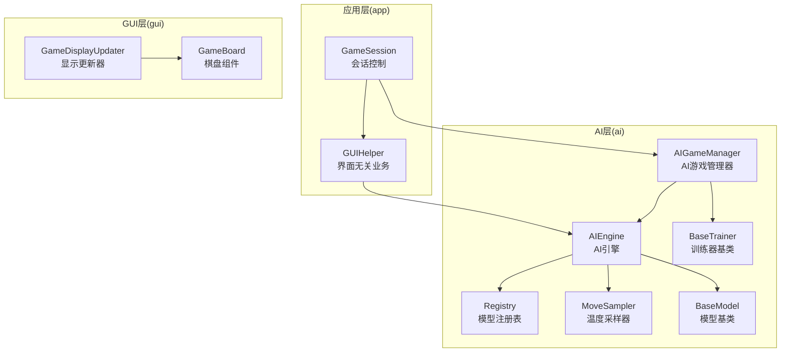
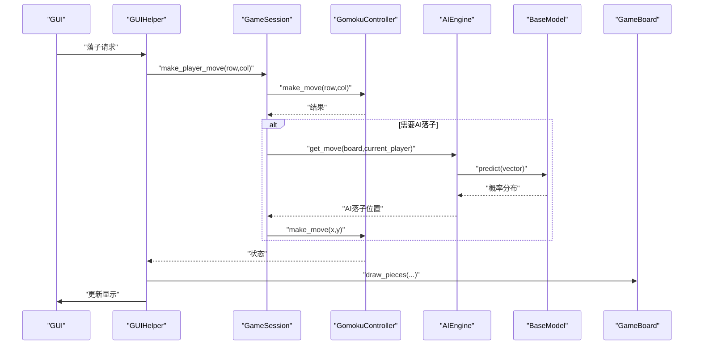
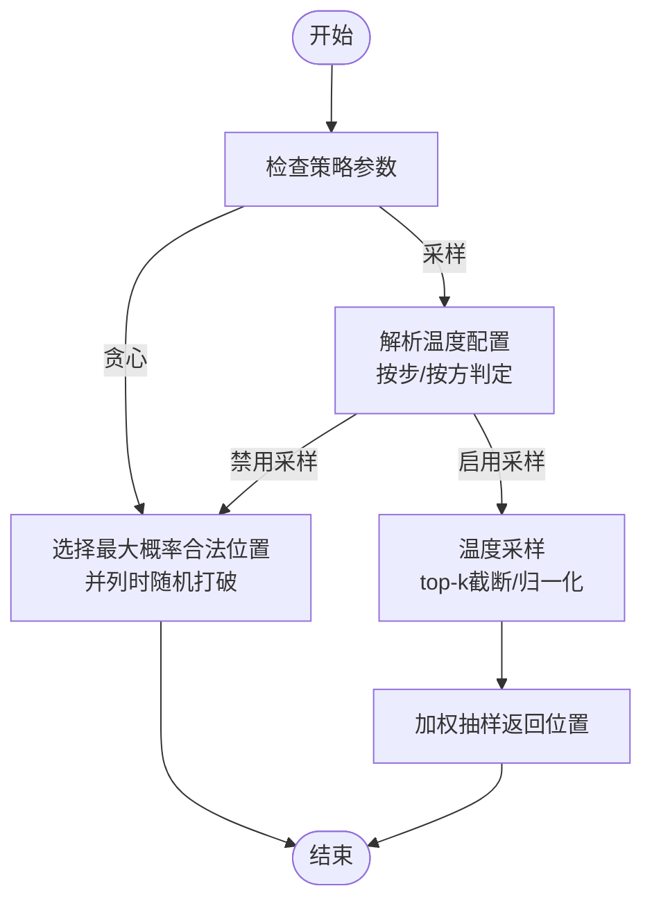
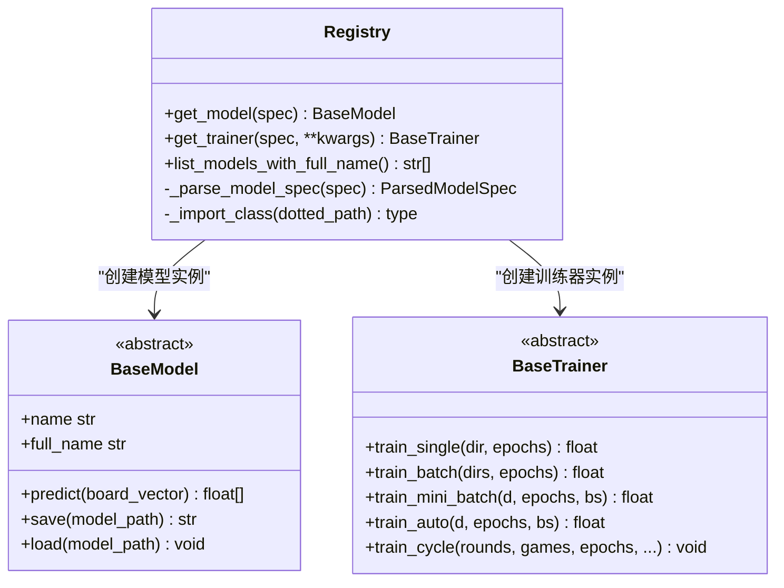
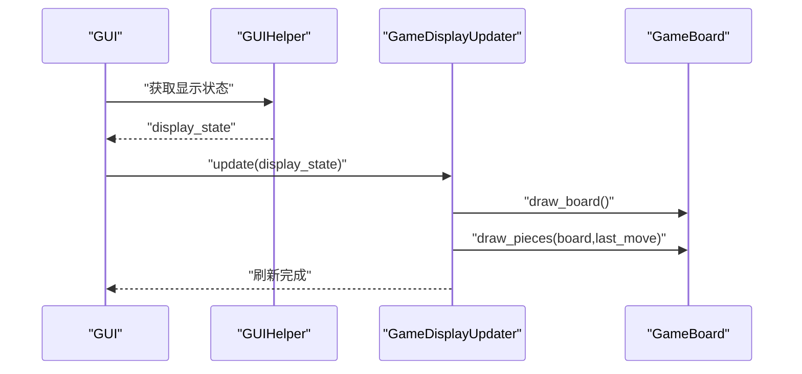
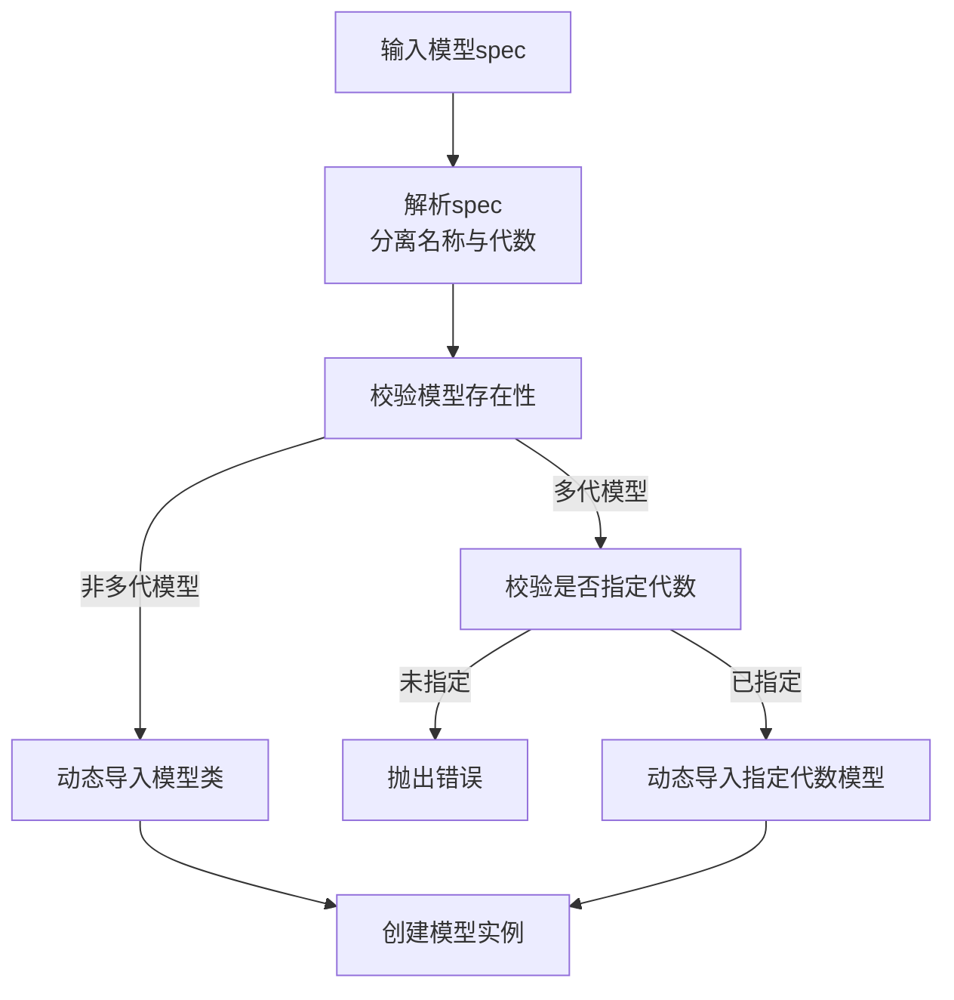
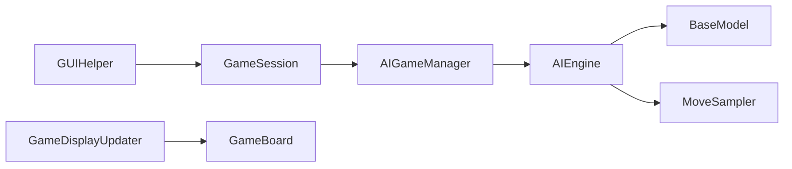

# 设计模式应用

<cite>
**本文引用的文件**
- [ai/registry.py](file://ai/registry.py)
- [ai/engine.py](file://ai/engine.py)
- [ai/move_sampler.py](file://ai/move_sampler.py)
- [ai/base_model.py](file://ai/base_model.py)
- [ai/base_trainer.py](file://ai/base_trainer.py)
- [ai/game_manager.py](file://ai/game_manager.py)
- [gui/display_updater.py](file://gui/display_updater.py)
- [gui/components/game_board.py](file://gui/components/game_board.py)
- [app/session.py](file://app/session.py)
- [app/gui_helper.py](file://app/gui_helper.py)
- [design/engine_move_strategy_design.md](file://design/engine_move_strategy_design.md)
- [design/move_sampler_design.md](file://design/move_sampler_design.md)
- [design/base_trainer_design.md](file://design/base_trainer_design.md)
- [tests/ai/unit/test_registry.py](file://tests/ai/unit/test_registry.py)
</cite>

## 目录
1. [简介](#简介)
2. [项目结构](#项目结构)
3. [核心组件](#核心组件)
4. [架构总览](#架构总览)
5. [详细组件分析](#详细组件分析)
6. [依赖分析](#依赖分析)
7. [性能考量](#性能考量)
8. [故障排查指南](#故障排查指南)
9. [结论](#结论)
10. [附录](#附录)

## 简介
本文件聚焦于五子棋AI项目中设计模式的实际应用与工程化落地，围绕以下模式展开：
- 策略模式：在AI落子策略中的应用（贪心/温度采样）
- 工厂模式：在模型与训练器创建中的应用（懒加载注册表）
- 观察者模式：在GUI更新中的应用（显示状态驱动界面刷新）
- 注册表模式：在模型管理中的应用（统一注册与懒加载）

我们将结合代码路径、类图、时序图与流程图，解释每种模式的实现细节、优缺点、适用场景与最佳实践，并给出常见陷阱与规避方法。

## 项目结构
项目采用“包-模块”分层组织，AI相关逻辑集中在ai包，GUI相关逻辑集中在gui包，应用层在app包。核心AI模块包括引擎、模型基类、训练器基类、注册表、采样器与游戏管理器；GUI模块包括棋盘组件与显示更新器；应用层负责会话与GUI辅助。

**图示来源**
- [app/session.py](file://app/session.py)
- [app/gui_helper.py](file://app/gui_helper.py)
- [ai/registry.py](file://ai/registry.py)
- [ai/engine.py](file://ai/engine.py)
- [ai/game_manager.py](file://ai/game_manager.py)
- [ai/move_sampler.py](file://ai/move_sampler.py)
- [ai/base_model.py](file://ai/base_model.py)
- [ai/base_trainer.py](file://ai/base_trainer.py)
- [gui/display_updater.py](file://gui/display_updater.py)
- [gui/components/game_board.py](file://gui/components/game_board.py)

**章节来源**
- [app/session.py](file://app/session.py)
- [app/gui_helper.py](file://app/gui_helper.py)
- [ai/registry.py](file://ai/registry.py)
- [ai/engine.py](file://ai/engine.py)
- [ai/game_manager.py](file://ai/game_manager.py)
- [ai/move_sampler.py](file://ai/move_sampler.py)
- [ai/base_model.py](file://ai/base_model.py)
- [ai/base_trainer.py](file://ai/base_trainer.py)
- [gui/display_updater.py](file://gui/display_updater.py)
- [gui/components/game_board.py](file://gui/components/game_board.py)

## 核心组件
- 模型注册表（注册表模式）：集中管理模型与训练器映射，支持多代模型与懒加载，提供统一入口。
- AI引擎（策略模式）：封装落子策略（贪心/温度采样），屏蔽模型细节，面向调用方提供稳定接口。
- 温度采样器（策略模式）：独立模块实现温度采样策略，供引擎在采样分支调用。
- 模型基类（工厂/模板方法）：定义统一接口，子类实现具体网络与输入转换，支持多代模型路径。
- 训练器基类（模板方法）：统一训练流程、设备选择、学习率调度与日志记录，子类专注模型特定实现。
- AI游戏管理器（策略编排）：在自对弈/人机对战中编排策略切换（按步/按方/按局）。
- GUI显示更新器（观察者）：接收显示状态字典，刷新棋盘、标签与历史记录。

**章节来源**
- [ai/registry.py](file://ai/registry.py)
- [ai/engine.py](file://ai/engine.py)
- [ai/move_sampler.py](file://ai/move_sampler.py)
- [ai/base_model.py](file://ai/base_model.py)
- [ai/base_trainer.py](file://ai/base_trainer.py)
- [ai/game_manager.py](file://ai/game_manager.py)
- [gui/display_updater.py](file://gui/display_updater.py)

## 架构总览
整体架构遵循“薄应用层、厚AI层、清晰GUI层”的分层思想。应用层仅负责会话与业务编排，AI层负责模型、策略与训练，GUI层负责渲染与交互。策略模式贯穿引擎与采样器，注册表模式贯穿模型与训练器创建，观察者模式贯穿GUI更新。

**图示来源**
- [app/gui_helper.py](file://app/gui_helper.py)
- [app/session.py](file://app/session.py)
- [ai/engine.py](file://ai/engine.py)
- [ai/base_model.py](file://ai/base_model.py)
- [gui/components/game_board.py](file://gui/components/game_board.py)

## 详细组件分析

### 策略模式：AI落子策略（贪心/温度采样）
- 设计要点
  - 引擎提供策略参数，贪心策略默认启用，避免过度随机性；采样策略通过独立模块实现，便于扩展。
  - 温度采样器提供温度、top-k与随机源配置，策略编排在游戏管理器中按步/按方/按局生效。
- 实现细节
  - 引擎接口新增策略参数与温度采样分支，采样分支委托给采样器。
  - 游戏管理器在单局对弈中解析temp_side并在阈值前启用采样，阈值后切换贪心。
- 优缺点
  - 优点：策略解耦、易于扩展与测试；默认贪心提升稳定性；采样策略可参数化。
  - 缺点：策略切换逻辑需在调用方编排，避免在引擎内部引入状态。
- 适用场景
  - 自对弈/样本生成：需要探索多样性时启用采样；评估/PvE：默认贪心。
- 最佳实践
  - 引擎保持单一职责，采样策略独立模块；调用方负责策略编排与参数传递。
- 常见陷阱
  - 在引擎内部维护策略状态；将采样参数硬编码在引擎中；忽略温度阈值与按方生效。

**图示来源**
- [ai/engine.py](file://ai/engine.py)
- [ai/move_sampler.py](file://ai/move_sampler.py)
- [ai/game_manager.py](file://ai/game_manager.py)
- [design/engine_move_strategy_design.md](file://design/engine_move_strategy_design.md)
- [design/move_sampler_design.md](file://design/move_sampler_design.md)

**章节来源**
- [ai/engine.py](file://ai/engine.py)
- [ai/move_sampler.py](file://ai/move_sampler.py)
- [ai/game_manager.py](file://ai/game_manager.py)
- [design/engine_move_strategy_design.md](file://design/engine_move_strategy_design.md)
- [design/move_sampler_design.md](file://design/move_sampler_design.md)

### 工厂模式：模型与训练器创建（懒加载注册表）
- 设计要点
  - 注册表集中维护模型与训练器映射，支持多代模型声明与懒加载，首次调用才动态导入。
  - 提供统一入口：get_model/get_trainer/list_models_with_full_name，屏蔽模块路径细节。
- 实现细节
  - 注册表数据结构包含模型类路径、训练器类路径与多代支持标志；解析spec字符串，校验多代模型代数。
  - 懒加载通过importlib按需导入，避免模块级导入所有模型。
- 优缺点
  - 优点：模块解耦、启动快、扩展简单；支持多代模型路径与版本化。
  - 缺点：注册表维护成本；动态导入的异常处理需细致。
- 适用场景
  - 多模型并存、版本化管理、命令行/配置驱动的模型选择。
- 最佳实践
  - 规范注册表格式；严格校验spec与多代模型；提供完善的错误提示。
- 常见陷阱
  - 模型名称包含非法字符；多代模型未指定代数；训练器缺失路径；懒加载异常未捕获。

**图示来源**
- [ai/registry.py](file://ai/registry.py)
- [ai/base_model.py](file://ai/base_model.py)
- [ai/base_trainer.py](file://ai/base_trainer.py)

**章节来源**
- [ai/registry.py](file://ai/registry.py)
- [ai/base_model.py](file://ai/base_model.py)
- [ai/base_trainer.py](file://ai/base_trainer.py)
- [tests/ai/unit/test_registry.py](file://tests/ai/unit/test_registry.py)

### 观察者模式：GUI更新（显示状态驱动）
- 设计要点
  - GUI显示更新器接收由GUI辅助提供的显示状态字典，驱动棋盘绘制、标签更新与历史记录刷新。
  - GUI辅助负责业务编排，显示更新器仅负责渲染，职责清晰。
- 实现细节
  - 显示状态包含棋盘、当前玩家、赢家、历史记录等；更新器根据状态刷新界面。
  - 棋盘组件负责绘制网格、棋子与最后落子高亮。
- 优缺点
  - 优点：界面与业务解耦；渲染逻辑集中；易于测试。
  - 缺点：状态传递需保持一致性；状态过多时需谨慎设计。
- 适用场景
  - 事件驱动的界面刷新；状态驱动的UI更新。
- 最佳实践
  - 显示状态结构化、稳定化；更新器幂等、可重复调用。
- 常见陷阱
  - 状态字段缺失或类型不匹配；更新器未处理空状态；渲染与业务混杂。

**图示来源**
- [app/gui_helper.py](file://app/gui_helper.py)
- [gui/display_updater.py](file://gui/display_updater.py)
- [gui/components/game_board.py](file://gui/components/game_board.py)

**章节来源**
- [app/gui_helper.py](file://app/gui_helper.py)
- [gui/display_updater.py](file://gui/display_updater.py)
- [gui/components/game_board.py](file://gui/components/game_board.py)

### 注册表模式：模型管理（统一注册与懒加载）
- 设计要点
  - 注册表集中管理模型与训练器映射，支持多代模型与版本化路径；通过spec字符串选择模型与代数。
  - 懒加载避免一次性导入所有模型，降低启动开销。
- 实现细节
  - 注册表条目包含模型类路径、训练器类路径与多代支持标志；解析spec字符串，校验代数。
  - list_models_with_full_name动态扫描多代模型的有效代数，过滤空目录。
- 优缺点
  - 优点：集中管理、扩展方便、启动快；多代模型路径清晰。
  - 缺点：注册表维护成本；多代模型目录结构需规范。
- 适用场景
  - 多模型并存、版本化管理、命令行/配置驱动的模型选择。
- 最佳实践
  - 规范注册表格式；严格校验spec与多代模型；提供完善的错误提示。
- 常见陷阱
  - 模型名称包含非法字符；多代模型未指定代数；训练器缺失路径；懒加载异常未捕获。

**图示来源**
- [ai/registry.py](file://ai/registry.py)

**章节来源**
- [ai/registry.py](file://ai/registry.py)
- [tests/ai/unit/test_registry.py](file://tests/ai/unit/test_registry.py)

## 依赖分析
- 模块耦合
  - 引擎依赖模型基类与采样器；游戏管理器依赖引擎与控制器；应用层依赖会话与GUI辅助；GUI层依赖显示更新器与棋盘组件。
- 关键依赖链
  - app.gui_helper -> app.session -> ai.engine -> ai.base_model
  - ai.game_manager -> ai.engine -> ai.base_model
  - gui.display_updater -> gui.components.game_board
- 外部依赖
  - PyTorch用于神经网络训练与推理；tkinter用于GUI渲染。

**图示来源**
- [app/gui_helper.py](file://app/gui_helper.py)
- [app/session.py](file://app/session.py)
- [ai/game_manager.py](file://ai/game_manager.py)
- [ai/engine.py](file://ai/engine.py)
- [ai/base_model.py](file://ai/base_model.py)
- [ai/move_sampler.py](file://ai/move_sampler.py)
- [gui/display_updater.py](file://gui/display_updater.py)
- [gui/components/game_board.py](file://gui/components/game_board.py)

**章节来源**
- [app/gui_helper.py](file://app/gui_helper.py)
- [app/session.py](file://app/session.py)
- [ai/game_manager.py](file://ai/game_manager.py)
- [ai/engine.py](file://ai/engine.py)
- [ai/base_model.py](file://ai/base_model.py)
- [ai/move_sampler.py](file://ai/move_sampler.py)
- [gui/display_updater.py](file://gui/display_updater.py)
- [gui/components/game_board.py](file://gui/components/game_board.py)

## 性能考量
- 策略模式
  - 贪心策略减少采样开销，适合评估与PvE；采样策略增加计算与随机性，适合自对弈探索。
- 工厂模式
  - 懒加载注册表避免一次性导入所有模型，降低启动时间；动态导入的异常处理需快速失败。
- 观察者模式
  - 显示更新器按需刷新，避免全量重绘；状态字典应尽量紧凑，减少不必要的更新。
- 训练器基类
  - 自动设备检测与GPU加速；学习率调度与日志记录可配置，平衡性能与可观测性。

[本节为通用指导，不直接分析具体文件]

## 故障排查指南
- 策略模式
  - 采样策略未实现：检查引擎采样分支是否抛出未实现异常；确认采样器模块是否正确导入。
  - 温度参数非法：检查温度>0、阈值与按方生效逻辑。
- 工厂模式
  - 未知模型/多代模型未指定代数：查看注册表错误消息；确认spec格式。
  - 懒加载异常：检查模块路径与类名；确保动态导入可用。
- 观察者模式
  - 显示状态字段缺失：核对GUI辅助提供的状态结构；更新器中增加健壮性检查。
- 训练器基类
  - 设备选择与GPU不可用：检查CUDA可用性；回退CPU训练。
  - 学习率调度：确认调度器类型与参数；避免静默失败。

**章节来源**
- [ai/engine.py](file://ai/engine.py)
- [ai/move_sampler.py](file://ai/move_sampler.py)
- [ai/registry.py](file://ai/registry.py)
- [gui/display_updater.py](file://gui/display_updater.py)
- [ai/base_trainer.py](file://ai/base_trainer.py)

## 结论
本项目通过策略模式实现了落子策略的灵活切换与扩展，通过工厂模式与注册表模式实现了模型与训练器的统一管理与懒加载，通过观察者模式实现了GUI的解耦与高效刷新。这些设计模式共同提升了系统的可维护性、扩展性与性能表现。在实践中，应坚持职责单一、参数化配置与清晰的依赖关系，避免在引擎内部引入状态与在GUI中混入业务逻辑。

[本节为总结性内容，不直接分析具体文件]

## 附录
- 设计文档参考
  - 引擎落子策略设计：[design/engine_move_strategy_design.md](file://design/engine_move_strategy_design.md)
  - 温度采样设计：[design/move_sampler_design.md](file://design/move_sampler_design.md)
  - 训练器基类设计：[design/base_trainer_design.md](file://design/base_trainer_design.md)
- 测试参考
  - 注册表单元测试：[tests/ai/unit/test_registry.py](file://tests/ai/unit/test_registry.py)

[本节为补充材料，不直接分析具体文件]