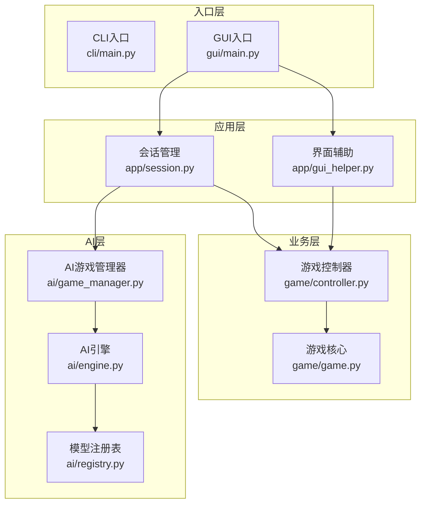
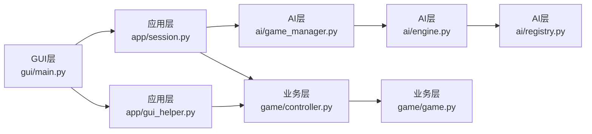
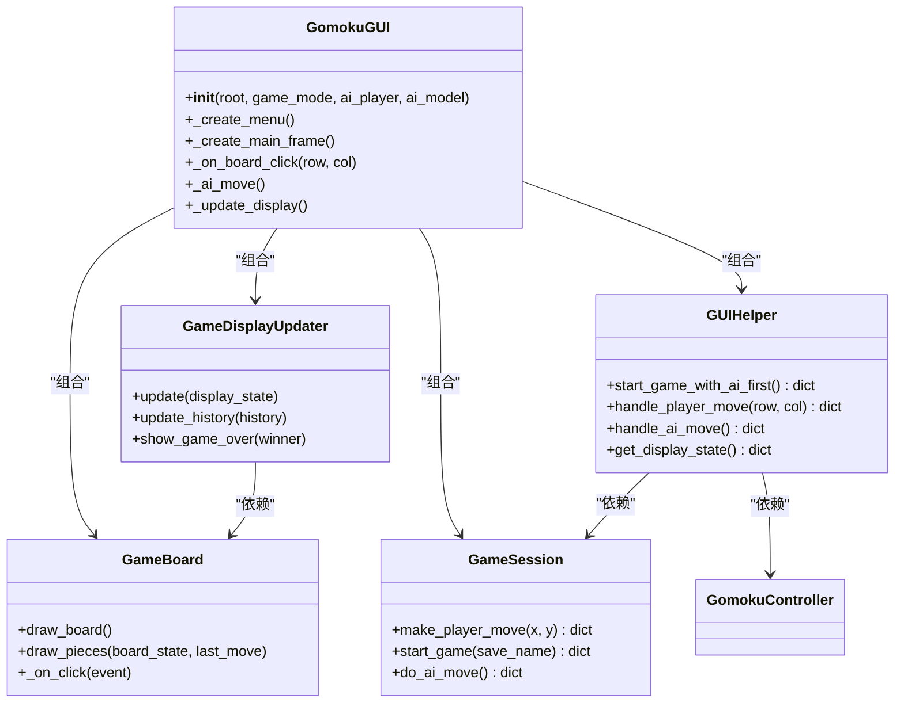
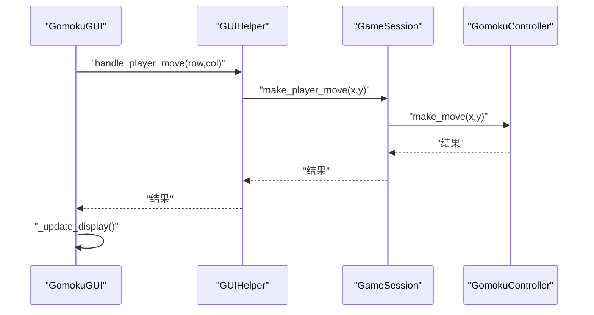
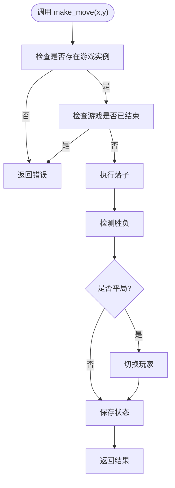
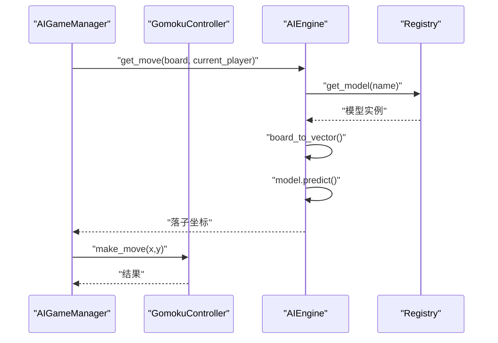
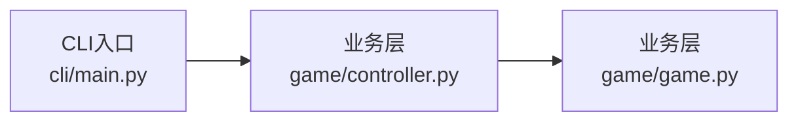
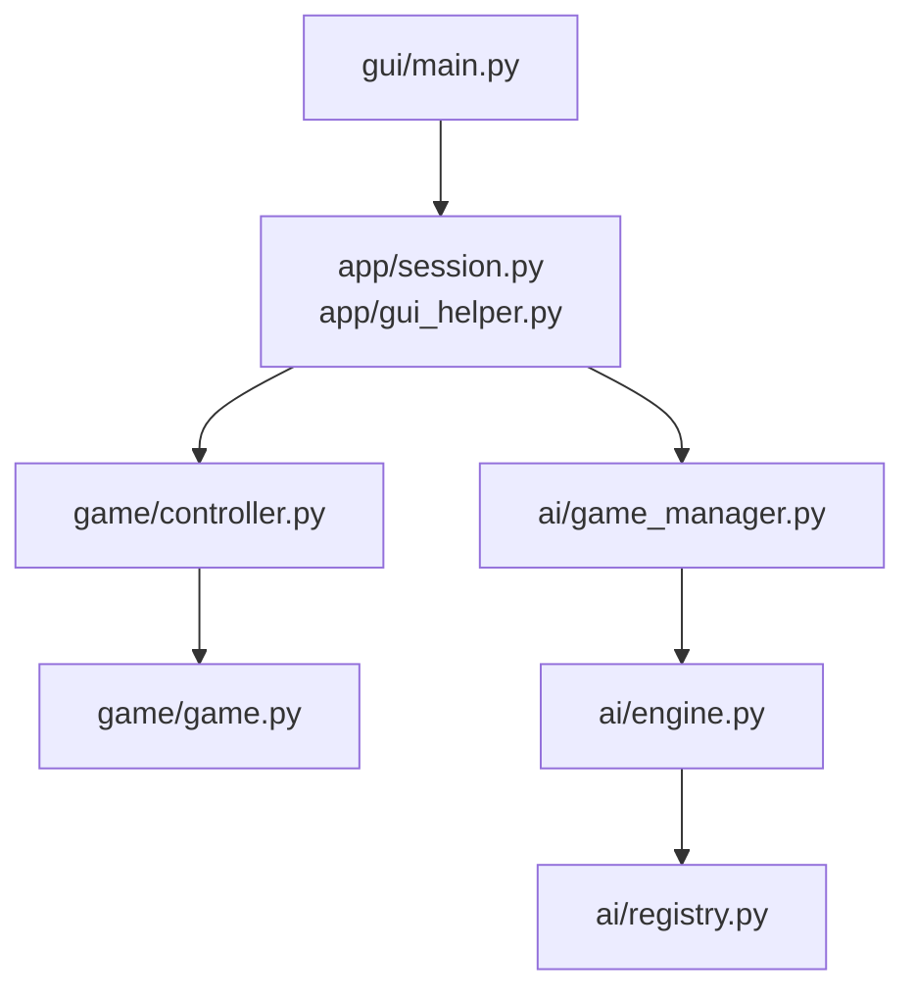

# 项目架构

<cite>
**本文引用的文件**
- [gui/main.py](file://gui/main.py)
- [app/session.py](file://app/session.py)
- [app/gui_helper.py](file://app/gui_helper.py)
- [gui/display_updater.py](file://gui/display_updater.py)
- [gui/components/game_board.py](file://gui/components/game_board.py)
- [game/controller.py](file://game/controller.py)
- [game/game.py](file://game/game.py)
- [ai/engine.py](file://ai/engine.py)
- [ai/registry.py](file://ai/registry.py)
- [ai/game_manager.py](file://ai/game_manager.py)
- [cli/main.py](file://cli/main.py)
- [design/design_specification.md](file://design/design_specification.md)
</cite>

## 目录
1. [简介](#简介)
2. [项目结构](#项目结构)
3. [核心组件](#核心组件)
4. [架构总览](#架构总览)
5. [详细组件分析](#详细组件分析)
6. [依赖分析](#依赖分析)
7. [性能考量](#性能考量)
8. [故障排查指南](#故障排查指南)
9. [结论](#结论)
10. [附录](#附录)

## 简介
本项目是一个五子棋AI系统，包含命令行与图形界面两种交互入口，以及完善的AI训练与对局流水线。本文档聚焦于系统架构，阐述GUI层、应用层、业务逻辑层与数据访问层的职责划分与交互关系，总结模块化设计原则、组件化界面组织、事件处理与状态管理机制，并结合设计文档梳理设计模式的应用与技术决策背景。

## 项目结构
项目采用“入口层—应用层—业务层—数据层”的分层架构：
- 入口层：提供CLI与GUI两种交互入口，分别位于cli与gui目录
- 应用层：薄代理层，协调业务与AI，典型代表为app包
- 业务层：游戏核心逻辑与存档管理，典型代表为game包
- AI层：AI引擎、模型注册与管理、训练流水线等，典型代表为ai包

**图示来源**
- [gui/main.py:1-462](file://gui/main.py#L1-L462)
- [app/session.py:1-179](file://app/session.py#L1-L179)
- [app/gui_helper.py:1-199](file://app/gui_helper.py#L1-L199)
- [game/controller.py:1-194](file://game/controller.py#L1-L194)
- [game/game.py:1-118](file://game/game.py#L1-L118)
- [ai/engine.py:1-194](file://ai/engine.py#L1-L194)
- [ai/registry.py:1-316](file://ai/registry.py#L1-L316)
- [ai/game_manager.py:1-339](file://ai/game_manager.py#L1-L339)

**章节来源**
- [design/design_specification.md:75-111](file://design/design_specification.md#L75-L111)

## 核心组件
- GUI主界面与组件
  - GomokuGUI：主窗口，菜单、棋盘、信息面板、控制按钮、回放浏览
  - GameBoard：棋盘绘制与点击事件绑定
  - GameDisplayUpdater：根据display_state刷新棋盘、标签、历史记录
- 应用层
  - GameSession：会话管理，协调PvP/PvE流程，向GUI提供统一落子接口
  - GUIHelper：处理与界面无关的业务逻辑，封装显示状态与动作
- 业务层
  - GomokuController：唯一对外接口，协调GomokuGame与GomokuSave
  - GomokuGame：棋盘状态、落子、胜负检测
- AI层
  - AIEngine：模型适配与落子策略（argmax/sampling）
  - AIGameManager：PvE与AI内战流程编排
  - Registry：模型注册与懒加载

**章节来源**
- [gui/main.py:31-462](file://gui/main.py#L31-L462)
- [gui/components/game_board.py:1-170](file://gui/components/game_board.py#L1-L170)
- [gui/display_updater.py:1-110](file://gui/display_updater.py#L1-L110)
- [app/session.py:12-179](file://app/session.py#L12-L179)
- [app/gui_helper.py:12-199](file://app/gui_helper.py#L12-L199)
- [game/controller.py:11-194](file://game/controller.py#L11-L194)
- [game/game.py:4-118](file://game/game.py#L4-L118)
- [ai/engine.py:44-194](file://ai/engine.py#L44-L194)
- [ai/game_manager.py:16-339](file://ai/game_manager.py#L16-L339)
- [ai/registry.py:58-184](file://ai/registry.py#L58-L184)

## 架构总览
系统采用清晰的分层与职责分离：
- GUI层：Tkinter组件化，事件驱动，通过GUIHelper与GameSession与业务层交互
- 应用层：GameSession与GUIHelper承担薄代理职责，不包含业务逻辑
- 业务层：GomokuController作为唯一对外接口，封装游戏状态与存档
- AI层：AIEngine与AIGameManager编排AI落子与对局流程，Registry统一模型加载

**图示来源**
- [gui/main.py:18-85](file://gui/main.py#L18-L85)
- [app/session.py:23-51](file://app/session.py#L23-L51)
- [app/gui_helper.py:15-23](file://app/gui_helper.py#L15-L23)
- [game/controller.py:14-30](file://game/controller.py#L14-L30)
- [ai/game_manager.py:27-38](file://ai/game_manager.py#L27-L38)
- [ai/engine.py:58-65](file://ai/engine.py#L58-L65)
- [ai/registry.py:150-184](file://ai/registry.py#L150-L184)
- [game/game.py:7-20](file://game/game.py#L7-L20)

## 详细组件分析

### GUI层组件关系与交互
GUI层采用组件化设计，主界面GomokuGUI组合GameBoard、GameDisplayUpdater、GUIHelper与GameSession，通过事件回调与状态刷新完成交互闭环。

**图示来源**
- [gui/main.py:31-462](file://gui/main.py#L31-L462)
- [gui/components/game_board.py:7-170](file://gui/components/game_board.py#L7-L170)
- [gui/display_updater.py:13-110](file://gui/display_updater.py#L13-L110)
- [app/gui_helper.py:12-199](file://app/gui_helper.py#L12-L199)
- [app/session.py:12-179](file://app/session.py#L12-L179)

**章节来源**
- [gui/main.py:224-285](file://gui/main.py#L224-L285)
- [gui/display_updater.py:40-110](file://gui/display_updater.py#L40-L110)
- [app/gui_helper.py:53-106](file://app/gui_helper.py#L53-L106)
- [app/session.py:63-102](file://app/session.py#L63-L102)

### 应用层：会话与界面辅助
应用层通过GameSession与GUIHelper剥离界面与业务逻辑，实现薄代理与职责清晰：
- GameSession：根据模式（PvP/PvE）协调控制器与AI管理器，返回统一结果
- GUIHelper：封装显示状态、落子与AI落子流程，屏蔽GUI细节

**图示来源**
- [app/gui_helper.py:53-82](file://app/gui_helper.py#L53-L82)
- [app/session.py:63-102](file://app/session.py#L63-L102)
- [game/controller.py:65-97](file://game/controller.py#L65-L97)

**章节来源**
- [app/session.py:63-102](file://app/session.py#L63-L102)
- [app/gui_helper.py:53-106](file://app/gui_helper.py#L53-L106)

### 业务层：控制器与核心逻辑
业务层以GomokuController为唯一对外接口，协调GomokuGame与GomokuSave，提供统一的dict/JSON返回格式，便于上层消费。

**图示来源**
- [game/controller.py:65-97](file://game/controller.py#L65-L97)
- [game/game.py:22-56](file://game/game.py#L22-L56)

**章节来源**
- [game/controller.py:32-174](file://game/controller.py#L32-L174)
- [game/game.py:22-118](file://game/game.py#L22-L118)

### AI层：引擎与注册表
AI层通过AIEngine与Registry实现模型适配与懒加载，AIGameManager编排PvE与AI内战流程。

**图示来源**
- [ai/game_manager.py:100-121](file://ai/game_manager.py#L100-L121)
- [ai/engine.py:67-142](file://ai/engine.py#L67-L142)
- [ai/registry.py:150-184](file://ai/registry.py#L150-L184)

**章节来源**
- [ai/engine.py:18-42](file://ai/engine.py#L18-L42)
- [ai/registry.py:150-184](file://ai/registry.py#L150-L184)
- [ai/game_manager.py:100-121](file://ai/game_manager.py#L100-L121)

### CLI入口对比
CLI入口与GUI入口共享相同的业务层与AI层，体现“薄入口、厚内核”的设计思想。

**图示来源**
- [cli/main.py:19-258](file://cli/main.py#L19-L258)
- [game/controller.py:11-194](file://game/controller.py#L11-L194)
- [game/game.py:4-118](file://game/game.py#L4-L118)

**章节来源**
- [cli/main.py:19-258](file://cli/main.py#L19-L258)

## 依赖分析
- 耦合与内聚
  - GUI层与应用层通过GUIHelper与GameSession松耦合，降低界面与业务逻辑耦合
  - 应用层不包含业务逻辑，内聚于流程编排与状态封装
  - 业务层以GomokuController为核心接口，内聚于游戏状态与存档
  - AI层通过Registry实现模型与训练器的统一注册与懒加载，降低模块间耦合
- 外部依赖
  - GUI层依赖tkinter与项目内组件
  - AI层依赖PyTorch与注册表
  - 业务层依赖标准库与JSON存档

**图示来源**
- [gui/main.py:18-28](file://gui/main.py#L18-L28)
- [app/session.py:7-8](file://app/session.py#L7-L8)
- [ai/engine.py:38-41](file://ai/engine.py#L38-L41)

**章节来源**
- [gui/main.py:18-28](file://gui/main.py#L18-L28)
- [app/session.py:7-8](file://app/session.py#L7-L8)
- [ai/engine.py:38-41](file://ai/engine.py#L38-L41)

## 性能考量
- 落子检测与平局检测
  - 胜利检测以最后落子为中心在4个方向检测，时间复杂度O(1)
  - 平局检测遍历棋盘，时间复杂度O(n²)
- AI落子策略
  - AIEngine支持argmax与temperature sampling两种策略，避免完全确定性导致自对弈路径退化
  - 支持传入预计算的概率向量，减少重复model.predict调用
- 设备选择
  - 训练器自动检测GPU并迁移模型，提升训练效率

**章节来源**
- [game/game.py:67-118](file://game/game.py#L67-L118)
- [ai/engine.py:67-142](file://ai/engine.py#L67-L142)

## 故障排查指南
- 模型加载失败
  - 现象：GUI弹窗提示“模型加载失败”
  - 原因：Registry解析spec失败或非多代模型指定代数
  - 处理：检查模型名称与代数格式，确保多代模型指定合法代数
- 游戏状态异常
  - 现象：落子报错或状态不一致
  - 原因：未创建或加载游戏、游戏已结束、坐标越界或位置被占用
  - 处理：先创建/加载游戏，确认当前玩家与历史记录，检查坐标合法性
- AI对局中断
  - 现象：训练或对局中途被中断
  - 原因：键盘中断或异常
  - 处理：训练器会保存当前进度与图表，可安全退出后继续

**章节来源**
- [app/session.py:44-51](file://app/session.py#L44-L51)
- [game/controller.py:65-97](file://game/controller.py#L65-L97)
- [ai/registry.py:168-179](file://ai/registry.py#L168-L179)

## 结论
本项目通过清晰的分层架构与模块化设计，实现了GUI与CLI双入口、薄应用层与强业务层的平衡。GUI层组件化与事件驱动、应用层会话与辅助、业务层统一接口与存档、AI层注册与引擎，共同构成了可扩展、可维护的五子棋AI系统。设计模式方面，注册表体现了工厂与懒加载思想，策略模式体现在AI落子策略选择，观察者思想体现在状态变更与UI刷新的解耦。

## 附录
- 设计模式应用
  - 工厂模式：Registry统一模型与训练器创建，支持多代模型指定
  - 策略模式：AIEngine支持argmax与sampling两种落子策略
  - 观察者模式：GUI通过GameDisplayUpdater监听状态变化并刷新界面
- 技术决策背景
  - 采用tkinter实现GUI，降低依赖与部署复杂度
  - 业务层以dict/JSON统一返回，便于CLI与GUI复用
  - AI层统一注册与懒加载，便于扩展新模型与训练器

**章节来源**
- [ai/registry.py:58-184](file://ai/registry.py#L58-L184)
- [ai/engine.py:12-16](file://ai/engine.py#L12-L16)
- [gui/display_updater.py:13-110](file://gui/display_updater.py#L13-L110)