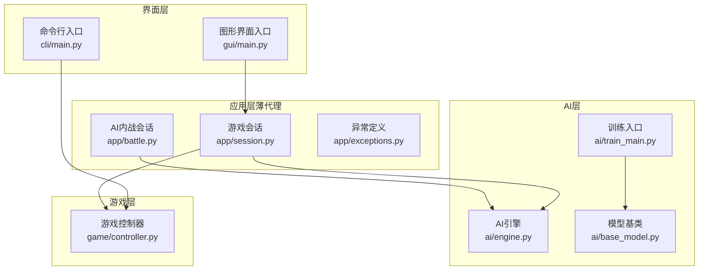
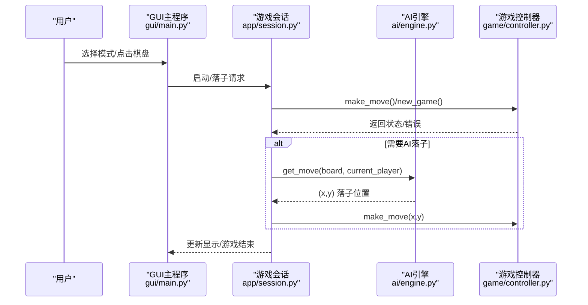
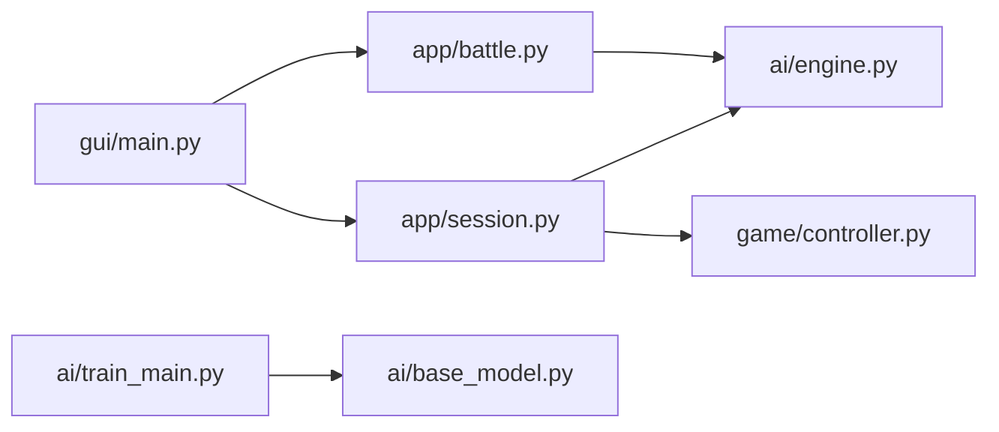

# 快速开始

<cite>
**本文引用的文件**   
- [requirements/key_points.md](file://requirements/key_points.md)
- [cli/main.py](file://cli/main.py)
- [gui/main.py](file://gui/main.py)
- [app/session.py](file://app/session.py)
- [app/battle.py](file://app/battle.py)
- [ai/engine.py](file://ai/engine.py)
- [ai/train_main.py](file://ai/train_main.py)
- [ai/base_model.py](file://ai/base_model.py)
- [design/design_specification.md](file://design/design_specification.md)
- [app/exceptions.py](file://app/exceptions.py)
</cite>

## 目录
1. [简介](#简介)
2. [项目结构](#项目结构)
3. [核心组件](#核心组件)
4. [架构总览](#架构总览)
5. [详细组件分析](#详细组件分析)
6. [依赖关系分析](#依赖关系分析)
7. [性能注意事项](#性能注意事项)
8. [故障排除指南](#故障排除指南)
9. [结论](#结论)
10. [附录](#附录)

## 简介
本指南面向首次接触五子棋AI项目的用户，帮助你在最短时间内完成环境准备、安装与启动，体验GUI图形界面、命令行界面与AI对战的核心功能。项目支持：
- 图形界面（GUI）：推荐方式，交互友好，支持人机对战与AI内战回放
- 命令行界面（CLI）：适合快速操作与自动化
- AI对战：支持AI vs AI，自动记录对局并生成训练样本

## 项目结构
项目采用清晰的分层结构：
- game：游戏核心逻辑与存档
- cli：命令行交互入口
- gui：图形界面入口与组件
- app：薄代理层，协调GUI与AI/游戏逻辑
- ai：AI引擎、模型、训练与评估工具
- design：设计文档与规范
- tests：测试用例
- requirements：关键设计要点与使用说明

**图示来源**
- [gui/main.py:398-462](file://gui/main.py#L398-L462)
- [cli/main.py:19-258](file://cli/main.py#L19-L258)
- [app/session.py:12-179](file://app/session.py#L12-L179)
- [app/battle.py:15-104](file://app/battle.py#L15-L104)
- [ai/engine.py:44-194](file://ai/engine.py#L44-L194)
- [ai/train_main.py:27-234](file://ai/train_main.py#L27-L234)
- [ai/base_model.py:24-323](file://ai/base_model.py#L24-L323)

**章节来源**
- [design/design_specification.md:75-111](file://design/design_specification.md#L75-L111)

## 核心组件
- 游戏控制器（GomokuController）：提供统一的对外接口，负责落子、读档、写档与状态查询
- AI引擎（AIEngine）：将棋盘状态转换为模型输入，调用模型输出概率分布，并按策略选择落子
- 训练入口（ai/train_main.py）：支持多模型训练，提供周期训练与从目录训练两种模式
- GUI主程序（gui/main.py）：提供模式选择、棋盘交互、回放浏览与AI内战配置
- CLI主程序（cli/main.py）：提供REPL交互式命令行，支持新建、落子、查看存档等

**章节来源**
- [app/session.py:12-179](file://app/session.py#L12-L179)
- [ai/engine.py:44-194](file://ai/engine.py#L44-L194)
- [ai/train_main.py:27-234](file://ai/train_main.py#L27-L234)
- [gui/main.py:398-462](file://gui/main.py#L398-L462)
- [cli/main.py:19-258](file://cli/main.py#L19-L258)

## 架构总览
下图展示从用户操作到AI决策与落子的端到端流程。

**图示来源**
- [gui/main.py:224-268](file://gui/main.py#L224-L268)
- [app/session.py:63-102](file://app/session.py#L63-L102)
- [ai/engine.py:67-142](file://ai/engine.py#L67-L142)
- [game/controller.py:65-97](file://game/controller.py#L65-L97)

## 详细组件分析

### 环境与依赖
- Python 版本要求：Python 3.8及以上（推荐使用最新稳定版本）
- 核心依赖：
  - PyTorch：用于神经网络模型推理与训练（ai/base_model.py、ai/train_main.py等模块使用torch）
  - tkinter：GUI界面基础（gui/main.py导入tkinter）
  - matplotlib（可选）：用于可视化（ai/loss_logger.py、ai/sample_visualizer.py等模块导入matplotlib）
- 项目内核：无额外第三方依赖，核心逻辑基于标准库

**章节来源**
- [ai/base_model.py:19-21](file://ai/base_model.py#L19-L21)
- [gui/main.py:15-27](file://gui/main.py#L15-L27)
- [ai/train_main.py:16-24](file://ai/train_main.py#L16-L24)

### 安装与启动指南

#### 1) 创建虚拟环境（推荐）
- Linux/macOS:
  - python3.8 -m venv venv
  - source venv/bin/activate
- Windows:
  - py -3.8 -m venv venv
  - venv\Scripts\Activate.ps1

#### 2) 安装PyTorch
- CPU版本（推荐入门）：
  - pip install torch torchvision
- GPU版本（CUDA 11.8+）：
  - 访问 https://pytorch.org/get-started/locally/，按指引安装对应CUDA版本
- 验证安装：
  - python -c "import torch; print(torch.__version__); print('CUDA可用:', torch.cuda.is_available())"

#### 3) 安装可选依赖（可视化）
- pip install matplotlib
- 若matplotlib报错，请先安装系统图形库（Linux参考apt/yum，Windows可忽略）

#### 4) 启动方式一：图形界面（GUI，推荐）
- 运行：
  - python gui/main.py
- 功能：
  - 选择模式（PvP/PvE/AI vs AI）
  - 人机对战（可选AI模型）
  - AI内战（可配置双方AI与对局数）
  - 回放浏览与回放窗口

**章节来源**
- [gui/main.py:398-462](file://gui/main.py#L398-L462)

#### 5) 启动方式二：命令行界面（CLI）
- 运行：
  - python cli/main.py
- 常用命令：
  - new [存档名称]：新建游戏
  - put x y：在当前存档落子
  - list/show/short：查看存档
  - help/quit/exit：帮助与退出

**章节来源**
- [cli/main.py:19-258](file://cli/main.py#L19-L258)
- [design/design_specification.md:619-799](file://design/design_specification.md#L619-L799)

#### 6) 启动方式三：AI对战（AI vs AI）
- GUI内战：
  - 在GUI中选择“AI vs AI”，设置双方AI与对局数，点击开始
  - 对战完成后可选择回放
- 命令行内战：
  - 通过app/battle.py封装的流程实现，GUI内部调用run_ai_vs_ai_mode

**章节来源**
- [gui/main.py:412-420](file://gui/main.py#L412-L420)
- [app/battle.py:52-92](file://app/battle.py#L52-L92)

### 基本使用示例

#### 示例一：简单AI对战
- GUI内战：
  - 打开 gui/main.py，选择“AI vs AI”
  - 设置黑方/白方AI（如random），对局数≥1
  - 点击开始，等待完成，可选择回放
- 命令行内战：
  - 通过GUI界面完成相同流程

**章节来源**
- [gui/main.py:412-420](file://gui/main.py#L412-L420)
- [app/battle.py:52-92](file://app/battle.py#L52-L92)

#### 示例二：训练示例（监督学习）
- 使用训练入口脚本：
  - python ai/train_main.py --model fc_v1 --cycle --rounds 10 --games 100
  - 或从已有数据目录训练：
    - python ai/train_main.py --model fc_v1 --train-from-dir ai/train_data/some_round --epochs 1000
- 参数说明（节选）：
  - --model：模型名称（如fc_v1、cnn_v3.2）
  - --cycle：开启训练周期模式
  - --rounds/--games：周期参数（轮次数/每轮对局数）
  - --train-from-dir：从数据目录训练
  - --epochs：训练轮数
  - --batch-size/--shuffle/--val-ratio：训练细节
  - --lr-scheduler/--lr-step-size/--lr-gamma/--lr-patience/--lr-factor：学习率调度

**章节来源**
- [ai/train_main.py:27-234](file://ai/train_main.py#L27-L234)

### 从零到一：完整安装与启动流程
- 步骤概览：
  1) 创建并激活虚拟环境
  2) 安装PyTorch（CPU/GPU二选一）
  3) 可选：安装matplotlib
  4) 运行 python gui/main.py 启动GUI
  5) 在GUI中选择模式并开始游戏/对战
  6) 如需命令行，运行 python cli/main.py

**章节来源**
- [gui/main.py:398-462](file://gui/main.py#L398-L462)
- [cli/main.py:19-258](file://cli/main.py#L19-L258)
- [ai/train_main.py:27-234](file://ai/train_main.py#L27-L234)

## 依赖关系分析

**图示来源**
- [gui/main.py:18-28](file://gui/main.py#L18-L28)
- [app/session.py:7-9](file://app/session.py#L7-L9)
- [app/battle.py:10-12](file://app/battle.py#L10-L12)
- [ai/engine.py:9](file://ai/engine.py#L9)
- [ai/train_main.py:23-24](file://ai/train_main.py#L23-L24)
- [ai/base_model.py:19-21](file://ai/base_model.py#L19-L21)

**章节来源**
- [gui/main.py:18-28](file://gui/main.py#L18-L28)
- [app/session.py:7-9](file://app/session.py#L7-L9)
- [app/battle.py:10-12](file://app/battle.py#L10-L12)
- [ai/engine.py:9](file://ai/engine.py#L9)
- [ai/train_main.py:23-24](file://ai/train_main.py#L23-L24)
- [ai/base_model.py:19-21](file://ai/base_model.py#L19-L21)

## 性能注意事项
- 训练周期与批量训练：合理设置 --rounds、--games、--batch-size，平衡速度与稳定性
- 学习率调度：可选 step/plateau，有助于收敛与泛化
- 温度采样：在周期训练中可启用温度采样，提升探索多样性
- 可视化开销：matplotlib在GUI中用于热力图等，首次渲染可能较慢，后续可缓存

[本节为通用建议，无需特定文件引用]

## 故障排除指南

- 问题：GUI启动后无法加载AI模型
  - 现象：弹出“模型加载失败”提示
  - 原因：模型名称错误或多代模型未指定代数
  - 处理：检查模型名称（如fc_v1、cnn_v3.2），或在多代模型中指定gen（如cnn_v3.2）
  - 参考：app/exceptions.py定义的ModelLoadError

- 问题：命令行无法识别模型
  - 现象：ai/train_main.py报错“未知模型”
  - 处理：确认--model参数正确；如为多代模型，确保包含代数（如cnn_v3.2）

- 问题：matplotlib相关报错
  - 现象：GUI或可视化模块导入matplotlib失败
  - 处理：安装matplotlib；若tkinter初始化冲突，先设置matplotlib后端

- 问题：PyTorch版本不兼容
  - 现象：torch导入失败或CUDA相关错误
  - 处理：根据官网选择匹配CUDA版本的torch；确认torch.__version__与CUDA匹配

- 问题：GUI界面空白或无响应
  - 现象：窗口创建但无内容
  - 处理：确保tkinter可用；关闭其他占用窗口；重启程序

**章节来源**
- [app/exceptions.py:8-25](file://app/exceptions.py#L8-L25)
- [ai/train_main.py:220-224](file://ai/train_main.py#L220-L224)
- [ai/base_model.py:162-164](file://ai/base_model.py#L162-L164)

## 结论
通过本指南，你可以在本地快速搭建五子棋AI项目环境，掌握GUI、CLI与AI对战三种启动方式，并完成基本的AI训练示例。建议优先使用GUI体验交互乐趣，随后逐步探索CLI与训练脚本，深入理解AI引擎与模型训练流程。

[本节为总结，无需特定文件引用]

## 附录

### 常用命令速查
- 启动GUI：python gui/main.py
- 启动CLI：python cli/main.py
- AI内战（GUI）：在GUI中选择“AI vs AI”，设置参数后开始
- 训练（监督）：python ai/train_main.py --model fc_v1 --train-from-dir ai/train_data/some_round --epochs 1000
- 训练周期：python ai/train_main.py --model cnn_v3.2 --cycle --rounds 10 --games 100

**章节来源**
- [gui/main.py:398-462](file://gui/main.py#L398-L462)
- [cli/main.py:19-258](file://cli/main.py#L19-L258)
- [ai/train_main.py:27-234](file://ai/train_main.py#L27-L234)