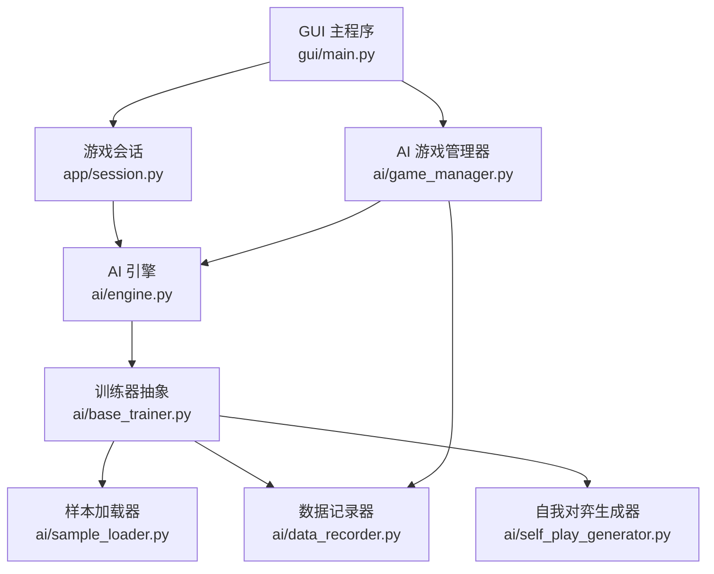
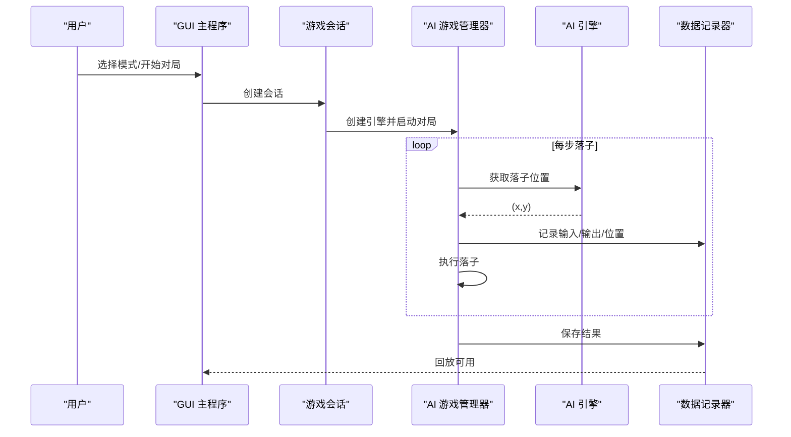
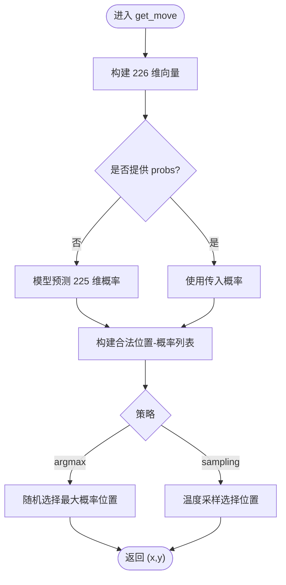
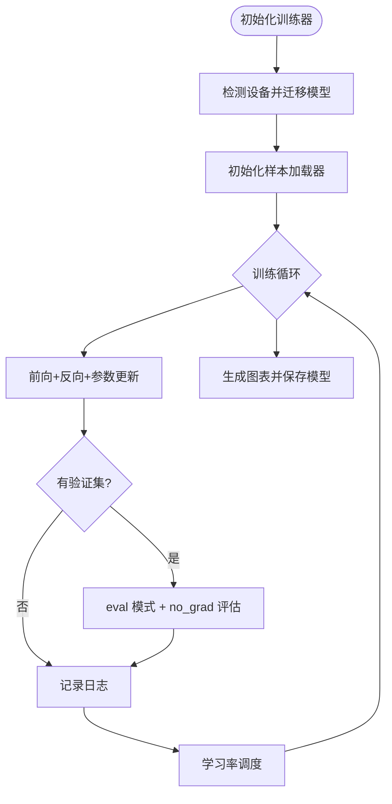
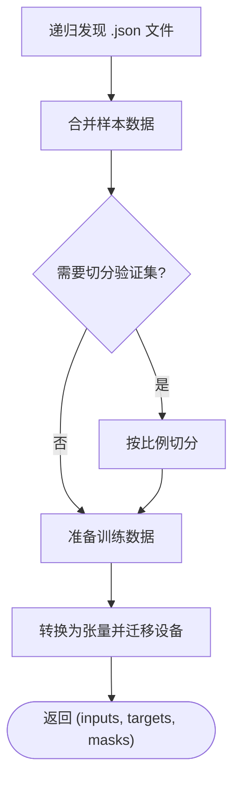
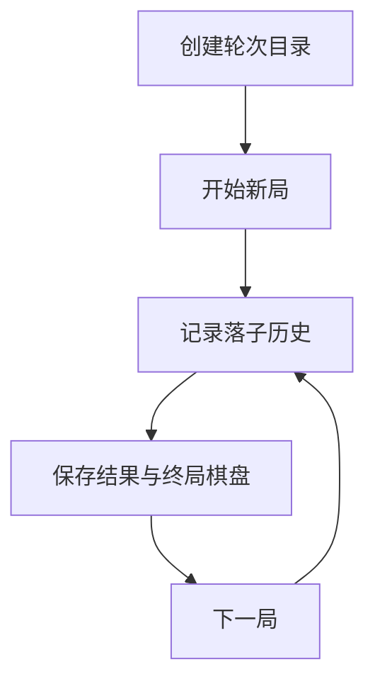
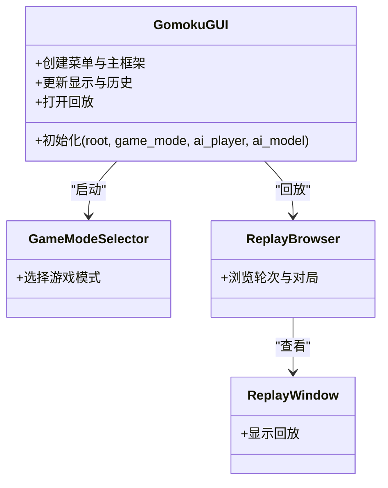
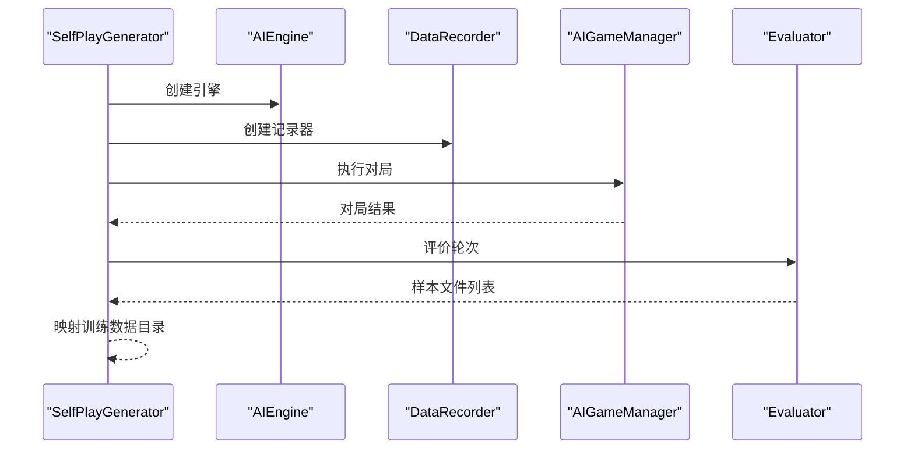
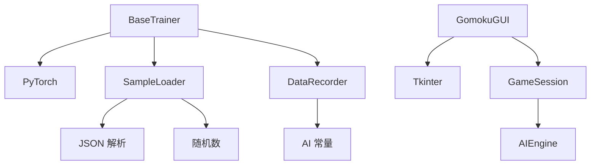

# 内存问题排查

<cite>
**本文档引用的文件**
- [ai/engine.py](file://ai/engine.py)
- [ai/base_trainer.py](file://ai/base_trainer.py)
- [ai/sample_loader.py](file://ai/sample_loader.py)
- [ai/data_recorder.py](file://ai/data_recorder.py)
- [ai/game_manager.py](file://ai/game_manager.py)
- [ai/self_play_generator.py](file://ai/self_play_generator.py)
- [ai/constants.py](file://ai/constants.py)
- [gui/main.py](file://gui/main.py)
- [app/session.py](file://app/session.py)
- [ai/keep_gpu_alive.py](file://ai/keep_gpu_alive.py)
- [temp/check_gpu.py](file://temp/check_gpu.py)
- [design/base_trainer_design.md](file://design/base_trainer_design.md)
- [design/gui_design.md](file://design/gui_design.md)
</cite>

## 目录
1. [简介](#简介)
2. [项目结构](#项目结构)
3. [核心组件](#核心组件)
4. [架构总览](#架构总览)
5. [详细组件分析](#详细组件分析)
6. [依赖分析](#依赖分析)
7. [性能考量](#性能考量)
8. [故障排查指南](#故障排查指南)
9. [结论](#结论)
10. [附录](#附录)

## 简介
本指南聚焦于五子棋AI项目的内存问题排查与优化，涵盖内存泄漏、内存不足、内存碎片化等常见问题的识别与解决方法。内容基于仓库现有代码结构，结合训练器、数据加载、AI引擎、GUI界面与回放模块，提供可操作的监控手段、检测技术、优化策略与最佳实践。

## 项目结构
项目采用分层架构：
- GUI层：Tkinter界面，负责用户交互与展示（棋盘、回放、模式选择等）
- 应用层：会话与控制器，协调游戏流程与AI对战
- AI层：引擎、训练器、数据记录、样本生成与评估
- 设计文档：提供训练流程、GUI组件与内存相关约束说明

**图表来源**
- [gui/main.py:398-462](file://gui/main.py#L398-L462)
- [app/session.py:12-179](file://app/session.py#L12-L179)
- [ai/engine.py:44-194](file://ai/engine.py#L44-L194)
- [ai/base_trainer.py:32-699](file://ai/base_trainer.py#L32-L699)
- [ai/sample_loader.py:67-240](file://ai/sample_loader.py#L67-L240)
- [ai/data_recorder.py:17-145](file://ai/data_recorder.py#L17-L145)
- [ai/self_play_generator.py:21-244](file://ai/self_play_generator.py#L21-L244)
- [ai/game_manager.py:16-339](file://ai/game_manager.py#L16-L339)

**章节来源**
- [gui/main.py:1-462](file://gui/main.py#L1-L462)
- [app/session.py:1-179](file://app/session.py#L1-L179)
- [ai/engine.py:1-194](file://ai/engine.py#L1-L194)
- [ai/base_trainer.py:1-699](file://ai/base_trainer.py#L1-L699)
- [ai/sample_loader.py:1-240](file://ai/sample_loader.py#L1-L240)
- [ai/data_recorder.py:1-145](file://ai/data_recorder.py#L1-L145)
- [ai/self_play_generator.py:1-244](file://ai/self_play_generator.py#L1-L244)
- [ai/game_manager.py:1-339](file://ai/game_manager.py#L1-L339)

## 核心组件
- AI引擎：负责将棋盘状态转换为向量并调用模型预测，支持预计算概率以减少重复调用
- 训练器抽象：统一设备选择（GPU/CPU）、损失计算、学习率调度、训练循环与保存
- 样本加载器：从JSON加载样本，合并与切分，转换为张量并迁移至设备
- 数据记录器：记录对局历史、落子位置与最终结果，生成紧凑JSON
- AI游戏管理器：封装人机对战与AI内战流程，支持温度采样与跨局进度回调
- 自我对弈生成器：执行自我对弈并生成训练样本，支持中断优雅处理
- GUI主程序：模式选择、主界面、回放浏览与查看器
- 会话：协调游戏模式与AI引擎创建，提供统一落子接口

**章节来源**
- [ai/engine.py:44-194](file://ai/engine.py#L44-L194)
- [ai/base_trainer.py:32-699](file://ai/base_trainer.py#L32-L699)
- [ai/sample_loader.py:67-240](file://ai/sample_loader.py#L67-L240)
- [ai/data_recorder.py:17-145](file://ai/data_recorder.py#L17-L145)
- [ai/game_manager.py:16-339](file://ai/game_manager.py#L16-L339)
- [ai/self_play_generator.py:21-244](file://ai/self_play_generator.py#L21-L244)
- [gui/main.py:31-462](file://gui/main.py#L31-L462)
- [app/session.py:12-179](file://app/session.py#L12-L179)

## 架构总览
训练与对弈流程涉及数据生成、样本生成、训练与回放，关键节点包括：
- 自我对弈：引擎生成落子，记录器保存每步数据
- 评价器：将对局数据转换为训练样本
- 训练器：加载样本、准备张量、前向/反向传播、日志与保存
- GUI：回放浏览与查看器展示热力图与历史记录

**图表来源**
- [gui/main.py:398-462](file://gui/main.py#L398-L462)
- [app/session.py:12-179](file://app/session.py#L12-L179)
- [ai/game_manager.py:100-231](file://ai/game_manager.py#L100-L231)
- [ai/engine.py:67-142](file://ai/engine.py#L67-L142)
- [ai/data_recorder.py:66-141](file://ai/data_recorder.py#L66-L141)

## 详细组件分析

### AI引擎内存特性与优化
- 输入向量构造：将15×15棋盘与当前玩家拼接为226维向量，内存占用与棋盘规模线性相关
- 概率缓存：支持传入预计算的概率向量，避免重复模型调用
- 策略选择：argmax与温度采样两种策略，采样策略引入随机源但不持有长期状态

**图表来源**
- [ai/engine.py:67-142](file://ai/engine.py#L67-L142)
- [ai/engine.py:173-194](file://ai/engine.py#L173-L194)

**章节来源**
- [ai/engine.py:44-194](file://ai/engine.py#L44-L194)

### 训练器内存特性与优化
- 设备选择：自动检测CUDA可用性，优先使用GPU
- 张量准备：将输入、目标与mask转换为张量并迁移到设备
- 训练循环：使用no_grad评估验证集，减少显存占用
- 日志与保存：定期flush日志，训练结束保存模型

**图表来源**
- [ai/base_trainer.py:21-120](file://ai/base_trainer.py#L21-L120)
- [ai/base_trainer.py:214-238](file://ai/base_trainer.py#L214-L238)
- [ai/base_trainer.py:257-322](file://ai/base_trainer.py#L257-L322)

**章节来源**
- [ai/base_trainer.py:32-699](file://ai/base_trainer.py#L32-L699)

### 样本加载器内存特性与优化
- 递归发现：遍历目录收集JSON文件，避免一次性加载全部数据
- 合并与切分：支持按比例切分训练/验证集，保证可复现
- 张量转换：将输入、目标与mask转换为张量并迁移到设备
- 紧凑格式：记录器保存时去除缩进，降低文件体积

**图表来源**
- [ai/sample_loader.py:36-64](file://ai/sample_loader.py#L36-L64)
- [ai/sample_loader.py:116-165](file://ai/sample_loader.py#L116-L165)
- [ai/sample_loader.py:206-240](file://ai/sample_loader.py#L206-L240)

**章节来源**
- [ai/sample_loader.py:67-240](file://ai/sample_loader.py#L67-L240)

### 数据记录器内存特性与优化
- 轮次目录：按AI名称与递增编号创建轮次目录，避免同名冲突
- 局内数据：每步落子追加到历史列表，结束时统一保存
- 紧凑JSON：关闭缩进，减少文件大小

**图表来源**
- [ai/data_recorder.py:43-80](file://ai/data_recorder.py#L43-L80)
- [ai/data_recorder.py:96-141](file://ai/data_recorder.py#L96-L141)

**章节来源**
- [ai/data_recorder.py:17-145](file://ai/data_recorder.py#L17-L145)

### GUI界面内存特性与优化
- 组件化设计：棋盘、热力图、回放浏览器等组件职责清晰，便于资源回收
- 回放查看器：嵌入式显示，减少额外窗口资源占用
- 模式选择器：独立窗口，退出后销毁

**图表来源**
- [gui/main.py:31-462](file://gui/main.py#L31-L462)
- [design/gui_design.md:86-512](file://design/gui_design.md#L86-L512)

**章节来源**
- [gui/main.py:1-462](file://gui/main.py#L1-L462)
- [design/gui_design.md:1-512](file://design/gui_design.md#L1-L512)

### 自我对弈生成器内存特性与优化
- 生成流程：自我对弈→评价→生成样本→映射训练数据目录
- 中断处理：捕获Ctrl+C，优雅返回已生成数据
- 并行评价：支持多进程并行，提升吞吐

**图表来源**
- [ai/self_play_generator.py:21-167](file://ai/self_play_generator.py#L21-L167)
- [ai/game_manager.py:233-339](file://ai/game_manager.py#L233-L339)

**章节来源**
- [ai/self_play_generator.py:170-244](file://ai/self_play_generator.py#L170-L244)
- [ai/game_manager.py:16-339](file://ai/game_manager.py#L16-L339)

## 依赖分析
- 训练器依赖PyTorch设备与优化器，自动检测CUDA并迁移模型
- 样本加载器依赖JSON解析与随机数，提供可复现切分
- 数据记录器依赖AI数据目录常量，确保路径一致性
- GUI依赖Tkinter组件，组件间通过回调与事件通信
- 会话依赖AI引擎创建与游戏控制器，协调PvE流程

**图表来源**
- [ai/base_trainer.py:10-18](file://ai/base_trainer.py#L10-L18)
- [ai/sample_loader.py:6-12](file://ai/sample_loader.py#L6-L12)
- [ai/data_recorder.py:12-14](file://ai/data_recorder.py#L12-L14)
- [gui/main.py:15-28](file://gui/main.py#L15-L28)
- [app/session.py:7-9](file://app/session.py#L7-L9)

**章节来源**
- [ai/base_trainer.py:1-699](file://ai/base_trainer.py#L1-L699)
- [ai/sample_loader.py:1-240](file://ai/sample_loader.py#L1-L240)
- [ai/data_recorder.py:1-145](file://ai/data_recorder.py#L1-L145)
- [gui/main.py:1-462](file://gui/main.py#L1-L462)
- [app/session.py:1-179](file://app/session.py#L1-L179)

## 性能考量
- GPU优先：训练器自动检测CUDA并迁移模型，显著降低训练时间
- no_grad评估：验证集评估使用eval模式与no_grad，减少显存占用
- 张量缓冲：mini-batch模式下使用GPU张量缓冲区，减少CPU-GPU同步开销
- 紧凑存储：记录器保存JSON时不使用缩进，降低磁盘IO与存储压力
- 设备选择：GUI与训练器共享设备检测逻辑，避免重复初始化

[本节为通用指导，无需引用具体文件]

## 故障排查指南

### 1. 识别内存泄漏
- 现象：长时间运行后内存持续增长，最终触发系统OOM
- 检查点：
  - 训练循环中是否存在未释放的中间张量（确认使用no_grad评估验证集）
  - 样本加载器是否正确关闭文件句柄（JSON读取为一次性加载）
  - GUI组件是否及时销毁不再使用的窗口与画布
  - 训练器保存模型前后是否清理日志缓冲

**章节来源**
- [ai/base_trainer.py:214-238](file://ai/base_trainer.py#L214-L238)
- [ai/sample_loader.py:93-94](file://ai/sample_loader.py#L93-L94)
- [gui/main.py:398-462](file://gui/main.py#L398-L462)

### 2. 诊断内存不足（OOM）
- 现象：训练或对弈时出现显存不足错误
- 诊断步骤：
  - 检查GPU可用性与驱动版本
  - 降低mini-batch大小或减少每轮样本数
  - 确认验证集评估使用no_grad，避免额外显存占用
  - 检查是否在GPU上累积过多中间张量

**章节来源**
- [temp/check_gpu.py:1-12](file://temp/check_gpu.py#L1-L12)
- [ai/base_trainer.py:214-238](file://ai/base_trainer.py#L214-L238)
- [ai/base_trainer.py:409-573](file://ai/base_trainer.py#L409-L573)

### 3. 诊断内存碎片化
- 现象：内存占用稳定但频繁分配/释放导致碎片增多
- 优化建议：
  - 复用张量与缓冲区（如mini-batch中的缓冲区）
  - 避免在热路径上频繁创建/销毁大型对象
  - 使用eval模式与no_grad减少临时梯度张量

**章节来源**
- [ai/base_trainer.py:478-534](file://ai/base_trainer.py#L478-L534)
- [ai/base_trainer.py:233-238](file://ai/base_trainer.py#L233-L238)

### 4. 监控与工具
- Python内存分析器：使用memory_profiler或tracemalloc定位热点
- GPU内存监控：nvidia-smi实时查看显存占用
- 训练日志：LossLogger记录训练过程，便于观察异常波动
- 设备检测：通过脚本检查CUDA可用性与GPU名称

**章节来源**
- [temp/check_gpu.py:1-12](file://temp/check_gpu.py#L1-L12)
- [ai/base_trainer.py:199-213](file://ai/base_trainer.py#L199-L213)

### 5. 常见场景与对策
- 大量样本数据处理：
  - 使用样本加载器的递归发现与合并功能，避免一次性加载全部数据
  - 切分训练/验证集时使用固定随机种子，保证可复现
- 模型训练过程：
  - 使用no_grad评估验证集，减少显存占用
  - 合理设置mini-batch大小，平衡吞吐与显存
- GUI界面内存管理：
  - 模式选择器与回放窗口为独立窗口，退出后销毁
  - 回放查看器嵌入式显示，减少额外窗口资源

**章节来源**
- [ai/sample_loader.py:116-165](file://ai/sample_loader.py#L116-L165)
- [ai/base_trainer.py:214-238](file://ai/base_trainer.py#L214-L238)
- [gui/main.py:398-462](file://gui/main.py#L398-L462)

### 6. 优化策略与代码改进建议
- 数据结构优化：
  - 使用列表推导替代逐条append，减少Python解释器开销
  - 在热路径上复用张量缓冲区，避免频繁分配
- 资源释放时机：
  - 训练结束统一flush日志并保存模型
  - 回放窗口关闭后释放相关资源
- 缓存管理：
  - 支持传入预计算概率，避免重复模型调用
  - 记录器保存时使用紧凑JSON，减少磁盘IO

**章节来源**
- [ai/sample_loader.py:215-218](file://ai/sample_loader.py#L215-L218)
- [ai/engine.py:111-113](file://ai/engine.py#L111-L113)
- [ai/data_recorder.py:137-140](file://ai/data_recorder.py#L137-L140)

### 7. 预防措施与最佳实践
- 设备检测与迁移：在初始化阶段统一检测并迁移模型到GPU
- 日志与保存：定期flush日志，训练中断时保存当前进度
- 目录与路径：使用常量定义AI数据与训练数据目录，避免路径拼接错误
- 可复现性：切分数据时使用固定随机种子，保证实验可复现

**章节来源**
- [ai/base_trainer.py:77-87](file://ai/base_trainer.py#L77-L87)
- [ai/base_trainer.py:199-213](file://ai/base_trainer.py#L199-L213)
- [ai/constants.py:11-26](file://ai/constants.py#L11-L26)

## 结论
通过设备自动检测、no_grad评估、mini-batch缓冲与紧凑存储等策略，项目在训练与对弈场景中具备良好的内存管理能力。结合本指南提供的监控与优化建议，可有效识别与解决内存泄漏、内存不足与碎片化问题，保障系统稳定运行。

[本节为总结，无需引用具体文件]

## 附录
- 设计文档参考：
  - [BaseTrainer设计:1-196](file://design/base_trainer_design.md#L1-L196)
  - [GUI设计:1-512](file://design/gui_design.md#L1-L512)

[本节为补充材料，无需引用具体文件]