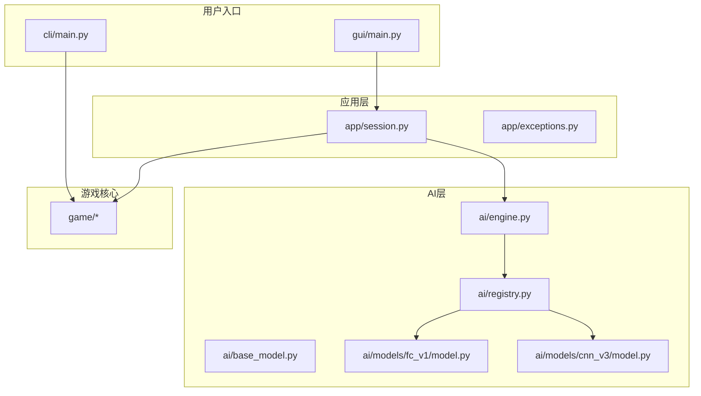
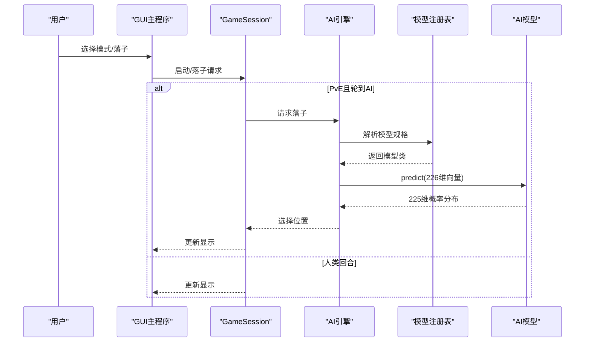
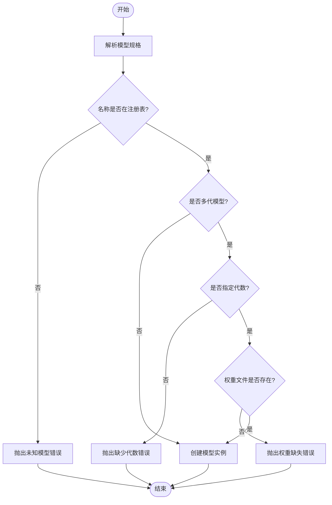
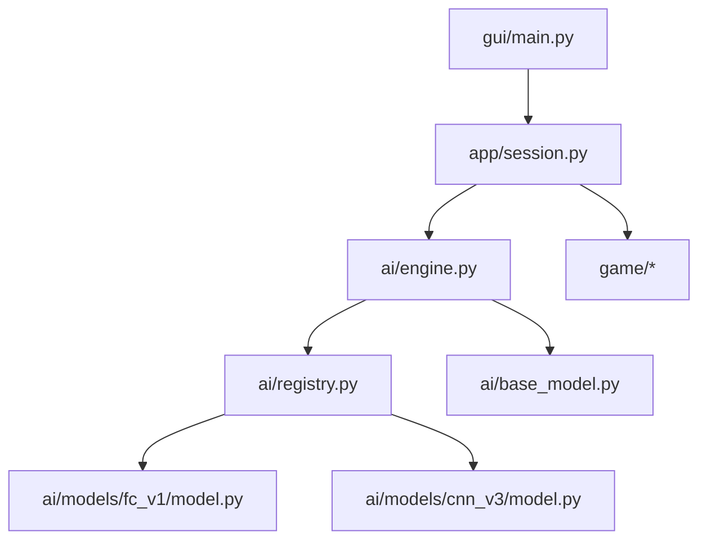

# 常见问题

<cite>
**本文引用的文件**
- [README.md](file://README.md)
- [requirements/key_points.md](file://requirements/key_points.md)
- [cli/main.py](file://cli/main.py)
- [gui/main.py](file://gui/main.py)
- [app/exceptions.py](file://app/exceptions.py)
- [app/session.py](file://app/session.py)
- [ai/engine.py](file://ai/engine.py)
- [ai/base_model.py](file://ai/base_model.py)
- [ai/registry.py](file://ai/registry.py)
- [ai/models/fc_v1/model.py](file://ai/models/fc_v1/model.py)
- [ai/models/cnn_v3/model.py](file://ai/models/cnn_v3/model.py)
- [tests/app/test_session_model_load_error.py](file://tests/app/test_session_model_load_error.py)
- [tests/app/test_battle_model_load_error.py](file://tests/app/test_battle_model_load_error.py)
</cite>

## 目录
1. [简介](#简介)
2. [项目结构](#项目结构)
3. [核心组件](#核心组件)
4. [架构总览](#架构总览)
5. [详细组件分析](#详细组件分析)
6. [依赖关系分析](#依赖关系分析)
7. [性能注意事项](#性能注意事项)
8. [故障排查指南](#故障排查指南)
9. [结论](#结论)
10. [附录](#附录)

## 简介
本常见问题解答面向五子棋AI项目的使用者与维护者，聚焦安装、配置、运行阶段的典型问题与解决方案，涵盖Python环境与依赖、PyTorch版本兼容、GUI界面启动异常、AI模型加载错误、路径与权限、环境变量等系统层面问题。文档提供症状、可能原因、可操作的解决步骤与验证方法，并给出问题分类索引，便于快速定位。

## 项目结构
项目采用分层清晰的组织方式：GUI与CLI分别提供用户入口；app层协调流程；ai层封装AI引擎与模型；game层承载核心规则与存档；tests提供完备的回归与异常场景验证。

**图表来源**
- [gui/main.py:398-462](file://gui/main.py#L398-L462)
- [cli/main.py:1-258](file://cli/main.py#L1-L258)
- [app/session.py:12-179](file://app/session.py#L12-L179)
- [ai/engine.py:18-42](file://ai/engine.py#L18-L42)
- [ai/registry.py:58-72](file://ai/registry.py#L58-L72)
- [ai/base_model.py:107-121](file://ai/base_model.py#L107-L121)
- [ai/models/fc_v1/model.py:91-132](file://ai/models/fc_v1/model.py#L91-L132)
- [ai/models/cnn_v3/model.py:96-139](file://ai/models/cnn_v3/model.py#L96-L139)

**章节来源**
- [README.md:5-20](file://README.md#L5-L20)
- [requirements/key_points.md:92-102](file://requirements/key_points.md#L92-L102)

## 核心组件
- GUI主程序：提供三种模式（PvP/PvE/AI vs AI），负责菜单、棋盘、回放、存档等交互。
- 应用会话：封装游戏会话流程，协调控制器与AI引擎，处理人机对战的AI加载与落子。
- AI引擎：将棋盘状态转换为模型输入，调用模型输出概率分布，按策略选择落子。
- 模型注册表：统一管理模型与训练器映射，支持多代模型指定（如 cnn_v3.1）。
- 基类模型：抽象AI模型接口，统一预测、保存、加载与多代路径处理。
- FCv1/CNNv3模型：具体神经网络实现，分别面向全连接与卷积结构。

**章节来源**
- [gui/main.py:31-90](file://gui/main.py#L31-L90)
- [app/session.py:12-62](file://app/session.py#L12-L62)
- [ai/engine.py:44-66](file://ai/engine.py#L44-L66)
- [ai/registry.py:58-72](file://ai/registry.py#L58-L72)
- [ai/base_model.py:24-36](file://ai/base_model.py#L24-L36)
- [ai/models/fc_v1/model.py:91-101](file://ai/models/fc_v1/model.py#L91-L101)
- [ai/models/cnn_v3/model.py:96-110](file://ai/models/cnn_v3/model.py#L96-L110)

## 架构总览
GUI与CLI通过应用层与游戏核心交互；应用层在PvE模式下创建AI引擎并委托AI引擎进行落子决策；AI引擎通过注册表解析模型规格，加载对应模型并进行预测。

**图表来源**
- [gui/main.py:448-457](file://gui/main.py#L448-L457)
- [app/session.py:63-102](file://app/session.py#L63-L102)
- [ai/engine.py:67-142](file://ai/engine.py#L67-L142)
- [ai/registry.py:150-184](file://ai/registry.py#L150-L184)
- [ai/base_model.py:195-230](file://ai/base_model.py#L195-L230)

## 详细组件分析

### GUI界面启动异常
- 症状
  - 启动后立即退出或无响应
  - 抛出模块导入错误或找不到依赖
- 可能原因
  - Python路径未正确添加项目根目录
  - 缺少GUI依赖（如tkinter）
  - 依赖未安装或版本冲突
- 解决步骤
  - 确认已在入口脚本中将项目根目录加入sys.path
  - 安装依赖：torch、matplotlib、numpy
  - 在虚拟环境中运行，避免系统Python冲突
  - 验证GUI依赖：在Python中导入tkinter
- 验证方法
  - 运行 python gui/main.py，确认界面正常显示
  - 若出现模块导入错误，检查sys.path插入位置与路径拼写

**章节来源**
- [gui/main.py:9-13](file://gui/main.py#L9-L13)
- [README.md:30-34](file://README.md#L30-L34)

### PyTorch版本兼容性
- 症状
  - 导入torch时报错或运行时报错
  - 加载模型时出现权重加载失败
- 可能原因
  - PyTorch版本与打包时环境不一致
  - 使用了不兼容的torch.load参数
- 解决步骤
  - 使用官方推荐的PyTorch版本
  - 使用weights_only参数加载权重
- 验证方法
  - 运行模型加载单元测试，确保权重加载成功

**章节来源**
- [ai/base_model.py:268-275](file://ai/base_model.py#L268-L275)
- [tests/app/test_session_model_load_error.py:84-92](file://tests/app/test_session_model_load_error.py#L84-L92)

### AI模型加载错误
- 症状
  - GUI弹出“模型加载失败”提示
  - 人机对战无法启动
  - AI内战或回放报Unknown model或Missing generation
- 可能原因
  - 指定模型名称不存在
  - 多代模型未指定代数（如 cnn_v3）
  - 模型权重文件缺失
- 解决步骤
  - 使用注册表支持的模型名称（random/fc_v1/cnn_v1/cnn_v2/cnn_v3.x）
  - 多代模型必须使用“模型名.代数”格式（如 cnn_v3.1）
  - 确保对应代数的权重文件存在
- 验证方法
  - 运行模型加载异常测试，确认抛出ModelLoadError并保留原始异常

**图表来源**
- [ai/registry.py:150-184](file://ai/registry.py#L150-L184)
- [ai/base_model.py:126-164](file://ai/base_model.py#L126-L164)

**章节来源**
- [app/exceptions.py:8-24](file://app/exceptions.py#L8-L24)
- [app/session.py:44-51](file://app/session.py#L44-L51)
- [tests/app/test_session_model_load_error.py:47-82](file://tests/app/test_session_model_load_error.py#L47-L82)
- [tests/app/test_battle_model_load_error.py:28-46](file://tests/app/test_battle_model_load_error.py#L28-L46)

### 命令行界面使用
- 症状
  - CLI无法启动或命令无效
- 可能原因
  - 未正确添加项目根目录到sys.path
  - 命令参数错误
- 解决步骤
  - 确认入口脚本中已插入项目根目录
  - 使用new/put/list/print/show/short/help/quit/exit等命令
- 验证方法
  - 运行python cli/main.py，进入REPL并执行命令

**章节来源**
- [cli/main.py:6-7](file://cli/main.py#L6-L7)
- [cli/main.py:19-73](file://cli/main.py#L19-L73)
- [README.md:346-360](file://README.md#L346-L360)

### 路径与权限问题
- 症状
  - 模型权重文件无法读取或保存
  - 目录不存在或权限不足
- 可能原因
  - 默认模型路径不在预期位置
  - 多代模型的gen子目录未创建或权重文件缺失
- 解决步骤
  - 确认模型默认路径存在且可访问
  - 多代模型使用“模型名.代数”格式并确保对应gen子目录存在
  - 为模型保存目录授予写权限
- 验证方法
  - 运行模型保存/加载流程，确认文件创建与读取成功

**章节来源**
- [ai/base_model.py:126-164](file://ai/base_model.py#L126-L164)
- [ai/models/fc_v1/model.py:103-104](file://ai/models/fc_v1/model.py#L103-L104)
- [ai/models/cnn_v3/model.py:109-110](file://ai/models/cnn_v3/model.py#L109-L110)

### 环境变量与系统依赖
- 症状
  - GUI启动失败或显示异常
  - 缺少GUI依赖
- 可能原因
  - 系统缺少tkinter或matplotlib/numpy
- 解决步骤
  - 安装所需依赖
  - 在虚拟环境中运行，避免系统库冲突
- 验证方法
  - 在Python中导入所需模块，确认无异常

**章节来源**
- [README.md:24-28](file://README.md#L24-L28)
- [README.md:30-34](file://README.md#L30-L34)

## 依赖关系分析
- 组件耦合
  - GUI依赖app层与游戏核心；app层依赖AI引擎与游戏控制器
  - AI引擎通过注册表解耦具体模型实现
  - 基类模型统一了预测、保存、加载接口
- 外部依赖
  - PyTorch用于神经网络推理与训练
  - tkinter用于GUI界面
  - matplotlib/numpy用于可视化与数值计算

**图表来源**
- [gui/main.py:18-28](file://gui/main.py#L18-L28)
- [app/session.py:7-8](file://app/session.py#L7-L8)
- [ai/engine.py:8-9](file://ai/engine.py#L8-L9)
- [ai/registry.py:58-72](file://ai/registry.py#L58-L72)
- [ai/base_model.py:107-121](file://ai/base_model.py#L107-L121)

**章节来源**
- [ai/registry.py:58-72](file://ai/registry.py#L58-L72)
- [ai/base_model.py:107-121](file://ai/base_model.py#L107-L121)

## 性能注意事项
- 训练与推理
  - 使用合适的batch size与学习率调度，避免梯度爆炸或收敛缓慢
  - 在GPU可用时尽量使用GPU推理，减少I/O开销
- 可观测性
  - 启用密集loss日志与曲线图，便于监控训练过程

[本节为通用指导，无需列出章节来源]

## 故障排查指南
- 安装与依赖
  - 确认Python版本满足要求
  - 安装torch、matplotlib、numpy
  - 在虚拟环境中运行，避免系统冲突
- GUI启动
  - 确认已添加项目根目录到sys.path
  - 检查tkinter可用性
- 模型加载
  - 使用注册表支持的模型名称
  - 多代模型必须指定代数
  - 确认权重文件存在
- 路径与权限
  - 确认模型默认路径存在且可写
  - 为gen子目录授予写权限

**章节来源**
- [README.md:24-34](file://README.md#L24-L34)
- [gui/main.py:9-13](file://gui/main.py#L9-L13)
- [ai/registry.py:150-184](file://ai/registry.py#L150-L184)
- [ai/base_model.py:126-164](file://ai/base_model.py#L126-L164)

## 结论
通过明确的组件职责、统一的模型注册与加载机制、完善的异常转换与测试覆盖，项目在安装、配置与运行方面具备良好的可维护性与可验证性。遵循本文的排查步骤与最佳实践，可高效解决大多数常见问题。

[本节为总结性内容，无需列出章节来源]

## 附录
- 常用命令参考
  - 启动GUI：python gui/main.py
  - 启动CLI：python cli/main.py
  - AI对战：python ai/battle.py --ai1 <AI> --ai2 <AI> [--games <局数>]
  - 生成样本：python ai/create_samples.py --model <模型> --output <输出文件> [选项]
  - 训练：python ai/train_main.py --model <模型> --train-from-dir <数据目录或文件> [选项]
  - 训练周期：python ai/train_main.py --model <模型> --cycle [选项]
  - 合并样本：python ai/merge_samples.py <目录1> [目录2] ... -o <输出文件路径>
  - LR范围测试：python ai/lr_range_test.py --model <模型> --data <数据路径> [选项]
  - 运行测试：python -m pytest tests/ -v -s

**章节来源**
- [README.md:40-197](file://README.md#L40-L197)