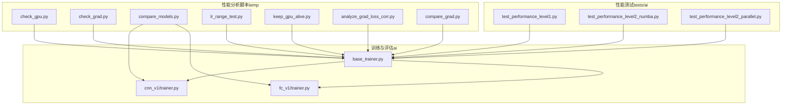
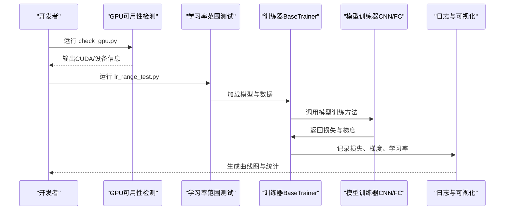
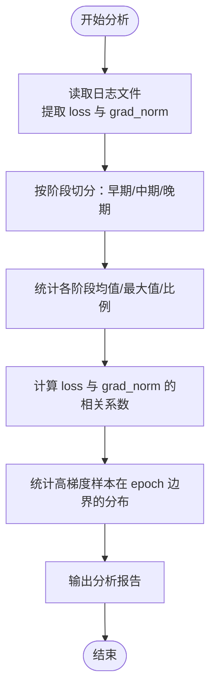
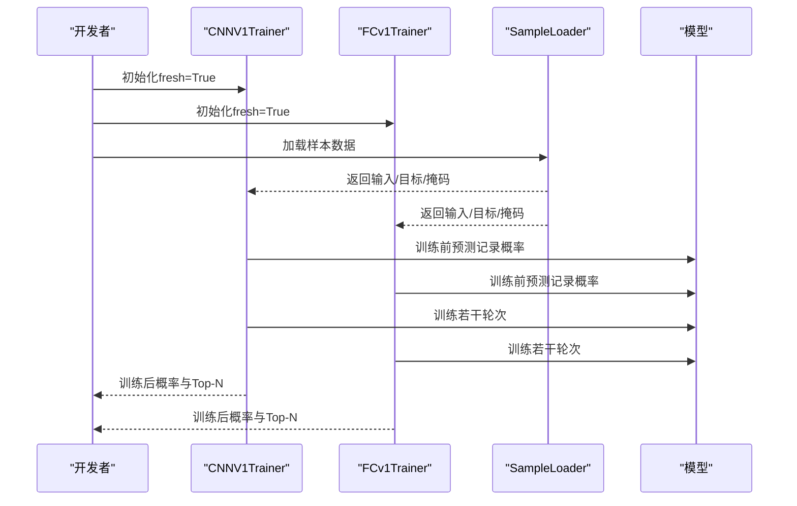
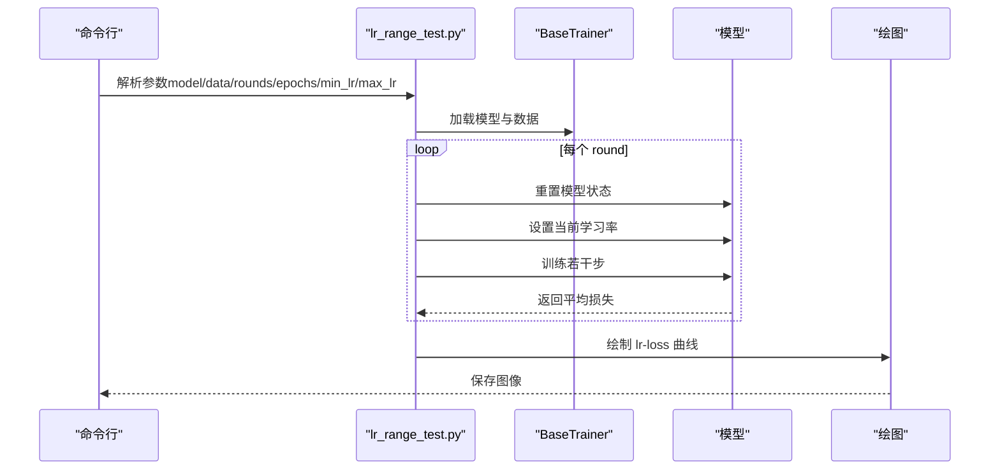
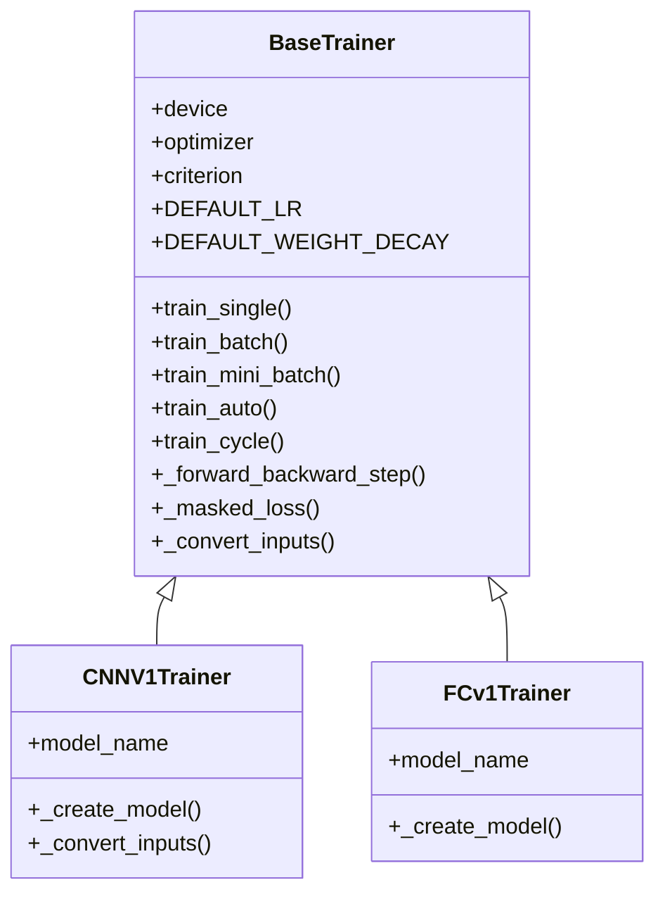
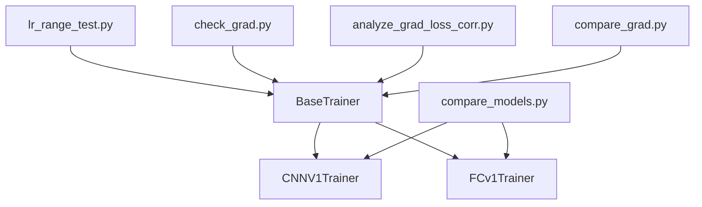

# 性能分析

<cite>
**本文引用的文件**
- [check_gpu.py](file://temp/check_gpu.py)
- [check_grad.py](file://temp/check_grad.py)
- [compare_models.py](file://temp/compare_models.py)
- [lr_range_test.py](file://ai/lr_range_test.py)
- [keep_gpu_alive.py](file://ai/keep_gpu_alive.py)
- [analyze_grad_loss_corr.py](file://temp/analyze_grad_loss_corr.py)
- [compare_grad.py](file://temp/compare_grad.py)
- [base_trainer.py](file://ai/base_trainer.py)
- [test_performance_level1.py](file://tests/ai/test_performance_level1.py)
- [test_performance_level2_numba.py](file://tests/ai/test_performance_level2_numba.py)
- [test_performance_level2_parallel.py](file://tests/ai/test_performance_level2_parallel.py)
- [trainer.py（cnn_v1）](file://ai/models/cnn_v1/trainer.py)
- [trainer.py（fc_v1）](file://ai/models/fc_v1/trainer.py)
</cite>

## 目录
1. [简介](#简介)
2. [项目结构](#项目结构)
3. [核心组件](#核心组件)
4. [架构总览](#架构总览)
5. [详细组件分析](#详细组件分析)
6. [依赖分析](#依赖分析)
7. [性能考量](#性能考量)
8. [故障排查指南](#故障排查指南)
9. [结论](#结论)
10. [附录](#附录)

## 简介
本指南面向五子棋AI项目的性能分析与优化，聚焦以下目标：
- 使用项目内置工具与分析脚本评估系统性能表现
- 监控GPU使用情况、梯度与损失关系、模型性能对比、NumPy/向量化加速效果
- 识别性能瓶颈并提出优化策略（内存、计算、并行）
- 建立基准测试与性能回归测试流程，保障功能演进后的性能稳定性
- 总结性能监控最佳实践与常见问题原因

## 项目结构
围绕性能分析的关键文件与模块如下：
- 性能测试与分析脚本：位于 temp 目录，涵盖GPU检测、梯度分析、模型对比、学习率范围测试等
- 训练与评估基础设施：位于 ai 目录，包含通用训练器、模型训练器、评估器等
- 性能测试用例：位于 tests/ai，覆盖第一级与第二级性能优化的正确性验证

**图示来源**
- [check_gpu.py:1-12](file://temp/check_gpu.py#L1-L12)
- [check_grad.py:1-22](file://temp/check_grad.py#L1-L22)
- [compare_models.py:1-53](file://temp/compare_models.py#L1-L53)
- [lr_range_test.py:1-289](file://ai/lr_range_test.py#L1-L289)
- [keep_gpu_alive.py:1-246](file://ai/keep_gpu_alive.py#L1-L246)
- [analyze_grad_loss_corr.py:1-94](file://temp/analyze_grad_loss_corr.py#L1-L94)
- [compare_grad.py:1-41](file://temp/compare_grad.py#L1-L41)
- [base_trainer.py:1-699](file://ai/base_trainer.py#L1-L699)
- [trainer.py（cnn_v1）:1-72](file://ai/models/cnn_v1/trainer.py#L1-L72)
- [trainer.py（fc_v1）:1-44](file://ai/models/fc_v1/trainer.py#L1-L44)
- [test_performance_level1.py:1-337](file://tests/ai/test_performance_level1.py#L1-L337)
- [test_performance_level2_numba.py:1-387](file://tests/ai/test_performance_level2_numba.py#L1-L387)
- [test_performance_level2_parallel.py:1-393](file://tests/ai/test_performance_level2_parallel.py#L1-L393)

**章节来源**
- [check_gpu.py:1-12](file://temp/check_gpu.py#L1-L12)
- [base_trainer.py:1-699](file://ai/base_trainer.py#L1-L699)

## 核心组件
- 通用训练器 BaseTrainer：提供设备检测、优化器/损失函数、训练循环、学习率调度、日志记录、验证集评估等通用能力
- 模型训练器（CNN v1、FC v1）：基于 BaseTrainer，实现模型创建与输入转换
- 性能分析脚本：GPU可用性检测、梯度与损失日志分析、模型对比、学习率范围测试、并行/NumPy加速验证
- 性能测试用例：验证第一级与第二级优化的正确性与回归

**章节来源**
- [base_trainer.py:21-120](file://ai/base_trainer.py#L21-L120)
- [trainer.py（cnn_v1）:13-72](file://ai/models/cnn_v1/trainer.py#L13-L72)
- [trainer.py（fc_v1）:11-44](file://ai/models/fc_v1/trainer.py#L11-L44)
- [test_performance_level1.py:1-337](file://tests/ai/test_performance_level1.py#L1-L337)
- [test_performance_level2_numba.py:1-387](file://tests/ai/test_performance_level2_numba.py#L1-L387)
- [test_performance_level2_parallel.py:1-393](file://tests/ai/test_performance_level2_parallel.py#L1-L393)

## 架构总览
训练与性能分析的整体流程如下：

**图示来源**
- [check_gpu.py:1-12](file://temp/check_gpu.py#L1-L12)
- [lr_range_test.py:131-210](file://ai/lr_range_test.py#L131-L210)
- [base_trainer.py:257-322](file://ai/base_trainer.py#L257-L322)
- [trainer.py（cnn_v1）:13-72](file://ai/models/cnn_v1/trainer.py#L13-L72)
- [trainer.py（fc_v1）:11-44](file://ai/models/fc_v1/trainer.py#L11-L44)

## 详细组件分析

### GPU使用情况监控
- 目的：确认CUDA可用性、驱动版本、GPU数量与名称，避免训练时设备不可用导致的性能问题
- 关键点：通过PyTorch查询CUDA状态与设备信息，便于在训练前快速判断硬件条件
- 建议：在长时间训练前运行脚本，结合 keep_gpu_alive.py 防止独显因空闲休眠

**章节来源**
- [check_gpu.py:1-12](file://temp/check_gpu.py#L1-L12)

### 梯度与损失关系分析
- 目的：理解训练过程中的梯度范数与损失之间的关系，识别异常波动与收敛趋势
- 方法：
  - 读取训练日志中的 loss 与 grad_norm 字段，分阶段统计（早期/中期/晚期）
  - 计算损失与梯度范数的相关系数，判断两者是否存在强相关
  - 分析高梯度样本在epoch边界上的分布，辅助定位学习率/批大小的影响
- 建议：结合学习率调度与批大小进行对照实验，观察相关系数变化

**图示来源**
- [check_grad.py:1-22](file://temp/check_grad.py#L1-L22)
- [analyze_grad_loss_corr.py:1-94](file://temp/analyze_grad_loss_corr.py#L1-L94)
- [compare_grad.py:1-41](file://temp/compare_grad.py#L1-L41)

**章节来源**
- [check_grad.py:1-22](file://temp/check_grad.py#L1-L22)
- [analyze_grad_loss_corr.py:1-94](file://temp/analyze_grad_loss_corr.py#L1-L94)
- [compare_grad.py:1-41](file://temp/compare_grad.py#L1-L41)

### 模型性能对比
- 目的：对比不同模型（如CNN v1与FC v1）在相同数据与训练条件下的损失与预测差异
- 方法：使用训练器对相同样本进行训练，记录训练前后关键位置的概率变化，比较Top-N位置一致性
- 建议：固定随机种子与训练超参，确保对比公平；关注过拟合与泛化差异

**图示来源**
- [compare_models.py:1-53](file://temp/compare_models.py#L1-L53)
- [trainer.py（cnn_v1）:13-72](file://ai/models/cnn_v1/trainer.py#L13-L72)
- [trainer.py（fc_v1）:11-44](file://ai/models/fc_v1/trainer.py#L11-L44)
- [base_trainer.py:324-407](file://ai/base_trainer.py#L324-L407)

**章节来源**
- [compare_models.py:1-53](file://temp/compare_models.py#L1-L53)
- [trainer.py（cnn_v1）:13-72](file://ai/models/cnn_v1/trainer.py#L13-L72)
- [trainer.py（fc_v1）:11-44](file://ai/models/fc_v1/trainer.py#L11-L44)
- [base_trainer.py:324-407](file://ai/base_trainer.py#L324-L407)

### 学习率范围测试（LR Range Test）
- 目的：自动搜索合适的初始学习率区间，避免过大/过小导致的训练不稳定或收敛缓慢
- 方法：在线性递增的学习率序列上，对每个lr进行固定轮次训练，记录平均损失，绘制lr-loss曲线
- 建议：结合学习率调度策略（Step/Plateau）与批大小进行多轮测试，选择损失下降最稳定的学习率

**图示来源**
- [lr_range_test.py:131-210](file://ai/lr_range_test.py#L131-L210)
- [base_trainer.py:257-322](file://ai/base_trainer.py#L257-L322)

**章节来源**
- [lr_range_test.py:1-289](file://ai/lr_range_test.py#L1-L289)
- [base_trainer.py:257-322](file://ai/base_trainer.py#L257-L322)

### GPU防休眠与监控
- 目的：防止长时间训练时GPU因空闲进入休眠，导致训练中断或性能抖动
- 方法：通过Windows API发送随机鼠标移动事件，维持GPU活跃；结合GPU可用性检测脚本
- 建议：在训练前运行防休眠脚本，配合日志记录与可视化监控

**章节来源**
- [keep_gpu_alive.py:1-246](file://ai/keep_gpu_alive.py#L1-L246)
- [check_gpu.py:1-12](file://temp/check_gpu.py#L1-L12)

### 训练器与输入转换
- 目的：统一训练流程、设备管理、损失计算与日志记录；针对不同模型（CNN/FC）提供输入转换
- 关键点：
  - 设备检测与迁移：自动选择GPU/CPU
  - 损失计算：masked L1Loss，支持掩码过滤无效位置
  - 训练循环：支持单轮次、批量、mini-batch、训练周期
  - 输入转换：FC默认(226,)，CNN转换为(3,15,15)通道张量

**图示来源**
- [base_trainer.py:32-180](file://ai/base_trainer.py#L32-L180)
- [trainer.py（cnn_v1）:13-72](file://ai/models/cnn_v1/trainer.py#L13-L72)
- [trainer.py（fc_v1）:11-44](file://ai/models/fc_v1/trainer.py#L11-L44)

**章节来源**
- [base_trainer.py:21-120](file://ai/base_trainer.py#L21-L120)
- [base_trainer.py:662-699](file://ai/base_trainer.py#L662-L699)
- [trainer.py（cnn_v1）:45-72](file://ai/models/cnn_v1/trainer.py#L45-L72)
- [trainer.py（fc_v1）:23-44](file://ai/models/fc_v1/trainer.py#L23-L44)

### 性能测试与回归验证
- 第一级优化测试：验证冗余predict消除、棋盘拷贝消除、JSON去缩进与prepare_tensors向量化
- 第二级优化测试：验证Numba JIT加速的正确性与回退机制、Evaluator多进程并行的一致性与错误处理
- 建议：将性能测试纳入CI流水线，作为功能变更的回归门槛

**章节来源**
- [test_performance_level1.py:1-337](file://tests/ai/test_performance_level1.py#L1-L337)
- [test_performance_level2_numba.py:1-387](file://tests/ai/test_performance_level2_numba.py#L1-L387)
- [test_performance_level2_parallel.py:1-393](file://tests/ai/test_performance_level2_parallel.py#L1-L393)

## 依赖分析
- 训练器依赖关系：CNN/FC训练器继承自BaseTrainer，复用设备管理、损失计算、训练循环等通用逻辑
- 分析脚本依赖：梯度分析与模型对比脚本依赖训练器与日志文件；LR范围测试脚本依赖训练器与数据加载器
- 性能测试依赖：第一级与第二级测试分别验证算法正确性与加速效果

**图示来源**
- [base_trainer.py:32-180](file://ai/base_trainer.py#L32-L180)
- [trainer.py（cnn_v1）:13-72](file://ai/models/cnn_v1/trainer.py#L13-L72)
- [trainer.py（fc_v1）:11-44](file://ai/models/fc_v1/trainer.py#L11-L44)
- [lr_range_test.py:131-210](file://ai/lr_range_test.py#L131-L210)
- [check_grad.py:1-22](file://temp/check_grad.py#L1-L22)
- [analyze_grad_loss_corr.py:1-94](file://temp/analyze_grad_loss_corr.py#L1-L94)
- [compare_grad.py:1-41](file://temp/compare_grad.py#L1-L41)
- [compare_models.py:1-53](file://temp/compare_models.py#L1-L53)

**章节来源**
- [base_trainer.py:32-180](file://ai/base_trainer.py#L32-L180)
- [trainer.py（cnn_v1）:13-72](file://ai/models/cnn_v1/trainer.py#L13-L72)
- [trainer.py（fc_v1）:11-44](file://ai/models/fc_v1/trainer.py#L11-L44)
- [lr_range_test.py:131-210](file://ai/lr_range_test.py#L131-L210)
- [compare_models.py:1-53](file://temp/compare_models.py#L1-L53)

## 性能考量
- 内存使用优化
  - 使用掩码过滤无效位置，减少无效梯度计算与内存占用
  - 验证集评估使用no_grad上下文，避免梯度计算
  - 批量训练与mini-batch训练的权衡：前者参数更新频率低、显存占用稳定；后者收敛更快、适合大规模数据
- 计算效率提升
  - 输入向量化：prepare_tensors采用列表推导替代逐条append，降低Python层开销
  - Numba JIT加速：对棋型检测关键路径进行JIT编译，在可用时显著提升速度
  - 学习率范围测试：帮助选择合适学习率，避免无效训练
- 并行处理优化
  - 多进程并行评价：Evaluator支持ProcessPoolExecutor，提高样本生成吞吐
  - GPU防休眠：防止独显空闲休眠导致的性能抖动
- 基准与回归测试
  - 将性能测试用例纳入CI，确保优化不引入回归
  - 对关键路径（棋型检测、样本生成、训练循环）建立基准指标

[本节为通用指导，无需列出具体文件来源]

## 故障排查指南
- GPU不可用或驱动异常
  - 使用GPU检测脚本确认CUDA可用性与设备信息
  - 若GPU休眠，运行防休眠脚本维持活跃
- 梯度异常或训练不稳定
  - 查看梯度与损失日志，分析高梯度样本分布与相关性
  - 调整学习率或批大小，重新运行学习率范围测试
- 模型性能差异
  - 使用模型对比脚本在相同条件下对比CNN与FC模型
  - 关注训练前后关键位置概率变化与Top-N一致性
- 并行与加速失效
  - 检查Numba可用性与回退逻辑
  - 验证多进程并行的错误处理与结果一致性

**章节来源**
- [check_gpu.py:1-12](file://temp/check_gpu.py#L1-L12)
- [keep_gpu_alive.py:1-246](file://ai/keep_gpu_alive.py#L1-L246)
- [check_grad.py:1-22](file://temp/check_grad.py#L1-L22)
- [analyze_grad_loss_corr.py:1-94](file://temp/analyze_grad_loss_corr.py#L1-L94)
- [compare_grad.py:1-41](file://temp/compare_grad.py#L1-L41)
- [compare_models.py:1-53](file://temp/compare_models.py#L1-L53)
- [test_performance_level2_numba.py:325-383](file://tests/ai/test_performance_level2_numba.py#L325-L383)
- [test_performance_level2_parallel.py:283-393](file://tests/ai/test_performance_level2_parallel.py#L283-L393)

## 结论
通过内置的性能分析脚本与训练器基础设施，项目能够系统地评估与优化训练性能。建议将GPU监控、梯度分析、模型对比、学习率范围测试与性能测试用例纳入日常开发与CI流程，以持续保障系统在功能演进中的性能稳定性。

[本节为总结性内容，无需列出具体文件来源]

## 附录
- 常用命令与建议
  - 运行GPU检测：python temp/check_gpu.py
  - 分析梯度与损失：python temp/analyze_grad_loss_corr.py
  - 模型对比：python temp/compare_models.py
  - 学习率范围测试：python ai/lr_range_test.py --model cnn_v1 --data path/to/data
  - 防GPU休眠：python ai/keep_gpu_alive.py
- 性能测试用例
  - 第一级优化：python -m tests.ai.test_performance_level1
  - 第二级优化（Numba）：python -m tests.ai.test_performance_level2_numba
  - 第二级优化（并行）：python -m tests.ai.test_performance_level2_parallel

[本节为操作指引，无需列出具体文件来源]