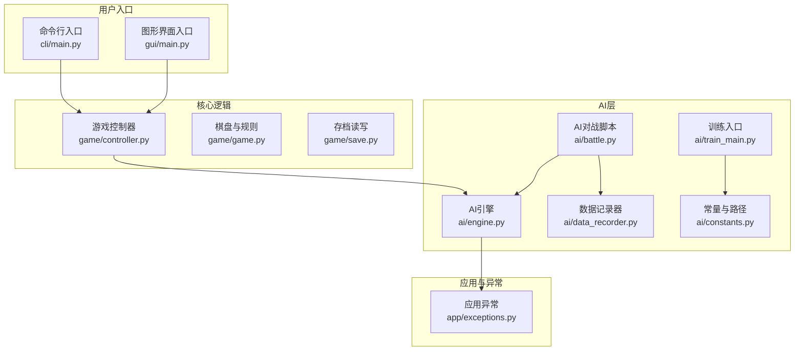
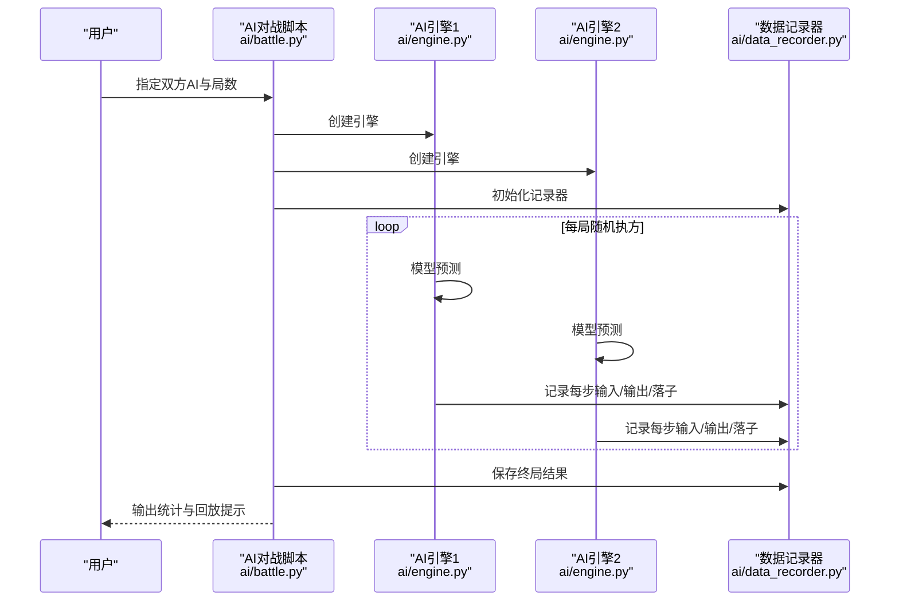
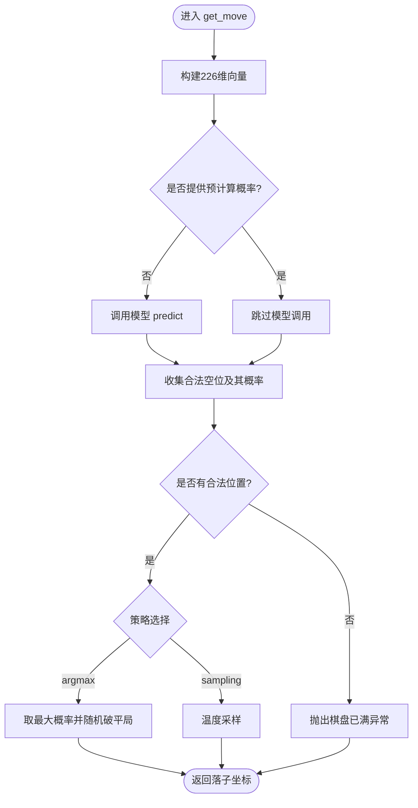
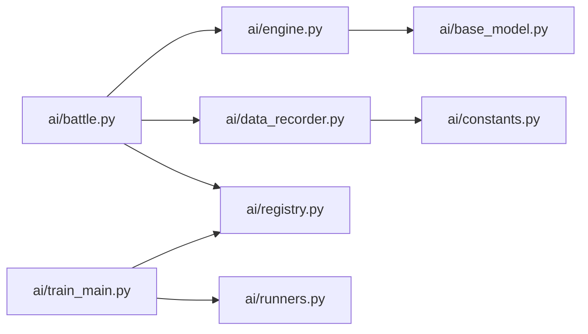

# 故障排除

<cite>
**本文引用的文件**   
- [README.md](file://README.md)
- [requirements/key_points.md](file://requirements/key_points.md)
- [ai/engine.py](file://ai/engine.py)
- [ai/battle.py](file://ai/battle.py)
- [ai/data_recorder.py](file://ai/data_recorder.py)
- [ai/train_main.py](file://ai/train_main.py)
- [cli/main.py](file://cli/main.py)
- [app/exceptions.py](file://app/exceptions.py)
- [ai/constants.py](file://ai/constants.py)
- [temp/check_gpu.py](file://temp/check_gpu.py)
- [temp/debug_ai_move.py](file://temp/debug_ai_move.py)
</cite>

## 目录
1. [简介](#简介)
2. [项目结构](#项目结构)
3. [核心组件](#核心组件)
4. [架构总览](#架构总览)
5. [详细组件分析](#详细组件分析)
6. [依赖关系分析](#依赖关系分析)
7. [性能考虑](#性能考虑)
8. [故障排除指南](#故障排除指南)
9. [结论](#结论)
10. [附录](#附录)

## 简介
本指南聚焦于五子棋AI项目的系统化故障排除，覆盖安装、运行、性能与数据四大类问题，提供日志分析、错误追踪、性能分析与内存泄漏检测方法，配套调试工具与诊断脚本，给出问题分类与优先级策略、预防性维护建议，以及社区支持与反馈渠道，帮助用户快速定位并解决绝大多数使用场景中的问题。

## 项目结构
项目采用模块化分层组织：CLI与GUI分别提供用户入口；game包承载核心棋盘与规则；ai包提供AI引擎、模型、训练与数据管线；tests与coverage_report支撑质量保障；design与temp沉淀设计与临时诊断脚本。

**图表来源**
- [cli/main.py:19-258](file://cli/main.py#L19-L258)
- [ai/engine.py:44-194](file://ai/engine.py#L44-L194)
- [ai/battle.py:94-133](file://ai/battle.py#L94-L133)
- [ai/data_recorder.py:17-145](file://ai/data_recorder.py#L17-L145)
- [ai/train_main.py:27-234](file://ai/train_main.py#L27-L234)
- [ai/constants.py:11-26](file://ai/constants.py#L11-L26)
- [app/exceptions.py:8-25](file://app/exceptions.py#L8-L25)

**章节来源**
- [README.md:5-20](file://README.md#L5-L20)
- [requirements/key_points.md:6-14](file://requirements/key_points.md#L6-L14)

## 核心组件
- AI引擎：负责将棋盘状态转换为模型输入，调用模型预测，按策略选择合法落子位置。
- AI对战脚本：启动双AI对战，记录每步输入输出与落子位置，输出统计结果。
- 数据记录器：按轮次与局数组织record.json，保存每步历史、胜负与终局状态。
- 训练入口：统一参数解析与模式路由，支持周期训练与从数据目录训练。
- 常量与路径：集中管理AI数据与训练数据目录、损失日志目录与记录间隔。
- 应用异常：将底层异常转换为面向用户的友好提示，便于GUI层反馈。

**章节来源**
- [ai/engine.py:44-194](file://ai/engine.py#L44-L194)
- [ai/battle.py:94-133](file://ai/battle.py#L94-L133)
- [ai/data_recorder.py:17-145](file://ai/data_recorder.py#L17-L145)
- [ai/train_main.py:27-234](file://ai/train_main.py#L27-L234)
- [ai/constants.py:11-26](file://ai/constants.py#L11-L26)
- [app/exceptions.py:8-25](file://app/exceptions.py#L8-L25)

## 架构总览
AI对战与训练围绕“数据-模型-策略”闭环展开：对战生成数据，数据驱动模型训练，训练产物指导后续对战。日志与可视化贯穿全流程，便于问题定位与性能评估。

**图表来源**
- [ai/battle.py:106-133](file://ai/battle.py#L106-L133)
- [ai/engine.py:67-143](file://ai/engine.py#L67-L143)
- [ai/data_recorder.py:96-141](file://ai/data_recorder.py#L96-L141)

## 详细组件分析

### AI引擎（AIEngine）
- 职责：输入向量构建、模型预测、合法位置筛选、策略选择（argmax/sampling）。
- 关键点：支持传入预计算概率以避免重复预测；落子策略参数化；异常抛出明确。
- 常见问题：棋盘已满无空位、策略参数非法、模型输出异常。

**图表来源**
- [ai/engine.py:67-143](file://ai/engine.py#L67-L143)

**章节来源**
- [ai/engine.py:67-143](file://ai/engine.py#L67-L143)

### AI对战脚本（ai/battle.py）
- 职责：参数解析、模型加载、引擎创建、对战执行、结果统计与输出。
- 关键点：支持多代模型（如cnn_v3.1）；每局执方随机；异常捕获与退出码。
- 常见问题：参数校验失败、模型名称无效、运行时异常。

**章节来源**
- [ai/battle.py:94-133](file://ai/battle.py#L94-L133)
- [ai/battle.py:136-195](file://ai/battle.py#L136-L195)

### 数据记录器（DataRecorder）
- 职责：轮次目录创建、局内数据累积、record.json保存。
- 关键点：紧凑JSON格式减少体积；游戏编号一致性校验与告警；终局信息补充。
- 常见问题：目录权限不足、并发写冲突、文件损坏。

**章节来源**
- [ai/data_recorder.py:17-145](file://ai/data_recorder.py#L17-L145)

### 训练入口（ai/train_main.py）
- 职责：参数解析、模式路由（周期/从数据目录）、训练器创建与执行。
- 关键点：--cycle与--train-from-dir互斥；学习率调度可选；温度采样参数仅在周期模式生效。
- 常见问题：参数冲突、数据路径不存在、训练器初始化失败。

**章节来源**
- [ai/train_main.py:27-234](file://ai/train_main.py#L27-L234)

### 常量与路径（ai/constants.py）
- 职责：集中管理AI数据目录、训练数据目录、损失日志目录与记录间隔。
- 关键点：可通过环境变量覆盖日志目录；默认记录间隔为200。
- 常见问题：路径拼接错误、环境变量覆盖导致日志丢失。

**章节来源**
- [ai/constants.py:11-26](file://ai/constants.py#L11-L26)

### 应用异常（app/exceptions.py）
- 职责：将底层异常转换为面向用户的友好提示，便于GUI层反馈。
- 常见问题：模型加载失败（未知名称、多代未指定代数）。

**章节来源**
- [app/exceptions.py:8-25](file://app/exceptions.py#L8-L25)

## 依赖关系分析
- ai/engine.py依赖ai/base_model与ai/registry；ai/battle.py依赖ai/engine、ai/data_recorder与ai/registry；ai/train_main.py依赖ai/registry与ai/runners；ai/data_recorder.py依赖ai/constants；CLI入口依赖game包。

**图表来源**
- [ai/battle.py:28-32](file://ai/battle.py#L28-L32)
- [ai/train_main.py:23-24](file://ai/train_main.py#L23-L24)
- [ai/data_recorder.py:12](file://ai/data_recorder.py#L12)
- [ai/engine.py:9](file://ai/engine.py#L9)

**章节来源**
- [ai/battle.py:28-32](file://ai/battle.py#L28-L32)
- [ai/train_main.py:23-24](file://ai/train_main.py#L23-L24)
- [ai/data_recorder.py:12](file://ai/data_recorder.py#L12)
- [ai/engine.py:9](file://ai/engine.py#L9)

## 性能考虑
- 训练性能：mini-batch与学习率调度可显著影响收敛速度与稳定性；日志与曲线有助于观测梯度范数与损失变化。
- 推理性能：AI引擎支持传入预计算概率以减少重复预测；落子策略可切换为argmax降低随机性带来的路径退化。
- I/O优化：record.json采用紧凑格式；合并样本文件可减少训练时I/O开销。

**章节来源**
- [README.md:177-179](file://README.md#L177-L179)
- [ai/engine.py:110-113](file://ai/engine.py#L110-L113)
- [README.md:247-252](file://README.md#L247-L252)

## 故障排除指南

### 一、安装与环境问题
- 症状
  - 导入模块报错（如找不到ai包或random被遮蔽）
  - PyTorch或CUDA不可用
- 诊断步骤
  - 确认Python版本与依赖满足要求
  - 检查sys.path插入顺序，避免ai目录遮蔽标准库
  - 使用GPU检查脚本确认CUDA与GPU状态
- 处理方法
  - 重新安装依赖，确保torch与matplotlib、numpy可用
  - 在脚本运行前显式插入项目根目录至sys.path
  - 若需GPU加速，安装匹配CUDA版本的torch并重启终端
- 预防措施
  - 使用虚拟环境隔离依赖
  - 在CI中加入GPU可用性检查

**章节来源**
- [ai/battle.py:18-26](file://ai/battle.py#L18-L26)
- [temp/check_gpu.py:1-12](file://temp/check_gpu.py#L1-L12)
- [README.md:24-34](file://README.md#L24-L34)

### 二、运行与参数问题
- 症状
  - 参数校验失败（如--cycle与--train-from-dir同时使用）
  - 模型名称无效或多代模型未指定代数
  - 对战局数非法
- 诊断步骤
  - 查看参数解析错误提示
  - 校验模型名称与多代格式（如cnn_v3.1）
  - 确认数据目录存在且包含.json文件
- 处理方法
  - 二选一使用--cycle或--train-from-dir
  - 按设计文档格式指定多代模型名称
  - 将局数设为正整数
- 预防措施
  - 在提交前运行pytest覆盖主要参数组合

**章节来源**
- [ai/train_main.py:196-207](file://ai/train_main.py#L196-L207)
- [ai/battle.py:184-186](file://ai/battle.py#L184-L186)
- [app/exceptions.py:15-24](file://app/exceptions.py#L15-L24)

### 三、性能与资源问题
- 症状
  - 训练收敛慢、梯度爆炸或消失
  - 训练时间过长
  - GUI卡顿或推理延迟高
- 诊断步骤
  - 观察损失日志与曲线，关注梯度范数
  - 使用--batch-size与--shuffle进行mini-batch训练
  - 在AI引擎中启用预计算概率避免重复预测
- 处理方法
  - 启用学习率调度（step/plateau）
  - 适当增大batch size以稳定误差曲面
  - 优化数据合并与I/O策略
- 预防措施
  - 定期生成dense loss log并绘制曲线
  - 在训练周期中逐步引入温度采样

**章节来源**
- [README.md:177-179](file://README.md#L177-L179)
- [ai/train_main.py:105-160](file://ai/train_main.py#L105-L160)
- [ai/engine.py:110-113](file://ai/engine.py#L110-L113)

### 四、数据与文件问题
- 症状
  - record.json缺失或损坏
  - 数据目录为空或路径错误
  - 日志目录不可写
- 诊断步骤
  - 检查轮次与局数目录是否存在
  - 校验record.json结构与字段完整性
  - 确认AI数据目录与日志目录权限
- 处理方法
  - 重建轮次目录并重新对战
  - 修复或删除损坏文件后重试
  - 修改日志目录环境变量指向可写路径
- 预防措施
  - 对重要文件加校验与备份
  - 使用合并脚本减少I/O碎片

**章节来源**
- [ai/data_recorder.py:53-64](file://ai/data_recorder.py#L53-L64)
- [ai/data_recorder.py:134-141](file://ai/data_recorder.py#L134-L141)
- [ai/constants.py:19-22](file://ai/constants.py#L19-L22)

### 五、调试与诊断方法
- 日志分析
  - 使用ai/constants.py中的日志目录常量定位loss_logs
  - 按200步间隔检查日志文件，识别异常波动
- 错误追踪
  - 在ai/battle.py与ai/train_main.py中捕获并打印异常
  - 将底层ValueError转换为ModelLoadError以便GUI反馈
- 性能分析
  - 使用temp/debug_ai_move.py分析模型输出分布与落子多样性
  - 检查GPU状态与CUDA版本匹配
- 内存泄漏检测
  - 在长时间训练中监控进程内存占用
  - 使用--batch-size与合理epoch数避免一次性加载过大数据

**章节来源**
- [ai/constants.py:19-25](file://ai/constants.py#L19-L25)
- [ai/battle.py:189-194](file://ai/battle.py#L189-L194)
- [app/exceptions.py:20-24](file://app/exceptions.py#L20-L24)
- [temp/debug_ai_move.py:1-42](file://temp/debug_ai_move.py#L1-L42)
- [temp/check_gpu.py:1-12](file://temp/check_gpu.py#L1-L12)

### 六、问题分类与优先级
- P0（紧急）：无法启动、模型加载失败、数据目录权限问题
- P1（高）：训练崩溃、日志缺失、参数冲突
- P2（中）：推理缓慢、GUI卡顿、回放异常
- P3（低）：UI细节问题、文档链接失效

处理策略
- P0：立即修复并回滚变更；通知用户并提供降级方案
- P1：快速定位参数与路径问题；提供修复指引
- P2：优化batch size与学习率；检查I/O与缓存
- P3：纳入后续版本改进计划

### 七、预防性维护
- 定期检查
  - GPU可用性与驱动版本
  - 数据目录磁盘空间与权限
  - 日志目录可写性与轮转
- 性能优化
  - 合理设置batch size与学习率调度
  - 使用合并样本减少I/O
  - 启用预计算概率降低推理开销
- 风险预警
  - 监控损失与梯度异常波动
  - 对关键文件增加校验与备份
  - 在CI中加入覆盖率与性能回归检查

### 八、社区支持与反馈渠道
- 提交问题时请附带：
  - 环境信息（Python版本、PyTorch/CUDA版本、GPU型号）
  - 复现命令与参数
  - 相关日志与错误堆栈
  - 数据与目录结构截图（脱敏处理）

## 结论
通过系统化的故障排除流程、日志与诊断工具、参数与路径校验、性能与资源优化，以及预防性维护策略，可显著提升五子棋AI项目的稳定性与用户体验。建议团队在CI中集成GPU可用性检查、覆盖率与性能回归，持续改进问题响应与修复效率。

## 附录

### 常用命令与参数速查
- 启动图形界面：python gui/main.py
- 启动命令行界面：python cli/main.py
- AI对战：python ai/battle.py --ai1 <AI> --ai2 <AI> [--games N]
- 训练入口：python ai/train_main.py --model <模型> --cycle/--train-from-dir <路径> [选项]
- 合并样本：python ai/merge_samples.py <目录>... -o <输出文件>

**章节来源**
- [README.md:40-74](file://README.md#L40-L74)
- [README.md:115-197](file://README.md#L115-L197)
- [README.md:233-252](file://README.md#L233-L252)