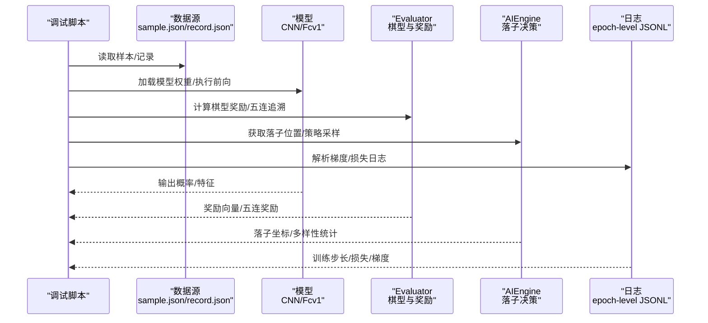
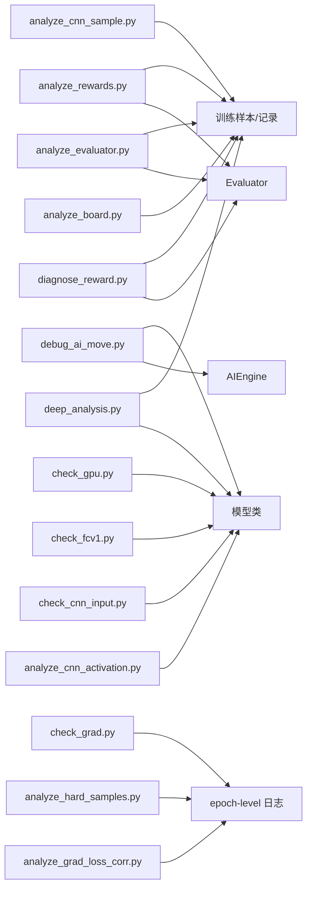

# 调试工具

<cite>
**本文引用的文件**
- [analyze_board.py](file://temp/analyze_board.py)
- [debug_ai_move.py](file://temp/debug_ai_move.py)
- [deep_analysis.py](file://temp/deep_analysis.py)
- [diagnose_reward.py](file://temp/diagnose_reward.py)
- [analyze_cnn_activation.py](file://temp/analyze_cnn_activation.py)
- [analyze_cnn_sample.py](file://temp/analyze_cnn_sample.py)
- [analyze_evaluator.py](file://temp/analyze_evaluator.py)
- [analyze_grad_loss_corr.py](file://temp/analyze_grad_loss_corr.py)
- [analyze_hard_samples.py](file://temp/analyze_hard_samples.py)
- [analyze_rewards.py](file://temp/analyze_rewards.py)
- [check_cnn_input.py](file://temp/check_cnn_input.py)
- [check_fcv1.py](file://temp/check_fcv1.py)
- [check_gpu.py](file://temp/check_gpu.py)
- [check_grad.py](file://temp/check_grad.py)
</cite>

## 目录
1. [简介](#简介)
2. [项目结构](#项目结构)
3. [核心组件](#核心组件)
4. [架构概览](#架构概览)
5. [详细组件分析](#详细组件分析)
6. [依赖分析](#依赖分析)
7. [性能考虑](#性能考虑)
8. [故障排除指南](#故障排除指南)
9. [结论](#结论)
10. [附录](#附录)

## 简介
本指南面向五子棋AI项目的开发者与研究者，系统介绍仓库中提供的调试与分析工具，覆盖棋盘状态分析、AI移动调试、奖励机制诊断、深度训练分析、梯度与损失关联分析、CNN激活与权重分析、输入转换校验、GPU可用性检查等多个方面。文档提供每个工具的用途、运行方式、输入输出格式、使用示例与预期结果，并给出工具组合使用的最佳实践与常见异常处理建议，帮助快速定位问题、进行性能分析与模型调试。

## 项目结构
调试工具主要位于临时脚本目录 temp 下，按功能划分为多个独立脚本，便于按需执行与组合使用。以下图示展示与调试相关的关键模块与工具之间的关系。

```mermaid
graph TB
subgraph "调试工具"
AB["analyze_board.py<br/>棋盘与样本分析"]
DAM["debug_ai_move.py<br/>AI移动调试"]
DA["deep_analysis.py<br/>深度训练分析"]
DR["diagnose_reward.py<br/>五连追溯奖励诊断"]
ACA["analyze_cnn_activation.py<br/>CNN激活与权重分析"]
ACS["analyze_cnn_sample.py<br/>CNN样本分析"]
AE["analyze_evaluator.py<br/>Evaluator棋型检测分析"]
ACLC["analyze_grad_loss_corr.py<br/>梯度与损失相关性"]
AHS["analyze_hard_samples.py<br/>困难样本分析"]
AR["analyze_rewards.py<br/>五连奖励与棋型融合分析"]
CCI["check_cnn_input.py<br/>CNN输入转换检查"]
CFG["check_fcv1.py<br/>FCv1模型参数检查"]
CG["check_gpu.py<br/>GPU可用性检查"]
CGD["check_grad.py<br/>梯度日志检查"]
end
subgraph "核心模块"
EV["Evaluator<br/>棋型检测与奖励计算"]
ENG["AIEngine<br/>落子决策引擎"]
MOD["模型类<br/>CNN/Fcv1"]
DATA["训练样本/记录<br/>sample.json/record.json"]
LOG["训练日志<br/>epoch-level JSONL"]
end
AB --> DATA
DAM --> ENG
DAM --> MOD
DA --> MOD
DA --> DATA
DR --> EV
DR --> DATA
ACA --> MOD
ACS --> DATA
AE --> EV
AE --> DATA
ACLC --> LOG
AHS --> LOG
AR --> EV
AR --> DATA
CCI --> MOD
CFG --> MOD
CG --> MOD
CGD --> LOG
```

图表来源
- [analyze_board.py:1-59](file://temp/analyze_board.py#L1-L59)
- [debug_ai_move.py:1-42](file://temp/debug_ai_move.py#L1-L42)
- [deep_analysis.py:1-76](file://temp/deep_analysis.py#L1-L76)
- [diagnose_reward.py:1-60](file://temp/diagnose_reward.py#L1-L60)
- [analyze_cnn_activation.py:1-338](file://temp/analyze_cnn_activation.py#L1-L338)
- [analyze_cnn_sample.py:1-35](file://temp/analyze_cnn_sample.py#L1-L35)
- [analyze_evaluator.py:1-55](file://temp/analyze_evaluator.py#L1-L55)
- [analyze_grad_loss_corr.py:1-94](file://temp/analyze_grad_loss_corr.py#L1-L94)
- [analyze_hard_samples.py:1-66](file://temp/analyze_hard_samples.py#L1-L66)
- [analyze_rewards.py:1-76](file://temp/analyze_rewards.py#L1-L76)
- [check_cnn_input.py:1-42](file://temp/check_cnn_input.py#L1-L42)
- [check_fcv1.py:1-17](file://temp/check_fcv1.py#L1-L17)
- [check_gpu.py:1-12](file://temp/check_gpu.py#L1-L12)
- [check_grad.py:1-22](file://temp/check_grad.py#L1-L22)

章节来源
- [analyze_board.py:1-59](file://temp/analyze_board.py#L1-L59)
- [debug_ai_move.py:1-42](file://temp/debug_ai_move.py#L1-L42)
- [deep_analysis.py:1-76](file://temp/deep_analysis.py#L1-L76)
- [diagnose_reward.py:1-60](file://temp/diagnose_reward.py#L1-L60)
- [analyze_cnn_activation.py:1-338](file://temp/analyze_cnn_activation.py#L1-L338)
- [analyze_cnn_sample.py:1-35](file://temp/analyze_cnn_sample.py#L1-L35)
- [analyze_evaluator.py:1-55](file://temp/analyze_evaluator.py#L1-L55)
- [analyze_grad_loss_corr.py:1-94](file://temp/analyze_grad_loss_corr.py#L1-L94)
- [analyze_hard_samples.py:1-66](file://temp/analyze_hard_samples.py#L1-L66)
- [analyze_rewards.py:1-76](file://temp/analyze_rewards.py#L1-L76)
- [check_cnn_input.py:1-42](file://temp/check_cnn_input.py#L1-L42)
- [check_fcv1.py:1-17](file://temp/check_fcv1.py#L1-L17)
- [check_gpu.py:1-12](file://temp/check_gpu.py#L1-L12)
- [check_grad.py:1-22](file://temp/check_grad.py#L1-L22)

## 核心组件
- 棋盘与样本分析工具：用于解析训练样本，打印棋盘状态、目标概率分布、掩码信息，辅助定位样本质量与标注问题。
- AI移动调试工具：在空棋盘等典型场景下，检查模型预测分布、落子选择多样性，验证策略采样与引擎行为。
- 深度训练分析工具：手动复现前向传播、损失计算与反向传播，验证训练流程与数值稳定性。
- 奖励机制诊断工具：基于对局记录，追踪五连奖励并核对棋型评估与融合奖励，确保奖励体系正确。
- 梯度与损失关联分析工具：统计高梯度样本的损失分布，计算相关系数，判断学习信号强度与训练波动。
- CNN激活与权重分析工具：统计参数量、权重分布、BatchNorm统计、死亡神经元检测、前向激活率，评估网络健康度。
- 输入转换检查工具：验证模型输入向量到张量的转换是否符合预期，确保通道与玩家信息正确映射。
- GPU可用性检查工具：确认CUDA环境与设备状态，避免训练/推理时的设备错误。
- 模型参数检查工具：快速统计模型参数规模与内存占用，辅助模型选型与资源规划。

章节来源
- [analyze_board.py:1-59](file://temp/analyze_board.py#L1-L59)
- [debug_ai_move.py:1-42](file://temp/debug_ai_move.py#L1-L42)
- [deep_analysis.py:1-76](file://temp/deep_analysis.py#L1-L76)
- [diagnose_reward.py:1-60](file://temp/diagnose_reward.py#L1-L60)
- [analyze_cnn_activation.py:1-338](file://temp/analyze_cnn_activation.py#L1-L338)
- [check_cnn_input.py:1-42](file://temp/check_cnn_input.py#L1-L42)
- [check_gpu.py:1-12](file://temp/check_gpu.py#L1-L12)
- [check_fcv1.py:1-17](file://temp/check_fcv1.py#L1-L17)

## 架构概览
下图展示调试工具与核心模块之间的交互关系，强调数据流与控制流：样本与记录驱动分析，模型与引擎提供预测与决策，日志与可视化支撑性能诊断。

图表来源
- [debug_ai_move.py:1-42](file://temp/debug_ai_move.py#L1-L42)
- [diagnose_reward.py:1-60](file://temp/diagnose_reward.py#L1-L60)
- [deep_analysis.py:1-76](file://temp/deep_analysis.py#L1-L76)
- [analyze_grad_loss_corr.py:1-94](file://temp/analyze_grad_loss_corr.py#L1-L94)
- [check_grad.py:1-22](file://temp/check_grad.py#L1-L22)

## 详细组件分析

### 棋盘状态分析工具
- 功能概述：解析训练样本，打印指定样本的棋盘状态、目标概率、玩家信息；检查目标最大位置与周围棋型，辅助定位样本标注与奖励分配问题。
- 输入格式：固定路径的样本JSON文件，包含若干样本对象，每个样本含输入向量、输出目标、掩码与玩家标记。
- 输出格式：控制台打印，包含当前落子方、某行棋子分布、目标最大位置及值、黑/白子位置列表、周围行序列等。
- 使用示例：直接运行脚本，查看Sample 22的详细分析与目标最大位置周围行。
- 预期结果：输出清晰显示棋盘状态与目标分布，便于发现异常高/低概率位置与标注偏差。
- 适用场景：样本质量检查、奖励分配合理性验证、训练初期问题定位。

章节来源
- [analyze_board.py:1-59](file://temp/analyze_board.py#L1-L59)

### AI移动调试工具
- 功能概述：在空棋盘等典型场景下，获取模型预测分布，统计最大值、最小值、差值、平均值与均匀期望，检查最大概率位置数量与多样性；模拟多次落子以观察引擎采样行为。
- 输入格式：无外部输入，直接调用模型与引擎。
- 输出格式：控制台打印预测统计、最大概率位置数量与前几个位置、多次模拟落子结果与多样性统计。
- 使用示例：直接运行脚本，观察空棋盘下的落子选择是否稳定与多样化。
- 预期结果：在空棋盘下，最大概率位置应集中且多样性较高；若多样性过低，可能提示采样策略或探索不足。
- 适用场景：策略采样调试、引擎鲁棒性验证、随机性与一致性检查。

章节来源
- [debug_ai_move.py:1-42](file://temp/debug_ai_move.py#L1-L42)

### 深度训练分析工具
- 功能概述：手动复现训练流程，从样本加载、输入/目标/掩码张量化、前向传播、损失计算、反向传播到更新后输出，验证训练过程与数值稳定性。
- 输入格式：固定路径的样本JSON文件与模型权重。
- 输出格式：控制台打印棋盘信息、目标统计、掩码统计、张量形状、前向输出、逐位置损失、平均损失、更新前后输出对比。
- 使用示例：直接运行脚本，观察特定样本在一次训练步后的输出变化。
- 预期结果：损失应下降，目标位置输出应提升；若出现NaN或爆炸，需检查损失函数与正则化。
- 适用场景：训练流程验证、数值稳定性检查、损失函数与掩码使用诊断。

章节来源
- [deep_analysis.py:1-76](file://temp/deep_analysis.py#L1-L76)

### 奖励机制诊断工具
- 功能概述：基于对局记录，查找五连位置并进行回溯奖励，核对Evaluator内部计算的奖励与样本输出概率，验证五连奖励是否正确应用。
- 输入格式：固定路径的对局记录JSON文件。
- 输出格式：控制台打印胜者、历史步数、结束棋盘长度、五连位置、回溯奖励数量与序列、样本输出概率与最大概率位置等。
- 使用示例：直接运行脚本，查看某次对局的五连追溯奖励与样本输出的对应关系。
- 预期结果：五连位置应有显著奖励，样本输出中对应位置概率应高于其他位置。
- 适用场景：奖励体系验证、棋型评估与五连奖励融合检查、训练样本标注一致性诊断。

章节来源
- [diagnose_reward.py:1-60](file://temp/diagnose_reward.py#L1-L60)

### 梯度与损失关联分析工具
- 功能概述：统计高梯度样本的损失分布，计算损失与梯度范数的相关系数，分析高梯度样本是否集中在训练边界附近。
- 输入格式：固定路径的epoch级训练日志JSONL文件。
- 输出格式：控制台打印总样本数、高梯度样本数、损失分布直方图、相关系数与区间分布、高梯度样本在前/后epoch的分布。
- 使用示例：直接运行脚本，查看损失与梯度范数的相关性与时间分布。
- 预期结果：若相关系数接近0，说明学习信号较弱；若集中在训练末期，可能提示学习率或正则化问题。
- 适用场景：学习信号分析、训练波动诊断、超参调优依据。

章节来源
- [analyze_grad_loss_corr.py:1-94](file://temp/analyze_grad_loss_corr.py#L1-L94)

### 困难样本分析工具
- 功能概述：筛选困难样本（高损失），统计其平均损失与梯度范数，同时统计高梯度样本的统计特征，辅助定位训练难点。
- 输入格式：固定路径的epoch级训练日志JSONL文件。
- 输出格式：控制台打印损失分桶统计、困难样本数量与占比、困难样本与高梯度样本的统计摘要。
- 使用示例：直接运行脚本，查看困难样本与高梯度样本的分布特征。
- 预期结果：困难样本占比过高可能指示数据噪声、标签问题或模型容量不足。
- 适用场景：数据质量诊断、模型性能瓶颈定位、样本筛选与增强策略制定。

章节来源
- [analyze_hard_samples.py:1-66](file://temp/analyze_hard_samples.py#L1-L66)

### CNN激活与权重分析工具
- 功能概述：统计模型各层参数量、权重分布（均值、标准差、极值、近零比例）、BatchNorm统计、全连接层死亡神经元检测、前向传播激活率，进行综合对比。
- 输入格式：固定路径的模型权重文件。
- 输出格式：控制台打印参数量统计表、权重分布表、BN统计表、死亡神经元统计、激活率汇总表与对比总结。
- 使用示例：直接运行脚本，比较CNN v1与v2的参数量、权重分布与激活率差异。
- 预期结果：v2应在参数量与激活率上优于v1；若存在大量死亡神经元，需检查初始化与正则化。
- 适用场景：模型健康度评估、网络设计优化、训练稳定性诊断。

章节来源
- [analyze_cnn_activation.py:1-338](file://temp/analyze_cnn_activation.py#L1-L338)

### CNN样本分析工具
- 功能概述：遍历训练样本，统计输出最大位置、Top-N位置与棋盘占用数，检查样本输出分布与棋型分布的对应关系。
- 输入格式：固定路径的样本JSON文件。
- 输出格式：控制台打印样本索引、占用棋子数、当前玩家、Top-3位置与概率。
- 使用示例：直接运行脚本，查看部分样本的输出分布特征。
- 预期结果：输出应集中在有棋型优势的位置；若分布过于分散，需检查奖励构造与Softmax归一化。
- 适用场景：样本输出质量检查、奖励构造合理性验证。

章节来源
- [analyze_cnn_sample.py:1-35](file://temp/analyze_cnn_sample.py#L1-L35)

### Evaluator棋型检测分析工具
- 功能概述：针对样本中的特定位置，分别检测黑方与白方落子后的棋型，计算棋型评估奖励，核对最终奖励与样本输出。
- 输入格式：样本JSON与对局记录JSON。
- 输出格式：控制台打印当前落子方、黑/白方落子后的棋型列表与对应奖励、最终奖励与样本输出对比。
- 使用示例：直接运行脚本，查看某一步骤的棋型检测与奖励计算。
- 预期结果：棋型评估奖励应与样本输出中对应位置概率一致或高度相关。
- 适用场景：棋型检测准确性验证、奖励函数调试、样本标注一致性检查。

章节来源
- [analyze_evaluator.py:1-55](file://temp/analyze_evaluator.py#L1-L55)

### 五连奖励与棋型融合分析工具
- 功能概述：从对局记录提取五连追溯奖励，结合棋型评估奖励进行融合，对比非五连但棋型优秀的候选位置，验证奖励融合策略。
- 输入格式：对局记录JSON。
- 输出格式：控制台打印每步的棋型评估奖励、五连追溯奖励、融合奖励与融合公式、非五连最优位置列表。
- 使用示例：直接运行脚本，查看奖励融合效果与候选位置对比。
- 预期结果：五连位置的融合奖励应显著高于非五连位置；若差距过小，需调整融合权重或奖励尺度。
- 适用场景：奖励融合策略验证、棋型与胜利路径的协同优化。

章节来源
- [analyze_rewards.py:1-76](file://temp/analyze_rewards.py#L1-L76)

### CNN输入转换检查工具
- 功能概述：验证模型输入向量到张量的转换是否正确，检查通道映射（黑/白/玩家）与张量形状，确保前向传播输入一致。
- 输入格式：无外部输入，直接调用模型内部转换函数。
- 输出格式：控制台打印张量形状、通道值与前向输出统计。
- 使用示例：直接运行脚本，检查空棋盘与有子棋盘的输入转换与前向输出。
- 预期结果：张量形状应为(1,3,15,15)，通道值与玩家标记应正确映射。
- 适用场景：输入预处理验证、数据管道调试、模型接口一致性检查。

章节来源
- [check_cnn_input.py:1-42](file://temp/check_cnn_input.py#L1-L42)

### FCv1模型参数检查工具
- 功能概述：统计FCv1模型总参数量、内存占用与各层参数量，辅助模型规模与资源估算。
- 输入格式：无外部输入，直接加载模型。
- 输出格式：控制台打印总参数量、百万参数数、模型大小（MB）与各层参数量。
- 使用示例：直接运行脚本，查看FCv1模型的参数规模。
- 预期结果：参数规模应与设计一致；过大可能导致显存不足或推理延迟。
- 适用场景：模型选型与资源规划、参数规模回归测试。

章节来源
- [check_fcv1.py:1-17](file://temp/check_fcv1.py#L1-L17)

### GPU可用性检查工具
- 功能概述：检查PyTorch版本、CUDA可用性、GPU数量与名称，辅助定位设备相关问题。
- 输入格式：无外部输入。
- 输出格式：控制台打印版本信息与设备状态。
- 使用示例：直接运行脚本，确认训练/推理环境。
- 预期结果：CUDA可用时应显示GPU数量与名称；否则提示未检测到GPU。
- 适用场景：环境配置检查、训练失败排查。

章节来源
- [check_gpu.py:1-12](file://temp/check_gpu.py#L1-L12)

### 梯度日志检查工具
- 功能概述：读取epoch级训练日志，打印最后/中期/早期的损失与梯度范数，辅助观察训练收敛趋势。
- 输入格式：固定路径的epoch级JSONL日志文件。
- 输出格式：控制台打印若干条日志记录，包含步长、损失与梯度范数。
- 使用示例：直接运行脚本，查看训练末期的梯度范数变化。
- 预期结果：梯度范数应随训练下降；若持续高位，需检查学习率与正则化。
- 适用场景：训练趋势观察、收敛性诊断。

章节来源
- [check_grad.py:1-22](file://temp/check_grad.py#L1-L22)

## 依赖分析
- 数据依赖：多数工具依赖训练样本与对局记录JSON文件；日志分析工具依赖epoch级JSONL日志。
- 模块依赖：工具通过导入Evaluator、AIEngine、模型类等核心模块执行分析；部分工具直接加载模型权重。
- 外部依赖：PyTorch、NumPy、JSON等，确保版本兼容与CUDA可用性。

图表来源
- [debug_ai_move.py:1-42](file://temp/debug_ai_move.py#L1-L42)
- [diagnose_reward.py:1-60](file://temp/diagnose_reward.py#L1-L60)
- [deep_analysis.py:1-76](file://temp/deep_analysis.py#L1-L76)
- [analyze_grad_loss_corr.py:1-94](file://temp/analyze_grad_loss_corr.py#L1-L94)
- [analyze_hard_samples.py:1-66](file://temp/analyze_hard_samples.py#L1-L66)
- [analyze_rewards.py:1-76](file://temp/analyze_rewards.py#L1-L76)
- [check_cnn_input.py:1-42](file://temp/check_cnn_input.py#L1-L42)
- [check_fcv1.py:1-17](file://temp/check_fcv1.py#L1-L17)
- [check_gpu.py:1-12](file://temp/check_gpu.py#L1-L12)
- [check_grad.py:1-22](file://temp/check_grad.py#L1-L22)

## 性能考虑
- 日志分析：相关系数与分桶统计涉及大量样本，建议对超大数据集进行随机采样以平衡精度与性能。
- 激活率分析：前向传播激活率统计使用钩子注册，注意在大规模统计时控制样本数量与设备内存。
- 训练流程复现：深度分析工具在CPU上运行即可，避免不必要的GPU占用；如需加速可切换至GPU并注意批大小与内存。
- 模型参数检查：仅加载权重与统计参数，开销较小，适合频繁运行。

## 故障排除指南
- CUDA不可用或设备错误
  - 现象：GPU检查工具提示未检测到GPU或CUDA版本不匹配。
  - 排查：确认PyTorch安装与CUDA版本匹配；检查环境变量与驱动版本；尝试禁用GPU或切换CPU运行。
  - 参考工具：GPU可用性检查工具。
- 训练不稳定或梯度爆炸
  - 现象：梯度范数持续高位，损失震荡或发散。
  - 排查：降低学习率、增加正则化、检查损失函数与标签；使用梯度日志检查工具观察趋势。
  - 参考工具：梯度日志检查工具、梯度与损失相关性分析工具。
- 样本标注异常
  - 现象：样本输出分布异常，目标位置概率过低或过高。
  - 排查：使用棋盘状态分析工具与CNN样本分析工具检查样本质量；核对掩码与奖励构造。
  - 参考工具：棋盘状态分析工具、CNN样本分析工具。
- 奖励体系不一致
  - 现象：五连位置奖励与棋型评估奖励不一致或融合效果不佳。
  - 排查：使用奖励机制诊断工具与五连奖励融合分析工具核对Evaluator内部计算与样本输出。
  - 参考工具：奖励机制诊断工具、五连奖励融合分析工具。
- 输入转换错误
  - 现象：模型输入张量形状或通道值异常。
  - 排查：使用CNN输入转换检查工具验证转换逻辑与通道映射。
  - 参考工具：CNN输入转换检查工具。
- 模型健康度问题
  - 现象：训练停滞或性能下降。
  - 排查：使用CNN激活与权重分析工具检查参数量、权重分布与激活率；关注死亡神经元与BN统计。
  - 参考工具：CNN激活与权重分析工具。

章节来源
- [check_gpu.py:1-12](file://temp/check_gpu.py#L1-L12)
- [check_grad.py:1-22](file://temp/check_grad.py#L1-L22)
- [analyze_grad_loss_corr.py:1-94](file://temp/analyze_grad_loss_corr.py#L1-L94)
- [analyze_board.py:1-59](file://temp/analyze_board.py#L1-L59)
- [analyze_cnn_sample.py:1-35](file://temp/analyze_cnn_sample.py#L1-L35)
- [diagnose_reward.py:1-60](file://temp/diagnose_reward.py#L1-L60)
- [analyze_rewards.py:1-76](file://temp/analyze_rewards.py#L1-L76)
- [check_cnn_input.py:1-42](file://temp/check_cnn_input.py#L1-L42)
- [analyze_cnn_activation.py:1-338](file://temp/analyze_cnn_activation.py#L1-L338)

## 结论
本指南梳理了五子棋AI项目中的调试与分析工具，覆盖样本、引擎、奖励、训练流程、日志与模型健康度等关键维度。通过组合使用这些工具，开发者可以快速定位问题、验证假设并优化系统性能。建议在日常开发中建立“样本检查—引擎调试—奖励核对—日志分析—模型健康度评估”的闭环流程，以提高迭代效率与模型质量。

## 附录
- 工具组合使用最佳实践
  - 初期：使用棋盘状态分析工具与CNN样本分析工具检查样本质量；使用GPU可用性检查工具确认环境。
  - 中期：使用AI移动调试工具验证策略采样；使用奖励机制诊断工具与五连奖励融合分析工具核对奖励体系；使用梯度日志检查工具观察收敛趋势。
  - 深入：使用深度训练分析工具复现训练流程；使用CNN激活与权重分析工具评估模型健康度；使用梯度与损失相关性分析工具与困难样本分析工具定位训练难点。
- 输出结果解读要点
  - 概率分布：关注最大概率位置与分布集中度；异常分散可能提示奖励构造或采样问题。
  - 激活率：ReLU层激活率过低可能提示死亡神经元或初始化问题；BN统计异常需检查归一化与正则化。
  - 梯度与损失：强相关通常表示学习信号良好；弱相关或集中在边界可能提示学习率或数据问题。
  - 奖励融合：五连奖励应显著高于非五连位置；若差距过小，需调整融合权重或奖励尺度。