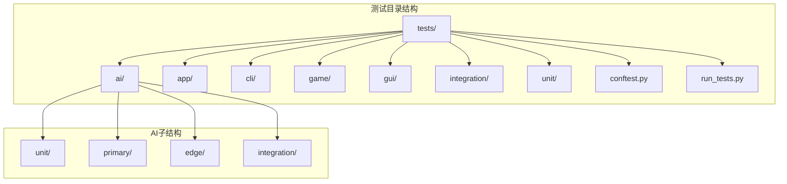
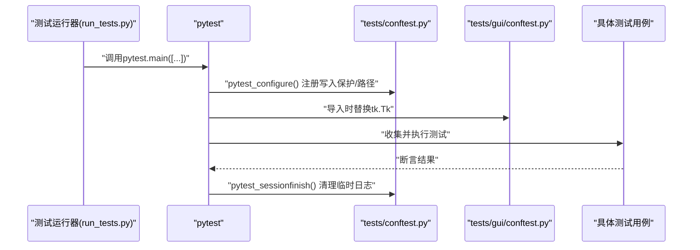
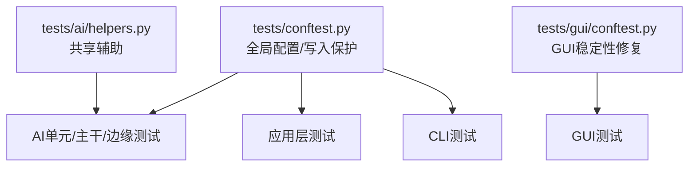

# 测试文档

<cite>
**本文引用的文件**
- [tests/conftest.py](file://tests/conftest.py)
- [tests/run_tests.py](file://tests/run_tests.py)
- [tests/gui/conftest.py](file://tests/gui/conftest.py)
- [tests/ai/helpers.py](file://tests/ai/helpers.py)
- [design/test/test_suit_analysis_report.md](file://design/test/test_suit_analysis_report.md)
- [design/test/top10_slowest_tests_analysis.md](file://design/test/top10_slowest_tests_analysis.md)
- [coverage_report/index.html](file://coverage_report/index.html)
- [tests/test_write_guard.py](file://tests/test_write_guard.py)
- [tests/integration/test_lr_range_e2e.py](file://tests/integration/test_lr_range_e2e.py)
- [tests/integration/test_multi_gen_flow.py](file://tests/integration/test_multi_gen_flow.py)
- [tests/unit/test_heatmap_color.py](file://tests/unit/test_heatmap_color.py)
- [tests/unit/test_lr_range_test.py](file://tests/unit/test_lr_range_test.py)
- [tests/ai/test_performance_level1.py](file://tests/ai/test_performance_level1.py)
- [tests/ai/test_performance_level2_numba.py](file://tests/ai/test_performance_level2_numba.py)
- [tests/ai/test_performance_level2_parallel.py](file://tests/ai/test_performance_level2_parallel.py)
- [tests/app/primary/test_battle.py](file://tests/app/primary/test_battle.py)
- [tests/ai/test_base_trainer.py](file://tests/ai/test_base_trainer.py)
- [tests/ai/test_base_trainer_train_auto.py](file://tests/ai/test_base_trainer_train_auto.py)
- [tests/ai/test_self_play_cycle.py](file://tests/ai/test_self_play_cycle.py)
- [tests/ai/test_cnn_models.py](file://tests/ai/test_cnn_models.py)
- [tests/ai/test_fc_v1_model.py](file://tests/ai/test_fc_v1_model.py)
- [tests/ai/test_evaluator.py](file://tests/ai/test_evaluator.py)
- [tests/ai/test_shape_detector.py](file://tests/ai/test_shape_detector.py)
- [tests/ai/test_loss_logger.py](file://tests/ai/test_loss_logger.py)
- [tests/ai/test_loss_logger_val.py](file://tests/ai/test_loss_logger_val.py)
- [tests/ai/test_game_manager.py](file://tests/ai/test_game_manager.py)
- [tests/ai/test_registry.py](file://tests/ai/test_registry.py)
- [tests/ai/test_runners.py](file://tests/ai/test_runners.py)
- [tests/ai/test_sample_loader.py](file://tests/ai/test_sample_loader.py)
- [tests/ai/test_move_sampler.py](file://tests/ai/test_move_sampler.py)
- [tests/ai/test_reward_calculator.py](file://tests/ai/test_reward_calculator.py)
- [tests/ai/test_line_tracer.py](file://tests/ai/test_line_tracer.py)
- [tests/ai/test_neural_network_model.py](file://tests/ai/test_neural_network_model.py)
- [tests/ai/test_create_samples.py](file://tests/ai/test_create_samples.py)
- [tests/ai/test_merge_samples.py](file://tests/ai/test_merge_samples.py)
- [tests/ai/test_sample_generator.py](file://tests/ai/test_sample_generator.py)
- [tests/ai/test_sample_visualizer.py](file://tests/ai/test_sample_visualizer.py)
- [tests/ai/test_data_recorder.py](file://tests/ai/test_data_recorder.py)
- [tests/ai/test_engine.py](file://tests/ai/test_engine.py)
- [tests/ai/test_engine_no_fallback.py](file://tests/ai/test_engine_no_fallback.py)
- [tests/ai/test_graceful_shutdown.py](file://tests/ai/test_graceful_shutdown.py)
- [tests/ai/test_train_main.py](file://tests/ai/test_train_main.py)
- [tests/ai/test_train_main_script.py](file://tests/ai/test_train_main_script.py)
- [tests/ai/test_battle.py](file://tests/ai/test_battle.py)
- [tests/ai/test_fc_v1_trainer_integration.py](file://tests/ai/test_fc_v1_trainer_integration.py)
- [tests/ai/test_fc_v1_trainer.py](file://tests/ai/test_fc_v1_trainer.py)
- [tests/ai/test_fc_v1_trainer_batch.py](file://tests/ai/test_fc_v1_trainer_batch.py)
- [tests/ai/test_fc_v1_trainer_verbose.py](file://tests/ai/test_fc_v1_trainer_verbose.py)
- [tests/ai/test_mini_batch_training.py](file://tests/ai/test_mini_batch_training.py)
- [tests/ai/test_mini_batch_training_edge.py](file://tests/ai/test_mini_batch_training_edge.py)
- [tests/ai/test_evaluator_shape_detection.py](file://tests/ai/test_evaluator_shape_detection.py)
- [tests/ai/test_evaluator_shape_detection_edge.py](file://tests/ai/test_evaluator_shape_detection_edge.py)
- [tests/ai/test_evaluator_winning_line.py](file://tests/ai/test_evaluator_winning_line.py)
- [tests/ai/test_base_model_multi_gen.py](file://tests/ai/test_base_model_multi_gen.py)
- [tests/ai/test_registry_multi_gen.py](file://tests/ai/test_registry_multi_gen.py)
- [tests/ai/test_random_model.py](file://tests/ai/test_random_model.py)
- [tests/ai/test_sample_creator.py](file://tests/ai/test_sample_creator.py)
- [tests/ai/test_sample_creator_winner_path_soft_label.py](file://tests/ai/test_sample_creator_winner_path_soft_label.py)
- [tests/ai/test_self_play_generator.py](file://tests/ai/test_self_play_generator.py)
- [tests/ai/test_self_play_cycle.py](file://tests/ai/test_self_play_cycle.py)
- [tests/ai/test_shape_detector.py](file://tests/ai/test_shape_detector.py)
- [tests/ai/test_train_main.py](file://tests/ai/test_train_main.py)
- [tests/ai/test_train_main_script.py](file://tests/ai/test_train_main_script.py)
- [tests/app/test_exceptions.py](file://tests/app/test_exceptions.py)
- [tests/app/test_gui_helper.py](file://tests/app/test_gui_helper.py)
- [tests/app/test_session_model_load_error.py](file://tests/app/test_session_model_load_error.py)
- [tests/cli/test_main.py](file://tests/cli/test_main.py)
- [tests/cli/test_train_main_cli.py](file://tests/cli/test_train_main_cli.py)
- [tests/cli/test_train_main_temp_cleanup.py](file://tests/cli/test_train_main_temp_cleanup.py)
- [tests/gui/test_main.py](file://tests/gui/test_main.py)
- [tests/gui/test_mode_selector.py](file://tests/gui/test_mode_selector.py)
- [tests/gui/test_heatmap.py](file://tests/gui/test_heatmap.py)
- [tests/gui/test_display_updater.py](file://tests/gui/test_display_updater.py)
- [tests/gui/test_game_board.py](file://tests/gui/test_game_board.py)
- [tests/gui/test_replay_browser.py](file://tests/gui/test_replay_browser.py)
- [tests/gui/test_replay_viewer.py](file://tests/gui/test_replay_viewer.py)
- [tests/gui/test_ai_battle.py](file://tests/gui/test_ai_battle.py)
- [tests/gui/test_gomoku_gui.py](file://tests/gui/test_gomoku_gui.py)
- [tests/test_controller.py](file://tests/test_controller.py)
- [tests/test_game.py](file://tests/test_game.py)
- [tests/test_save.py](file://tests/test_save.py)
- [tests/test_write_guard.py](file://tests/test_write_guard.py)
</cite>

## 目录
1. [简介](#简介)
2. [项目结构](#项目结构)
3. [核心组件](#核心组件)
4. [架构总览](#架构总览)
5. [详细组件分析](#详细组件分析)
6. [依赖分析](#依赖分析)
7. [性能考量](#性能考量)
8. [故障排查指南](#故障排查指南)
9. [结论](#结论)
10. [附录](#附录)

## 简介
本测试文档面向五子棋AI项目的测试体系，系统阐述测试策略、测试框架配置、测试分类与执行、用例编写规范、覆盖率分析与改进、自动化测试与持续集成实践，以及测试最佳实践。文档基于仓库现有测试结构与设计文档，结合pytest配置、写入保护钩子、GUI稳定性修复、性能热点分析与优化策略，帮助团队建立高质量、可维护、可扩展的测试工程能力。

## 项目结构
测试目录按“功能域 + 分层”组织：
- tests/
  - ai/: AI核心模块测试（unit/primary/edge/integration）
  - app/: 应用层测试（会话、异常、GUI辅助等）
  - cli/: 命令行入口测试
  - game/: 游戏控制与存档测试
  - gui/: 图形界面测试（含独立 conftest 以稳定 Tk/Tcl）
  - integration/: 端到端与多生成器流程测试
  - unit/: 通用单元测试（如热力图颜色、学习率范围测试）
  - conftest.py: 全局pytest配置（写入保护、路径注入、损失日志目录）
  - run_tests.py: 统一入口（兼容直接运行）

图表来源
- [tests/](file://tests/)
- [tests/conftest.py](file://tests/conftest.py)
- [tests/run_tests.py](file://tests/run_tests.py)

章节来源
- [tests/](file://tests/)
- [tests/conftest.py](file://tests/conftest.py)
- [tests/run_tests.py](file://tests/run_tests.py)

## 核心组件
- pytest全局配置与写入保护
  - 通过conftest.py在会话开始前设置专用损失日志目录，避免污染真实数据；在会话结束时清理。
  - 注入sys.path，确保从项目根导入模块；移除空字符串避免冲突。
  - 安装open()钩子，拦截写入受保护目录，防止测试污染生产数据；允许读取。
- GUI稳定性修复
  - gui/conftest.py在模块导入阶段替换tk.Tk，创建唯一共享root，避免Windows+Python 3.13下Tcl解释器偶发退化导致的非确定性失败。
- 测试运行器
  - run_tests.py提供统一入口，兼容直接运行；默认禁用输出捕获以规避Windows Tcl/Tk兼容问题；自动清理临时损失日志目录。

章节来源
- [tests/conftest.py:1-119](file://tests/conftest.py#L1-L119)
- [tests/gui/conftest.py:1-53](file://tests/gui/conftest.py#L1-L53)
- [tests/run_tests.py:1-60](file://tests/run_tests.py#L1-L60)

## 架构总览
测试执行流与保护机制如下：

图表来源
- [tests/run_tests.py:49-55](file://tests/run_tests.py#L49-L55)
- [tests/conftest.py:22-25](file://tests/conftest.py#L22-L25)
- [tests/gui/conftest.py:23-42](file://tests/gui/conftest.py#L23-L42)

## 详细组件分析

### 测试分类与设计原则
- 单元测试（unit）
  - 面向独立函数/类的最小可验证单元，强调快速、稳定、可重复。
  - 示例：[tests/ai/test_registry.py](file://tests/ai/test_registry.py)、[tests/ai/test_runners.py](file://tests/ai/test_runners.py)、[tests/ai/test_sample_loader.py](file://tests/ai/test_sample_loader.py)、[tests/ai/test_move_sampler.py](file://tests/ai/test_move_sampler.py)、[tests/ai/test_reward_calculator.py](file://tests/ai/test_reward_calculator.py)、[tests/ai/test_line_tracer.py](file://tests/ai/test_line_tracer.py)、[tests/ai/test_neural_network_model.py](file://tests/ai/test_neural_network_model.py)、[tests/ai/test_create_samples.py](file://tests/ai/test_create_samples.py)、[tests/ai/test_merge_samples.py](file://tests/ai/test_merge_samples.py)、[tests/ai/test_sample_generator.py](file://tests/ai/test_sample_generator.py)、[tests/ai/test_sample_visualizer.py](file://tests/ai/test_sample_visualizer.py)、[tests/ai/test_data_recorder.py](file://tests/ai/test_data_recorder.py)、[tests/ai/test_engine.py](file://tests/ai/test_engine.py)、[tests/ai/test_engine_no_fallback.py](file://tests/ai/test_engine_no_fallback.py)、[tests/ai/test_graceful_shutdown.py](file://tests/ai/test_graceful_shutdown.py)、[tests/ai/test_train_main.py](file://tests/ai/test_train_main.py)、[tests/ai/test_train_main_script.py](file://tests/ai/test_train_main_script.py)、[tests/ai/test_battle.py](file://tests/ai/test_battle.py)、[tests/ai/test_fc_v1_trainer_integration.py](file://tests/ai/test_fc_v1_trainer_integration.py)、[tests/ai/test_fc_v1_trainer.py](file://tests/ai/test_fc_v1_trainer.py)、[tests/ai/test_fc_v1_trainer_batch.py](file://tests/ai/test_fc_v1_trainer_batch.py)、[tests/ai/test_fc_v1_trainer_verbose.py](file://tests/ai/test_fc_v1_trainer_verbose.py)、[tests/ai/test_mini_batch_training.py](file://tests/ai/test_mini_batch_training.py)、[tests/ai/test_mini_batch_training_edge.py](file://tests/ai/test_mini_batch_training_edge.py)、[tests/ai/test_evaluator_shape_detection.py](file://tests/ai/test_evaluator_shape_detection.py)、[tests/ai/test_evaluator_shape_detection_edge.py](file://tests/ai/test_evaluator_shape_detection_edge.py)、[tests/ai/test_evaluator_winning_line.py](file://tests/ai/test_evaluator_winning_line.py)、[tests/ai/test_base_model_multi_gen.py](file://tests/ai/test_base_model_multi_gen.py)、[tests/ai/test_registry_multi_gen.py](file://tests/ai/test_registry_multi_gen.py)、[tests/ai/test_random_model.py](file://tests/ai/test_random_model.py)、[tests/ai/test_sample_creator.py](file://tests/ai/test_sample_creator.py)、[tests/ai/test_sample_creator_winner_path_soft_label.py](file://tests/ai/test_sample_creator_winner_path_soft_label.py)、[tests/ai/test_self_play_generator.py](file://tests/ai/test_self_play_generator.py)、[tests/ai/test_self_play_cycle.py](file://tests/ai/test_self_play_cycle.py)、[tests/ai/test_shape_detector.py](file://tests/ai/test_shape_detector.py)、[tests/ai/test_train_main.py](file://tests/ai/test_train_main.py)、[tests/ai/test_train_main_script.py](file://tests/ai/test_train_main_script.py)、[tests/app/test_exceptions.py](file://tests/app/test_exceptions.py)、[tests/app/test_gui_helper.py](file://tests/app/test_gui_helper.py)、[tests/app/test_session_model_load_error.py](file://tests/app/test_session_model_load_error.py)、[tests/cli/test_main.py](file://tests/cli/test_main.py)、[tests/cli/test_train_main_cli.py](file://tests/cli/test_train_main_cli.py)、[tests/cli/test_train_main_temp_cleanup.py](file://tests/cli/test_train_main_temp_cleanup.py)、[tests/gui/test_main.py](file://tests/gui/test_main.py)、[tests/gui/test_mode_selector.py](file://tests/gui/test_mode_selector.py)、[tests/gui/test_heatmap.py](file://tests/gui/test_heatmap.py)、[tests/gui/test_display_updater.py](file://tests/gui/test_display_updater.py)、[tests/gui/test_game_board.py](file://tests/gui/test_game_board.py)、[tests/gui/test_replay_browser.py](file://tests/gui/test_replay_browser.py)、[tests/gui/test_replay_viewer.py](file://tests/gui/test_replay_viewer.py)、[tests/gui/test_ai_battle.py](file://tests/gui/test_ai_battle.py)、[tests/gui/test_gomoku_gui.py](file://tests/gui/test_gomoku_gui.py)、[tests/test_controller.py](file://tests/test_controller.py)、[tests/test_game.py](file://tests/test_game.py)、[tests/test_save.py](file://tests/test_save.py)、[tests/test_write_guard.py](file://tests/test_write_guard.py)
- 主干测试（primary）
  - 面向核心业务流程与关键功能的中等规模测试，强调行为正确性与边界条件。
  - 示例：[tests/ai/test_loss_logger.py](file://tests/ai/test_loss_logger.py)、[tests/ai/test_loss_logger_val.py](file://tests/ai/test_loss_logger_val.py)、[tests/ai/test_game_manager.py](file://tests/ai/test_game_manager.py)、[tests/ai/test_evaluator.py](file://tests/ai/test_evaluator.py)、[tests/ai/test_shape_detector.py](file://tests/ai/test_shape_detector.py)
- 边界测试（edge）
  - 针对边界条件、异常路径与极端输入的专项测试。
  - 示例：[tests/ai/test_mini_batch_training_edge.py](file://tests/ai/test_mini_batch_training_edge.py)、[tests/ai/test_evaluator_shape_detection_edge.py](file://tests/ai/test_evaluator_shape_detection_edge.py)
- 集成测试（integration）
  - 关注模块间协作、端到端流程与外部依赖交互。
  - 示例：[tests/integration/test_lr_range_e2e.py](file://tests/integration/test_lr_range_e2e.py)、[tests/integration/test_multi_gen_flow.py](file://tests/integration/test_multi_gen_flow.py)
- 性能测试（performance）
  - 关注性能指标、并发与资源占用，通常包含基准与回归监控。
  - 示例：[tests/ai/test_performance_level1.py](file://tests/ai/test_performance_level1.py)、[tests/ai/test_performance_level2_numba.py](file://tests/ai/test_performance_level2_numba.py)、[tests/ai/test_performance_level2_parallel.py](file://tests/ai/test_performance_level2_parallel.py)
- 回归测试（regression）
  - 用于验证已知缺陷不会重现，通常与问题单关联。
  - 示例：[tests/ai/test_bugfix_dense_log_and_val_ratio.py](file://tests/ai/test_bugfix_dense_log_and_val_ratio.py)

章节来源
- [tests/ai/test_loss_logger.py](file://tests/ai/test_loss_logger.py)
- [tests/ai/test_loss_logger_val.py](file://tests/ai/test_loss_logger_val.py)
- [tests/ai/test_game_manager.py](file://tests/ai/test_game_manager.py)
- [tests/ai/test_evaluator.py](file://tests/ai/test_evaluator.py)
- [tests/ai/test_shape_detector.py](file://tests/ai/test_shape_detector.py)
- [tests/ai/test_mini_batch_training_edge.py](file://tests/ai/test_mini_batch_training_edge.py)
- [tests/ai/test_evaluator_shape_detection_edge.py](file://tests/ai/test_evaluator_shape_detection_edge.py)
- [tests/integration/test_lr_range_e2e.py](file://tests/integration/test_lr_range_e2e.py)
- [tests/integration/test_multi_gen_flow.py](file://tests/integration/test_multi_gen_flow.py)
- [tests/ai/test_performance_level1.py](file://tests/ai/test_performance_level1.py)
- [tests/ai/test_performance_level2_numba.py](file://tests/ai/test_performance_level2_numba.py)
- [tests/ai/test_performance_level2_parallel.py](file://tests/ai/test_performance_level2_parallel.py)
- [tests/ai/test_bugfix_dense_log_and_val_ratio.py](file://tests/ai/test_bugfix_dense_log_and_val_ratio.py)

### 测试数据与辅助工具
- AI测试共享辅助
  - 提供创建样本目录与样本数据、构造225维输出向量等通用方法，减少重复代码。
  - 参考：[tests/ai/helpers.py:12-73](file://tests/ai/helpers.py#L12-L73)

章节来源
- [tests/ai/helpers.py:12-73](file://tests/ai/helpers.py#L12-L73)

### 断言方法与边界条件
- 断言策略
  - 行为驱动：验证函数/方法的行为是否符合预期（如回调调用次数、日志输出、目录创建）。
  - 结构驱动：验证返回值结构、形状、类型与约束（如长度、维度、非空）。
  - 等价性驱动：验证不同实现或路径的输出一致性（如并行与串行结果数量一致）。
- 边界条件
  - 输入边界：空集合、单元素、极大/极小值、特殊掩码。
  - 状态边界：首次调用、最后一次调用、中间态。
  - 异常边界：非法参数、缺失文件、权限不足、资源耗尽。

章节来源
- [tests/ai/test_loss_logger.py](file://tests/ai/test_loss_logger.py)
- [tests/ai/test_loss_logger_val.py](file://tests/ai/test_loss_logger_val.py)
- [tests/ai/test_performance_level2_parallel.py](file://tests/ai/test_performance_level2_parallel.py)

### 覆盖率分析与报告
- 报告入口
  - 仓库提供HTML覆盖率报告目录，包含按模块划分的覆盖率页面与索引页。
  - 参考：[coverage_report/index.html](file://coverage_report/index.html)
- 报告解读要点
  - 行覆盖率：关注未覆盖的分支与路径，识别潜在风险区域。
  - 分支覆盖率：重点检查条件分支与异常路径。
  - 函数/类覆盖率：评估测试对核心构件的覆盖程度。
- 改进策略
  - 针对低覆盖率模块补充单元测试与边界测试。
  - 对复杂函数进行参数化测试，覆盖更多输入组合。
  - 对关键路径增加异常场景测试，提升鲁棒性。

章节来源
- [coverage_report/index.html](file://coverage_report/index.html)

### 自动化测试与持续集成
- 执行策略
  - 直接调用pytest：python -m pytest tests/ -v
  - 统一入口：python tests/run_tests.py（默认禁用输出捕获，避免Windows Tcl/Tk兼容问题）
- 分层执行与标记
  - 设计文档建议引入pytest marker区分慢测试，CI使用-m "not slow"快速反馈。
  - 参考：[design/test/test_suit_analysis_report.md:127-137](file://design/test/test_suit_analysis_report.md#L127-L137)
- 环境管理
  - conftest.py确保测试专用损失日志目录与sys.path配置；GUI conftest确保Tcl解释器稳定。
  - 参考：[tests/conftest.py:16-39](file://tests/conftest.py#L16-L39)、[tests/gui/conftest.py:23-42](file://tests/gui/conftest.py#L23-L42)
- 结果分析
  - 利用覆盖率报告与测试日志定位问题模块，结合性能分析报告优化耗时用例。

章节来源
- [tests/run_tests.py:49-55](file://tests/run_tests.py#L49-L55)
- [design/test/test_suit_analysis_report.md:127-137](file://design/test/test_suit_analysis_report.md#L127-L137)
- [tests/conftest.py:16-39](file://tests/conftest.py#L16-L39)
- [tests/gui/conftest.py:23-42](file://tests/gui/conftest.py#L23-L42)

### 测试用例编写指南
- 数据准备
  - 使用共享辅助工具创建标准化测试数据，保证输入一致性与可重复性。
  - 参考：[tests/ai/helpers.py:12-73](file://tests/ai/helpers.py#L12-L73)
- 断言方法
  - 行为断言：验证回调、日志、事件是否按预期触发。
  - 结构断言：验证返回值长度、形状、字段完整性。
  - 等价性断言：验证不同实现或路径的一致性。
- 边界条件
  - 空输入、单元素、全零/全一、特殊掩码、异常参数。
- 可维护性
  - 将重复逻辑抽取为fixture或辅助函数，减少冗余。
  - 用参数化测试覆盖相似场景，提高效率。

章节来源
- [tests/ai/helpers.py:12-73](file://tests/ai/helpers.py#L12-L73)
- [tests/ai/test_loss_logger.py](file://tests/ai/test_loss_logger.py)
- [tests/ai/test_performance_level2_parallel.py](file://tests/ai/test_performance_level2_parallel.py)

### 性能测试与优化
- 热点分析
  - 高epoch训练、真实AI对局、ProcessPool开销是主要耗时来源。
  - 参考：[design/test/top10_slowest_tests_analysis.md:1-465](file://design/test/top10_slowest_tests_analysis.md#L1-L465)
- 优化策略
  - 降低epoch至断言所需最小值；减少对局场次；合并重复断言；删除冗余测试。
  - 参考：[design/test/top10_slowest_tests_analysis.md:24-74](file://design/test/top10_slowest_tests_analysis.md#L24-L74)
- 集成mock
  - 对于编排逻辑验证，可用mock替换耗时环节，保留关键路径真实执行。
  - 参考：[design/test/test_suit_analysis_report.md:191-336](file://design/test/test_suit_analysis_report.md#L191-L336)

章节来源
- [design/test/top10_slowest_tests_analysis.md:1-465](file://design/test/top10_slowest_tests_analysis.md#L1-L465)
- [design/test/test_suit_analysis_report.md:191-336](file://design/test/test_suit_analysis_report.md#L191-L336)

### 写入保护与安全测试
- 保护机制
  - conftest.py拦截写入受保护目录，防止测试污染生产数据；允许读取。
  - 参考：[tests/conftest.py:44-106](file://tests/conftest.py#L44-L106)
- 测试验证
  - 提供专门的写入保护测试，确保规则生效。
  - 参考：[tests/test_write_guard.py](file://tests/test_write_guard.py)

章节来源
- [tests/conftest.py:44-106](file://tests/conftest.py#L44-L106)
- [tests/test_write_guard.py](file://tests/test_write_guard.py)

## 依赖分析
测试依赖关系与耦合度分析：
- 低耦合
  - 各模块测试相对独立，通过共享辅助工具与conftest进行基础配置。
- 中等耦合
  - AI训练与对局测试之间存在编排依赖（如trainer与self-play cycle），但可通过mock解耦。
- 外部依赖
  - GUI测试依赖tkinter，通过gui/conftest统一替换tk.Tk以稳定Tcl解释器。
  - 参考：[tests/gui/conftest.py:23-42](file://tests/gui/conftest.py#L23-L42)

图表来源
- [tests/conftest.py:1-119](file://tests/conftest.py#L1-L119)
- [tests/gui/conftest.py:1-53](file://tests/gui/conftest.py#L1-L53)
- [tests/ai/helpers.py:1-73](file://tests/ai/helpers.py#L1-L73)

章节来源
- [tests/conftest.py:1-119](file://tests/conftest.py#L1-L119)
- [tests/gui/conftest.py:1-53](file://tests/gui/conftest.py#L1-L53)
- [tests/ai/helpers.py:1-73](file://tests/ai/helpers.py#L1-L73)

## 性能考量
- 测试执行时间分布
  - 极慢/慢/中等/快四档，极慢主要来自实际AI对局+训练；慢来自并行与JIT；中等来自GUI与绘图；快来自纯计算。
  - 参考：[design/test/test_suit_analysis_report.md:32-42](file://design/test/test_suit_analysis_report.md#L32-L42)
- 优化收益
  - 通过降低epoch、减少对局、合并断言与删除重复测试，显著缩短全量耗时。
  - 参考：[design/test/top10_slowest_tests_analysis.md:389-465](file://design/test/top10_slowest_tests_analysis.md#L389-L465)

章节来源
- [design/test/test_suit_analysis_report.md:32-42](file://design/test/test_suit_analysis_report.md#L32-L42)
- [design/test/top10_slowest_tests_analysis.md:389-465](file://design/test/top10_slowest_tests_analysis.md#L389-L465)

## 故障排查指南
- Windows GUI测试不稳定
  - 症状：Tcl初始化失败，随机非确定性失败。
  - 处理：确保使用gui/conftest提供的tk.Tk替换；必要时通过运行器禁用输出捕获。
  - 参考：[tests/gui/conftest.py:1-53](file://tests/gui/conftest.py#L1-L53)、[tests/run_tests.py:49-55](file://tests/run_tests.py#L49-L55)
- 写入保护触发
  - 症状：断言提示写入受保护目录。
  - 处理：使用临时目录或pytest提供的tmp_path fixture；避免直接写入受保护路径。
  - 参考：[tests/conftest.py:44-106](file://tests/conftest.py#L44-L106)
- 测试耗时异常
  - 症状：个别测试耗时远高于预期。
  - 处理：检查是否执行了高epoch训练或真实对局；参考性能分析报告进行优化。
  - 参考：[design/test/top10_slowest_tests_analysis.md:1-465](file://design/test/top10_slowest_tests_analysis.md#L1-L465)

章节来源
- [tests/gui/conftest.py:1-53](file://tests/gui/conftest.py#L1-L53)
- [tests/run_tests.py:49-55](file://tests/run_tests.py#L49-L55)
- [tests/conftest.py:44-106](file://tests/conftest.py#L44-L106)
- [design/test/top10_slowest_tests_analysis.md:1-465](file://design/test/top10_slowest_tests_analysis.md#L1-L465)

## 结论
本测试文档基于仓库现有测试体系与设计文档，构建了覆盖全面、层次清晰的测试工程实践指南。通过pytest配置、写入保护、GUI稳定性修复与性能优化策略，团队可以在保证质量的同时显著提升测试效率。建议持续引入分层标记、参数化测试与mock集成，配合覆盖率报告与性能分析，形成闭环的质量保障体系。

## 附录
- 测试命名规范
  - 使用test_xxx.py命名文件，test_xxx用例命名清晰表达意图与断言目标。
- 测试组织结构
  - 按功能域与分层组织，共享辅助与conftest集中配置，减少重复。
- 维护策略
  - 定期清理废弃测试、合并重复用例、降低高耗时测试的实际工作量；引入标记与分层执行以适配CI。