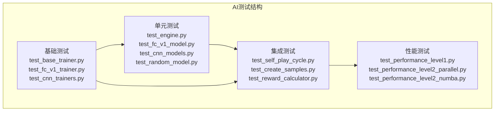
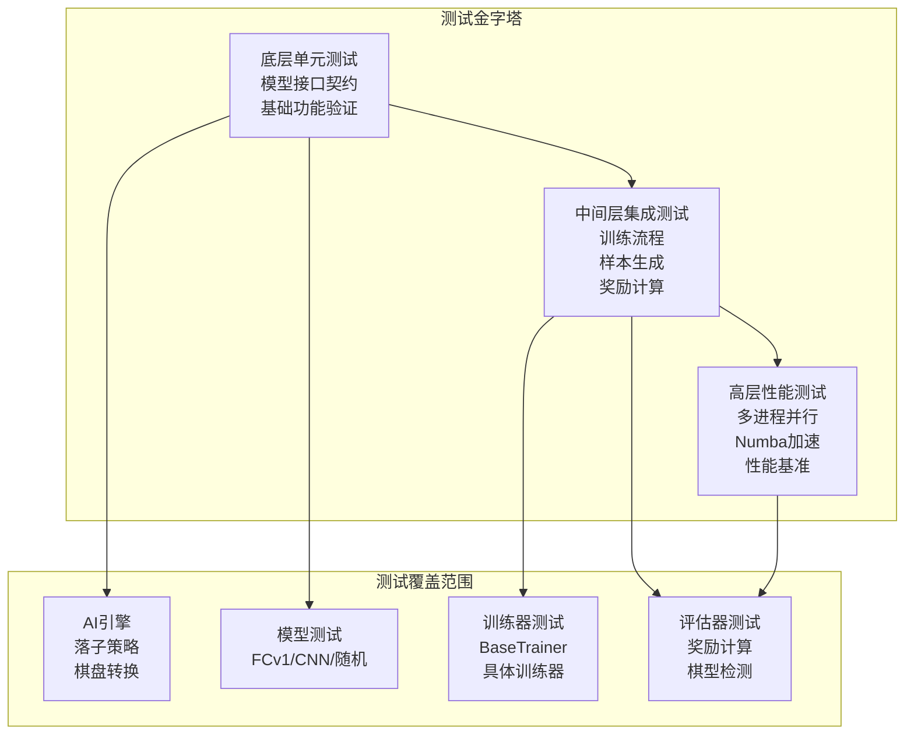
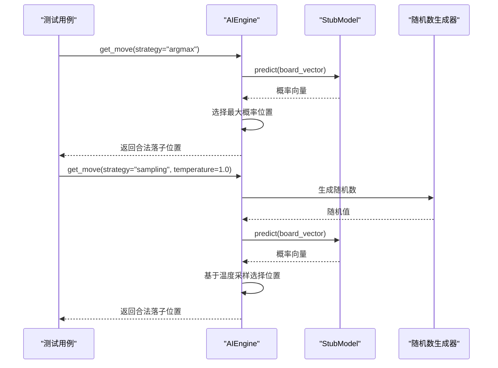
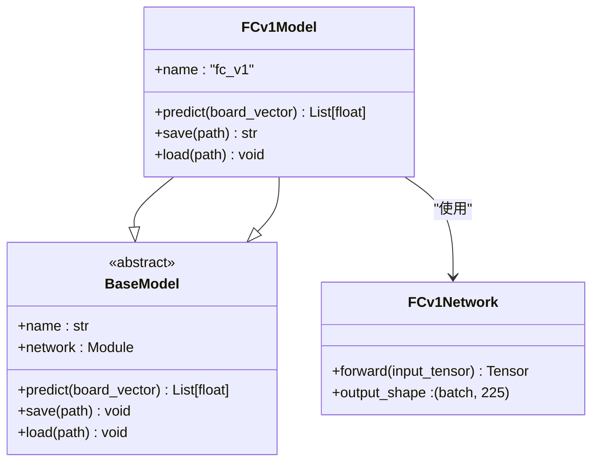
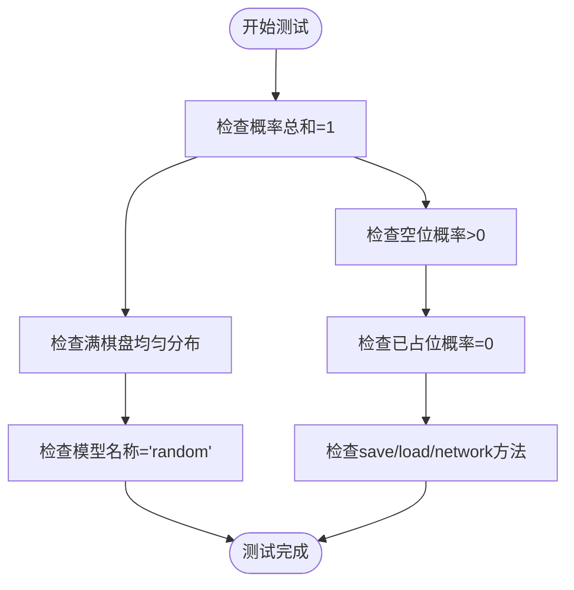
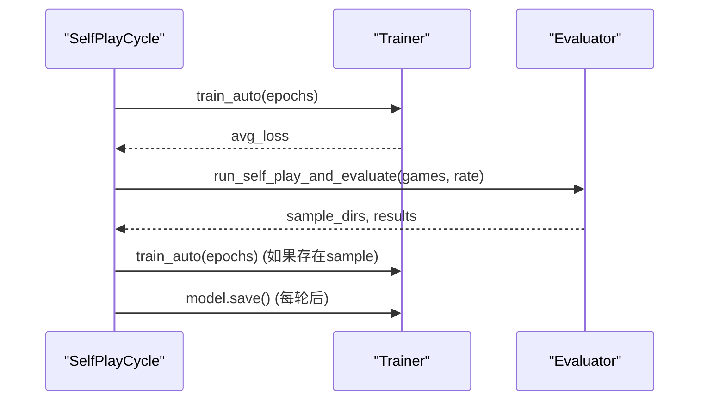
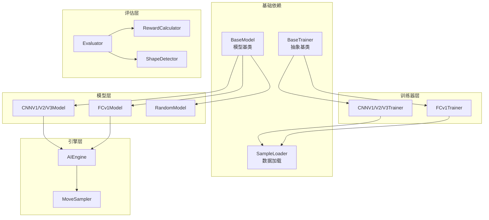

# AI模块测试用例

<cite>
**本文档引用的文件**
- [tests/ai/test_engine.py](file://tests/ai/test_engine.py)
- [tests/ai/test_fc_v1_model.py](file://tests/ai/test_fc_v1_model.py)
- [tests/ai/test_cnn_models.py](file://tests/ai/test_cnn_models.py)
- [tests/ai/test_random_model.py](file://tests/ai/test_random_model.py)
- [tests/ai/test_self_play_cycle.py](file://tests/ai/test_self_play_cycle.py)
- [tests/ai/test_create_samples.py](file://tests/ai/test_create_samples.py)
- [tests/ai/test_reward_calculator.py](file://tests/ai/test_reward_calculator.py)
- [tests/ai/test_performance_level1.py](file://tests/ai/test_performance_level1.py)
- [tests/ai/test_performance_level2_parallel.py](file://tests/ai/test_performance_level2_parallel.py)
- [tests/ai/test_performance_level2_numba.py](file://tests/ai/test_performance_level2_numba.py)
- [tests/ai/test_base_trainer.py](file://tests/ai/test_base_trainer.py)
- [tests/ai/test_fc_v1_trainer.py](file://tests/ai/test_fc_v1_trainer.py)
- [tests/ai/test_cnn_trainers.py](file://tests/ai/test_cnn_trainers.py)
</cite>

## 目录
1. [简介](#简介)
2. [项目结构](#项目结构)
3. [核心组件](#核心组件)
4. [架构概览](#架构概览)
5. [详细组件分析](#详细组件分析)
6. [依赖分析](#依赖分析)
7. [性能考虑](#性能考虑)
8. [故障排查指南](#故障排查指南)
9. [结论](#结论)

## 简介
本文档系统性地梳理了AI模块的测试用例体系，涵盖AI引擎测试、训练器测试、模型测试和评估器测试的实现方法。文档详细说明了FCv1模型测试、CNN模型测试和随机模型测试的测试场景与断言方法，并提供了AI训练流程测试用例（自我对弈测试、样本生成测试和奖励计算测试）的实现细节。此外，文档还介绍了AI性能测试用例（推理速度测试、内存使用测试和精度验证测试）的方法与标准，以及边界条件测试、异常处理测试和回归测试策略。

## 项目结构
AI模块测试主要分布在tests/ai目录下，按照功能域划分为：
- 单元测试：针对具体组件的单元测试，如模型、训练器、引擎等
- 集成测试：跨组件的集成测试，如训练流程、样本生成等
- 性能测试：性能优化相关的测试，包括多进程并行、Numba加速等
- 边界测试：边界条件和异常处理测试

**图表来源**
- [tests/ai/test_engine.py:1-527](file://tests/ai/test_engine.py#L1-L527)
- [tests/ai/test_fc_v1_model.py:1-372](file://tests/ai/test_fc_v1_model.py#L1-L372)
- [tests/ai/test_cnn_models.py:1-341](file://tests/ai/test_cnn_models.py#L1-L341)
- [tests/ai/test_random_model.py:1-120](file://tests/ai/test_random_model.py#L1-L120)
- [tests/ai/test_self_play_cycle.py:1-266](file://tests/ai/test_self_play_cycle.py#L1-L266)
- [tests/ai/test_create_samples.py:1-563](file://tests/ai/test_create_samples.py#L1-L563)
- [tests/ai/test_reward_calculator.py:1-270](file://tests/ai/test_reward_calculator.py#L1-L270)
- [tests/ai/test_performance_level1.py:1-337](file://tests/ai/test_performance_level1.py#L1-L337)
- [tests/ai/test_performance_level2_parallel.py:1-393](file://tests/ai/test_performance_level2_parallel.py#L1-L393)
- [tests/ai/test_performance_level2_numba.py:1-387](file://tests/ai/test_performance_level2_numba.py#L1-L387)
- [tests/ai/test_base_trainer.py:1-277](file://tests/ai/test_base_trainer.py#L1-L277)
- [tests/ai/test_fc_v1_trainer.py:1-501](file://tests/ai/test_fc_v1_trainer.py#L1-L501)
- [tests/ai/test_cnn_trainers.py:1-225](file://tests/ai/test_cnn_trainers.py#L1-L225)

**章节来源**
- [tests/ai/test_engine.py:1-527](file://tests/ai/test_engine.py#L1-L527)
- [tests/ai/test_fc_v1_model.py:1-372](file://tests/ai/test_fc_v1_model.py#L1-L372)
- [tests/ai/test_cnn_models.py:1-341](file://tests/ai/test_cnn_models.py#L1-L341)
- [tests/ai/test_random_model.py:1-120](file://tests/ai/test_random_model.py#L1-L120)
- [tests/ai/test_self_play_cycle.py:1-266](file://tests/ai/test_self_play_cycle.py#L1-L266)
- [tests/ai/test_create_samples.py:1-563](file://tests/ai/test_create_samples.py#L1-L563)
- [tests/ai/test_reward_calculator.py:1-270](file://tests/ai/test_reward_calculator.py#L1-L270)
- [tests/ai/test_performance_level1.py:1-337](file://tests/ai/test_performance_level1.py#L1-L337)
- [tests/ai/test_performance_level2_parallel.py:1-393](file://tests/ai/test_performance_level2_parallel.py#L1-L393)
- [tests/ai/test_performance_level2_numba.py:1-387](file://tests/ai/test_performance_level2_numba.py#L1-L387)
- [tests/ai/test_base_trainer.py:1-277](file://tests/ai/test_base_trainer.py#L1-L277)
- [tests/ai/test_fc_v1_trainer.py:1-501](file://tests/ai/test_fc_v1_trainer.py#L1-L501)
- [tests/ai/test_cnn_trainers.py:1-225](file://tests/ai/test_cnn_trainers.py#L1-L225)

## 核心组件
AI模块测试覆盖以下核心组件：

### AI引擎测试
AI引擎测试验证AIEngine类的完整功能，包括棋盘向量转换、落子策略选择、模型接口契约等。

### 模型测试
模型测试涵盖FCv1、CNN系列和随机模型的单元测试，验证模型的预测行为、接口契约和默认加载机制。

### 训练器测试
训练器测试验证BaseTrainer抽象基类和具体训练器（FCv1、CNN系列）的训练流程、参数更新和错误处理。

### 评估器测试
评估器测试验证奖励计算、棋型检测和样本生成的正确性。

**章节来源**
- [tests/ai/test_engine.py:52-527](file://tests/ai/test_engine.py#L52-L527)
- [tests/ai/test_fc_v1_model.py:20-372](file://tests/ai/test_fc_v1_model.py#L20-L372)
- [tests/ai/test_cnn_models.py:33-341](file://tests/ai/test_cnn_models.py#L33-L341)
- [tests/ai/test_random_model.py:13-120](file://tests/ai/test_random_model.py#L13-L120)
- [tests/ai/test_base_trainer.py:22-277](file://tests/ai/test_base_trainer.py#L22-L277)
- [tests/ai/test_fc_v1_trainer.py:118-501](file://tests/ai/test_fc_v1_trainer.py#L118-L501)
- [tests/ai/test_cnn_trainers.py:62-225](file://tests/ai/test_cnn_trainers.py#L62-L225)

## 架构概览
AI模块测试采用分层架构，从单元测试到集成测试再到性能测试，形成完整的测试金字塔。

**图表来源**
- [tests/ai/test_engine.py:1-527](file://tests/ai/test_engine.py#L1-L527)
- [tests/ai/test_base_trainer.py:1-277](file://tests/ai/test_base_trainer.py#L1-L277)
- [tests/ai/test_performance_level2_parallel.py:1-393](file://tests/ai/test_performance_level2_parallel.py#L1-L393)

## 详细组件分析

### AI引擎测试分析

AI引擎测试通过多种策略验证AIEngine的落子决策能力：

#### 落子策略测试
测试覆盖三种策略：argmax（默认）、sampling（温度采样）和未知策略。每种策略都有对应的断言方法：

**图表来源**
- [tests/ai/test_engine.py:297-524](file://tests/ai/test_engine.py#L297-L524)

#### 棋盘向量转换测试
验证棋盘到向量的转换逻辑，包括空棋盘、有棋子棋盘和边界情况的处理。

**章节来源**
- [tests/ai/test_engine.py:52-527](file://tests/ai/test_engine.py#L52-L527)

### FCv1模型测试分析

FCv1模型测试验证神经网络结构和预测行为：

#### 网络结构测试
验证FCv1Network的输入输出维度和前向传播行为：

**图表来源**
- [tests/ai/test_fc_v1_model.py:20-174](file://tests/ai/test_fc_v1_model.py#L20-L174)

#### 模型行为测试
测试包括：
- 预测输出格式验证（225维浮点数列表）
- 概率分布验证（范围(0,1)，总和为1）
- 不同输入场景的稳定性
- 模型保存和加载机制

**章节来源**
- [tests/ai/test_fc_v1_model.py:83-372](file://tests/ai/test_fc_v1_model.py#L83-L372)

### CNN模型测试分析

CNN模型测试采用参数化测试设计，统一验证三代CNN模型的共同行为：

#### 共性行为测试
所有CNN模型共享以下测试：
- 网络输出形状验证（batch, 225）
- 概率分布验证（范围(0,1)，总和为1）
- 预测行为验证（不同输入场景）
- 保存/加载机制验证

#### 版本特异性测试
- CNN v2：参数量约101万（3层64通道轻量化）
- CNN v3：参数量约1.9万（纯卷积，1×1 Conv替代FC）

**章节来源**
- [tests/ai/test_cnn_models.py:33-341](file://tests/ai/test_cnn_models.py#L33-L341)

### 随机模型测试分析

随机模型测试验证基础模型接口契约的完整性：

#### 接口契约测试
- 概率分布验证：满棋盘时返回均匀分布
- 空位概率验证：已落子位置概率为0，其他位置概率相等
- 模型属性验证：name属性、save/load方法、network属性

**图表来源**
- [tests/ai/test_random_model.py:19-79](file://tests/ai/test_random_model.py#L19-L79)

**章节来源**
- [tests/ai/test_random_model.py:13-120](file://tests/ai/test_random_model.py#L13-L120)

### 训练器测试分析

训练器测试验证BaseTrainer抽象基类和具体训练器的训练流程：

#### BaseTrainer测试
验证抽象基类的完整性：
- 抽象方法约束（必须实现_save_model、_load_model、model_name）
- 优化器配置（AdamW，权重衰减0.01）
- 学习率调度器支持（StepLR、ReduceLROnPlateau）

#### FCv1训练器测试
- 单轮训练验证（train_single）
- 批量训练验证（train_batch，参数更新次数=epochs）
- 数据加载和张量准备验证
- fresh参数行为验证

**章节来源**
- [tests/ai/test_base_trainer.py:22-277](file://tests/ai/test_base_trainer.py#L22-L277)
- [tests/ai/test_fc_v1_trainer.py:118-501](file://tests/ai/test_fc_v1_trainer.py#L118-L501)

### 自我对弈测试分析

自我对弈测试验证训练周期的编排逻辑：

#### 训练周期编排测试
- 多轮训练验证（run_self_play_and_evaluate调用次数=rounds）
- 参数传递验证（games、rate、max_workers正确传递）
- 结果统计验证（sample_dirs数量、训练数据目录结构）
- 中断处理验证（interrupted标志正确处理）

**图表来源**
- [tests/ai/test_self_play_cycle.py:46-262](file://tests/ai/test_self_play_cycle.py#L46-L262)

**章节来源**
- [tests/ai/test_self_play_cycle.py:46-266](file://tests/ai/test_self_play_cycle.py#L46-L266)

### 样本生成测试分析

样本生成测试验证create_samples脚本的完整流程：

#### CLI参数测试
- 输出文件存在性验证
- 样本数量与对局数一致性验证（排除平局）
- 数据增强参数测试（--no-augment）
- 温度采样参数测试（--no-temp-sampling、--temp-side等）

#### 端到端测试
- winner_path模式测试（获胜路径样本生成）
- 增强策略验证（D4变换、镜像变换）
- 错误处理测试（无效JSON、缺失文件）

**章节来源**
- [tests/ai/test_create_samples.py:23-563](file://tests/ai/test_create_samples.py#L23-L563)

### 奖励计算测试分析

奖励计算测试验证棋型检测和奖励分配的正确性：

#### 棋型检测测试
- 基础棋型奖励验证（连五、活四、冲四、活三、活二）
- 多棋型组合奖励验证（多活三、多冲四）
- 敌方棋型奖励因子验证（0.95因子）
- 眠三、眠二奖励验证（眠三动态比例，眠二奖励为0）

#### 冲四递归测试
- 冲四防守后无后续棋型时的奖励计算
- 位置参数缺失时的回退机制

**章节来源**
- [tests/ai/test_reward_calculator.py:16-270](file://tests/ai/test_reward_calculator.py#L16-L270)

## 依赖分析

AI模块测试之间存在层次化的依赖关系：

**图表来源**
- [tests/ai/test_base_trainer.py:19-277](file://tests/ai/test_base_trainer.py#L19-L277)
- [tests/ai/test_fc_v1_model.py:17-372](file://tests/ai/test_fc_v1_model.py#L17-L372)
- [tests/ai/test_cnn_models.py:23-341](file://tests/ai/test_cnn_models.py#L23-L341)
- [tests/ai/test_engine.py:16-527](file://tests/ai/test_engine.py#L16-L527)
- [tests/ai/test_performance_level2_parallel.py:24-393](file://tests/ai/test_performance_level2_parallel.py#L24-L393)

**章节来源**
- [tests/ai/test_base_trainer.py:1-277](file://tests/ai/test_base_trainer.py#L1-L277)
- [tests/ai/test_engine.py:1-527](file://tests/ai/test_engine.py#L1-L527)
- [tests/ai/test_performance_level2_parallel.py:1-393](file://tests/ai/test_performance_level2_parallel.py#L1-L393)

## 性能考虑

AI模块测试涵盖了多层次的性能优化验证：

### 第一级性能优化测试
验证三项关键优化的正确性：

#### 冗余预测消除
- get_move新增probs参数，避免重复调用model.predict
- 预计算概率向量时不应再次调用predict
- 传入probs与不传probs的行为一致性验证

#### 棋盘拷贝消除
- detect_shapes原地修改-恢复模式
- 多次调用detect_shapes不相互影响
- 棋盘状态正确恢复

#### JSON去缩进和张量向量化
- DataRecorder保存的JSON为紧凑格式
- prepare_tensors使用列表推导替代逐条append

### 第二级性能优化测试

#### 多进程并行测试
- ProcessPoolExecutor并行评价的正确性
- 串行模式（max_workers=1）与并行模式结果一致性
- 错误处理：无效record不影响其他文件

#### Numba JIT加速测试
- detect_single_direction的JIT版本正确性
- 与纯Python版本结果一致性验证
- 性能基准测试（JIT版本应比纯Python快）

**章节来源**
- [tests/ai/test_performance_level1.py:30-337](file://tests/ai/test_performance_level1.py#L30-L337)
- [tests/ai/test_performance_level2_parallel.py:85-393](file://tests/ai/test_performance_level2_parallel.py#L85-L393)
- [tests/ai/test_performance_level2_numba.py:30-387](file://tests/ai/test_performance_level2_numba.py#L30-L387)

## 故障排查指南

### 常见问题及解决方案

#### 模型加载问题
- **问题**：模型文件不存在时的行为
- **解决方案**：RandomModel和各训练器都应能创建新模型而非报错
- **测试验证**：test_model_load_nonexistent_file

#### 训练器初始化问题
- **问题**：BaseTrainer子类必须实现的抽象方法
- **解决方案**：确保实现_save_model、_load_model、model_name属性
- **测试验证**：test_base_trainer_requires_create_model

#### 样本数据格式问题
- **问题**：无效JSON或缺失样本文件
- **解决方案**：适当的异常处理和错误信息
- **测试验证**：test_load_sample_invalid_json

#### 性能回归问题
- **问题**：多进程并行或Numba加速导致的性能下降
- **解决方案**：检查JIT编译缓存、进程池配置
- **测试验证**：test_jit_faster_than_python

### 调试建议
1. **逐步缩小范围**：从单元测试到集成测试逐步定位问题
2. **使用Mock对象**：隔离外部依赖，专注于核心逻辑验证
3. **检查断言条件**：确保断言覆盖所有边界情况
4. **性能基准对比**：建立性能基线，监控回归

**章节来源**
- [tests/ai/test_random_model.py:197-227](file://tests/ai/test_random_model.py#L197-L227)
- [tests/ai/test_base_trainer.py:25-59](file://tests/ai/test_base_trainer.py#L25-L59)
- [tests/ai/test_performance_level2_parallel.py:305-393](file://tests/ai/test_performance_level2_parallel.py#L305-L393)

## 结论
AI模块测试用例体系完整覆盖了从基础模型接口契约到复杂训练流程的各个方面。通过分层测试策略（单元测试、集成测试、性能测试），确保了AI系统的可靠性、性能和可维护性。测试用例不仅验证了功能正确性，还包含了边界条件处理、异常情况应对和性能基准测试，为AI模块的持续开发和维护提供了坚实的基础。