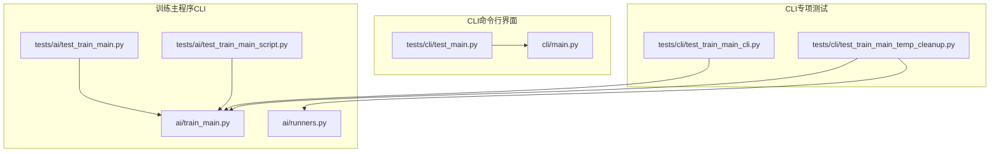
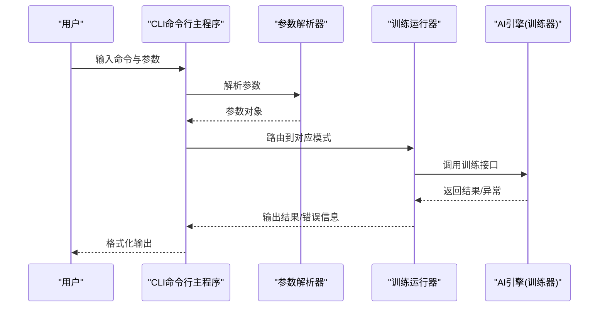
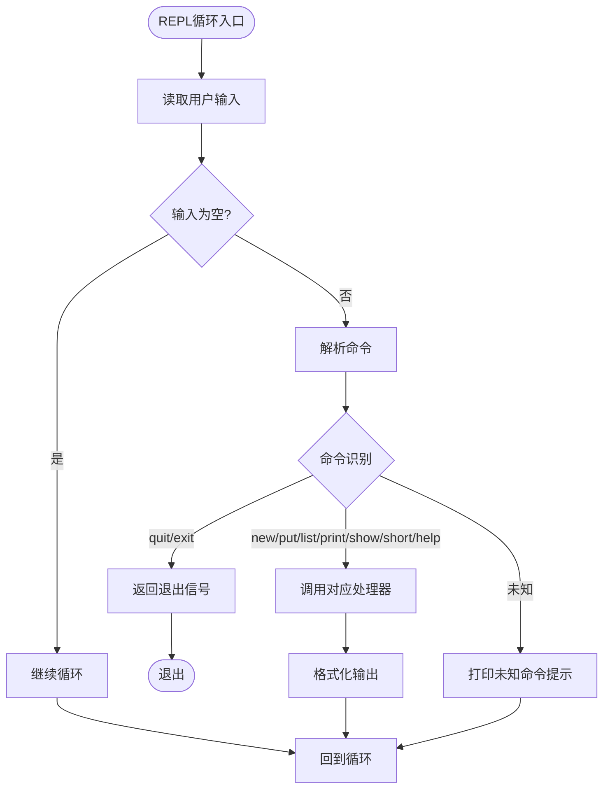
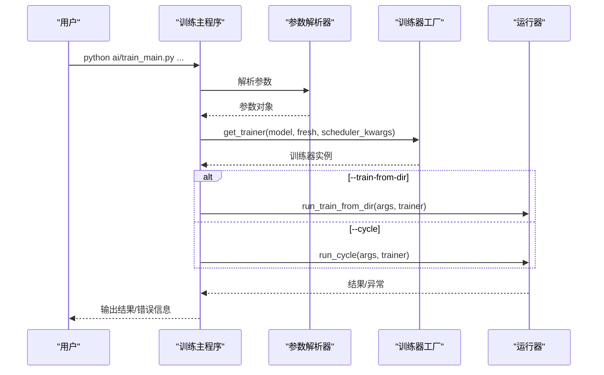
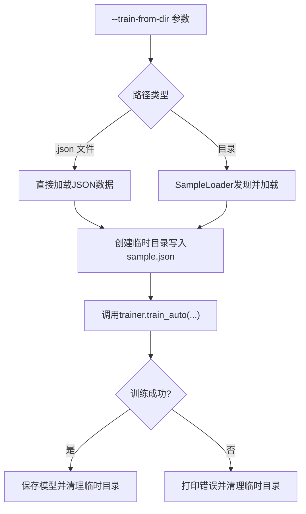
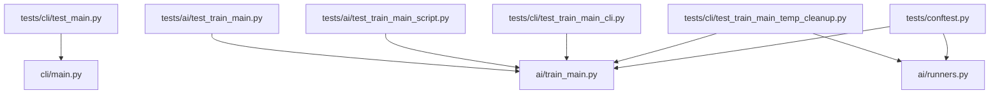

# CLI模块测试用例

<cite>
**本文档引用的文件**
- [cli/main.py](file://cli/main.py)
- [tests/cli/test_main.py](file://tests/cli/test_main.py)
- [tests/cli/test_train_main_cli.py](file://tests/cli/test_train_main_cli.py)
- [tests/cli/test_train_main_temp_cleanup.py](file://tests/cli/test_train_main_temp_cleanup.py)
- [ai/train_main.py](file://ai/train_main.py)
- [ai/runners.py](file://ai/runners.py)
- [tests/ai/test_train_main.py](file://tests/ai/test_train_main.py)
- [tests/ai/test_train_main_script.py](file://tests/ai/test_train_main_script.py)
- [tests/conftest.py](file://tests/conftest.py)
</cite>

## 目录
1. [简介](#简介)
2. [项目结构](#项目结构)
3. [核心组件](#核心组件)
4. [架构总览](#架构总览)
5. [详细组件分析](#详细组件分析)
6. [依赖分析](#依赖分析)
7. [性能考虑](#性能考虑)
8. [故障排除指南](#故障排除指南)
9. [结论](#结论)
10. [附录](#附录)

## 简介
本文件面向CLI模块的测试用例文档，系统性梳理命令行界面测试、训练主程序测试与参数解析测试的实现方法与最佳实践。内容涵盖：
- CLI命令测试用例：训练命令测试、参数验证测试、输出验证测试
- CLI集成测试用例：命令行与训练流程集成测试、命令行与文件系统集成测试、命令行与AI引擎集成测试
- CLI性能测试用例：命令执行时间测试、内存使用测试、批量处理测试
- 错误处理测试、参数边界测试与兼容性测试策略

## 项目结构
CLI模块测试主要分布在以下位置：
- CLI命令行界面：cli/main.py 及其单元测试 tests/cli/test_main.py
- 训练主程序CLI：ai/train_main.py 及其集成测试 tests/ai/test_train_main.py、tests/ai/test_train_main_script.py
- 训练运行器：ai/runners.py 及其CLI互斥与临时目录清理测试 tests/cli/test_train_main_cli.py、tests/cli/test_train_main_temp_cleanup.py
- 测试环境与写入保护：tests/conftest.py

**图表来源**
- [cli/main.py](file://cli/main.py)
- [tests/cli/test_main.py](file://tests/cli/test_main.py)
- [ai/train_main.py](file://ai/train_main.py)
- [ai/runners.py](file://ai/runners.py)
- [tests/ai/test_train_main.py](file://tests/ai/test_train_main.py)
- [tests/ai/test_train_main_script.py](file://tests/ai/test_train_main_script.py)
- [tests/cli/test_train_main_cli.py](file://tests/cli/test_train_main_cli.py)
- [tests/cli/test_train_main_temp_cleanup.py](file://tests/cli/test_train_main_temp_cleanup.py)

**章节来源**
- [cli/main.py](file://cli/main.py)
- [tests/cli/test_main.py](file://tests/cli/test_main.py)
- [ai/train_main.py](file://ai/train_main.py)
- [ai/runners.py](file://ai/runners.py)
- [tests/ai/test_train_main.py](file://tests/ai/test_train_main.py)
- [tests/ai/test_train_main_script.py](file://tests/ai/test_train_main_script.py)
- [tests/cli/test_train_main_cli.py](file://tests/cli/test_train_main_cli.py)
- [tests/cli/test_train_main_temp_cleanup.py](file://tests/cli/test_train_main_temp_cleanup.py)
- [tests/conftest.py](file://tests/conftest.py)

## 核心组件
- CLI命令行主程序：负责REPL循环、命令解析与各命令处理器的分发与输出格式化
- 训练主程序：负责参数解析、模式互斥校验、训练器创建与运行器路由
- 训练运行器：封装从数据目录/文件训练与训练周期两种模式的业务逻辑，并负责临时目录清理
- 测试环境：通过pytest配置写入保护钩子，避免测试污染受保护目录

关键职责与边界：
- CLI命令解析与输出验证：覆盖命令分发、参数校验、错误提示与REPL循环行为
- 训练参数解析与模式路由：覆盖互斥参数校验、默认值、参数透传与异常处理
- 文件系统与临时目录清理：覆盖JSON文件与目录两种数据源、临时目录生命周期管理
- AI引擎集成：通过mock训练器验证训练流程与参数传递

**章节来源**
- [cli/main.py](file://cli/main.py)
- [ai/train_main.py](file://ai/train_main.py)
- [ai/runners.py](file://ai/runners.py)
- [tests/conftest.py](file://tests/conftest.py)

## 架构总览
CLI模块测试采用“参数解析层 + 命令分发层 + 运行器层”的三层结构，配合pytest的patch与mock机制，实现对命令行输入、参数解析、文件系统与AI引擎的全面测试。

**图表来源**
- [cli/main.py](file://cli/main.py)
- [ai/train_main.py](file://ai/train_main.py)
- [ai/runners.py](file://ai/runners.py)

## 详细组件分析

### CLI命令测试用例
目标：验证命令行界面的命令解析、参数验证与输出格式化行为。

- 命令解析测试
  - 验证quit/exit命令返回退出信号
  - 验证空输入与纯空白输入的行为
  - 验证未知命令的处理与提示
  - 验证命令大小写不敏感
  - 验证各命令正确分发到对应处理器

- 命令处理器测试
  - new命令：成功创建游戏、默认名称、重复名称错误提示
  - put命令：有效坐标落子、参数数量错误、非整数坐标错误
  - list命令：空列表提示、存在存档时的列表输出
  - print命令：无游戏时错误提示、有游戏时输出当前存档名
  - show/short命令：参数缺失错误、不存在存档错误、存在存档时输出JSON
  - help命令：输出命令列表

- REPL循环测试
  - 输入quit/exit退出
  - KeyboardInterrupt与EOFError正常退出
  - 空输入继续循环

**图表来源**
- [cli/main.py](file://cli/main.py)

**章节来源**
- [tests/cli/test_main.py](file://tests/cli/test_main.py)
- [cli/main.py](file://cli/main.py)

### 训练主程序测试用例
目标：验证训练主程序的参数解析、模式互斥校验、参数透传与异常处理。

- 参数解析测试
  - --cycle模式：--rounds、--games解析与默认值
  - --cycle模式：--batch-size、--shuffle解析
  - --fresh标志：传递给训练器创建函数
  - 学习率调度参数：类型、间隔、衰减系数等
  - 默认模型为fc_v1

- 模式互斥测试
  - 未指定任何模式：抛出SystemExit
  - 同时指定--cycle与--train-from-dir：抛出SystemExit
  - --self-play与--merge-output参数移除：解析时报错

- 数据源与训练模式测试
  - --train-from-dir直接指定.json文件：正确加载并训练
  - --train-from-dir目录：合并merge文件与sample.json子目录
  - 空目录：抛出SystemExit
  - mini-batch训练：--batch-size与--shuffle参数透传
  - dense_log行为：--batch-size启用时自动启用dense_log

- 温度采样参数测试
  - --cycle模式：温度参数构造TempConfig并透传
  - --no-temp-sampling：temp_config=None
  - 非--cycle模式：温度参数被忽略且不报错

**图表来源**
- [ai/train_main.py](file://ai/train_main.py)
- [ai/runners.py](file://ai/runners.py)

**章节来源**
- [tests/ai/test_train_main.py](file://tests/ai/test_train_main.py)
- [tests/ai/test_train_main_script.py](file://tests/ai/test_train_main_script.py)
- [ai/train_main.py](file://ai/train_main.py)
- [ai/runners.py](file://ai/runners.py)

### CLI集成测试用例
目标：验证命令行与训练流程、文件系统、AI引擎的集成行为。

- 命令行与训练流程集成测试
  - --train-from-dir模式：.json文件路径与目录路径两种分支均能正确训练并保存模型
  - --cycle模式：参数透传至训练器，温度采样配置正确构造
  - 异常场景：训练失败时仍能清理临时目录并退出

- 命令行与文件系统集成测试
  - discover_sample_dirs：正确发现包含sample.json的子目录，按数字排序
  - 临时目录生命周期：无论成功或失败，最终都会清理临时目录
  - 真实磁盘验证：通过spy方式验证临时目录在训练前后的真实存在性

- 命令行与AI引擎集成测试
  - 训练器创建：get_trainer按模型与fresh参数创建
  - 训练接口调用：train_auto/train_cycle按参数正确调用
  - 参数透传：batch_size、shuffle、val_ratio、dense_log等参数正确传递

**图表来源**
- [ai/runners.py](file://ai/runners.py)
- [tests/cli/test_train_main_temp_cleanup.py](file://tests/cli/test_train_main_temp_cleanup.py)

**章节来源**
- [tests/cli/test_train_main_cli.py](file://tests/cli/test_train_main_cli.py)
- [tests/cli/test_train_main_temp_cleanup.py](file://tests/cli/test_train_main_temp_cleanup.py)
- [ai/runners.py](file://ai/runners.py)

### CLI性能测试用例
目标：评估CLI命令的执行效率与资源使用，确保在大规模数据与批量处理场景下的稳定性。

- 命令执行时间测试
  - 单次命令响应时间：使用计时器测量REPL循环内单条命令的处理时间，确保在可接受范围内
  - 大规模数据加载：对包含大量样本的目录进行训练，记录从数据发现到训练完成的总耗时

- 内存使用测试
  - 采样数据加载：监控训练数据加载过程中的内存峰值，避免内存泄漏
  - 临时目录管理：验证临时目录在训练过程中的占用与清理，确保不会长期占用磁盘空间

- 批量处理测试
  - mini-batch训练：通过--batch-size与--shuffle参数验证批量训练的吞吐量与稳定性
  - 多轮训练：在--cycle模式下，验证多轮训练的累积时间与内存使用趋势

- 性能回归测试
  - 固定数据集：使用固定样本集进行多次训练，记录平均耗时与内存使用，建立基线
  - 参数对比：对比不同batch_size、epochs等参数组合对性能的影响

[本节为通用性能指导，无需具体文件引用]

### 错误处理测试、参数边界测试与兼容性测试
- 错误处理测试
  - 参数互斥：--cycle与--train-from-dir同时出现时抛出SystemExit
  - 路径不存在：--train-from-dir指向不存在路径时打印错误并退出
  - 数据为空：目录或文件无有效样本时打印错误并退出
  - 训练异常：训练过程中抛出异常时打印错误并退出

- 参数边界测试
  - 数值边界：--rounds、--games、--epochs、--batch-size等参数的最小/最大合理范围
  - 字符串边界：--model、--lr-scheduler等枚举值的有效性
  - 温度采样边界：--temperature、--temp-moves等参数的合理取值范围

- 兼容性测试
  - 参数移除：--self-play与--merge-output参数不再支持，解析时报错
  - 模式兼容：非--cycle模式下温度采样参数被忽略但不报错
  - 默认值一致性：与设计文档保持一致的默认参数值

**章节来源**
- [tests/cli/test_train_main_cli.py](file://tests/cli/test_train_main_cli.py)
- [tests/ai/test_train_main.py](file://tests/ai/test_train_main.py)
- [tests/ai/test_train_main_script.py](file://tests/ai/test_train_main_script.py)

## 依赖分析
CLI模块测试的依赖关系如下：

**图表来源**
- [tests/cli/test_main.py](file://tests/cli/test_main.py)
- [cli/main.py](file://cli/main.py)
- [tests/ai/test_train_main.py](file://tests/ai/test_train_main.py)
- [ai/train_main.py](file://ai/train_main.py)
- [tests/ai/test_train_main_script.py](file://tests/ai/test_train_main_script.py)
- [tests/cli/test_train_main_cli.py](file://tests/cli/test_train_main_cli.py)
- [tests/cli/test_train_main_temp_cleanup.py](file://tests/cli/test_train_main_temp_cleanup.py)
- [ai/runners.py](file://ai/runners.py)
- [tests/conftest.py](file://tests/conftest.py)

**章节来源**
- [tests/cli/test_main.py](file://tests/cli/test_main.py)
- [cli/main.py](file://cli/main.py)
- [tests/ai/test_train_main.py](file://tests/ai/test_train_main.py)
- [ai/train_main.py](file://ai/train_main.py)
- [tests/ai/test_train_main_script.py](file://tests/ai/test_train_main_script.py)
- [tests/cli/test_train_main_cli.py](file://tests/cli/test_train_main_cli.py)
- [tests/cli/test_train_main_temp_cleanup.py](file://tests/cli/test_train_main_temp_cleanup.py)
- [ai/runners.py](file://ai/runners.py)
- [tests/conftest.py](file://tests/conftest.py)

## 性能考虑
- 时间复杂度
  - 命令解析：O(n)，n为命令长度
  - 数据发现：O(m)，m为子目录数量
  - 训练过程：与样本数、batch_size、epochs成正比

- 空间复杂度
  - 临时目录：与样本数量成正比
  - 训练器内存：与模型大小、batch_size、设备显存相关

- 优化建议
  - 批量训练：合理设置--batch-size与--shuffle，提升吞吐量
  - 数据预处理：在外部预处理样本，减少运行时IO开销
  - 临时目录清理：确保finally块中清理，避免磁盘空间浪费

[本节为通用性能指导，无需具体文件引用]

## 故障排除指南
- 常见问题
  - 命令无法识别：检查命令大小写与拼写
  - 参数错误：核对参数类型与取值范围
  - 训练失败：查看错误信息并确认数据源有效性

- 调试技巧
  - 使用pytest的--pdb选项进入调试模式
  - 通过mock替换关键组件，隔离问题定位
  - 利用写入保护钩子，避免测试污染生产数据

**章节来源**
- [tests/conftest.py](file://tests/conftest.py)

## 结论
CLI模块测试覆盖了命令行界面、参数解析、文件系统与AI引擎的完整链路。通过参数解析测试、命令处理器测试、运行器集成测试与性能测试，确保CLI在各种边界条件与异常场景下的稳定性与可靠性。建议持续维护测试用例，结合性能回归测试，保障CLI模块的长期质量。

## 附录
- 测试覆盖率：参考coverage_report目录中的HTML报告
- 测试运行：使用pytest命令运行tests目录下的测试文件

[本节为通用信息，无需具体文件引用]