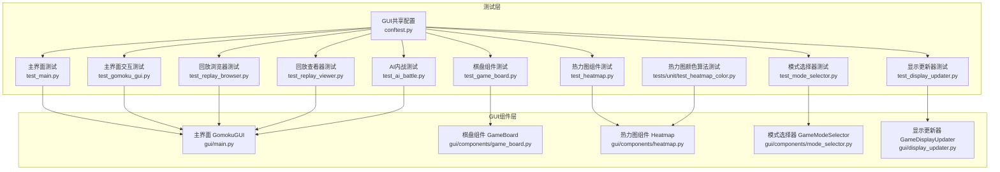
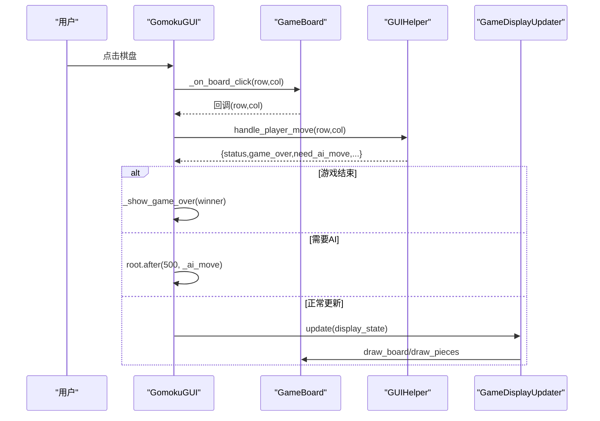
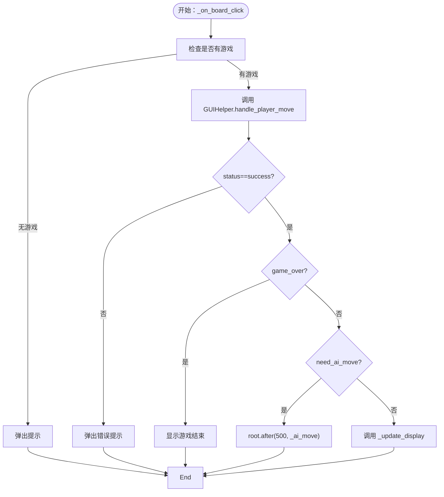
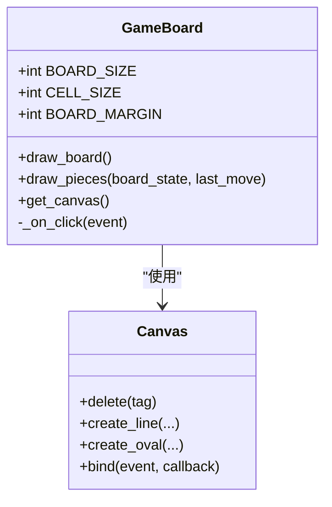
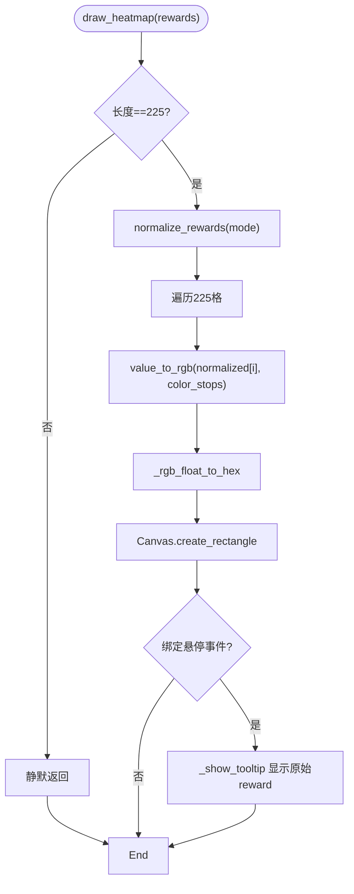
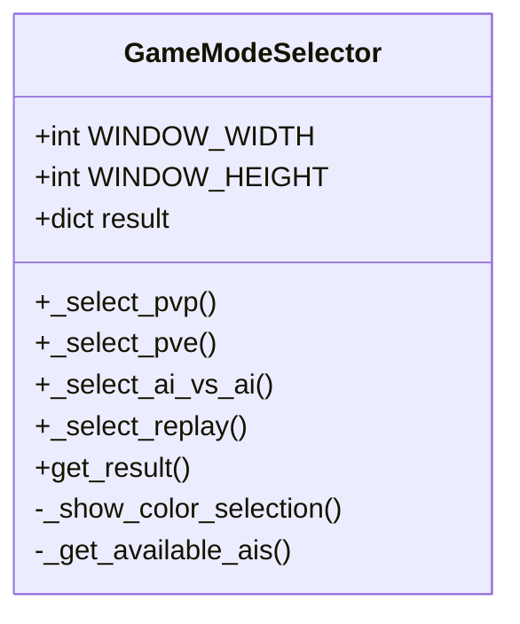
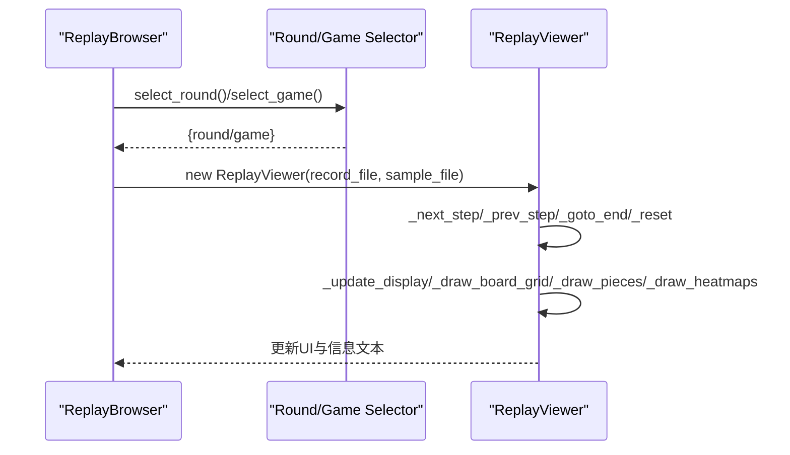
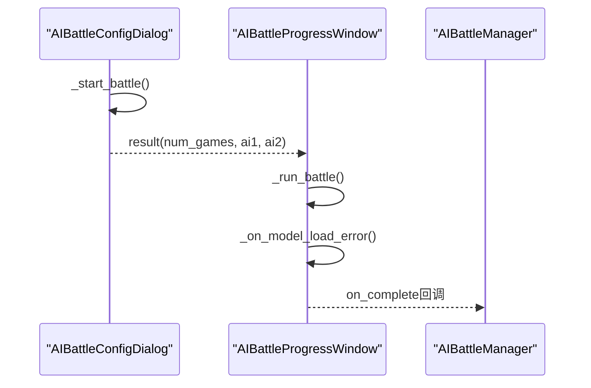
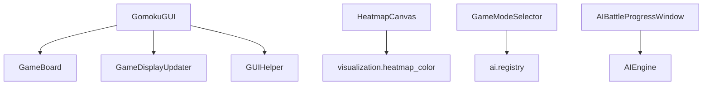

# GUI模块测试用例

<cite>
**本文档引用的文件**
- [tests/gui/test_gomoku_gui.py](file://tests/gui/test_gomoku_gui.py)
- [tests/gui/test_game_board.py](file://tests/gui/test_game_board.py)
- [tests/gui/test_heatmap.py](file://tests/gui/test_heatmap.py)
- [tests/gui/test_mode_selector.py](file://tests/gui/test_mode_selector.py)
- [tests/gui/test_main.py](file://tests/gui/test_main.py)
- [tests/gui/test_display_updater.py](file://tests/gui/test_display_updater.py)
- [tests/gui/test_replay_browser.py](file://tests/gui/test_replay_browser.py)
- [tests/gui/test_replay_viewer.py](file://tests/gui/test_replay_viewer.py)
- [tests/gui/test_ai_battle.py](file://tests/gui/test_ai_battle.py)
- [tests/gui/conftest.py](file://tests/gui/conftest.py)
- [tests/unit/test_heatmap_color.py](file://tests/unit/test_heatmap_color.py)
- [gui/main.py](file://gui/main.py)
- [gui/components/game_board.py](file://gui/components/game_board.py)
- [gui/components/heatmap.py](file://gui/components/heatmap.py)
- [gui/components/mode_selector.py](file://gui/components/mode_selector.py)
- [gui/display_updater.py](file://gui/display_updater.py)
</cite>

## 目录
1. [简介](#简介)
2. [项目结构](#项目结构)
3. [核心组件](#核心组件)
4. [架构总览](#架构总览)
5. [详细组件测试分析](#详细组件测试分析)
6. [依赖关系分析](#依赖关系分析)
7. [性能考虑](#性能考虑)
8. [故障排查指南](#故障排查指南)
9. [结论](#结论)
10. [附录](#附录)

## 简介
本文件系统化梳理GUI模块的测试用例，覆盖主界面、棋盘组件、热力图组件、模式选择器以及回放浏览/查看、AI内战等子系统的测试策略与实现细节。文档同时提供交互测试、视觉效果测试、性能测试、错误处理与跨平台兼容性测试的完整方法论与实践建议，帮助开发者快速定位问题并持续改进GUI质量。

## 项目结构
GUI测试主要集中在tests/gui目录，采用按功能模块分层组织：
- 主界面与菜单流程测试：tests/gui/test_main.py
- 组件级单元测试：棋盘(test_game_board.py)、热力图(test_heatmap.py)、模式选择器(test_mode_selector.py)
- 回放系统测试：replay_browser.py、replay_viewer.py
- AI内战测试：ai_battle.py
- 显示更新器测试：display_updater.py
- GUI共享配置：conftest.py（解决Windows+Python3.13下Tcl解释器不稳定问题）
- 热力图颜色算法单元测试：tests/unit/test_heatmap_color.py

图表来源
- [tests/gui/test_main.py:1-450](file://tests/gui/test_main.py#L1-L450)
- [tests/gui/test_gomoku_gui.py:1-295](file://tests/gui/test_gomoku_gui.py#L1-L295)
- [tests/gui/test_game_board.py:1-212](file://tests/gui/test_game_board.py#L1-L212)
- [tests/gui/test_heatmap.py:1-341](file://tests/gui/test_heatmap.py#L1-L341)
- [tests/gui/test_mode_selector.py:1-166](file://tests/gui/test_mode_selector.py#L1-L166)
- [tests/gui/test_replay_browser.py:1-206](file://tests/gui/test_replay_browser.py#L1-L206)
- [tests/gui/test_replay_viewer.py:1-288](file://tests/gui/test_replay_viewer.py#L1-L288)
- [tests/gui/test_ai_battle.py:1-311](file://tests/gui/test_ai_battle.py#L1-L311)
- [tests/gui/test_display_updater.py:1-359](file://tests/gui/test_display_updater.py#L1-L359)
- [tests/gui/conftest.py:1-53](file://tests/gui/conftest.py#L1-L53)
- [tests/unit/test_heatmap_color.py:1-257](file://tests/unit/test_heatmap_color.py#L1-L257)
- [gui/main.py:1-462](file://gui/main.py#L1-L462)
- [gui/components/game_board.py:1-170](file://gui/components/game_board.py#L1-L170)
- [gui/components/heatmap.py:1-358](file://gui/components/heatmap.py#L1-L358)
- [gui/components/mode_selector.py:1-411](file://gui/components/mode_selector.py#L1-L411)
- [gui/display_updater.py:1-110](file://gui/display_updater.py#L1-L110)

章节来源
- [tests/gui/test_main.py:1-450](file://tests/gui/test_main.py#L1-L450)
- [tests/gui/test_gomoku_gui.py:1-295](file://tests/gui/test_gomoku_gui.py#L1-L295)
- [tests/gui/test_game_board.py:1-212](file://tests/gui/test_game_board.py#L1-L212)
- [tests/gui/test_heatmap.py:1-341](file://tests/gui/test_heatmap.py#L1-L341)
- [tests/gui/test_mode_selector.py:1-166](file://tests/gui/test_mode_selector.py#L1-L166)
- [tests/gui/test_replay_browser.py:1-206](file://tests/gui/test_replay_browser.py#L1-L206)
- [tests/gui/test_replay_viewer.py:1-288](file://tests/gui/test_replay_viewer.py#L1-L288)
- [tests/gui/test_ai_battle.py:1-311](file://tests/gui/test_ai_battle.py#L1-L311)
- [tests/gui/test_display_updater.py:1-359](file://tests/gui/test_display_updater.py#L1-L359)
- [tests/gui/conftest.py:1-53](file://tests/gui/conftest.py#L1-L53)
- [tests/unit/test_heatmap_color.py:1-257](file://tests/unit/test_heatmap_color.py#L1-L257)
- [gui/main.py:1-462](file://gui/main.py#L1-L462)
- [gui/components/game_board.py:1-170](file://gui/components/game_board.py#L1-L170)
- [gui/components/heatmap.py:1-358](file://gui/components/heatmap.py#L1-L358)
- [gui/components/mode_selector.py:1-411](file://gui/components/mode_selector.py#L1-L411)
- [gui/display_updater.py:1-110](file://gui/display_updater.py#L1-L110)

## 核心组件
- 主界面GomokuGUI：负责菜单、主框架、棋盘组件、信息面板、历史记录、显示更新器的组装与事件调度。
- 棋盘组件GameBoard：绘制15×15网格、棋子、最后落子高亮，处理点击事件并回调上层。
- 热力图组件Heatmap：基于可视化模块的归一化与颜色映射，绘制225格热力图，支持tooltip与自定义色板。
- 模式选择器GameModeSelector：提供PvP/PvE/AI内战/回放模式选择，支持颜色与AI配置。
- 显示更新器GameDisplayUpdater：根据display_state刷新棋盘、标签、历史记录与游戏结束弹窗。
- 回放系统：ReplayBrowser/ReplayViewer负责AI对局回放浏览与查看。
- AI内战：AIBattleConfigDialog/AIBattleProgressWindow/AIBattleManager负责AI对战配置与进度展示。

章节来源
- [gui/main.py:31-90](file://gui/main.py#L31-L90)
- [gui/components/game_board.py:7-52](file://gui/components/game_board.py#L7-L52)
- [gui/components/heatmap.py:68-134](file://gui/components/heatmap.py#L68-L134)
- [gui/components/mode_selector.py:12-52](file://gui/components/mode_selector.py#L12-L52)
- [gui/display_updater.py:13-40](file://gui/display_updater.py#L13-L40)

## 架构总览
GUI测试采用“组件级单元测试 + 主流程集成测试”的双层策略：
- 组件级：对每个GUI组件进行独立单元测试，验证绘制、事件、布局、颜色等行为。
- 集成级：对主界面的菜单调用链、状态转换、AI调度、错误处理进行端到端验证。

图表来源
- [gui/main.py:91-200](file://gui/main.py#L91-L200)
- [gui/components/game_board.py:151-166](file://gui/components/game_board.py#L151-L166)
- [gui/display_updater.py:40-82](file://gui/display_updater.py#L40-L82)
- [tests/gui/test_main.py:68-152](file://tests/gui/test_main.py#L68-L152)

## 详细组件测试分析

### 主界面测试（GomokuGUI）
- 落子后状态解析：验证controller返回dict结构，避免元组解包错误；验证is_over方法存在而非is_game_over。
- 人机对战流程：验证玩家执黑/白时AI是否正确调度；验证AI先走时游戏创建与落子、显示更新、当前玩家切换。
- 调用链验证：通过mock替换messagebox、root.after等，验证_on_board_click、_ai_move、_update_display的调用顺序与条件分支。
- 错误处理：验证ModelLoadError在不同模式下的弹窗提示与流程中断。

图表来源
- [tests/gui/test_gomoku_gui.py:76-138](file://tests/gui/test_gomoku_gui.py#L76-L138)
- [tests/gui/test_main.py:68-152](file://tests/gui/test_main.py#L68-L152)

章节来源
- [tests/gui/test_gomoku_gui.py:1-295](file://tests/gui/test_gomoku_gui.py#L1-L295)
- [tests/gui/test_main.py:1-450](file://tests/gui/test_main.py#L1-L450)

### 棋盘组件测试（GameBoard）
- 初始化与布局：验证BOARD_SIZE、CELL_SIZE、BOARD_MARGIN常量；验证画布尺寸计算。
- 绘制功能：验证空棋盘、黑棋、白棋、最后落子标记的图形对象数量变化。
- 事件处理：验证点击坐标映射到棋盘行列，边界外点击不触发回调。
- 回调机制：验证on_click_callback参数传递与调用时机。

图表来源
- [gui/components/game_board.py:7-170](file://gui/components/game_board.py#L7-L170)
- [tests/gui/test_game_board.py:17-212](file://tests/gui/test_game_board.py#L17-L212)

章节来源
- [tests/gui/test_game_board.py:1-212](file://tests/gui/test_game_board.py#L1-L212)
- [gui/components/game_board.py:1-170](file://gui/components/game_board.py#L1-L170)

### 热力图组件测试（Heatmap）
- 基础绘制：验证225个零值可正常绘制；长度不等于225时静默返回。
- Tooltip：验证悬停显示原始reward值，坐标与行列信息展示；隐藏tooltip逻辑。
- 归一化与色板：默认log模式；支持自定义color_stops；非法mode在draw阶段抛错。
- 颜色精度：验证tooltip中reward的6位有效数字格式化，避免长尾显示。
- 端到端：结合visualization.heatmap_color的value_to_rgb/normalize_rewards契约，验证颜色映射正确性。

图表来源
- [gui/components/heatmap.py:137-200](file://gui/components/heatmap.py#L137-L200)
- [tests/gui/test_heatmap.py:39-220](file://tests/gui/test_heatmap.py#L39-L220)
- [tests/unit/test_heatmap_color.py:1-257](file://tests/unit/test_heatmap_color.py#L1-L257)

章节来源
- [tests/gui/test_heatmap.py:1-341](file://tests/gui/test_heatmap.py#L1-L341)
- [gui/components/heatmap.py:1-358](file://gui/components/heatmap.py#L1-L358)
- [tests/unit/test_heatmap_color.py:1-257](file://tests/unit/test_heatmap_color.py#L1-L257)

### 模式选择器测试（GameModeSelector）
- 初始化与布局：验证窗口尺寸、配色方案、标题与描述文本。
- 模式选择：验证PvP、PvE（执黑/执白）、AI内战、回放模式的选择结果。
- 颜色与AI配置：验证Toplevel对话框创建、可用AI列表委托至registry、默认值设置。
- 结果获取：验证get_result在未选择时返回None，选择后返回正确字典。

图表来源
- [gui/components/mode_selector.py:12-200](file://gui/components/mode_selector.py#L12-L200)
- [tests/gui/test_mode_selector.py:17-166](file://tests/gui/test_mode_selector.py#L17-L166)

章节来源
- [tests/gui/test_mode_selector.py:1-166](file://tests/gui/test_mode_selector.py#L1-L166)
- [gui/components/mode_selector.py:1-411](file://gui/components/mode_selector.py#L1-L411)

### 回放系统测试（ReplayBrowser/ReplayViewer）
- 回放浏览器：验证轮次与对局目录扫描、字段完整性（name/path/display/id/record_file）。
- 回放查看器：验证历史步进、棋盘绘制、热力图绘制、信息文本更新、样本数据联动。
- 边界与回归：验证goto_end不越界、空output不崩溃、225格式reward绘制。

图表来源
- [tests/gui/test_replay_browser.py:45-206](file://tests/gui/test_replay_browser.py#L45-L206)
- [tests/gui/test_replay_viewer.py:18-288](file://tests/gui/test_replay_viewer.py#L18-L288)

章节来源
- [tests/gui/test_replay_browser.py:1-206](file://tests/gui/test_replay_browser.py#L1-L206)
- [tests/gui/test_replay_viewer.py:1-288](file://tests/gui/test_replay_viewer.py#L1-L288)

### AI内战测试（AIBattle）
- 配置对话框：验证默认局数、默认AI、可用AI列表委托、非法输入不崩溃。
- 进度窗口：验证引擎创建、线程调度、ModelLoadError处理与弹窗提示。
- 管理器：验证run_ai_vs_ai静态方法可用性。

图表来源
- [tests/gui/test_ai_battle.py:24-311](file://tests/gui/test_ai_battle.py#L24-L311)

章节来源
- [tests/gui/test_ai_battle.py:1-311](file://tests/gui/test_ai_battle.py#L1-L311)

### 显示更新器测试（GameDisplayUpdater）
- update：验证无游戏/有游戏、当前玩家回合/获胜/平局状态下的标签与棋盘绘制。
- update_history：验证历史记录清空、插入、序号格式与滚动。
- show_game_over：验证弹窗标题与内容格式。

章节来源
- [tests/gui/test_display_updater.py:1-359](file://tests/gui/test_display_updater.py#L1-L359)
- [gui/display_updater.py:1-110](file://gui/display_updater.py#L1-L110)

## 依赖关系分析
- 组件耦合：GomokuGUI依赖GameBoard、GameDisplayUpdater、GUIHelper；HeatmapCanvas依赖visualization.heatmap_color；模式选择器依赖ai.registry。
- 外部依赖：tkinter（GUI）、messagebox/simpledialog（对话框）、threading（AI内战后台线程）。
- 可能的循环依赖：测试文件通过conftest统一替换tk.Tk，避免各组件间相互影响。

图表来源
- [gui/main.py:18-28](file://gui/main.py#L18-L28)
- [gui/components/heatmap.py:30-34](file://gui/components/heatmap.py#L30-L34)
- [gui/components/mode_selector.py:8-9](file://gui/components/mode_selector.py#L8-L9)
- [tests/gui/test_ai_battle.py:198-228](file://tests/gui/test_ai_battle.py#L198-L228)

章节来源
- [gui/main.py:1-462](file://gui/main.py#L1-L462)
- [gui/components/heatmap.py:1-358](file://gui/components/heatmap.py#L1-L358)
- [gui/components/mode_selector.py:1-411](file://gui/components/mode_selector.py#L1-L411)
- [tests/gui/test_ai_battle.py:1-311](file://tests/gui/test_ai_battle.py#L1-L311)

## 性能考虑
- 界面响应时间：通过root.after调度AI落子（500ms延迟），测试中使用mock捕获调度调用，验证响应链路。
- 内存使用：conftest通过一次性共享root替换tk.Tk，避免Windows+Python3.13下Tcl解释器频繁初始化导致的内存抖动与非确定性失败。
- 动画流畅性：热力图绘制采用批量归一化与Canvas矩形绘制，测试关注绘制稳定性与tooltip交互响应。

章节来源
- [tests/gui/test_main.py:120-138](file://tests/gui/test_main.py#L120-L138)
- [tests/gui/conftest.py:1-53](file://tests/gui/conftest.py#L1-L53)
- [tests/gui/test_heatmap.py:137-200](file://tests/gui/test_heatmap.py#L137-L200)

## 故障排查指南
- 模型加载失败：在PvE与AI内战模式下，ModelLoadError应被捕获并通过messagebox弹窗提示，测试覆盖两种场景。
- Tcl解释器异常：Windows+Python3.13下反复创建tk.Tk会导致“init.tcl”读取失败，conftest提供全局替换工厂，确保测试稳定。
- 热力图绘制异常：非法mode在draw阶段抛错；长度不匹配静默返回；tooltip显示原始reward避免长尾显示。
- 回放数据越界：goto_end时保护current_step不越界，测试覆盖该边界场景。

章节来源
- [tests/gui/test_main.py:374-450](file://tests/gui/test_main.py#L374-L450)
- [tests/gui/conftest.py:1-53](file://tests/gui/conftest.py#L1-L53)
- [tests/gui/test_heatmap.py:159-200](file://tests/gui/test_heatmap.py#L159-L200)
- [tests/gui/test_replay_viewer.py:213-228](file://tests/gui/test_replay_viewer.py#L213-L228)

## 结论
GUI模块测试体系通过组件级与集成级测试相结合，全面覆盖用户交互、界面更新、事件处理、颜色渲染、布局适配、主题切换、错误处理与跨平台稳定性。配合conftest的共享root策略与热力图颜色算法的单元测试，确保在复杂AI对局与回放场景下的可靠性与一致性。

## 附录
- 测试执行建议：优先运行组件级测试定位具体组件问题，再运行集成测试验证端到端流程。
- 可访问性：当前测试未覆盖键盘导航与屏幕阅读器支持，建议补充焦点管理与无障碍标签断言。
- 跨平台：conftest已解决Windows+Python3.13的Tcl问题，macOS/Linux建议在CI中增加GUI交互测试覆盖率。