# 单元测试用例

<cite>
**本文引用的文件**   
- [tests/conftest.py](file://tests/conftest.py)
- [tests/run_tests.py](file://tests/run_tests.py)
- [tests/ai/unit/test_game_manager_unit.py](file://tests/ai/unit/test_game_manager_unit.py)
- [tests/ai/unit/test_registry.py](file://tests/ai/unit/test_registry.py)
- [tests/ai/unit/test_runners.py](file://tests/ai/unit/test_runners.py)
- [tests/ai/unit/test_sample_loader_split.py](file://tests/ai/unit/test_sample_loader_split.py)
- [tests/ai/helpers.py](file://tests/ai/helpers.py)
- [tests/unit/test_heatmap_color.py](file://tests/unit/test_heatmap_color.py)
- [tests/unit/test_lr_range_test.py](file://tests/unit/test_lr_range_test.py)
- [tests/gui/test_game_board.py](file://tests/gui/test_game_board.py)
- [tests/cli/test_main.py](file://tests/cli/test_main.py)
</cite>

## 目录
1. [简介](#简介)
2. [项目结构](#项目结构)
3. [核心组件](#核心组件)
4. [架构总览](#架构总览)
5. [详细组件分析](#详细组件分析)
6. [依赖分析](#依赖分析)
7. [性能考虑](#性能考虑)
8. [故障排查指南](#故障排查指南)
9. [结论](#结论)
10. [附录](#附录)

## 简介
本文件面向五子棋项目的单元测试体系，系统梳理单函数测试、算法测试与工具函数测试的实现方法与最佳实践，总结测试设计原则（隔离性、可重复性、可维护性），并提供测试用例设计、断言方法与测试数据准备的指导。同时结合现有测试组织结构、命名规范与执行策略，给出覆盖率分析与补充建议。

## 项目结构
测试目录采用按功能域与层级划分的组织方式：
- tests/
  - ai/：AI相关测试，细分为 unit、primary、edge、integration 等层次
  - app/：应用层测试
  - cli/：命令行接口测试
  - gui/：图形界面组件测试
  - unit/：通用工具与可视化模块的单元测试
  - integration/：集成测试
  - conftest.py：全局 pytest 配置（环境初始化、写保护钩子、路径注入）
  - run_tests.py：统一入口脚本，封装 pytest 调用与兼容性处理

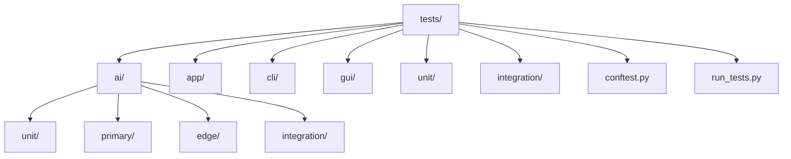

**图示来源**
- [tests/conftest.py:1-119](file://tests/conftest.py#L1-L119)
- [tests/run_tests.py:1-60](file://tests/run_tests.py#L1-L60)

**章节来源**
- [tests/conftest.py:1-119](file://tests/conftest.py#L1-L119)
- [tests/run_tests.py:1-60](file://tests/run_tests.py#L1-L60)

## 核心组件
- 测试运行与环境
  - 全局配置：在 pytest 收集阶段注入项目根目录至 sys.path，设置训练损失日志目录，安装写保护钩子防止测试写入受保护目录
  - 统一入口：tests/run_tests.py 封装 pytest 调用，默认禁用输出捕获以规避 Windows 上 Tkinter 兼容性问题
- 单元测试样例
  - AI 游戏管理器：对私有静态方法进行主流程与边界条件测试，验证记录文件生成与字段完整性
  - 注册表：对模型/训练器加载、异常处理、懒加载与注册表数据一致性进行测试
  - 运行器：对训练与循环模式的参数透传、异常处理与清理逻辑进行测试
  - 数据分割：对训练/验证集比例、无重叠、完整性、可复现性与边界条件进行测试
  - 可视化工具：对颜色映射、归一化模式与 RGBA 输出进行测试
  - LR 范围测试：对模型加载、数据加载、曲线绘图与学习率扫描流程进行测试
  - GUI 组件：对棋盘绘制、点击回调、边界判定与画布尺寸进行测试
  - CLI：对命令解析、参数校验与 REPL 循环行为进行测试

**章节来源**
- [tests/conftest.py:1-119](file://tests/conftest.py#L1-L119)
- [tests/run_tests.py:1-60](file://tests/run_tests.py#L1-L60)
- [tests/ai/unit/test_game_manager_unit.py:1-317](file://tests/ai/unit/test_game_manager_unit.py#L1-L317)
- [tests/ai/unit/test_registry.py:1-288](file://tests/ai/unit/test_registry.py#L1-L288)
- [tests/ai/unit/test_runners.py:1-237](file://tests/ai/unit/test_runners.py#L1-L237)
- [tests/ai/unit/test_sample_loader_split.py:1-192](file://tests/ai/unit/test_sample_loader_split.py#L1-L192)
- [tests/ai/helpers.py:1-73](file://tests/ai/helpers.py#L1-L73)
- [tests/unit/test_heatmap_color.py:1-257](file://tests/unit/test_heatmap_color.py#L1-L257)
- [tests/unit/test_lr_range_test.py:1-271](file://tests/unit/test_lr_range_test.py#L1-L271)
- [tests/gui/test_game_board.py:1-212](file://tests/gui/test_game_board.py#L1-L212)
- [tests/cli/test_main.py:1-352](file://tests/cli/test_main.py#L1-L352)

## 架构总览
测试架构围绕“隔离、可重复、可维护”的原则构建，通过 pytest 钩子与 fixtures 实现环境隔离与资源清理，通过 mock 与临时目录保障测试稳定性，并通过统一入口脚本与配置文件确保跨平台一致性。

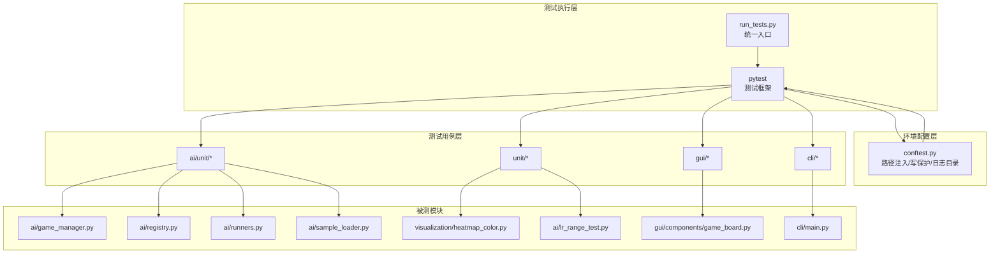

**图示来源**
- [tests/run_tests.py:1-60](file://tests/run_tests.py#L1-L60)
- [tests/conftest.py:1-119](file://tests/conftest.py#L1-L119)
- [tests/ai/unit/test_game_manager_unit.py:1-317](file://tests/ai/unit/test_game_manager_unit.py#L1-L317)
- [tests/ai/unit/test_registry.py:1-288](file://tests/ai/unit/test_registry.py#L1-L288)
- [tests/ai/unit/test_runners.py:1-237](file://tests/ai/unit/test_runners.py#L1-L237)
- [tests/ai/unit/test_sample_loader_split.py:1-192](file://tests/ai/unit/test_sample_loader_split.py#L1-L192)
- [tests/unit/test_heatmap_color.py:1-257](file://tests/unit/test_heatmap_color.py#L1-L257)
- [tests/unit/test_lr_range_test.py:1-271](file://tests/unit/test_lr_range_test.py#L1-L271)
- [tests/gui/test_game_board.py:1-212](file://tests/gui/test_game_board.py#L1-L212)
- [tests/cli/test_main.py:1-352](file://tests/cli/test_main.py#L1-L352)

## 详细组件分析

### 组件A：AI 游戏管理器单元测试
- 测试目标
  - 提取并测试私有静态方法 _play_single_game 的主流程与边界条件
  - 验证记录文件生成、字段完整性与维度约束
  - 验证异常场景（棋盘已满）下的行为与数据保存
- 设计要点
  - 使用临时目录与 patch 替换控制器保存路径，避免污染真实数据
  - 通过 mock 引擎模拟异常抛出，验证异常处理与数据持久化
  - 断言 winner 合法性、记录文件存在性与字段完整性
- 关键断言
  - 记录文件存在且包含 history/winner/end_board
  - end_board 维度符合预期
  - 多局独立运行，每局记录独立
  - 棋盘已满时仍能保存结果

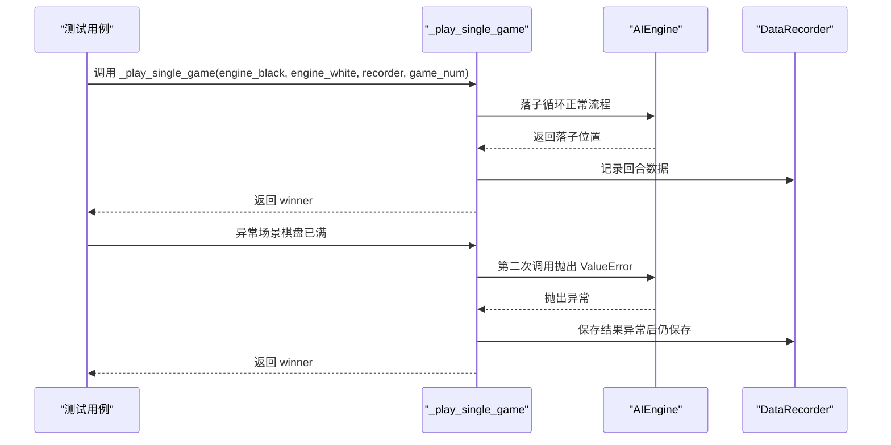

**图示来源**
- [tests/ai/unit/test_game_manager_unit.py:50-148](file://tests/ai/unit/test_game_manager_unit.py#L50-L148)
- [tests/ai/unit/test_game_manager_unit.py:256-313](file://tests/ai/unit/test_game_manager_unit.py#L256-L313)

**章节来源**
- [tests/ai/unit/test_game_manager_unit.py:1-317](file://tests/ai/unit/test_game_manager_unit.py#L1-L317)

### 组件B：注册表单元测试
- 测试目标
  - get_model/get_trainer/list_models 的正确性与异常处理
  - 多代模型加载与参数透传
  - 懒加载机制与注册表数据完整性
- 设计要点
  - 使用临时权重文件满足多代模型加载约束
  - 断言 predict 输出维度与非负性
  - 断言 trainer 构造参数透传与调度器类型
  - 通过源码检查验证懒加载实现

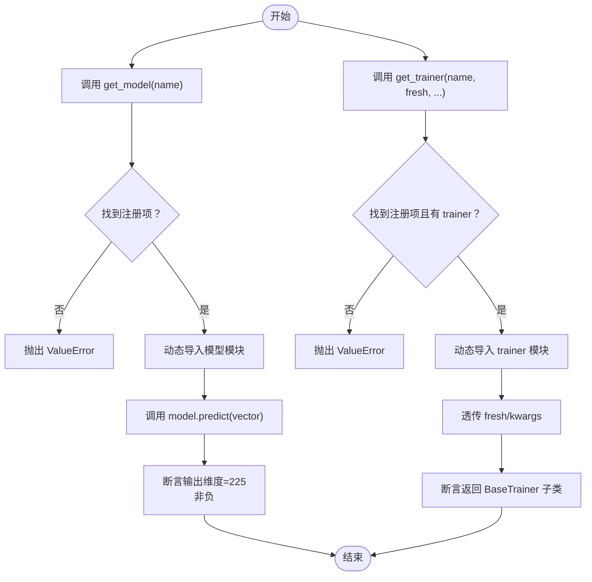

**图示来源**
- [tests/ai/unit/test_registry.py:26-106](file://tests/ai/unit/test_registry.py#L26-L106)
- [tests/ai/unit/test_registry.py:108-173](file://tests/ai/unit/test_registry.py#L108-L173)
- [tests/ai/unit/test_registry.py:175-214](file://tests/ai/unit/test_registry.py#L175-L214)
- [tests/ai/unit/test_registry.py:215-248](file://tests/ai/unit/test_registry.py#L215-L248)
- [tests/ai/unit/test_registry.py:250-284](file://tests/ai/unit/test_registry.py#L250-L284)

**章节来源**
- [tests/ai/unit/test_registry.py:1-288](file://tests/ai/unit/test_registry.py#L1-L288)

### 组件C：运行器单元测试
- 测试目标
  - run_train_from_dir：路径存在性、空文件、批处理与清理逻辑
  - run_cycle：参数透传、温度采样开关、异常处理
- 设计要点
  - 使用临时目录与 mock trainer 验证 train_auto/train_cycle 调用
  - 断言异常时的 sys.exit 与清理调用
  - 通过参数命名空间构造合理默认值

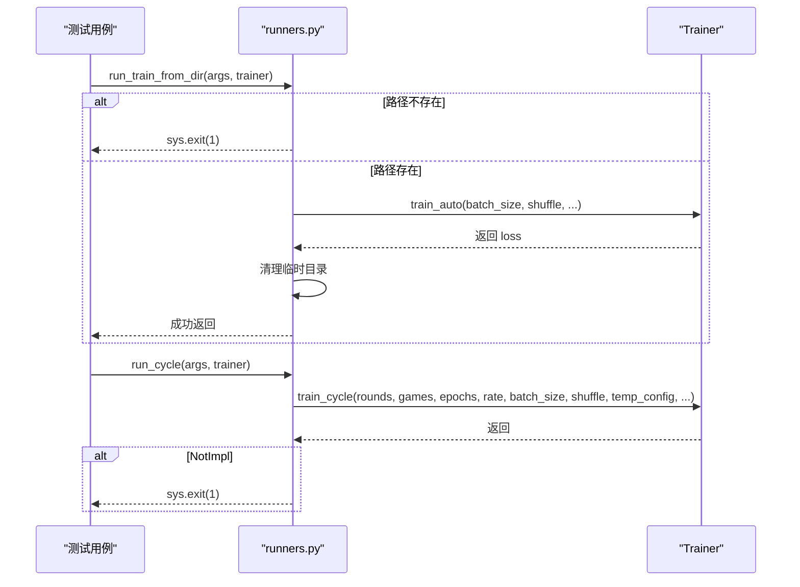

**图示来源**
- [tests/ai/unit/test_runners.py:81-175](file://tests/ai/unit/test_runners.py#L81-L175)
- [tests/ai/unit/test_runners.py:177-233](file://tests/ai/unit/test_runners.py#L177-L233)

**章节来源**
- [tests/ai/unit/test_runners.py:1-237](file://tests/ai/unit/test_runners.py#L1-L237)

### 组件D：样本加载与分割单元测试
- 测试目标
  - load_and_split 按比例分割训练/验证集，保证无重叠、完整性与可复现性
  - 边界条件：val_ratio 合法性、单样本、文件缺失
- 设计要点
  - 通过辅助函数批量创建包含 sample.json 的目录
  - 使用固定种子确保可复现性
  - 断言比例误差在允许范围内

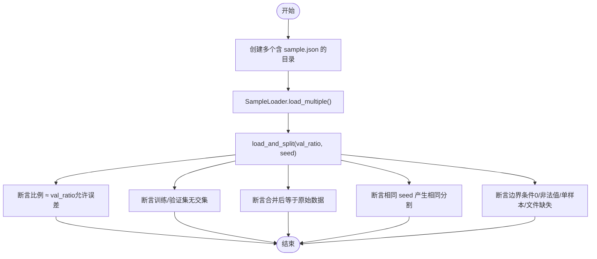

**图示来源**
- [tests/ai/unit/test_sample_loader_split.py:48-74](file://tests/ai/unit/test_sample_loader_split.py#L48-L74)
- [tests/ai/unit/test_sample_loader_split.py:76-104](file://tests/ai/unit/test_sample_loader_split.py#L76-L104)
- [tests/ai/unit/test_sample_loader_split.py:106-126](file://tests/ai/unit/test_sample_loader_split.py#L106-L126)
- [tests/ai/unit/test_sample_loader_split.py:142-188](file://tests/ai/unit/test_sample_loader_split.py#L142-L188)

**章节来源**
- [tests/ai/unit/test_sample_loader_split.py:1-192](file://tests/ai/unit/test_sample_loader_split.py#L1-L192)
- [tests/ai/helpers.py:1-73](file://tests/ai/helpers.py#L1-L73)

### 组件E：可视化工具单元测试
- 测试目标
  - value_to_rgb：端点命中、中段插值、越界截断、自定义色板
  - normalize_rewards：max/log/linear 模式、全零输入、非法 mode
  - rewards_to_rgba：alpha 通道附加与颜色映射
- 设计要点
  - 使用容差断言浮点颜色值
  - 参数化测试覆盖多种模式与边界

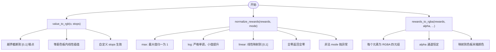

**图示来源**
- [tests/unit/test_heatmap_color.py:35-95](file://tests/unit/test_heatmap_color.py#L35-L95)
- [tests/unit/test_heatmap_color.py:132-146](file://tests/unit/test_heatmap_color.py#L132-L146)
- [tests/unit/test_heatmap_color.py:151-181](file://tests/unit/test_heatmap_color.py#L151-L181)
- [tests/unit/test_heatmap_color.py:187-196](file://tests/unit/test_heatmap_color.py#L187-L196)
- [tests/unit/test_heatmap_color.py:201-213](file://tests/unit/test_heatmap_color.py#L201-L213)
- [tests/unit/test_heatmap_color.py:218-226](file://tests/unit/test_heatmap_color.py#L218-L226)
- [tests/unit/test_heatmap_color.py:231-257](file://tests/unit/test_heatmap_color.py#L231-L257)

**章节来源**
- [tests/unit/test_heatmap_color.py:1-257](file://tests/unit/test_heatmap_color.py#L1-L257)

### 组件F：LR 范围测试单元测试
- 测试目标
  - load_model/load_data/plot_lr_loss_curve/run_lr_range_test 的接口正确性
  - lr 线性递增、loss 有限、模型每轮重置
- 设计要点
  - 使用辅助函数创建 merge 文件与 sample 目录
  - 断言 lr 首尾值与长度、loss 有限性与一致性

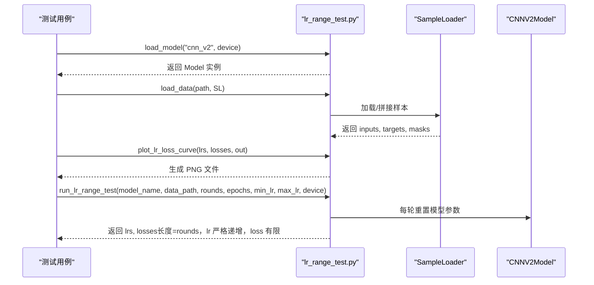

**图示来源**
- [tests/unit/test_lr_range_test.py:60-73](file://tests/unit/test_lr_range_test.py#L60-L73)
- [tests/unit/test_lr_range_test.py:75-106](file://tests/unit/test_lr_range_test.py#L75-L106)
- [tests/unit/test_lr_range_test.py:108-122](file://tests/unit/test_lr_range_test.py#L108-L122)
- [tests/unit/test_lr_range_test.py:124-267](file://tests/unit/test_lr_range_test.py#L124-L267)

**章节来源**
- [tests/unit/test_lr_range_test.py:1-271](file://tests/unit/test_lr_range_test.py#L1-L271)
- [tests/ai/helpers.py:12-55](file://tests/ai/helpers.py#L12-L55)

### 组件G：GUI 组件单元测试
- 测试目标
  - GameBoard 初始化、绘制棋盘与棋子、点击回调与边界判定、画布尺寸
- 设计要点
  - 使用 Tkinter mock 与 Canvas 断言图形对象数量变化
  - 通过事件坐标映射验证点击回调

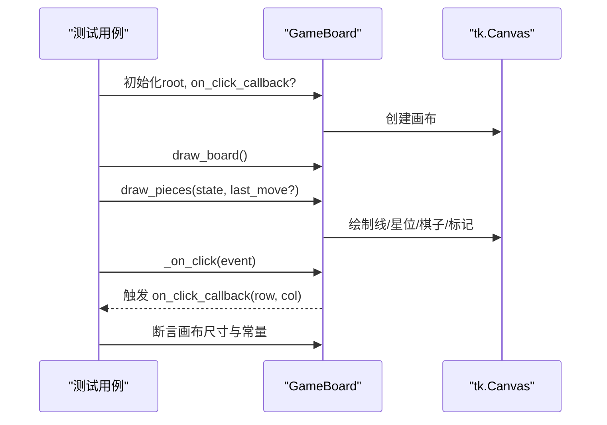

**图示来源**
- [tests/gui/test_game_board.py:32-124](file://tests/gui/test_game_board.py#L32-L124)
- [tests/gui/test_game_board.py:169-211](file://tests/gui/test_game_board.py#L169-L211)

**章节来源**
- [tests/gui/test_game_board.py:1-212](file://tests/gui/test_game_board.py#L1-L212)

### 组件H：CLI 单元测试
- 测试目标
  - 命令解析、参数校验、REPL 循环与异常中断处理
- 设计要点
  - 使用 patch 模拟 print/input，断言分派与错误提示
  - 验证 quit/exit 等价、help 列表完整、空输入继续循环

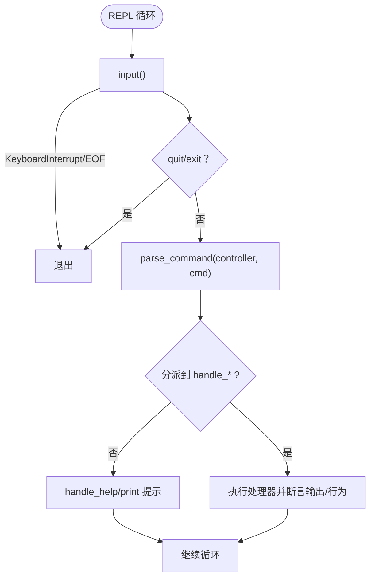

**图示来源**
- [tests/cli/test_main.py:318-352](file://tests/cli/test_main.py#L318-L352)
- [tests/cli/test_main.py:22-102](file://tests/cli/test_main.py#L22-L102)
- [tests/cli/test_main.py:104-140](file://tests/cli/test_main.py#L104-L140)
- [tests/cli/test_main.py:142-178](file://tests/cli/test_main.py#L142-L178)
- [tests/cli/test_main.py:180-208](file://tests/cli/test_main.py#L180-L208)
- [tests/cli/test_main.py:210-238](file://tests/cli/test_main.py#L210-L238)
- [tests/cli/test_main.py:240-267](file://tests/cli/test_main.py#L240-L267)
- [tests/cli/test_main.py:269-288](file://tests/cli/test_main.py#L269-L288)
- [tests/cli/test_main.py:299-313](file://tests/cli/test_main.py#L299-L313)

**章节来源**
- [tests/cli/test_main.py:1-352](file://tests/cli/test_main.py#L1-L352)

## 依赖分析
- 测试与被测模块的耦合关系
  - AI 单元测试依赖 game、ai.engine、ai.data_recorder 等模块
  - 可视化与 LR 测试依赖 torch、matplotlib（绘图）、SampleLoader
  - GUI 测试依赖 Tkinter
  - CLI 测试依赖游戏控制器与存档模块
- 外部依赖与集成点
  - pytest 作为测试框架
  - conftest 提供全局钩子与写保护
  - run_tests 统一入口，兼容 Windows 平台差异

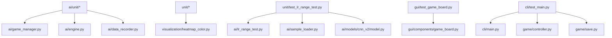

**图示来源**
- [tests/ai/unit/test_game_manager_unit.py:19-24](file://tests/ai/unit/test_game_manager_unit.py#L19-L24)
- [tests/unit/test_heatmap_color.py:12-17](file://tests/unit/test_heatmap_color.py#L12-L17)
- [tests/unit/test_lr_range_test.py:18-26](file://tests/unit/test_lr_range_test.py#L18-L26)
- [tests/gui/test_game_board.py](file://tests/gui/test_game_board.py#L14)
- [tests/cli/test_main.py:16-19](file://tests/cli/test_main.py#L16-L19)

**章节来源**
- [tests/ai/unit/test_game_manager_unit.py:1-317](file://tests/ai/unit/test_game_manager_unit.py#L1-L317)
- [tests/unit/test_heatmap_color.py:1-257](file://tests/unit/test_heatmap_color.py#L1-L257)
- [tests/unit/test_lr_range_test.py:1-271](file://tests/unit/test_lr_range_test.py#L1-L271)
- [tests/gui/test_game_board.py:1-212](file://tests/gui/test_game_board.py#L1-L212)
- [tests/cli/test_main.py:1-352](file://tests/cli/test_main.py#L1-L352)

## 性能考虑
- 测试执行效率
  - 使用临时目录与 mock 降低 I/O 与外部依赖开销
  - 通过参数化与共享辅助函数减少重复构造
- 资源管理
  - conftest 中的写保护钩子与日志目录清理避免资源泄漏
  - run_tests 默认禁用输出捕获，减少调试成本与平台兼容问题

[本节为通用建议，无需具体文件分析]

## 故障排查指南
- 写保护错误
  - 现象：尝试写入受保护目录触发断言
  - 处理：改用临时目录或 tmp_path fixture，或在测试中明确允许的写入路径
- Windows GUI 测试不稳定
  - 现象：Tcl/Tk 初始化失败导致 GUI 测试间歇性失败
  - 处理：使用统一入口脚本或 pytest 命令行默认禁用输出捕获
- 训练/循环模式异常
  - 现象：路径不存在或空文件导致提前退出
  - 处理：确保测试数据目录与文件存在，或断言 sys.exit 行为
- 可视化颜色断言失败
  - 现象：浮点颜色值微小差异导致断言失败
  - 处理：使用容差断言或统一精度

**章节来源**
- [tests/conftest.py:44-119](file://tests/conftest.py#L44-L119)
- [tests/run_tests.py:9-11](file://tests/run_tests.py#L9-L11)
- [tests/ai/unit/test_runners.py:84-102](file://tests/ai/unit/test_runners.py#L84-L102)
- [tests/unit/test_heatmap_color.py:24-30](file://tests/unit/test_heatmap_color.py#L24-L30)

## 结论
本项目的单元测试体系以 pytest 为核心，结合全局配置与统一入口，实现了良好的隔离性、可重复性与可维护性。通过覆盖函数级、算法级与工具函数级测试，配合断言与测试数据准备的最佳实践，能够有效保障核心模块的正确性与稳定性。建议持续完善覆盖率报告与测试补充策略，进一步提升质量与信心。

[本节为总结性内容，无需具体文件分析]

## 附录

### 单元测试设计原则
- 隔离性
  - 使用临时目录与 mock 替换外部依赖
  - 通过 patch 控制被测对象的外部交互
- 可重复性
  - 固定随机种子，确保结果可复现
  - 使用参数化测试覆盖多种输入组合
- 可维护性
  - 提取共享辅助函数，减少重复代码
  - 明确断言目标与错误提示，便于定位问题

**章节来源**
- [tests/ai/unit/test_sample_loader_split.py:109-126](file://tests/ai/unit/test_sample_loader_split.py#L109-L126)
- [tests/ai/helpers.py:12-55](file://tests/ai/helpers.py#L12-L55)

### 测试用例设计指南
- 测试用例设计
  - 主流程：覆盖正常输入与预期输出
  - 边界条件：最小/最大值、空输入、单元素、非法参数
  - 异常场景：抛出异常的输入与错误消息
- 断言方法
  - 精确断言：用于确定值（如维度、长度）
  - 容差断言：用于浮点比较（颜色、损失值）
  - 类型断言：确保返回对象类型正确
- 测试数据准备
  - 使用辅助函数批量生成测试数据
  - 通过参数化覆盖多组输入

**章节来源**
- [tests/unit/test_heatmap_color.py:24-30](file://tests/unit/test_heatmap_color.py#L24-L30)
- [tests/ai/unit/test_registry.py:29-35](file://tests/ai/unit/test_registry.py#L29-L35)
- [tests/ai/helpers.py:12-55](file://tests/ai/helpers.py#L12-L55)

### 单元测试组织结构、命名规范与执行策略
- 组织结构
  - tests/ai/unit、tests/unit、tests/gui、tests/cli 等按功能域划分
  - 每个模块下以 test_*.py 命名，清晰表达测试目标
- 命名规范
  - 测试类：TestXxx
  - 测试方法：test_xxx（动词短语）
  - 辅助函数：_xxx（内部使用）
- 执行策略
  - 统一入口：python tests/run_tests.py 或 python -m pytest tests/ -v -s
  - 全局钩子：conftest 注入路径、写保护、日志目录

**章节来源**
- [tests/run_tests.py:1-60](file://tests/run_tests.py#L1-L60)
- [tests/conftest.py:1-119](file://tests/conftest.py#L1-L119)

### 单元测试覆盖率分析
- 覆盖率统计
  - 项目提供 coverage_report 目录，包含 HTML 报告与索引页面
- 测试盲点识别
  - 通过报告定位未覆盖的文件与函数，优先补齐关键路径测试
- 测试补充策略
  - 针对高风险模块（训练、评估、可视化）增加边界与异常测试
  - 使用参数化与数据驱动测试扩大输入覆盖

**章节来源**
- [tests/run_tests.py:1-60](file://tests/run_tests.py#L1-L60)