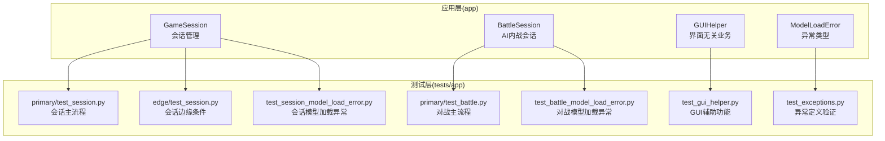
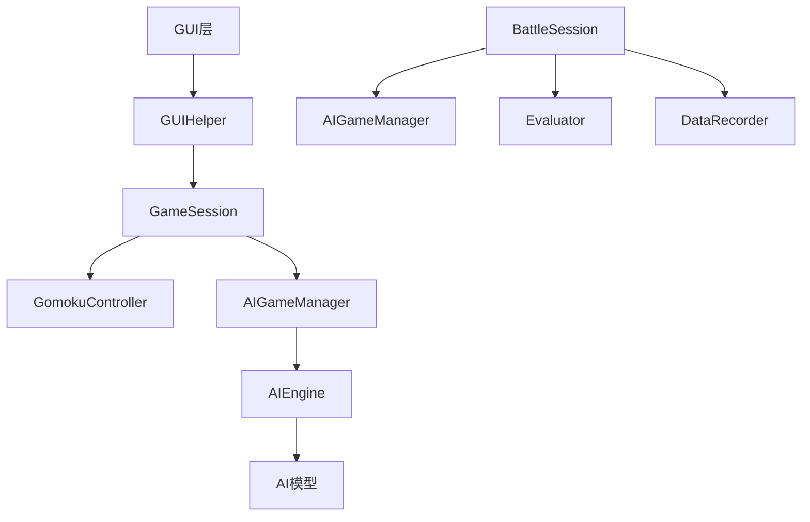
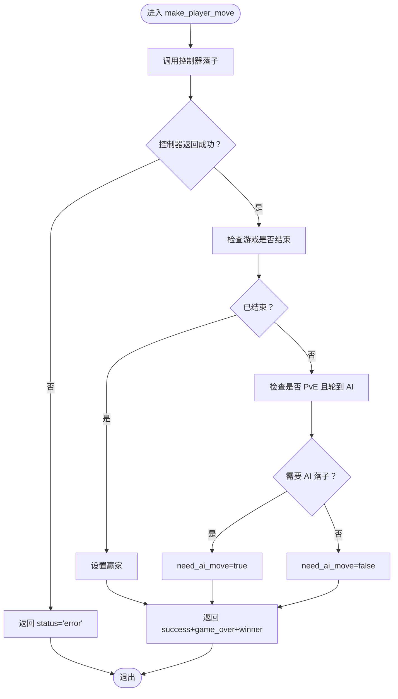
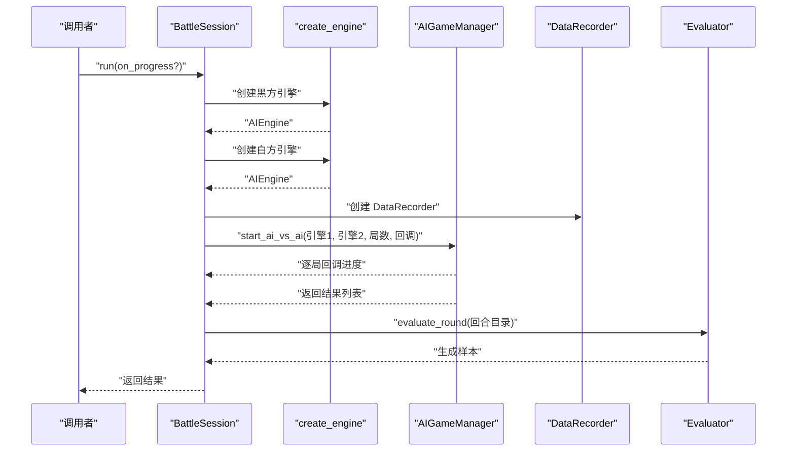
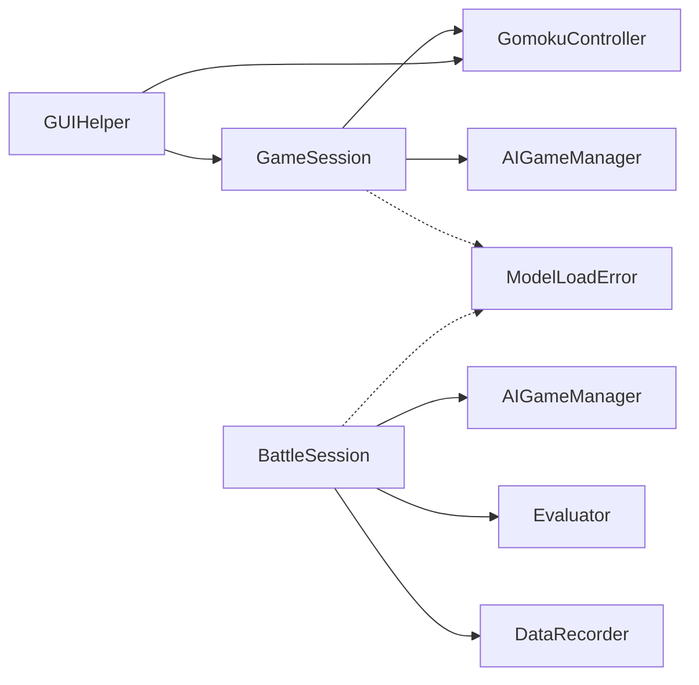

# 应用层测试用例

<cite>
**本文引用的文件**
- [app/session.py](file://app/session.py)
- [app/battle.py](file://app/battle.py)
- [app/gui_helper.py](file://app/gui_helper.py)
- [app/exceptions.py](file://app/exceptions.py)
- [tests/app/primary/test_session.py](file://tests/app/primary/test_session.py)
- [tests/app/edge/test_session.py](file://tests/app/edge/test_session.py)
- [tests/app/primary/test_battle.py](file://tests/app/primary/test_battle.py)
- [tests/app/test_exceptions.py](file://tests/app/test_exceptions.py)
- [tests/app/test_gui_helper.py](file://tests/app/test_gui_helper.py)
- [tests/app/test_session_model_load_error.py](file://tests/app/test_session_model_load_error.py)
- [tests/app/test_battle_model_load_error.py](file://tests/app/test_battle_model_load_error.py)
</cite>

## 目录
1. [引言](#引言)
2. [项目结构](#项目结构)
3. [核心组件](#核心组件)
4. [架构总览](#架构总览)
5. [详细组件分析](#详细组件分析)
6. [依赖分析](#依赖分析)
7. [性能考虑](#性能考虑)
8. [故障排查指南](#故障排查指南)
9. [结论](#结论)
10. [附录](#附录)

## 引言
本文件面向应用层测试，系统化梳理并规范游戏会话测试、对战管理测试与异常处理测试的实现方法。重点覆盖：
- 会话生命周期测试：从会话创建、启动游戏、落子、AI 调度到结束的全流程验证
- 对战状态管理测试：AI 内战流程、进度回调、训练样本生成与回放能力
- 错误恢复测试：模型加载失败、非法落子、越界落子、未开始游戏等异常路径
- 集成测试：会话与游戏逻辑、GUI、AI 引擎的协同验证
- 性能测试：会话创建、内存使用、并发处理的评估方法与标准
- 边界条件与稳定性：极端输入、重复操作、资源清理等策略

## 项目结构
应用层测试围绕 app 包的核心类展开：GameSession、BattleSession、GUIHelper，并配套异常类型 ModelLoadError。测试用例分布在 tests/app 目录下，按“主流程(primary)”、“边缘(edge)”、“集成/功能特定”分类组织。

图表来源
- [app/session.py:1-179](file://app/session.py#L1-L179)
- [app/battle.py:1-104](file://app/battle.py#L1-L104)
- [app/gui_helper.py:1-199](file://app/gui_helper.py#L1-L199)
- [app/exceptions.py:1-25](file://app/exceptions.py#L1-L25)
- [tests/app/primary/test_session.py:1-304](file://tests/app/primary/test_session.py#L1-L304)
- [tests/app/edge/test_session.py:1-146](file://tests/app/edge/test_session.py#L1-L146)
- [tests/app/primary/test_battle.py:1-141](file://tests/app/primary/test_battle.py#L1-L141)
- [tests/app/test_exceptions.py:1-45](file://tests/app/test_exceptions.py#L1-L45)
- [tests/app/test_gui_helper.py:1-219](file://tests/app/test_gui_helper.py#L1-L219)
- [tests/app/test_session_model_load_error.py:1-103](file://tests/app/test_session_model_load_error.py#L1-L103)
- [tests/app/test_battle_model_load_error.py:1-114](file://tests/app/test_battle_model_load_error.py#L1-L114)

章节来源
- [app/session.py:1-179](file://app/session.py#L1-L179)
- [app/battle.py:1-104](file://app/battle.py#L1-L104)
- [app/gui_helper.py:1-199](file://app/gui_helper.py#L1-L199)
- [app/exceptions.py:1-25](file://app/exceptions.py#L1-L25)
- [tests/app/primary/test_session.py:1-304](file://tests/app/primary/test_session.py#L1-L304)
- [tests/app/edge/test_session.py:1-146](file://tests/app/edge/test_session.py#L1-L146)
- [tests/app/primary/test_battle.py:1-141](file://tests/app/primary/test_battle.py#L1-L141)
- [tests/app/test_exceptions.py:1-45](file://tests/app/test_exceptions.py#L1-L45)
- [tests/app/test_gui_helper.py:1-219](file://tests/app/test_gui_helper.py#L1-L219)
- [tests/app/test_session_model_load_error.py:1-103](file://tests/app/test_session_model_load_error.py#L1-L103)
- [tests/app/test_battle_model_load_error.py:1-114](file://tests/app/test_battle_model_load_error.py#L1-L114)

## 核心组件
- GameSession：封装一局游戏的会话流程，负责模式管理、落子、AI 调度、状态返回与结束判定
- BattleSession：封装 AI 内战流程，负责引擎创建、对战循环、进度回调、样本生成与回放
- GUIHelper：剥离界面无关的业务逻辑，提供启动游戏、处理落子、AI 落子、显示状态与配置转换
- ModelLoadError：应用层异常，承载模型加载失败信息，便于 GUI 层展示与回退

章节来源
- [app/session.py:12-179](file://app/session.py#L12-L179)
- [app/battle.py:15-104](file://app/battle.py#L15-L104)
- [app/gui_helper.py:12-199](file://app/gui_helper.py#L12-L199)
- [app/exceptions.py:8-25](file://app/exceptions.py#L8-L25)

## 架构总览
应用层以薄代理方式协调 game 与 ai 两层，测试通过模拟控制器与临时目录，隔离外部副作用，确保可重复性与稳定性。

图表来源
- [app/gui_helper.py:12-199](file://app/gui_helper.py#L12-L199)
- [app/session.py:12-179](file://app/session.py#L12-L179)
- [app/battle.py:15-104](file://app/battle.py#L15-L104)

## 详细组件分析

### 会话生命周期测试
目标：验证会话创建、启动、落子、AI 调度、结束与属性行为的正确性与鲁棒性。

- 主流程用例
  - 模式属性与 AI 执棋方属性验证
  - PvP 模式落子与 need_ai_move 标志
  - PvE 模式落子触发 AI 标志与 do_ai_move 成功
  - 游戏结束时 winner 正确返回
  - start_game 自动命名与 AI 先走/后走的不同行为
  - create_engine 工厂函数返回期望类型

- 边缘条件用例
  - 已占用位置与越界落子返回错误
  - 未创建游戏时落子与 do_ai_move 返回错误
  - 游戏结束后继续落子返回错误
  - 重复启动同名存档返回错误
  - 模型加载失败转换为 ModelLoadError 并保留异常链

- 关键流程图：make_player_move

图表来源
- [app/session.py:63-102](file://app/session.py#L63-L102)

章节来源
- [tests/app/primary/test_session.py:1-304](file://tests/app/primary/test_session.py#L1-L304)
- [tests/app/edge/test_session.py:1-146](file://tests/app/edge/test_session.py#L1-L146)
- [tests/app/test_session_model_load_error.py:1-103](file://tests/app/test_session_model_load_error.py#L1-L103)

### 对战管理测试
目标：验证 BattleSession 的对战循环、进度回调、样本生成与回放能力。

- 主流程用例
  - run() 返回长度等于局数的结果列表
  - 结果项包含 game 与 winner 字段，winner 为 1/2/3
  - run() 完成后在训练数据目录生成样本文件
  - run() 后 get_recorder() 返回有效 DataRecorder
  - on_progress 回调按局数正确调用

- 关键序列图：BattleSession.run()

图表来源
- [app/battle.py:52-92](file://app/battle.py#L52-L92)

章节来源
- [tests/app/primary/test_battle.py:1-141](file://tests/app/primary/test_battle.py#L1-L141)
- [tests/app/test_battle_model_load_error.py:1-114](file://tests/app/test_battle_model_load_error.py#L1-L114)

### 异常处理测试
目标：验证异常类型定义、异常链传递与应用层错误转换。

- ModelLoadError 定义与行为
  - 继承自 Exception
  - 可携带错误信息
  - 支持异常链（from ValueError）
  - 可从 app 包直接导入

- 模型加载异常转换
  - GameSession.__init__ 将 create_engine 的 ValueError 转换为 ModelLoadError
  - BattleSession.run 将任意一方引擎创建失败转换为 ModelLoadError
  - 异常保留原始 ValueError 作为 __cause__

章节来源
- [tests/app/test_exceptions.py:1-45](file://tests/app/test_exceptions.py#L1-L45)
- [tests/app/test_session_model_load_error.py:1-103](file://tests/app/test_session_model_load_error.py#L1-L103)
- [tests/app/test_battle_model_load_error.py:1-114](file://tests/app/test_battle_model_load_error.py#L1-L114)
- [app/exceptions.py:8-25](file://app/exceptions.py#L8-L25)

### GUI 集成测试
目标：验证 GUIHelper 将界面与业务解耦后的交互一致性。

- 功能点
  - AI 先走启动游戏：创建游戏并执行 AI 落子
  - 处理玩家落子：返回 success/error、need_ai_move、game_over/winner
  - 处理 AI 落子：返回 success/error、game_over/winner
  - 显示状态：无游戏时返回空状态，有游戏时返回 board/history 等
  - 玩家名称：基于动物主题的黑白玩家名称
  - 配置转换：根据选择器结果生成 PvE 配置（玩家颜色与 AI 模型）

章节来源
- [tests/app/test_gui_helper.py:1-219](file://tests/app/test_gui_helper.py#L1-L219)
- [app/gui_helper.py:12-199](file://app/gui_helper.py#L12-L199)

## 依赖分析
应用层组件之间的依赖关系清晰：GameSession 与 BattleSession 分别委托给 game 与 ai 层；GUIHelper 作为薄代理协调两者；异常类型集中于 app 层，便于 GUI 层统一处理。

图表来源
- [app/session.py:7-9](file://app/session.py#L7-L9)
- [app/battle.py:10-12](file://app/battle.py#L10-L12)
- [app/gui_helper.py:22-23](file://app/gui_helper.py#L22-L23)
- [app/exceptions.py:8-25](file://app/exceptions.py#L8-L25)

章节来源
- [app/session.py:1-179](file://app/session.py#L1-L179)
- [app/battle.py:1-104](file://app/battle.py#L1-L104)
- [app/gui_helper.py:1-199](file://app/gui_helper.py#L1-L199)
- [app/exceptions.py:1-25](file://app/exceptions.py#L1-L25)

## 性能考虑
- 会话创建性能
  - 使用临时目录与最小化依赖初始化，避免磁盘与网络开销
  - 复用控制器实例，减少对象创建成本
- 内存使用
  - 控制器与会话在测试结束后清理临时目录
  - BattleSession 在 run() 前后确保 DataRecorder 生命周期可控
- 并发处理
  - 单测中通过 patch 控制器与数据目录，避免并发冲突
  - 对战流程按局顺序执行，保证结果可重现

[本节为通用指导，无需列出具体文件来源]

## 故障排查指南
- 模型加载失败
  - 症状：初始化 GameSession/BattleSession 时抛出 ModelLoadError
  - 排查：确认 AI 名称是否存在、多代模型是否指定代数
  - 处理：GUI 捕获 ModelLoadError，提示用户并回退到模式选择
- 非法落子
  - 症状：落子返回 error，包含错误信息
  - 排查：检查坐标越界、位置已占用、游戏未开始、已结束
- 未开始游戏调用 AI
  - 症状：pvp 模式调用 do_ai_move 抛 RuntimeError；pve 未启动时调用返回 error
  - 处理：确保先 start_game，再进行 AI 落子
- 回调与回放
  - 症状：on_progress 未被调用或 get_recorder 返回 None
  - 排查：确认 run() 已执行；检查 DataRecorder 初始化与目录权限

章节来源
- [tests/app/edge/test_session.py:41-82](file://tests/app/edge/test_session.py#L41-L82)
- [tests/app/primary/test_session.py:99-117](file://tests/app/primary/test_session.py#L99-L117)
- [tests/app/test_session_model_load_error.py:47-82](file://tests/app/test_session_model_load_error.py#L47-L82)
- [tests/app/test_battle_model_load_error.py:28-91](file://tests/app/test_battle_model_load_error.py#L28-L91)

## 结论
应用层测试体系以 GameSession、BattleSession、GUIHelper 为核心，结合 ModelLoadError 异常机制，实现了从会话生命周期、对战管理到异常恢复的全链路验证。通过主流程与边缘条件用例、集成测试与异常转换测试，确保了应用层在真实 GUI 与 AI 引擎环境下的稳定性与可维护性。

[本节为总结性内容，无需列出具体文件来源]

## 附录
- 测试文件清单
  - 会话主流程：tests/app/primary/test_session.py
  - 会话边缘条件：tests/app/edge/test_session.py
  - 对战主流程：tests/app/primary/test_battle.py
  - 异常定义：tests/app/test_exceptions.py
  - GUI 辅助：tests/app/test_gui_helper.py
  - 会话模型加载异常：tests/app/test_session_model_load_error.py
  - 对战模型加载异常：tests/app/test_battle_model_load_error.py

[本节为补充信息，无需列出具体文件来源]