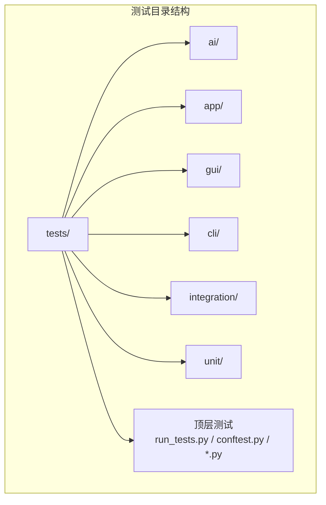
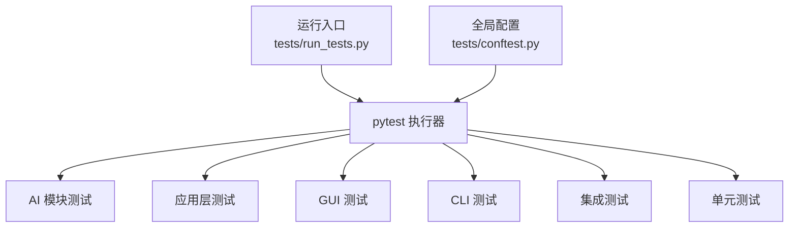
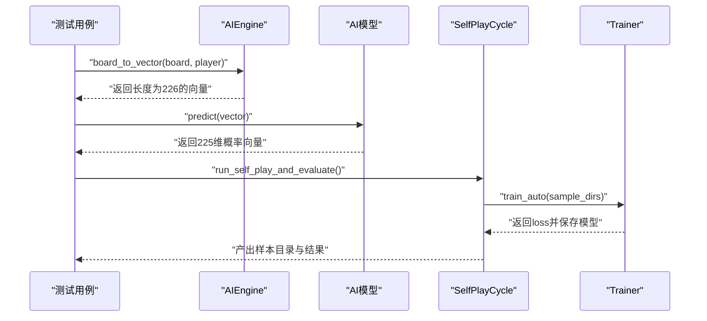
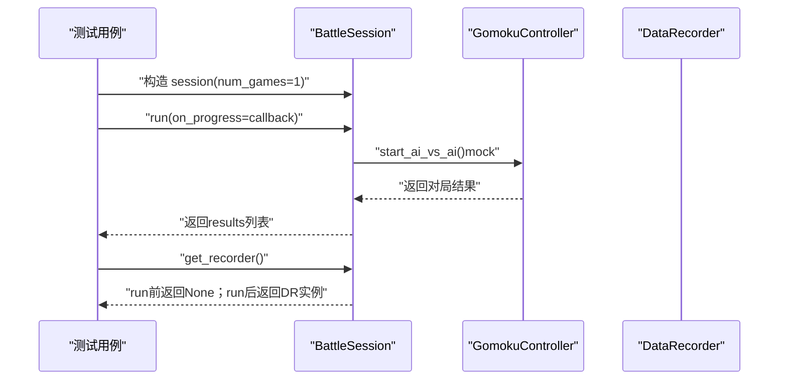
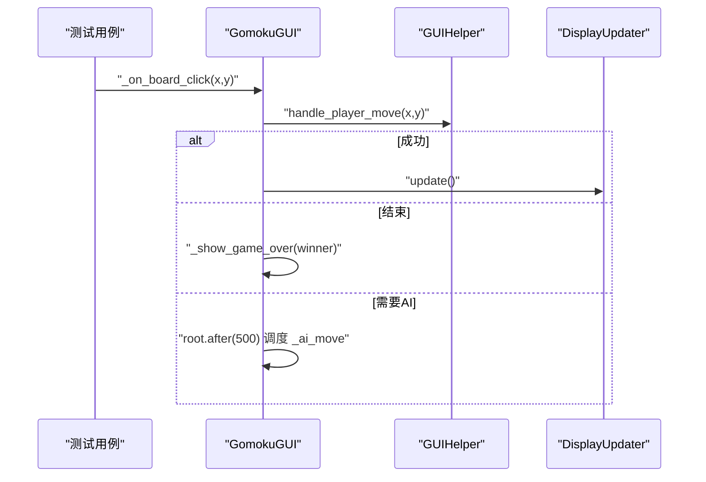
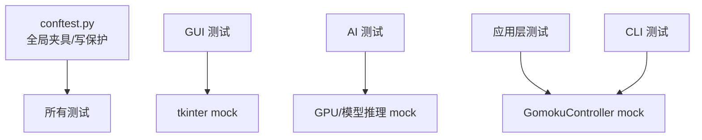

# 测试用例

<cite>
**本文引用的文件**
- [tests/__init__.py](file://tests/__init__.py)
- [tests/conftest.py](file://tests/conftest.py)
- [tests/run_tests.py](file://tests/run_tests.py)
- [design/test/test_suit_analysis_report.md](file://design/test/test_suit_analysis_report.md)
- [design/test/top10_slowest_tests_analysis.md](file://design/test/top10_slowest_tests_analysis.md)
- [tests/ai/__init__.py](file://tests/ai/__init__.py)
- [tests/ai/test_engine.py](file://tests/ai/test_engine.py)
- [tests/app/primary/test_battle.py](file://tests/app/primary/test_battle.py)
- [tests/gui/test_main.py](file://tests/gui/test_main.py)
- [tests/cli/test_main.py](file://tests/cli/test_main.py)
- [tests/test_controller.py](file://tests/test_controller.py)
- [tests/test_game.py](file://tests/test_game.py)
- [tests/test_save.py](file://tests/test_save.py)
- [tests/test_write_guard.py](file://tests/test_write_guard.py)
- [tests/integration/test_lr_range_e2e.py](file://tests/integration/test_lr_range_e2e.py)
- [tests/integration/test_multi_gen_flow.py](file://tests/integration/test_multi_gen_flow.py)
- [tests/unit/test_heatmap_color.py](file://tests/unit/test_heatmap_color.py)
- [tests/unit/test_lr_range_test.py](file://tests/unit/test_lr_range_test.py)
</cite>

## 目录
1. [简介](#简介)
2. [项目结构](#项目结构)
3. [核心组件](#核心组件)
4. [架构总览](#架构总览)
5. [详细组件分析](#详细组件分析)
6. [依赖分析](#依赖分析)
7. [性能考量](#性能考量)
8. [故障排查指南](#故障排查指南)
9. [结论](#结论)
10. [附录](#附录)

## 简介
本文件面向五子棋AI项目，系统化梳理测试用例体系与实践，覆盖单元测试、集成测试、性能测试与回归测试，并针对AI模块、游戏模块、GUI模块、应用层与CLI模块分别给出测试重点、场景与最佳实践。文档还提供测试用例编写指南、覆盖范围说明、组织结构规范以及维护策略，帮助团队高效构建稳定、可维护的测试体系。

## 项目结构
测试目录按“模块+层次”组织：
- tests/
  - ai/：AI相关测试（单元/主干/边缘）
  - app/：应用层（会话、战斗）测试
  - gui/：图形界面交互测试（mock界面）
  - cli/：命令行接口测试
  - integration/：端到端/跨模块集成测试
  - unit/：通用单元测试（颜色、学习率等）
  - run_tests.py：统一入口（兼容性）
  - conftest.py：全局夹具与写入保护钩子
  - 其他顶层测试：控制器、游戏、存档、写保护等

图表来源
- [tests/__init__.py:1-2](file://tests/__init__.py#L1-L2)
- [tests/conftest.py:1-119](file://tests/conftest.py#L1-L119)
- [tests/run_tests.py:1-60](file://tests/run_tests.py#L1-L60)

章节来源
- [tests/__init__.py:1-2](file://tests/__init__.py#L1-L2)
- [tests/conftest.py:1-119](file://tests/conftest.py#L1-L119)
- [tests/run_tests.py:1-60](file://tests/run_tests.py#L1-L60)

## 核心组件
- 测试运行与环境
  - 统一入口：tests/run_tests.py，兼容直接调用 pytest
  - 全局配置：tests/conftest.py，负责临时损失日志目录、sys.path修正、写保护hook
- 测试分类与层次
  - 单元测试：模块内最小可验证单元，强调隔离与快速
  - 集成测试：跨模块协作，验证编排与接口契约
  - 性能测试：关注吞吐、延迟与并发稳定性
  - 回归测试：随版本演进持续回归，确保回归用例稳定
- 关键测试能力
  - 写保护：禁止测试向受保护目录写入，避免污染生产数据
  - 夹具复用：class/模块级共享setup/teardown，减少重复开销
  - mock策略：对昂贵IO/对局/进程池进行合理mock，提升效率

章节来源
- [tests/run_tests.py:1-60](file://tests/run_tests.py#L1-L60)
- [tests/conftest.py:1-119](file://tests/conftest.py#L1-L119)
- [design/test/test_suit_analysis_report.md:1-369](file://design/test/test_suit_analysis_report.md#L1-L369)
- [design/test/top10_slowest_tests_analysis.md:1-465](file://design/test/top10_slowest_tests_analysis.md#L1-L465)

## 架构总览
测试架构围绕“模块化+层次化+可维护”的原则设计，结合pytest生态与项目特性，形成如下闭环：
- 测试发现与执行：pytest自动发现tests/下用例
- 环境准备：conftest集中初始化（临时日志、写保护、路径）
- 执行与报告：统一入口run_tests.py或直接pytest
- 覆盖与优化：基于耗时分析与设计报告持续精简

图表来源
- [tests/run_tests.py:49-56](file://tests/run_tests.py#L49-L56)
- [tests/conftest.py:109-119](file://tests/conftest.py#L109-L119)

## 详细组件分析

### AI模块测试
- 测试重点
  - AIEngine：棋盘向量编码、落子策略（随机/确定性）、异常路径
  - 模型：输出长度、概率格式、概率和为1、空棋盘均匀分布等
  - 训练器：train_auto/train_batch/train_single/verbose输出、日志曲线生成
  - 自我对弈与编排：SelfPlayCycle流程、数据产出、模型保存
- 场景与示例
  - 空棋盘向量长度与占位校验
  - 随机模型输出概率和为1、空棋盘均匀分布
  - 训练批次/单次训练触发日志与绘图
  - 自我对弈编排逻辑（mock对弈，真实训练）

图表来源
- [tests/ai/test_engine.py:52-141](file://tests/ai/test_engine.py#L52-L141)
- [tests/ai/test_engine.py:143-200](file://tests/ai/test_engine.py#L143-L200)

章节来源
- [tests/ai/test_engine.py:1-200](file://tests/ai/test_engine.py#L1-L200)
- [design/test/top10_slowest_tests_analysis.md:77-170](file://design/test/top10_slowest_tests_analysis.md#L77-L170)

### 应用层（BattleSession）测试
- 测试重点
  - run()返回值结构与长度
  - on_progress回调调用次数与参数序列
  - 生成训练样本与DataRecorder可用性
  - run前后get_recorder()状态变化
- 场景与示例
  - 多断言共享一次对局结果，减少对局开销
  - num_games=2时验证回调调用序列
  - run前返回None，run后返回有效Recorder

图表来源
- [tests/app/primary/test_battle.py:35-95](file://tests/app/primary/test_battle.py#L35-L95)
- [tests/app/primary/test_battle.py:97-141](file://tests/app/primary/test_battle.py#L97-L141)

章节来源
- [tests/app/primary/test_battle.py:1-141](file://tests/app/primary/test_battle.py#L1-L141)

### GUI模块测试
- 测试重点
  - 棋盘点击事件调用链与状态转换
  - AI先行流程、错误提示与显示更新
  - 与tkinter无关的业务逻辑验证（mock）
- 场景与示例
  - 无游戏时点击弹提示
  - 合法落子先调helper再更新显示
  - 游戏结束显示结果
  - 需要AI时调度延时落子

图表来源
- [tests/gui/test_main.py:68-153](file://tests/gui/test_main.py#L68-L153)
- [tests/gui/test_main.py:154-200](file://tests/gui/test_main.py#L154-L200)

章节来源
- [tests/gui/test_main.py:1-200](file://tests/gui/test_main.py#L1-L200)

### CLI模块测试
- 测试重点
  - 命令解析：大小写不敏感、未知命令提示
  - 命令分派：new/put/list/print/show/short/help
  - 参数校验：参数数量、整数坐标等
- 场景与示例
  - quit/exit返回退出信号
  - new命令创建游戏并打印提示
  - put命令有效落子打印信息，非法参数打印错误

章节来源
- [tests/cli/test_main.py:1-200](file://tests/cli/test_main.py#L1-L200)

### 游戏与存档模块测试
- 测试重点
  - 控制器：游戏状态变更、胜负判定、历史记录
  - 游戏：棋盘状态、规则约束
  - 存档：读写、列表、短名展示
- 场景与示例
  - 控制器接口行为与异常路径
  - 存档列表为空/有内容的不同输出
  - short命令展示存档缩略信息

章节来源
- [tests/test_controller.py](file://tests/test_controller.py)
- [tests/test_game.py](file://tests/test_game.py)
- [tests/test_save.py](file://tests/test_save.py)

### 集成测试
- 测试重点
  - 端到端学习率扫描：LR Range Test
  - 多生成器流水线：多代模型训练流
- 场景与示例
  - LR Range Test完整流程与输出
  - 多代模型训练编排与数据流转

章节来源
- [tests/integration/test_lr_range_e2e.py](file://tests/integration/test_lr_range_e2e.py)
- [tests/integration/test_multi_gen_flow.py](file://tests/integration/test_multi_gen_flow.py)

### 性能测试与回归
- 测试重点
  - 训练器高epoch路径的最小化验证（避免冗余训练）
  - 并行评价：数量一致性、错误隔离、进程池开销
  - 回归用例：Top10最慢测试的优化与保留策略
- 场景与示例
  - 将epochs从1000降至10/200/400，仅保留必要断言
  - 并行与串行数量一致、错误隔离验证
  - 通过合并/删除重复用例显著缩短CI时间

章节来源
- [design/test/top10_slowest_tests_analysis.md:1-465](file://design/test/top10_slowest_tests_analysis.md#L1-L465)
- [design/test/test_suit_analysis_report.md:1-369](file://design/test/test_suit_analysis_report.md#L1-L369)

## 依赖分析
- 测试耦合与隔离
  - conftest集中注入：避免各模块重复初始化
  - 写保护hook：强制隔离生产数据目录
  - mock策略：对昂贵路径（对局、进程池、绘图）进行替换
- 外部依赖与集成点
  - GUI：依赖tkinter，测试通过mock根对象与组件
  - 训练：依赖GPU/大量计算，测试通过参数化与小规模epoch验证
  - 文件系统：通过临时目录与写保护确保隔离

图表来源
- [tests/conftest.py:44-119](file://tests/conftest.py#L44-L119)
- [tests/gui/test_main.py:25-60](file://tests/gui/test_main.py#L25-L60)
- [tests/app/primary/test_battle.py:47-64](file://tests/app/primary/test_battle.py#L47-L64)

章节来源
- [tests/conftest.py:1-119](file://tests/conftest.py#L1-L119)

## 性能考量
- 瓶颈识别
  - 实际对局与训练：train_cycle、battle session等
  - 高epoch测试：train_batch/train_single/verbose输出
  - 并行模式：ProcessPool spawn开销
- 优化策略
  - 降低epoch至断言所需最小值
  - 合并重复用例、删除冗余断言
  - class级共享fixture，减少重复setup/teardown
  - 保留关键端到端用例，其余标记为慢测试

章节来源
- [design/test/top10_slowest_tests_analysis.md:371-465](file://design/test/top10_slowest_tests_analysis.md#L371-L465)
- [design/test/test_suit_analysis_report.md:119-188](file://design/test/test_suit_analysis_report.md#L119-L188)

## 故障排查指南
- 写保护错误
  - 现象：尝试写入受保护目录触发断言
  - 处理：使用临时目录或pytest提供的tmp_path fixture
- GUI测试不稳定
  - 现象：Windows上Tcl/Tk初始化失败
  - 处理：默认禁用输出捕获，必要时显式开启
- 训练耗时长
  - 现象：高epoch测试导致CI时间过长
  - 处理：降低epoch、合并用例、保留关键断言
- 并行模式异常
  - 现象：进程池spawn开销大、结果不一致
  - 处理：减少record数量、合并断言、确保错误隔离

章节来源
- [tests/conftest.py:44-119](file://tests/conftest.py#L44-L119)
- [tests/run_tests.py:9-11](file://tests/run_tests.py#L9-L11)
- [design/test/top10_slowest_tests_analysis.md:371-465](file://design/test/top10_slowest_tests_analysis.md#L371-L465)

## 结论
本测试体系以pytest为核心，结合模块化与层次化策略，实现了对AI、应用、GUI、CLI与游戏/存档模块的全面覆盖。通过写保护、mock与参数化等手段，既保证了测试稳定性与可维护性，又显著降低了CI时间。建议持续遵循“慢测试标记、用例合并、断言最小化”的原则，配合定期的回归与重构，确保测试体系长期健康。

## 附录

### 测试分类与实现方法
- 单元测试
  - 针对函数/类的最小可验证单元，断言明确、依赖隔离
  - 示例：AIEngine向量编码、随机模型概率分布
- 集成测试
  - 跨模块协作验证，关注编排与接口契约
  - 示例：BattleSession主流程、GUI调用链
- 性能测试
  - 关注吞吐、延迟与并发稳定性
  - 示例：并行评价数量一致性、进程池开销
- 回归测试
  - 随版本演进持续回归，保留关键端到端用例

章节来源
- [tests/ai/test_engine.py:1-200](file://tests/ai/test_engine.py#L1-L200)
- [tests/app/primary/test_battle.py:1-141](file://tests/app/primary/test_battle.py#L1-L141)
- [tests/gui/test_main.py:1-200](file://tests/gui/test_main.py#L1-L200)
- [design/test/top10_slowest_tests_analysis.md:371-465](file://design/test/top10_slowest_tests_analysis.md#L371-L465)

### 各模块测试重点与场景
- AI模块
  - 重点：向量编码、落子策略、训练流程、自对弈编排
  - 场景：空棋盘/部分填充/满棋盘、概率分布、日志输出
- 应用层
  - 重点：BattleSession主流程、回调与样本生成
  - 场景：多断言共享一次对局、回调序列验证
- GUI模块
  - 重点：点击事件、AI先行、错误提示、显示更新
  - 场景：无游戏提示、合法落子、游戏结束、延时AI
- CLI模块
  - 重点：命令解析、参数校验、命令分派
  - 场景：大小写不敏感、未知命令提示、参数错误提示
- 游戏与存档
  - 重点：控制器状态、胜负判定、存档读写与列表
  - 场景：空列表提示、重复名称处理、短名展示

章节来源
- [tests/ai/test_engine.py:1-200](file://tests/ai/test_engine.py#L1-L200)
- [tests/app/primary/test_battle.py:1-141](file://tests/app/primary/test_battle.py#L1-L141)
- [tests/gui/test_main.py:1-200](file://tests/gui/test_main.py#L1-L200)
- [tests/cli/test_main.py:1-200](file://tests/cli/test_main.py#L1-L200)
- [tests/test_controller.py](file://tests/test_controller.py)
- [tests/test_game.py](file://tests/test_game.py)
- [tests/test_save.py](file://tests/test_save.py)

### 测试用例编写指南
- 测试数据准备
  - 使用临时目录与pytest fixtures隔离数据
  - 对昂贵资源（对局、训练、进程池）进行mock
- 断言方法
  - 优先断言行为与接口契约，避免过度断言
  - 对日志/输出进行最小化断言（如call_count>=1）
- 边界条件处理
  - 满棋盘、非法坐标、重复名称等
  - 回调参数序列、错误消息文本
- 异常情况测试
  - 棋盘已满、参数非法、未知命令、进程池错误
  - 通过mock模拟异常路径并验证错误处理

章节来源
- [tests/conftest.py:44-119](file://tests/conftest.py#L44-L119)
- [design/test/top10_slowest_tests_analysis.md:371-465](file://design/test/top10_slowest_tests_analysis.md#L371-L465)

### 测试覆盖范围
- 功能测试：覆盖核心业务流程与边界条件
- 接口测试：命令解析、回调、文件读写接口
- 兼容性测试：Windows上GUI与并行模式稳定性
- 安全测试：写保护hook防止生产数据污染

章节来源
- [tests/conftest.py:44-119](file://tests/conftest.py#L44-L119)
- [tests/test_write_guard.py](file://tests/test_write_guard.py)

### 测试组织结构
- 文件命名规范
  - 模块/层次/功能：tests/<module>/<level>/test_<feature>.py
  - 示例：tests/ai/primary/test_evaluator_shape_detection.py
- 测试类设计
  - 每个类聚焦单一职责，断言尽量独立
  - class级共享fixture减少重复setup/teardown
- 测试方法分类
  - 主流程：run()/handle_*等
  - 边界与异常：空棋盘/非法参数/未知命令
  - 性能与集成：并行模式、日志输出、端到端流程

章节来源
- [tests/ai/__init__.py:1-8](file://tests/ai/__init__.py#L1-L8)
- [tests/app/primary/test_battle.py:35-95](file://tests/app/primary/test_battle.py#L35-L95)

### 测试用例维护策略
- 更新
  - 随模块重构同步更新用例，保持与实现一致
- 重构
  - 合并重复用例、删除冗余断言、降低epoch
- 废弃处理
  - 对废弃模型/功能的测试进行归档或删除
- 标记与分层
  - 使用pytest marker区分慢测试，CI默认跳过慢用例

章节来源
- [design/test/test_suit_analysis_report.md:119-188](file://design/test/test_suit_analysis_report.md#L119-L188)
- [design/test/top10_slowest_tests_analysis.md:437-465](file://design/test/top10_slowest_tests_analysis.md#L437-L465)