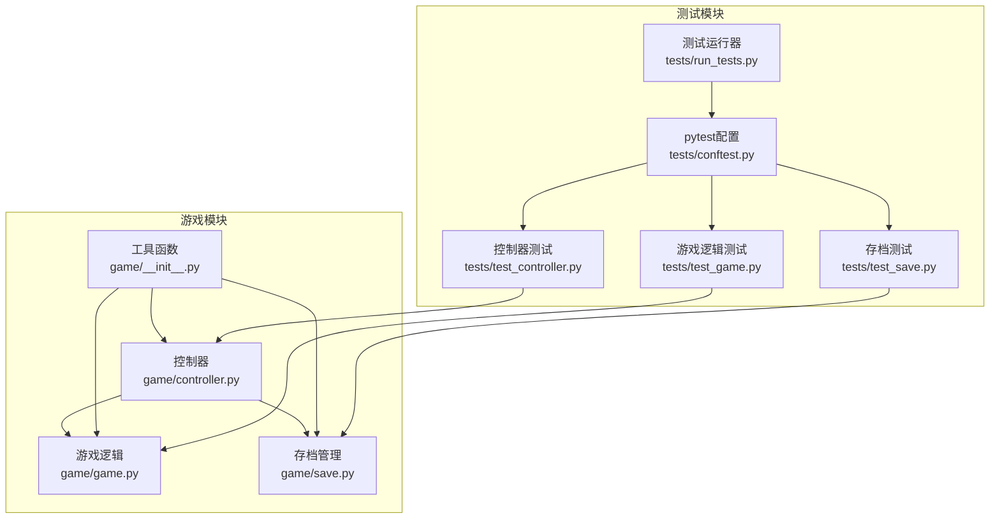
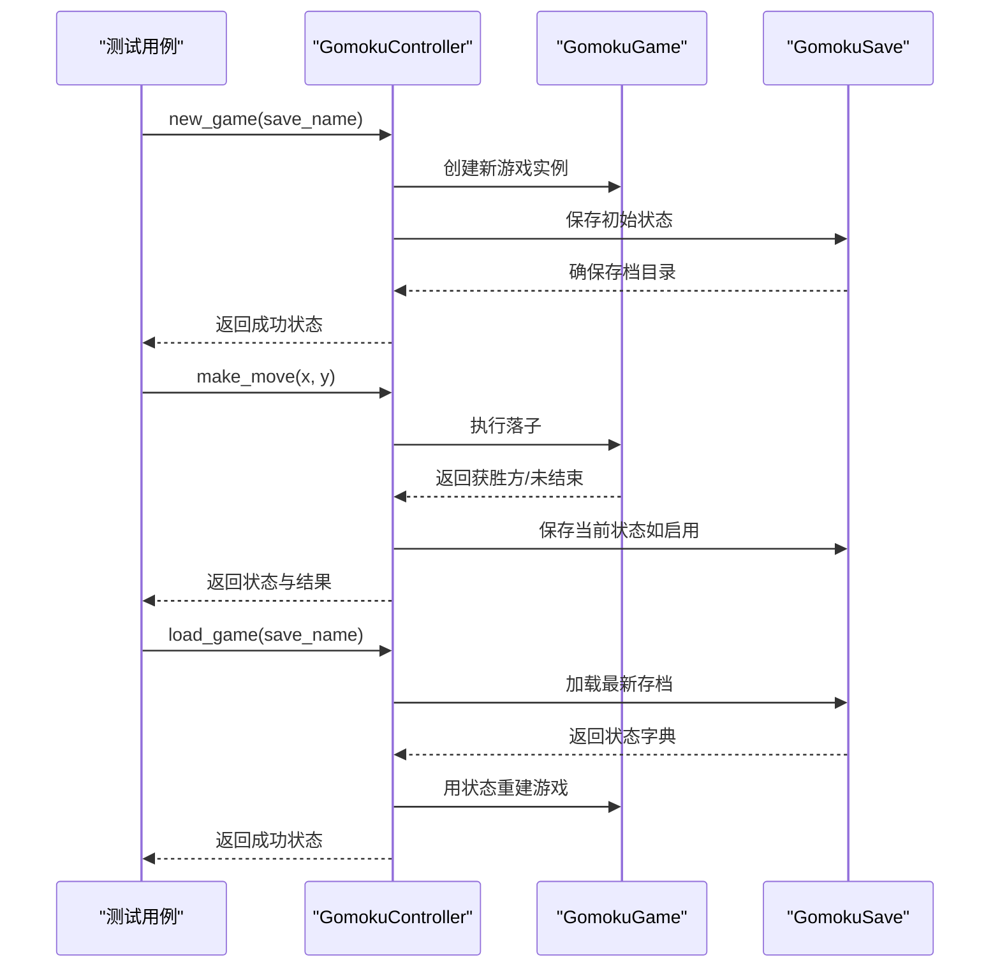
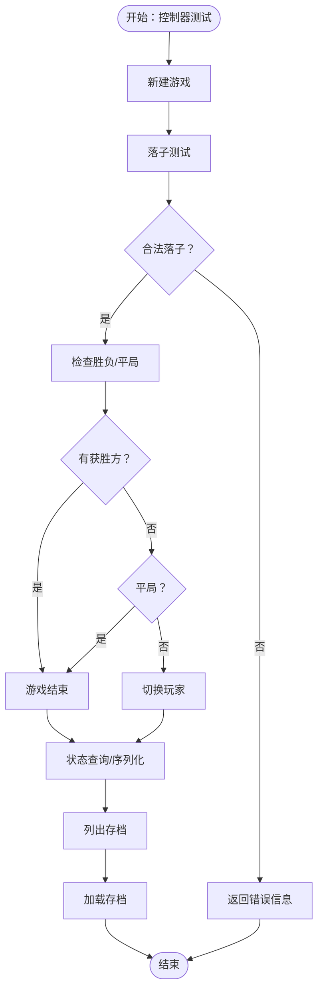
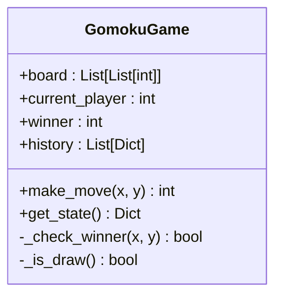
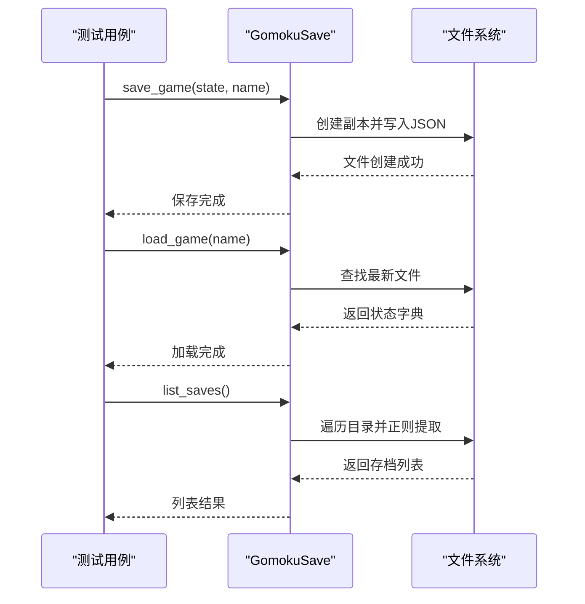
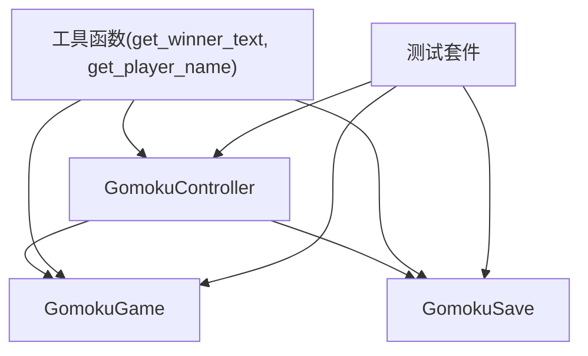

# 游戏模块测试用例

<cite>
**本文档引用的文件**
- [game/controller.py](file://game/controller.py)
- [game/game.py](file://game/game.py)
- [game/save.py](file://game/save.py)
- [game/__init__.py](file://game/__init__.py)
- [tests/test_controller.py](file://tests/test_controller.py)
- [tests/test_game.py](file://tests/test_game.py)
- [tests/test_save.py](file://tests/test_save.py)
- [tests/conftest.py](file://tests/conftest.py)
- [tests/run_tests.py](file://tests/run_tests.py)
- [design/test/test_suit_analysis_report.md](file://design/test/test_suit_analysis_report.md)
- [design/test/top10_slowest_tests_analysis.md](file://design/test/top10_slowest_tests_analysis.md)
</cite>

## 目录
1. [简介](#简介)
2. [项目结构](#项目结构)
3. [核心组件](#核心组件)
4. [架构概览](#架构概览)
5. [详细组件分析](#详细组件分析)
6. [依赖分析](#依赖分析)
7. [性能考虑](#性能考虑)
8. [故障排除指南](#故障排除指南)
9. [结论](#结论)
10. [附录](#附录)

## 简介
本文件为游戏模块的全面测试用例文档，重点覆盖五子棋控制器测试、游戏逻辑测试和存档系统测试。文档详细说明了游戏规则验证测试（胜负判定、棋盘状态、落子合法性）、游戏状态管理测试（初始化、状态转换、持久化）、性能测试（游戏循环性能、内存泄漏检测、并发安全性）以及错误处理、边界条件和兼容性测试策略。所有测试实现均基于仓库现有测试文件，并结合项目设计文档进行系统化整理。

## 项目结构
游戏模块位于 `game/` 目录，包含控制器、核心逻辑和存档管理三个主要组件；对应的测试位于 `tests/` 目录，分别覆盖控制器、游戏逻辑和存档系统的功能与边界场景。测试运行器通过 `tests/run_tests.py` 统一调用 pytest，并在 `tests/conftest.py` 中配置全局环境与写入保护机制。

**图表来源**
- [game/controller.py:1-194](file://game/controller.py#L1-L194)
- [game/game.py:1-118](file://game/game.py#L1-L118)
- [game/save.py:1-93](file://game/save.py#L1-L93)
- [game/__init__.py:1-55](file://game/__init__.py#L1-L55)
- [tests/test_controller.py:1-319](file://tests/test_controller.py#L1-L319)
- [tests/test_game.py:1-245](file://tests/test_game.py#L1-L245)
- [tests/test_save.py:1-303](file://tests/test_save.py#L1-L303)
- [tests/conftest.py:1-119](file://tests/conftest.py#L1-L119)
- [tests/run_tests.py:1-60](file://tests/run_tests.py#L1-L60)

**章节来源**
- [game/controller.py:1-194](file://game/controller.py#L1-L194)
- [game/game.py:1-118](file://game/game.py#L1-L118)
- [game/save.py:1-93](file://game/save.py#L1-L93)
- [tests/test_controller.py:1-319](file://tests/test_controller.py#L1-L319)
- [tests/test_game.py:1-245](file://tests/test_game.py#L1-L245)
- [tests/test_save.py:1-303](file://tests/test_save.py#L1-L303)
- [tests/conftest.py:1-119](file://tests/conftest.py#L1-L119)
- [tests/run_tests.py:1-60](file://tests/run_tests.py#L1-L60)

## 核心组件
- 控制器（GomokuController）：对外唯一接口，负责游戏生命周期管理、落子执行、状态查询、存档操作与错误处理。
- 游戏逻辑（GomokuGame）：核心规则实现，包括棋盘状态、合法移动验证、胜负判定和平局检测。
- 存档管理（GomokuSave）：负责存档目录创建、文件命名、保存与加载、存档列表与日期排序。
- 工具函数：统一的胜负文本与玩家名称映射，供控制器与测试使用。

**章节来源**
- [game/controller.py:11-194](file://game/controller.py#L11-L194)
- [game/game.py:4-118](file://game/game.py#L4-L118)
- [game/save.py:9-93](file://game/save.py#L9-L93)
- [game/__init__.py:6-45](file://game/__init__.py#L6-L45)

## 架构概览
控制器协调游戏逻辑与存档管理，提供统一的状态查询与JSON序列化能力；游戏逻辑独立实现规则校验；存档管理负责文件系统交互与数据持久化。测试通过独立的临时目录与写入保护机制，确保测试隔离与数据安全。

**图表来源**
- [game/controller.py:32-121](file://game/controller.py#L32-L121)
- [game/game.py:22-65](file://game/game.py#L22-L65)
- [game/save.py:17-57](file://game/save.py#L17-L57)

**章节来源**
- [game/controller.py:32-121](file://game/controller.py#L32-L121)
- [game/game.py:22-65](file://game/game.py#L22-L65)
- [game/save.py:17-57](file://game/save.py#L17-L57)

## 详细组件分析

### 五子棋控制器测试
控制器测试覆盖新建游戏、落子合法性、胜负判定、平局处理、状态查询、JSON序列化、存档列表与加载等功能。测试通过临时目录隔离，确保不同测试互不干扰，并验证控制器在各种边界条件下的行为。

- 新建游戏测试：验证初始状态、历史记录、名称与起始时间字段。
- 落子合法性测试：越界、占用位置、游戏结束后继续落子等错误场景。
- 胜负判定测试：横、竖、斜向五连，长连（六子及以上）同样获胜。
- 平局测试：通过预置满盘无五连状态，验证平局分支与状态标志。
- 状态查询测试：完整状态与简化状态的区别，JSON序列化有效性。
- 存档相关测试：列表存档、加载不存在的存档、加载后历史记录行为。

**图表来源**
- [tests/test_controller.py:83-319](file://tests/test_controller.py#L83-L319)

**章节来源**
- [tests/test_controller.py:83-319](file://tests/test_controller.py#L83-L319)

### 游戏逻辑测试
游戏逻辑测试专注于规则实现的正确性，包括初始化、状态深拷贝保护、落子合法性、胜负判定（横、竖、斜）、长连获胜与平局检测。测试通过构造特定棋盘局面验证规则一致性，并确保状态隔离与不可变性。

- 初始化测试：验证棋盘大小、初始玩家、赢家状态与历史记录为空。
- 状态深拷贝测试：验证从外部状态重建游戏时，修改外部状态不影响内部状态。
- 落子合法性测试：越界、占用位置、游戏结束后落子抛出异常。
- 胜负判定测试：多种方向的五连与长连验证。
- 平局测试：通过模7线性模式构造满盘无五连棋盘，验证平局判定。

**图表来源**
- [game/game.py:4-118](file://game/game.py#L4-L118)

**章节来源**
- [tests/test_game.py:15-245](file://tests/test_game.py#L15-L245)
- [game/game.py:22-117](file://game/game.py#L22-L117)

### 存档系统测试
存档系统测试覆盖目录创建、文件命名、保存与加载、存档列表与排序、同名同日多次保存不覆盖、存档名包含下划线的正确提取等场景。测试通过临时目录模拟真实文件系统行为，验证存档的可靠性与兼容性。

- 目录创建测试：初始化时确保存档目录存在。
- 保存测试：验证文件创建、内容正确性与时间戳命名。
- 加载测试：验证存在与不存在的存档加载行为。
- 列表测试：验证空目录、多存档、排序与特殊字符处理。
- 同名同日多次保存测试：验证时间戳避免覆盖。
- 存档名包含下划线测试：验证正则提取的正确性。

**图表来源**
- [game/save.py:17-92](file://game/save.py#L17-L92)
- [tests/test_save.py:52-303](file://tests/test_save.py#L52-L303)

**章节来源**
- [tests/test_save.py:52-303](file://tests/test_save.py#L52-L303)
- [game/save.py:17-92](file://game/save.py#L17-L92)

## 依赖分析
- 控制器依赖游戏逻辑与存档管理，提供统一接口与错误处理。
- 游戏逻辑独立实现规则，不依赖外部存储。
- 存档管理依赖文件系统，负责数据持久化与命名规范。
- 工具函数提供文本映射，供控制器与测试使用。
- 测试通过临时目录与写入保护机制，避免污染生产数据。

**图表来源**
- [game/controller.py:6-30](file://game/controller.py#L6-L30)
- [game/game.py:7-20](file://game/game.py#L7-L20)
- [game/save.py:12-15](file://game/save.py#L12-L15)
- [game/__init__.py:6-45](file://game/__init__.py#L6-L45)
- [tests/test_controller.py:12-14](file://tests/test_controller.py#L12-L14)
- [tests/test_game.py](file://tests/test_game.py#L9)
- [tests/test_save.py](file://tests/test_save.py#L14)

**章节来源**
- [game/controller.py:6-30](file://game/controller.py#L6-L30)
- [game/game.py:7-20](file://game/game.py#L7-L20)
- [game/save.py:12-15](file://game/save.py#L12-L15)
- [game/__init__.py:6-45](file://game/__init__.py#L6-L45)
- [tests/test_controller.py:12-14](file://tests/test_controller.py#L12-L14)
- [tests/test_game.py](file://tests/test_game.py#L9)
- [tests/test_save.py](file://tests/test_save.py#L14)

## 性能考虑
根据设计文档的测试性能分析，项目已实施多项优化措施以提升测试效率：
- 引入 pytest marker 分层执行，CI 可快速反馈（3-4 分钟），全量验证（8-10 分钟）。
- 合并同功能碎片文件，减少重复 fixture 开销，降低维护成本。
- 多模型共享测试基类，减少重复测试用例数量。
- 降低慢测试的实际工作量：将高 epoch 训练降至断言所需最小值，mock 高耗时环节（如 AI 对局）保留关键逻辑验证。
- 通过 class 级 fixture 共享昂贵资源（如进程池），减少创建开销。

这些策略显著降低了测试总耗时，建议在新增测试时遵循相同原则，优先使用轻量断言与最小化数据集，必要时通过 mock 降低集成成本。

**章节来源**
- [design/test/test_suit_analysis_report.md:1-369](file://design/test/test_suit_analysis_report.md#L1-L369)
- [design/test/top10_slowest_tests_analysis.md:1-465](file://design/test/top10_slowest_tests_analysis.md#L1-L465)

## 故障排除指南
- 写入保护错误：测试期间禁止向受保护目录写入文件，防止污染生产数据。若出现写入保护错误，使用临时目录或 `tmp_path` fixture。
- 存档加载失败：确认存档名称与日期格式匹配，检查文件是否存在且可读。
- 落子异常：检查坐标范围、位置是否被占用、游戏是否已结束。
- 状态查询错误：在未创建或加载游戏时调用状态查询会返回错误，需先执行新建或加载操作。
- JSON 序列化问题：确保状态字典可被 JSON 正确序列化，避免包含不可序列化对象。

**章节来源**
- [tests/conftest.py:44-119](file://tests/conftest.py#L44-L119)
- [tests/test_controller.py:185-269](file://tests/test_controller.py#L185-L269)
- [tests/test_save.py:140-153](file://tests/test_save.py#L140-L153)

## 结论
本测试用例文档系统性地梳理了游戏模块的控制器、游戏逻辑与存档管理的测试策略与实现细节。通过规则验证、状态管理、性能优化与错误处理的综合测试，确保了模块在功能正确性、稳定性与可维护性方面的质量。建议在后续开发中持续应用现有优化策略，保持测试高效与可扩展。

## 附录
- 测试运行：通过 `tests/run_tests.py` 统一调用 pytest，避免 Windows 上 Tcl/Tk 初始化兼容性问题。
- 测试配置：pytest 全局配置包含写入保护、路径设置与临时日志目录清理。
- 设计文档：测试套件耗时分析与优化策略，指导测试重构与性能改进。

**章节来源**
- [tests/run_tests.py:49-55](file://tests/run_tests.py#L49-L55)
- [tests/conftest.py:22-25](file://tests/conftest.py#L22-L25)
- [design/test/test_suit_analysis_report.md:1-369](file://design/test/test_suit_analysis_report.md#L1-L369)
- [design/test/top10_slowest_tests_analysis.md:1-465](file://design/test/top10_slowest_tests_analysis.md#L1-L465)