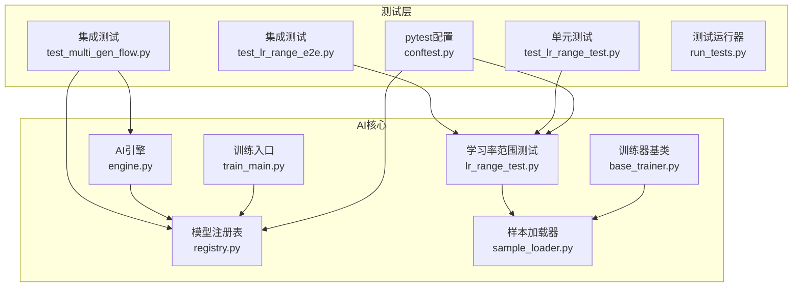
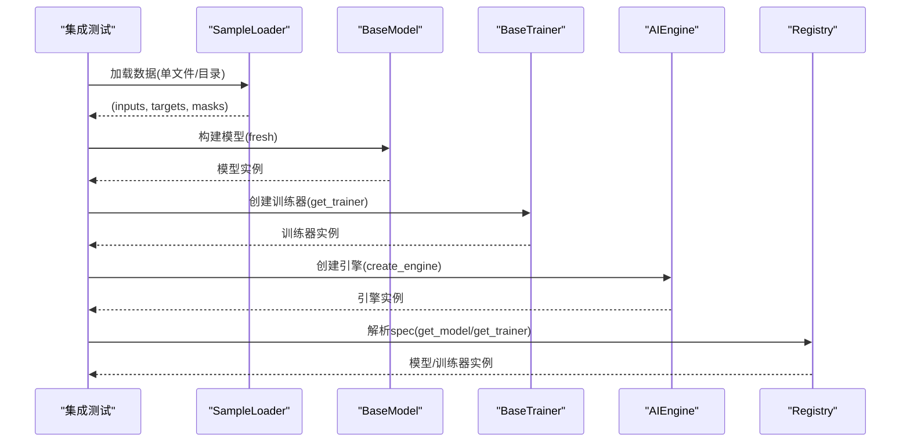
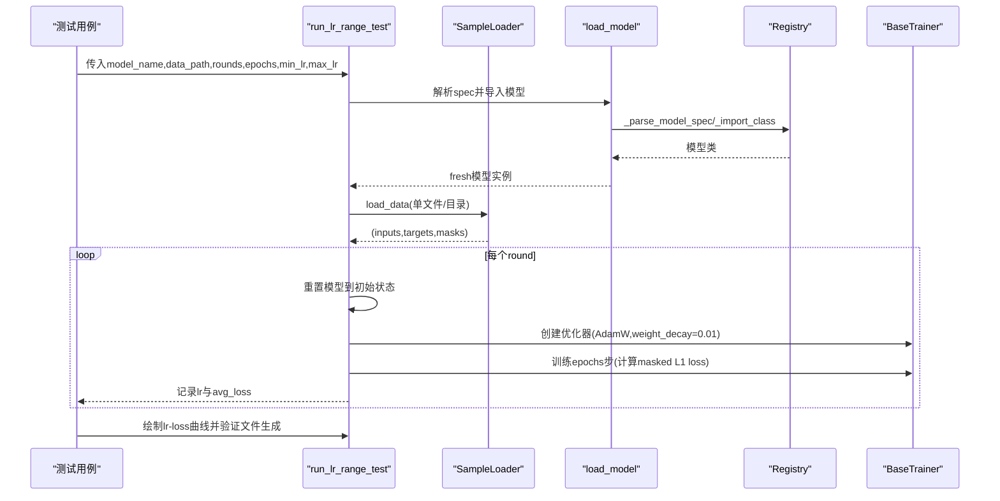
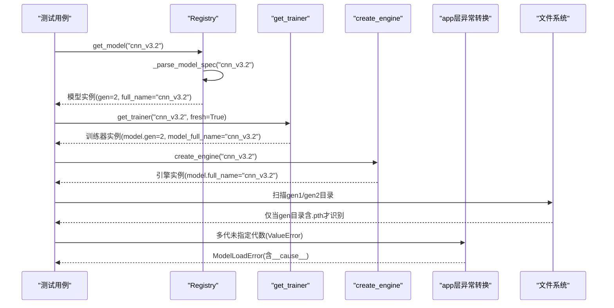
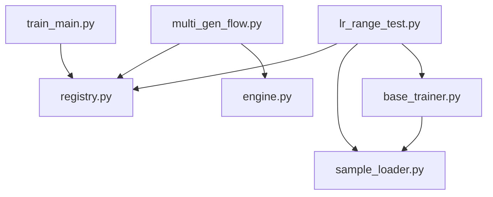

# 集成测试用例

<cite>
**本文档引用的文件**
- [tests/integration/test_lr_range_e2e.py](file://tests/integration/test_lr_range_e2e.py)
- [tests/integration/test_multi_gen_flow.py](file://tests/integration/test_multi_gen_flow.py)
- [ai/lr_range_test.py](file://ai/lr_range_test.py)
- [ai/train_main.py](file://ai/train_main.py)
- [tests/conftest.py](file://tests/conftest.py)
- [tests/unit/test_lr_range_test.py](file://tests/unit/test_lr_range_test.py)
- [tests/ai/helpers.py](file://tests/ai/helpers.py)
- [ai/base_trainer.py](file://ai/base_trainer.py)
- [ai/registry.py](file://ai/registry.py)
- [ai/sample_loader.py](file://ai/sample_loader.py)
- [ai/engine.py](file://ai/engine.py)
- [tests/run_tests.py](file://tests/run_tests.py)
- [design/test/test_suit_analysis_report.md](file://design/test/test_suit_analysis_report.md)
</cite>

## 目录
1. [简介](#简介)
2. [项目结构](#项目结构)
3. [核心组件](#核心组件)
4. [架构总览](#架构总览)
5. [详细组件分析](#详细组件分析)
6. [依赖分析](#依赖分析)
7. [性能考虑](#性能考虑)
8. [故障排查指南](#故障排查指南)
9. [结论](#结论)
10. [附录](#附录)

## 简介
本文件面向集成测试，系统化梳理端到端测试、多代训练流程测试与学习率范围测试的实现方法与最佳实践。文档涵盖：
- 系统集成测试用例设计与执行：完整训练流程、多模块协作、数据流验证
- 性能集成测试用例设计与执行：系统整体性能、资源使用、负载测试
- 集成测试策略：测试环境搭建、测试数据准备、测试结果验证
- 测试场景设计、测试用例组合与执行顺序

## 项目结构
本项目采用模块化组织，AI训练与推理、注册表、样本加载、引擎等核心模块清晰分离，测试体系覆盖单元、集成与性能测试三层。

**图表来源**
- [tests/integration/test_lr_range_e2e.py:1-133](file://tests/integration/test_lr_range_e2e.py#L1-L133)
- [tests/integration/test_multi_gen_flow.py:1-357](file://tests/integration/test_multi_gen_flow.py#L1-L357)
- [ai/lr_range_test.py:1-289](file://ai/lr_range_test.py#L1-L289)
- [ai/registry.py:1-316](file://ai/registry.py#L1-L316)
- [ai/sample_loader.py:1-240](file://ai/sample_loader.py#L1-L240)
- [ai/base_trainer.py:1-699](file://ai/base_trainer.py#L1-L699)
- [ai/engine.py:1-194](file://ai/engine.py#L1-L194)
- [ai/train_main.py:1-234](file://ai/train_main.py#L1-L234)
- [tests/conftest.py:1-119](file://tests/conftest.py#L1-L119)
- [tests/run_tests.py:1-60](file://tests/run_tests.py#L1-L60)

**章节来源**
- [tests/integration/test_lr_range_e2e.py:1-133](file://tests/integration/test_lr_range_e2e.py#L1-L133)
- [tests/integration/test_multi_gen_flow.py:1-357](file://tests/integration/test_multi_gen_flow.py#L1-L357)
- [ai/lr_range_test.py:1-289](file://ai/lr_range_test.py#L1-L289)
- [ai/registry.py:1-316](file://ai/registry.py#L1-L316)
- [ai/sample_loader.py:1-240](file://ai/sample_loader.py#L1-L240)
- [ai/base_trainer.py:1-699](file://ai/base_trainer.py#L1-L699)
- [ai/engine.py:1-194](file://ai/engine.py#L1-L194)
- [ai/train_main.py:1-234](file://ai/train_main.py#L1-L234)
- [tests/conftest.py:1-119](file://tests/conftest.py#L1-L119)
- [tests/run_tests.py:1-60](file://tests/run_tests.py#L1-L60)

## 核心组件
- 学习率范围测试（LR Range Test）：端到端验证从数据加载、模型构建、训练循环到曲线绘制的完整流程，支持单文件与目录两种数据源，具备异常输入校验与绘图输出验证。
- 多代模型训练流程：覆盖从模型规范解析、训练器创建、引擎创建、异常转换到保存/加载代数隔离的全流程，重点验证多代模型的目录结构与文件约束。
- 注册表与引擎：统一模型/训练器解析与导入，提供多代模型的规范校验与文件系统扫描能力，引擎负责将棋盘状态转换为模型输入并选择落子策略。
- 样本加载器：统一从JSON到张量的数据转换，支持单文件、多目录合并、训练/验证集分割与输入格式转换。
- 训练器基类：提供通用训练循环、学习率调度、损失计算与日志记录能力，支持全量更新与mini-batch两种训练模式。

**章节来源**
- [ai/lr_range_test.py:1-289](file://ai/lr_range_test.py#L1-L289)
- [tests/integration/test_lr_range_e2e.py:1-133](file://tests/integration/test_lr_range_e2e.py#L1-L133)
- [tests/integration/test_multi_gen_flow.py:1-357](file://tests/integration/test_multi_gen_flow.py#L1-L357)
- [ai/registry.py:1-316](file://ai/registry.py#L1-L316)
- [ai/engine.py:1-194](file://ai/engine.py#L1-L194)
- [ai/sample_loader.py:1-240](file://ai/sample_loader.py#L1-L240)
- [ai/base_trainer.py:1-699](file://ai/base_trainer.py#L1-L699)

## 架构总览
集成测试围绕三条主线展开：
- 端到端学习率范围测试：从数据准备到曲线生成，验证LR递增、loss计算与绘图输出。
- 多代模型端到端流程：从spec解析到训练器/引擎实例化，再到异常转换与保存/加载隔离。
- 训练入口集成：从CLI参数解析到训练器路由，验证训练模式与参数传递。

**图表来源**
- [ai/lr_range_test.py:102-210](file://ai/lr_range_test.py#L102-L210)
- [ai/sample_loader.py:206-239](file://ai/sample_loader.py#L206-L239)
- [ai/base_trainer.py:32-120](file://ai/base_trainer.py#L32-L120)
- [ai/engine.py:18-42](file://ai/engine.py#L18-L42)
- [ai/registry.py:150-224](file://ai/registry.py#L150-L224)

## 详细组件分析

### 端到端学习率范围测试（LR Range Test）
- 测试目标：验证LR递增策略、loss计算、模型重置、绘图输出与异常处理。
- 关键流程：
  - 数据加载：支持单文件merge.json与目录扫描，空数据与不存在路径触发异常。
  - 模型加载：基于spec解析与注册表导入，不支持模型名触发ValueError。
  - 训练循环：每个round重置模型到初始状态，使用固定学习率训练，计算masked L1 loss。
  - 结果验证：lr严格递增、loss为有限值、绘图文件生成。
- 测试用例：
  - CNNV2端到端：验证返回长度、lr递增、loss有限性与绘图输出。
  - 目录数据：验证从目录加载数据的正确性。
  - 异常输入：验证不支持模型名与不存在路径的异常处理。

**图表来源**
- [ai/lr_range_test.py:131-210](file://ai/lr_range_test.py#L131-L210)
- [ai/lr_range_test.py:102-129](file://ai/lr_range_test.py#L102-L129)
- [ai/lr_range_test.py:35-73](file://ai/lr_range_test.py#L35-L73)
- [ai/registry.py:103-130](file://ai/registry.py#L103-L130)
- [ai/registry.py:150-184](file://ai/registry.py#L150-L184)

**章节来源**
- [tests/integration/test_lr_range_e2e.py:1-133](file://tests/integration/test_lr_range_e2e.py#L1-L133)
- [ai/lr_range_test.py:1-289](file://ai/lr_range_test.py#L1-L289)
- [tests/unit/test_lr_range_test.py:1-271](file://tests/unit/test_lr_range_test.py#L1-L271)

### 多代模型训练流程测试
- 测试目标：验证多代模型spec解析、训练器/引擎创建、异常转换与保存/加载隔离。
- 关键流程：
  - 规范解析：支持"cnn_v3.1"等形式，非多代模型指定代数或多代模型未指定代数触发异常。
  - 训练器创建：get_trainer返回对应训练器实例，gen属性与full_name一致。
  - 引擎创建：create_engine返回AIEngine实例，模型属性与spec一致。
  - 异常转换：多代模型未指定代数在app层转换为ModelLoadError。
  - 保存/加载隔离：不同gen的权重保存到不同目录，互不影响。
- 测试用例：
  - 规范到模型实例：验证gen属性、full_name与默认路径包含gen子目录。
  - 规范到训练器：验证训练器模型与自身gen属性。
  - 文件系统扫描：验证gen目录下存在.pth时才识别为有效代数。
  - 引擎创建与异常转换：验证create_engine异常转换为ModelLoadError。
  - 保存/加载隔离：验证gen1/gen2权重互不影响。

**图表来源**
- [tests/integration/test_multi_gen_flow.py:74-110](file://tests/integration/test_multi_gen_flow.py#L74-L110)
- [tests/integration/test_multi_gen_flow.py:115-137](file://tests/integration/test_multi_gen_flow.py#L115-L137)
- [tests/integration/test_multi_gen_flow.py:142-178](file://tests/integration/test_multi_gen_flow.py#L142-L178)
- [tests/integration/test_multi_gen_flow.py:183-202](file://tests/integration/test_multi_gen_flow.py#L183-L202)
- [tests/integration/test_multi_gen_flow.py:207-272](file://tests/integration/test_multi_gen_flow.py#L207-L272)
- [tests/integration/test_multi_gen_flow.py:277-353](file://tests/integration/test_multi_gen_flow.py#L277-L353)
- [ai/registry.py:103-130](file://ai/registry.py#L103-L130)
- [ai/registry.py:150-224](file://ai/registry.py#L150-L224)
- [ai/engine.py:18-42](file://ai/engine.py#L18-L42)

**章节来源**
- [tests/integration/test_multi_gen_flow.py:1-357](file://tests/integration/test_multi_gen_flow.py#L1-L357)
- [ai/registry.py:1-316](file://ai/registry.py#L1-L316)
- [ai/engine.py:1-194](file://ai/engine.py#L1-L194)

### 训练入口集成测试
- 测试目标：验证CLI参数解析、训练器路由、训练模式与参数传递。
- 关键流程：
  - 参数解析：--cycle与--train-from-dir二选一，lr调度参数、温度采样参数等。
  - 训练器创建：get_trainer根据spec与调度参数创建训练器。
  - 模式路由：run_cycle或run_train_from_dir。
- 测试用例：
  - 参数校验：互斥参数校验与缺失参数报错。
  - 训练器创建：异常捕获与错误输出。
  - 模式路由：根据参数选择对应运行器。

**章节来源**
- [ai/train_main.py:1-234](file://ai/train_main.py#L1-L234)
- [ai/registry.py:187-224](file://ai/registry.py#L187-L224)

## 依赖分析
- 模块耦合：
  - lr_range_test依赖registry、sample_loader与base_trainer的通用loss计算。
  - multi_gen_flow依赖registry与engine，验证异常转换与文件系统扫描。
  - base_trainer提供训练循环与学习率调度，被训练入口与引擎间接使用。
- 外部依赖：
  - PyTorch用于张量运算与优化器。
  - Matplotlib用于绘图（非交互后端）。
  - importlib用于懒加载模型与训练器类。

**图表来源**
- [ai/lr_range_test.py:29-33](file://ai/lr_range_test.py#L29-L33)
- [ai/registry.py:1-316](file://ai/registry.py#L1-L316)
- [ai/sample_loader.py:1-240](file://ai/sample_loader.py#L1-L240)
- [ai/base_trainer.py:1-699](file://ai/base_trainer.py#L1-L699)
- [ai/engine.py:1-194](file://ai/engine.py#L1-L194)
- [ai/train_main.py:1-234](file://ai/train_main.py#L1-L234)

**章节来源**
- [ai/lr_range_test.py:1-289](file://ai/lr_range_test.py#L1-L289)
- [ai/registry.py:1-316](file://ai/registry.py#L1-L316)
- [ai/sample_loader.py:1-240](file://ai/sample_loader.py#L1-L240)
- [ai/base_trainer.py:1-699](file://ai/base_trainer.py#L1-L699)
- [ai/engine.py:1-194](file://ai/engine.py#L1-L194)
- [ai/train_main.py:1-234](file://ai/train_main.py#L1-L234)

## 性能考虑
- 测试性能热点：
  - 实际训练/对局类测试耗时最高，主要由于真实AI对局与模型训练。
  - 重复fixture开销与多模型重复测试增加整体耗时。
- 优化建议：
  - 引入pytest标记分层执行，CI快速反馈。
  - 合并同功能碎片文件，减少fixture重复开销。
  - 多模型共享测试基类，参数化替代重复测试。
  - 降低慢测试的实际工作量，使用mock或更小epoch间隔验证。

**章节来源**
- [design/test/test_suit_analysis_report.md:1-369](file://design/test/test_suit_analysis_report.md#L1-L369)

## 故障排查指南
- 写入保护：
  - 测试期间拦截写入受保护目录，防止污染生产数据。如需写入，请使用临时目录或tmp_path fixture。
- 异常转换：
  - 多代模型未指定代数在app层转换为ModelLoadError，检查spec格式与gen目录存在性。
- 数据加载：
  - 不存在路径触发FileNotFoundError；空数据触发ValueError。检查数据文件与目录结构。
- 设备选择：
  - 自动检测GPU/CPU，确保CUDA可用性与显存充足。

**章节来源**
- [tests/conftest.py:44-119](file://tests/conftest.py#L44-L119)
- [tests/integration/test_multi_gen_flow.py:207-272](file://tests/integration/test_multi_gen_flow.py#L207-L272)
- [ai/lr_range_test.py:115-128](file://ai/lr_range_test.py#L115-L128)
- [ai/base_trainer.py:21-29](file://ai/base_trainer.py#L21-L29)

## 结论
集成测试覆盖了从数据加载、模型训练到引擎推理的完整链路，重点验证多代模型的规范解析、异常转换与保存/加载隔离。通过pytest配置与写入保护，确保测试环境安全与数据隔离。结合性能分析报告，建议采用分层执行与参数化策略优化整体测试效率。

## 附录

### 集成测试策略
- 测试环境搭建：
  - 使用pytest配置设置测试专用loss日志目录，避免污染真实数据。
  - 安装写入保护hook，拦截写入受保护目录。
- 测试数据准备：
  - 使用辅助工具创建merge.json或sample.json，支持软max输出与mask。
  - 目录数据通过递归扫描加载，确保路径与文件存在。
- 测试结果验证：
  - 端到端流程验证返回长度、lr递增、loss有限性与绘图输出。
  - 多代流程验证gen属性、full_name、文件系统扫描与异常转换。
  - 训练入口验证参数解析、训练器创建与模式路由。

**章节来源**
- [tests/conftest.py:1-119](file://tests/conftest.py#L1-L119)
- [tests/ai/helpers.py:1-73](file://tests/ai/helpers.py#L1-L73)
- [ai/sample_loader.py:185-204](file://ai/sample_loader.py#L185-L204)
- [tests/integration/test_lr_range_e2e.py:1-133](file://tests/integration/test_lr_range_e2e.py#L1-L133)
- [tests/integration/test_multi_gen_flow.py:1-357](file://tests/integration/test_multi_gen_flow.py#L1-L357)
- [ai/train_main.py:196-230](file://ai/train_main.py#L196-L230)