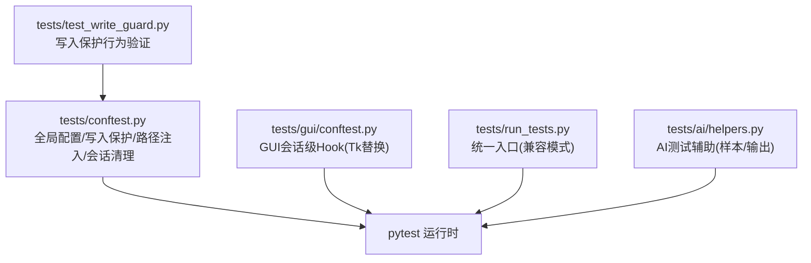
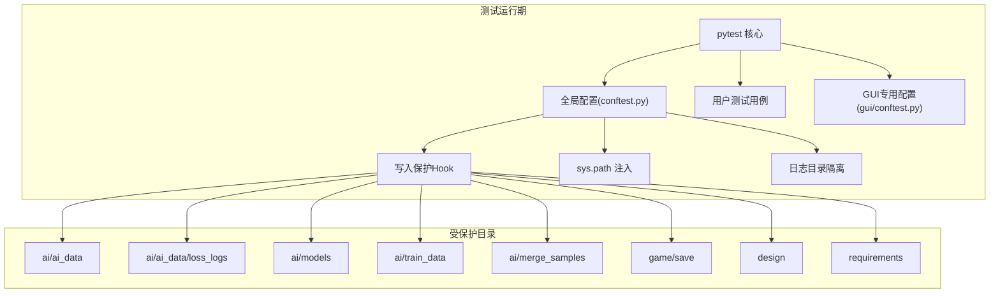
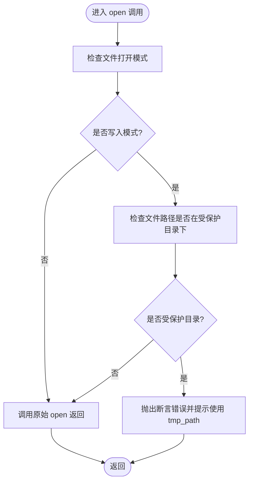
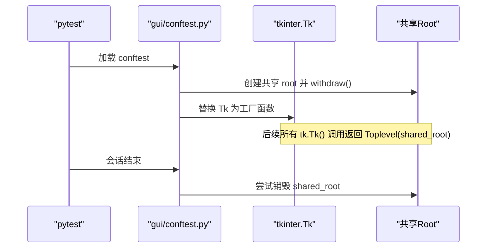
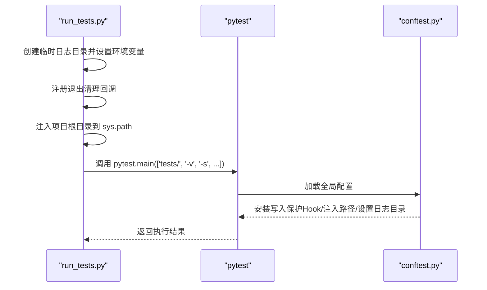
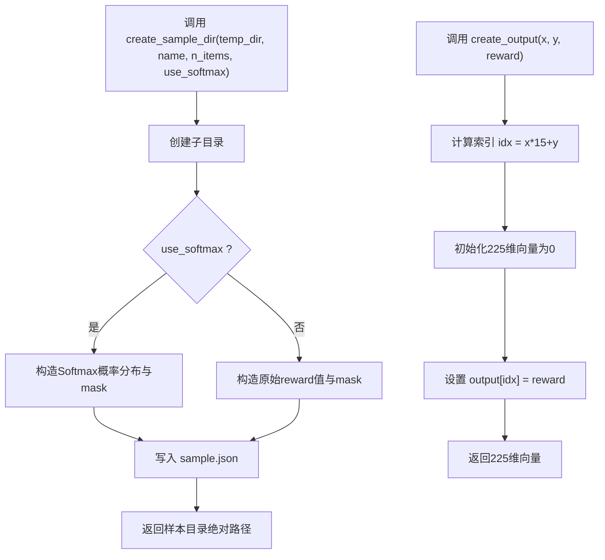
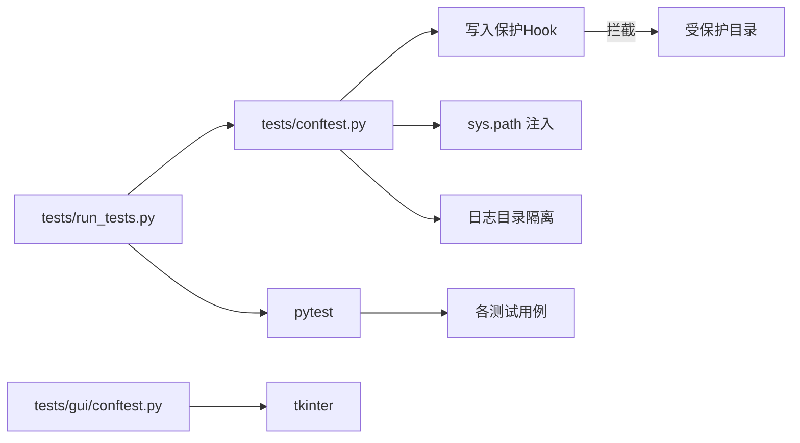

# 测试策略

<cite>
**本文引用的文件**
- [tests/conftest.py](file://tests/conftest.py)
- [tests/run_tests.py](file://tests/run_tests.py)
- [tests/gui/conftest.py](file://tests/gui/conftest.py)
- [tests/test_write_guard.py](file://tests/test_write_guard.py)
- [tests/ai/helpers.py](file://tests/ai/helpers.py)
</cite>

## 目录
1. [简介](#简介)
2. [项目结构](#项目结构)
3. [核心组件](#核心组件)
4. [架构总览](#架构总览)
5. [详细组件分析](#详细组件分析)
6. [依赖分析](#依赖分析)
7. [性能考虑](#性能考虑)
8. [故障排查指南](#故障排查指南)
9. [结论](#结论)
10. [附录](#附录)

## 简介
本文件面向五子棋AI项目的测试体系，系统阐述测试架构与策略，涵盖：
- pytest 全局配置、测试发现与执行策略
- 测试环境隔离机制（临时目录、写入保护Hook、受保护目录管理）
- 测试会话生命周期管理（初始化与清理）
- 测试执行最佳实践（并行、排序、失败重试）
- 测试数据管理（生成、存储、清理）
- 测试环境配置（依赖注入、fixture、上下文管理）

目标是帮助开发者在保证测试稳定性的同时，提升测试效率与可维护性。

## 项目结构
测试相关的关键位置与职责如下：
- tests/conftest.py：全局pytest配置，负责：
  - 设置测试专用的损失日志目录，避免污染真实数据
  - 安装写入保护Hook，拦截对受保护目录的写入
  - 配置sys.path确保项目根目录可导入
  - 会话结束时清理临时日志目录
- tests/gui/conftest.py：GUI测试专用配置，解决Windows+Python 3.13下Tcl/Tk初始化不稳定问题
- tests/run_tests.py：统一入口脚本，兼容直接调用pytest运行测试
- tests/test_write_guard.py：验证写入保护Hook的行为
- tests/ai/helpers.py：AI测试共享辅助工具，用于生成测试样本与输出向量

图表来源
- [tests/conftest.py:1-119](file://tests/conftest.py#L1-L119)
- [tests/gui/conftest.py:1-53](file://tests/gui/conftest.py#L1-L53)
- [tests/run_tests.py:1-60](file://tests/run_tests.py#L1-L60)
- [tests/test_write_guard.py:1-177](file://tests/test_write_guard.py#L1-L177)
- [tests/ai/helpers.py:1-73](file://tests/ai/helpers.py#L1-L73)

章节来源
- [tests/conftest.py:1-119](file://tests/conftest.py#L1-L119)
- [tests/gui/conftest.py:1-53](file://tests/gui/conftest.py#L1-L53)
- [tests/run_tests.py:1-60](file://tests/run_tests.py#L1-L60)
- [tests/test_write_guard.py:1-177](file://tests/test_write_guard.py#L1-L177)
- [tests/ai/helpers.py:1-73](file://tests/ai/helpers.py#L1-L73)

## 核心组件
- 全局pytest配置与环境隔离
  - 通过环境变量注入测试专用的日志目录，避免污染真实数据
  - 会话结束自动清理临时日志目录
  - 注入项目根目录到sys.path，确保模块导入一致性
- 写入保护Hook
  - 替换builtins.open与io.open，拦截写入受保护目录的操作
  - 支持多种写入模式（w/a/x/+），并处理相对路径与子目录场景
  - 提供清晰的错误提示，引导使用tmp_path等临时目录
- GUI测试专用Hook
  - 在会话开始时创建共享root，替换tk.Tk为工厂函数，避免多次初始化Tcl导致的不稳定
  - 会话结束时尽力销毁共享root
- 测试运行入口
  - 统一调用pytest，兼容直接python tests/run_tests.py
  - 默认禁用输出捕获，规避Windows上Tcl/Tk初始化问题
- AI测试辅助工具
  - 生成符合AI训练输入格式的样本目录与JSON
  - 生成指定坐标的225维输出向量，便于单元测试

章节来源
- [tests/conftest.py:16-26](file://tests/conftest.py#L16-L26)
- [tests/conftest.py:28-42](file://tests/conftest.py#L28-L42)
- [tests/conftest.py:44-119](file://tests/conftest.py#L44-L119)
- [tests/gui/conftest.py:23-53](file://tests/gui/conftest.py#L23-L53)
- [tests/run_tests.py:49-56](file://tests/run_tests.py#L49-L56)
- [tests/ai/helpers.py:12-56](file://tests/ai/helpers.py#L12-L56)

## 架构总览
整体测试架构围绕pytest生态构建，通过全局配置与目录隔离保障测试稳定性；通过写入保护Hook防止误写生产数据；通过GUI专用Hook解决平台特定问题；通过统一入口简化执行流程。

图表来源
- [tests/conftest.py:44-58](file://tests/conftest.py#L44-L58)
- [tests/conftest.py:92-107](file://tests/conftest.py#L92-L107)
- [tests/gui/conftest.py:18-53](file://tests/gui/conftest.py#L18-L53)

## 详细组件分析

### 写入保护Hook组件
- 设计目标
  - 在测试期间拦截对受保护目录的写入，防止污染生产数据
  - 允许读取受保护目录内容与向临时目录写入
- 关键实现点
  - 模式识别：判断是否为写入模式（w/a/x/+）
  - 路径判定：使用绝对路径与目录前缀匹配，避免误判相似目录
  - 替换open：替换builtins.open与io.open，统一拦截
  - 错误提示：包含被拦截路径与受保护目录列表，指导使用tmp_path
- 行为验证
  - 针对多种写入模式与路径场景进行参数化测试
  - 验证读取与临时目录写入不受影响
  - 验证相对路径与子目录场景均被正确拦截

图表来源
- [tests/conftest.py:64-107](file://tests/conftest.py#L64-L107)
- [tests/test_write_guard.py:27-97](file://tests/test_write_guard.py#L27-L97)
- [tests/test_write_guard.py:99-143](file://tests/test_write_guard.py#L99-L143)
- [tests/test_write_guard.py:145-177](file://tests/test_write_guard.py#L145-L177)

章节来源
- [tests/conftest.py:64-107](file://tests/conftest.py#L64-L107)
- [tests/test_write_guard.py:27-177](file://tests/test_write_guard.py#L27-L177)

### GUI测试Hook组件
- 设计目标
  - 解决Windows+Python 3.13环境下Tcl/Tk初始化不稳定导致的非确定性失败
- 关键实现点
  - 在模块导入时创建共享root并隐藏
  - 替换tk.Tk为工厂函数，返回基于共享root的Toplevel实例
  - 会话结束时尝试销毁共享root，尽力而为

图表来源
- [tests/gui/conftest.py:23-53](file://tests/gui/conftest.py#L23-L53)

章节来源
- [tests/gui/conftest.py:1-53](file://tests/gui/conftest.py#L1-L53)

### 测试运行入口组件
- 设计目标
  - 提供统一入口，兼容直接调用与pytest命令行
  - 处理Windows平台Tcl/Tk初始化问题，默认禁用输出捕获
- 关键实现点
  - 创建临时日志目录并通过环境变量注入
  - 注册退出清理回调
  - 注入项目根目录到sys.path
  - 调用pytest.main并传入默认参数

图表来源
- [tests/run_tests.py:19-56](file://tests/run_tests.py#L19-L56)
- [tests/conftest.py:16-26](file://tests/conftest.py#L16-L26)
- [tests/conftest.py:28-42](file://tests/conftest.py#L28-L42)
- [tests/conftest.py:109-119](file://tests/conftest.py#L109-L119)

章节来源
- [tests/run_tests.py:1-60](file://tests/run_tests.py#L1-L60)
- [tests/conftest.py:16-119](file://tests/conftest.py#L16-L119)

### AI测试辅助组件
- 设计目标
  - 提供可复用的测试数据生成工具，减少重复代码
- 关键实现点
  - create_sample_dir：在临时目录下生成包含sample.json的测试样本目录
  - create_output：生成指定坐标的225维输出向量，支持Softmax概率分布或原始reward两种模式

图表来源
- [tests/ai/helpers.py:12-56](file://tests/ai/helpers.py#L12-L56)
- [tests/ai/helpers.py:58-73](file://tests/ai/helpers.py#L58-L73)

章节来源
- [tests/ai/helpers.py:1-73](file://tests/ai/helpers.py#L1-L73)

## 依赖分析
- 组件耦合
  - tests/conftest.py 与 tests/test_write_guard.py：前者提供Hook，后者验证行为
  - tests/gui/conftest.py 与GUI测试：前者提供会话级Hook，后者在该范围内生效
  - tests/run_tests.py 与 tests/conftest.py：前者兼容入口，后者提供核心配置
- 外部依赖
  - pytest：测试框架与执行引擎
  - tkinter：GUI测试依赖
  - tempfile/shutil/os/sys/builtins/io：环境隔离与Hook实现的基础能力

图表来源
- [tests/run_tests.py:49-56](file://tests/run_tests.py#L49-L56)
- [tests/conftest.py:44-119](file://tests/conftest.py#L44-L119)
- [tests/gui/conftest.py:18-53](file://tests/gui/conftest.py#L18-L53)

章节来源
- [tests/run_tests.py:1-60](file://tests/run_tests.py#L1-L60)
- [tests/conftest.py:1-119](file://tests/conftest.py#L1-L119)
- [tests/gui/conftest.py:1-53](file://tests/gui/conftest.py#L1-L53)

## 性能考虑
- 并行测试
  - 建议使用pytest-xdist插件启用并行执行，结合--maxfail与--lf减少无效开销
  - 注意共享资源（如GPU、文件句柄）的并发控制，必要时使用标记分组
- 测试排序
  - 使用--randomize或--ordering插件按依赖或耗时排序，缩短整体执行时间
  - 将长耗时测试拆分为独立子集，便于并行与重试
- 失败重试
  - 使用pytest-rerunfailures插件配置失败重试次数与条件，降低平台抖动影响
- I/O与日志
  - 通过隔离日志目录避免磁盘争用，减少I/O瓶颈
  - GUI测试中避免频繁创建销毁窗口，利用共享root降低初始化成本

## 故障排查指南
- 写入保护错误
  - 现象：断言错误，提示写入受保护目录
  - 处理：改用tmp_path或临时目录；确认路径是否为受保护目录的子目录
  - 参考：tests/test_write_guard.py中的参数化用例
- GUI初始化失败（Windows/Tcl/Tk）
  - 现象：随机出现“init.tcl”相关错误或非确定性失败
  - 处理：确保使用tests/gui/conftest.py提供的共享root方案；避免在测试外层重复创建tk.Tk
- 输出捕获问题
  - 现象：GUI测试间歇性失败
  - 处理：run_tests.py默认禁用输出捕获；若需捕获可显式传入--capture=fd

章节来源
- [tests/test_write_guard.py:27-97](file://tests/test_write_guard.py#L27-L97)
- [tests/gui/conftest.py:23-53](file://tests/gui/conftest.py#L23-L53)
- [tests/run_tests.py:49-56](file://tests/run_tests.py#L49-L56)

## 结论
本测试策略通过全局配置、写入保护、GUI专用Hook与统一入口，构建了稳定可靠的测试执行环境。配合AI测试辅助工具与明确的数据管理策略，能够在保证安全性与可重复性的前提下，高效推进五子棋AI的持续集成与演进。

## 附录
- 受保护目录清单（与配置保持一致）
  - ai/ai_data
  - ai/ai_data/loss_logs
  - ai/models
  - ai/train_data
  - ai/merge_samples
  - game/save
  - design
  - requirements
- 常用执行建议
  - 直接运行：python tests/run_tests.py
  - 命令行运行：python -m pytest tests/ -v -s
  - 并行执行：python -m pytest tests/ -v -n auto
  - 失败重试：python -m pytest tests/ --lf --reruns=2
  - 排序执行：python -m pytest tests/ --randomly --ordering