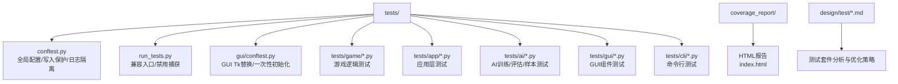
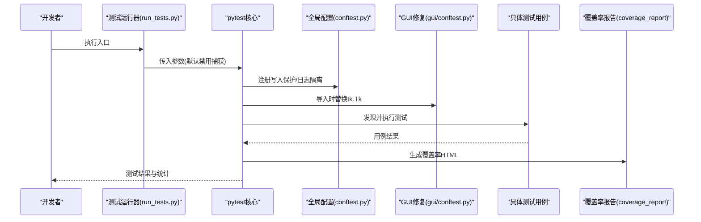
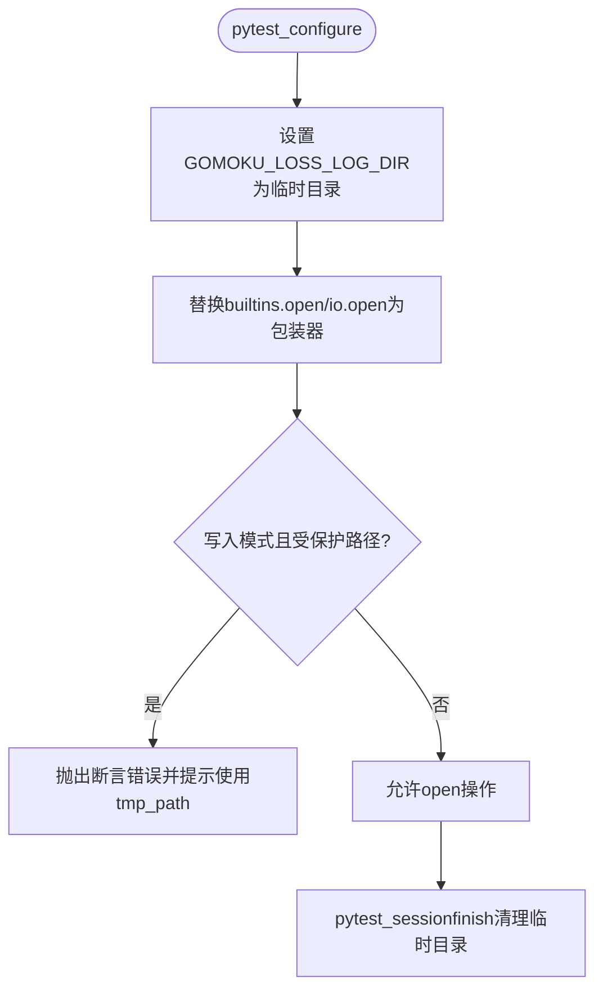
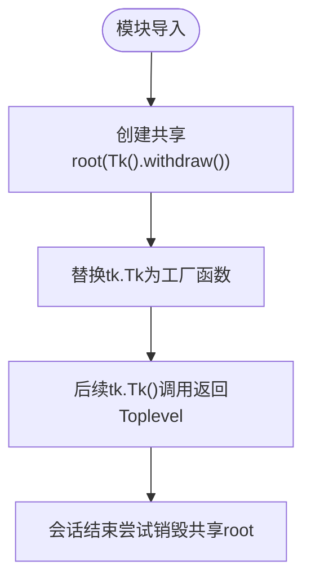
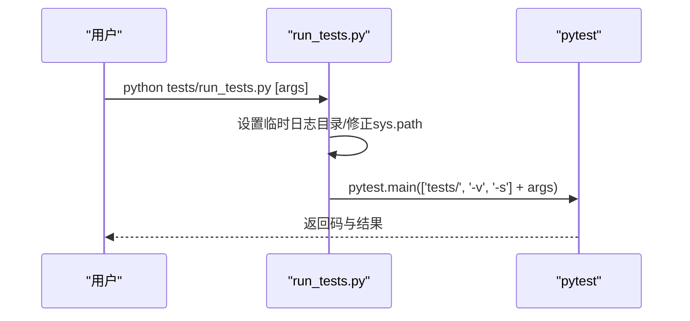
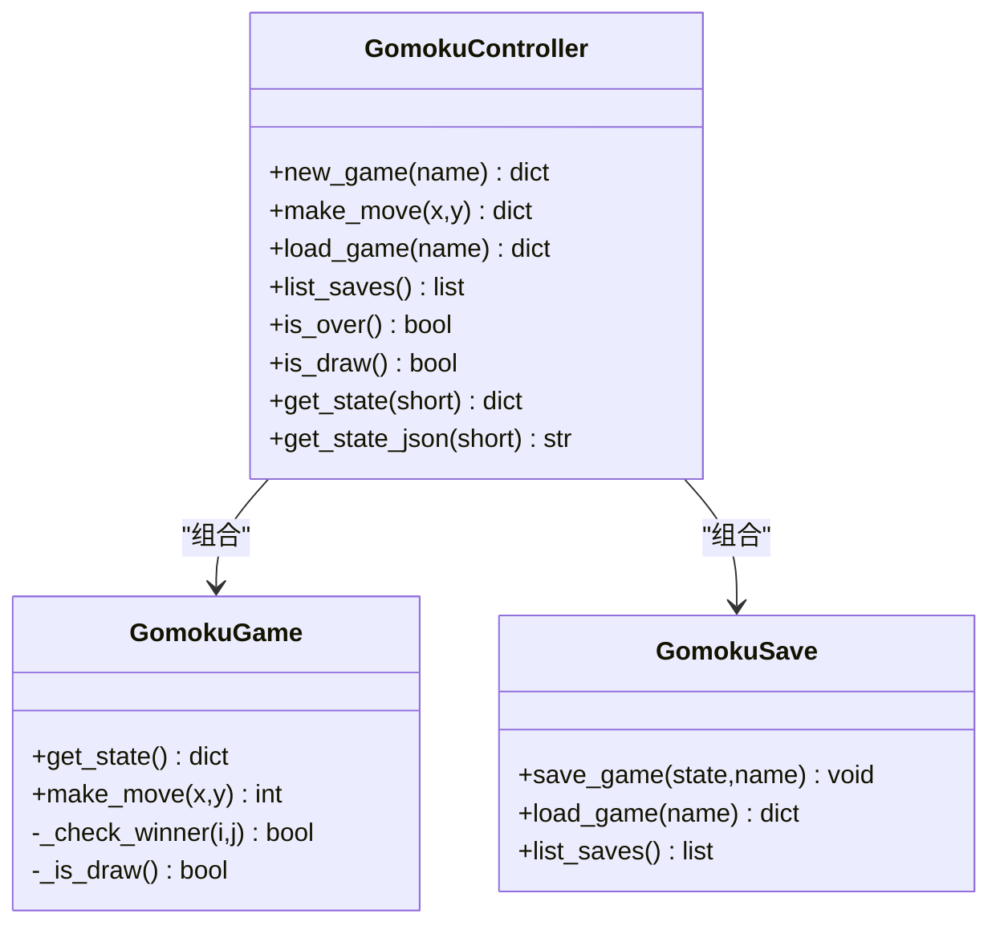
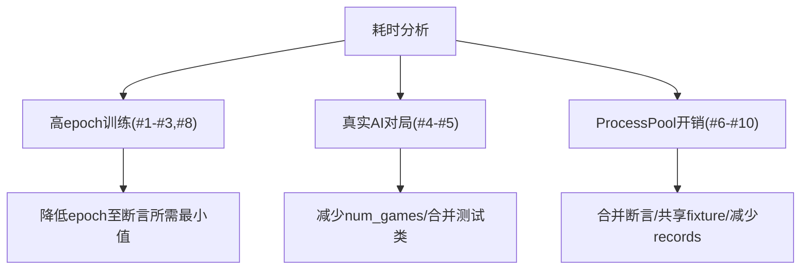
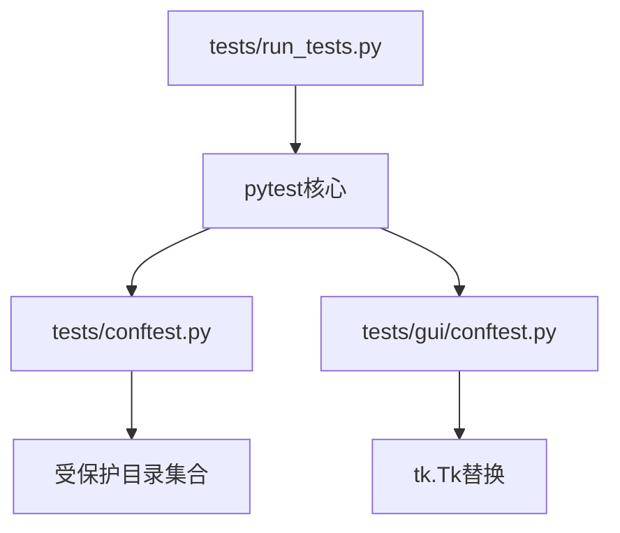
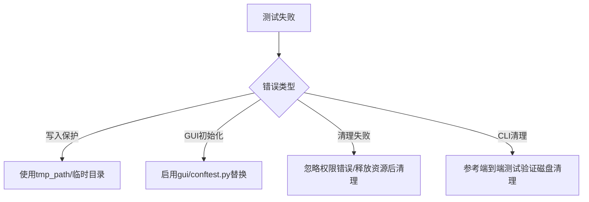

# 测试自动化

<cite>
**本文引用的文件**
- [tests/conftest.py](file://tests/conftest.py)
- [tests/run_tests.py](file://tests/run_tests.py)
- [tests/gui/conftest.py](file://tests/gui/conftest.py)
- [tests/test_controller.py](file://tests/test_controller.py)
- [tests/test_game.py](file://tests/test_game.py)
- [tests/test_save.py](file://tests/test_save.py)
- [design/test/test_suit_analysis_report.md](file://design/test/test_suit_analysis_report.md)
- [design/test/top10_slowest_tests_analysis.md](file://design/test/top10_slowest_tests_analysis.md)
- [tests/test_write_guard.py](file://tests/test_write_guard.py)
- [coverage_report/index.html](file://coverage_report/index.html)
- [coverage_report/z_05281745e451733e_model_py.html](file://coverage_report/z_05281745e451733e_model_py.html)
- [coverage_report/coverage_html_cb_188fc9a4.js](file://coverage_report/coverage_html_cb_188fc9a4.js)
- [tests/cli/test_train_main_temp_cleanup.py](file://tests/cli/test_train_main_temp_cleanup.py)
</cite>

## 目录
1. [简介](#简介)
2. [项目结构](#项目结构)
3. [核心组件](#核心组件)
4. [架构总览](#架构总览)
5. [详细组件分析](#详细组件分析)
6. [依赖分析](#依赖分析)
7. [性能考量](#性能考量)
8. [故障排查指南](#故障排查指南)
9. [结论](#结论)
10. [附录](#附录)

## 简介
本指南面向五子棋AI项目的测试自动化落地，系统阐述测试脚本编写、执行与维护方法；持续集成配置与触发机制；测试环境管理最佳实践；测试结果分析与报告生成；测试数据的自动化管理；测试故障的自动检测与通知；以及测试自动化的性能优化策略（并行、缓存、资源优化）。文档基于仓库现有测试基础设施与设计文档进行总结提炼，帮助团队建立稳定高效的测试自动化体系。

## 项目结构
测试相关的核心位置与职责如下：
- tests/：集中存放所有测试用例与通用配置
  - conftest.py：全局pytest配置，含写入保护hook、损失日志目录隔离、sys.path修正
  - run_tests.py：兼容入口，封装pytest调用，默认禁用输出捕获以规避Windows GUI兼容性问题
  - gui/conftest.py：GUI测试专用conftest，解决Windows+Python 3.13下Tcl解释器退化导致的非确定性失败
  - 各模块测试文件：game、app、ai、gui、cli等子目录下按功能划分的单元/集成/边缘测试
- coverage_report/：覆盖率HTML报告产物
- design/test/：测试套件耗时分析与优化策略文档

**图表来源**
- [tests/conftest.py:1-119](file://tests/conftest.py#L1-L119)
- [tests/run_tests.py:1-60](file://tests/run_tests.py#L1-L60)
- [tests/gui/conftest.py:1-53](file://tests/gui/conftest.py#L1-L53)
- [design/test/test_suit_analysis_report.md:1-369](file://design/test/test_suit_analysis_report.md#L1-L369)

**章节来源**
- [tests/conftest.py:1-119](file://tests/conftest.py#L1-L119)
- [tests/run_tests.py:1-60](file://tests/run_tests.py#L1-L60)
- [tests/gui/conftest.py:1-53](file://tests/gui/conftest.py#L1-L53)
- [design/test/test_suit_analysis_report.md:1-369](file://design/test/test_suit_analysis_report.md#L1-L369)

## 核心组件
- 全局pytest配置与写入保护
  - 通过环境变量隔离损失日志目录，避免污染真实数据
  - 注册open包装器，拦截写入受保护目录的行为，保障生产数据安全
  - 在会话结束时清理临时日志目录
- GUI测试稳定性保障
  - 在导入阶段替换tk.Tk为返回共享root的工厂，避免多次初始化Tcl导致的非确定性失败
- 测试运行器
  - 提供兼容入口，支持直接调用pytest，同时默认禁用输出捕获以适配Windows GUI
- 测试用例示例
  - 控制器、游戏、存档等模块的典型测试，展示断言风格与状态隔离实践

**章节来源**
- [tests/conftest.py:16-26](file://tests/conftest.py#L16-L26)
- [tests/conftest.py:92-106](file://tests/conftest.py#L92-L106)
- [tests/conftest.py:109-118](file://tests/conftest.py#L109-L118)
- [tests/gui/conftest.py:23-52](file://tests/gui/conftest.py#L23-L52)
- [tests/run_tests.py:49-55](file://tests/run_tests.py#L49-L55)
- [tests/test_controller.py:59-82](file://tests/test_controller.py#L59-L82)
- [tests/test_game.py:12-26](file://tests/test_game.py#L12-L26)
- [tests/test_save.py:31-51](file://tests/test_save.py#L31-L51)

## 架构总览
测试自动化整体流程包括：环境初始化（conftest）、测试发现与执行（pytest）、GUI稳定性保障（gui/conftest）、结果收集与报告（coverage_report）。

**图表来源**
- [tests/run_tests.py:49-55](file://tests/run_tests.py#L49-L55)
- [tests/conftest.py:109-118](file://tests/conftest.py#L109-L118)
- [tests/gui/conftest.py:23-52](file://tests/gui/conftest.py#L23-L52)
- [coverage_report/index.html](file://coverage_report/index.html)

## 详细组件分析

### 组件A：全局配置与写入保护（conftest.py）
- 目标
  - 隔离损失日志目录，避免污染真实数据
  - 安装open包装器，拦截写入受保护目录
  - 修正sys.path，确保项目根目录可导入
- 关键机制
  - 会话开始时创建临时日志目录并注入环境变量
  - 会话结束时清理临时日志目录
  - 注册builtins.open与io.open的包装器，仅允许读取受保护目录
  - 定义受保护目录集合（如ai_data、models、train_data等）

**图表来源**
- [tests/conftest.py:16-26](file://tests/conftest.py#L16-L26)
- [tests/conftest.py:92-106](file://tests/conftest.py#L92-L106)
- [tests/conftest.py:109-118](file://tests/conftest.py#L109-L118)

**章节来源**
- [tests/conftest.py:16-26](file://tests/conftest.py#L16-L26)
- [tests/conftest.py:47-58](file://tests/conftest.py#L47-L58)
- [tests/conftest.py:92-106](file://tests/conftest.py#L92-L106)
- [tests/conftest.py:109-118](file://tests/conftest.py#L109-L118)

### 组件B：GUI测试稳定性（gui/conftest.py）
- 目标
  - 解决Windows+Python 3.13下Tcl解释器偶发退化导致的非确定性失败
- 机制
  - 在模块导入时创建唯一真实Tk root，并将tk.Tk替换为返回Toplevel(shared_root)的工厂
  - 会话结束时尝试销毁共享root

**图表来源**
- [tests/gui/conftest.py:23-52](file://tests/gui/conftest.py#L23-L52)

**章节来源**
- [tests/gui/conftest.py:23-52](file://tests/gui/conftest.py#L23-L52)

### 组件C：测试运行器（run_tests.py）
- 目标
  - 提供兼容入口，封装pytest调用
  - 默认禁用输出捕获，规避Windows Tcl/Tk兼容性问题
- 行为
  - 设置临时损失日志目录（兼容性兜底）
  - 注册退出清理钩子
  - 修正sys.path
  - 调用pytest.main(args=['tests/', '-v', '-s'])

**图表来源**
- [tests/run_tests.py:49-55](file://tests/run_tests.py#L49-L55)

**章节来源**
- [tests/run_tests.py:19-31](file://tests/run_tests.py#L19-L31)
- [tests/run_tests.py:37-46](file://tests/run_tests.py#L37-L46)
- [tests/run_tests.py:49-55](file://tests/run_tests.py#L49-L55)

### 组件D：控制器/游戏/存档测试（示例）
- 控制器测试
  - 展示状态隔离（临时目录）、断言风格（状态字段、赢家、结束标志）
  - 平局构造与注入，验证胜负判定与状态一致性
- 游戏测试
  - 初始化、落子、越界/占用检测、胜负判定（横/竖/斜）
  - 平局检测（模7线性模式构造满盘无五连）
  - 状态深拷贝保护
- 存档测试
  - 目录创建、文件保存与加载、列表排序、同名同日多次保存不覆盖、含下划线名称解析

**图表来源**
- [tests/test_controller.py:59-82](file://tests/test_controller.py#L59-L82)
- [tests/test_game.py:12-26](file://tests/test_game.py#L12-L26)
- [tests/test_save.py:31-51](file://tests/test_save.py#L31-L51)

**章节来源**
- [tests/test_controller.py:59-82](file://tests/test_controller.py#L59-L82)
- [tests/test_controller.py:163-184](file://tests/test_controller.py#L163-L184)
- [tests/test_game.py:12-26](file://tests/test_game.py#L12-L26)
- [tests/test_game.py:106-151](file://tests/test_game.py#L106-L151)
- [tests/test_game.py:165-204](file://tests/test_game.py#L165-L204)
- [tests/test_save.py:31-51](file://tests/test_save.py#L31-L51)
- [tests/test_save.py:256-284](file://tests/test_save.py#L256-L284)

### 组件E：测试套件耗时分析与优化策略
- 现状与瓶颈
  - 全量测试约91秒，Top10耗时占比达46%
  - 主要瓶颈：高epoch训练、真实AI对局、ProcessPool开销
- 已实施优化
  - 将epochs从1000降至10~400，call_count断言放宽，num_games从3→2/1，records从4→2
  - 合并重复测试，删除冗余断言
- 未实施策略
  - 引入pytest marker分层执行（CI快速通道）
  - 合并同单元碎片文件、多模型共享测试基类、train_cycle mock化

**图表来源**
- [design/test/top10_slowest_tests_analysis.md:18-18](file://design/test/top10_slowest_tests_analysis.md#L18-L18)
- [design/test/test_suit_analysis_report.md:119-188](file://design/test/test_suit_analysis_report.md#L119-L188)

**章节来源**
- [design/test/top10_slowest_tests_analysis.md:18-53](file://design/test/top10_slowest_tests_analysis.md#L18-L53)
- [design/test/top10_slowest_tests_analysis.md:371-465](file://design/test/top10_slowest_tests_analysis.md#L371-L465)
- [design/test/test_suit_analysis_report.md:119-188](file://design/test/test_suit_analysis_report.md#L119-L188)

## 依赖分析
- 组件耦合
  - tests/conftest.py与pytest生命周期强耦合，负责全局环境初始化与清理
  - tests/gui/conftest.py与tkinter强耦合，仅影响tests/gui目录下的测试
  - tests/run_tests.py与pytest命令行接口耦合，提供兼容入口
- 外部依赖
  - pytest及其插件（marker、fixture等）
  - Python标准库（tempfile、shutil、os、sys等）
  - GUI相关（tkinter），仅在GUI测试中使用

**图表来源**
- [tests/conftest.py:47-58](file://tests/conftest.py#L47-L58)
- [tests/gui/conftest.py:23-52](file://tests/gui/conftest.py#L23-L52)
- [tests/run_tests.py:49-55](file://tests/run_tests.py#L49-L55)

**章节来源**
- [tests/conftest.py:47-58](file://tests/conftest.py#L47-L58)
- [tests/gui/conftest.py:23-52](file://tests/gui/conftest.py#L23-L52)
- [tests/run_tests.py:49-55](file://tests/run_tests.py#L49-L55)

## 性能考量
- 现状
  - 全量测试约91秒，Top10耗时占比46%
- 已实施优化
  - 降低epoch数、减少num_games、合并断言、删除冗余测试
- 建议继续优化
  - 引入pytest marker分层执行（CI快速通道）
  - 合并同单元碎片文件、多模型共享测试基类
  - train_cycle mock化，降低“实际对局+训练”的端到端测试比例
  - 引入class级fixture共享昂贵对象（如Evaluator），注意目录状态隔离

**章节来源**
- [design/test/top10_slowest_tests_analysis.md:371-465](file://design/test/top10_slowest_tests_analysis.md#L371-L465)
- [design/test/test_suit_analysis_report.md:119-188](file://design/test/test_suit_analysis_report.md#L119-L188)

## 故障排查指南
- 写入保护错误
  - 现象：断言错误提示试图写入受保护目录
  - 原因：测试代码直接写入受保护目录
  - 解决：使用pytest提供的tmp_path fixture或临时目录
- GUI非确定性失败
  - 现象：Windows下Tcl初始化失败或随机漂移
  - 原因：多次初始化tk.Tk导致Tcl解释器退化
  - 解决：使用tests/gui/conftest.py提供的替换机制
- 临时目录清理失败
  - 现象：Windows下文件被占用导致清理失败
  - 解决：在teardown中忽略PermissionError，或确保资源释放后再清理
- CLI临时目录清理验证
  - 通过端到端测试验证真实磁盘上的临时目录创建与删除

**图表来源**
- [tests/test_write_guard.py:118-150](file://tests/test_write_guard.py#L118-L150)
- [tests/gui/conftest.py:23-52](file://tests/gui/conftest.py#L23-L52)
- [tests/test_controller.py:71-82](file://tests/test_controller.py#L71-L82)
- [tests/cli/test_train_main_temp_cleanup.py:122-147](file://tests/cli/test_train_main_temp_cleanup.py#L122-L147)

**章节来源**
- [tests/test_write_guard.py:118-150](file://tests/test_write_guard.py#L118-L150)
- [tests/gui/conftest.py:23-52](file://tests/gui/conftest.py#L23-L52)
- [tests/test_controller.py:71-82](file://tests/test_controller.py#L71-L82)
- [tests/cli/test_train_main_temp_cleanup.py:122-147](file://tests/cli/test_train_main_temp_cleanup.py#L122-L147)

## 结论
本项目已具备完善的测试自动化基础：全局配置隔离生产数据、GUI稳定性修复、运行器兼容入口与禁用捕获策略。结合测试套件耗时分析与优化策略，建议继续推进分层执行、合并重复测试、参数化多模型测试与部分端到端测试的mock化，以显著缩短CI时间并提升可维护性。同时，持续完善测试数据管理与报告生成，确保测试质量与可追溯性。

## 附录

### A. 测试脚本编写与维护要点
- 断言风格
  - 验证状态字段、赢家、结束标志、历史长度等
  - 使用状态深拷贝保护，避免外部修改影响内部状态
- 状态隔离
  - 使用临时目录与临时文件，确保用例间互不干扰
  - 在teardown中释放资源并清理临时目录
- GUI测试
  - 依赖tests/gui/conftest.py提供的替换机制，避免多次初始化Tcl

**章节来源**
- [tests/test_controller.py:59-82](file://tests/test_controller.py#L59-L82)
- [tests/test_game.py:219-245](file://tests/test_game.py#L219-L245)
- [tests/gui/conftest.py:23-52](file://tests/gui/conftest.py#L23-L52)

### B. 持续集成配置与触发机制
- 建议
  - 引入pytest marker分层执行：CI默认运行非slow标记用例，全量验证保留至nightly
  - 在CI中默认禁用输出捕获，规避Windows GUI兼容性问题
  - 将tests/run_tests.py作为入口，便于统一参数与环境配置

**章节来源**
- [design/test/test_suit_analysis_report.md:121-138](file://design/test/test_suit_analysis_report.md#L121-L138)
- [tests/run_tests.py:49-55](file://tests/run_tests.py#L49-L55)

### C. 测试环境管理最佳实践
- 环境隔离
  - 通过环境变量隔离损失日志目录
  - 使用tmp_path等pytest fixture进行临时文件/目录管理
- 资源释放
  - 在teardown中释放对象引用与关闭文件句柄
  - 忽略Windows下可能的清理权限错误

**章节来源**
- [tests/conftest.py:16-26](file://tests/conftest.py#L16-L26)
- [tests/test_controller.py:71-82](file://tests/test_controller.py#L71-L82)

### D. 测试结果分析与报告生成
- 覆盖率报告
  - HTML报告位于coverage_report/，包含索引与按模块的详细页面
  - 可通过浏览器打开index.html查看整体与模块级覆盖率

**章节来源**
- [coverage_report/index.html](file://coverage_report/index.html)
- [coverage_report/z_05281745e451733e_model_py.html](file://coverage_report/z_05281745e451733e_model_py.html)

### E. 测试数据的自动化管理
- 生成与清理
  - 使用临时目录与临时文件，测试结束后清理
  - CLI相关测试验证真实磁盘上的临时目录创建与删除
- 更新与维护
  - 通过pytest fixture与上下文管理器确保数据一致性与可维护性

**章节来源**
- [tests/test_save.py:17-29](file://tests/test_save.py#L17-L29)
- [tests/cli/test_train_main_temp_cleanup.py:122-147](file://tests/cli/test_train_main_temp_cleanup.py#L122-L147)

### F. 测试故障的自动检测与通知
- 自动检测
  - 通过pytest断言与异常捕获识别失败用例
  - 写入保护hook阻止对生产数据的意外写入
- 通知机制
  - 建议在CI中结合pytest的失败重试与邮件/消息通知插件
  - 对GUI与Windows特有问题，可在CI日志中标注并附带截图或视频

**章节来源**
- [tests/test_write_guard.py:118-150](file://tests/test_write_guard.py#L118-L150)
- [tests/gui/conftest.py:23-52](file://tests/gui/conftest.py#L23-L52)

### G. 测试自动化的性能优化策略
- 并行测试执行
  - 引入class级fixture共享昂贵对象（如Evaluator），注意目录状态隔离
- 测试缓存
  - 利用pytest缓存与依赖缓存，减少重复计算
- 资源优化
  - 降低epoch数、减少num_games、合并断言与重复测试
  - 对真实AI对局与ProcessPool开销进行mock或合并

**章节来源**
- [design/test/top10_slowest_tests_analysis.md:371-465](file://design/test/top10_slowest_tests_analysis.md#L371-L465)
- [design/test/test_suit_analysis_report.md:119-188](file://design/test/test_suit_analysis_report.md#L119-L188)