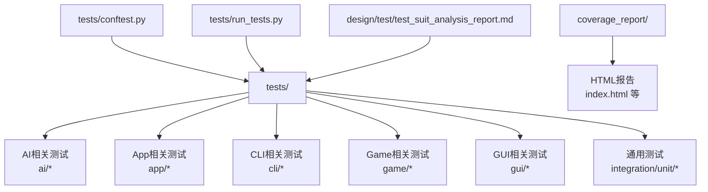
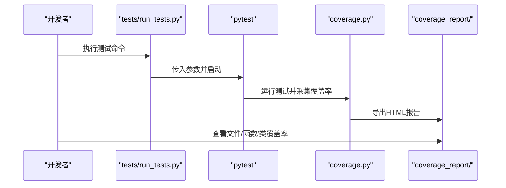
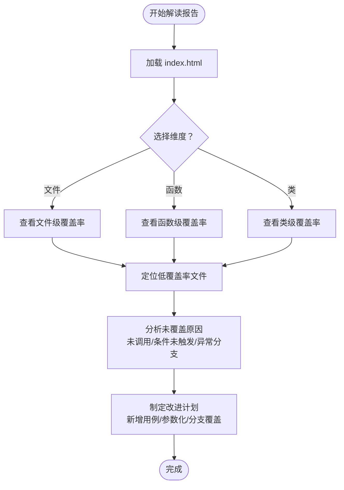
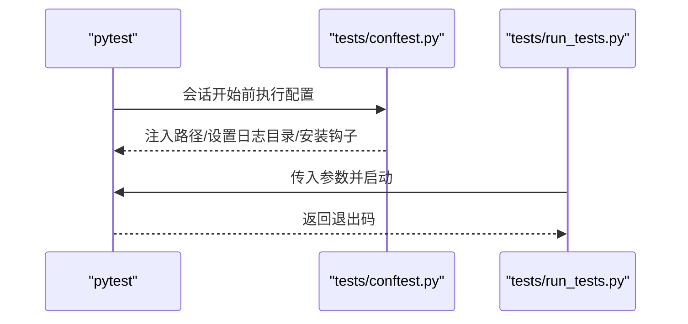
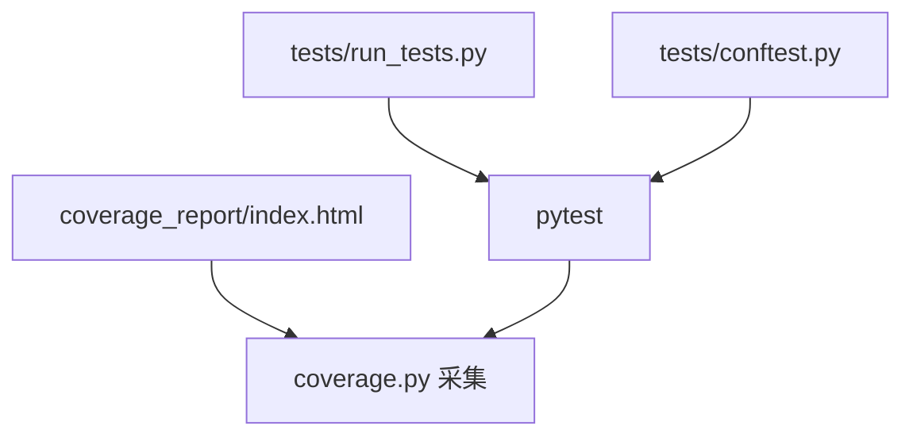

# 测试覆盖率

<cite>
**本文引用的文件**
- [coverage_report/index.html](file://coverage_report/index.html)
- [tests/conftest.py](file://tests/conftest.py)
- [tests/run_tests.py](file://tests/run_tests.py)
- [design/test/test_suit_analysis_report.md](file://design/test/test_suit_analysis_report.md)
- [tests/test_controller.py](file://tests/test_controller.py)
- [tests/test_game.py](file://tests/test_game.py)
- [tests/test_save.py](file://tests/test_save.py)
</cite>

## 目录
1. [简介](#简介)
2. [项目结构](#项目结构)
3. [核心组件](#核心组件)
4. [架构总览](#架构总览)
5. [详细组件分析](#详细组件分析)
6. [依赖分析](#依赖分析)
7. [性能考量](#性能考量)
8. [故障排查指南](#故障排查指南)
9. [结论](#结论)
10. [附录](#附录)

## 简介
本文件面向五子棋AI项目，系统化阐述测试覆盖率的分析标准、工具使用、报告生成与解读方法，并提供覆盖率改进策略、阈值设定与验证、自动化集成（CI/CD）以及最佳实践。项目当前已具备基于 coverage.py 的覆盖率报告，整体行覆盖率约为76%，部分模块存在明显覆盖率缺口，尤其是GUI主程序文件。

## 项目结构
- 测试与覆盖率相关的关键位置：
  - tests/：集中存放各类测试用例，涵盖AI、App、CLI、Game、GUI等模块。
  - coverage_report/：coverage.py 生成的HTML覆盖率报告，包含文件级、函数级、类级覆盖率索引与详情页。
  - tests/conftest.py：pytest全局配置，负责环境初始化、写入保护钩子、路径注入等。
  - tests/run_tests.py：统一入口脚本，封装pytest调用及兼容性处理（如Windows下禁用输出捕获）。
  - design/test/test_suit_analysis_report.md：测试套件耗时分析与优化建议，为覆盖率与执行效率协同改进提供依据。

**图表来源**
- [coverage_report/index.html:1-334](file://coverage_report/index.html#L1-L334)
- [tests/conftest.py:1-119](file://tests/conftest.py#L1-L119)
- [tests/run_tests.py:1-60](file://tests/run_tests.py#L1-L60)
- [design/test/test_suit_analysis_report.md:1-369](file://design/test/test_suit_analysis_report.md#L1-L369)

**章节来源**
- [coverage_report/index.html:1-334](file://coverage_report/index.html#L1-L334)
- [tests/conftest.py:1-119](file://tests/conftest.py#L1-L119)
- [tests/run_tests.py:1-60](file://tests/run_tests.py#L1-L60)
- [design/test/test_suit_analysis_report.md:1-369](file://design/test/test_suit_analysis_report.md#L1-L369)

## 核心组件
- 覆盖率报告与解读
  - 报告首页展示总体行覆盖率（当前约76%），并提供按文件、函数、类维度的索引与切换。
  - 表格字段：文件、语句数、缺失数、排除数、覆盖率，便于快速定位低覆盖率文件。
- 测试运行与环境
  - tests/conftest.py：在pytest会话开始前注入项目根路径，设置测试专用损失日志目录，安装写入保护钩子，防止测试向受保护目录写入。
  - tests/run_tests.py：统一调用pytest，兼容Windows平台的输出捕获问题，默认禁用输出捕获以避免GUI测试不稳定。
- 测试套件耗时与覆盖率协同优化
  - design/test/test_suit_analysis_report.md：分析测试耗时分布，提出分层标记、合并重复fixture、参数化多模型测试、降低慢测试实际工作量等策略，有助于在提升覆盖率的同时控制CI执行时间。

**章节来源**
- [coverage_report/index.html:50-312](file://coverage_report/index.html#L50-L312)
- [tests/conftest.py:16-119](file://tests/conftest.py#L16-L119)
- [tests/run_tests.py:9-55](file://tests/run_tests.py#L9-L55)
- [design/test/test_suit_analysis_report.md:119-369](file://design/test/test_suit_analysis_report.md#L119-L369)

## 架构总览
覆盖率分析在本项目中的工作流如下：
- 运行测试：通过tests/run_tests.py或pytest命令执行tests/下的全部测试。
- 收集覆盖率：coverage.py在运行过程中统计各模块的行/分支/函数/类覆盖率。
- 生成报告：coverage.py导出HTML报告至coverage_report/，便于浏览与分析。
- 解读与改进：根据报告定位低覆盖率文件，结合测试套件优化策略进行针对性补充与重构。

**图表来源**
- [tests/run_tests.py:49-55](file://tests/run_tests.py#L49-L55)
- [coverage_report/index.html:1-334](file://coverage_report/index.html#L1-L334)

## 详细组件分析

### 覆盖率报告与解读
- 报告首页要点
  - 总体行覆盖率：76%（基于1346条语句，317条未覆盖）。
  - 文件维度：按覆盖率排序，可快速发现低覆盖率文件。
  - 功能维度：支持切换到函数/类索引页，辅助定位具体函数或类的覆盖率缺口。
- 低覆盖率示例
  - gui/main.py：266条语句全部未覆盖（0%），表明该模块缺少针对性测试或测试未执行到。
  - ai/base_model.py：10条语句中2条未覆盖（80%）。
  - ai/battle.py：84条语句中19条未覆盖（77%）。
  - game/controller.py：98条语句中11条未覆盖（89%）。
- 覆盖率指标说明
  - 行覆盖率：已执行的源代码行数占比。用于衡量“代码被执行”的广度。
  - 分支覆盖率：已执行的分支（if/else/elif等）占比。用于衡量“条件逻辑被执行”的完整性。
  - 函数覆盖率：已执行的函数定义占比。用于衡量“函数被调用”的完整性。
  - 类覆盖率：已执行的类定义占比。用于衡量“类被实例化/访问”的完整性。
  - 计算方法：覆盖率 = 已覆盖计数 / 总计数；缺失数 = 总计数 - 已覆盖计数。

**图表来源**
- [coverage_report/index.html:62-312](file://coverage_report/index.html#L62-L312)

**章节来源**
- [coverage_report/index.html:50-312](file://coverage_report/index.html#L50-L312)

### 测试运行与环境配置
- 环境初始化
  - tests/conftest.py在pytest会话开始前设置测试专用损失日志目录，避免污染真实数据；同时注入项目根路径，确保模块导入正常。
  - 写入保护钩子：拦截对受保护目录的写入操作，防止测试破坏生产数据。
- 运行入口
  - tests/run_tests.py统一调用pytest，兼容Windows平台的输出捕获问题，默认禁用输出捕获，避免GUI测试不稳定。
- 与覆盖率的关系
  - conftest.py的路径注入与写入保护确保测试稳定运行，间接提升覆盖率数据的可靠性。
  - run_tests.py的默认参数影响测试稳定性，从而影响覆盖率采集的完整性。

**图表来源**
- [tests/conftest.py:16-119](file://tests/conftest.py#L16-L119)
- [tests/run_tests.py:49-55](file://tests/run_tests.py#L49-L55)

**章节来源**
- [tests/conftest.py:16-119](file://tests/conftest.py#L16-L119)
- [tests/run_tests.py:9-55](file://tests/run_tests.py#L9-L55)

### 测试套件耗时与覆盖率协同优化
- 现状与瓶颈
  - 极慢测试集中在实际训练/对局类测试，占总耗时的较大比例。
  - 重复fixture开销与多模型重复测试造成资源浪费。
- 改进策略
  - 引入pytest标记分层执行，CI快速反馈，全量验证兼顾。
  - 合并同单元碎片文件，减少重复fixture开销与维护成本。
  - 多模型共享测试基类，参数化替代重复测试。
  - 降低慢测试的实际工作量（如减少epoch数、使用mock）。
- 与覆盖率的关系
  - 优化策略在提升CI效率的同时，保持或提升覆盖率，避免“只求快不求全”。

**章节来源**
- [design/test/test_suit_analysis_report.md:119-369](file://design/test/test_suit_analysis_report.md#L119-L369)

### 典型测试用例与覆盖率关联
- 控制器测试（game/controller）
  - tests/test_controller.py：覆盖多种落子场景、胜负判定、平局、状态查询等，有助于提升控制器相关模块的覆盖率。
- 游戏逻辑测试（game/game）
  - tests/test_game.py：覆盖初始化、落子、胜负判定、平局检测、状态隔离等，有助于提升游戏核心逻辑覆盖率。
- 存档管理测试（game/save）
  - tests/test_save.py：覆盖存档创建、加载、列表、命名规则等，有助于提升存档模块覆盖率。

**章节来源**
- [tests/test_controller.py:1-319](file://tests/test_controller.py#L1-L319)
- [tests/test_game.py:1-245](file://tests/test_game.py#L1-L245)
- [tests/test_save.py:1-303](file://tests/test_save.py#L1-L303)

## 依赖分析
- 覆盖率报告依赖关系
  - coverage_report/index.html 依赖于 coverage.py 的采集结果与HTML导出。
  - tests/conftest.py 与 tests/run_tests.py 为测试执行的基础，间接影响覆盖率数据的稳定性与完整性。
- 低覆盖率文件的潜在依赖
  - gui/main.py 低覆盖率可能与其作为入口模块的特殊性有关，需结合GUI测试策略与覆盖率采集配置进行分析。

**图表来源**
- [coverage_report/index.html:1-334](file://coverage_report/index.html#L1-L334)
- [tests/run_tests.py:49-55](file://tests/run_tests.py#L49-L55)
- [tests/conftest.py:16-119](file://tests/conftest.py#L16-L119)

**章节来源**
- [coverage_report/index.html:1-334](file://coverage_report/index.html#L1-L334)
- [tests/run_tests.py:49-55](file://tests/run_tests.py#L49-L55)
- [tests/conftest.py:16-119](file://tests/conftest.py#L16-L119)

## 性能考量
- 覆盖率采集的性能影响
  - 覆盖率采集本身会带来轻微开销，但通常可忽略不计。
  - 测试执行时间主要由实际AI对局与训练决定，优化策略应优先考虑减少实际工作量与重复开销。
- CI执行效率
  - 通过pytest标记分层执行，可在CI中快速反馈，缩短等待时间。
  - 合并重复测试与参数化多模型测试，减少测试文件数量与执行时间。

[本节为一般性指导，无需特定文件分析]

## 故障排查指南
- 覆盖率报告无法生成或不完整
  - 检查tests/run_tests.py与pytest命令是否正确传入覆盖率参数。
  - 确认tests/conftest.py的路径注入与写入保护未阻止覆盖率采集。
- 特定文件覆盖率异常低
  - 检查该文件是否被测试用例覆盖到，或是否存在条件分支未触发。
  - 对于GUI主程序等入口模块，确认测试策略与覆盖率采集配置是否匹配。
- 测试不稳定导致覆盖率波动
  - 关注tests/conftest.py中的写入保护与路径注入，确保测试环境一致性。
  - 对于Windows平台GUI测试，确认是否遵循tests/run_tests.py的默认参数设置。

**章节来源**
- [tests/run_tests.py:9-55](file://tests/run_tests.py#L9-L55)
- [tests/conftest.py:16-119](file://tests/conftest.py#L16-L119)

## 结论
本项目已具备较为完善的覆盖率报告体系，整体行覆盖率约为76%。为进一步提升质量与效率，建议：
- 优先补齐低覆盖率文件（如gui/main.py）的测试，提升覆盖率与稳定性。
- 结合测试套件耗时分析报告，采用分层标记、合并重复、参数化等策略，平衡覆盖率与CI效率。
- 设定合理的覆盖率阈值（如行覆盖率≥80%），并在CI中强制校验，持续跟踪覆盖率趋势。

[本节为总结性内容，无需特定文件分析]

## 附录

### 覆盖率阈值设定与验证
- 建议阈值
  - 行覆盖率：≥80%
  - 分支覆盖率：≥70%
  - 函数/类覆盖率：≥90%
- 验证方式
  - 在CI中增加覆盖率检查步骤，若低于阈值则失败。
  - 结合历史趋势对比，确保覆盖率稳步提升。

[本节为一般性指导，无需特定文件分析]

### 覆盖率报告自动化与集成
- 本地生成
  - 使用tests/run_tests.py或pytest命令运行测试，配合coverage.py导出HTML报告至coverage_report/。
- CI集成
  - 在CI流水线中加入覆盖率检查步骤，失败即终止构建。
  - 可结合pytest标记分层执行，先运行快速用例，再运行全量用例。

[本节为一般性指导，无需特定文件分析]

### 覆盖率分析最佳实践
- 指标选择
  - 以行覆盖率为主，辅以分支、函数、类覆盖率综合评估。
- 报告维护
  - 定期审查覆盖率报告，识别长期低覆盖率模块并制定改进计划。
- 趋势跟踪
  - 记录每周/每月覆盖率变化，形成趋势图，辅助决策与资源分配。

[本节为一般性指导，无需特定文件分析]