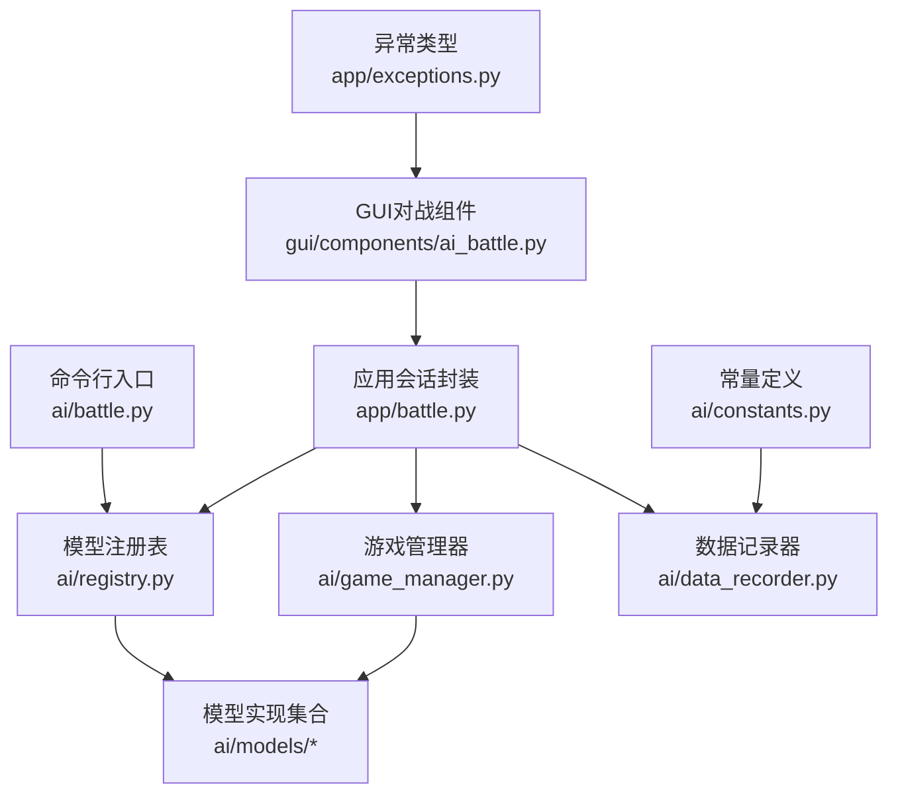
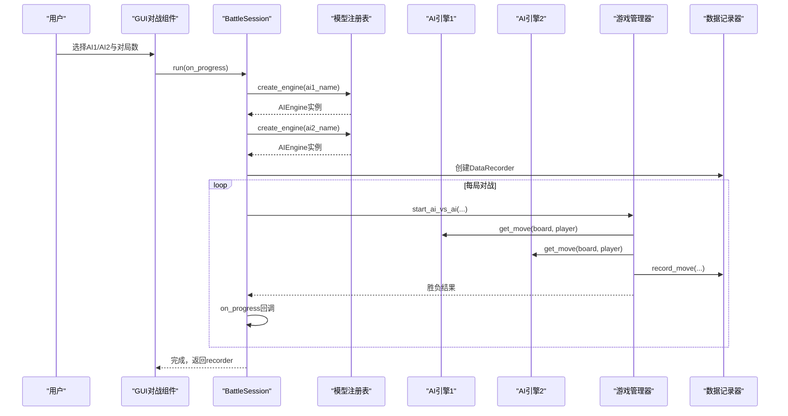
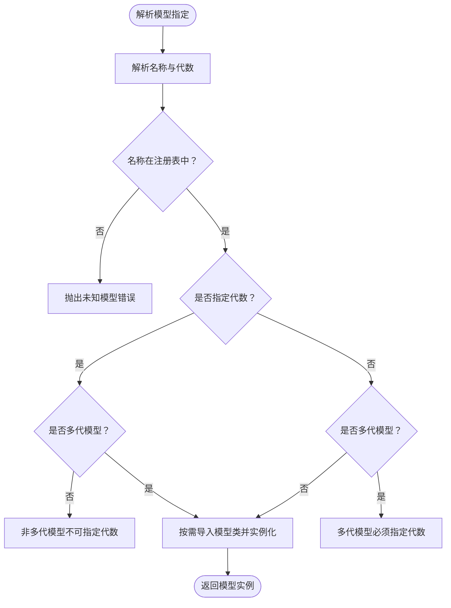
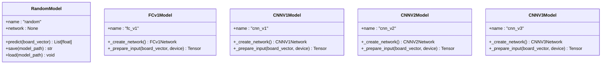
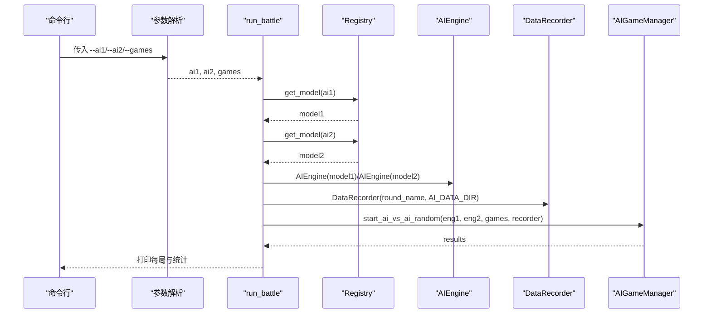
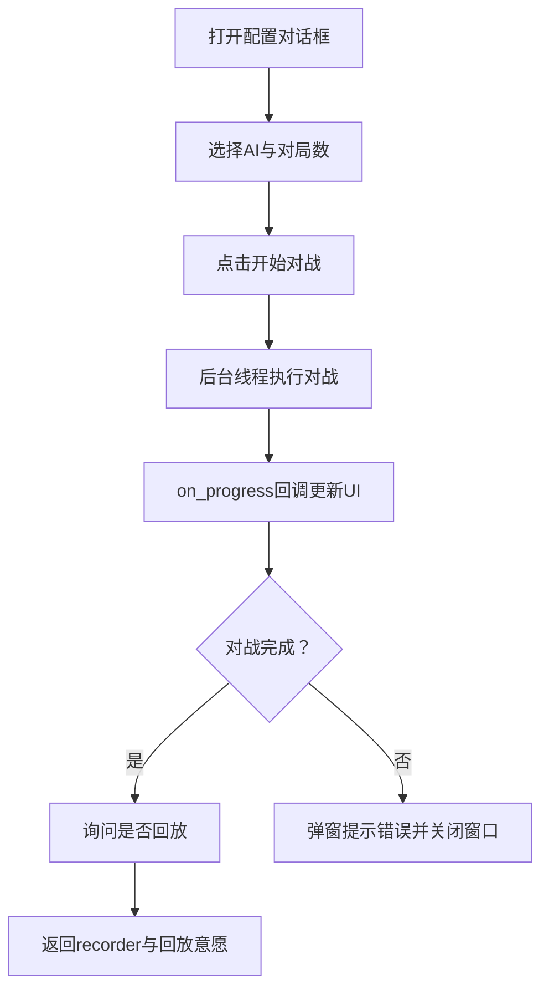
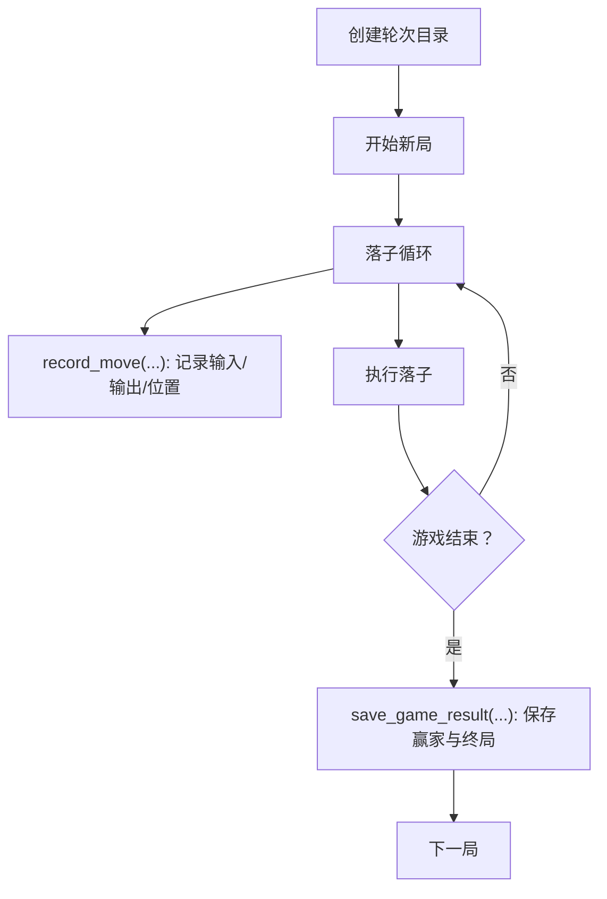
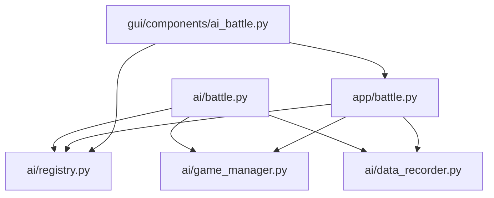

# AI对战

<cite>
**本文引用的文件**
- [ai/battle.py](file://ai/battle.py)
- [gui/components/ai_battle.py](file://gui/components/ai_battle.py)
- [app/battle.py](file://app/battle.py)
- [ai/registry.py](file://ai/registry.py)
- [ai/models/__init__.py](file://ai/models/__init__.py)
- [ai/models/random/model.py](file://ai/models/random/model.py)
- [ai/models/fc_v1/model.py](file://ai/models/fc_v1/model.py)
- [ai/models/cnn_v1/model.py](file://ai/models/cnn_v1/model.py)
- [ai/models/cnn_v2/model.py](file://ai/models/cnn_v2/model.py)
- [ai/models/cnn_v3/model.py](file://ai/models/cnn_v3/model.py)
- [ai/constants.py](file://ai/constants.py)
- [ai/data_recorder.py](file://ai/data_recorder.py)
- [ai/game_manager.py](file://ai/game_manager.py)
- [gui/components/constants.py](file://gui/components/constants.py)
- [app/exceptions.py](file://app/exceptions.py)
</cite>

## 目录
1. [简介](#简介)
2. [项目结构](#项目结构)
3. [核心组件](#核心组件)
4. [架构总览](#架构总览)
5. [详细组件分析](#详细组件分析)
6. [依赖关系分析](#依赖关系分析)
7. [性能考量](#性能考量)
8. [故障排查指南](#故障排查指南)
9. [结论](#结论)
10. [附录](#附录)

## 简介
本指南面向希望使用AI对战功能的用户，涵盖以下内容：
- AI对战的配置方法：如何选择不同AI模型（Random随机模型、FCv1全连接网络、CNNV1/V2/V3卷积网络等），以及多代模型（如cnn_v3.x）的使用方式。
- AI对战参数设置：对战数量、AI模型配置、执棋颜色分配等。
- 启动流程与监控：命令行与GUI两种启动方式，对战进度显示与结果统计。
- 模型加载与管理：模型文件位置、版本兼容性、错误处理与常见问题。
- 结果解读与性能评估：如何理解胜负统计、平局比例与不同模型表现差异。

## 项目结构
AI对战相关的核心代码分布在以下模块：
- 命令行入口与对战执行：ai/battle.py
- GUI对战配置与进度窗口：gui/components/ai_battle.py
- 应用层会话封装：app/battle.py
- 模型注册与懒加载：ai/registry.py
- 模型实现与导出：ai/models/* 与 ai/models/__init__.py
- 常量与数据记录：ai/constants.py、ai/data_recorder.py
- 游戏管理与对局流程：ai/game_manager.py
- GUI常量与异常类型：gui/components/constants.py、app/exceptions.py

**图表来源**
- [ai/battle.py:1-199](file://ai/battle.py#L1-L199)
- [gui/components/ai_battle.py:1-346](file://gui/components/ai_battle.py#L1-L346)
- [app/battle.py:1-104](file://app/battle.py#L1-L104)
- [ai/registry.py:1-316](file://ai/registry.py#L1-L316)
- [ai/models/__init__.py:1-28](file://ai/models/__init__.py#L1-L28)
- [ai/constants.py:1-26](file://ai/constants.py#L1-L26)
- [ai/data_recorder.py:1-145](file://ai/data_recorder.py#L1-L145)
- [ai/game_manager.py:1-339](file://ai/game_manager.py#L1-L339)
- [app/exceptions.py:1-25](file://app/exceptions.py#L1-L25)

**章节来源**
- [ai/battle.py:1-199](file://ai/battle.py#L1-L199)
- [gui/components/ai_battle.py:1-346](file://gui/components/ai_battle.py#L1-L346)
- [app/battle.py:1-104](file://app/battle.py#L1-L104)
- [ai/registry.py:1-316](file://ai/registry.py#L1-L316)
- [ai/models/__init__.py:1-28](file://ai/models/__init__.py#L1-L28)
- [ai/constants.py:1-26](file://ai/constants.py#L1-L26)
- [ai/data_recorder.py:1-145](file://ai/data_recorder.py#L1-L145)
- [ai/game_manager.py:1-339](file://ai/game_manager.py#L1-L339)
- [app/exceptions.py:1-25](file://app/exceptions.py#L1-L25)

## 核心组件
- 模型注册与懒加载：ai/registry.py 提供统一的模型注册表，支持多代模型（如cnn_v3.1、cnn_v3.2）的按需加载与名称解析。
- 模型实现：ai/models/* 下包含Random、FCv1、CNNV1/V2/V3等模型实现，通过 ai/models/__init__.py 暴露统一接口。
- 对战执行：ai/battle.py 提供命令行对战入口；app/battle.py 提供应用层会话封装；gui/components/ai_battle.py 提供GUI配置与进度窗口。
- 数据记录：ai/data_recorder.py 负责每轮对战的数据持久化，按轮次与局号组织目录结构。
- 游戏管理：ai/game_manager.py 管理AI内战流程，支持固定执棋与随机执棋两种模式。

**章节来源**
- [ai/registry.py:1-316](file://ai/registry.py#L1-L316)
- [ai/models/__init__.py:1-28](file://ai/models/__init__.py#L1-L28)
- [ai/battle.py:1-199](file://ai/battle.py#L1-L199)
- [app/battle.py:1-104](file://app/battle.py#L1-L104)
- [gui/components/ai_battle.py:1-346](file://gui/components/ai_battle.py#L1-L346)
- [ai/data_recorder.py:1-145](file://ai/data_recorder.py#L1-L145)
- [ai/game_manager.py:1-339](file://ai/game_manager.py#L1-L339)

## 架构总览
AI对战采用分层设计：
- 表层：CLI与GUI分别提供入口，负责参数收集与进度反馈。
- 应用层：BattleSession封装对战流程，协调引擎与记录器。
- 模型层：Registry统一加载模型，模型实现提供预测能力。
- 游戏层：GameManager驱动对局，DataRecorder持久化数据。

**图表来源**
- [gui/components/ai_battle.py:251-317](file://gui/components/ai_battle.py#L251-L317)
- [app/battle.py:52-92](file://app/battle.py#L52-L92)
- [ai/registry.py:150-184](file://ai/registry.py#L150-L184)
- [ai/game_manager.py:233-274](file://ai/game_manager.py#L233-L274)
- [ai/data_recorder.py:96-141](file://ai/data_recorder.py#L96-L141)

## 详细组件分析

### 模型注册与多代模型支持（ai/registry.py）
- 支持的模型：random、fc_v1、cnn_v1、cnn_v2、cnn_v3。
- 多代模型：cnn_v3标记为支持多代，list_models_with_full_name()会扫描gen{i}/子目录并仅展示包含有效权重文件的代数。
- 懒加载：get_model()/get_trainer()按需导入模块，避免启动时加载全部模型。
- 规范与约束：模型名禁止包含“.”；多代模型必须显式指定代数；非多代模型不可指定代数。

**图表来源**
- [ai/registry.py:103-184](file://ai/registry.py#L103-L184)
- [ai/registry.py:237-296](file://ai/registry.py#L237-L296)

**章节来源**
- [ai/registry.py:58-72](file://ai/registry.py#L58-L72)
- [ai/registry.py:150-184](file://ai/registry.py#L150-L184)
- [ai/registry.py:237-296](file://ai/registry.py#L237-L296)

### 模型实现概览
- RandomModel：对空位均匀赋权，适合基准对照。
- FCv1Model：全连接网络，5层隐藏层，参数量较大。
- CNNV1Model：轻量化卷积网络，参数量与FCv1相当。
- CNNV2Model：在V1基础上进一步压缩参数与计算量。
- CNNV3Model：极简纯卷积设计，无FC/BatchNorm/Dropout，参数量最小。

**图表来源**
- [ai/models/random/model.py:10-64](file://ai/models/random/model.py#L10-L64)
- [ai/models/fc_v1/model.py:91-132](file://ai/models/fc_v1/model.py#L91-L132)
- [ai/models/cnn_v1/model.py:106-148](file://ai/models/cnn_v1/model.py#L106-L148)
- [ai/models/cnn_v2/model.py:117-160](file://ai/models/cnn_v2/model.py#L117-L160)
- [ai/models/cnn_v3/model.py:96-139](file://ai/models/cnn_v3/model.py#L96-L139)

**章节来源**
- [ai/models/random/model.py:10-64](file://ai/models/random/model.py#L10-L64)
- [ai/models/fc_v1/model.py:91-132](file://ai/models/fc_v1/model.py#L91-L132)
- [ai/models/cnn_v1/model.py:106-148](file://ai/models/cnn_v1/model.py#L106-L148)
- [ai/models/cnn_v2/model.py:117-160](file://ai/models/cnn_v2/model.py#L117-L160)
- [ai/models/cnn_v3/model.py:96-139](file://ai/models/cnn_v3/model.py#L96-L139)

### 命令行对战（ai/battle.py）
- 功能：启动两个AI的内战，每局执方随机，输出每局结果与统计。
- 参数：--ai1、--ai2、--games；校验对局数必须大于0。
- 流程：解析参数→加载模型→创建引擎→创建DataRecorder→执行对战→打印统计。

**图表来源**
- [ai/battle.py:136-199](file://ai/battle.py#L136-L199)
- [ai/battle.py:94-133](file://ai/battle.py#L94-L133)
- [ai/registry.py:150-184](file://ai/registry.py#L150-L184)
- [ai/game_manager.py:277-339](file://ai/game_manager.py#L277-L339)
- [ai/constants.py:11-15](file://ai/constants.py#L11-L15)

**章节来源**
- [ai/battle.py:136-199](file://ai/battle.py#L136-L199)
- [ai/battle.py:94-133](file://ai/battle.py#L94-L133)
- [ai/game_manager.py:277-339](file://ai/game_manager.py#L277-L339)
- [ai/constants.py:11-15](file://ai/constants.py#L11-L15)

### GUI对战（gui/components/ai_battle.py）
- 配置对话框：提供AI1/AI2选择与对局数设置，支持多代模型枚举。
- 进度窗口：显示当前对局进度与状态，后台线程执行对战。
- 错误处理：捕获模型加载异常并弹窗提示，回退到模式选择界面。
- 回调机制：对战完成后询问是否回放，并将recorder与回放意愿回传。

**图表来源**
- [gui/components/ai_battle.py:22-169](file://gui/components/ai_battle.py#L22-L169)
- [gui/components/ai_battle.py:171-317](file://gui/components/ai_battle.py#L171-L317)
- [app/exceptions.py:8-25](file://app/exceptions.py#L8-L25)

**章节来源**
- [gui/components/ai_battle.py:22-169](file://gui/components/ai_battle.py#L22-L169)
- [gui/components/ai_battle.py:171-317](file://gui/components/ai_battle.py#L171-L317)
- [app/exceptions.py:8-25](file://app/exceptions.py#L8-L25)

### 应用层会话（app/battle.py）
- 职责：创建引擎、执行对战、生成训练样本、通过回调上报进度。
- 异常转换：将底层模型加载异常转换为ModelLoadError，便于GUI处理。

**章节来源**
- [app/battle.py:15-104](file://app/battle.py#L15-L104)
- [app/exceptions.py:8-25](file://app/exceptions.py#L8-L25)

### 数据记录与结果统计（ai/data_recorder.py、ai/game_manager.py）
- DataRecorder：按轮次创建目录，每局独立子目录，记录每步输入、输出与落子位置，结束时保存完整记录。
- 结果统计：ai/battle.py提供统计函数，计算双方胜率与平局比例。

**图表来源**
- [ai/data_recorder.py:66-141](file://ai/data_recorder.py#L66-L141)
- [ai/game_manager.py:124-231](file://ai/game_manager.py#L124-L231)
- [ai/battle.py:68-92](file://ai/battle.py#L68-L92)

**章节来源**
- [ai/data_recorder.py:17-145](file://ai/data_recorder.py#L17-L145)
- [ai/game_manager.py:124-231](file://ai/game_manager.py#L124-L231)
- [ai/battle.py:68-92](file://ai/battle.py#L68-L92)

## 依赖关系分析
- 模块耦合：
  - ai/battle.py 依赖 ai/registry、ai/game_manager、ai/data_recorder。
  - app/battle.py 依赖 ai/registry、ai/game_manager、ai/data_recorder。
  - gui/components/ai_battle.py 依赖 app/battle.py 与 ai/registry。
- 外部依赖：
  - 模型实现依赖PyTorch（如FCv1/CNN系列）。
  - GUI依赖tkinter。
- 潜在风险：
  - 多代模型目录结构与权重文件一致性校验（registry中对pth与gen目录共存的严格校验）。
  - 模型加载失败的异常链路需在GUI层友好呈现。

**图表来源**
- [ai/battle.py:28-32](file://ai/battle.py#L28-L32)
- [app/battle.py:10-12](file://app/battle.py#L10-L12)
- [gui/components/ai_battle.py:16-18](file://gui/components/ai_battle.py#L16-L18)

**章节来源**
- [ai/battle.py:28-32](file://ai/battle.py#L28-L32)
- [app/battle.py:10-12](file://app/battle.py#L10-L12)
- [gui/components/ai_battle.py:16-18](file://gui/components/ai_battle.py#L16-L18)

## 性能考量
- 模型复杂度排序（从高到低）：FCv1 > CNNV1 ≈ CNNV2 > CNNV3（参数量与计算量）。
- 推理速度：RandomModel最快（无神经网络），CNNV3通常最省时，FCv1相对较慢。
- GPU/CPU：PyTorch模型默认在可用设备上运行，可通过环境变量或模型内部逻辑切换设备。
- 数据写入：DataRecorder采用紧凑JSON格式，减少文件体积与IO开销。

[本节为通用建议，无需特定文件引用]

## 故障排查指南
- 选择的模型名称无效或拼写错误：检查 ai/registry.py 中的注册表键名，确认大小写与名称一致。
- 多代模型未指定代数：cnn_v3.* 必须显式指定代数，如 cnn_v3.1。
- 非多代模型却带代数：如 random.1 会被拒绝。
- 模型目录下pth与gen目录共存：registry会抛出错误，需清理冗余文件。
- GUI弹窗提示“模型加载失败”：app/battle.py 将底层异常转换为 ModelLoadError，GUI捕获后提示用户并回退。
- 对局卡住或棋盘已满：game_manager在棋盘已满时会提前结束对局并记录提示信息。

**章节来源**
- [ai/registry.py:168-178](file://ai/registry.py#L168-L178)
- [ai/registry.py:284-287](file://ai/registry.py#L284-L287)
- [app/battle.py:73-74](file://app/battle.py#L73-L74)
- [app/exceptions.py:8-25](file://app/exceptions.py#L8-L25)
- [ai/game_manager.py:211-214](file://ai/game_manager.py#L211-L214)

## 结论
AI对战功能提供了灵活的模型选择、便捷的启动方式与完善的进度监控。通过注册表与会话封装，用户可以快速比较不同AI模型在相同对局条件下的表现，并基于统计数据与回放功能进行深入分析。建议在实验中优先尝试Random作为基线，再逐步引入更复杂的CNN模型，并结合多代模型进行迭代评估。

[本节为总结，无需特定文件引用]

## 附录

### AI模型选择与特点速览
- Random：无参数，均匀随机，适合作为对照基线。
- FCv1：全连接网络，参数量大，推理较慢但表达能力强。
- CNNV1：轻量化卷积网络，参数量与FCv1相近。
- CNNV2：在V1基础上进一步压缩参数与计算量，平衡性能与效率。
- CNNV3：极简纯卷积，参数量最小，推理最快，适合实时场景。

**章节来源**
- [ai/models/random/model.py:10-64](file://ai/models/random/model.py#L10-L64)
- [ai/models/fc_v1/model.py:91-132](file://ai/models/fc_v1/model.py#L91-L132)
- [ai/models/cnn_v1/model.py:106-148](file://ai/models/cnn_v1/model.py#L106-L148)
- [ai/models/cnn_v2/model.py:117-160](file://ai/models/cnn_v2/model.py#L117-L160)
- [ai/models/cnn_v3/model.py:96-139](file://ai/models/cnn_v3/model.py#L96-L139)

### 模型文件位置与版本兼容
- 默认权重文件位置：各模型实现文件所在目录下对应名称的.pth文件（如 fc_v1.pth、cnn.pth、cnn_v2.pth、cnn_v3.pth）。
- 多代模型：cnn_v3.* 的权重位于 ai/models/cnn_v3/gen{i}/ 目录下，且要求该目录至少包含一个.pth文件才会被识别为有效代数。
- 版本兼容：registry对多代模型的目录与文件一致性进行严格校验，避免空目录或混杂文件导致的加载失败。

**章节来源**
- [ai/models/fc_v1/model.py:104](file://ai/models/fc_v1/model.py#L104)
- [ai/models/cnn_v1/model.py:119](file://ai/models/cnn_v1/model.py#L119)
- [ai/models/cnn_v2/model.py:131](file://ai/models/cnn_v2/model.py#L131)
- [ai/models/cnn_v3/model.py:110](file://ai/models/cnn_v3/model.py#L110)
- [ai/registry.py:260-296](file://ai/registry.py#L260-L296)

### 对战参数与启动方式
- 命令行参数：
  - --ai1：黑方AI名称（如 random、fc_v1、cnn_v3.1）
  - --ai2：白方AI名称（如 random、fc_v1、cnn_v3.1）
  - --games：对战局数（默认10，必须>0）
- GUI配置：
  - 通过配置对话框选择AI与对局数，点击“开始对战”后弹出进度窗口。
  - 进度窗口实时显示当前对局与总对局数，完成后询问是否回放。

**章节来源**
- [ai/battle.py:160-180](file://ai/battle.py#L160-L180)
- [gui/components/ai_battle.py:79-129](file://gui/components/ai_battle.py#L79-L129)

### 结果解读与性能评估
- 统计指标：总局数、双方胜场数与胜率、平局数与平局率。
- 结果来源：ai/battle.py 的统计函数与ai/game_manager.py 的结果列表。
- 回放与分析：通过app/battle.py返回的DataRecorder获取轮次目录，GUI可据此回放对局。

**章节来源**
- [ai/battle.py:68-92](file://ai/battle.py#L68-L92)
- [ai/game_manager.py:277-339](file://ai/game_manager.py#L277-L339)
- [app/battle.py:94-104](file://app/battle.py#L94-L104)