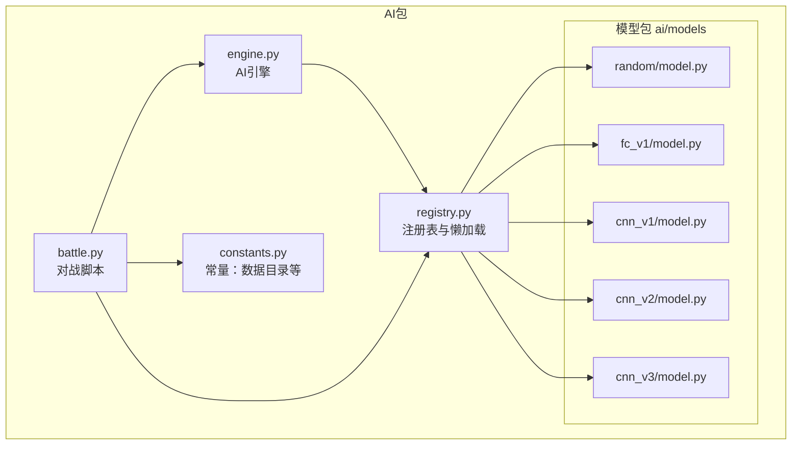
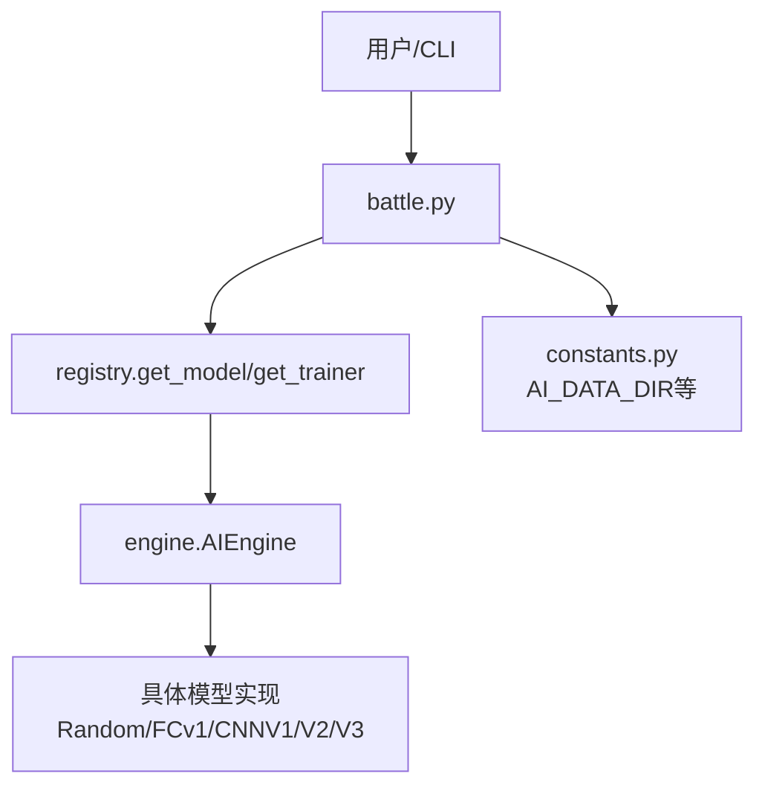
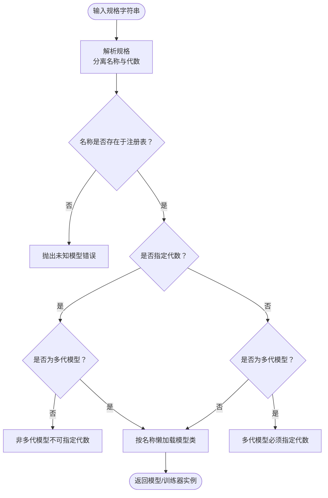
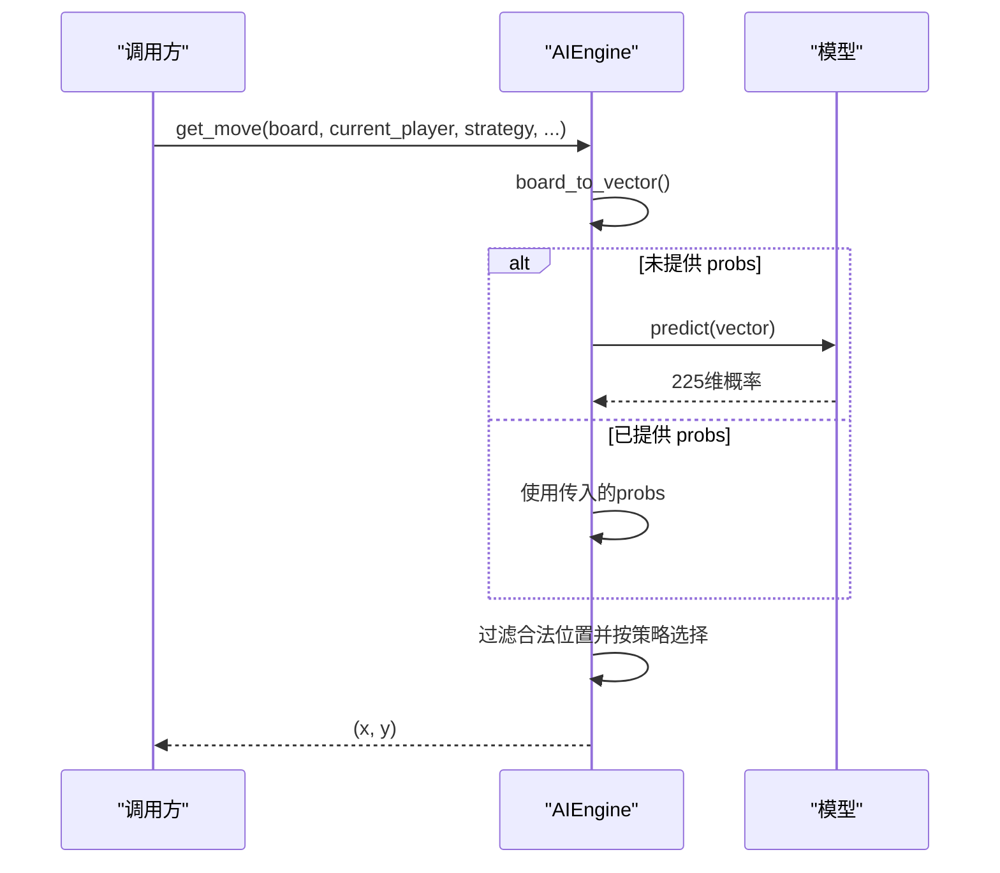
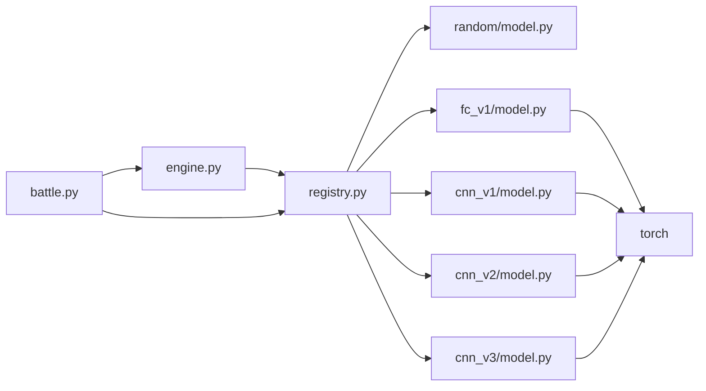

# AI模型配置

<cite>
**本文引用的文件**
- [registry.py](file://ai/registry.py)
- [__init__.py](file://ai/__init__.py)
- [models/__init__.py](file://ai/models/__init__.py)
- [engine.py](file://ai/engine.py)
- [battle.py](file://ai/battle.py)
- [random/model.py](file://ai/models/random/model.py)
- [fc_v1/model.py](file://ai/models/fc_v1/model.py)
- [cnn_v1/model.py](file://ai/models/cnn_v1/model.py)
- [cnn_v2/model.py](file://ai/models/cnn_v2/model.py)
- [cnn_v3/model.py](file://ai/models/cnn_v3/model.py)
- [cnn_design.md](file://design/cnn_design.md)
- [fc_v1_design.md](file://design/fc_v1_design.md)
- [cnn_v2_design.md](file://design/cnn_v2_design.md)
- [cnn_v3_design.md](file://design/cnn_v3_design.md)
- [constants.py](file://ai/constants.py)
</cite>

## 目录
1. [简介](#简介)
2. [项目结构](#项目结构)
3. [核心组件](#核心组件)
4. [架构总览](#架构总览)
5. [详细组件分析](#详细组件分析)
6. [依赖关系分析](#依赖关系分析)
7. [性能考量](#性能考量)
8. [故障排查指南](#故障排查指南)
9. [结论](#结论)
10. [附录](#附录)

## 简介
本指南面向使用者与开发者，系统讲解如何在本五子棋AI项目中配置与使用各类AI模型。内容涵盖：
- 各AI模型的特点与适用场景：Random随机模型、FCv1全连接网络、CNNV1/V2/V3卷积网络
- 通过AI注册表系统加载与管理模型：名称规范、版本/代数兼容性、模型文件路径
- 模型参数配置：加载参数、推理参数、性能优化选项
- 模型切换与替换：动态加载、验证机制、错误处理策略
- 模型性能对比与使用建议，辅助选择合适模型进行对战

## 项目结构
AI相关代码集中在 ai 包中，模型实现位于 ai/models 下，注册表与引擎位于 ai 根目录，对战脚本位于 ai/battle.py。

**图表来源**
- [registry.py:58-72](file://ai/registry.py#L58-L72)
- [engine.py:18-42](file://ai/engine.py#L18-L42)
- [battle.py:28-32](file://ai/battle.py#L28-L32)
- [random/model.py:10-64](file://ai/models/random/model.py#L10-L64)
- [fc_v1/model.py:91-132](file://ai/models/fc_v1/model.py#L91-L132)
- [cnn_v1/model.py:106-148](file://ai/models/cnn_v1/model.py#L106-L148)
- [cnn_v2/model.py:117-160](file://ai/models/cnn_v2/model.py#L117-L160)
- [cnn_v3/model.py:96-139](file://ai/models/cnn_v3/model.py#L96-L139)
- [constants.py:11-22](file://ai/constants.py#L11-L22)

**章节来源**
- [__init__.py:1-21](file://ai/__init__.py#L1-L21)
- [models/__init__.py:1-28](file://ai/models/__init__.py#L1-L28)

## 核心组件
- 注册表系统（registry.py）
  - 统一维护模型与训练器映射，支持多代模型（cnn_v3）指定代数
  - 提供 get_model/spec 解析、懒加载、多代模型目录扫描
- AI引擎（engine.py）
  - 将棋盘状态转换为输入向量，调用模型获取概率分布，按策略选择落子
  - 支持 argmax 与 sampling 两种策略，temperature/top_k/rng 控制采样
- 模型实现
  - RandomModel：均匀随机策略
  - FCv1Model：全连接网络，10层隐藏层，每层1000神经元
  - CNNV1/CNNV2/CNNV3：卷积网络，逐步轻量化与极简化
- 对战脚本（battle.py）
  - 命令行启动双AI对战，统计胜负与平局比例
- 常量（constants.py）
  - 定义AI数据目录、训练数据目录、损失日志目录与记录间隔

**章节来源**
- [registry.py:58-72](file://ai/registry.py#L58-L72)
- [engine.py:67-143](file://ai/engine.py#L67-L143)
- [random/model.py:10-64](file://ai/models/random/model.py#L10-L64)
- [fc_v1/model.py:91-132](file://ai/models/fc_v1/model.py#L91-L132)
- [cnn_v1/model.py:106-148](file://ai/models/cnn_v1/model.py#L106-L148)
- [cnn_v2/model.py:117-160](file://ai/models/cnn_v2/model.py#L117-L160)
- [cnn_v3/model.py:96-139](file://ai/models/cnn_v3/model.py#L96-L139)
- [battle.py:94-134](file://ai/battle.py#L94-L134)
- [constants.py:11-22](file://ai/constants.py#L11-L22)

## 架构总览
AI注册表负责模型与训练器的统一管理与懒加载；AI引擎负责将棋盘状态转换为模型输入并执行推理；对战脚本通过注册表加载双方模型并驱动对局；模型实现位于 models 子包，遵循统一的BaseModel/NeuralNetworkModel接口。

**图表来源**
- [battle.py:106-120](file://ai/battle.py#L106-L120)
- [registry.py:150-224](file://ai/registry.py#L150-L224)
- [engine.py:44-143](file://ai/engine.py#L44-L143)
- [constants.py:11-22](file://ai/constants.py#L11-L22)

## 详细组件分析

### 注册表系统（AI注册表）
- 模型名称规范
  - 基础名称：random、fc_v1、cnn_v1、cnn_v2、cnn_v3
  - 多代模型：cnn_v3 支持 cnn_v3.1、cnn_v3.2 等代数
  - 名称不得包含“.”（注册表在构建时校验）
- 规格解析与校验
  - 支持形如 "cnn_v3.1" 的规格字符串
  - 未指定代数时，多代模型会报错提示必须指定
  - 指定代数但模型非多代时，报错提示不允许
- 懒加载与训练器
  - get_model/spec 解析后按需 import 模型类
  - get_trainer 同样支持规格解析，且要求模型具备训练器
- 多代模型目录扫描
  - list_models_with_full_name 会扫描 models/cnn_v3/gen{i}/ 目录
  - 仅当 gen{i} 目录下存在至少一个 .pth 文件时才视为有效代数
  - 若模型目录同时存在 .pth 文件与 gen 子目录，抛出异常

**图表来源**
- [registry.py:103-184](file://ai/registry.py#L103-L184)
- [registry.py:187-224](file://ai/registry.py#L187-L224)

**章节来源**
- [registry.py:58-72](file://ai/registry.py#L58-L72)
- [registry.py:103-184](file://ai/registry.py#L103-L184)
- [registry.py:187-224](file://ai/registry.py#L187-L224)
- [registry.py:237-296](file://ai/registry.py#L237-L296)

### AI引擎（AIEngine）
- 输入转换
  - 将 15x15 棋盘与当前落子方拼接为 226 维向量
- 推理与策略
  - 若未提供 probs，先调用 model.predict 获取 225 维概率分布
  - 策略：
    - argmax：选择最大概率合法位置，平局时随机打破
    - sampling：温度加权采样，支持 temperature、top_k、rng
- 错误处理
  - 棋盘已满无空位时抛出异常
  - 未知策略时抛出异常
  - 采样策略下 temperature 必须 > 0

**图表来源**
- [engine.py:67-143](file://ai/engine.py#L67-L143)

**章节来源**
- [engine.py:67-143](file://ai/engine.py#L67-L143)

### 模型实现概览

#### Random模型
- 特点：对空位返回均匀概率，已落子位置概率为0
- 适用场景：基准/调试、快速验证流程
- 关键点：predict 返回 225 维概率列表；无神经网络参数

**章节来源**
- [random/model.py:10-64](file://ai/models/random/model.py#L10-L64)

#### FCv1模型
- 网络结构：输入层(226) -> 10层隐藏层(每层1000, ReLU) -> 输出层(225) -> Softmax
- 默认行为：若存在默认路径的 .pth 文件则自动加载，否则新建模型
- 适用场景：监督学习入门、稳定基线
- 训练器：FCv1Trainer，支持单轮次与训练周期模式

**章节来源**
- [fc_v1/model.py:91-132](file://ai/models/fc_v1/model.py#L91-L132)
- [fc_v1_design.md:56-97](file://design/fc_v1_design.md#L56-L97)

#### CNNV1/CNNV2/CNNV3模型
- CNNV1：轻量化卷积网络，参数量约445万，适合与FCv1对比
- CNNV2：在CNNV1基础上统一卷积通道并压缩FC层，参数量约101万
- CNNV3：纯卷积网络，无FC/BatchNorm/Dropout，参数量约1.9万，结构最简
- 共同点：均继承自 NeuralNetworkModel，实现 _create_network/_prepare_input

**章节来源**
- [cnn_v1/model.py:106-148](file://ai/models/cnn_v1/model.py#L106-L148)
- [cnn_v2/model.py:117-160](file://ai/models/cnn_v2/model.py#L117-L160)
- [cnn_v3/model.py:96-139](file://ai/models/cnn_v3/model.py#L96-L139)
- [cnn_design.md:77-133](file://design/cnn_design.md#L77-L133)
- [cnn_v2_design.md:21-47](file://design/cnn_v2_design.md#L21-L47)
- [cnn_v3_design.md:17-42](file://design/cnn_v3_design.md#L17-L42)

### 对战脚本（battle.py）
- 功能：启动两AI对战，统计胜负与平局比例
- 模型加载：直接调用 registry.get_model 获取双方模型实例
- 数据记录：使用 DataRecorder 与 AI_DATA_DIR 记录对局数据
- 参数：--ai1/--ai2 指定模型规格；--games 指定对局数

**章节来源**
- [battle.py:94-134](file://ai/battle.py#L94-L134)
- [constants.py:11-22](file://ai/constants.py#L11-L22)

## 依赖关系分析
- 模块耦合
  - engine 依赖 registry.get_model
  - battle 依赖 registry.get_model 与 engine
  - models 子包各自实现 BaseModel/NeuralNetworkModel 接口
- 外部依赖
  - torch/torch.nn：CNN/FC模型推理与训练
  - importlib：注册表懒加载

**图表来源**
- [registry.py:58-72](file://ai/registry.py#L58-L72)
- [engine.py:38-41](file://ai/engine.py#L38-L41)
- [battle.py:106-112](file://ai/battle.py#L106-L112)
- [fc_v1/model.py:13-15](file://ai/models/fc_v1/model.py#L13-L15)
- [cnn_v1/model.py:21-23](file://ai/models/cnn_v1/model.py#L21-L23)
- [cnn_v2/model.py:28-31](file://ai/models/cnn_v2/model.py#L28-L31)
- [cnn_v3/model.py:25-28](file://ai/models/cnn_v3/model.py#L25-L28)

**章节来源**
- [registry.py:58-72](file://ai/registry.py#L58-L72)
- [engine.py:38-41](file://ai/engine.py#L38-L41)
- [battle.py:106-112](file://ai/battle.py#L106-L112)

## 性能考量
- 模型复杂度与参数量
  - FCv1：10层隐藏层，每层1000神经元，参数量约445万（与CNNV1对标）
  - CNNV1：参数量约445万，包含BN与FC层
  - CNNV2：统一卷积通道并压缩FC层，参数量约101万
  - CNNV3：纯卷积+1×1卷积输出，参数量约1.9万
- 推理路径
  - engine 支持传入预计算的 probs，避免重复 model.predict 调用
  - RandomModel 无神经网络，推理开销最小
- 训练与数据
  - constants.py 定义 AI_DATA_DIR/TRAIN_DATA_DIR/LOSS_LOG_DIR
  - 训练周期中可通过 LOSS_LOG_INTERVAL 控制日志记录频率

**章节来源**
- [cnn_design.md:120-133](file://design/cnn_design.md#L120-L133)
- [cnn_v2_design.md:35-47](file://design/cnn_v2_design.md#L35-L47)
- [cnn_v3_design.md:29-41](file://design/cnn_v3_design.md#L29-L41)
- [engine.py:110-113](file://ai/engine.py#L110-L113)
- [constants.py:11-25](file://ai/constants.py#L11-L25)

## 故障排查指南
- 未知模型或规格错误
  - 现象：ValueError 抛出“未知模型”或“多代模型必须指定代数”
  - 处理：确认模型名称与代数规范；多代模型必须使用 cnn_v3.x
- 代数格式错误
  - 现象：ValueError 报告代数必须为正整数
  - 处理：检查规格字符串末尾的代数是否为正整数
- 多代模型目录异常
  - 现象：模型目录下 pth 文件与 gen 目录共存时报错
  - 处理：清理多余文件，确保 gen{i}/ 目录下存在 .pth 文件
- 推理策略错误
  - 现象：未知策略或采样策略下 temperature ≤ 0 抛错
  - 处理：使用 "argmax" 或 "sampling"；采样时设置 temperature > 0
- 棋盘已满
  - 现象：无空位可落子
  - 处理：检查棋盘状态或提前终止对局

**章节来源**
- [registry.py:168-179](file://ai/registry.py#L168-L179)
- [registry.py:284-287](file://ai/registry.py#L284-L287)
- [engine.py:124-142](file://ai/engine.py#L124-L142)

## 结论
本项目通过注册表系统实现了模型与训练器的统一管理与懒加载，配合AI引擎与对战脚本，提供了灵活、可扩展的AI配置方案。不同模型在复杂度与参数量上各有侧重：Random适合基准与调试；FCv1提供稳定的监督学习基线；CNNV1/V2/V3在卷积结构上逐步轻量化与极简化，便于在资源受限环境下部署。通过规范的名称与代数约定、完善的错误处理与日志配置，用户可以安全地进行模型切换与对战评估。

## 附录

### 模型名称与规格对照
- 基础模型：random、fc_v1、cnn_v1、cnn_v2
- 多代模型：cnn_v3（支持 cnn_v3.1、cnn_v3.2 等）

**章节来源**
- [registry.py:58-72](file://ai/registry.py#L58-L72)
- [registry.py:237-296](file://ai/registry.py#L237-L296)

### 模型加载参数与默认路径
- FCv1：默认模型保存路径为 ai/models/fc_v1/fc_v1.pth
- CNNV1：默认模型保存路径为 ai/models/cnn_v1/cnn.pth
- CNNV2：默认模型保存路径为 ai/models/cnn_v2/cnn_v2.pth
- CNNV3：默认模型保存路径为 ai/models/cnn_v3/cnn_v3.pth
- Random：无神经网络参数，save/load 为占位行为

**章节来源**
- [fc_v1/model.py:103-104](file://ai/models/fc_v1/model.py#L103-L104)
- [cnn_v1/model.py:118-119](file://ai/models/cnn_v1/model.py#L118-L119)
- [cnn_v2/model.py:129-131](file://ai/models/cnn_v2/model.py#L129-L131)
- [cnn_v3/model.py:108-110](file://ai/models/cnn_v3/model.py#L108-L110)
- [random/model.py:27-33](file://ai/models/random/model.py#L27-L33)

### 推理参数与策略
- 策略
  - argmax：默认策略，选择最大概率合法位置，平局随机打破
  - sampling：温度加权采样，支持 temperature、top_k、rng
- 输入
  - board：15x15 棋盘，0=空, 1=黑, 2=白
  - current_player：当前落子方，1=黑, 2=白
  - probs：可选，225 维概率分布
- 输出
  - (x, y) 落子位置

**章节来源**
- [engine.py:67-143](file://ai/engine.py#L67-L143)

### 模型性能对比与使用建议
- 参数量与结构
  - FCv1：约445万参数，10层隐藏层
  - CNNV1：约445万参数，含BN与FC层
  - CNNV2：约101万参数，统一卷积通道并压缩FC层
  - CNNV3：约1.9万参数，纯卷积+1×1卷积输出
- 适用场景
  - 基准/调试：Random
  - 监督学习基线：FCv1
  - 资源受限部署：CNNV2/CNNV3
  - 对比研究：FCv1 与 CNNV1/V2/V3

**章节来源**
- [cnn_design.md:120-133](file://design/cnn_design.md#L120-L133)
- [cnn_v2_design.md:35-47](file://design/cnn_v2_design.md#L35-L47)
- [cnn_v3_design.md:29-41](file://design/cnn_v3_design.md#L29-L41)