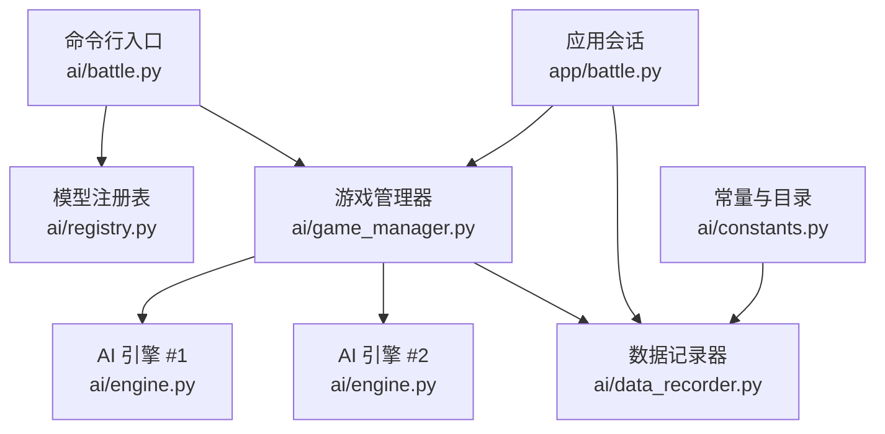
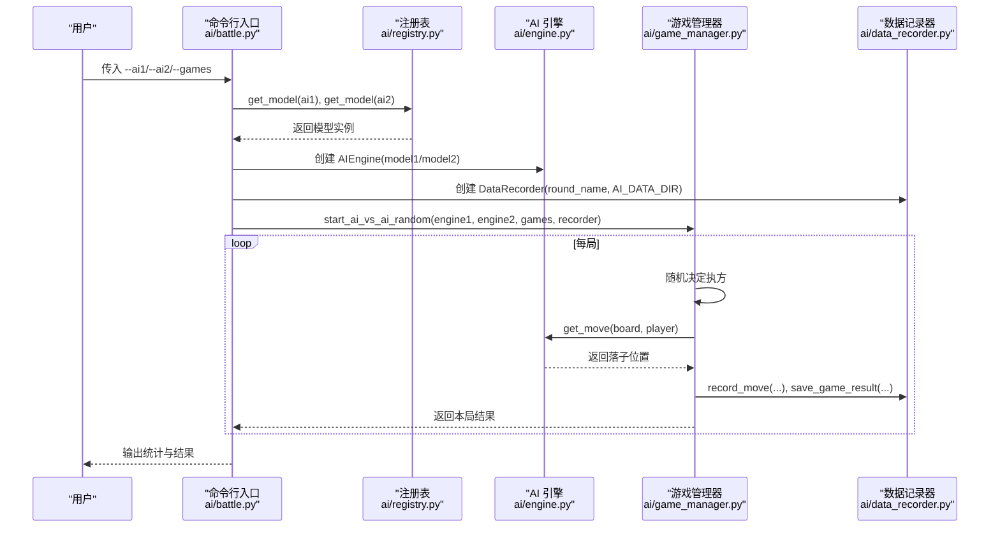
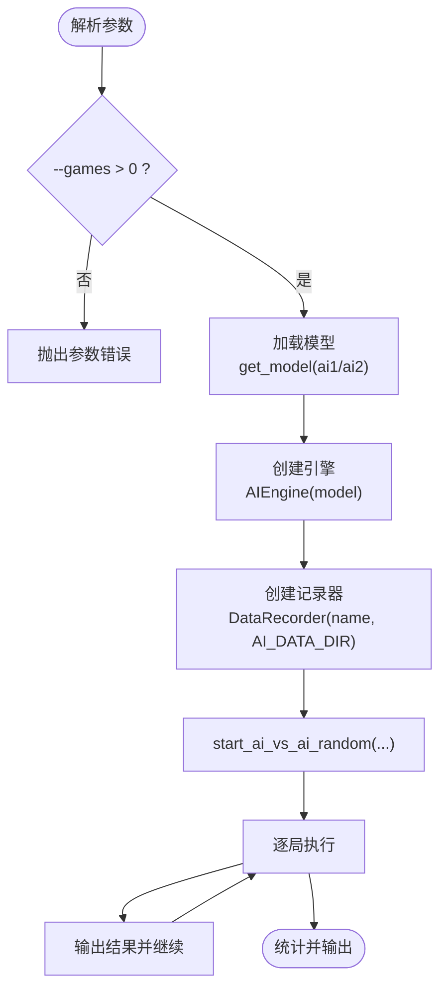
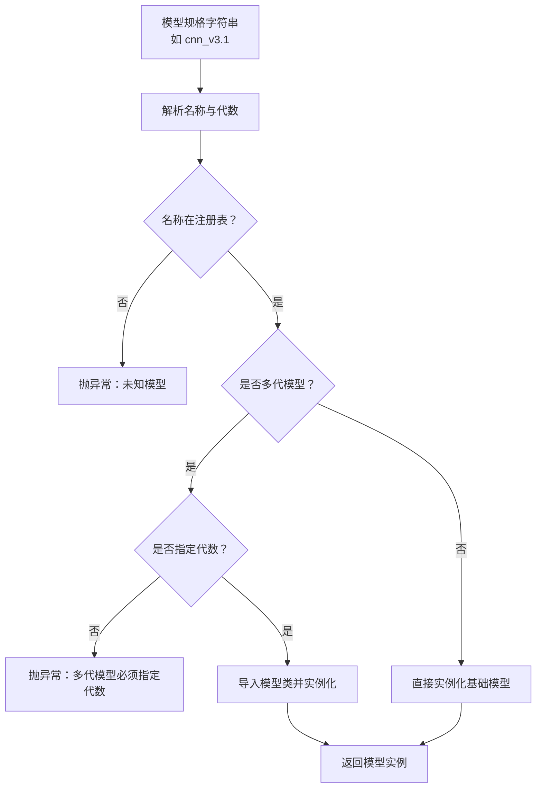
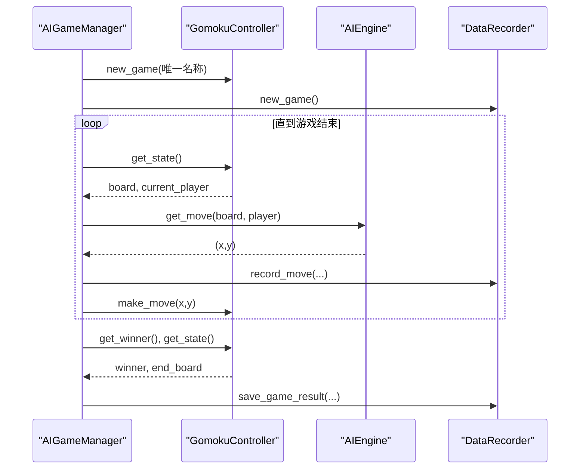
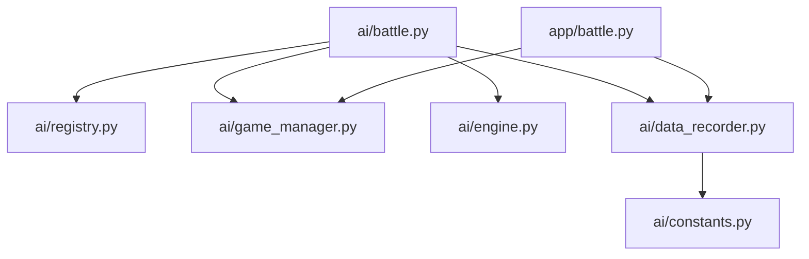

# 对战参数设置

<cite>
**本文引用的文件**
- [README.md](file://README.md)
- [ai/battle.py](file://ai/battle.py)
- [app/battle.py](file://app/battle.py)
- [ai/game_manager.py](file://ai/game_manager.py)
- [ai/data_recorder.py](file://ai/data_recorder.py)
- [ai/registry.py](file://ai/registry.py)
- [ai/engine.py](file://ai/engine.py)
- [ai/constants.py](file://ai/constants.py)
- [tests/ai/test_battle.py](file://tests/ai/test_battle.py)
- [tests/app/primary/test_battle.py](file://tests/app/primary/test_battle.py)
</cite>

## 目录
1. [简介](#简介)
2. [项目结构](#项目结构)
3. [核心组件](#核心组件)
4. [架构总览](#架构总览)
5. [详细组件分析](#详细组件分析)
6. [依赖分析](#依赖分析)
7. [性能考虑](#性能考虑)
8. [故障排查指南](#故障排查指南)
9. [结论](#结论)
10. [附录](#附录)

## 简介
本指南围绕“AI 对战”参数配置展开，重点说明以下内容：
- 核心参数：--ai1、--ai2、--games 的含义与用法
- 参数有效性验证机制：类型检查、取值范围限制、模型存在性验证
- 对战过程中的动态参数：执棋颜色随机分配、数据记录配置、对战进度监控
- 最佳实践：不同规模对战的参数建议、性能优化与内存控制
- 常见错误排查：参数配置错误的定位与解决方法

## 项目结构
与对战参数相关的关键模块与文件如下：
- 命令行入口与参数解析：ai/battle.py
- 会话层封装：app/battle.py
- 游戏管理与对战流程：ai/game_manager.py
- 数据记录与持久化：ai/data_recorder.py
- 模型注册与加载：ai/registry.py
- 引擎与落子策略：ai/engine.py
- 常量与目录配置：ai/constants.py
- 文档与示例：README.md
- 单元测试：tests/ai/test_battle.py、tests/app/primary/test_battle.py

图表来源
- [ai/battle.py:136-199](file://ai/battle.py#L136-L199)
- [app/battle.py:15-104](file://app/battle.py#L15-L104)
- [ai/game_manager.py:16-339](file://ai/game_manager.py#L16-L339)
- [ai/data_recorder.py:17-145](file://ai/data_recorder.py#L17-L145)
- [ai/registry.py:58-184](file://ai/registry.py#L58-L184)
- [ai/engine.py:44-194](file://ai/engine.py#L44-L194)
- [ai/constants.py:11-26](file://ai/constants.py#L11-L26)

章节来源
- [README.md:54-75](file://README.md#L54-L75)
- [ai/battle.py:136-199](file://ai/battle.py#L136-L199)
- [app/battle.py:15-104](file://app/battle.py#L15-L104)
- [ai/game_manager.py:16-339](file://ai/game_manager.py#L16-L339)
- [ai/data_recorder.py:17-145](file://ai/data_recorder.py#L17-L145)
- [ai/registry.py:58-184](file://ai/registry.py#L58-L184)
- [ai/engine.py:44-194](file://ai/engine.py#L44-L194)
- [ai/constants.py:11-26](file://ai/constants.py#L11-L26)

## 核心组件
- 命令行参数与入口
  - --ai1：指定黑方 AI 名称（如 random、fc_v1、cnn_v3.1）
  - --ai2：指定白方 AI 名称（如 random、fc_v1、cnn_v3.1）
  - --games：对战局数，默认 10，必须为正整数
- 模型加载与验证
  - 通过注册表统一解析模型规格，支持多代模型 cnn_v3.{代数}
  - 未知模型、多代模型未指定代数、非多代模型指定代数等情况会抛出异常
- 对战流程与动态参数
  - 每局执方随机（黑/白在双方之间随机分配）
  - 数据记录：每步落子与终局结果写入 JSON 文件
  - 进度监控：CLI 逐局输出；GUI 会话支持 on_progress 回调

章节来源
- [README.md:54-75](file://README.md#L54-L75)
- [ai/battle.py:160-186](file://ai/battle.py#L160-L186)
- [ai/registry.py:150-184](file://ai/registry.py#L150-L184)
- [ai/game_manager.py:276-339](file://ai/game_manager.py#L276-L339)
- [ai/data_recorder.py:66-141](file://ai/data_recorder.py#L66-L141)
- [app/battle.py:52-92](file://app/battle.py#L52-L92)

## 架构总览
下面的时序图展示了从命令行到对战完成的主要调用链路。

图表来源
- [ai/battle.py:94-133](file://ai/battle.py#L94-L133)
- [ai/registry.py:150-184](file://ai/registry.py#L150-L184)
- [ai/engine.py:67-142](file://ai/engine.py#L67-L142)
- [ai/game_manager.py:276-339](file://ai/game_manager.py#L276-L339)
- [ai/data_recorder.py:96-141](file://ai/data_recorder.py#L96-L141)

## 详细组件分析

### 命令行参数与入口（ai/battle.py）
- 参数定义与校验
  - --ai1、--ai2：必填，字符串类型，用于从注册表加载模型
  - --games：整数类型，默认 10，必须 > 0，否则抛错
- 动态参数
  - 每局执方随机：黑/白在双方之间随机分配
  - 数据记录：使用组合名称作为轮次目录前缀，按局号创建子目录
  - 结果输出：逐局打印，最后输出统计（胜/负/平局百分比）

图表来源
- [ai/battle.py:160-186](file://ai/battle.py#L160-L186)
- [ai/battle.py:106-133](file://ai/battle.py#L106-L133)
- [ai/game_manager.py:276-339](file://ai/game_manager.py#L276-L339)

章节来源
- [ai/battle.py:136-199](file://ai/battle.py#L136-L199)
- [ai/battle.py:160-186](file://ai/battle.py#L160-L186)

### 模型注册与加载（ai/registry.py）
- 支持的模型与多代模型
  - 基础模型：random、fc_v1、cnn_v1、cnn_v2
  - 多代模型：cnn_v3（需指定代数，如 cnn_v3.1、cnn_v3.2）
- 规格解析与校验
  - 未知模型：抛出异常
  - 非多代模型指定代数：抛出异常
  - 多代模型未指定代数：抛出异常
- 懒加载机制：按需导入模型类，避免启动时的模块级依赖

图表来源
- [ai/registry.py:103-184](file://ai/registry.py#L103-L184)

章节来源
- [ai/registry.py:58-184](file://ai/registry.py#L58-L184)

### 游戏管理与对战流程（ai/game_manager.py）
- 固定执方与随机执方两种模式
  - start_ai_vs_ai：engine1 固定执黑，engine2 固定执白
  - start_ai_vs_ai_random：每局随机决定谁执黑/白
- 温度采样与落子策略
  - 默认策略为贪心（argmax），在合法位置中选择概率最大者
  - 若启用温度采样，将在前若干步按 softmax 分布采样，之后切回贪心
- 数据记录
  - 每步记录 input、output、position
  - 终局保存 winner 与 end_board

图表来源
- [ai/game_manager.py:124-231](file://ai/game_manager.py#L124-L231)
- [ai/engine.py:67-142](file://ai/engine.py#L67-L142)
- [ai/data_recorder.py:96-141](file://ai/data_recorder.py#L96-L141)

章节来源
- [ai/game_manager.py:232-339](file://ai/game_manager.py#L232-L339)

### 数据记录与持久化（ai/data_recorder.py）
- 目录结构
  - 轮次目录：{ai_name}_{递增整数}
  - 每局子目录：1, 2, 3, ...
  - 每局记录文件：record.json（紧凑格式，减少体积）
- 数据内容
  - history：每步的 input、output、position
  - winner：1=黑胜、2=白胜、3=平局
  - end_board：终局棋盘向量

章节来源
- [ai/data_recorder.py:17-145](file://ai/data_recorder.py#L17-L145)

### 应用会话与进度回调（app/battle.py）
- BattleSession.run
  - 创建两个 AIEngine
  - 创建 DataRecorder
  - 调用 AIGameManager.start_ai_vs_ai（GUI 场景下可传入 on_progress 回调）
  - 对战完成后生成训练样本
- get_recorder
  - run() 后返回 DataRecorder，供 GUI 回放使用

章节来源
- [app/battle.py:15-104](file://app/battle.py#L15-L104)

## 依赖分析
- 参数解析依赖注册表进行模型加载
- 游戏管理器依赖引擎与记录器
- 会话层依赖游戏管理器与记录器
- 常量模块提供数据目录路径

图表来源
- [ai/battle.py:136-199](file://ai/battle.py#L136-L199)
- [app/battle.py:15-104](file://app/battle.py#L15-L104)
- [ai/game_manager.py:16-339](file://ai/game_manager.py#L16-L339)
- [ai/data_recorder.py:17-145](file://ai/data_recorder.py#L17-L145)
- [ai/registry.py:58-184](file://ai/registry.py#L58-L184)
- [ai/engine.py:44-194](file://ai/engine.py#L44-L194)
- [ai/constants.py:11-26](file://ai/constants.py#L11-L26)

章节来源
- [ai/battle.py:136-199](file://ai/battle.py#L136-L199)
- [app/battle.py:15-104](file://app/battle.py#L15-L104)
- [ai/game_manager.py:16-339](file://ai/game_manager.py#L16-L339)
- [ai/data_recorder.py:17-145](file://ai/data_recorder.py#L17-L145)
- [ai/registry.py:58-184](file://ai/registry.py#L58-L184)
- [ai/engine.py:44-194](file://ai/engine.py#L44-L194)
- [ai/constants.py:11-26](file://ai/constants.py#L11-L26)

## 性能考虑
- 模型加载
  - 通过注册表懒加载，避免不必要的模块导入
- 数据记录
  - record.json 采用紧凑格式，减少磁盘占用与 IO 时间
- 温度采样
  - 默认使用贪心策略，降低采样开销；仅在需要探索时启用温度采样
- 进度回调
  - GUI 会话支持 on_progress 回调，避免阻塞主线程

章节来源
- [ai/data_recorder.py:137-141](file://ai/data_recorder.py#L137-L141)
- [ai/engine.py:67-142](file://ai/engine.py#L67-L142)
- [app/battle.py:52-92](file://app/battle.py#L52-L92)

## 故障排查指南
- 参数类型错误
  - --games 必须为整数；非正数将触发参数错误
- 模型名称无效
  - 未知模型名称：注册表抛出异常
  - 多代模型未指定代数：抛出异常
  - 非多代模型指定代数：抛出异常
- 棋盘已满
  - 落子时若无空位可选，引擎抛出异常
- 数据目录权限
  - 确认 AI 数据目录可写；可通过环境变量覆盖日志目录

章节来源
- [ai/battle.py:183-194](file://ai/battle.py#L183-L194)
- [ai/registry.py:168-184](file://ai/registry.py#L168-L184)
- [ai/engine.py:124-126](file://ai/engine.py#L124-L126)
- [ai/constants.py:19-22](file://ai/constants.py#L19-L22)

## 结论
通过对战参数设置指南，用户可以：
- 正确配置 --ai1、--ai2、--games 三个核心参数
- 理解参数有效性验证机制与模型加载流程
- 掌握执棋颜色随机分配、数据记录与进度监控等动态参数
- 结合最佳实践与故障排查方法，高效开展不同规模的对战实验

## 附录

### 参数清单与校验要点
- --ai1：必填，字符串；通过注册表解析模型；多代模型需指定代数
- --ai2：必填，字符串；通过注册表解析模型；多代模型需指定代数
- --games：可选，整数，默认 10；必须 > 0

章节来源
- [README.md:54-75](file://README.md#L54-L75)
- [ai/battle.py:160-186](file://ai/battle.py#L160-L186)
- [ai/registry.py:150-184](file://ai/registry.py#L150-L184)

### 最佳实践建议
- 小规模测试（10–50 局）
  - 使用默认贪心策略，快速得到稳定结果
  - 无需温度采样，减少不确定性
- 中等规模（100–500 局）
  - 可开启温度采样，提升开局多样性
  - 合理设置 --temperature 与 --temp-moves
- 大规模训练（≥1000 局）
  - 使用固定执方模式（start_ai_vs_ai）对比更稳定
  - 启用进度回调，监控训练进程
  - 控制数据目录容量，定期清理历史轮次

章节来源
- [README.md:175-179](file://README.md#L175-L179)
- [app/battle.py:52-92](file://app/battle.py#L52-L92)