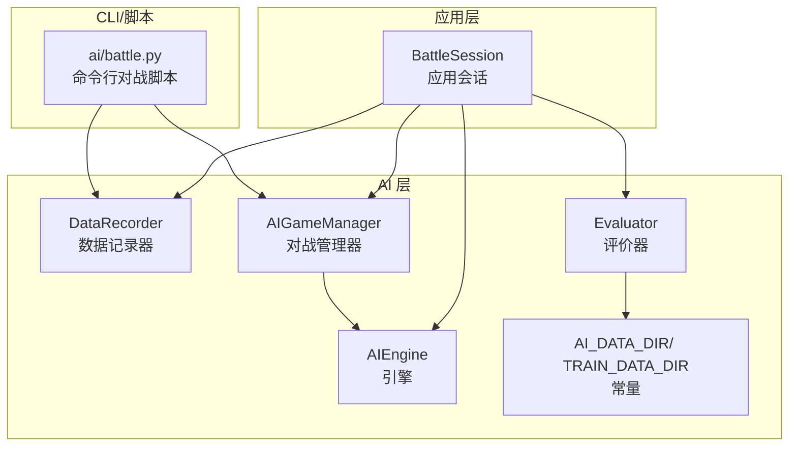
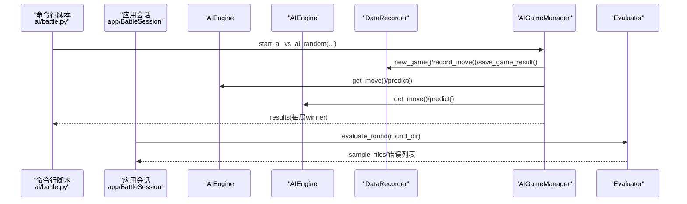
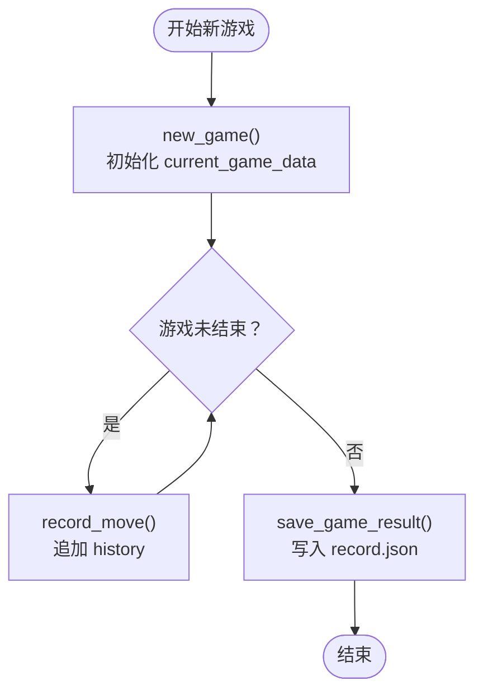
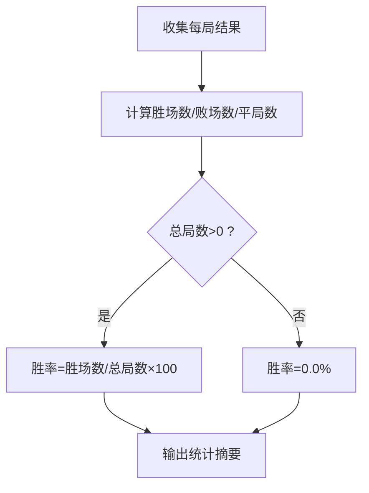
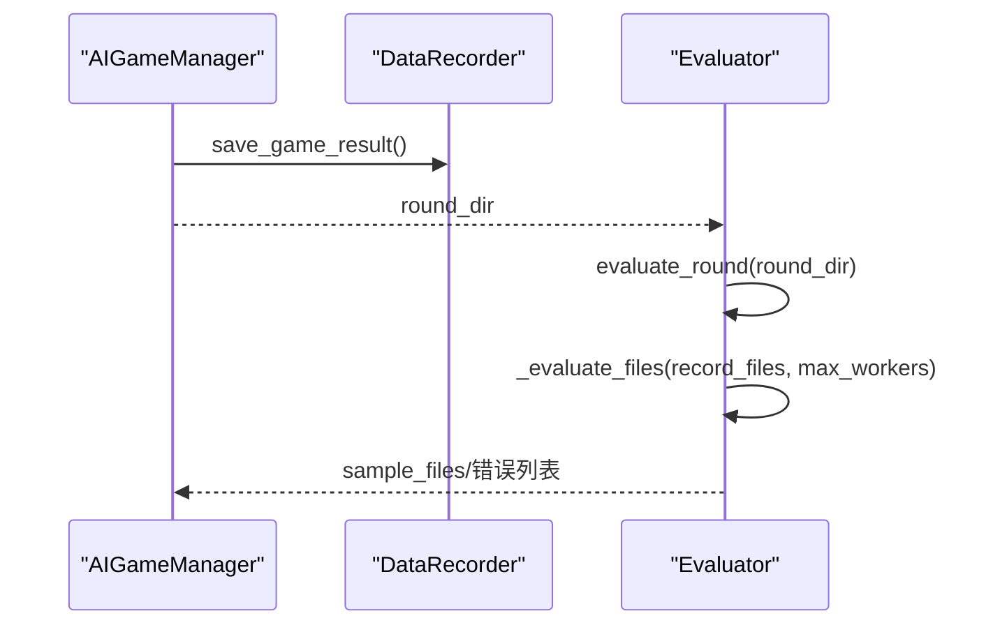
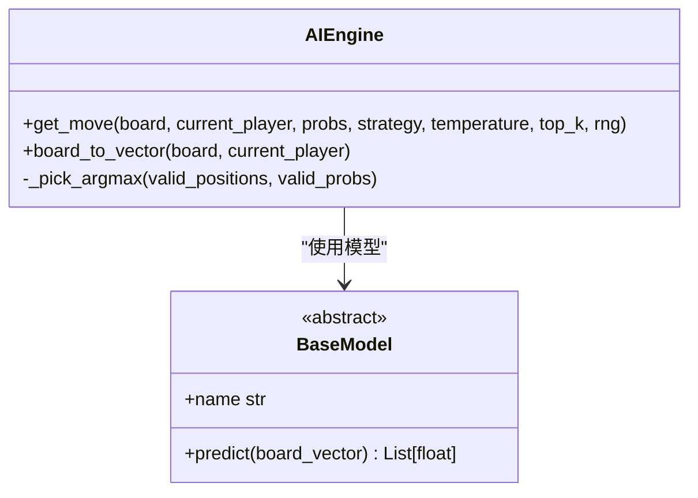
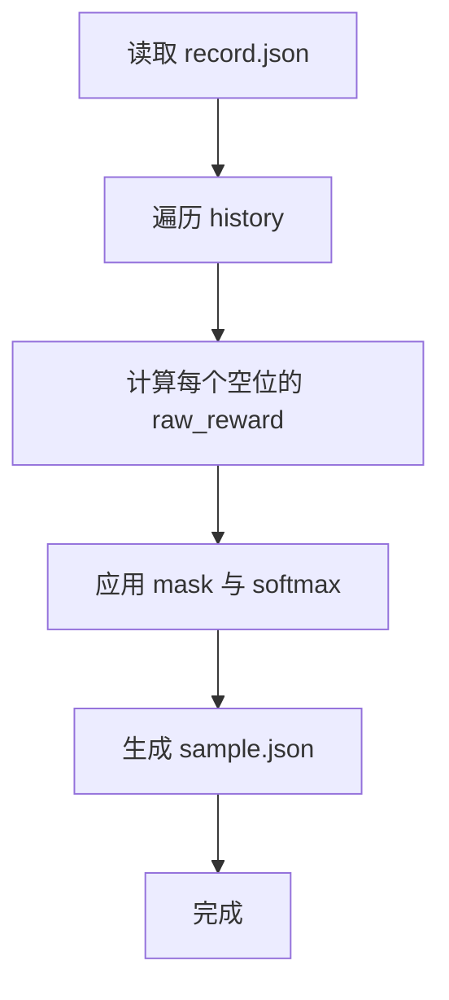
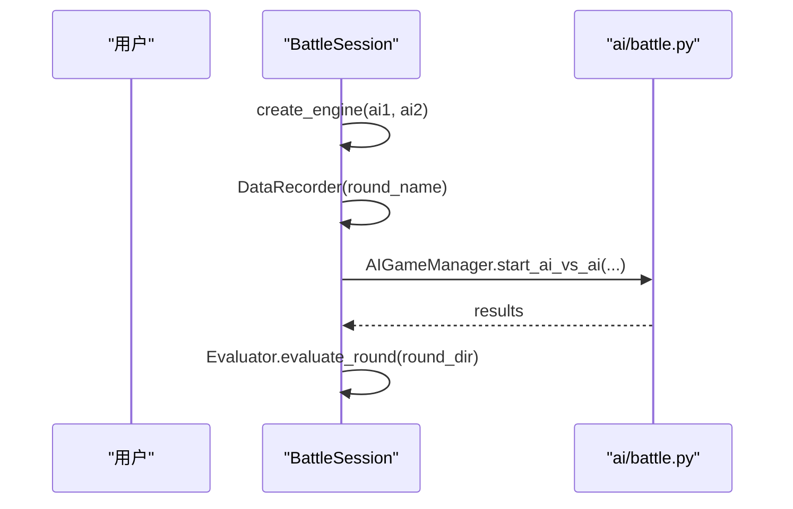
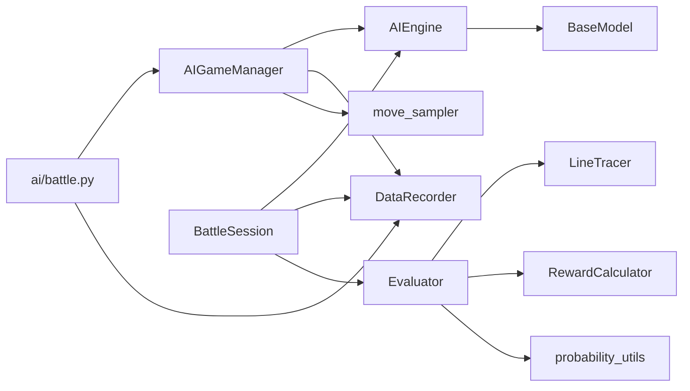

# 结果分析

<cite>
**本文引用的文件**
- [ai/data_recorder.py](file://ai/data_recorder.py)
- [ai/battle.py](file://ai/battle.py)
- [ai/game_manager.py](file://ai/game_manager.py)
- [app/battle.py](file://app/battle.py)
- [ai/constants.py](file://ai/constants.py)
- [ai/engine.py](file://ai/engine.py)
- [ai/evaluator.py](file://ai/evaluator.py)
- [design/ai_design.md](file://design/ai_design.md)
- [design/evaluator_shape_detection_design.md](file://design/evaluator_shape_detection_design.md)
- [README.md](file://README.md)
- [tests/ai/test_data_recorder.py](file://tests/ai/test_data_recorder.py)
- [tests/ai/test_battle.py](file://tests/ai/test_battle.py)
</cite>

## 目录
1. [简介](#简介)
2. [项目结构](#项目结构)
3. [核心组件](#核心组件)
4. [架构总览](#架构总览)
5. [详细组件分析](#详细组件分析)
6. [依赖分析](#依赖分析)
7. [性能考量](#性能考量)
8. [故障排查指南](#故障排查指南)
9. [结论](#结论)
10. [附录](#附录)

## 简介
本指南面向“AI对战结果分析”，围绕以下目标展开：
- 明确对战结果的输出格式与统计指标（胜场数、败场数、平局数、胜率百分比等）及其计算方法
- 说明对战数据的记录、存储与导出机制（DataRecorder、文件格式、目录组织）
- 提供结果解读方法与技巧（模型性能对比、趋势观察、异常识别）
- 给出可视化建议（图表、报表、趋势分析）

## 项目结构
本项目采用模块化分层设计：
- ai 包：AI 引擎、数据记录、对战管理、评价器、常量等
- app 包：应用层会话（BattleSession）封装对战全流程
- tests 包：单元与集成测试，覆盖 DataRecorder、battle 等关键模块
- design 文档：系统设计与算法设计说明
- README：使用说明与命令速查

**图表来源**
- [ai/engine.py:44-194](file://ai/engine.py#L44-L194)
- [ai/data_recorder.py:17-145](file://ai/data_recorder.py#L17-L145)
- [ai/game_manager.py:16-339](file://ai/game_manager.py#L16-L339)
- [ai/evaluator.py:51-350](file://ai/evaluator.py#L51-L350)
- [app/battle.py:15-104](file://app/battle.py#L15-L104)
- [ai/constants.py:6-26](file://ai/constants.py#L6-L26)

**章节来源**
- [README.md:1-20](file://README.md#L1-L20)
- [ai/constants.py:6-26](file://ai/constants.py#L6-L26)

## 核心组件
- DataRecorder：负责每轮对战的目录创建、每局游戏的子目录与记录文件生成、落子数据与终局信息的持久化
- AIGameManager：封装 AI 内战流程，支持固定执方与随机执方两种模式，记录每步输入输出与落子位置
- AIEngine：将棋盘状态向量化，调用模型获取输出，按策略选择落子位置
- Evaluator：从 record.json 生成 sample.json，用于训练样本构建
- BattleSession（app 层）：封装应用侧对战全流程，创建引擎、记录器、执行对战并生成样本
- ai/battle.py（CLI）：命令行对战脚本，输出每局结果与统计

**章节来源**
- [ai/data_recorder.py:17-145](file://ai/data_recorder.py#L17-L145)
- [ai/game_manager.py:123-339](file://ai/game_manager.py#L123-L339)
- [ai/engine.py:44-194](file://ai/engine.py#L44-L194)
- [ai/evaluator.py:51-350](file://ai/evaluator.py#L51-L350)
- [app/battle.py:15-104](file://app/battle.py#L15-L104)
- [ai/battle.py:68-133](file://ai/battle.py#L68-L133)

## 架构总览
AI 对战从“引擎-记录器-管理器-评价器”闭环流转，CLI 与应用层均可驱动该流程。

**图表来源**
- [ai/battle.py:94-133](file://ai/battle.py#L94-L133)
- [ai/game_manager.py:276-339](file://ai/game_manager.py#L276-L339)
- [ai/data_recorder.py:66-141](file://ai/data_recorder.py#L66-L141)
- [ai/evaluator.py:224-350](file://ai/evaluator.py#L224-L350)
- [app/battle.py:52-92](file://app/battle.py#L52-L92)

## 详细组件分析

### DataRecorder 数据记录机制
- 目录组织：按轮次创建目录，命名规则为 {ai_name}_{递增整数}，确保每次运行独立空间
- 每局记录：每局游戏一个子目录，包含 record.json，记录 history、winner、end_board
- 数据字段：
  - history：每步记录 input（226维向量）、output（225维概率分布）、position（落子坐标）
  - winner：1=黑胜、2=白胜、3=平局、0=未结束
  - end_board：终局棋盘状态（226维向量）
- 文件格式：JSON，紧凑格式（无缩进）以降低体积
- 错误处理：当 game_id 不匹配时自动纠正并记录，避免中断

**图表来源**
- [ai/data_recorder.py:66-141](file://ai/data_recorder.py#L66-L141)

**章节来源**
- [ai/data_recorder.py:17-145](file://ai/data_recorder.py#L17-L145)
- [tests/ai/test_data_recorder.py:33-180](file://tests/ai/test_data_recorder.py#L33-L180)

### 对战结果输出格式与统计指标
- CLI 输出格式：逐局打印执方与胜负，最后输出总局数、双方胜场数与胜率
- 统计指标：
  - 胜场数：ai1_won 或 ai2_won 为真计数
  - 败场数：对方获胜即为败
  - 平局数：winner==3
  - 胜率百分比：对应胜场数/总局数×100，0局时为 0.0%
- 结果数据结构：每局包含 game、winner、ai1_color、ai2_color、ai1_won、ai2_won

**图表来源**
- [ai/battle.py:68-92](file://ai/battle.py#L68-L92)

**章节来源**
- [ai/battle.py:68-133](file://ai/battle.py#L68-L133)
- [tests/ai/test_battle.py:280-312](file://tests/ai/test_battle.py#L280-L312)

### 对战数据存储与导出
- 存储位置：
  - AI 对战记录：ai/ai_data/{轮次目录}/{局号}/record.json
  - 训练样本：ai/train_data/{轮次目录}/{局号}/sample.json
  - 常量路径：AI_DATA_DIR、TRAIN_DATA_DIR
- 导出流程：对战结束后由 Evaluator.evaluate_round 遍历轮次目录下的 record.json，生成对应 sample.json
- 并行策略：支持多进程并行评价，进程崩溃时自动回退串行

**图表来源**
- [ai/game_manager.py:224-274](file://ai/game_manager.py#L224-L274)
- [ai/evaluator.py:224-350](file://ai/evaluator.py#L224-L350)
- [ai/constants.py:11-15](file://ai/constants.py#L11-L15)

**章节来源**
- [ai/evaluator.py:224-350](file://ai/evaluator.py#L224-L350)
- [ai/constants.py:11-15](file://ai/constants.py#L11-L15)

### AI 引擎与落子策略
- 输入向量：226 维（前 225 位为棋盘按行展开，末位为当前落子方）
- 输出概率：225 维（softmax 概率分布，mask 掉已落子位置）
- 落子策略：
  - argmax：选择最大概率合法位置，平局时随机打破
  - sampling：温度采样，支持 top-k 截断与自定义随机源
- 错误处理：棋盘已满时报错，避免无效落子

**图表来源**
- [ai/engine.py:44-194](file://ai/engine.py#L44-L194)
- [design/ai_design.md:29-101](file://design/ai_design.md#L29-L101)

**章节来源**
- [ai/engine.py:67-143](file://ai/engine.py#L67-L143)
- [design/ai_design.md:103-196](file://design/ai_design.md#L103-L196)

### 评价器与样本生成
- 输入：record.json（history、winner、end_board）
- 输出：sample.json（input、output、mask）
- 算法：双向棋型检测法（我方视角+敌方视角），结合五连追溯奖励融合
- 并行：ProcessPoolExecutor 并行处理，失败回退串行
- 质量保障：对输出进行 softmax 归一化，mask 掉非法位置

**图表来源**
- [ai/evaluator.py:97-210](file://ai/evaluator.py#L97-L210)
- [design/evaluator_shape_detection_design.md:163-216](file://design/evaluator_shape_detection_design.md#L163-L216)

**章节来源**
- [ai/evaluator.py:97-210](file://ai/evaluator.py#L97-L210)
- [design/evaluator_shape_detection_design.md:1-465](file://design/evaluator_shape_detection_design.md#L1-L465)

### 应用层 BattleSession 与 CLI 对战脚本
- BattleSession：创建引擎与记录器，执行固定局数对战，结束后生成训练样本
- CLI 脚本：解析参数，加载模型，创建记录器，调用 AIGameManager.start_ai_vs_ai_random，打印统计

**图表来源**
- [app/battle.py:52-92](file://app/battle.py#L52-L92)
- [ai/battle.py:94-133](file://ai/battle.py#L94-L133)

**章节来源**
- [app/battle.py:52-92](file://app/battle.py#L52-L92)
- [ai/battle.py:136-199](file://ai/battle.py#L136-L199)

## 依赖分析
- 模块耦合
  - AIGameManager 依赖 AIEngine、DataRecorder、move_sampler（温度采样）
  - Evaluator 依赖 LineTracer、RewardCalculator、probability_utils
  - BattleSession 依赖 create_engine、DataRecorder、Evaluator
- 外部依赖
  - JSON 文件读写、并发进程池（ProcessPoolExecutor）
  - 常量路径（AI_DATA_DIR、TRAIN_DATA_DIR）

**图表来源**
- [ai/engine.py:44-194](file://ai/engine.py#L44-L194)
- [ai/game_manager.py:16-339](file://ai/game_manager.py#L16-L339)
- [ai/evaluator.py:51-350](file://ai/evaluator.py#L51-L350)
- [app/battle.py:15-104](file://app/battle.py#L15-L104)
- [ai/battle.py:94-133](file://ai/battle.py#L94-L133)

**章节来源**
- [ai/engine.py:44-194](file://ai/engine.py#L44-L194)
- [ai/game_manager.py:16-339](file://ai/game_manager.py#L16-L339)
- [ai/evaluator.py:51-350](file://ai/evaluator.py#L51-L350)
- [app/battle.py:15-104](file://app/battle.py#L15-L104)
- [ai/battle.py:94-133](file://ai/battle.py#L94-L133)

## 性能考量
- 数据写入优化：record.json 与 sample.json 采用紧凑 JSON 格式，减少文件体积约 50%
- 并行评价：默认限制最大工作进程数，避免资源争用；进程崩溃自动回退串行
- 温度采样：支持按步切换策略，兼顾探索与稳定性
- I/O 优化：轮次目录结构清晰，便于批量处理与增量分析

[本节为通用指导，不直接分析具体文件]

## 故障排查指南
- 游戏编号不匹配
  - 现象：record_move/save_game_result 报告 game_id 不一致
  - 处理：DataRecorder 已自动纠正并记录，检查调用链是否跨线程/异步调用
- 棋盘已满
  - 现象：get_move 抛出“棋盘已满，无空位可落子”
  - 处理：确认游戏状态与落子合法性；检查引擎策略与输入向量
- 进程池崩溃
  - 现象：并行评价时 BrokenProcessPool
  - 处理：自动回退串行；检查内存占用与样本规模
- 样本质量异常
  - 现象：softmax 后概率分布异常或 mask 异常
  - 处理：核对 record.json 内容与 end_board 格式；检查五连追溯奖励融合

**章节来源**
- [ai/data_recorder.py:81-141](file://ai/data_recorder.py#L81-L141)
- [ai/engine.py:105-142](file://ai/engine.py#L105-L142)
- [ai/evaluator.py:325-347](file://ai/evaluator.py#L325-L347)

## 结论
本系统提供了从对战到样本生成的完整闭环：CLI 与应用层均可驱动 AI 内战，DataRecorder 以轮次目录组织数据，AIGameManager 记录每步输入输出，Evaluator 将对局转化为训练样本。统计层面，CLI 输出直观的胜负与胜率统计；应用层可进一步扩展为可视化与报表生成的基础。

[本节为总结性内容，不直接分析具体文件]

## 附录

### 结果统计指标说明
- 胜场数：某一方在随机执方下获胜的局数
- 败场数：另一方获胜的局数
- 平局数：winner==3 的局数
- 胜率百分比：胜场数/总局数×100，0局时为 0.0%

**章节来源**
- [ai/battle.py:68-92](file://ai/battle.py#L68-L92)

### 数据导出与备份策略建议
- 导出路径
  - 对战记录：ai/ai_data/{轮次目录}/{局号}/record.json
  - 训练样本：ai/train_data/{轮次目录}/{局号}/sample.json
- 备份策略
  - 定期归档轮次目录至外部存储
  - 生成样本后进行完整性校验（sample.json 结构与数值范围）
  - 使用合并工具将分散样本合并为大文件以提升训练 I/O 效率

**章节来源**
- [ai/evaluator.py:212-222](file://ai/evaluator.py#L212-L222)
- [README.md:407-416](file://README.md#L407-L416)

### 结果解读方法与技巧
- 模型性能对比
  - 固定执方与随机执方对比：前者稳定但可能受先手优势影响，后者更公平
  - 多轮次统计：增加局数以降低随机波动
- 趋势观察
  - 按轮次统计胜率变化，识别模型改进或退化
  - 观察平局比例，评估双方实力接近程度
- 异常识别
  - 胜率极端偏离（如一方长期 0/100%）需检查模型加载与数据一致性
  - 样本分布异常（softmax 极端或 flat）需回溯 record.json

**章节来源**
- [ai/battle.py:276-339](file://ai/battle.py#L276-L339)
- [ai/game_manager.py:276-339](file://ai/game_manager.py#L276-L339)

### 可视化建议
- 图表展示
  - 胜率折线图：按轮次/局数展示双方胜率变化
  - 棋型热力图：结合样本可视化工具，展示关键位置的攻击强度
- 统计报表
  - 每轮汇总：总局数、胜/负/平、胜率、平局率
  - 样本质量：命中率、概率分布差异等指标
- 工具与方法
  - 使用样本可视化工具生成棋盘与热力图
  - 利用合并样本工具减少 I/O，提升报表生成效率

**章节来源**
- [README.md:265-297](file://README.md#L265-L297)
- [design/evaluator_shape_detection_design.md:1-465](file://design/evaluator_shape_detection_design.md#L1-L465)