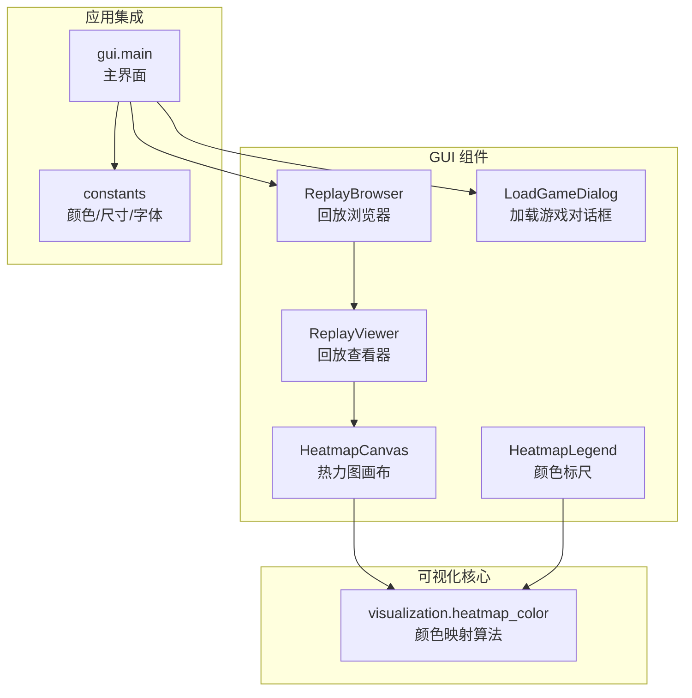
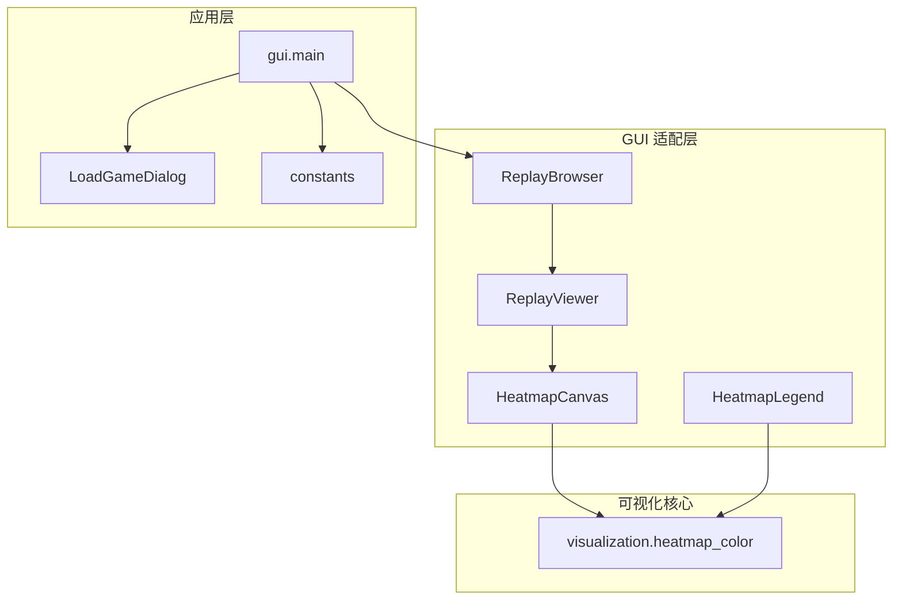
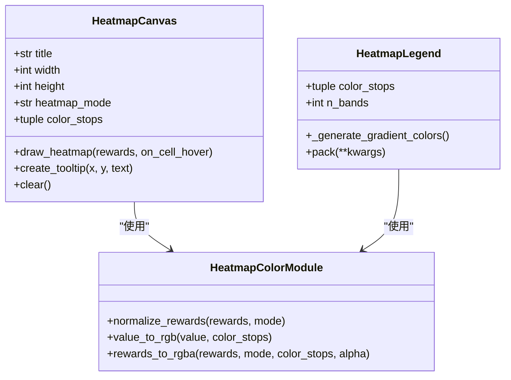
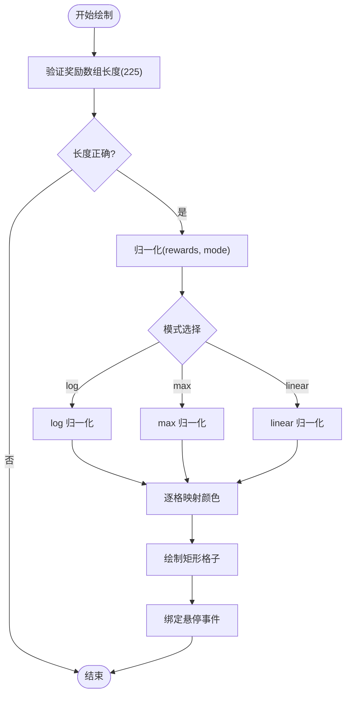
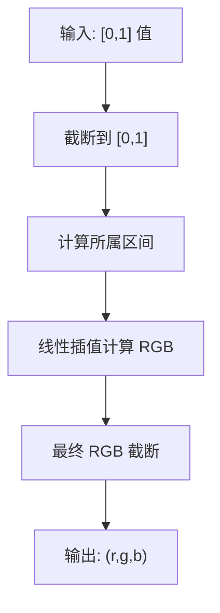
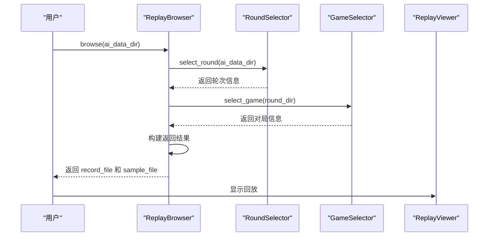
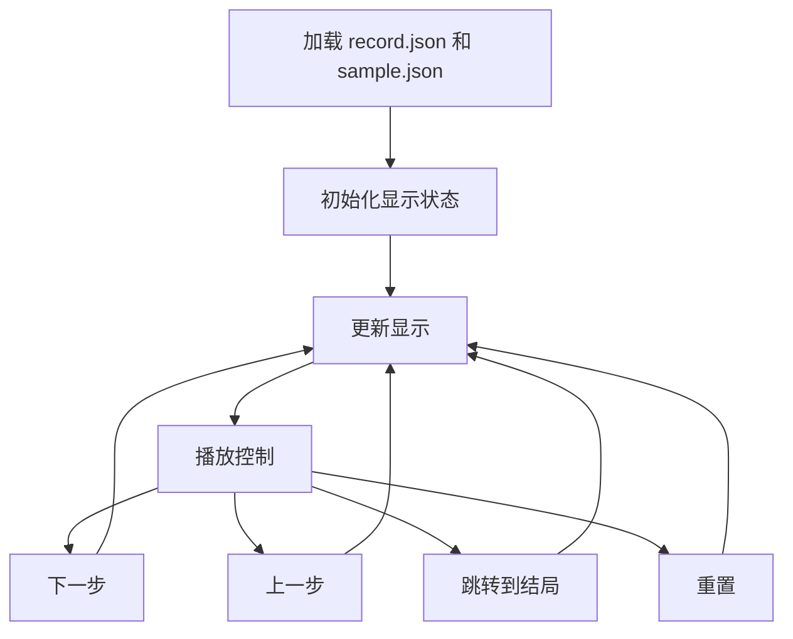
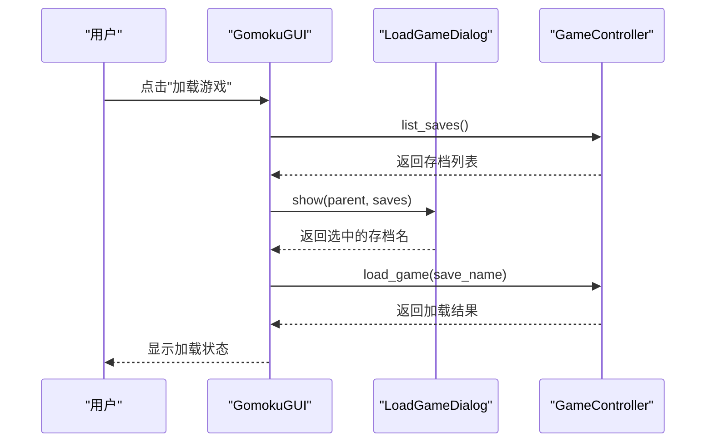
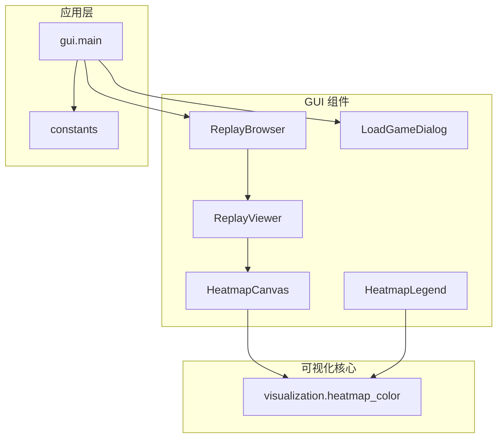

# 可视化功能

<cite>
**本文档引用的文件**
- [gui/components/heatmap.py](file://gui/components/heatmap.py)
- [visualization/heatmap_color.py](file://visualization/heatmap_color.py)
- [gui/components/replay_browser.py](file://gui/components/replay_browser.py)
- [gui/components/replay_viewer.py](file://gui/components/replay_viewer.py)
- [gui/components/load_game_dialog.py](file://gui/components/load_game_dialog.py)
- [gui/components/constants.py](file://gui/components/constants.py)
- [gui/main.py](file://gui/main.py)
- [tests/gui/test_heatmap.py](file://tests/gui/test_heatmap.py)
- [tests/gui/test_replay_browser.py](file://tests/gui/test_replay_browser.py)
- [tests/gui/test_replay_viewer.py](file://tests/gui/test_replay_viewer.py)
- [design/gui_heatmap_reuse_design.md](file://design/gui_heatmap_reuse_design.md)
- [design/sample_visualizer_design.md](file://design/sample_visualizer_design.md)
- [README.md](file://README.md)
</cite>

## 目录
1. [简介](#简介)
2. [项目结构](#项目结构)
3. [核心组件](#核心组件)
4. [架构概览](#架构概览)
5. [详细组件分析](#详细组件分析)
6. [依赖分析](#依赖分析)
7. [性能考虑](#性能考虑)
8. [故障排除指南](#故障排除指南)
9. [结论](#结论)
10. [附录](#附录)

## 简介
本指南面向使用者，详细介绍五子棋项目中的可视化功能，包括：
- 热力图功能：颜色编码系统、概率分布显示、归一化模式
- 对局回放系统：回放浏览器、对局文件选择、播放控制
- 存档管理：查看、加载、保存游戏存档
- 可视化图表解读：训练曲线、损失函数变化、模型性能评估
- 自定义选项与高级用法：热力图模式、色板配置、回放控制

## 项目结构
可视化功能主要分布在以下模块：
- GUI 组件：热力图画布、回放浏览器、回放查看器、存档对话框
- 可视化核心：热力图颜色映射算法
- 设计文档：热力图复用设计、样本可视化设计
- 测试：GUI 组件测试

**图表来源**
- [gui/components/heatmap.py:68-357](file://gui/components/heatmap.py#L68-L357)
- [visualization/heatmap_color.py:32-203](file://visualization/heatmap_color.py#L32-L203)
- [gui/components/replay_browser.py:300-382](file://gui/components/replay_browser.py#L300-L382)
- [gui/components/replay_viewer.py:13-425](file://gui/components/replay_viewer.py#L13-L425)
- [gui/main.py:31-461](file://gui/main.py#L31-L461)

**章节来源**
- [gui/main.py:31-461](file://gui/main.py#L31-L461)
- [gui/components/heatmap.py:1-358](file://gui/components/heatmap.py#L1-L358)
- [visualization/heatmap_color.py:1-204](file://visualization/heatmap_color.py#L1-L204)

## 核心组件
本节概述可视化功能的关键组件及其职责。

- 热力图画布（HeatmapCanvas）
  - 负责绘制 15×15 棋盘格的热力图
  - 支持多种归一化模式（log/max/linear）
  - 提供悬停 tooltip 显示原始奖励值
  - 使用默认白→黄→橙→红色板

- 颜色标尺（HeatmapLegend）
  - 显示热力图颜色映射的标尺
  - 默认 24 档渐变，对应 4 色板
  - 标签显示各色节点名称

- 回放浏览器（ReplayBrowser）
  - 选择 AI 内战轮次目录
  - 选择具体对局文件
  - 返回 record.json 和 sample.json 路径

- 回放查看器（ReplayViewer）
  - 显示棋盘网格和棋子
  - 绘制 AI 热力图和 Sample 热力图
  - 提供播放控制（上一步/下一步/跳转到结局/重置）
  - 显示历史记录和详细信息

- 加载游戏对话框（LoadGameDialog）
  - 从现有存档列表中选择并加载游戏

**章节来源**
- [gui/components/heatmap.py:68-357](file://gui/components/heatmap.py#L68-L357)
- [gui/components/replay_browser.py:300-382](file://gui/components/replay_browser.py#L300-L382)
- [gui/components/replay_viewer.py:13-425](file://gui/components/replay_viewer.py#L13-L425)
- [gui/components/load_game_dialog.py:11-56](file://gui/components/load_game_dialog.py#L11-L56)

## 架构概览
可视化功能的架构遵循“核心算法独立、GUI 适配层”的设计原则。颜色映射算法位于独立模块，GUI 组件通过导入该模块实现热力图功能，确保算法可复用且无 UI 依赖。

**图表来源**
- [gui/components/heatmap.py:30-34](file://gui/components/heatmap.py#L30-L34)
- [visualization/heatmap_color.py:1-20](file://visualization/heatmap_color.py#L1-L20)
- [gui/components/replay_viewer.py:9-10](file://gui/components/replay_viewer.py#L9-L10)
- [gui/main.py:18-28](file://gui/main.py#L18-L28)

## 详细组件分析

### 热力图组件分析
热力图组件提供概率分布的直观可视化，支持多种归一化模式和自定义色板。

**图表来源**
- [gui/components/heatmap.py:68-357](file://gui/components/heatmap.py#L68-L357)
- [visualization/heatmap_color.py:63-203](file://visualization/heatmap_color.py#L63-L203)

热力图归一化流程：

**图表来源**
- [gui/components/heatmap.py:137-195](file://gui/components/heatmap.py#L137-L195)
- [visualization/heatmap_color.py:63-121](file://visualization/heatmap_color.py#L63-L121)

热力图颜色映射算法：

**图表来源**
- [visualization/heatmap_color.py:128-171](file://visualization/heatmap_color.py#L128-L171)

**章节来源**
- [gui/components/heatmap.py:68-357](file://gui/components/heatmap.py#L68-L357)
- [visualization/heatmap_color.py:63-203](file://visualization/heatmap_color.py#L63-L203)
- [design/gui_heatmap_reuse_design.md:191-240](file://design/gui_heatmap_reuse_design.md#L191-L240)

### 回放浏览器组件分析
回放浏览器提供对 AI 内战对局的浏览和选择功能。

**图表来源**
- [gui/components/replay_browser.py:300-382](file://gui/components/replay_browser.py#L300-L382)

回放查看器的数据流：

**图表来源**
- [gui/components/replay_viewer.py:48-260](file://gui/components/replay_viewer.py#L48-L260)

**章节来源**
- [gui/components/replay_browser.py:300-382](file://gui/components/replay_browser.py#L300-L382)
- [gui/components/replay_viewer.py:13-425](file://gui/components/replay_viewer.py#L13-L425)

### 存档管理组件分析
存档管理系统提供游戏存档的查看、加载和保存功能。

**图表来源**
- [gui/main.py:354-376](file://gui/main.py#L354-L376)
- [gui/components/load_game_dialog.py:14-56](file://gui/components/load_game_dialog.py#L14-L56)

**章节来源**
- [gui/main.py:354-376](file://gui/main.py#L354-L376)
- [gui/components/load_game_dialog.py:11-56](file://gui/components/load_game_dialog.py#L11-L56)

## 依赖分析
可视化功能的依赖关系清晰，遵循模块化设计原则。

**图表来源**
- [gui/components/heatmap.py:30-34](file://gui/components/heatmap.py#L30-L34)
- [gui/components/replay_viewer.py:9-10](file://gui/components/replay_viewer.py#L9-L10)
- [gui/main.py:18-28](file://gui/main.py#L18-L28)

**章节来源**
- [gui/components/heatmap.py:30-34](file://gui/components/heatmap.py#L30-L34)
- [gui/components/replay_viewer.py:9-10](file://gui/components/replay_viewer.py#L9-L10)
- [gui/main.py:18-28](file://gui/main.py#L18-L28)

## 性能考虑
- 热力图绘制优化
  - 批量归一化：对整列奖励进行归一化，避免重复计算
  - 逐格颜色映射：使用预计算的色板插值
  - 悬停事件绑定：使用默认参数捕获机制避免闭包问题

- 回放系统优化
  - 数据懒加载：仅在需要时加载对局数据
  - 显示状态缓存：避免重复绘制棋盘和热力图
  - 步骤控制：高效的索引访问和状态更新

- 内存管理
  - tooltip 窗口复用：避免频繁创建销毁
  - 图像资源管理：matplotlib 后端设置避免内存泄漏

## 故障排除指南
常见问题及解决方案：

### 热力图显示异常
- 问题：热力图全白或全黑
  - 检查归一化模式设置
  - 验证奖励值范围是否合理
  - 确认色板配置正确

- 问题：tooltip 显示错误
  - 确认鼠标悬停事件绑定正确
  - 检查奖励值格式（应为数值类型）

### 回放系统问题
- 问题：无法选择对局
  - 检查 ai_data 目录是否存在
  - 确认 record.json 文件格式正确
  - 验证对局文件完整性

- 问题：播放控制无效
  - 检查当前步骤索引范围
  - 确认历史记录数据格式
  - 验证 sample.json 是否存在

### 存档管理问题
- 问题：存档列表为空
  - 检查 game/save/ 目录权限
  - 确认存档文件格式正确
  - 验证文件编码（UTF-8）

**章节来源**
- [tests/gui/test_heatmap.py:147-219](file://tests/gui/test_heatmap.py#L147-L219)
- [tests/gui/test_replay_browser.py:70-116](file://tests/gui/test_replay_browser.py#L70-L116)
- [tests/gui/test_replay_viewer.py:104-150](file://tests/gui/test_replay_viewer.py#L104-L150)

## 结论
本可视化功能提供了完整的五子棋数据分析和展示能力：
- 热力图功能支持多种归一化模式和自定义色板
- 回放系统实现了完整的对局浏览和播放控制
- 存档管理提供了便捷的游戏进度管理
- 设计文档确保了功能的可维护性和可扩展性

通过合理的架构设计和充分的测试覆盖，这些功能能够满足研究人员和开发者的多样化需求。

## 附录

### 热力图使用指南
1. **基本使用**
   - 创建 HeatmapCanvas 实例
   - 调用 draw_heatmap(rewards) 绘制热力图
   - 可选：设置 heatmap_mode 和 color_stops

2. **归一化模式**
   - log：适用于 softmax 极端分布
   - max：标准最大值归一化
   - linear：线性归一化

3. **颜色配置**
   - 默认白→黄→橙→红色板
   - 支持自定义色板（至少 2 个色节点）

### 回放系统使用指南
1. **选择对局**
   - 通过 ReplayBrowser.browse() 选择轮次和对局
   - 系统自动查找对应的 sample.json

2. **播放控制**
   - 上一步/下一步：逐手移动
   - 跳转到结局：快速查看最终状态
   - 重置：回到初始状态

3. **显示选项**
   - 棋盘显示：显示棋子位置
   - 热力图显示：显示 AI 输出和 Sample 输出

### 存档管理使用指南
1. **查看存档**
   - 点击"游戏"→"加载游戏"
   - 从列表中选择目标存档

2. **保存游戏**
   - 点击"游戏"→"保存游戏"
   - 系统自动保存当前状态

3. **新建游戏**
   - 输入存档名称（可选）
   - 系统创建新的游戏状态

### 可视化图表解读
- **训练曲线**：观察损失函数随训练轮次的变化趋势
- **损失函数变化**：识别过拟合或欠拟合迹象
- **模型性能评估**：通过热力图分析 AI 的决策分布

**章节来源**
- [README.md:265-297](file://README.md#L265-L297)
- [design/gui_heatmap_reuse_design.md:149-164](file://design/gui_heatmap_reuse_design.md#L149-L164)
- [design/sample_visualizer_design.md:78-94](file://design/sample_visualizer_design.md#L78-L94)