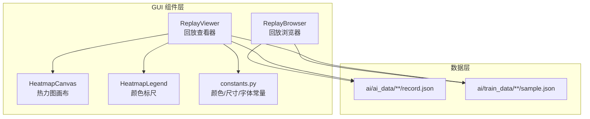
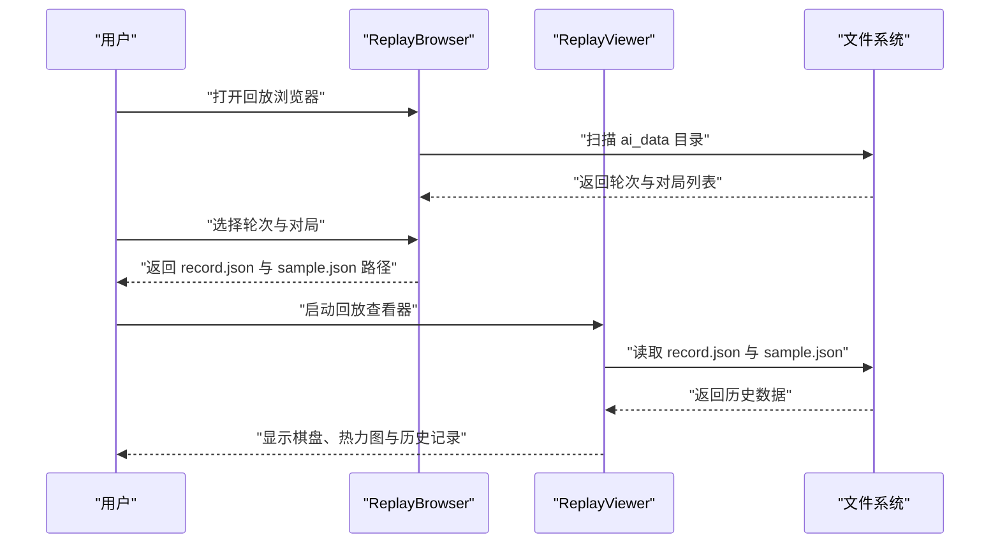
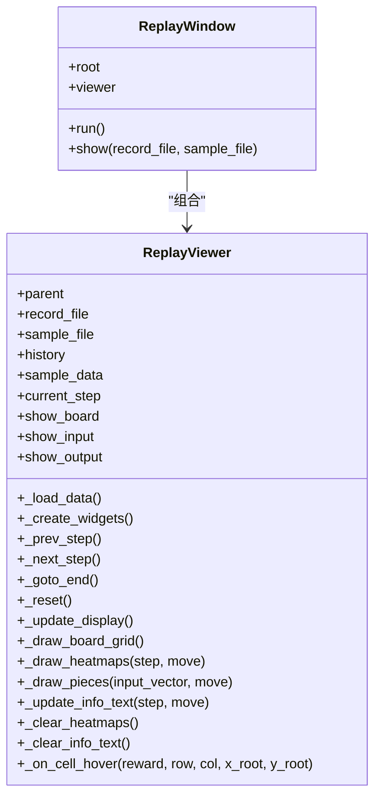
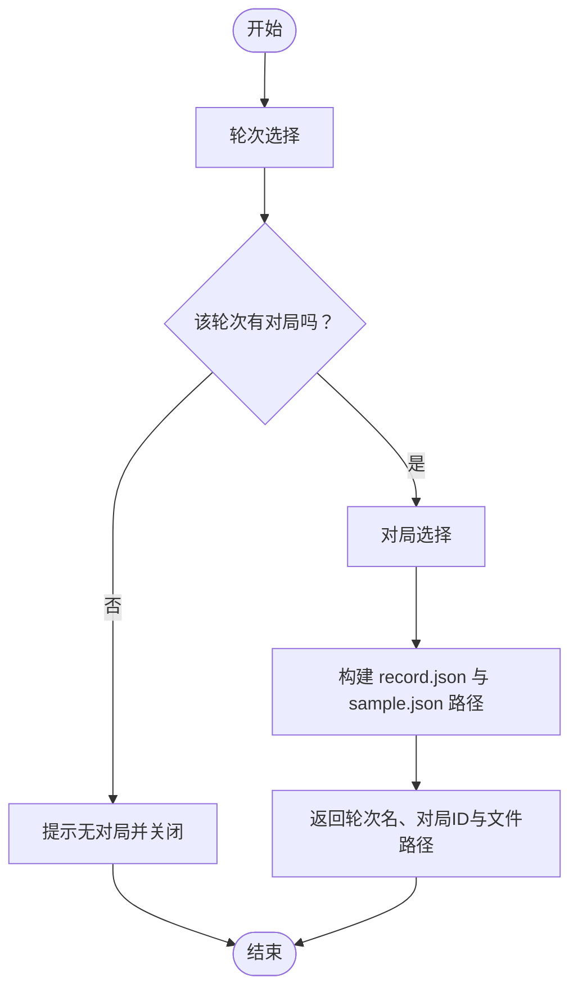
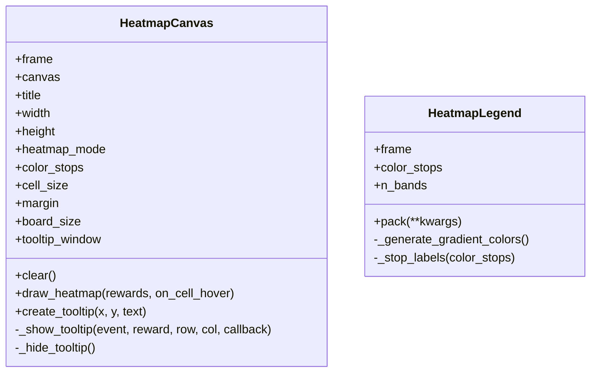
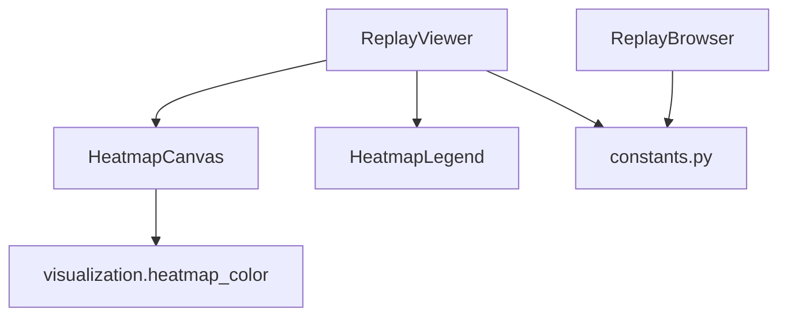

# 对局回放

<cite>
**本文引用的文件**
- [replay_viewer.py](file://gui/components/replay_viewer.py)
- [replay_browser.py](file://gui/components/replay_browser.py)
- [constants.py](file://gui/components/constants.py)
- [heatmap.py](file://gui/components/heatmap.py)
- [test_replay_viewer.py](file://tests/gui/test_replay_viewer.py)
- [test_replay_browser.py](file://tests/gui/test_replay_browser.py)
- [ai_data_path_fix_design.md](file://design/ai_data_path_fix_design.md)
- [record.json 示例](file://ai/ai_data/cnn_v1_vs_cnn_v2_1/1/record.json)
</cite>

## 目录
1. [简介](#简介)
2. [项目结构](#项目结构)
3. [核心组件](#核心组件)
4. [架构总览](#架构总览)
5. [详细组件分析](#详细组件分析)
6. [依赖分析](#依赖分析)
7. [性能考虑](#性能考虑)
8. [故障排查指南](#故障排查指南)
9. [结论](#结论)
10. [附录](#附录)

## 简介
本用户指南面向需要使用对局回放系统的用户，重点介绍两个核心组件：
- ReplayViewer：负责加载与播放对局回放，支持棋盘可视化、热力图展示、历史记录浏览与步进控制。
- ReplayBrowser：负责在 ai_data 目录中选择轮次与对局，构建回放所需的 record.json 与 sample.json 路径。

文档将帮助您：
- 快速上手：加载与播放对局文件、控制播放速度、暂停与继续播放。
- 文件管理：浏览、选择、删除对局文件（概念性说明）。
- 理解格式：record.json 与 sample.json 的结构与字段含义。
- 高级用法：快进/快退、跳转到指定步数、查看历史记录、导出回放数据。
- 分析应用：结合回放进行 AI 模型分析与训练效果评估。

## 项目结构
回放系统位于 GUI 组件层，围绕 tkinter 构建，采用“组件 + 常量 + 可视化”的分层设计：
- gui/components：包含回放查看器、回放浏览器、热力图组件与常量定义。
- tests/gui：提供针对回放组件的行为测试，保障功能正确性。
- ai/ai_data：存放对局回放数据（record.json），通常由 AI 对战或评估流程生成。
- ai/train_data：存放与回放关联的样本数据（sample.json），用于对比 AI 推理热力图。

图表来源
- [replay_viewer.py:13-47](file://gui/components/replay_viewer.py#L13-L47)
- [replay_browser.py:300-383](file://gui/components/replay_browser.py#L300-L383)
- [constants.py:1-66](file://gui/components/constants.py#L1-L66)

章节来源
- [replay_viewer.py:1-426](file://gui/components/replay_viewer.py#L1-L426)
- [replay_browser.py:1-383](file://gui/components/replay_browser.py#L1-L383)
- [constants.py:1-66](file://gui/components/constants.py#L1-L66)

## 核心组件
- ReplayViewer
  - 职责：加载 record.json 与可选的 sample.json，渲染棋盘与热力图，维护当前步进状态，提供上一步/下一步/跳转结局/重置等控制。
  - 关键能力：绘制棋盘网格、落子高亮、AI 热力图、Sample 热力图、信息文本展示、历史记录列表。
- ReplayBrowser
  - 职责：在 ai_data 目录中选择轮次与对局，自动推断对应的 sample.json 路径，返回 record_file 与 sample_file。
  - 关键能力：轮次选择器、对局选择器、浏览流程编排。
- HeatmapCanvas/HeatmapLegend
  - 职责：将 225 维 reward 向量映射为棋盘热力图，提供颜色标尺与悬停 tooltip。
- constants.py
  - 职责：统一颜色、尺寸、字体等视觉常量，保证界面风格一致。

章节来源
- [replay_viewer.py:13-47](file://gui/components/replay_viewer.py#L13-L47)
- [replay_browser.py:300-383](file://gui/components/replay_browser.py#L300-L383)
- [heatmap.py:68-358](file://gui/components/heatmap.py#L68-L358)
- [constants.py:1-66](file://gui/components/constants.py#L1-L66)

## 架构总览
回放系统采用“浏览器选择 + 查看器播放”的分层架构：
- 用户通过 ReplayBrowser 选择轮次与对局，得到 record.json 与 sample.json 的路径。
- ReplayViewer 使用这些路径加载数据，渲染棋盘与热力图，并维护播放状态。
- HeatmapCanvas 负责热力图绘制与交互，HeatmapLegend 提供颜色标尺。
- constants.py 提供统一的视觉样式。

图表来源
- [replay_browser.py:300-383](file://gui/components/replay_browser.py#L300-L383)
- [replay_viewer.py:48-63](file://gui/components/replay_viewer.py#L48-L63)

## 详细组件分析

### ReplayViewer 组件
ReplayViewer 是回放系统的核心，负责数据加载、界面渲染与交互控制。

- 数据加载
  - 从 record.json 读取 history 列表，其中每个元素包含 input、output、position 等字段。
  - 可选加载 sample.json，用于对比 AI 推理热力图与 Sample 热力图。
- 界面布局
  - 控制区：上一步、下一步、跳转到结局、重置。
  - 棋盘区：绘制 15×15 网格与棋子，高亮最后落子位置。
  - 热力图区：AI 热力图与 Sample 热力图（若存在）。
  - 信息区：显示当前步数、落子方、落子位置、输入/输出向量片段与 Sample 的实际落子 reward。
  - 历史记录区：列出每一步的玩家与坐标。
- 控制逻辑
  - 上一步/下一步：边界保护，防止越界。
  - 跳转到结局/重置：快速回到末尾或初始状态。
  - 显示选项：可切换是否显示棋盘、输入向量、输出向量。
- 交互细节
  - 棋盘网格与棋子绘制遵循固定尺寸与间距。
  - 热力图按行优先索引映射到 15×15 棋盘，支持悬停 tooltip 显示原始 reward 值。
  - 信息文本根据当前步数动态更新，包含落子方、位置与 reward 等。

图表来源
- [replay_viewer.py:13-47](file://gui/components/replay_viewer.py#L13-L47)
- [replay_viewer.py:379-426](file://gui/components/replay_viewer.py#L379-L426)

章节来源
- [replay_viewer.py:13-47](file://gui/components/replay_viewer.py#L13-L47)
- [replay_viewer.py:48-63](file://gui/components/replay_viewer.py#L48-L63)
- [replay_viewer.py:64-207](file://gui/components/replay_viewer.py#L64-L207)
- [replay_viewer.py:208-229](file://gui/components/replay_viewer.py#L208-L229)
- [replay_viewer.py:230-377](file://gui/components/replay_viewer.py#L230-L377)
- [replay_viewer.py:379-426](file://gui/components/replay_viewer.py#L379-L426)

### ReplayBrowser 组件
ReplayBrowser 提供“轮次选择 → 对局选择 → 路径构建”的完整流程。

- 轮次选择器 RoundSelector
  - 扫描 ai_data 目录，统计每个轮次下的对局数量，展示为“轮次名 (对局数)”。
  - 支持双击或点击“查看对局”确认选择。
- 对局选择器 GameSelector
  - 遍历所选轮次目录，查找包含 record.json 的对局。
  - 解析 record.json 中的 winner 与 history 长度，展示为“第 N 局 - 胜负 (步数)”。
  - 支持双击或点击“开始回放”确认选择。
- 浏览器 ReplayBrowser
  - 提供静态方法 select_round/select_game/browse，串联选择流程。
  - 自动尝试将 record.json 路径替换为 train_data 下的 sample.json 路径（若存在）。

图表来源
- [replay_browser.py:300-383](file://gui/components/replay_browser.py#L300-L383)

章节来源
- [replay_browser.py:12-149](file://gui/components/replay_browser.py#L12-L149)
- [replay_browser.py:151-298](file://gui/components/replay_browser.py#L151-L298)
- [replay_browser.py:300-383](file://gui/components/replay_browser.py#L300-L383)

### HeatmapCanvas 与 HeatmapLegend
- HeatmapCanvas
  - 输入：长度为 225 的 reward 列表（行优先映射到 15×15 棋盘）。
  - 处理：批量归一化（支持 log/max/linear），逐格绘制矩形并绑定悬停事件。
  - 输出：热力图网格与 tooltip（显示原始 reward）。
- HeatmapLegend
  - 输入：颜色节点（默认白→黄→橙→红）。
  - 处理：生成渐变条与色名标签，辅助解读热力图。

图表来源
- [heatmap.py:68-134](file://gui/components/heatmap.py#L68-L134)
- [heatmap.py:137-247](file://gui/components/heatmap.py#L137-L247)
- [heatmap.py:257-358](file://gui/components/heatmap.py#L257-L358)

章节来源
- [heatmap.py:68-358](file://gui/components/heatmap.py#L68-L358)

### 常量与样式
- 颜色：背景、棋盘、文字、边框、棋子、按钮、热力图边框等。
- 尺寸：窗口尺寸、棋盘画布、单元格大小、边距、棋盘大小、棋子半径、高亮半径、热力图单元大小。
- 字体：标题、副标题、按钮、常规、小号、等宽字体。
- 动物表情：黑棋、白棋、最后落子标记。

章节来源
- [constants.py:1-66](file://gui/components/constants.py#L1-L66)

## 依赖分析
- ReplayViewer 依赖
  - HeatmapCanvas/HeatmapLegend：用于热力图绘制与颜色标尺。
  - constants.py：统一颜色与尺寸。
  - 文件系统：读取 record.json 与 sample.json。
- ReplayBrowser 依赖
  - 文件系统：扫描 ai_data 与 train_data，构建路径。
  - constants.py：窗口样式与颜色。
- HeatmapCanvas 依赖
  - visualization.heatmap_color：归一化与颜色映射算法。

图表来源
- [replay_viewer.py:9-10](file://gui/components/replay_viewer.py#L9-L10)
- [heatmap.py:30-34](file://gui/components/heatmap.py#L30-L34)

章节来源
- [replay_viewer.py:9-10](file://gui/components/replay_viewer.py#L9-L10)
- [heatmap.py:30-34](file://gui/components/heatmap.py#L30-L34)

## 性能考虑
- 热力图绘制
  - 采用批量归一化与逐格绘制，避免重复计算，提升响应速度。
  - tooltip 仅在悬停时创建，减少资源占用。
- 棋盘绘制
  - 固定尺寸与网格，绘制逻辑简单，适合实时刷新。
- 数据加载
  - JSON 文件按需读取，避免一次性加载大文件造成卡顿。
- 建议
  - 对超长对局，建议使用“跳转到结局”快速定位末尾，减少中间步进。
  - 若热力图数据量较大，可暂时关闭热力图显示以降低渲染压力。

## 故障排查指南
- 无法找到回放数据
  - 确认 ai_data 目录存在且包含轮次与对局子目录，且每个对局包含 record.json。
  - 参考设计文档中的默认路径约定，确保路径正确。
- 选择轮次或对局后无反应
  - 检查是否有 record.json 文件，且格式可解析。
  - 确认 sample.json 是否与 record.json 对应（路径替换逻辑依赖文件名）。
- 热力图显示异常
  - 确认 output 向量长度为 225（行优先索引）。
  - 检查 heatmap_mode 参数是否合法（log/max/linear）。
- 步进控制无效
  - 确认 current_step 边界条件：不能小于 0 或大于历史长度。
- 测试参考
  - 行为测试覆盖了初始化、步进、热力图绘制、信息文本更新等关键场景，可作为功能回归的参考。

章节来源
- [test_replay_viewer.py:80-243](file://tests/gui/test_replay_viewer.py#L80-L243)
- [test_replay_browser.py:70-190](file://tests/gui/test_replay_browser.py#L70-L190)
- [ai_data_path_fix_design.md:53-83](file://design/ai_data_path_fix_design.md#L53-L83)

## 结论
对局回放系统通过 ReplayBrowser 与 ReplayViewer 的协作，实现了从数据选择到可视化播放的完整闭环。ReplayViewer 提供直观的棋盘与热力图展示，ReplayBrowser 则简化了数据路径的发现与构建。配合 HeatmapCanvas/HeatmapLegend 的高质量可视化与 constants.py 的统一样式，用户可以高效地进行对局分析、训练效果评估与数据导出。

## 附录

### 对局文件格式说明
- record.json（必选）
  - 字段示例：history（数组）、winner（整数，0/1/2/3 表示未完成/黑胜/白胜/平局）。
  - history 中每个元素包含：
    - position：落子坐标 [行, 列]。
    - input：输入向量（长度通常为 225+玩家标识）。
    - output：输出向量（长度通常为 225，表示每个位置的 reward）。
- sample.json（可选）
  - 与 history 对应，每个元素包含 input、output、mask 等字段，用于对比 AI 推理与样本策略。

章节来源
- [replay_viewer.py:48-63](file://gui/components/replay_viewer.py#L48-L63)
- [test_replay_viewer.py:32-64](file://tests/gui/test_replay_viewer.py#L32-L64)

### 存储位置与路径约定
- ai_data 目录
  - 默认路径约定：ai/ai_data（可在设计文档中确认）。
  - 结构：轮次目录 → 对局目录 → record.json。
- train_data 目录
  - 与 ai_data 对应，用于存放 sample.json。
  - 路径替换规则：将 ai_data 中的 record.json 路径替换为 train_data 并将文件名改为 sample.json。
- 设计依据
  - 默认路径修正与回放浏览器路径查找逻辑在设计文档中有明确说明。

章节来源
- [ai_data_path_fix_design.md:53-83](file://design/ai_data_path_fix_design.md#L53-L83)
- [replay_browser.py:372-376](file://gui/components/replay_browser.py#L372-L376)

### 回放操作指南
- 基本操作
  - 加载与播放：通过 ReplayBrowser 选择轮次与对局，启动 ReplayViewer。
  - 控制：上一步、下一步、跳转到结局、重置。
  - 观察：棋盘网格与棋子、AI 热力图、Sample 热力图（若存在）、信息文本与历史记录。
- 高级用法
  - 快进/快退：连续点击下一步/上一步，或使用“跳转到结局”快速定位。
  - 指定步数：当前步数显示在控件区域，可通过逐步前进到达目标步。
  - 查看历史记录：在历史记录列表中查看每一步的玩家与坐标。
- 导出与分析
  - 导出：可将 record.json 与 sample.json 复制到其他位置进行离线分析。
  - 分析：结合热力图与信息文本，评估 AI 在关键位置的决策倾向与奖励分布。

章节来源
- [replay_viewer.py:78-96](file://gui/components/replay_viewer.py#L78-L96)
- [replay_viewer.py:208-229](file://gui/components/replay_viewer.py#L208-L229)
- [replay_viewer.py:230-377](file://gui/components/replay_viewer.py#L230-L377)