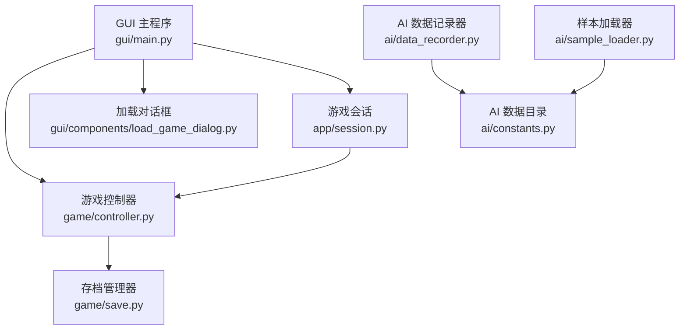
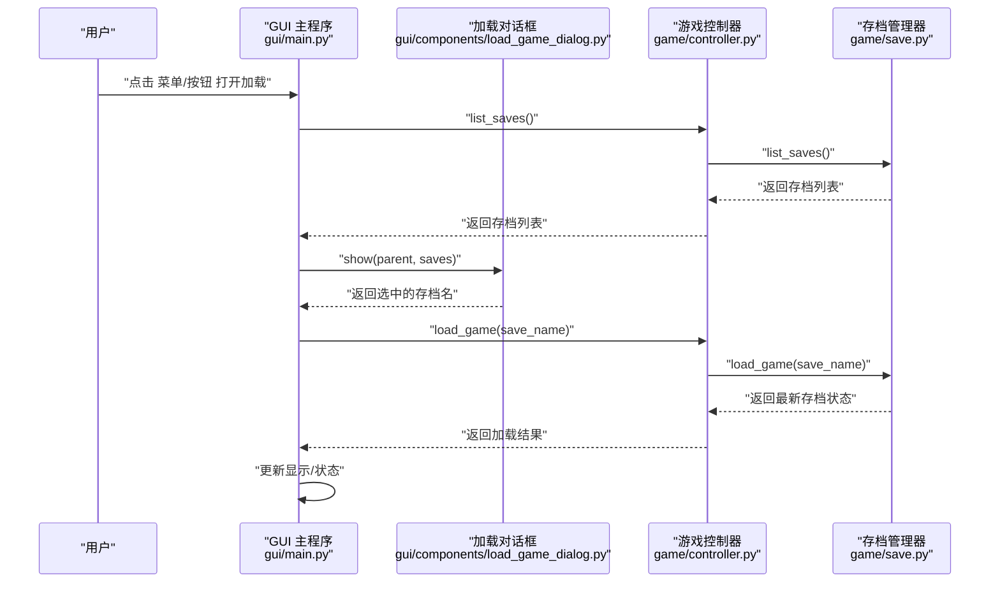
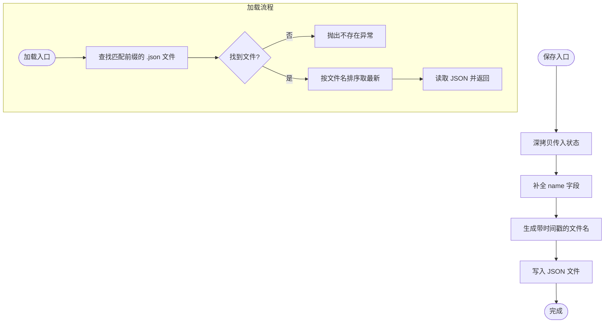
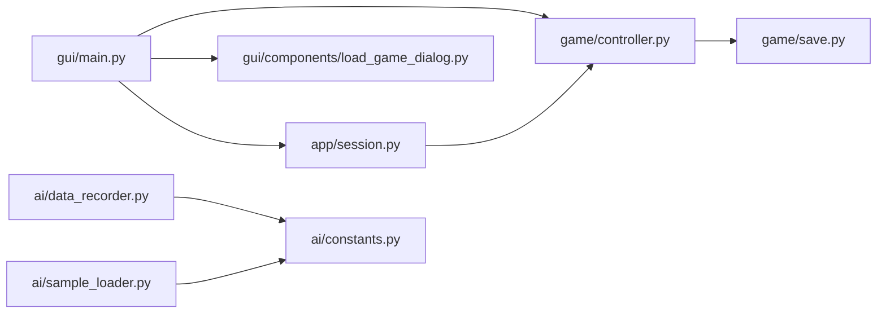

# 数据管理

<cite>
**本文引用的文件**
- [load_game_dialog.py](file://gui/components/load_game_dialog.py)
- [save.py](file://game/save.py)
- [controller.py](file://game/controller.py)
- [main.py](file://gui/main.py)
- [session.py](file://app/session.py)
- [data_recorder.py](file://ai/data_recorder.py)
- [sample_loader.py](file://ai/sample_loader.py)
- [constants.py](file://ai/constants.py)
- [test_save.py](file://tests/test_save.py)
</cite>

## 目录
1. [简介](#简介)
2. [项目结构](#项目结构)
3. [核心组件](#核心组件)
4. [架构总览](#架构总览)
5. [详细组件分析](#详细组件分析)
6. [依赖分析](#依赖分析)
7. [性能考虑](#性能考虑)
8. [故障排查指南](#故障排查指南)
9. [结论](#结论)
10. [附录](#附录)

## 简介
本指南围绕“数据管理”主题，面向使用者与维护者，系统讲解以下内容：
- 存档文件管理：LoadGameDialog 对话框的使用、支持的文件格式、加载过程中的验证机制
- 对局数据的存储与组织：文件命名规则、目录结构、数据备份策略
- 数据导入导出与批量处理：如何批量处理对局文件、数据格式转换、清理无效文件
- 数据质量检查：识别与修复损坏的对局文件
- 数据迁移与版本兼容：安全升级与维护建议

## 项目结构
本项目的数据管理涉及三层：
- GUI 层：提供用户交互入口（新建/保存/加载/回放）
- 控制层：封装游戏生命周期与存档操作（创建、保存、加载、状态查询）
- 数据层：具体文件系统与 AI 对局数据的组织与读写

图表来源
- [main.py:1-462](file://gui/main.py#L1-L462)
- [controller.py:1-194](file://game/controller.py#L1-L194)
- [save.py:1-93](file://game/save.py#L1-L93)
- [load_game_dialog.py:1-56](file://gui/components/load_game_dialog.py#L1-L56)
- [session.py:1-179](file://app/session.py#L1-L179)
- [data_recorder.py:1-145](file://ai/data_recorder.py#L1-L145)
- [sample_loader.py:1-240](file://ai/sample_loader.py#L1-L240)
- [constants.py:1-26](file://ai/constants.py#L1-L26)

章节来源
- [main.py:1-462](file://gui/main.py#L1-L462)
- [controller.py:1-194](file://game/controller.py#L1-L194)
- [save.py:1-93](file://game/save.py#L1-L93)
- [load_game_dialog.py:1-56](file://gui/components/load_game_dialog.py#L1-L56)
- [session.py:1-179](file://app/session.py#L1-L179)
- [data_recorder.py:1-145](file://ai/data_recorder.py#L1-L145)
- [sample_loader.py:1-240](file://ai/sample_loader.py#L1-L240)
- [constants.py:1-26](file://ai/constants.py#L1-L26)

## 核心组件
- 存档管理器：负责存档的保存、加载、列举与文件名生成
- 游戏控制器：对外唯一接口，协调存档与游戏状态
- 加载对话框：提供用户选择存档的交互界面
- 游戏会话：封装一局游戏流程（PvP/PvE），并协调 AI
- AI 数据记录器：组织 AI 对局数据的目录与文件
- 样本加载器：批量发现与加载训练样本，支持分割与张量化

章节来源
- [save.py:1-93](file://game/save.py#L1-L93)
- [controller.py:1-194](file://game/controller.py#L1-L194)
- [load_game_dialog.py:1-56](file://gui/components/load_game_dialog.py#L1-L56)
- [session.py:1-179](file://app/session.py#L1-L179)
- [data_recorder.py:1-145](file://ai/data_recorder.py#L1-L145)
- [sample_loader.py:1-240](file://ai/sample_loader.py#L1-L240)

## 架构总览
下面的时序图展示了“加载游戏”的完整流程，包括用户交互、对话框选择、控制器加载与状态更新。

图表来源
- [main.py:354-376](file://gui/main.py#L354-L376)
- [load_game_dialog.py:14-55](file://gui/components/load_game_dialog.py#L14-L55)
- [controller.py:99-121](file://game/controller.py#L99-L121)
- [save.py:36-57](file://game/save.py#L36-L57)

## 详细组件分析

### 存档管理器（GomokuSave）
- 职责
  - 保存游戏状态为 JSON 文件，文件名包含时间戳，避免同一天多次保存覆盖
  - 加载指定存档名的最新版本（按文件名中的日期排序）
  - 列举所有存档名（基于文件名解析，兼容旧格式）
- 文件命名规则
  - 保存：{存档名}_{年-月-日_时分秒}.json
  - 列举：从 .json 文件名中提取存档名（支持末尾日期后缀）
- 目录结构
  - 默认位于项目根目录下的 game/save/
  - 初始化时自动创建目录
- 加载验证
  - 若无匹配文件，抛出异常
  - 选择最新文件（按字典序，日期越新越靠后）

图表来源
- [save.py:17-35](file://game/save.py#L17-L35)
- [save.py:36-57](file://game/save.py#L36-L57)
- [save.py:59-79](file://game/save.py#L59-L79)
- [save.py:85-92](file://game/save.py#L85-L92)

章节来源
- [save.py:1-93](file://game/save.py#L1-L93)
- [test_save.py:1-303](file://tests/test_save.py#L1-L303)

### 游戏控制器（GomokuController）
- 职责
  - 对外唯一接口，封装存档与游戏状态
  - 新建游戏时自动生成存档名并保存初始状态
  - 加载存档时保留原始 start_time，并重建游戏实例
  - 提供状态查询与 JSON 序列化
- 与存档管理器协作
  - 通过 GomokuSave 完成保存/加载/列举
  - 生成默认存档名（跳过已存在编号）
- 错误处理
  - 未创建游戏时禁止落子
  - 游戏结束后禁止继续落子
  - 加载失败时返回错误信息

章节来源
- [controller.py:1-194](file://game/controller.py#L1-L194)

### 加载对话框（LoadGameDialog）
- 功能
  - 展示所有可用存档列表
  - 用户选择后返回存档名，未选择或取消返回 None
- 交互要点
  - 未选择时给出警告提示
  - 使用模态对话框阻塞父窗口直到关闭

章节来源
- [load_game_dialog.py:1-56](file://gui/components/load_game_dialog.py#L1-L56)
- [main.py:354-376](file://gui/main.py#L354-L376)

### 游戏会话（GameSession）
- 职责
  - 封装一局游戏流程（PvP/PvE）
  - 协调 AI（当启用 PvE 且 AI 先手时自动落子）
- 与控制器协作
  - 委托落子、状态查询、胜负判定
- 错误处理
  - 模型加载失败转换为特定异常类型，便于 GUI 捕获并提示

章节来源
- [session.py:1-179](file://app/session.py#L1-L179)

### AI 数据记录器（DataRecorder）
- 目录结构
  - 根目录：ai/ai_data（由常量定义）
  - 轮次目录：{ai_name}_{递增整数}
  - 每局子目录：1, 2, 3, ...
  - 每局记录文件：record.json（紧凑格式）
- 数据完整性
  - 记录每步 input/output/position
  - 结束时保存 winner 与 end_board
  - 自动校验并纠正 game_id 不一致的情况

章节来源
- [data_recorder.py:1-145](file://ai/data_recorder.py#L1-L145)
- [constants.py:1-26](file://ai/constants.py#L1-L26)

### 样本加载器（SampleLoader）
- 功能
  - 发现并加载 .json 训练数据（递归扫描）
  - 合并多个 sample.json
  - 按比例随机分割为训练/验证集
  - 转换为 PyTorch 张量并移动到设备
- 错误处理
  - 文件不存在、JSON 格式错误、分割范围非法等均有明确异常

章节来源
- [sample_loader.py:1-240](file://ai/sample_loader.py#L1-L240)

## 依赖分析
- GUI 依赖控制器与会话，控制器依赖存档管理器
- AI 数据记录器与样本加载器共享 AI 数据目录常量
- 加载对话框被 GUI 调用，返回值驱动控制器加载

图表来源
- [main.py:1-462](file://gui/main.py#L1-L462)
- [controller.py:1-194](file://game/controller.py#L1-L194)
- [save.py:1-93](file://game/save.py#L1-L93)
- [load_game_dialog.py:1-56](file://gui/components/load_game_dialog.py#L1-L56)
- [session.py:1-179](file://app/session.py#L1-L179)
- [data_recorder.py:1-145](file://ai/data_recorder.py#L1-L145)
- [sample_loader.py:1-240](file://ai/sample_loader.py#L1-L240)
- [constants.py:1-26](file://ai/constants.py#L1-L26)

## 性能考虑
- 存档写入
  - 使用紧凑 JSON 格式（record.json）减少体积
- 数据发现
  - 递归扫描目录时按路径排序，保证结果稳定
- 张量准备
  - 使用列表推导与批量张量化，减少 Python 解释器开销

章节来源
- [data_recorder.py:137-140](file://ai/data_recorder.py#L137-L140)
- [sample_loader.py:215-239](file://ai/sample_loader.py#L215-L239)

## 故障排查指南
- 加载失败：提示“存档不存在”
  - 检查存档目录是否存在对应文件
  - 确认存档名拼写与大小写
  - 若同一天多次保存，确认文件名包含时间戳后缀
- 加载后状态异常
  - 确认加载的是最新文件（按文件名排序）
  - 检查 JSON 格式是否正确
- 列举存档为空
  - 确认目录下存在 .json 文件
  - 确认文件名符合“存档名_日期”或“存档名_日期_时间”格式
- AI 对局数据损坏
  - record.json 缺失或格式错误时，评估/回放可能失败
  - 可通过并行评估模式观察错误数量，定位问题文件
- 模型加载失败
  - GUI 层捕获特定异常并提示回退到模式选择界面

章节来源
- [save.py:46-47](file://game/save.py#L46-L47)
- [controller.py:105-121](file://game/controller.py#L105-L121)
- [test_save.py:140-153](file://tests/test_save.py#L140-L153)
- [sample_loader.py:80-94](file://ai/sample_loader.py#L80-L94)

## 结论
本指南梳理了从 GUI 到控制器再到数据层的完整数据管理流程，明确了存档文件的命名与组织方式、加载验证机制、AI 对局数据的目录结构与质量保障手段，并提供了导入导出与批量处理、质量检查与迁移兼容的实践建议。遵循本文所述规范，可显著提升数据管理的可靠性与可维护性。

## 附录

### 存档文件管理操作步骤
- 新建/保存
  - 通过 GUI 新建游戏，系统自动保存初始状态
  - 保存文件名包含时间戳，避免覆盖
- 加载
  - 在 GUI 中打开“加载游戏”，选择存档后自动加载最新版本
  - 若无存档，提示暂无数据
- 列举
  - 控制器提供存档列表，GUI 用于对话框展示

章节来源
- [main.py:321-376](file://gui/main.py#L321-L376)
- [controller.py:32-63](file://game/controller.py#L32-L63)
- [save.py:59-79](file://game/save.py#L59-L79)

### 对局数据存储与组织
- 目录结构
  - AI 数据根目录：ai/ai_data（由常量定义）
  - 轮次目录：{ai_name}_{递增整数}
  - 每局子目录：1, 2, 3, ...
  - 记录文件：record.json（紧凑 JSON）
- 数据完整性
  - 每步记录 input/output/position
  - 结束时补充 winner 与 end_board
  - 自动校验 game_id 一致性

章节来源
- [constants.py:11-15](file://ai/constants.py#L11-L15)
- [data_recorder.py:43-79](file://ai/data_recorder.py#L43-L79)
- [data_recorder.py:96-140](file://ai/data_recorder.py#L96-L140)

### 数据导入导出与批量处理
- 导入
  - 使用样本加载器递归发现 .json 文件并加载
  - 支持多目录合并与按比例分割训练/验证集
- 导出
  - AI 对局数据以 record.json 形式保存，便于后续评估与回放
- 批量处理
  - 通过递归扫描与合并，实现跨目录批量加载
  - 支持并行评估模式，提高处理效率

章节来源
- [sample_loader.py:36-64](file://ai/sample_loader.py#L36-L64)
- [sample_loader.py:185-204](file://ai/sample_loader.py#L185-L204)
- [sample_loader.py:116-165](file://ai/sample_loader.py#L116-L165)

### 数据质量检查
- JSON 格式校验
  - 加载阶段抛出明确异常，便于定位问题文件
- 并行评估模式
  - 单个 record 失败不影响其他文件的处理
  - 输出成功 sample 数量与错误列表，便于统计

章节来源
- [sample_loader.py:80-94](file://ai/sample_loader.py#L80-L94)
- [tests\ai\test_performance_level2_parallel.py:350-392](file://tests/ai/test_performance_level2_parallel.py#L350-L392)

### 数据迁移与版本兼容
- 文件命名演进
  - 从“存档名_日期.json”升级为“存档名_日期_时分秒.json”，避免同天覆盖
- 目录结构演进
  - AI 数据目录由常量集中管理，便于迁移与覆盖
- 版本兼容
  - 控制器加载时保留原始 start_time，确保历史数据一致性
  - 存档列举兼容旧格式（日期后缀），保证向前兼容

章节来源
- [save.py:85-92](file://game/save.py#L85-L92)
- [save.py:69-76](file://game/save.py#L69-L76)
- [controller.py:109-118](file://game/controller.py#L109-L118)
- [constants.py:11-22](file://ai/constants.py#L11-L22)