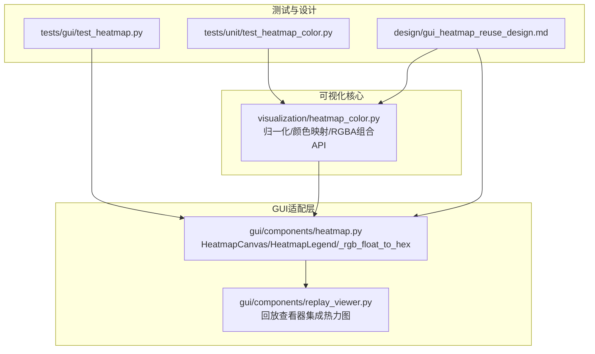
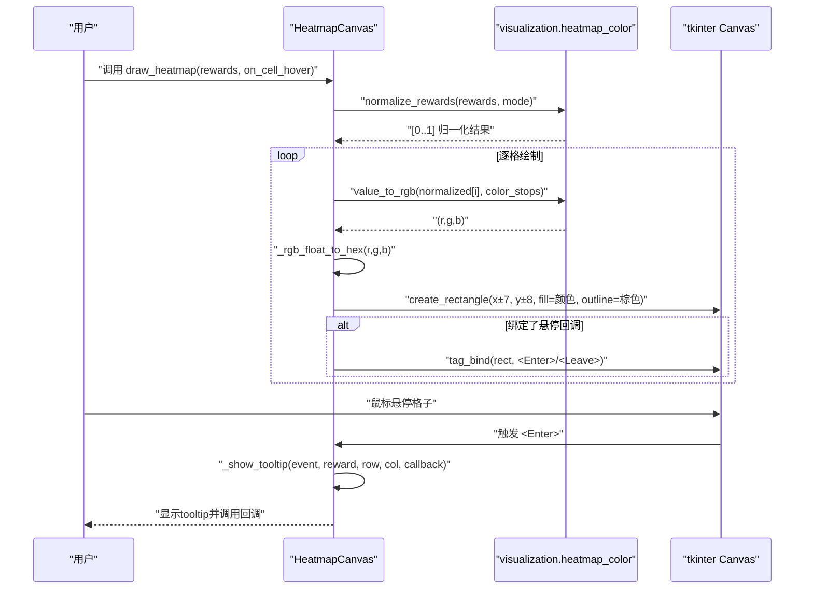
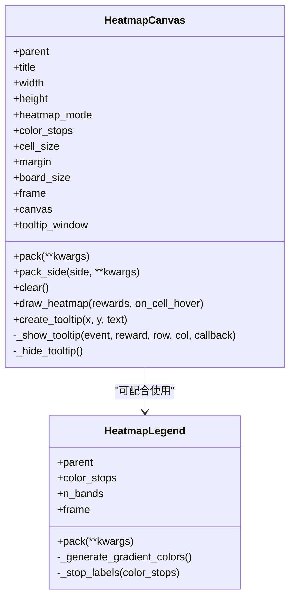
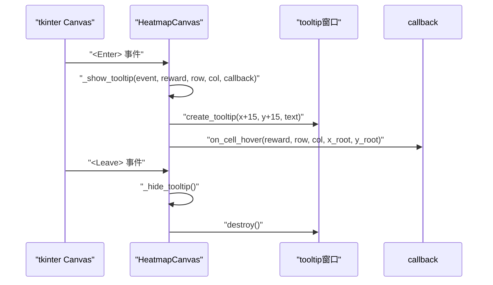
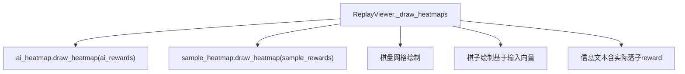
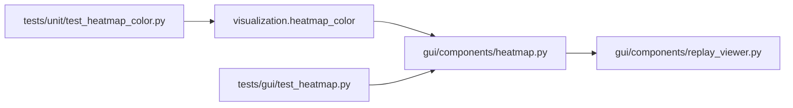

# 热力图使用

<cite>
**本文引用的文件**
- [gui/components/heatmap.py](file://gui/components/heatmap.py)
- [visualization/heatmap_color.py](file://visualization/heatmap_color.py)
- [tests/gui/test_heatmap.py](file://tests/gui/test_heatmap.py)
- [tests/unit/test_heatmap_color.py](file://tests/unit/test_heatmap_color.py)
- [design/gui_heatmap_reuse_design.md](file://design/gui_heatmap_reuse_design.md)
- [gui/components/replay_viewer.py](file://gui/components/replay_viewer.py)
- [temp/viz_sample.py](file://temp/viz_sample.py)
</cite>

## 目录
1. [简介](#简介)
2. [项目结构](#项目结构)
3. [核心组件](#核心组件)
4. [架构概览](#架构概览)
5. [详细组件分析](#详细组件分析)
6. [依赖分析](#依赖分析)
7. [性能考虑](#性能考虑)
8. [故障排查指南](#故障排查指南)
9. [结论](#结论)
10. [附录](#附录)

## 简介
本指南面向希望在GUI中集成并使用热力图功能的开发者与使用者，围绕 HeatmapCanvas 组件展开，系统讲解以下内容：
- 如何初始化热力图画布、设置归一化模式（log/max/linear）与自定义色板
- 热力图的颜色编码系统与从概率分布到RGB颜色的转换流程
- tooltip 功能的实现机制与事件绑定
- 热力图数据输入格式（225维向量）、绘制流程与事件处理方法
- 在GUI中集成热力图组件的实际示例与鼠标悬停事件处理
- 热力图在AI模型分析中的应用场景与可视化价值

## 项目结构
热力图功能由两部分协作完成：
- 可视化核心算法：位于 visualization/heatmap_color.py，提供无UI依赖的颜色映射与归一化能力
- GUI适配层：位于 gui/components/heatmap.py，封装tkinter画布、tooltip与legend组件



图表来源
- [gui/components/heatmap.py:1-358](file://gui/components/heatmap.py#L1-L358)
- [visualization/heatmap_color.py:1-204](file://visualization/heatmap_color.py#L1-L204)
- [gui/components/replay_viewer.py:279-298](file://gui/components/replay_viewer.py#L279-L298)
- [tests/gui/test_heatmap.py:1-341](file://tests/gui/test_heatmap.py#L1-L341)
- [tests/unit/test_heatmap_color.py:1-257](file://tests/unit/test_heatmap_color.py#L1-L257)
- [design/gui_heatmap_reuse_design.md:1-347](file://design/gui_heatmap_reuse_design.md#L1-L347)

章节来源
- [gui/components/heatmap.py:1-358](file://gui/components/heatmap.py#L1-L358)
- [visualization/heatmap_color.py:1-204](file://visualization/heatmap_color.py#L1-L204)
- [design/gui_heatmap_reuse_design.md:1-347](file://design/gui_heatmap_reuse_design.md#L1-L347)

## 核心组件
- HeatmapCanvas：15×15棋盘格热力图画布，支持log/max/linear归一化与自定义色板，内置tooltip
- HeatmapLegend：颜色标尺组件，沿色节点等距生成渐变条
- _rgb_float_to_hex：将[0,1]浮点RGB转为tkinter可用的"#RRGGBB"字符串
- visualization.heatmap_color：提供normalize_rewards/value_to_rgb/rewards_to_rgba等纯函数

章节来源
- [gui/components/heatmap.py:68-358](file://gui/components/heatmap.py#L68-L358)
- [visualization/heatmap_color.py:32-204](file://visualization/heatmap_color.py#L32-L204)

## 架构概览
HeatmapCanvas.draw_heatmap 的核心流程如下：
- 输入：长度为225的奖励值列表（行优先对应棋盘位置）
- 归一化：normalize_rewards(rewards, mode) → [0,1]范围
- 颜色映射：value_to_rgb(v, color_stops) → (r,g,b)
- 颜色转换：_rgb_float_to_hex(r,g,b) → "#RRGGBB"
- 绘制：在Canvas上绘制15×15个16×16像素的矩形格子
- 事件：绑定<Enter>/<Leave>事件，显示tooltip并回调外部on_cell_hover



图表来源
- [gui/components/heatmap.py:137-247](file://gui/components/heatmap.py#L137-L247)
- [visualization/heatmap_color.py:63-122](file://visualization/heatmap_color.py#L63-L122)
- [visualization/heatmap_color.py:128-172](file://visualization/heatmap_color.py#L128-L172)

章节来源
- [gui/components/heatmap.py:137-247](file://gui/components/heatmap.py#L137-L247)
- [visualization/heatmap_color.py:63-172](file://visualization/heatmap_color.py#L63-L172)

## 详细组件分析

### HeatmapCanvas 组件
- 初始化参数
  - parent：父容器
  - title：标题（当前未在画布内渲染）
  - width/height：画布像素尺寸
  - heatmap_mode："log"/"max"/"linear"，默认"log"
  - color_stops：色节点序列，None时使用默认白→黄→橙→红四色
- 核心方法
  - pack/pack_side：布局管理
  - clear：清空画布
  - draw_heatmap：绘制热力图，支持长度不等于225时静默返回
  - create_tooltip/_show_tooltip/_hide_tooltip：tooltip显示与隐藏
- 事件绑定
  - 每个格子绑定<Enter>/<Leave>事件，显示tooltip并调用on_cell_hover回调
  - tooltip显示原始reward值（非归一化值），格式化为最多6位有效数字
- 默认样式
  - 格子尺寸16×16，边距20，棋盘15×15
  - 格子描边为棕色，填充色由颜色映射决定



图表来源
- [gui/components/heatmap.py:68-358](file://gui/components/heatmap.py#L68-L358)

章节来源
- [gui/components/heatmap.py:68-247](file://gui/components/heatmap.py#L68-L247)

### 归一化与颜色映射
- 归一化模式
  - "log"：log(1 + r*K)/log(1 + max*K)，K=1/max(r)，对softmax极值分布提升次高位可辨识度
  - "max"：r/max(r)，最简单直观
  - "linear"：(r - min)/(max - min)，适合均匀分布信号
- 颜色映射
  - 色节点等距分布在[0,1]，相邻节点在RGB空间线性插值
  - 默认色板：白→黄→橙→红（4色）
  - 支持任意n≥2色节点，节点数改变不影响端点与插值正确性
- RGBA组合API
  - rewards_to_rgba：一次性得到matplotlib可用的RGBA列表（含alpha）

```mermaid
flowchart TD
Start(["输入: rewards"]) --> Mode{"选择模式"}
Mode --> |"log"| Log["计算K=1/max(r)<br/>scaled=log1p(max(r,0)*K)<br/>m=max(scaled)<br/>返回scaled/m"]
Mode --> |"max"| Max["denom=max(max_r, eps)<br/>返回[r/denom]"]
Mode --> |"linear"| Lin["lo=min(r), hi=max(r), rng=max(hi-lo, eps)<br/>返回[(r-lo)/rng]"]
Log --> Clamp["截断到[0,1]"]
Max --> Clamp
Lin --> Clamp
Clamp --> Map["value_to_rgb(v, color_stops)"]
Map --> Hex["_rgb_float_to_hex(r,g,b)"]
Hex --> End(["输出: "#RRGGBB"])
```

图表来源
- [visualization/heatmap_color.py:63-122](file://visualization/heatmap_color.py#L63-L122)
- [visualization/heatmap_color.py:128-172](file://visualization/heatmap_color.py#L128-L172)
- [gui/components/heatmap.py:41-58](file://gui/components/heatmap.py#L41-L58)

章节来源
- [visualization/heatmap_color.py:63-172](file://visualization/heatmap_color.py#L63-L172)
- [gui/components/heatmap.py:41-58](file://gui/components/heatmap.py#L41-L58)

### tooltip 与事件处理
- tooltip显示内容
  - 坐标：(row, col)
  - 奖励值：原始reward（非归一化），格式化为最多6位有效数字
- 事件绑定
  - 每个格子矩形绑定<Enter>与<Leave>事件
  - <Enter>：创建/更新tooltip并调用on_cell_hover回调
  - <Leave>：隐藏tooltip
- 回调参数
  - on_cell_hover(reward, row, col, x_root, y_root)



图表来源
- [gui/components/heatmap.py:198-247](file://gui/components/heatmap.py#L198-L247)

章节来源
- [gui/components/heatmap.py:198-247](file://gui/components/heatmap.py#L198-L247)

### GUI集成示例（回放查看器）
在回放查看器中，热力图与棋盘在同一画布上显示：
- 棋盘网格绘制
- 热力图绘制：调用 ai_heatmap.draw_heatmap 与 sample_heatmap.draw_heatmap
- 棋子绘制：根据输入向量的225维棋盘状态绘制黑白棋子
- 信息文本：显示落子方、落子位置及实际落子reward



图表来源
- [gui/components/replay_viewer.py:279-325](file://gui/components/replay_viewer.py#L279-L325)

章节来源
- [gui/components/replay_viewer.py:279-325](file://gui/components/replay_viewer.py#L279-L325)

## 依赖分析
- HeatmapCanvas 依赖 visualization.heatmap_color 的归一化与颜色映射函数
- HeatmapLegend 依赖 visualization.heatmap_color 的颜色映射函数
- GUI层不依赖matplotlib，颜色转换通过 _rgb_float_to_hex 完成
- 回放查看器集成 HeatmapCanvas 与 HeatmapLegend



图表来源
- [gui/components/heatmap.py:30-34](file://gui/components/heatmap.py#L30-L34)
- [visualization/heatmap_color.py:1-204](file://visualization/heatmap_color.py#L1-L204)
- [gui/components/replay_viewer.py:9](file://gui/components/replay_viewer.py#L9-L9)
- [tests/gui/test_heatmap.py:26-31](file://tests/gui/test_heatmap.py#L26-L31)
- [tests/unit/test_heatmap_color.py:12-17](file://tests/unit/test_heatmap_color.py#L12-L17)

章节来源
- [gui/components/heatmap.py:30-34](file://gui/components/heatmap.py#L30-L34)
- [visualization/heatmap_color.py:1-204](file://visualization/heatmap_color.py#L1-L204)
- [gui/components/replay_viewer.py:9](file://gui/components/replay_viewer.py#L9-L9)
- [tests/gui/test_heatmap.py:26-31](file://tests/gui/test_heatmap.py#L26-L31)
- [tests/unit/test_heatmap_color.py:12-17](file://tests/unit/test_heatmap_color.py#L12-L17)

## 性能考虑
- 归一化批处理：normalize_rewards 对整个225维向量进行一次全局统计，避免重复计算
- 颜色映射：逐格调用 value_to_rgb，时间复杂度O(N)，N=225
- Canvas绘制：15×15格子，每次绘制1个矩形，绘制开销较小
- tooltip：仅在悬停时创建/销毁窗口，事件绑定采用lambda捕获当前循环变量，避免闭包陷阱
- 颜色转换：_rgb_float_to_hex 仅做乘255四舍五入，开销极小

## 故障排查指南
- 归一化模式非法
  - 现象：调用 draw_heatmap 抛出 ValueError
  - 原因：heatmap_mode 不在 {"log","max","linear"}
  - 解决：确保传入合法模式或在构造时指定
- 输入长度不等于225
  - 现象：静默返回，不绘制
  - 原因：向后兼容设计
  - 解决：确保输入为225维行优先向量
- tooltip显示异常
  - 现象：tooltip不显示或显示原始值格式不符合预期
  - 原因：tooltip显示原始reward，使用"{:.6g}"格式化
  - 解决：确认 on_cell_hover 回调接收的参数正确
- 颜色映射异常
  - 现象：颜色与预期不符
  - 原因：color_stops节点数或顺序问题
  - 解决：检查自定义色板是否至少2个节点，或使用默认白→黄→橙→红

章节来源
- [gui/components/heatmap.py:157-159](file://gui/components/heatmap.py#L157-L159)
- [gui/components/heatmap.py:159-164](file://gui/components/heatmap.py#L159-L164)
- [gui/components/heatmap.py:206-214](file://gui/components/heatmap.py#L206-L214)
- [visualization/heatmap_color.py:147-149](file://visualization/heatmap_color.py#L147-L149)

## 结论
HeatmapCanvas 提供了灵活、可配置且高性能的热力图可视化能力，结合 visualization.heatmap_color 的归一化与颜色映射算法，能够清晰呈现AI模型输出的概率分布。通过回放查看器的集成示例，用户可以直观地观察AI在不同步数下的决策分布与落子位置的reward值，从而更好地理解AI的决策过程。

## 附录

### 使用指南：初始化与参数
- 初始化 HeatmapCanvas
  - 参数：parent、title、width、height、heatmap_mode、color_stops
  - 默认 heatmap_mode="log"，默认 color_stops 为白→黄→橙→红四色
- 设置归一化模式
  - "log"：推荐用于softmax极值分布
  - "max"：简单直观的最大值归一化
  - "linear"：线性归一化，适合均匀分布
- 自定义色板
  - 传入 color_stops 序列，至少2个节点
  - 节点等距分布在[0,1]，相邻节点RGB线性插值

章节来源
- [gui/components/heatmap.py:71-99](file://gui/components/heatmap.py#L71-L99)
- [visualization/heatmap_color.py:32-39](file://visualization/heatmap_color.py#L32-L39)

### 数据输入格式与绘制流程
- 输入格式
  - 225维行优先向量，对应15×15棋盘的每个位置
- 绘制流程
  - 调用 draw_heatmap(rewards, on_cell_hover)
  - 内部先归一化，再逐格映射颜色并绘制矩形
  - 绑定悬停事件，显示tooltip并回调

章节来源
- [gui/components/heatmap.py:137-195](file://gui/components/heatmap.py#L137-L195)

### 事件处理与tooltip
- 悬停事件
  - <Enter>：显示tooltip并调用 on_cell_hover(reward, row, col, x_root, y_root)
  - <Leave>：隐藏tooltip
- tooltip内容
  - 显示坐标(row, col)与原始reward值（格式化为最多6位有效数字）

章节来源
- [gui/components/heatmap.py:185-194](file://gui/components/heatmap.py#L185-L194)
- [gui/components/heatmap.py:198-214](file://gui/components/heatmap.py#L198-L214)

### 在GUI中集成热力图
- 回放查看器集成
  - 在 _draw_heatmaps 中分别绘制 AI 热力图与 Sample 热力图
  - 与棋盘网格、棋子绘制共同显示
- 示例参考
  - 回放查看器实现：[gui/components/replay_viewer.py:279-325](file://gui/components/replay_viewer.py#L279-L325)
  - 热力图单元测试：[tests/gui/test_heatmap.py:73-98](file://tests/gui/test_heatmap.py#L73-L98)

章节来源
- [gui/components/replay_viewer.py:279-325](file://gui/components/replay_viewer.py#L279-L325)
- [tests/gui/test_heatmap.py:73-98](file://tests/gui/test_heatmap.py#L73-L98)

### AI模型分析中的应用场景
- softmax极值分布可视化
  - log归一化能显著提升次高位的可辨识度
- 回放分析
  - 观察AI在不同步数下的决策分布
  - 定位实际落子位置的reward值
- 可视化示例
  - matplotlib热力图示例：[temp/viz_sample.py:66-98](file://temp/viz_sample.py#L66-L98)

章节来源
- [design/gui_heatmap_reuse_design.md:149-164](file://design/gui_heatmap_reuse_design.md#L149-L164)
- [temp/viz_sample.py:66-98](file://temp/viz_sample.py#L66-L98)