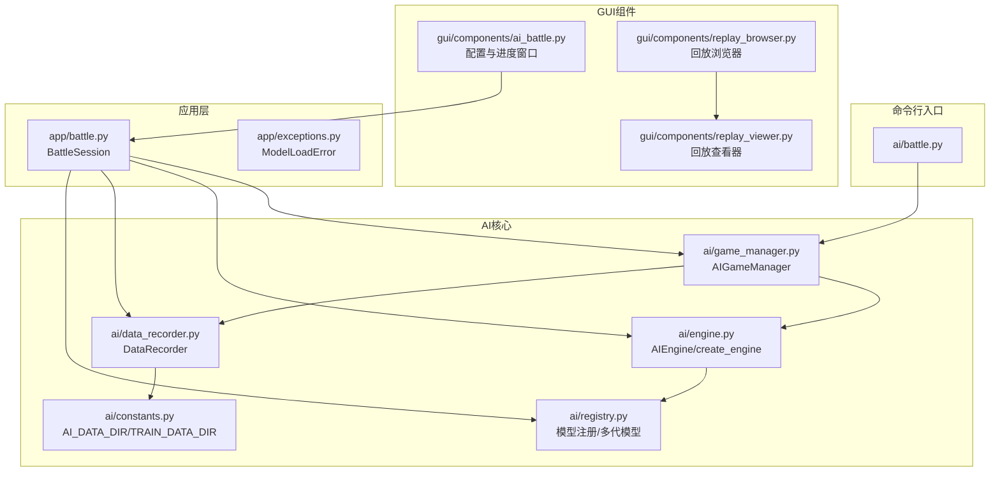
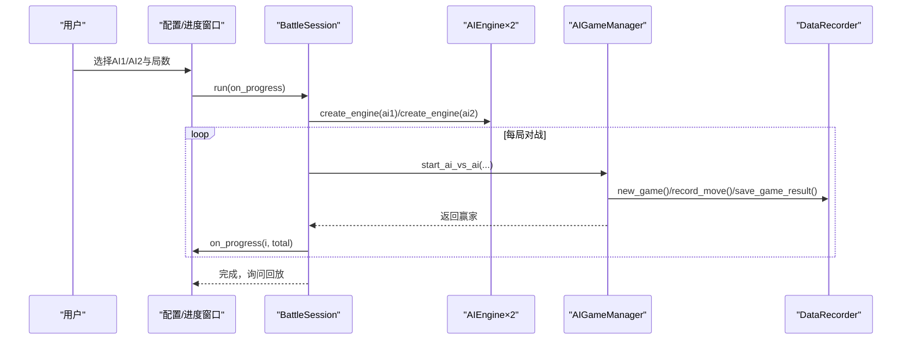
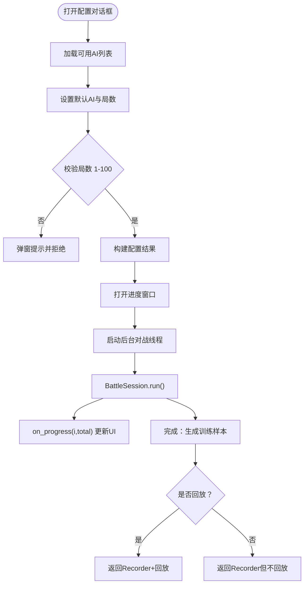
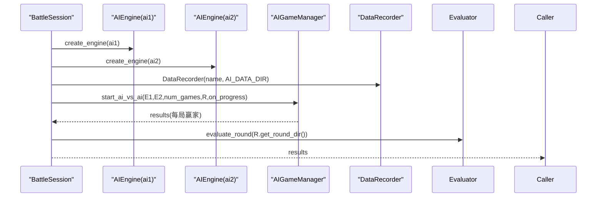
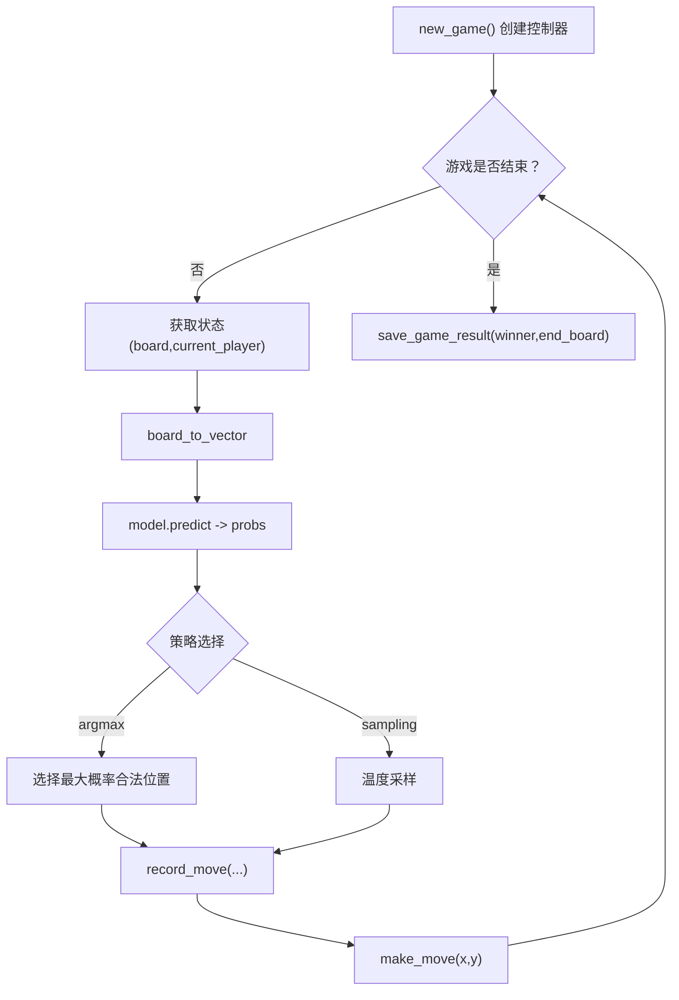
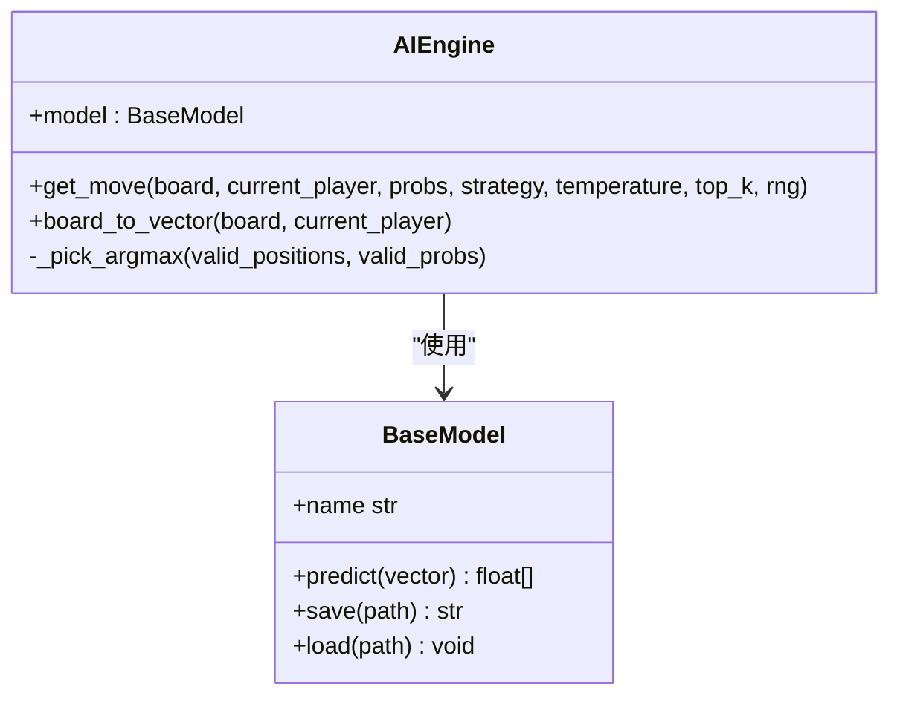
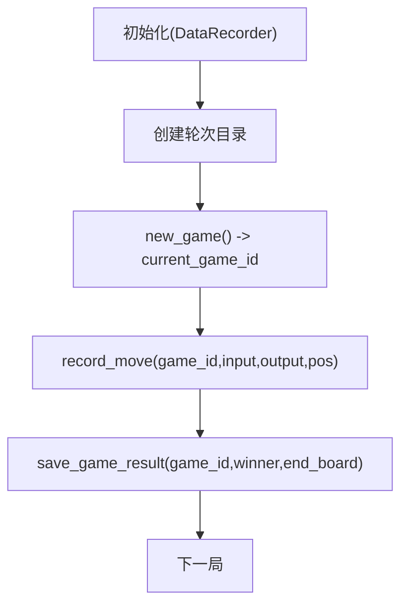
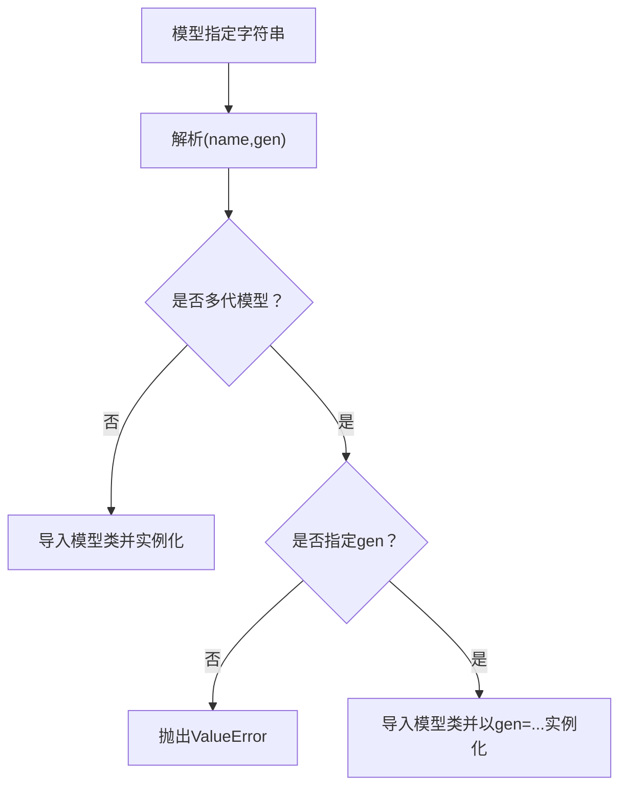
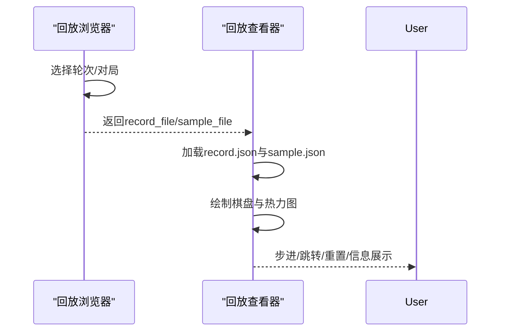
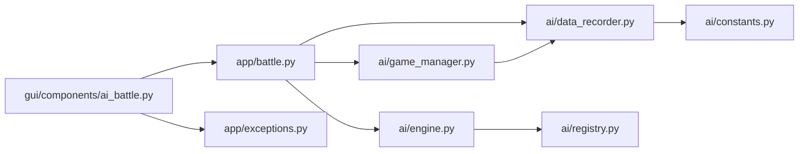

# AI内战（AI vs AI）

<cite>
**本文引用的文件**
- [ai/battle.py](file://ai/battle.py)
- [gui/components/ai_battle.py](file://gui/components/ai_battle.py)
- [app/battle.py](file://app/battle.py)
- [ai/game_manager.py](file://ai/game_manager.py)
- [ai/engine.py](file://ai/engine.py)
- [ai/data_recorder.py](file://ai/data_recorder.py)
- [ai/registry.py](file://ai/registry.py)
- [ai/constants.py](file://ai/constants.py)
- [app/exceptions.py](file://app/exceptions.py)
- [gui/components/replay_browser.py](file://gui/components/replay_browser.py)
- [gui/components/replay_viewer.py](file://gui/components/replay_viewer.py)
- [tests/gui/test_ai_battle.py](file://tests/gui/test_ai_battle.py)
- [temp/test_ai_battle.py](file://temp/test_ai_battle.py)
</cite>

## 目录
1. [简介](#简介)
2. [项目结构](#项目结构)
3. [核心组件](#核心组件)
4. [架构总览](#架构总览)
5. [详细组件分析](#详细组件分析)
6. [依赖关系分析](#依赖关系分析)
7. [性能考量](#性能考量)
8. [故障排除指南](#故障排除指南)
9. [结论](#结论)
10. [附录](#附录)

## 简介
本指南面向“AI内战（AI vs AI）”模式，提供从初始化配置、对战执行、实时进度展示到回放分析的全流程使用说明。内容涵盖：
- AI模型选择与多代模型支持
- 对战数量与参数配置
- 自动对弈流程与进度跟踪
- 回放浏览与样本数据分析
- 常见问题排查与解决方案

## 项目结构
AI内战相关代码主要分布在以下模块：
- 命令行入口与脚本：ai/battle.py
- GUI组件：gui/components/ai_battle.py、gui/components/replay_browser.py、gui/components/replay_viewer.py
- 业务会话与流程编排：app/battle.py
- 游戏与对战核心：ai/game_manager.py、ai/engine.py、ai/data_recorder.py、ai/registry.py、ai/constants.py
- 异常定义：app/exceptions.py
- 测试与示例：tests/gui/test_ai_battle.py、temp/test_ai_battle.py

**图表来源**
- [ai/battle.py:1-199](file://ai/battle.py#L1-L199)
- [gui/components/ai_battle.py:1-346](file://gui/components/ai_battle.py#L1-L346)
- [app/battle.py:1-104](file://app/battle.py#L1-L104)
- [ai/game_manager.py:1-339](file://ai/game_manager.py#L1-L339)
- [ai/engine.py:1-194](file://ai/engine.py#L1-L194)
- [ai/data_recorder.py:1-145](file://ai/data_recorder.py#L1-L145)
- [ai/registry.py:1-316](file://ai/registry.py#L1-L316)
- [ai/constants.py:1-26](file://ai/constants.py#L1-L26)
- [gui/components/replay_browser.py:1-383](file://gui/components/replay_browser.py#L1-L383)
- [gui/components/replay_viewer.py:1-426](file://gui/components/replay_viewer.py#L1-L426)

**章节来源**
- [ai/battle.py:1-199](file://ai/battle.py#L1-L199)
- [gui/components/ai_battle.py:1-346](file://gui/components/ai_battle.py#L1-L346)
- [app/battle.py:1-104](file://app/battle.py#L1-L104)
- [ai/game_manager.py:1-339](file://ai/game_manager.py#L1-L339)
- [ai/engine.py:1-194](file://ai/engine.py#L1-L194)
- [ai/data_recorder.py:1-145](file://ai/data_recorder.py#L1-L145)
- [ai/registry.py:1-316](file://ai/registry.py#L1-L316)
- [ai/constants.py:1-26](file://ai/constants.py#L1-L26)
- [gui/components/replay_browser.py:1-383](file://gui/components/replay_browser.py#L1-L383)
- [gui/components/replay_viewer.py:1-426](file://gui/components/replay_viewer.py#L1-L426)

## 核心组件
- AI内战配置与进度窗口：负责收集AI1、AI2、对战局数，启动后台对战线程，实时更新进度，完成时询问是否回放。
- BattleSession：封装完整内战流程，创建引擎、执行对战、生成训练样本，向上层回调进度。
- AIGameManager：实现单局与多局AI对战，管理控制器、记录每步数据、保存结果。
- AIEngine：桥接UI与模型，将棋盘状态向量化，调用模型预测，按策略选择落子。
- DataRecorder：按轮次与对局组织数据，记录每步输入、输出与落子位置，保存完整记录。
- Registry：统一模型注册与懒加载，支持多代模型（如cnn_v3.1、cnn_v3.2）。
- 回放浏览器与查看器：浏览轮次与对局，加载record.json与sample.json，可视化热力图与棋盘。

**章节来源**
- [gui/components/ai_battle.py:22-346](file://gui/components/ai_battle.py#L22-L346)
- [app/battle.py:15-104](file://app/battle.py#L15-L104)
- [ai/game_manager.py:16-339](file://ai/game_manager.py#L16-L339)
- [ai/engine.py:44-194](file://ai/engine.py#L44-L194)
- [ai/data_recorder.py:17-145](file://ai/data_recorder.py#L17-L145)
- [ai/registry.py:58-316](file://ai/registry.py#L58-L316)
- [gui/components/replay_browser.py:12-383](file://gui/components/replay_browser.py#L12-L383)
- [gui/components/replay_viewer.py:13-426](file://gui/components/replay_viewer.py#L13-L426)

## 架构总览
AI内战采用分层设计：
- GUI层：配置与进度窗口、回放浏览与查看器
- 应用层：BattleSession编排对战与样本生成
- AI层：AIGameManager驱动对战，AIEngine处理模型交互，DataRecorder持久化数据
- 注册与常量：Registry统一模型加载，constants提供数据目录

**图表来源**
- [gui/components/ai_battle.py:251-317](file://gui/components/ai_battle.py#L251-L317)
- [app/battle.py:52-92](file://app/battle.py#L52-L92)
- [ai/game_manager.py:233-274](file://ai/game_manager.py#L233-L274)
- [ai/data_recorder.py:66-141](file://ai/data_recorder.py#L66-L141)

## 详细组件分析

### 组件A：AI内战配置与进度窗口
- 功能要点
  - 配置对话框：选择AI1/AI2（来自registry.list_models_with_full_name）、设置对战局数（1-100）
  - 进度窗口：后台线程执行对战，主线程更新状态与进度，完成提示回放
  - 错误处理：捕获ModelLoadError，弹窗提示并回调通知未完成
- 关键流程
  - 配置校验与结果收集
  - 后台线程启动BattleSession.run并注册on_progress
  - 完成后询问是否回放，返回DataRecorder与标志

**图表来源**
- [gui/components/ai_battle.py:141-169](file://gui/components/ai_battle.py#L141-L169)
- [gui/components/ai_battle.py:251-317](file://gui/components/ai_battle.py#L251-L317)

**章节来源**
- [gui/components/ai_battle.py:22-346](file://gui/components/ai_battle.py#L22-L346)
- [tests/gui/test_ai_battle.py:24-155](file://tests/gui/test_ai_battle.py#L24-L155)

### 组件B：BattleSession（应用层会话）
- 职责
  - 创建两个AI引擎（委托create_engine）
  - 创建DataRecorder并执行start_ai_vs_ai（逐局回调进度）
  - 对战完成后调用Evaluator.evaluate_round生成训练样本
- 异常处理
  - 捕获create_engine的ValueError并转换为ModelLoadError向上抛出

**图表来源**
- [app/battle.py:52-92](file://app/battle.py#L52-L92)
- [ai/game_manager.py:233-274](file://ai/game_manager.py#L233-L274)
- [ai/data_recorder.py:142-145](file://ai/data_recorder.py#L142-L145)

**章节来源**
- [app/battle.py:15-104](file://app/battle.py#L15-L104)

### 组件C：AIGameManager（对战核心）
- 单局流程
  - 创建GomokuController，new_game，循环落子直至结束
  - 每步：AIEngine.board_to_vector + model.predict，按策略选择落子，record_move
  - 结束：保存winner与终局board
- 多局流程
  - start_ai_vs_ai：固定执方（engine1黑，engine2白）
  - start_ai_vs_ai_random：每局随机决定执方，返回每局ai1_color/ai2_color与胜负标记

**图表来源**
- [ai/game_manager.py:124-231](file://ai/game_manager.py#L124-L231)
- [ai/engine.py:67-143](file://ai/engine.py#L67-L143)
- [ai/data_recorder.py:96-141](file://ai/data_recorder.py#L96-L141)

**章节来源**
- [ai/game_manager.py:16-339](file://ai/game_manager.py#L16-L339)
- [ai/engine.py:44-194](file://ai/engine.py#L44-L194)
- [ai/data_recorder.py:17-145](file://ai/data_recorder.py#L17-L145)

### 组件D：AIEngine（模型交互）
- 职责
  - 将棋盘状态转换为226维向量（225维棋盘+1维当前玩家）
  - 调用模型predict获取225维概率分布
  - 支持argmax与sampling两种策略；sampling委托move_sampler实现
- 错误处理
  - 棋盘已满无空位时抛出ValueError
  - 策略非法时抛出ValueError

**图表来源**
- [ai/engine.py:44-194](file://ai/engine.py#L44-L194)

**章节来源**
- [ai/engine.py:18-42](file://ai/engine.py#L18-L42)
- [ai/engine.py:67-143](file://ai/engine.py#L67-L143)

### 组件E：DataRecorder（数据持久化）
- 轮次目录：ai/ai_data/{ai_name}_{递增整数}/
- 每局子目录：1,2,3...
- 每步记录：input(226维)、output(225维)、position
- 结束保存：winner、end_board

**图表来源**
- [ai/data_recorder.py:27-145](file://ai/data_recorder.py#L27-L145)
- [ai/constants.py:11-15](file://ai/constants.py#L11-L15)

**章节来源**
- [ai/data_recorder.py:17-145](file://ai/data_recorder.py#L17-L145)
- [ai/constants.py:11-26](file://ai/constants.py#L11-L26)

### 组件F：Registry（模型注册与多代模型）
- 支持多代模型（如cnn_v3.1、cnn_v3.2），通过gen{i}目录与.pth文件识别有效代数
- list_models_with_full_name返回含代数的完整模型名列表
- get_model/get_trainer按spec解析并懒加载

**图表来源**
- [ai/registry.py:103-184](file://ai/registry.py#L103-L184)
- [ai/registry.py:237-296](file://ai/registry.py#L237-L296)

**章节来源**
- [ai/registry.py:58-316](file://ai/registry.py#L58-L316)

### 组件G：回放浏览器与查看器
- 浏览器：列出轮次目录与对局数量；选择后定位record.json与sample.json
- 查看器：棋盘网格+棋子+热力图（AI输出与Sample对比）+历史列表+步骤控制

**图表来源**
- [gui/components/replay_browser.py:300-383](file://gui/components/replay_browser.py#L300-L383)
- [gui/components/replay_viewer.py:13-426](file://gui/components/replay_viewer.py#L13-L426)

**章节来源**
- [gui/components/replay_browser.py:12-383](file://gui/components/replay_browser.py#L12-L383)
- [gui/components/replay_viewer.py:13-426](file://gui/components/replay_viewer.py#L13-L426)

## 依赖关系分析
- 组件耦合
  - GUI层依赖app/BattleSession；BattleSession依赖ai包（engine、game_manager、data_recorder、registry）
  - AIGameManager依赖engine与data_recorder；engine依赖registry与model
- 外部依赖
  - 数据目录：AI_DATA_DIR、TRAIN_DATA_DIR
  - 异常：ModelLoadError用于向GUI传达模型加载失败

**图表来源**
- [gui/components/ai_battle.py:16-18](file://gui/components/ai_battle.py#L16-L18)
- [app/battle.py:10-12](file://app/battle.py#L10-L12)
- [ai/game_manager.py:10-13](file://ai/game_manager.py#L10-L13)
- [ai/engine.py:38-41](file://ai/engine.py#L38-L41)
- [ai/data_recorder.py:12](file://ai/data_recorder.py#L12)
- [ai/constants.py:11-15](file://ai/constants.py#L11-L15)
- [app/exceptions.py:8-25](file://app/exceptions.py#L8-L25)

**章节来源**
- [app/battle.py:10-12](file://app/battle.py#L10-L12)
- [ai/game_manager.py:10-13](file://ai/game_manager.py#L10-L13)
- [ai/engine.py:38-41](file://ai/engine.py#L38-L41)
- [ai/data_recorder.py:12](file://ai/data_recorder.py#L12)
- [ai/constants.py:11-15](file://ai/constants.py#L11-L15)
- [app/exceptions.py:8-25](file://app/exceptions.py#L8-L25)

## 性能考量
- 预测复用：AIEngine支持传入预计算probs，避免重复model.predict，降低开销
- 数据写入：record.json采用紧凑JSON格式，减少文件体积
- 温度采样：仅在sampling策略下启用，避免不必要的概率重算
- 多线程：GUI进度窗口使用后台线程执行对战，保证界面响应

[本节为通用建议，无需特定文件引用]

## 故障排除指南
- 模型加载失败
  - 现象：弹窗提示“模型加载失败”
  - 原因：未知模型名、多代模型未指定代数、模型文件缺失
  - 处理：确认模型名存在于registry列表；为多代模型指定gen（如cnn_v3.1）；检查.pth文件是否存在
- 对战进程异常
  - 现象：对局中途报错或卡死
  - 排查：检查AI模型predict是否正常；确认棋盘状态向量化无异常；查看DataRecorder是否正确记录
- 回放数据缺失
  - 现象：回放浏览器找不到轮次或对局
  - 排查：确认AI_DATA_DIR/training_data目录存在；轮次目录命名规则为{ai_name}_{序号}；对局目录包含record.json
- 命令行对战
  - 使用方式：python ai/battle.py --ai1 <模型> --ai2 <模型> --games <局数>
  - 注意：局数必须大于0；模型名需在registry中存在

**章节来源**
- [app/exceptions.py:8-25](file://app/exceptions.py#L8-L25)
- [gui/components/ai_battle.py:283-297](file://gui/components/ai_battle.py#L283-L297)
- [ai/registry.py:150-184](file://ai/registry.py#L150-L184)
- [ai/constants.py:11-15](file://ai/constants.py#L11-L15)
- [ai/battle.py:136-195](file://ai/battle.py#L136-L195)

## 结论
AI内战模式通过清晰的分层设计实现了从配置到对战、从数据记录到回放分析的完整闭环。GUI层提供直观的交互体验，应用层编排对战流程，AI层专注模型与策略，配合严格的异常处理与数据持久化，确保对战过程稳定可靠。借助回放工具，用户可以深入分析AI策略与样本质量，为后续训练优化提供依据。

[本节为总结性内容，无需特定文件引用]

## 附录
- 示例与测试参考
  - 命令行对战示例：见ai/battle.py帮助信息
  - GUI组件测试：覆盖配置对话框、进度窗口、管理器行为
  - 模拟对战示例：temp/test_ai_battle.py展示FCv1模型自我对弈流程

**章节来源**
- [ai/battle.py:136-195](file://ai/battle.py#L136-L195)
- [tests/gui/test_ai_battle.py:1-311](file://tests/gui/test_ai_battle.py#L1-L311)
- [temp/test_ai_battle.py:1-64](file://temp/test_ai_battle.py#L1-L64)