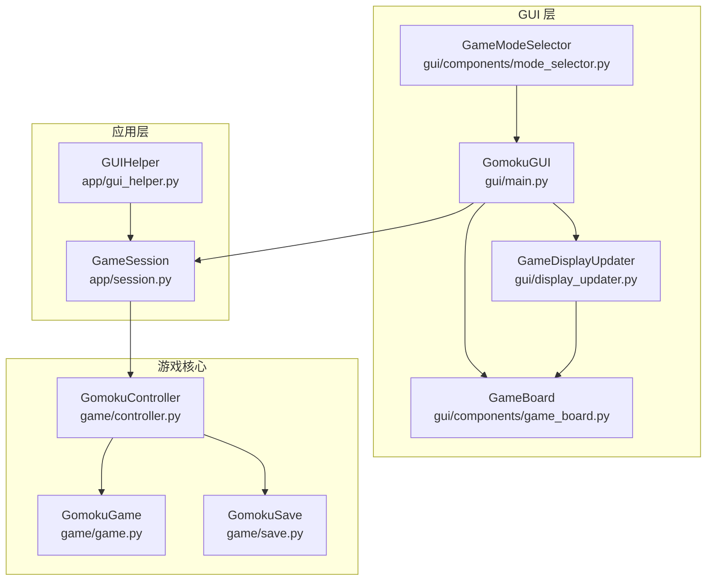
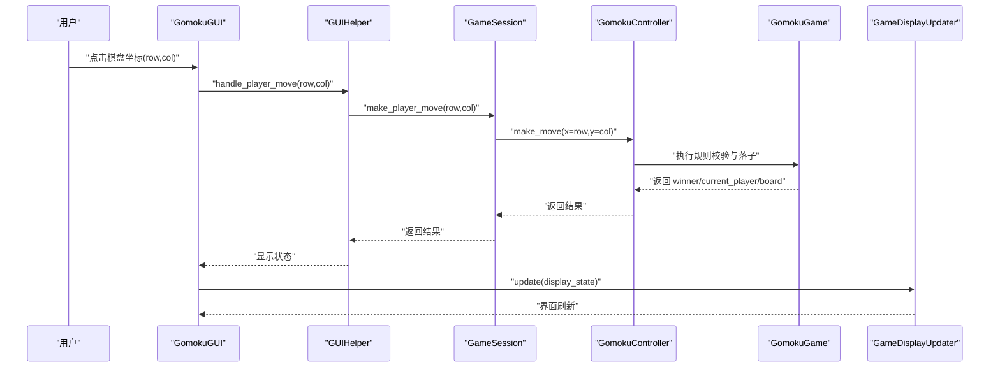
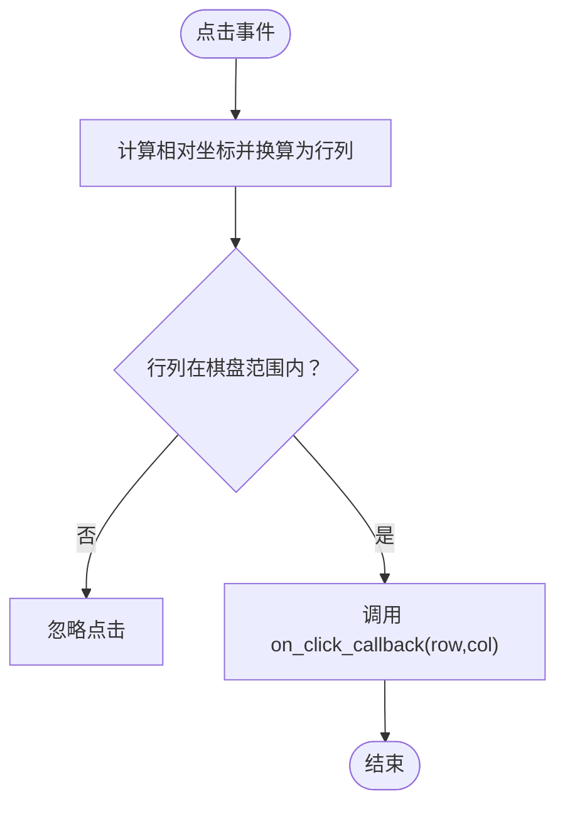
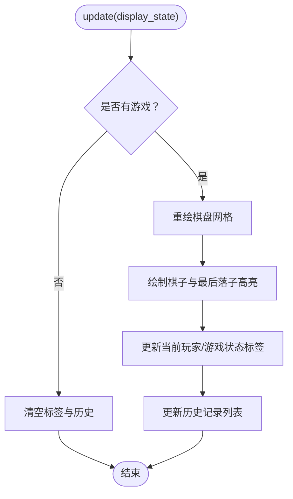
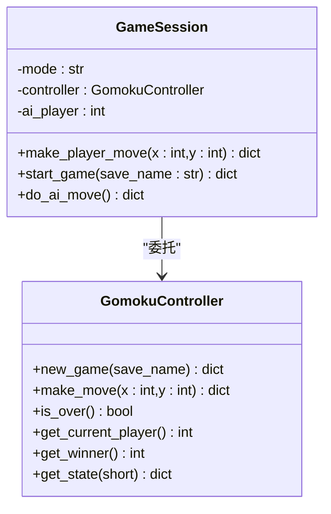
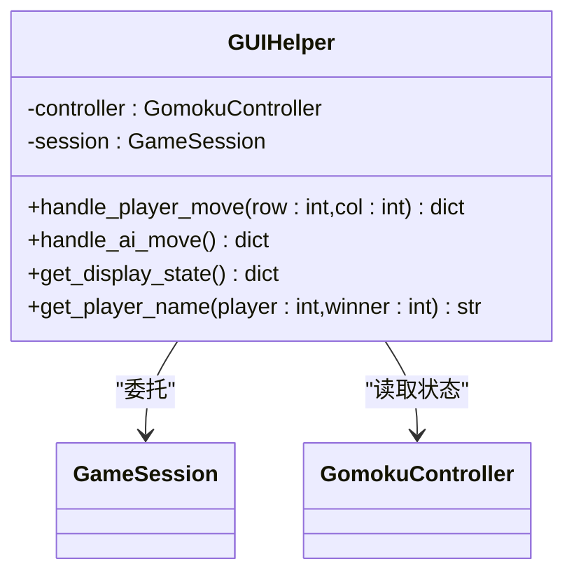
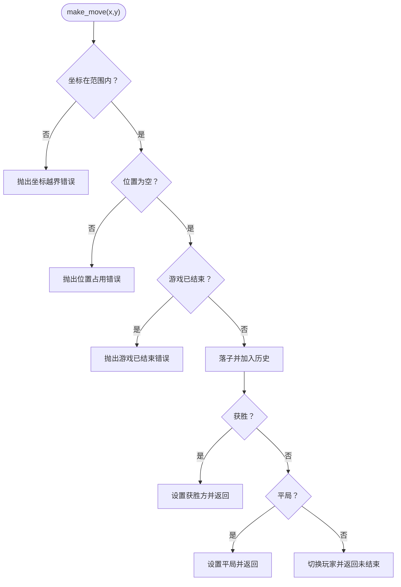
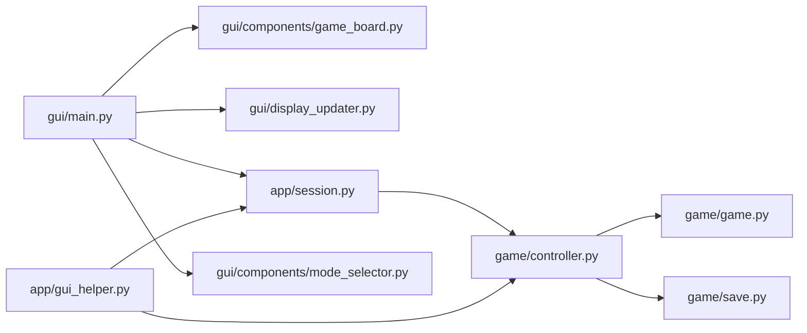

# 人人对战（PvP）

<cite>
**本文引用的文件**
- [gui/main.py](file://gui/main.py)
- [gui/components/game_board.py](file://gui/components/game_board.py)
- [gui/display_updater.py](file://gui/display_updater.py)
- [gui/components/mode_selector.py](file://gui/components/mode_selector.py)
- [app/session.py](file://app/session.py)
- [app/gui_helper.py](file://app/gui_helper.py)
- [game/controller.py](file://game/controller.py)
- [game/game.py](file://game/game.py)
- [game/save.py](file://game/save.py)
</cite>

## 目录
1. [简介](#简介)
2. [项目结构](#项目结构)
3. [核心组件](#核心组件)
4. [架构总览](#架构总览)
5. [详细组件分析](#详细组件分析)
6. [依赖关系分析](#依赖关系分析)
7. [性能考量](#性能考量)
8. [故障排除指南](#故障排除指南)
9. [结论](#结论)
10. [附录](#附录)

## 简介
本指南面向新手与进阶玩家，系统讲解“人人对战（PvP）”模式的完整操作流程与策略要点。内容涵盖：
- 游戏初始化与棋盘布局
- 双人轮流落子机制与胜负判定
- 用户界面操作（棋盘点击、状态显示、历史记录）
- 常见误操作与界面响应异常的排查
- 实用策略建议（开局、中盘、终局）

## 项目结构
PvP 模式属于 GUI 层与游戏核心逻辑的协作产物，主要涉及以下模块：
- GUI 主入口与界面组织：gui/main.py
- 棋盘组件与绘制：gui/components/game_board.py
- 界面渲染与状态更新：gui/display_updater.py
- 游戏会话与流程编排：app/session.py
- GUI 业务辅助：app/gui_helper.py
- 游戏控制器与规则：game/controller.py、game/game.py
- 存档管理：game/save.py
- 模式选择器（启动时）：gui/components/mode_selector.py

图表来源
- [gui/main.py:31-90](file://gui/main.py#L31-L90)
- [gui/components/game_board.py:7-52](file://gui/components/game_board.py#L7-L52)
- [gui/display_updater.py:13-40](file://gui/display_updater.py#L13-L40)
- [gui/components/mode_selector.py:12-52](file://gui/components/mode_selector.py#L12-L52)
- [app/session.py:12-39](file://app/session.py#L12-L39)
- [app/gui_helper.py:12-24](file://app/gui_helper.py#L12-L24)
- [game/controller.py:11-31](file://game/controller.py#L11-L31)
- [game/game.py:4-21](file://game/game.py#L4-L21)
- [game/save.py:9-16](file://game/save.py#L9-L16)

章节来源
- [gui/main.py:31-90](file://gui/main.py#L31-L90)
- [gui/components/game_board.py:7-52](file://gui/components/game_board.py#L7-L52)
- [gui/display_updater.py:13-40](file://gui/display_updater.py#L13-L40)
- [gui/components/mode_selector.py:12-52](file://gui/components/mode_selector.py#L12-L52)
- [app/session.py:12-39](file://app/session.py#L12-L39)
- [app/gui_helper.py:12-24](file://app/gui_helper.py#L12-L24)
- [game/controller.py:11-31](file://game/controller.py#L11-L31)
- [game/game.py:4-21](file://game/game.py#L4-L21)
- [game/save.py:9-16](file://game/save.py#L9-L16)

## 核心组件
- GomokuGUI：主界面与事件分发，负责菜单、按钮、棋盘点击回调、显示更新与弹窗提示。
- GameBoard：绘制棋盘网格、星位与棋子，响应鼠标点击并转换为行列坐标。
- GameDisplayUpdater：根据 display_state 刷新棋盘、标签、历史记录与游戏结束弹窗。
- GameSession：封装一局游戏流程，PvP 模式下仅做流程编排，不包含 AI。
- GUIHelper：将 GUI 与业务解耦，提供统一的落子与显示状态获取接口。
- GomokuController：对外唯一接口，封装游戏状态、规则校验与存档。
- GomokuGame：核心规则实现（棋盘、轮流、胜负判定、历史记录）。
- GomokuSave：存档的创建、加载与列表管理。

章节来源
- [gui/main.py:31-90](file://gui/main.py#L31-L90)
- [gui/components/game_board.py:7-52](file://gui/components/game_board.py#L7-L52)
- [gui/display_updater.py:13-40](file://gui/display_updater.py#L13-L40)
- [app/session.py:12-39](file://app/session.py#L12-L39)
- [app/gui_helper.py:12-24](file://app/gui_helper.py#L12-L24)
- [game/controller.py:11-31](file://game/controller.py#L11-L31)
- [game/game.py:4-21](file://game/game.py#L4-L21)
- [game/save.py:9-16](file://game/save.py#L9-L16)

## 架构总览
PvP 模式的调用链路如下：
- 用户在棋盘上点击，触发 GUI 的点击回调
- GUI 将坐标交给 GUIHelper，再委托 GameSession
- GameSession 调用 GomokuController.make_move 执行规则校验与落子
- GomokuController 返回结果，GUIHelper 组装显示状态
- GameDisplayUpdater 根据状态更新棋盘、玩家标签、历史记录与弹窗

图表来源
- [gui/main.py:224-243](file://gui/main.py#L224-L243)
- [app/gui_helper.py:53-82](file://app/gui_helper.py#L53-L82)
- [app/session.py:63-102](file://app/session.py#L63-L102)
- [game/controller.py:65-98](file://game/controller.py#L65-L98)
- [game/game.py:22-56](file://game/game.py#L22-L56)
- [gui/display_updater.py:40-82](file://gui/display_updater.py#L40-L82)

## 详细组件分析

### 棋盘组件（GameBoard）
- 功能职责
  - 绘制 15×15 标准棋盘网格与星位
  - 绘制棋子（黑子/白子），并高亮最后落子位置
  - 将鼠标点击事件转换为棋盘行列坐标并回调上层
- 关键点
  - 点击事件绑定 canvas，坐标计算考虑边距与单元格大小
  - 仅在有效范围内触发回调，避免越界
  - 支持 pack/grid 布局方式

图表来源
- [gui/components/game_board.py:151-166](file://gui/components/game_board.py#L151-L166)

章节来源
- [gui/components/game_board.py:7-52](file://gui/components/game_board.py#L7-L52)
- [gui/components/game_board.py:97-119](file://gui/components/game_board.py#L97-L119)
- [gui/components/game_board.py:151-166](file://gui/components/game_board.py#L151-L166)

### 界面渲染（GameDisplayUpdater）
- 功能职责
  - 根据 display_state 刷新棋盘、存档名、当前玩家、游戏状态与历史记录
  - 游戏结束时弹窗提示
- 关键点
  - 未开始游戏时清空显示区域
  - 胜负判定时切换标签颜色与文本
  - 历史记录自动滚动到最后一条

图表来源
- [gui/display_updater.py:40-82](file://gui/display_updater.py#L40-L82)

章节来源
- [gui/display_updater.py:13-40](file://gui/display_updater.py#L13-L40)
- [gui/display_updater.py:83-110](file://gui/display_updater.py#L83-L110)

### 游戏会话（GameSession）
- 功能职责
  - 封装一局游戏流程（PvP 模式：仅流程编排）
  - 提供统一的 make_player_move 接口，返回 need_ai_move 标志（PvE 专用）
- 关键点
  - PvP 模式下 ai_player 为 None，do_ai_move 会抛出运行时错误
  - start_game 直接委托控制器创建新游戏

图表来源
- [app/session.py:12-102](file://app/session.py#L12-L102)
- [game/controller.py:32-98](file://game/controller.py#L32-L98)

章节来源
- [app/session.py:12-102](file://app/session.py#L12-L102)
- [app/session.py:145-179](file://app/session.py#L145-L179)

### GUI 业务辅助（GUIHelper）
- 功能职责
  - 将 GUI 与业务逻辑解耦，提供统一接口
  - 获取 display_state、处理玩家落子、处理 AI 落子（PvE）
- 关键点
  - get_display_state 从控制器获取状态并计算 last_move
  - handle_player_move 返回 need_ai_move 标志（PvE）

图表来源
- [app/gui_helper.py:12-148](file://app/gui_helper.py#L12-L148)

章节来源
- [app/gui_helper.py:12-148](file://app/gui_helper.py#L12-L148)

### 游戏控制器与规则（GomokuController/GomokuGame）
- 功能职责
  - GomokuController：对外唯一接口，封装存档、状态查询与规则调用
  - GomokuGame：核心规则（棋盘、轮流、胜负判定、历史记录）
- 关键点
  - make_move 前进行坐标范围、占用与游戏结束校验
  - _check_winner 以四个方向检测连成五子及以上获胜
  - _is_draw 在棋盘满且无获胜方时判平局

图表来源
- [game/game.py:22-56](file://game/game.py#L22-L56)
- [game/game.py:67-102](file://game/game.py#L67-L102)
- [game/game.py:104-117](file://game/game.py#L104-L117)

章节来源
- [game/controller.py:65-98](file://game/controller.py#L65-L98)
- [game/game.py:4-21](file://game/game.py#L4-L21)
- [game/game.py:22-56](file://game/game.py#L22-L56)
- [game/game.py:67-102](file://game/game.py#L67-L102)
- [game/game.py:104-117](file://game/game.py#L104-L117)

### 存档管理（GomokuSave）
- 功能职责
  - 保存游戏状态为 JSON 文件，自动附加时间戳
  - 加载最新存档（按日期排序）
  - 列出所有存档名称（去重）
- 关键点
  - 文件命名包含日期时间，避免同一天多次保存覆盖
  - 加载时选择最新文件

章节来源
- [game/save.py:17-58](file://game/save.py#L17-L58)
- [game/save.py:59-93](file://game/save.py#L59-L93)

## 依赖关系分析
- GUI 层依赖 GameBoard、GameDisplayUpdater、GameSession、GUIHelper
- GameSession 依赖 GomokuController
- GomokuController 依赖 GomokuGame 与 GomokuSave
- GUI 主入口在启动时通过模式选择器决定进入 PvP/PvE/AI 内战

图表来源
- [gui/main.py:18-28](file://gui/main.py#L18-L28)
- [app/session.py:7-8](file://app/session.py#L7-L8)
- [game/controller.py:6-8](file://game/controller.py#L6-L8)

章节来源
- [gui/main.py:18-28](file://gui/main.py#L18-L28)
- [app/session.py:7-8](file://app/session.py#L7-L8)
- [game/controller.py:6-8](file://game/controller.py#L6-L8)

## 性能考量
- 棋盘绘制与点击事件均为 O(1) 操作，性能开销极低
- 胜负判定在 make_move 中进行，每次最多检查 4 个方向，每个方向最多 29 步（15×2-1），整体 O(1)
- 历史记录列表更新为顺序插入，界面滚动至末尾，整体 O(n)
- 建议：避免在高并发场景下频繁刷新界面；当前实现已足够高效

## 故障排除指南
- 无法点击棋盘
  - 检查是否已新建游戏（GUI 会在未开始时提示）
  - 确认点击位置在棋盘网格内
- 落子无效
  - 坐标越界或位置已被占用
  - 游戏已结束仍尝试落子
- 界面不刷新
  - 确保调用 _update_display 或 _update_history
  - 检查 display_state 是否包含 has_game 与 board
- 历史记录不更新
  - 确认控制器返回的 state 包含 history
  - 检查 GameDisplayUpdater.update_history 的调用
- 存档相关
  - 保存失败：确认保存目录存在且可写
  - 加载失败：确认存档名称正确且存在最新文件

章节来源
- [gui/main.py:224-243](file://gui/main.py#L224-L243)
- [gui/display_updater.py:40-82](file://gui/display_updater.py#L40-L82)
- [game/controller.py:65-98](file://game/controller.py#L65-L98)
- [game/save.py:17-58](file://game/save.py#L17-L58)

## 结论
PvP 模式通过清晰的分层设计实现了“双人轮流对战”的完整闭环：GUI 负责交互与展示，GameSession 编排流程，GomokuController/GomokuGame 提供规则保障。新手可按本文操作步骤快速上手，进阶玩家可结合策略要点提升实战水平。

## 附录

### 操作步骤（新手速通）
- 启动程序，选择“人人对战”
- 点击“新建游戏”，输入存档名称（可留空自动生成）
- 黑方先行，点击棋盘任意空位落子
- 界面自动切换到白方回合，重复上述步骤
- 任意一方形成五子连线即获胜，或棋盘满为平局
- 可随时“保存游戏”、“加载游戏”、“查看回放”

章节来源
- [gui/components/mode_selector.py:176-180](file://gui/components/mode_selector.py#L176-L180)
- [gui/main.py:321-343](file://gui/main.py#L321-L343)
- [gui/main.py:224-243](file://gui/main.py#L224-L243)
- [game/game.py:67-102](file://game/game.py#L67-L102)

### 胜负判定规则
- 连成五子（含五子以上）即获胜
- 平局：棋盘满且无人获胜
- 黑方先手，轮流落子

章节来源
- [game/game.py:67-102](file://game/game.py#L67-L102)
- [game/game.py:104-117](file://game/game.py#L104-L117)

### 策略要点（实用建议）
- 开局
  - 占据天元或星位附近，便于向多个方向发展
  - 避免在边缘过早形成孤子
- 中盘
  - 同时构建多个威胁（活二/冲四），迫使对手防守
  - 注意对手的连子威胁，优先堵截
- 终局
  - 优先形成活三或冲四，创造必胜局面
  - 若双方均无明显优势，谨慎落子，避免送死