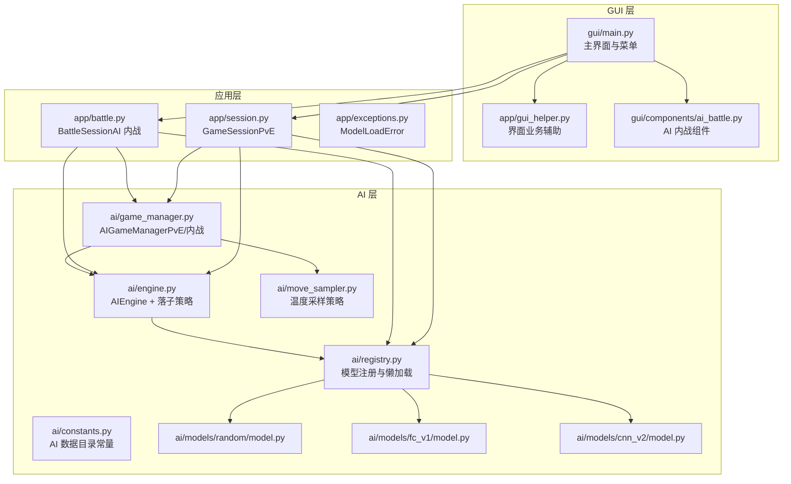
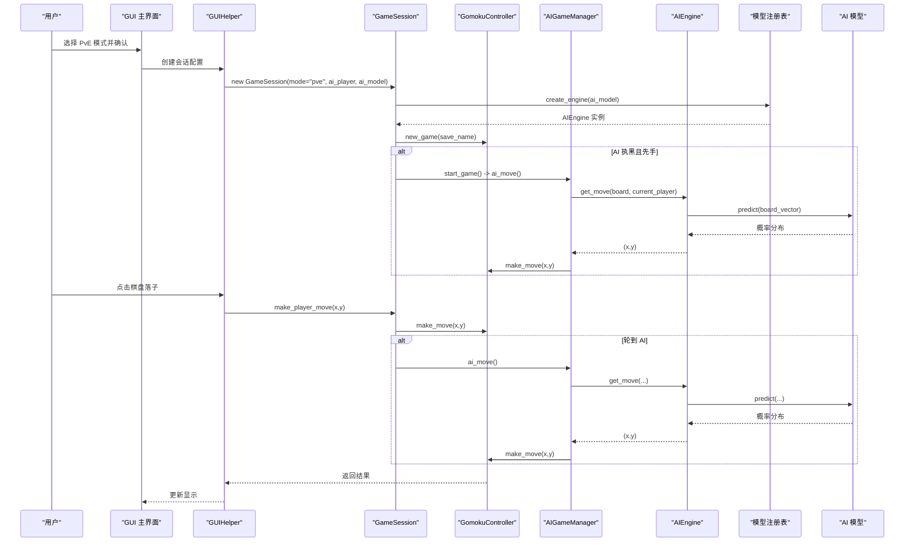
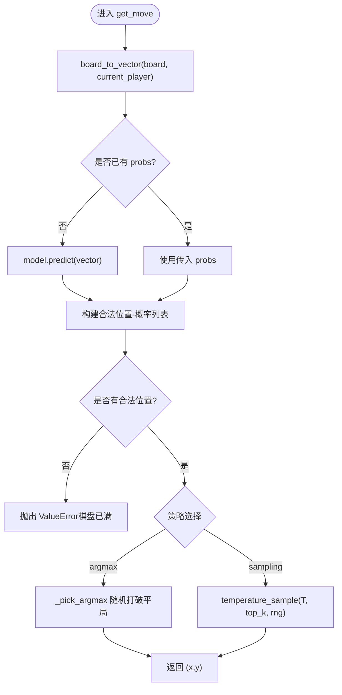
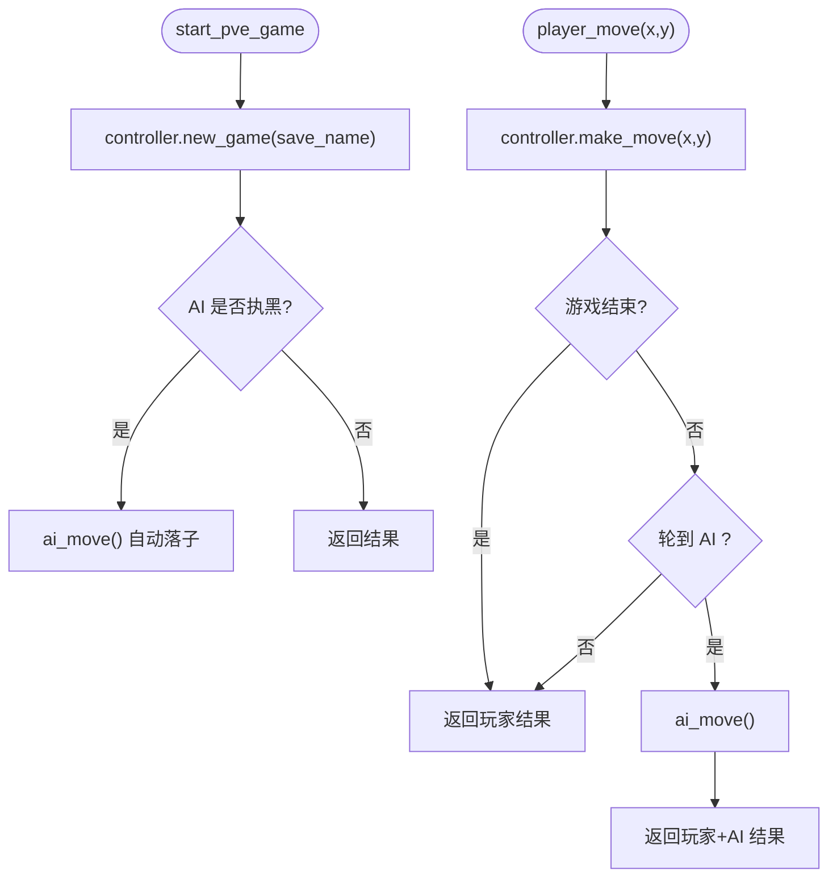
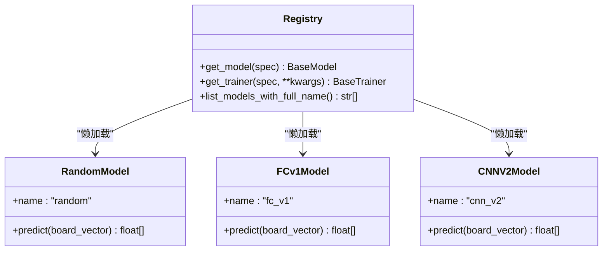
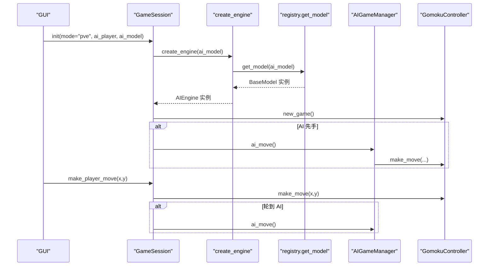
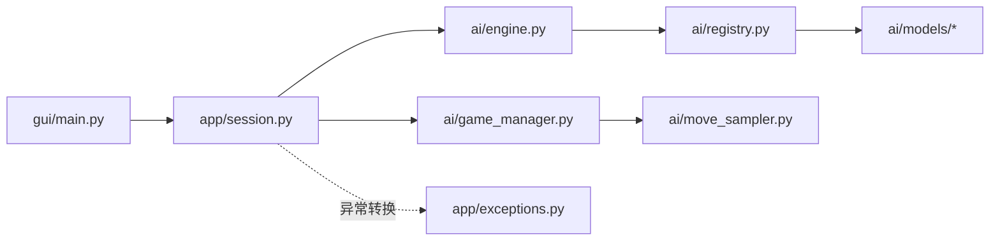

# 人机对战（PvE）

<cite>
**本文引用的文件**
- [ai/battle.py](file://ai/battle.py)
- [gui/components/ai_battle.py](file://gui/components/ai_battle.py)
- [app/battle.py](file://app/battle.py)
- [ai/engine.py](file://ai/engine.py)
- [ai/game_manager.py](file://ai/game_manager.py)
- [ai/registry.py](file://ai/registry.py)
- [ai/constants.py](file://ai/constants.py)
- [app/session.py](file://app/session.py)
- [gui/main.py](file://gui/main.py)
- [ai/move_sampler.py](file://ai/move_sampler.py)
- [app/gui_helper.py](file://app/gui_helper.py)
- [ai/models/random/model.py](file://ai/models/random/model.py)
- [ai/models/fc_v1/model.py](file://ai/models/fc_v1/model.py)
- [ai/models/cnn_v2/model.py](file://ai/models/cnn_v2/model.py)
- [app/exceptions.py](file://app/exceptions.py)
- [design/multi_gen_model_design.md](file://design/multi_gen_model_design.md)
</cite>

## 目录
1. [简介](#简介)
2. [项目结构](#项目结构)
3. [核心组件](#核心组件)
4. [架构总览](#架构总览)
5. [详细组件分析](#详细组件分析)
6. [依赖关系分析](#依赖关系分析)
7. [性能考量](#性能考量)
8. [故障排除指南](#故障排除指南)
9. [结论](#结论)
10. [附录](#附录)

## 简介
本指南面向“人机对战（PvE）”模式的使用者与维护者，系统讲解从界面配置到对局执行、从AI模型选择到落子策略的技术细节，帮助你高效完成对局、理解AI行为、制定针对性策略，并在遇到问题时快速定位与解决。

## 项目结构
PvE 模式横跨 GUI、应用层与 AI 层，主要模块如下：
- GUI 层：负责用户交互、模式选择、落子触发与显示更新
- 应用层：封装游戏会话、PvE 专用流程与异常转换
- AI 层：AI 引擎、游戏管理、模型注册与落子策略

图表来源
- [gui/main.py:1-462](file://gui/main.py#L1-L462)
- [app/session.py:1-179](file://app/session.py#L1-L179)
- [app/battle.py:1-104](file://app/battle.py#L1-L104)
- [ai/engine.py:1-194](file://ai/engine.py#L1-L194)
- [ai/game_manager.py:1-339](file://ai/game_manager.py#L1-L339)
- [ai/registry.py:1-316](file://ai/registry.py#L1-L316)
- [ai/move_sampler.py:1-258](file://ai/move_sampler.py#L1-L258)
- [ai/models/random/model.py:1-64](file://ai/models/random/model.py#L1-L64)
- [ai/models/fc_v1/model.py:1-132](file://ai/models/fc_v1/model.py#L1-L132)
- [ai/models/cnn_v2/model.py:1-160](file://ai/models/cnn_v2/model.py#L1-L160)

章节来源
- [gui/main.py:1-462](file://gui/main.py#L1-L462)
- [app/session.py:1-179](file://app/session.py#L1-L179)
- [ai/game_manager.py:1-339](file://ai/game_manager.py#L1-L339)

## 核心组件
- 模型注册与加载：通过统一注册表按需懒加载，支持多代模型（如 cnn_v3.1、cnn_v3.2）。
- AI 引擎：将棋盘状态转换为模型输入，调用模型获取概率分布，并按策略选择落子位置。
- 游戏管理：协调 PvE 对局流程，处理玩家落子与 AI 自动落子，支持 AI 先手自动落子。
- 会话封装：应用层 GameSession 将 GUI 与 AI 逻辑解耦，提供统一的落子接口与异常转换。
- 温度采样：自对弈阶段可启用温度采样策略，提升探索多样性（与 PvE 无直接关系，但影响模型训练质量）。

章节来源
- [ai/registry.py:150-185](file://ai/registry.py#L150-L185)
- [ai/engine.py:18-42](file://ai/engine.py#L18-L42)
- [ai/engine.py:67-143](file://ai/engine.py#L67-L143)
- [ai/game_manager.py:40-122](file://ai/game_manager.py#L40-L122)
- [app/session.py:12-103](file://app/session.py#L12-L103)
- [ai/move_sampler.py:50-112](file://ai/move_sampler.py#L50-L112)

## 架构总览
PvE 的端到端流程：GUI 选择模式与AI配置 → 应用层创建 GameSession → AI 层创建 AIEngine → 游戏管理器协调落子 → 显示更新器刷新界面。

图表来源
- [gui/main.py:224-268](file://gui/main.py#L224-L268)
- [app/gui_helper.py:53-106](file://app/gui_helper.py#L53-L106)
- [app/session.py:63-102](file://app/session.py#L63-L102)
- [ai/game_manager.py:60-121](file://ai/game_manager.py#L60-L121)
- [ai/engine.py:67-143](file://ai/engine.py#L67-L143)
- [ai/registry.py:150-185](file://ai/registry.py#L150-L185)

## 详细组件分析

### AI 引擎与落子策略
- 输入转换：将 15×15 棋盘与当前玩家拼接为 226 维向量。
- 模型预测：调用模型返回 225 维概率分布（空位概率之和为 1）。
- 落子策略：
  - argmax（默认）：在合法位置中选择概率最大者，平局时随机打破。
  - sampling：温度加权采样，支持 top_k 截断与可选随机源。
- 性能优化：支持传入已计算的概率向量，避免重复预测。

图表来源
- [ai/engine.py:106-143](file://ai/engine.py#L106-L143)
- [ai/move_sampler.py:117-186](file://ai/move_sampler.py#L117-L186)

章节来源
- [ai/engine.py:67-143](file://ai/engine.py#L67-L143)
- [ai/move_sampler.py:117-186](file://ai/move_sampler.py#L117-L186)

### 游戏管理器（PvE）
- 启动游戏：创建新对局，若 AI 执黑则自动执行第一步。
- 玩家落子：执行玩家落子，检查胜负；若轮到 AI 则自动触发 AI 落子。
- AI 落子：获取当前状态，调用引擎选择位置并执行。

图表来源
- [ai/game_manager.py:40-121](file://ai/game_manager.py#L40-L121)

章节来源
- [ai/game_manager.py:40-121](file://ai/game_manager.py#L40-L121)

### 模型注册与加载
- 统一注册表：集中维护模型类路径与训练器映射，支持多代模型（cnn_v3.x）。
- 懒加载：首次调用时动态导入模块，避免启动时的模块级依赖。
- 多代模型约束：未指定代数时报错，确保用户明确选择目标代数。

图表来源
- [ai/registry.py:58-72](file://ai/registry.py#L58-L72)
- [ai/models/random/model.py:10-64](file://ai/models/random/model.py#L10-L64)
- [ai/models/fc_v1/model.py:91-132](file://ai/models/fc_v1/model.py#L91-L132)
- [ai/models/cnn_v2/model.py:117-160](file://ai/models/cnn_v2/model.py#L117-L160)

章节来源
- [ai/registry.py:150-185](file://ai/registry.py#L150-L185)
- [ai/models/random/model.py:35-64](file://ai/models/random/model.py#L35-L64)
- [ai/models/fc_v1/model.py:106-132](file://ai/models/fc_v1/model.py#L106-L132)
- [ai/models/cnn_v2/model.py:133-160](file://ai/models/cnn_v2/model.py#L133-L160)

### 游戏会话（PvE）
- 模式与配置：接收 ai_player（1=黑，2=白）与 ai_model（如 random、fc_v1、cnn_v2、cnn_v3.x）。
- 异常转换：将底层 create_engine 的 ValueError 转换为 ModelLoadError，便于 GUI 统一处理。
- 落子接口：对外提供 make_player_move 与 do_ai_move，返回是否需要 AI 落子与胜负信息。

图表来源
- [app/session.py:23-103](file://app/session.py#L23-L103)
- [ai/engine.py:18-42](file://ai/engine.py#L18-L42)
- [ai/registry.py:150-185](file://ai/registry.py#L150-L185)

章节来源
- [app/session.py:23-103](file://app/session.py#L23-L103)

### GUI 与显示更新
- 模式入口：主界面根据选择器结果创建 PvE 会话；若模型加载失败，弹窗提示并回退。
- 落子延迟：点击后延时触发 AI 落子，模拟“思考时间”，提升观感。
- 显示更新：通过 GameDisplayUpdater 刷新棋盘、状态与历史记录。

章节来源
- [gui/main.py:442-457](file://gui/main.py#L442-L457)
- [gui/main.py:240-268](file://gui/main.py#L240-L268)
- [app/gui_helper.py:108-148](file://app/gui_helper.py#L108-L148)

## 依赖关系分析
- 松耦合：GUI 仅依赖应用层接口，应用层依赖 AI 层接口，AI 层通过注册表解耦具体模型实现。
- 异常链路：底层 ValueError 在应用层转换为 ModelLoadError，GUI 统一处理。
- 多代模型：注册表负责校验与懒加载，避免在导入阶段即触发文件系统检查。

图表来源
- [gui/main.py:1-462](file://gui/main.py#L1-L462)
- [app/session.py:1-179](file://app/session.py#L1-L179)
- [ai/engine.py:1-194](file://ai/engine.py#L1-194)
- [ai/registry.py:1-316](file://ai/registry.py#L1-L316)
- [ai/game_manager.py:1-339](file://ai/game_manager.py#L1-L339)
- [ai/move_sampler.py:1-258](file://ai/move_sampler.py#L1-L258)
- [app/exceptions.py:1-24](file://app/exceptions.py#L1-L24)

章节来源
- [app/exceptions.py:8-24](file://app/exceptions.py#L8-L24)
- [design/multi_gen_model_design.md:390-451](file://design/multi_gen_model_design.md#L390-L451)

## 性能考量
- 模型预测缓存：AIEngine 支持传入已计算的概率向量，避免重复调用模型预测，降低推理开销。
- 温度采样成本：采样过程包含排序与加权抽样，对性能有轻微影响；PvE 默认使用 argmax，无需采样。
- GPU/设备：模型输入转换与前向计算在设备间传输需注意，建议在批量或频繁调用时关注内存与带宽。

章节来源
- [ai/engine.py:110-113](file://ai/engine.py#L110-L113)
- [ai/move_sampler.py:117-186](file://ai/move_sampler.py#L117-L186)

## 故障排除指南
- 模型加载失败
  - 现象：弹窗提示“模型加载失败”，并回退到模式选择界面。
  - 原因：多代模型未指定代数、模型名称未知、非多代模型指定代数。
  - 处理：在 GUI 中重新选择模型，确保多代模型使用形如 cnn_v3.1 的完整名称。
- AI 先手异常
  - 现象：AI 执黑时未自动落子。
  - 原因：会话未正确初始化或控制器未创建新游戏。
  - 处理：确认会话创建成功，检查 start_game 返回值。
- 落子无效或报错
  - 现象：玩家落子后返回错误或未触发 AI 落子。
  - 原因：非法坐标、非轮到 AI、控制器状态异常。
  - 处理：检查 make_player_move 返回值，确认当前玩家与胜负状态。

章节来源
- [app/exceptions.py:8-24](file://app/exceptions.py#L8-L24)
- [app/session.py:44-51](file://app/session.py#L44-L51)
- [gui/main.py:224-268](file://gui/main.py#L224-L268)
- [ai/game_manager.py:60-98](file://ai/game_manager.py#L60-L98)

## 结论
PvE 模式通过清晰的分层设计实现了“用户界面—应用层—AI 层”的解耦：GUI 负责交互与显示，应用层负责流程编排与异常转换，AI 层负责模型与策略。借助统一注册表与会话封装，用户可以灵活选择 AI 模型并获得稳定的对局体验。遵循本文的配置与故障排除建议，可显著提升对局效率与成功率。

## 附录

### PvE 设置与流程速览
- AI 难度与模型选择
  - 随机模型：适合入门与对比，落子完全随机。
  - 全连接模型（fc_v1）：较弱神经网络，适合教学与基准测试。
  - 卷积模型（cnn_v2）：轻量化卷积网络，平衡性能与资源占用。
  - 多代模型（cnn_v3.x）：需指定代数，建议选择已收敛的代数版本。
- 执棋颜色分配
  - GUI 会根据玩家选择自动分配 AI 执棋颜色（黑/白）。
- AI 先手处理
  - 若 AI 执黑，系统会在新局创建后自动执行第一步。
- 自动落子延迟
  - 点击后延迟约 500ms 触发 AI 落子，模拟“思考时间”。

章节来源
- [ai/models/random/model.py:35-64](file://ai/models/random/model.py#L35-L64)
- [ai/models/fc_v1/model.py:106-132](file://ai/models/fc_v1/model.py#L106-L132)
- [ai/models/cnn_v2/model.py:133-160](file://ai/models/cnn_v2/model.py#L133-L160)
- [ai/registry.py:237-296](file://ai/registry.py#L237-L296)
- [gui/main.py:88-89](file://gui/main.py#L88-L89)
- [gui/main.py:240-241](file://gui/main.py#L240-L241)

### AI 对战策略与技巧
- 针对随机模型：利用其均匀分布特性，优先占据中心区域与形成双四威胁。
- 针对神经网络模型：观察其偏好位置，避免在明显低概率区域反复试探；在残局阶段利用其更稳健的落子倾向。
- 制定针对性战术：通过落子历史与热力图（如后续支持）分析对手偏好，采用“诱敌深入”或“封锁通道”策略。

[本节为通用策略建议，不直接分析具体文件]