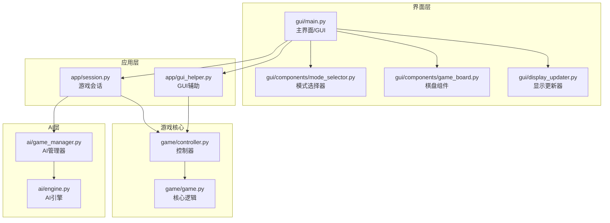
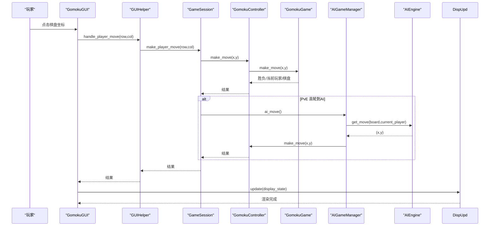
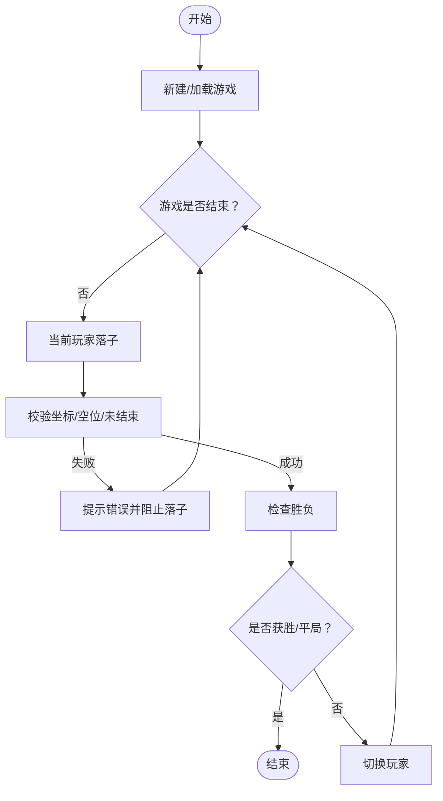
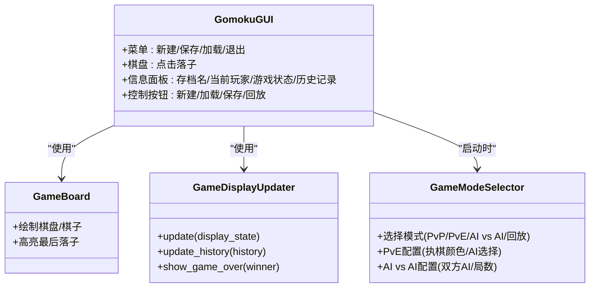
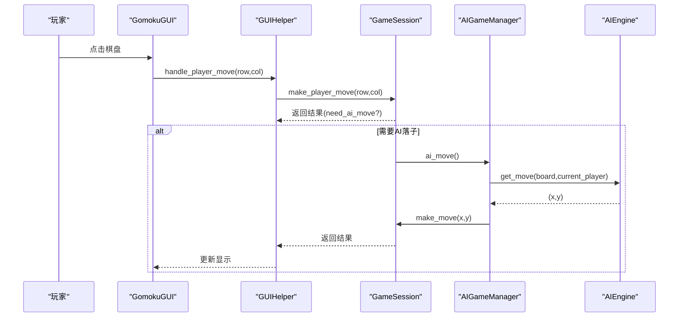
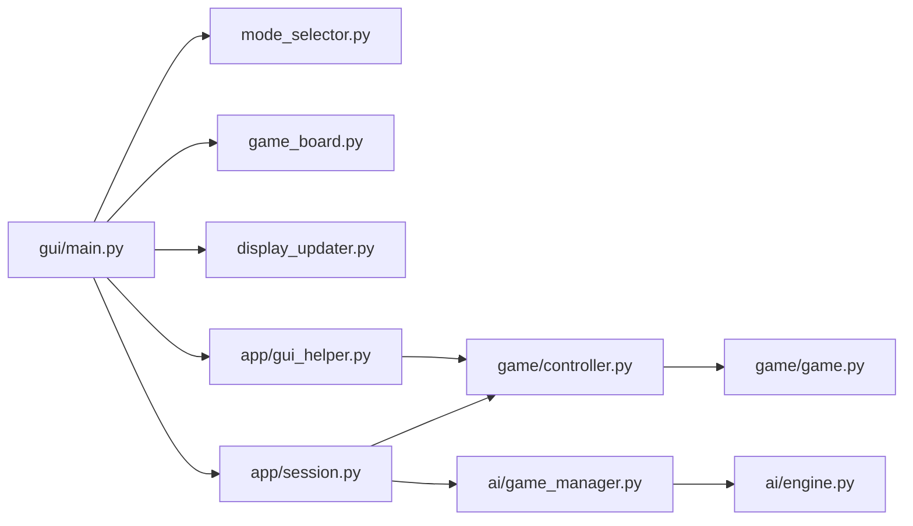

# 游戏玩法

<cite>
**本文引用的文件**
- [gui/main.py](file://gui/main.py)
- [gui/components/mode_selector.py](file://gui/components/mode_selector.py)
- [gui/components/game_board.py](file://gui/components/game_board.py)
- [gui/display_updater.py](file://gui/display_updater.py)
- [app/session.py](file://app/session.py)
- [app/gui_helper.py](file://app/gui_helper.py)
- [game/controller.py](file://game/controller.py)
- [game/game.py](file://game/game.py)
- [ai/engine.py](file://ai/engine.py)
- [ai/game_manager.py](file://ai/game_manager.py)
- [cli/main.py](file://cli/main.py)
- [requirements/key_points.md](file://requirements/key_points.md)
</cite>

## 目录
1. [简介](#简介)
2. [项目结构](#项目结构)
3. [核心组件](#核心组件)
4. [架构总览](#架构总览)
5. [详细组件分析](#详细组件分析)
6. [依赖关系分析](#依赖关系分析)
7. [性能考量](#性能考量)
8. [故障排除指南](#故障排除指南)
9. [结论](#结论)
10. [附录](#附录)

## 简介
本指南面向五子棋玩家，系统讲解三种游戏模式：人人对战（PvP）、人机对战（PvE）、AI 内战（AI vs AI）。文档覆盖游戏规则、棋盘操作、基本流程、GUI 界面功能、策略要点与常见问题排查，帮助你快速上手并深入理解游戏机制与界面交互。

## 项目结构
本项目采用清晰的分层结构：
- GUI 层：负责界面与用户交互（Tkinter）
- 应用层（app）：薄代理层，协调控制器与会话
- 游戏核心（game）：包含控制器、游戏逻辑与存档
- AI 层（ai）：AI 引擎、管理器与模型注册
- CLI 层：命令行交互工具，便于调试与演示

**图表来源**
- [gui/main.py:1-462](file://gui/main.py#L1-L462)
- [gui/components/mode_selector.py:1-411](file://gui/components/mode_selector.py#L1-L411)
- [gui/components/game_board.py:1-170](file://gui/components/game_board.py#L1-L170)
- [gui/display_updater.py:1-110](file://gui/display_updater.py#L1-L110)
- [app/session.py:1-179](file://app/session.py#L1-L179)
- [app/gui_helper.py:1-199](file://app/gui_helper.py#L1-L199)
- [game/controller.py:1-194](file://game/controller.py#L1-L194)
- [game/game.py:1-118](file://game/game.py#L1-L118)
- [ai/engine.py:1-194](file://ai/engine.py#L1-L194)
- [ai/game_manager.py:1-339](file://ai/game_manager.py#L1-L339)

**章节来源**
- [gui/main.py:1-462](file://gui/main.py#L1-L462)
- [gui/components/mode_selector.py:1-411](file://gui/components/mode_selector.py#L1-L411)
- [gui/components/game_board.py:1-170](file://gui/components/game_board.py#L1-L170)
- [gui/display_updater.py:1-110](file://gui/display_updater.py#L1-L110)
- [app/session.py:1-179](file://app/session.py#L1-L179)
- [app/gui_helper.py:1-199](file://app/gui_helper.py#L1-L199)
- [game/controller.py:1-194](file://game/controller.py#L1-L194)
- [game/game.py:1-118](file://game/game.py#L1-L118)
- [ai/engine.py:1-194](file://ai/engine.py#L1-L194)
- [ai/game_manager.py:1-339](file://ai/game_manager.py#L1-L339)

## 核心组件
- 模式选择器：启动时引导选择游戏模式（PvP/PvE/AI vs AI），并收集玩家颜色与AI配置。
- 主界面：菜单、棋盘、信息面板、历史记录、控制按钮。
- GUI 辅助：封装与界面无关的业务逻辑，统一落子与显示状态获取。
- 游戏会话：管理一局游戏流程，协调控制器与AI管理器。
- 控制器：对外唯一接口，负责落子、状态查询、存档读写。
- 核心逻辑：15×15棋盘、黑白轮流、五子连线获胜、平局判定。
- AI 引擎：将棋盘状态转换为模型输入，调用模型输出概率分布，按策略选择落子。
- AI 管理器：在 PvE/AI vs AI 中协调落子与状态推进。

**章节来源**
- [gui/components/mode_selector.py:176-277](file://gui/components/mode_selector.py#L176-L277)
- [gui/main.py:91-396](file://gui/main.py#L91-L396)
- [app/gui_helper.py:53-106](file://app/gui_helper.py#L53-L106)
- [app/session.py:63-102](file://app/session.py#L63-L102)
- [game/controller.py:65-98](file://game/controller.py#L65-L98)
- [game/game.py:22-56](file://game/game.py#L22-L56)
- [ai/engine.py:67-142](file://ai/engine.py#L67-L142)
- [ai/game_manager.py:100-121](file://ai/game_manager.py#L100-L121)

## 架构总览
GUI 通过模式选择器进入不同模式，随后由控制器与会话协调核心逻辑与AI引擎完成落子与状态更新，显示更新器负责渲染棋盘、状态与历史。

**图表来源**
- [gui/main.py:224-267](file://gui/main.py#L224-L267)
- [app/gui_helper.py:53-106](file://app/gui_helper.py#L53-L106)
- [app/session.py:63-102](file://app/session.py#L63-L102)
- [game/controller.py:65-98](file://game/controller.py#L65-L98)
- [game/game.py:22-56](file://game/game.py#L22-L56)
- [ai/game_manager.py:100-121](file://ai/game_manager.py#L100-L121)
- [ai/engine.py:67-142](file://ai/engine.py#L67-L142)
- [gui/display_updater.py:40-81](file://gui/display_updater.py#L40-L81)

## 详细组件分析

### 游戏规则与胜负判定
- 棋盘：15×15，坐标范围 0-14。
- 胜负判定：任一方向（横、竖、斜）连成五子及以上即获胜；棋盘满无空位则平局。
- 走法限制：坐标必须在范围内且位置为空；游戏结束后禁止落子。
- 轮次机制：黑方先行，双方轮流落子。

**图表来源**
- [game/game.py:22-56](file://game/game.py#L22-L56)
- [game/game.py:67-102](file://game/game.py#L67-L102)
- [game/controller.py:65-98](file://game/controller.py#L65-L98)

**章节来源**
- [requirements/key_points.md:6-14](file://requirements/key_points.md#L6-L14)
- [game/game.py:22-56](file://game/game.py#L22-L56)
- [game/game.py:67-102](file://game/game.py#L67-L102)
- [game/controller.py:65-98](file://game/controller.py#L65-L98)

### GUI 界面与操作流程
- 模式选择：启动后弹出模式选择器，支持 PvP、PvE、AI vs AI、回放。
- 主界面：左侧棋盘，右侧信息面板（存档名、当前玩家、游戏状态、历史记录）与控制按钮（新建/加载/保存/回放）。
- 棋盘交互：点击棋盘格子触发落子；AI 先手时自动落子。
- 显示更新：根据控制器状态刷新棋盘、玩家信息与历史记录。

**图表来源**
- [gui/main.py:91-396](file://gui/main.py#L91-L396)
- [gui/components/game_board.py:61-170](file://gui/components/game_board.py#L61-L170)
- [gui/display_updater.py:13-110](file://gui/display_updater.py#L13-L110)
- [gui/components/mode_selector.py:12-411](file://gui/components/mode_selector.py#L12-L411)

**章节来源**
- [gui/main.py:91-396](file://gui/main.py#L91-L396)
- [gui/components/game_board.py:61-170](file://gui/components/game_board.py#L61-L170)
- [gui/display_updater.py:13-110](file://gui/display_updater.py#L13-L110)
- [gui/components/mode_selector.py:12-411](file://gui/components/mode_selector.py#L12-L411)

### 三种游戏模式详解

#### 1) 人人对战（PvP）
- 双人轮流落子，黑方先行。
- 界面直接点击棋盘落子，无 AI 干预。
- 适合教学与朋友对弈。

**章节来源**
- [gui/components/mode_selector.py:176-179](file://gui/components/mode_selector.py#L176-L179)
- [app/session.py:63-102](file://app/session.py#L63-L102)

#### 2) 人机对战（PvE）
- 玩家选择执黑或执白；AI 使用指定模型。
- 轮到 AI 时自动落子，AI 落子后立即刷新界面。
- 若 AI 先手，界面会自动先落 AI 一步。

**图表来源**
- [gui/main.py:224-267](file://gui/main.py#L224-L267)
- [app/gui_helper.py:53-106](file://app/gui_helper.py#L53-L106)
- [app/session.py:63-102](file://app/session.py#L63-L102)
- [ai/game_manager.py:100-121](file://ai/game_manager.py#L100-L121)
- [ai/engine.py:67-142](file://ai/engine.py#L67-L142)

**章节来源**
- [gui/main.py:88-89](file://gui/main.py#L88-L89)
- [gui/main.py:244-267](file://gui/main.py#L244-L267)
- [app/session.py:145-178](file://app/session.py#L145-L178)

#### 3) AI 内战（AI vs AI）
- 可配置双方 AI 与对局数，自动进行多局对战。
- 每步落子都会记录到 ai_data 目录，支持后续回放与分析。
- 支持查看回放、对比 AI 输出与样本热力图。

**章节来源**
- [gui/components/mode_selector.py:278-391](file://gui/components/mode_selector.py#L278-L391)
- [gui/main.py:411-420](file://gui/main.py#L411-L420)
- [ai/game_manager.py:232-274](file://ai/game_manager.py#L232-L274)

### 存档与历史记录
- 存档：支持新建、加载、保存；默认名称自动生成，避免冲突。
- 历史记录：右侧列表显示每一步的落子与玩家，自动滚动到最后。
- 状态标签：显示当前玩家与游戏状态（进行中/获胜/平局）。

**章节来源**
- [game/controller.py:32-63](file://game/controller.py#L32-L63)
- [game/controller.py:99-121](file://game/controller.py#L99-L121)
- [gui/display_updater.py:83-101](file://gui/display_updater.py#L83-L101)
- [gui/main.py:321-376](file://gui/main.py#L321-L376)

### 命令行补充
- CLI 提供 REPL 交互，支持新建、落子、列出存档、打印棋盘、显示存档等命令。
- 适合快速验证规则与调试。

**章节来源**
- [cli/main.py:19-258](file://cli/main.py#L19-L258)

## 依赖关系分析
- GUI 依赖模式选择器、棋盘组件、显示更新器。
- GUIHelper 依赖控制器与会话，封装落子与显示状态获取。
- 会话依赖控制器与 AI 管理器，协调 PvE/AI vs AI。
- 控制器依赖核心游戏逻辑与存档模块。
- AI 管理器依赖 AI 引擎与控制器。
- AI 引擎依赖模型注册与策略采样。

**图表来源**
- [gui/main.py:18-28](file://gui/main.py#L18-L28)
- [app/gui_helper.py:22-23](file://app/gui_helper.py#L22-L23)
- [app/session.py:40-51](file://app/session.py#L40-L51)
- [ai/game_manager.py:36-38](file://ai/game_manager.py#L36-L38)
- [ai/engine.py:58-65](file://ai/engine.py#L58-L65)
- [game/controller.py:14-30](file://game/controller.py#L14-L30)
- [game/game.py:7-20](file://game/game.py#L7-L20)

**章节来源**
- [gui/main.py:18-28](file://gui/main.py#L18-L28)
- [app/gui_helper.py:22-23](file://app/gui_helper.py#L22-L23)
- [app/session.py:40-51](file://app/session.py#L40-L51)
- [ai/game_manager.py:36-38](file://ai/game_manager.py#L36-L38)
- [ai/engine.py:58-65](file://ai/engine.py#L58-L65)
- [game/controller.py:14-30](file://game/controller.py#L14-L30)
- [game/game.py:7-20](file://game/game.py#L7-L20)

## 性能考量
- AI 落子：AI 引擎在落子前会将棋盘转换为向量并调用模型预测，随后按策略选择合法位置。合理使用预计算的概率向量可减少重复预测开销。
- 温度采样：在 AI vs AI 中可启用温度采样策略，提升探索性；需注意温度参数与 top_k 设置对性能与稳定性的影响。
- 显示更新：显示更新器按需刷新棋盘与历史，避免不必要的重绘。

[本节为通用指导，不直接分析具体文件]

## 故障排除指南
- 模型加载失败（PvE）：当选择的 AI 模型不可用时，会抛出模型加载错误，GUI 会提示并回退到模式选择界面。请检查 AI 模型名称与可用列表。
- 落子失败：坐标越界、位置已被占用、游戏已结束等情况会提示错误。请确认坐标范围与当前游戏状态。
- 无回放数据：AI 内战未进行或数据目录不存在时，回放功能会提示暂无数据。请先进行 AI 对战。
- 无法保存/加载：检查存档名称是否重复或目录权限。默认存档名称自动生成，避免冲突。

**章节来源**
- [gui/main.py:453-456](file://gui/main.py#L453-L456)
- [gui/main.py:241-242](file://gui/main.py#L241-L242)
- [gui/main.py:384-386](file://gui/main.py#L384-L386)
- [game/controller.py:42-47](file://game/controller.py#L42-L47)

## 结论
本指南从规则、界面、流程与策略四个维度介绍了五子棋的三种模式。通过 GUI 的直观交互与 AI 的智能落子，玩家既能体验传统对弈的乐趣，也能欣赏 AI 的博弈智慧。建议先从 PvP 熟悉规则，再尝试 PvE 与 AI vs AI，逐步掌握落子时机与胜负关键。

[本节为总结性内容，不直接分析具体文件]

## 附录

### 常用操作清单
- 新建游戏：菜单“游戏/新建游戏”，可输入存档名称或使用默认名称。
- 加载/保存：菜单“游戏/加载游戏/保存游戏”，自动保存当前状态。
- 回放对局：菜单“游戏/回放对局”，浏览 AI 内战记录。
- 棋盘落子：在棋盘空白处点击，坐标范围 0-14。

**章节来源**
- [gui/main.py:96-103](file://gui/main.py#L96-L103)
- [gui/main.py:321-376](file://gui/main.py#L321-L376)
- [gui/main.py:379-396](file://gui/main.py#L379-L396)

### 策略与技巧
- 控制中心：优先抢占中心区域，扩大连子空间。
- 防守优先：留意对手的活四/冲四威胁，及时堵截。
- 多重威胁：创造多个进攻点，迫使对手防守。
- 时间管理：PvE 中 AI 落子有延迟，把握节奏，避免过度思考。

[本节为通用指导，不直接分析具体文件]