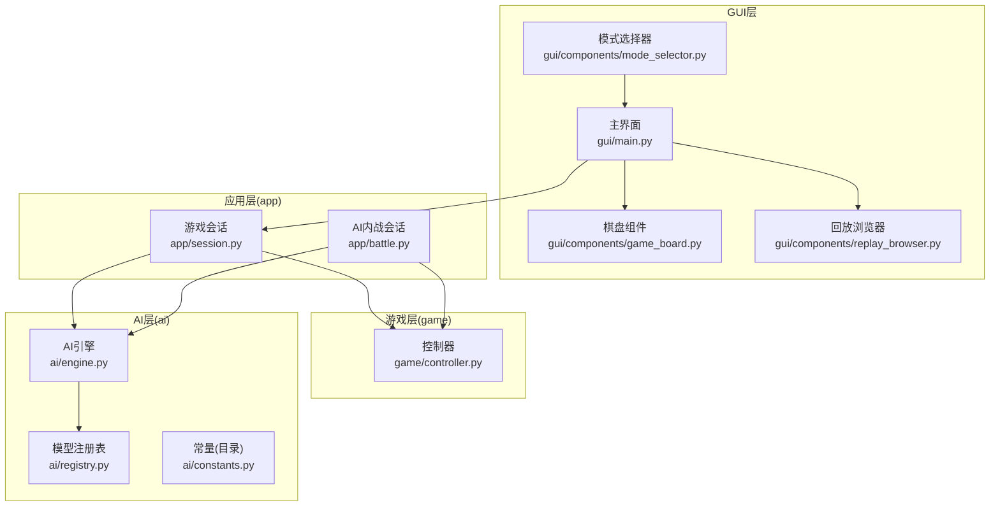
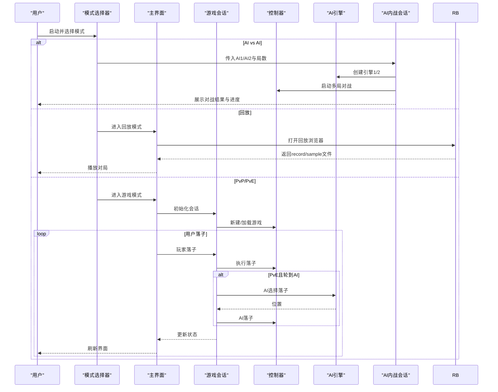
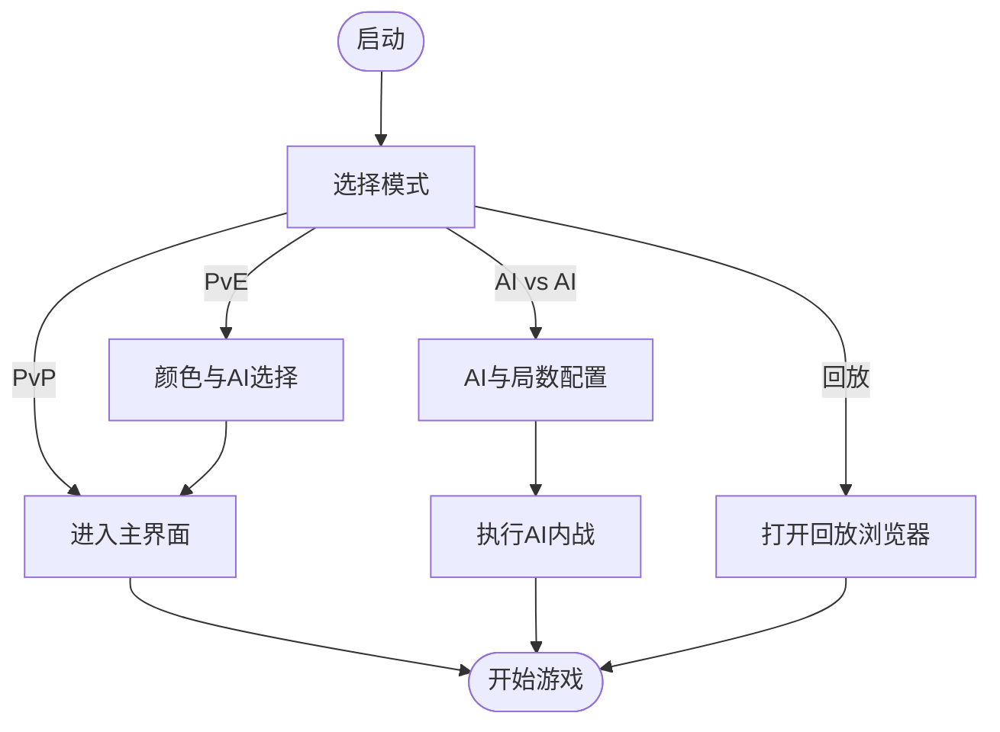
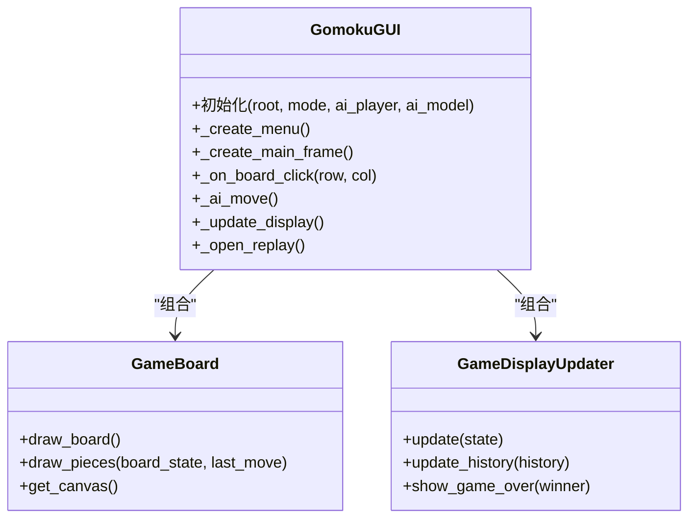
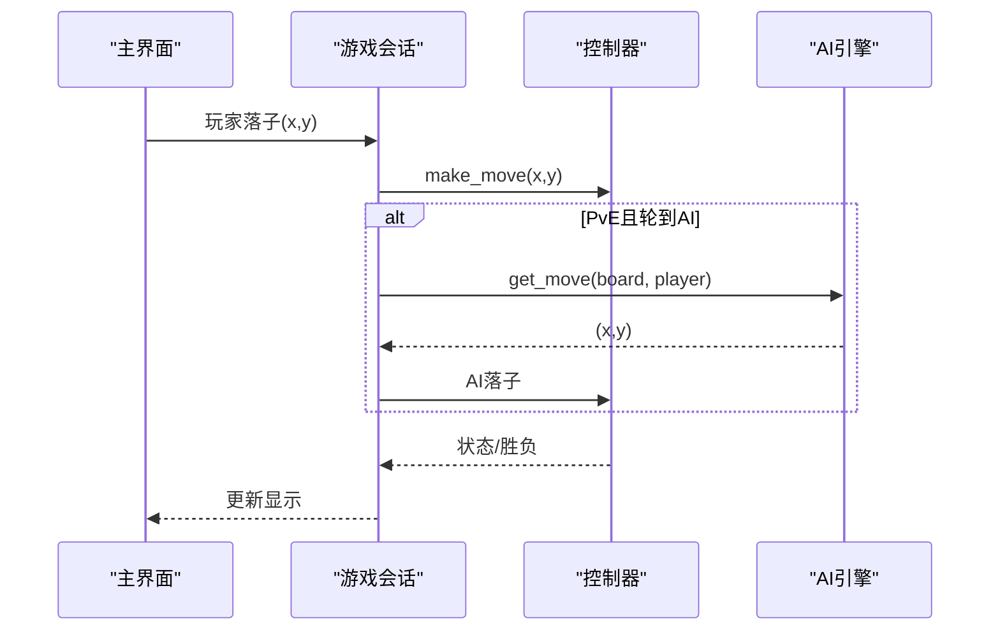
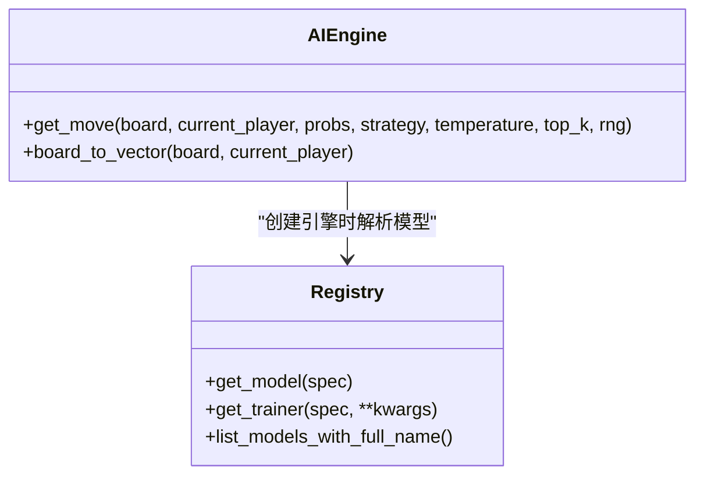
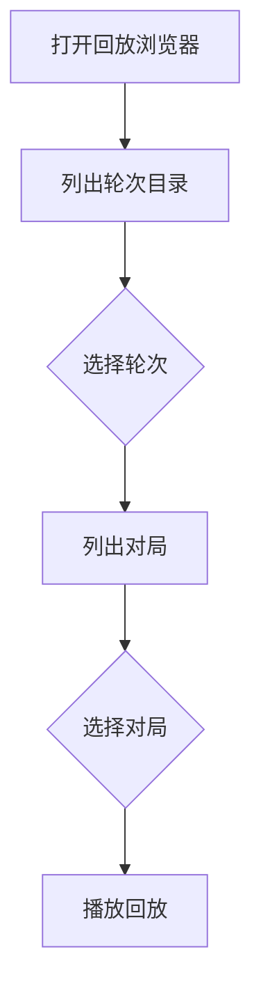
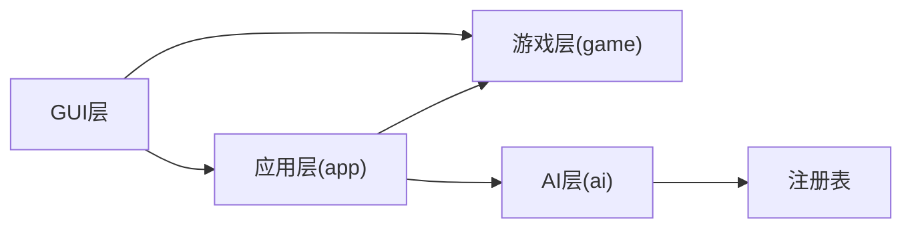

# 用户指南

<cite>
**本文引用的文件**
- [gui/main.py](file://gui/main.py)
- [gui/components/game_board.py](file://gui/components/game_board.py)
- [gui/components/mode_selector.py](file://gui/components/mode_selector.py)
- [gui/components/replay_browser.py](file://gui/components/replay_browser.py)
- [gui/components/constants.py](file://gui/components/constants.py)
- [app/session.py](file://app/session.py)
- [app/battle.py](file://app/battle.py)
- [ai/engine.py](file://ai/engine.py)
- [ai/registry.py](file://ai/registry.py)
- [ai/constants.py](file://ai/constants.py)
- [game/controller.py](file://game/controller.py)
- [cli/main.py](file://cli/main.py)
</cite>

## 目录
1. [简介](#简介)
2. [项目结构](#项目结构)
3. [核心组件](#核心组件)
4. [架构总览](#架构总览)
5. [详细组件分析](#详细组件分析)
6. [依赖关系分析](#依赖关系分析)
7. [性能与使用建议](#性能与使用建议)
8. [故障排查](#故障排查)
9. [结论](#结论)
10. [附录](#附录)

## 简介
本指南面向五子棋AI项目的最终用户，帮助您快速掌握三种游戏模式的使用方法：人人对战（PvP）、人机对战（PvE）、AI内战（AI vs AI）。同时，为您介绍图形界面的功能与操作方式，包括棋盘交互、菜单选项、设置配置、AI对战配置、结果统计与回放、存档管理等。此外，还提供策略指导、高级技巧与常见问题解答，帮助您充分利用项目提供的全部功能。

## 项目结构
项目采用分层清晰的组织方式：
- GUI层：负责用户交互与界面展示，包含模式选择、棋盘绘制、回放浏览等功能。
- 应用层（app）：薄代理层，协调游戏流程与AI对战，不包含业务逻辑。
- 游戏层（game）：提供统一的控制器接口，管理棋盘状态、落子、存档等。
- AI层：提供多种AI模型、引擎、注册表、对战管理与数据记录等能力。
- CLI层：提供命令行交互，便于自动化与调试。

**图表来源**
- [gui/main.py:1-462](file://gui/main.py#L1-L462)
- [gui/components/mode_selector.py:1-411](file://gui/components/mode_selector.py#L1-L411)
- [gui/components/game_board.py:1-170](file://gui/components/game_board.py#L1-L170)
- [gui/components/replay_browser.py:1-383](file://gui/components/replay_browser.py#L1-L383)
- [app/session.py:1-179](file://app/session.py#L1-L179)
- [app/battle.py:1-104](file://app/battle.py#L1-L104)
- [game/controller.py:1-194](file://game/controller.py#L1-L194)
- [ai/engine.py:1-194](file://ai/engine.py#L1-L194)
- [ai/registry.py:1-316](file://ai/registry.py#L1-L316)
- [ai/constants.py:1-26](file://ai/constants.py#L1-L26)

**章节来源**
- [gui/main.py:1-462](file://gui/main.py#L1-L462)
- [gui/components/mode_selector.py:1-411](file://gui/components/mode_selector.py#L1-L411)
- [gui/components/game_board.py:1-170](file://gui/components/game_board.py#L1-L170)
- [gui/components/replay_browser.py:1-383](file://gui/components/replay_browser.py#L1-L383)
- [app/session.py:1-179](file://app/session.py#L1-L179)
- [app/battle.py:1-104](file://app/battle.py#L1-L104)
- [game/controller.py:1-194](file://game/controller.py#L1-L194)
- [ai/engine.py:1-194](file://ai/engine.py#L1-L194)
- [ai/registry.py:1-316](file://ai/registry.py#L1-L316)
- [ai/constants.py:1-26](file://ai/constants.py#L1-L26)

## 核心组件
- 模式选择器：启动时引导用户选择游戏模式（PvP/PvE/AI vs AI/回放），并收集相关配置。
- 主界面：整合菜单、棋盘、信息面板与控制按钮，协调用户交互与显示更新。
- 游戏会话：封装单局游戏流程，PvE模式下协调AI引擎与控制器。
- AI引擎：将棋盘状态转换为模型输入，调用AI模型获取概率分布并按策略选择落子。
- 回放浏览器：浏览AI内战产生的对局，支持轮次与对局选择。
- 控制器：统一的对外接口，负责落子、状态查询、存档读写等。

**章节来源**
- [gui/components/mode_selector.py:1-411](file://gui/components/mode_selector.py#L1-L411)
- [gui/main.py:1-462](file://gui/main.py#L1-L462)
- [app/session.py:1-179](file://app/session.py#L1-L179)
- [ai/engine.py:1-194](file://ai/engine.py#L1-L194)
- [gui/components/replay_browser.py:1-383](file://gui/components/replay_browser.py#L1-L383)
- [game/controller.py:1-194](file://game/controller.py#L1-L194)

## 架构总览
GUI层通过模式选择器进入不同流程：PvP直接进入主界面；PvE配置AI后进入主界面；AI vs AI直接触发AI对战流程；回放模式通过回放浏览器选择对局。

**图表来源**
- [gui/components/mode_selector.py:1-411](file://gui/components/mode_selector.py#L1-L411)
- [gui/main.py:1-462](file://gui/main.py#L1-L462)
- [app/session.py:1-179](file://app/session.py#L1-L179)
- [ai/engine.py:1-194](file://ai/engine.py#L1-L194)
- [app/battle.py:1-104](file://app/battle.py#L1-L104)
- [gui/components/replay_browser.py:1-383](file://gui/components/replay_browser.py#L1-L383)

## 详细组件分析

### 模式选择器（模式切换与配置）
- 功能：提供四种入口：人人对战、人机对战、AI内战、查看回放。
- 人机对战：弹出颜色与AI选择对话框，支持选择执棋颜色与对手AI。
- AI内战：弹出配置对话框，选择黑方AI、白方AI与对局数量。
- 回放：直接进入回放浏览器，选择轮次与对局。

**图表来源**
- [gui/components/mode_selector.py:1-411](file://gui/components/mode_selector.py#L1-L411)

**章节来源**
- [gui/components/mode_selector.py:1-411](file://gui/components/mode_selector.py#L1-L411)

### 主界面与棋盘交互
- 菜单：新建游戏、保存游戏、加载游戏、退出。
- 信息面板：显示当前存档名、当前玩家、游戏状态、历史记录。
- 控制按钮：新建游戏、加载游戏、保存游戏、回放对局。
- 棋盘：15×15网格，支持点击落子；最后落子位置高亮；支持热力图（见“可视化功能”）。

**图表来源**
- [gui/main.py:1-462](file://gui/main.py#L1-L462)
- [gui/components/game_board.py:1-170](file://gui/components/game_board.py#L1-L170)

**章节来源**
- [gui/main.py:1-462](file://gui/main.py#L1-L462)
- [gui/components/game_board.py:1-170](file://gui/components/game_board.py#L1-L170)

### 游戏会话与控制器
- 游戏会话：封装单局流程，PvE模式下协调AI引擎与控制器，返回是否需要AI落子等标志。
- 控制器：统一对外接口，负责落子、状态查询、存档读写、胜负判断等。

**图表来源**
- [app/session.py:1-179](file://app/session.py#L1-L179)
- [game/controller.py:1-194](file://game/controller.py#L1-L194)
- [ai/engine.py:1-194](file://ai/engine.py#L1-L194)

**章节来源**
- [app/session.py:1-179](file://app/session.py#L1-L179)
- [game/controller.py:1-194](file://game/controller.py#L1-L194)
- [ai/engine.py:1-194](file://ai/engine.py#L1-L194)

### AI引擎与模型注册
- AI引擎：将棋盘状态转换为向量，调用模型获取概率分布，按策略（argmax或采样）选择落子。
- 注册表：统一管理模型与训练器映射，支持多代模型（如cnn_v3.1、cnn_v3.2）。
- 常量：定义AI数据目录与训练数据目录等路径。

**图表来源**
- [ai/engine.py:1-194](file://ai/engine.py#L1-L194)
- [ai/registry.py:1-316](file://ai/registry.py#L1-L316)
- [ai/constants.py:1-26](file://ai/constants.py#L1-L26)

**章节来源**
- [ai/engine.py:1-194](file://ai/engine.py#L1-L194)
- [ai/registry.py:1-316](file://ai/registry.py#L1-L316)
- [ai/constants.py:1-26](file://ai/constants.py#L1-L26)

### 回放浏览器与对局回放
- 轮次选择：列出ai_data目录下的轮次，显示每轮对局数量。
- 对局选择：列出选定轮次内的对局，显示胜负与步数。
- 回放：打开回放窗口播放对局，支持record.json与可选sample.json。

**图表来源**
- [gui/components/replay_browser.py:1-383](file://gui/components/replay_browser.py#L1-L383)

**章节来源**
- [gui/components/replay_browser.py:1-383](file://gui/components/replay_browser.py#L1-L383)

### 命令行工具（CLI）
- 提供REPL交互，支持新建游戏、落子、列出存档、打印棋盘、显示完整/简要存档信息、帮助与退出。
- 适合自动化脚本与调试。

**章节来源**
- [cli/main.py:1-258](file://cli/main.py#L1-L258)

## 依赖关系分析
- GUI层依赖应用层与AI层：主界面通过会话与控制器协调游戏，通过引擎与注册表加载AI模型。
- 应用层薄代理：会话与内战会话均委托底层逻辑，避免重复实现。
- AI层通过注册表实现懒加载，支持多代模型扩展。
- 游戏层提供统一接口，避免GUI直接耦合底层细节。

**图表来源**
- [gui/main.py:1-462](file://gui/main.py#L1-L462)
- [app/session.py:1-179](file://app/session.py#L1-L179)
- [app/battle.py:1-104](file://app/battle.py#L1-L104)
- [ai/registry.py:1-316](file://ai/registry.py#L1-L316)
- [game/controller.py:1-194](file://game/controller.py#L1-L194)

**章节来源**
- [gui/main.py:1-462](file://gui/main.py#L1-L462)
- [app/session.py:1-179](file://app/session.py#L1-L179)
- [app/battle.py:1-104](file://app/battle.py#L1-L104)
- [ai/registry.py:1-316](file://ai/registry.py#L1-L316)
- [game/controller.py:1-194](file://game/controller.py#L1-L194)

## 性能与使用建议
- AI落子策略：默认使用argmax策略，随机打破并列；采样策略可通过温度与top_k调节探索程度。
- 多代模型：多代模型仅展示包含有效权重文件的代数，避免空目录干扰。
- 回放数据：AI内战结束后自动生成训练样本，便于后续分析与可视化。
- 存档管理：建议定期备份存档，避免意外覆盖或删除。

[本节为通用建议，无需特定文件引用]

## 故障排查
- 模型加载失败：当AI模型名称无效或多代模型未指定代数时，会抛出模型加载错误。请检查模型名称与代数配置。
- 棋盘已满：当棋盘无空位时，AI引擎会抛出异常。请确认棋盘状态。
- 无回放数据：若未进行AI内战，回放目录可能为空。请先执行AI内战并等待数据生成。
- 未知命令（CLI）：输入命令不正确时，CLI会提示帮助信息。请参考帮助输出。

**章节来源**
- [ai/engine.py:102-142](file://ai/engine.py#L102-L142)
- [gui/main.py:418-420](file://gui/main.py#L418-L420)
- [cli/main.py:70-72](file://cli/main.py#L70-L72)

## 结论
本指南围绕三种游戏模式与GUI功能进行了系统讲解，并结合AI引擎与注册表机制说明了AI对战的配置与流程。通过回放浏览器与存档管理，您可以深入分析对局并复盘策略。建议在使用过程中结合策略指导与高级技巧，逐步提升对AI模型与对战流程的理解。

[本节为总结，无需特定文件引用]

## 附录

### 三种游戏模式使用指南
- 人人对战（PvP）
  - 启动后选择“人人对战”，进入主界面。
  - 双方轮流点击棋盘落子，界面实时更新。
  - 支持新建/保存/加载游戏与回放对局。
- 人机对战（PvE）
  - 启动后选择“人机对战”，选择执棋颜色与AI对手。
  - 若AI执黑，AI将先行一步；否则等待玩家落子。
  - 支持保存/加载游戏与回放。
- AI内战（AI vs AI）
  - 启动后选择“AI内战”，设置黑方AI、白方AI与对局数量。
  - 程序自动执行多局对战并生成训练样本。
  - 通过回放浏览器查看历史对局。

**章节来源**
- [gui/components/mode_selector.py:176-411](file://gui/components/mode_selector.py#L176-L411)
- [gui/main.py:411-457](file://gui/main.py#L411-L457)
- [app/battle.py:52-92](file://app/battle.py#L52-L92)

### GUI界面功能速览
- 菜单：新建游戏、保存游戏、加载游戏、退出。
- 信息面板：当前存档名、当前玩家、游戏状态、历史记录。
- 控制按钮：新建游戏、加载游戏、保存游戏、回放对局。
- 棋盘：点击落子、最后落子高亮、支持热力图（见可视化功能）。

**章节来源**
- [gui/main.py:91-396](file://gui/main.py#L91-L396)
- [gui/components/game_board.py:97-170](file://gui/components/game_board.py#L97-L170)

### AI对战配置说明
- 可用AI模型：random、fc_v1、cnn_v1、cnn_v2、cnn_v3（多代需指定代数，如cnn_v3.1）。
- 落子策略：argmax（默认）或采样（temperature、top_k可调）。
- AI内战：设置黑方AI、白方AI与对局数量，完成后生成训练样本。

**章节来源**
- [ai/registry.py:58-72](file://ai/registry.py#L58-L72)
- [ai/engine.py:67-142](file://ai/engine.py#L67-L142)
- [app/battle.py:27-92](file://app/battle.py#L27-L92)

### 可视化功能使用
- 热力图：棋盘组件支持热力图显示（颜色与标注），用于展示AI对各位置的偏好。
- 对局回放：通过回放浏览器选择轮次与对局，播放record.json与可选sample.json。
- 存档管理：支持新建、保存、加载游戏，便于随时继续对局或复盘。

**章节来源**
- [gui/components/game_board.py:97-170](file://gui/components/game_board.py#L97-L170)
- [gui/components/replay_browser.py:300-383](file://gui/components/replay_browser.py#L300-L383)
- [gui/main.py:321-376](file://gui/main.py#L321-L376)

### 游戏策略与高级技巧
- 开局占中心：优先占据棋盘中心区域，扩大影响力。
- 防守反击：注意对手的连子威胁，及时堵截形成活三/冲四。
- 活四与冲四：活四是必胜条件，冲四可形成杀招，需谨慎评估。
- 多子协同：尽量形成多子配合，避免孤子被逐一击破。
- 观察热力图：结合AI热力图分析，理解AI对关键位置的重视程度。

[本节为通用策略建议，无需特定文件引用]