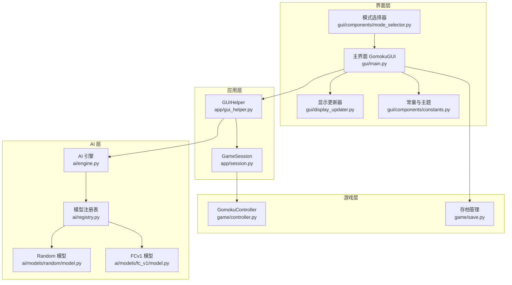
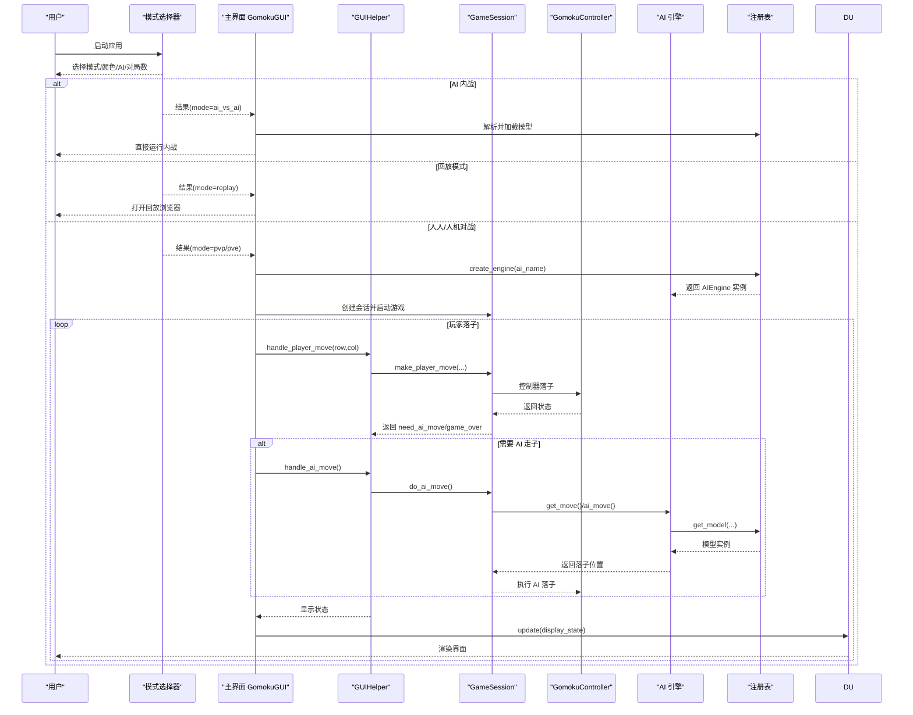
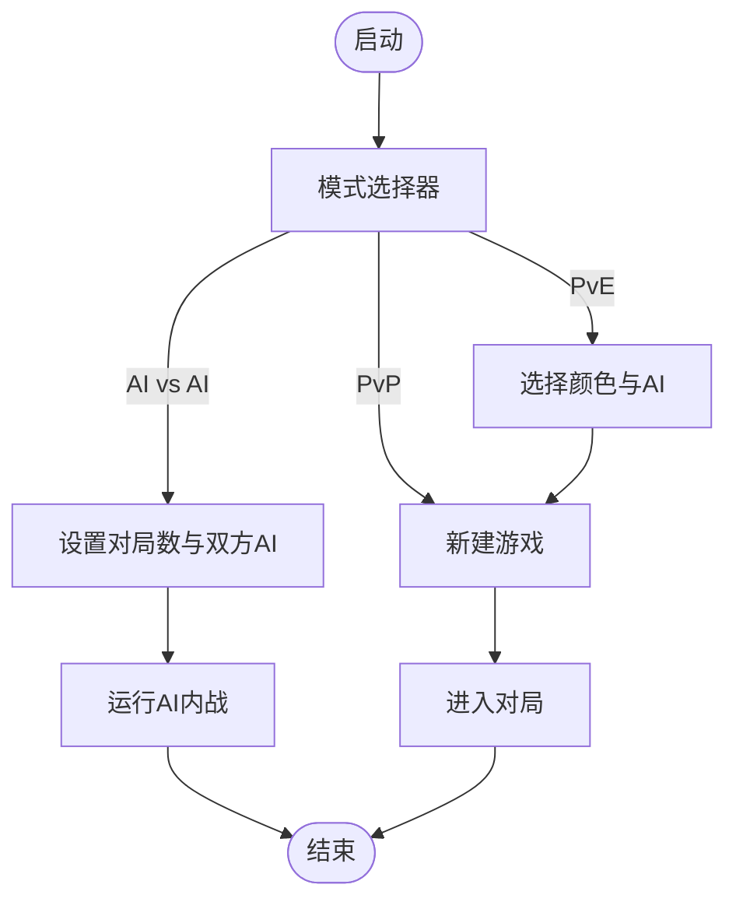
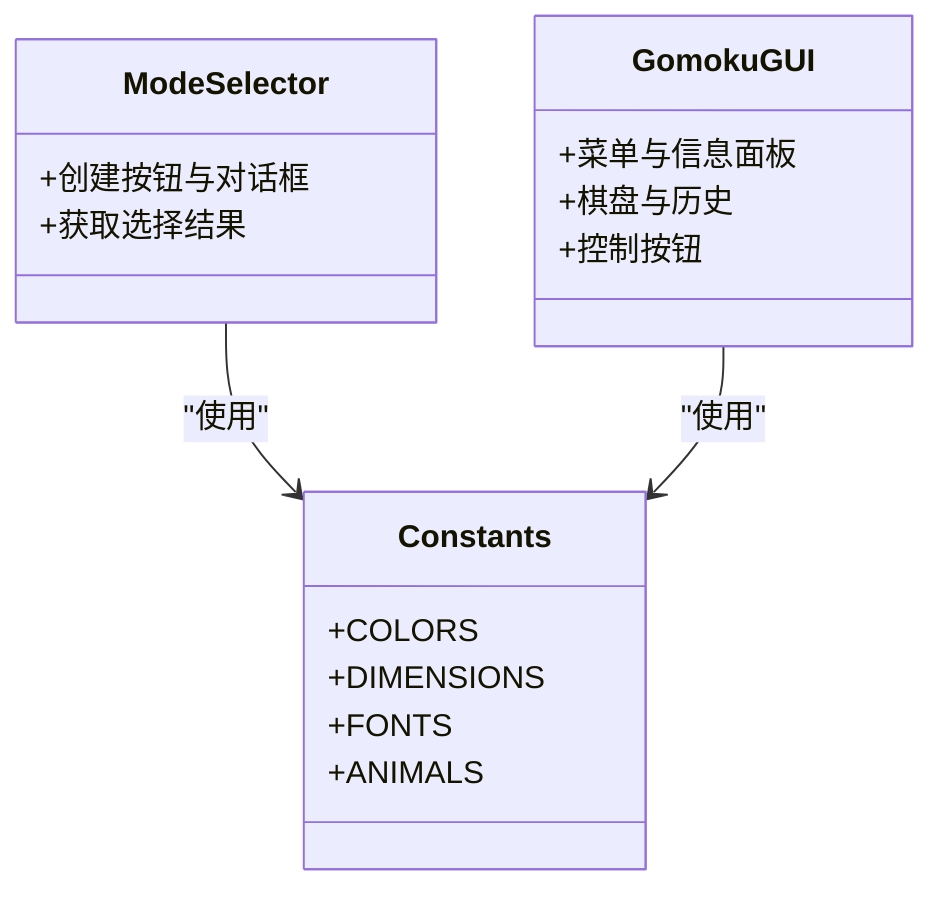
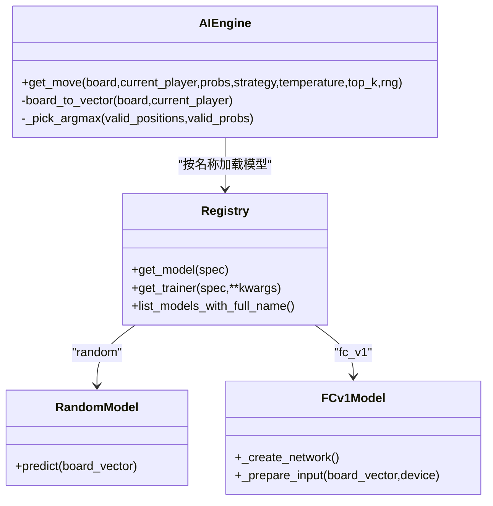
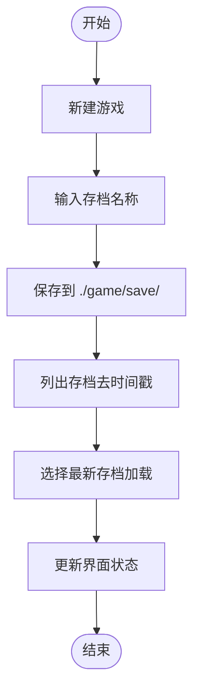
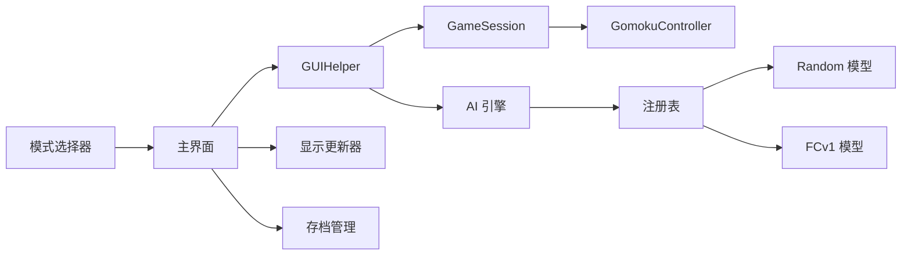

# 设置与配置

<cite>
**本文引用的文件**
- [gui/components/mode_selector.py](file://gui/components/mode_selector.py)
- [gui/main.py](file://gui/main.py)
- [gui/components/constants.py](file://gui/components/constants.py)
- [app/gui_helper.py](file://app/gui_helper.py)
- [gui/display_updater.py](file://gui/display_updater.py)
- [game/save.py](file://game/save.py)
- [app/session.py](file://app/session.py)
- [ai/engine.py](file://ai/engine.py)
- [ai/registry.py](file://ai/registry.py)
- [ai/models/random/model.py](file://ai/models/random/model.py)
- [ai/models/fc_v1/model.py](file://ai/models/fc_v1/model.py)
</cite>

## 目录
1. [简介](#简介)
2. [项目结构](#项目结构)
3. [核心组件](#核心组件)
4. [架构总览](#架构总览)
5. [详细组件分析](#详细组件分析)
6. [依赖关系分析](#依赖关系分析)
7. [性能考虑](#性能考虑)
8. [故障排查指南](#故障排查指南)
9. [结论](#结论)
10. [附录](#附录)

## 简介
本指南面向普通用户与技术读者，系统讲解“森林五子棋”项目的设置与配置。内容涵盖：
- 游戏模式选择器的使用方法与三种模式的特点对比、适用场景与切换方法
- 界面主题与外观配置（配色方案、字体设置、布局调整等）
- 游戏设置参数（难度级别、AI 模型选择、落子策略、音效与动画等）
- 存档管理功能（创建、加载、删除、备份等）
- 系统配置与环境要求，帮助优化体验并解决常见配置问题

## 项目结构
本项目采用分层清晰的组织方式：
- GUI 层：负责界面交互与渲染，包含模式选择器、主界面、显示更新器等
- 应用层：封装业务流程，协调控制器与会话
- 游戏层：提供核心规则与状态管理
- AI 层：提供多种 AI 模型与引擎，支持多代模型与懒加载

图表来源
- [gui/components/mode_selector.py:1-411](file://gui/components/mode_selector.py#L1-L411)
- [gui/main.py:1-462](file://gui/main.py#L1-L462)
- [gui/display_updater.py:1-110](file://gui/display_updater.py#L1-L110)
- [gui/components/constants.py:1-66](file://gui/components/constants.py#L1-L66)
- [app/gui_helper.py:1-199](file://app/gui_helper.py#L1-L199)
- [app/session.py:1-179](file://app/session.py#L1-L179)
- [ai/engine.py:1-194](file://ai/engine.py#L1-L194)
- [ai/registry.py:1-316](file://ai/registry.py#L1-L316)
- [ai/models/random/model.py:1-64](file://ai/models/random/model.py#L1-L64)
- [ai/models/fc_v1/model.py:1-132](file://ai/models/fc_v1/model.py#L1-L132)
- [game/save.py:1-93](file://game/save.py#L1-L93)

章节来源
- [gui/main.py:1-462](file://gui/main.py#L1-L462)
- [gui/components/mode_selector.py:1-411](file://gui/components/mode_selector.py#L1-L411)
- [gui/components/constants.py:1-66](file://gui/components/constants.py#L1-L66)

## 核心组件
- 模式选择器：启动时呈现三种游戏模式与回放入口，支持人机对战的颜色与 AI 选择、AI 内战的对局数配置
- 主界面与显示更新器：提供菜单、棋盘、信息面板、历史记录与控制按钮，实时渲染游戏状态
- GUIHelper：封装与界面无关的业务逻辑，统一对外暴露落子、AI 走子、状态查询等接口
- GameSession：管理一局游戏流程，协调控制器与 AI 管理器
- 存档管理：提供存档创建、加载、列表与命名规范
- AI 引擎与注册表：统一模型加载、多代模型扩展、落子策略选择

章节来源
- [gui/components/mode_selector.py:12-411](file://gui/components/mode_selector.py#L12-L411)
- [gui/main.py:31-462](file://gui/main.py#L31-L462)
- [gui/display_updater.py:13-110](file://gui/display_updater.py#L13-L110)
- [app/gui_helper.py:12-199](file://app/gui_helper.py#L12-L199)
- [app/session.py:12-179](file://app/session.py#L12-L179)
- [game/save.py:9-93](file://game/save.py#L9-L93)
- [ai/engine.py:44-194](file://ai/engine.py#L44-L194)
- [ai/registry.py:58-316](file://ai/registry.py#L58-L316)

## 架构总览
下图展示了从启动到进入游戏的关键交互流程。

图表来源
- [gui/components/mode_selector.py:176-411](file://gui/components/mode_selector.py#L176-L411)
- [gui/main.py:398-462](file://gui/main.py#L398-L462)
- [app/gui_helper.py:53-106](file://app/gui_helper.py#L53-L106)
- [app/session.py:63-179](file://app/session.py#L63-L179)
- [ai/engine.py:18-42](file://ai/engine.py#L18-L42)
- [ai/registry.py:150-184](file://ai/registry.py#L150-L184)

## 详细组件分析

### 游戏模式选择器
- 三种模式与特点
  - 人人对战（PvP）：两位玩家轮流落子，适合教学与休闲对弈
  - 人机对战（PvE）：玩家 vs AI，可选择执黑/执白与不同 AI 模型
  - AI 内战（AI vs AI）：两台 AI 自动对战，可设置对局数
- 适用场景
  - PvP：朋友对局、练习基本规则
  - PvE：单人挑战、学习不同 AI 的风格
  - AI vs AI：研究 AI 表现、回放与分析
- 切换方法
  - 启动后在模式选择器界面点击对应按钮，或在主界面通过菜单“新建游戏/加载游戏/保存游戏/回放对局”进行切换

图表来源
- [gui/components/mode_selector.py:90-143](file://gui/components/mode_selector.py#L90-L143)
- [gui/main.py:411-457](file://gui/main.py#L411-L457)

章节来源
- [gui/components/mode_selector.py:12-411](file://gui/components/mode_selector.py#L12-L411)
- [gui/main.py:398-462](file://gui/main.py#L398-L462)

### 界面主题与外观配置
- 配色方案
  - 背景、棋盘、文字、边框、按钮、高亮等颜色均在常量中集中定义，便于统一风格与主题扩展
- 字体设置
  - 标题、副标题、按钮、常规、小号、等宽字体等分类，满足不同信息层级的可读性需求
- 布局调整
  - 窗口尺寸、棋盘尺寸、单元格大小、棋子半径、热力图尺寸等参数集中管理，便于适配不同分辨率

图表来源
- [gui/components/constants.py:3-66](file://gui/components/constants.py#L3-L66)
- [gui/components/mode_selector.py:12-51](file://gui/components/mode_selector.py#L12-L51)
- [gui/main.py:91-320](file://gui/main.py#L91-L320)

章节来源
- [gui/components/constants.py:1-66](file://gui/components/constants.py#L1-L66)
- [gui/main.py:91-320](file://gui/main.py#L91-L320)

### 游戏设置参数
- 难度级别与 AI 模型
  - 支持随机模型与多种神经网络模型；多代模型（如 cnn_v3）可按代数选择
  - 通过注册表统一管理模型加载与训练器映射，支持懒加载
- 落子策略
  - 引擎支持两种策略：argmax（默认，选择最大概率合法位置，平局随机打破）与 sampling（温度采样，支持温度与 top-k）
- 音效与动画
  - 项目未提供独立音效与动画开关；棋盘绘制与高亮由显示更新器驱动，可结合主题色与尺寸参数微调观感

图表来源
- [ai/engine.py:44-194](file://ai/engine.py#L44-L194)
- [ai/registry.py:150-316](file://ai/registry.py#L150-L316)
- [ai/models/random/model.py:35-64](file://ai/models/random/model.py#L35-L64)
- [ai/models/fc_v1/model.py:111-132](file://ai/models/fc_v1/model.py#L111-L132)

章节来源
- [ai/engine.py:67-142](file://ai/engine.py#L67-L142)
- [ai/registry.py:237-296](file://ai/registry.py#L237-L296)
- [ai/models/random/model.py:35-64](file://ai/models/random/model.py#L35-L64)
- [ai/models/fc_v1/model.py:111-132](file://ai/models/fc_v1/model.py#L111-L132)

### 存档管理功能
- 存档创建
  - 新建游戏时弹出输入框，输入存档名称；系统自动保存并带时间戳
- 存档加载
  - 列出所有存档，按最新日期自动选择；加载成功后界面同步更新
- 存档删除与备份
  - 本项目未提供图形化删除与备份功能；可通过文件系统直接管理存档目录
- 存档命名与列表
  - 存档文件名包含日期与时间戳，列表时去除时间戳提取存档名

图表来源
- [gui/main.py:321-376](file://gui/main.py#L321-L376)
- [game/save.py:17-93](file://game/save.py#L17-L93)

章节来源
- [gui/main.py:321-376](file://gui/main.py#L321-L376)
- [game/save.py:17-93](file://game/save.py#L17-L93)

## 依赖关系分析
- 组件耦合
  - 模式选择器与主界面通过结果字典解耦；主界面通过 GUIHelper 与 GameSession 解耦业务与界面
  - AI 引擎通过注册表与模型实现解耦，支持多代模型扩展
- 外部依赖
  - GUI 使用 tkinter；AI 模型依赖 PyTorch（如 FCv1）
- 循环依赖
  - 通过延迟导入与模块拆分避免循环依赖

图表来源
- [gui/components/mode_selector.py:1-411](file://gui/components/mode_selector.py#L1-L411)
- [gui/main.py:1-462](file://gui/main.py#L1-L462)
- [app/gui_helper.py:1-199](file://app/gui_helper.py#L1-L199)
- [app/session.py:1-179](file://app/session.py#L1-L179)
- [ai/engine.py:1-194](file://ai/engine.py#L1-L194)
- [ai/registry.py:1-316](file://ai/registry.py#L1-L316)
- [ai/models/random/model.py:1-64](file://ai/models/random/model.py#L1-L64)
- [ai/models/fc_v1/model.py:1-132](file://ai/models/fc_v1/model.py#L1-L132)
- [game/save.py:1-93](file://game/save.py#L1-L93)

章节来源
- [gui/main.py:1-462](file://gui/main.py#L1-L462)
- [ai/registry.py:1-316](file://ai/registry.py#L1-L316)

## 性能考虑
- AI 落子策略
  - argmax：稳定、快速，适合大多数对局
  - sampling：引入随机性，适合探索与多样性；温度与 top-k 参数影响多样性与稳定性
- 多代模型
  - 多代模型按代数展开为独立条目，仅当有效权重存在时才展示，避免无效加载
- 显示更新
  - 显示更新器按需重绘棋盘与历史，减少不必要的刷新

## 故障排查指南
- 模型加载失败
  - 现象：人机对战或 AI 内战启动时报错
  - 排查：确认所选 AI 模型已正确训练并具备有效权重；多代模型需指定代数
- 棋盘已满或非法落子
  - 现象：提示无空位可落子或落子失败
  - 排查：检查游戏状态与轮次；确认控制器未提前结束
- 回放数据缺失
  - 现象：回放模式提示暂无回放数据
  - 排查：先进行一次 AI 内战对局以生成回放数据

章节来源
- [app/session.py:44-51](file://app/session.py#L44-L51)
- [ai/engine.py:124-126](file://ai/engine.py#L124-L126)
- [gui/main.py:422-435](file://gui/main.py#L422-L435)

## 结论
本项目提供了完整的五子棋游戏体验：直观的模式选择、可定制的主题与外观、灵活的 AI 模型与落子策略、完善的存档管理与回放能力。通过统一的注册表与引擎抽象，用户可以轻松切换不同 AI 模型与策略，获得多样化的对弈体验。

## 附录

### 游戏模式对比与切换
- 人人对战（PvP）
  - 特点：双人轮流，规则纯正
  - 切换：模式选择器点击“人人对战”
- 人机对战（PvE）
  - 特点：可选执棋颜色与 AI 模型
  - 切换：模式选择器点击“人机对战”，在弹窗中选择颜色与 AI
- AI 内战（AI vs AI）
  - 特点：自动对战，可设置对局数与双方 AI
  - 切换：模式选择器点击“AI 内战”，在弹窗中设置参数

章节来源
- [gui/components/mode_selector.py:90-143](file://gui/components/mode_selector.py#L90-L143)
- [gui/main.py:411-457](file://gui/main.py#L411-L457)

### 界面主题与外观配置清单
- 配色方案：背景、棋盘、文字、边框、按钮、高亮、棋子、热力图等
- 字体设置：标题、副标题、按钮、常规、小号、等宽
- 布局参数：窗口尺寸、棋盘尺寸、单元格大小、棋子半径、热力图尺寸

章节来源
- [gui/components/constants.py:3-66](file://gui/components/constants.py#L3-L66)

### 游戏设置参数清单
- AI 模型：random、fc_v1、cnn_v1、cnn_v2、cnn_v3（多代需指定代数）
- 落子策略：argmax、sampling（支持温度与 top-k）
- 存档管理：创建、加载、列表、命名规则（含时间戳）

章节来源
- [ai/registry.py:237-296](file://ai/registry.py#L237-L296)
- [ai/engine.py:67-142](file://ai/engine.py#L67-L142)
- [game/save.py:17-93](file://game/save.py#L17-L93)