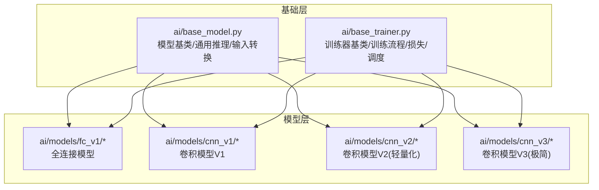
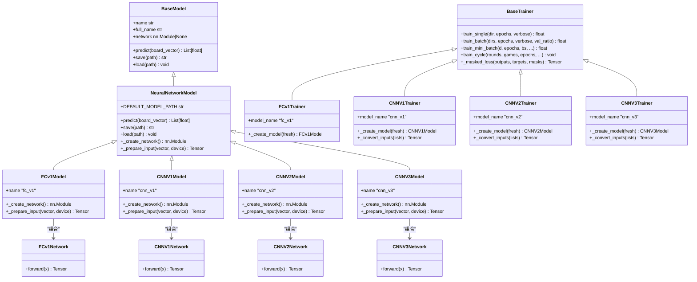
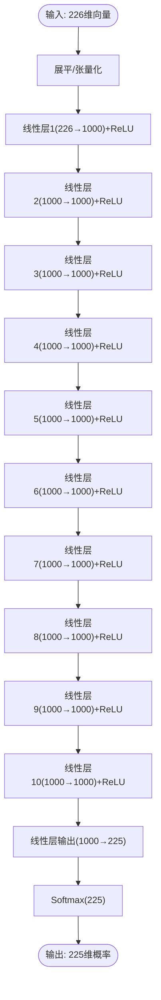
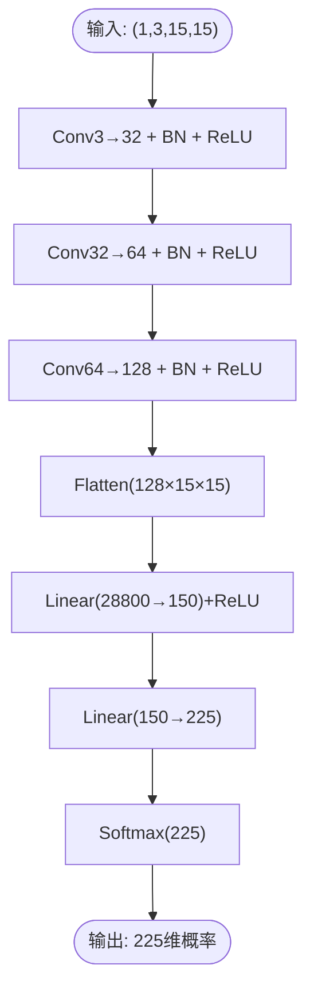
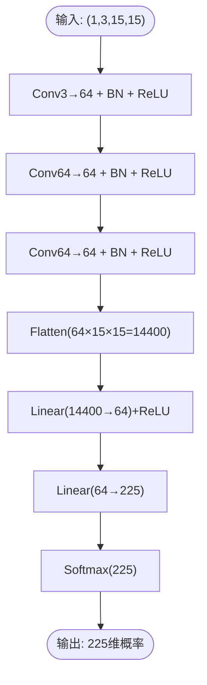
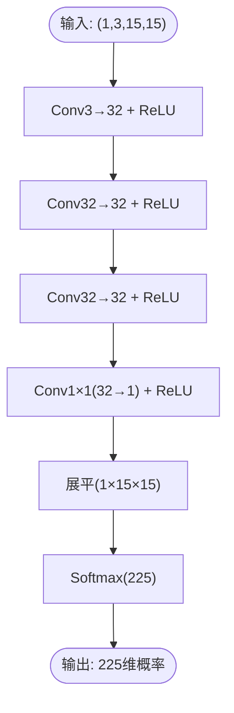
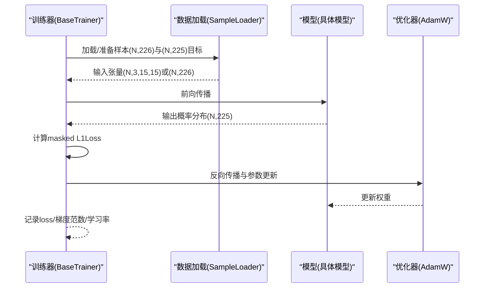
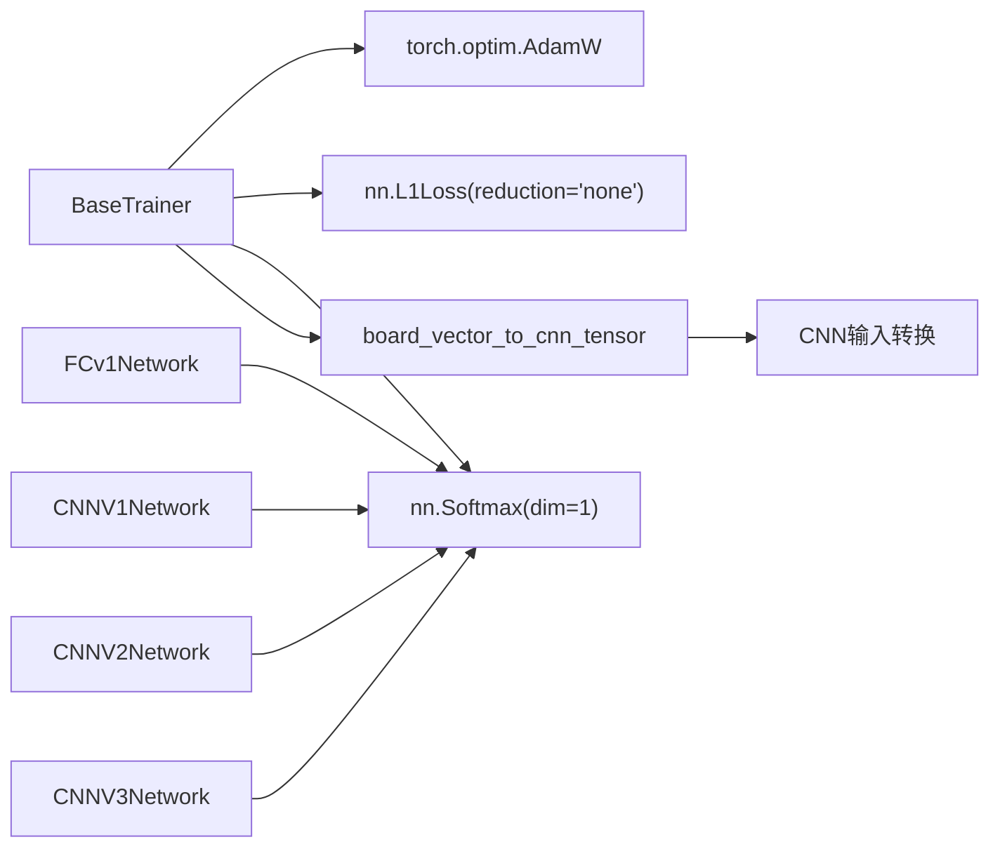

# AI模型设计

<cite>
**本文引用的文件**
- [ai/base_model.py](file://ai/base_model.py)
- [ai/base_trainer.py](file://ai/base_trainer.py)
- [ai/models/fc_v1/model.py](file://ai/models/fc_v1/model.py)
- [ai/models/fc_v1/trainer.py](file://ai/models/fc_v1/trainer.py)
- [ai/models/cnn_v1/model.py](file://ai/models/cnn_v1/model.py)
- [ai/models/cnn_v1/trainer.py](file://ai/models/cnn_v1/trainer.py)
- [ai/models/cnn_v2/model.py](file://ai/models/cnn_v2/model.py)
- [ai/models/cnn_v2/trainer.py](file://ai/models/cnn_v2/trainer.py)
- [ai/models/cnn_v3/model.py](file://ai/models/cnn_v3/model.py)
- [ai/models/cnn_v3/trainer.py](file://ai/models/cnn_v3/trainer.py)
- [design/fc_v1_design.md](file://design/fc_v1_design.md)
- [design/cnn_design.md](file://design/cnn_design.md)
- [design/cnn_v2_design.md](file://design/cnn_v2_design.md)
- [design/cnn_v3_design.md](file://design/cnn_v3_design.md)
</cite>

## 目录
1. [简介](#简介)
2. [项目结构](#项目结构)
3. [核心组件](#核心组件)
4. [架构总览](#架构总览)
5. [详细组件分析](#详细组件分析)
6. [依赖分析](#依赖分析)
7. [性能考量](#性能考量)
8. [故障排查指南](#故障排查指南)
9. [结论](#结论)
10. [附录](#附录)

## 简介
本设计文档面向五子棋AI模型，系统梳理并对比三种模型的设计理念与架构选择：FCv1全连接网络、CNNV1/V2/V3卷积神经网络。文档从输入输出设计、网络结构、参数配置、训练与评估方案、性能权衡等方面进行深入分析，并提供架构图与数据流图，帮助读者理解模型的前向传播、掩码损失计算、学习率调度与训练周期等关键流程，为模型选择与优化提供实证依据。

## 项目结构
本项目采用“模型分层 + 通用基类”的组织方式：
- ai/base_model.py 定义统一的模型接口与通用前向推理逻辑，以及board向CNN输入的转换工具。
- ai/base_trainer.py 定义通用训练器抽象与训练流程（单轮次、批量、mini-batch、训练周期），内置AdamW优化器、L1Loss掩码损失、StepLR/ReduceLROnPlateau学习率调度。
- ai/models/fc_v1、cnn_v1、cnn_v2、cnn_v3 分别实现不同架构的模型与对应训练器，均继承自NeuralNetworkModel/BaseTrainer，遵循统一的输入/输出约定与训练接口。

**图示来源**
- [ai/base_model.py:1-323](file://ai/base_model.py#L1-L323)
- [ai/base_trainer.py:1-699](file://ai/base_trainer.py#L1-L699)
- [ai/models/fc_v1/model.py:1-132](file://ai/models/fc_v1/model.py#L1-L132)
- [ai/models/cnn_v1/model.py:1-148](file://ai/models/cnn_v1/model.py#L1-L148)
- [ai/models/cnn_v2/model.py:1-160](file://ai/models/cnn_v2/model.py#L1-L160)
- [ai/models/cnn_v3/model.py:1-139](file://ai/models/cnn_v3/model.py#L1-L139)

**章节来源**
- [ai/base_model.py:1-323](file://ai/base_model.py#L1-L323)
- [ai/base_trainer.py:1-699](file://ai/base_trainer.py#L1-L699)

## 核心组件
- 模型基类与通用推理
  - ai/base_model.NeuralNetworkModel：封装predict/save/load，统一前向推理流程（eval模式、no_grad、Softmax输出）。
  - ai/base_model.board_vector_to_cnn_tensor：将226维向量转换为(1,3,15,15)张量，供CNN模型共享。
- 训练器基类
  - ai/base_trainer.BaseTrainer：统一训练流程（单轮次/批量/mini-batch/训练周期）、设备选择、AdamW优化器、L1Loss掩码损失、StepLR/ReduceLROnPlateau学习率调度。
- FCv1模型
  - ai/models/fc_v1.model.FCv1Network：10层隐藏层（每层1000神经元，ReLU），输出层225维Softmax。
  - ai/models/fc_v1.trainer.FCv1Trainer：继承BaseTrainer，创建FCv1Model。
- CNNV1模型
  - ai/models/cnn_v1.model.CNNV1Network：3层卷积（3→32→64→128）+2层全连接（28800→150→225）。
  - ai/models/cnn_v1.trainer.CNNV1Trainer：继承BaseTrainer，创建CNNV1Model。
- CNNV2模型
  - ai/models/cnn_v2.model.CNNV2Network：统一卷积通道至64，FC1从28800→64，显著降低参数量。
  - ai/models/cnn_v2.trainer.CNNV2Trainer：继承BaseTrainer，创建CNNV2Model。
- CNNV3模型
  - ai/models/cnn_v3.model.CNNV3Network：纯卷积（无FC/BN/Dropout），用1×1卷积替代FC，输出15×15空间概率图再展平Softmax。
  - ai/models/cnn_v3.trainer.CNNV3Trainer：继承BaseTrainer，创建CNNV3Model。

**章节来源**
- [ai/base_model.py:107-323](file://ai/base_model.py#L107-L323)
- [ai/base_trainer.py:32-699](file://ai/base_trainer.py#L32-L699)
- [ai/models/fc_v1/model.py:18-132](file://ai/models/fc_v1/model.py#L18-L132)
- [ai/models/cnn_v1/model.py:26-148](file://ai/models/cnn_v1/model.py#L26-L148)
- [ai/models/cnn_v2/model.py:34-160](file://ai/models/cnn_v2/model.py#L34-L160)
- [ai/models/cnn_v3/model.py:31-139](file://ai/models/cnn_v3/model.py#L31-L139)
- [ai/models/fc_v1/trainer.py:11-44](file://ai/models/fc_v1/trainer.py#L11-L44)
- [ai/models/cnn_v1/trainer.py:13-72](file://ai/models/cnn_v1/trainer.py#L13-L72)
- [ai/models/cnn_v2/trainer.py:13-72](file://ai/models/cnn_v2/trainer.py#L13-L72)
- [ai/models/cnn_v3/trainer.py:13-73](file://ai/models/cnn_v3/trainer.py#L13-L73)

## 架构总览
下图展示模型与训练器的类关系与继承层次，体现统一接口与可替换的训练流程。

**图示来源**
- [ai/base_model.py:24-323](file://ai/base_model.py#L24-L323)
- [ai/base_trainer.py:32-699](file://ai/base_trainer.py#L32-L699)
- [ai/models/fc_v1/model.py:91-132](file://ai/models/fc_v1/model.py#L91-L132)
- [ai/models/cnn_v1/model.py:106-148](file://ai/models/cnn_v1/model.py#L106-L148)
- [ai/models/cnn_v2/model.py:117-160](file://ai/models/cnn_v2/model.py#L117-L160)
- [ai/models/cnn_v3/model.py:96-139](file://ai/models/cnn_v3/model.py#L96-L139)
- [ai/models/fc_v1/trainer.py:11-44](file://ai/models/fc_v1/trainer.py#L11-L44)
- [ai/models/cnn_v1/trainer.py:13-72](file://ai/models/cnn_v1/trainer.py#L13-L72)
- [ai/models/cnn_v2/trainer.py:13-72](file://ai/models/cnn_v2/trainer.py#L13-L72)
- [ai/models/cnn_v3/trainer.py:13-73](file://ai/models/cnn_v3/trainer.py#L13-L73)

## 详细组件分析

### FCv1全连接模型
- 设计理念
  - 采用10层隐藏层（每层1000神经元）的全连接网络，直接对展平的226维向量进行建模，输出225维Softmax概率分布。
  - 该设计强调监督学习与策略预测，但缺乏对棋盘空间结构的建模能力。
- 输入输出设计
  - 输入：226维向量（前225维为棋盘状态按行展开，第226维为当前落子方）。
  - 输出：225维Softmax概率分布，索引i对应位置(i//15, i%15)。
- 网络结构与参数
  - 结构：226→10×ReLU(1000)→225，参数量约946万。
  - 激活：ReLU；输出：Softmax。
- 训练与损失
  - 优化器：AdamW（默认学习率与权重衰减可配置）。
  - 损失：L1Loss（MAE），使用掩码张量对有效位置加权。
  - 目标：Softmax概率分布（由采样器生成）。
- 性能特点
  - 参数量大，训练成本高；对棋盘局部性建模弱，易受噪声影响。
  - 适合探索监督学习策略，但需配合更强的特征工程或结构改进。

**图示来源**
- [ai/models/fc_v1/model.py:18-88](file://ai/models/fc_v1/model.py#L18-L88)

**章节来源**
- [ai/models/fc_v1/model.py:18-132](file://ai/models/fc_v1/model.py#L18-L132)
- [design/fc_v1_design.md:1-712](file://design/fc_v1_design.md#L1-L712)

### CNNV1卷积模型
- 设计理念
  - 采用3层卷积（3→32→64→128）+紧凑全连接（28800→150→225），参数量与FCv1相当，强调空间特征提取。
- 输入输出设计
  - 输入：(1,3,15,15)三通道张量（黑棋、白棋、当前方）。
  - 输出：225维Softmax概率分布。
- 网络结构与参数
  - 结构：Conv→BN→ReLU（3层）→Flatten→Linear(28800→150)→ReLU→Linear(150→225)→Softmax。
  - 参数量：约445万。
- 训练与损失
  - 优化器：AdamW；损失：L1Loss掩码；学习率调度：StepLR或ReduceLROnPlateau。
- 性能特点
  - 利用卷积的空间局部性，特征表达更稳健；参数量适中，适合监督学习策略。

**图示来源**
- [ai/models/cnn_v1/model.py:26-103](file://ai/models/cnn_v1/model.py#L26-L103)

**章节来源**
- [ai/models/cnn_v1/model.py:26-148](file://ai/models/cnn_v1/model.py#L26-L148)
- [design/cnn_design.md:1-285](file://design/cnn_design.md#L1-L285)

### CNNV2卷积模型（轻量化）
- 设计理念
  - 在CNNV1基础上统一卷积通道至64，FC1从28800→64，显著降低参数量与计算开销。
- 输入输出设计
  - 输入/输出与CNNV1一致。
- 网络结构与参数
  - 结构：Conv3→64（3层）→Linear(14400→64)→Linear(64→225)→Softmax。
  - 参数量：约101万（-77%）。
- 训练与损失
  - 优化器：AdamW；损失：L1Loss掩码；学习率调度：StepLR或ReduceLROnPlateau。
- 性能特点
  - 显著提升训练效率与内存占用；在保持预测精度的同时大幅缩短收敛时间。

**图示来源**
- [ai/models/cnn_v2/model.py:34-114](file://ai/models/cnn_v2/model.py#L34-L114)

**章节来源**
- [ai/models/cnn_v2/model.py:34-160](file://ai/models/cnn_v2/model.py#L34-L160)
- [design/cnn_v2_design.md:1-96](file://design/cnn_v2_design.md#L1-L96)

### CNNV3卷积模型（极简）
- 设计理念
  - 纯卷积网络，无FC/BN/Dropout，用1×1卷积替代全连接层，直接输出15×15空间概率图，全程保持空间结构。
- 输入输出设计
  - 输入/输出与CNNV1一致。
- 网络结构与参数
  - 结构：Conv3→32（3层）→Conv1×1(32→1)→ReLU→展平→Softmax。
  - 参数量：约1.9万（-98%）。
- 训练与损失
  - 优化器：AdamW；损失：L1Loss掩码；学习率调度：StepLR或ReduceLROnPlateau。
- 性能特点
  - 参数量极小，推理与训练速度最快；结构最简，便于理解与调试；在监督学习场景下具备良好泛化潜力。

**图示来源**
- [ai/models/cnn_v3/model.py:31-93](file://ai/models/cnn_v3/model.py#L31-L93)

**章节来源**
- [ai/models/cnn_v3/model.py:31-139](file://ai/models/cnn_v3/model.py#L31-L139)
- [design/cnn_v3_design.md:1-173](file://design/cnn_v3_design.md#L1-L173)

### 训练流程与数据流
- 训练流程（BaseTrainer）
  - 设备选择：优先CUDA，否则CPU。
  - 优化器：AdamW（可配置权重衰减）。
  - 损失：L1Loss（reduction='none'），结合掩码张量进行加权平均。
  - 学习率调度：StepLR或ReduceLROnPlateau。
  - 训练模式：单轮次、批量、mini-batch、训练周期。
- 数据流（以CNN为例）
  - 输入：226维向量→(N,3,15,15)张量。
  - 前向：卷积→ReLU→展平→全连接→Softmax。
  - 损失：masked L1Loss，按mask有效位置求平均。
  - 反向：计算梯度并更新参数。

**图示来源**
- [ai/base_trainer.py:240-322](file://ai/base_trainer.py#L240-L322)
- [ai/base_trainer.py:662-699](file://ai/base_trainer.py#L662-L699)
- [ai/base_model.py:278-323](file://ai/base_model.py#L278-L323)

**章节来源**
- [ai/base_trainer.py:32-699](file://ai/base_trainer.py#L32-L699)
- [ai/base_model.py:107-323](file://ai/base_model.py#L107-L323)

## 依赖分析
- 组件耦合
  - 模型与训练器通过抽象接口解耦：模型仅需实现网络创建与输入准备，训练器统一处理优化、损失、调度与日志。
  - CNN模型共享输入转换函数，避免重复实现。
- 外部依赖
  - PyTorch（nn.Module、optim、L1Loss、Softmax等）。
  - 设备自动检测（CUDA优先）。
- 潜在风险
  - 训练器对模型的network属性强依赖，需确保子类正确设置。
  - 掩码机制需与采样器生成的mask保持一致。

**图示来源**
- [ai/base_trainer.py:89-101](file://ai/base_trainer.py#L89-L101)
- [ai/base_model.py:278-323](file://ai/base_model.py#L278-L323)
- [ai/models/fc_v1/model.py:18-88](file://ai/models/fc_v1/model.py#L18-L88)
- [ai/models/cnn_v1/model.py:26-103](file://ai/models/cnn_v1/model.py#L26-L103)
- [ai/models/cnn_v2/model.py:34-114](file://ai/models/cnn_v2/model.py#L34-L114)
- [ai/models/cnn_v3/model.py:31-93](file://ai/models/cnn_v3/model.py#L31-L93)

**章节来源**
- [ai/base_trainer.py:32-144](file://ai/base_trainer.py#L32-L144)
- [ai/base_model.py:278-323](file://ai/base_model.py#L278-L323)

## 性能考量
- 计算复杂度
  - FCv1：线性层参数量大，前向/反向传播开销高；适合探索性实验。
  - CNNV1：卷积+全连接，空间特征提取强，计算量中等。
  - CNNV2：统一卷积通道+压缩FC，显著降低计算与内存占用。
  - CNNV3：纯卷积+1×1卷积，参数量最小，计算与内存开销最低。
- 内存占用
  - CNNV3 < CNNV2 < CNNV1 << FCv1。
- 训练效率
  - CNNV3最快，CNNV2次之，CNNV1再次之，FCv1最慢。
- 收敛特性
  - CNN系列利用空间结构，通常具有更好的泛化与稳定性；FCv1需更强的正则与特征工程。

[本节为通用性能讨论，无需列出具体文件来源]

## 故障排查指南
- 模型加载失败
  - 检查DEFAULT_MODEL_PATH是否存在；多代模型需明确gen参数以定位权重文件。
- 设备错误
  - 确认CUDA可用性；训练器会自动选择GPU/CPU。
- 训练中断
  - Ctrl+C中断会保存当前进度与图表；可安全重启。
- 掩码问题
  - 确保targets/masks维度与输出一致；BaseTrainer会按mask有效位置求平均。

**章节来源**
- [ai/base_model.py:126-166](file://ai/base_model.py#L126-L166)
- [ai/base_trainer.py:115-120](file://ai/base_trainer.py#L115-L120)
- [ai/base_trainer.py:314-322](file://ai/base_trainer.py#L314-L322)
- [ai/base_trainer.py:678-699](file://ai/base_trainer.py#L678-L699)

## 结论
- FCv1适合探索监督学习策略与快速原型验证，但受限于全连接结构与高参数量。
- CNNV1在空间特征提取方面优于FCv1，适合稳健的监督学习策略。
- CNNV2在CNNV1基础上显著降低参数量与计算开销，兼顾效率与精度。
- CNNV3以极简结构实现最强的训练/推理效率，适合资源受限场景与快速迭代。
- 建议：中小规模实验优先CNNV2；大规模训练与部署优先CNNV3；需要更强特征表达时采用CNNV1。

[本节为总结性内容，无需列出具体文件来源]

## 附录
- 训练入口与CLI
  - 支持单轮次训练、批量训练、mini-batch训练与训练周期；可配置学习率调度与验证集比例。
- 评估与验证
  - 支持验证集损失记录与曲线生成；支持密集日志与稀疏日志模式。
- 设计文档参考
  - FCv1、CNNV1/V2/V3设计文档提供了详细的参数量估算、接口说明与测试用例。

**章节来源**
- [ai/base_trainer.py:324-660](file://ai/base_trainer.py#L324-L660)
- [design/fc_v1_design.md:1-712](file://design/fc_v1_design.md#L1-L712)
- [design/cnn_design.md:1-285](file://design/cnn_design.md#L1-L285)
- [design/cnn_v2_design.md:1-96](file://design/cnn_v2_design.md#L1-L96)
- [design/cnn_v3_design.md:1-173](file://design/cnn_v3_design.md#L1-L173)