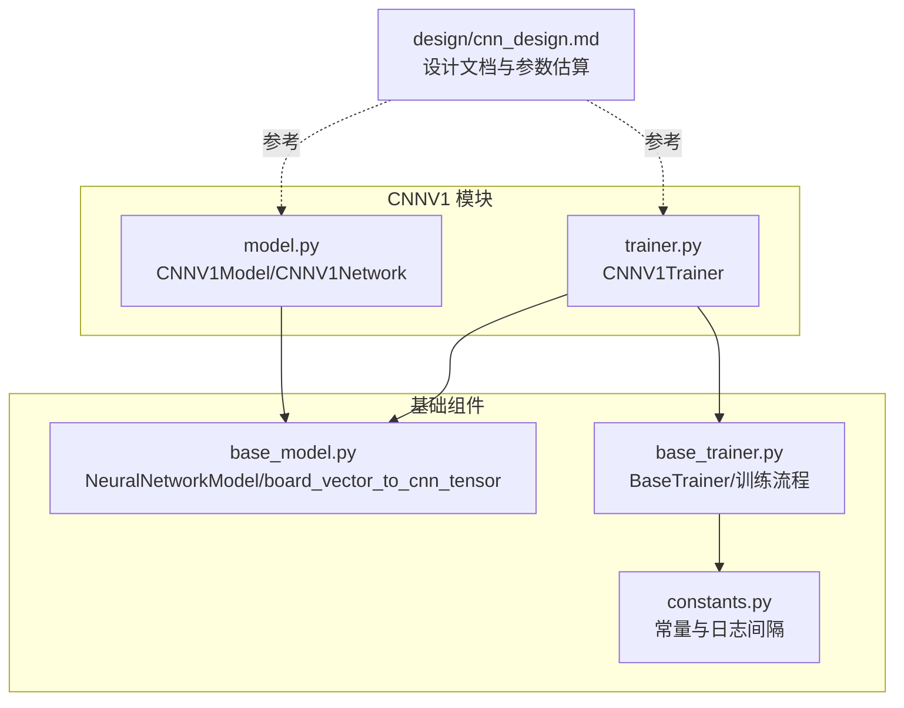
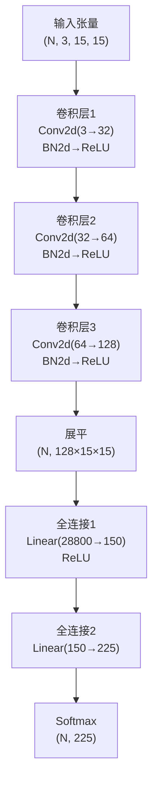
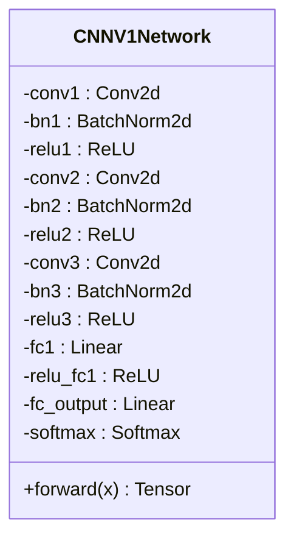
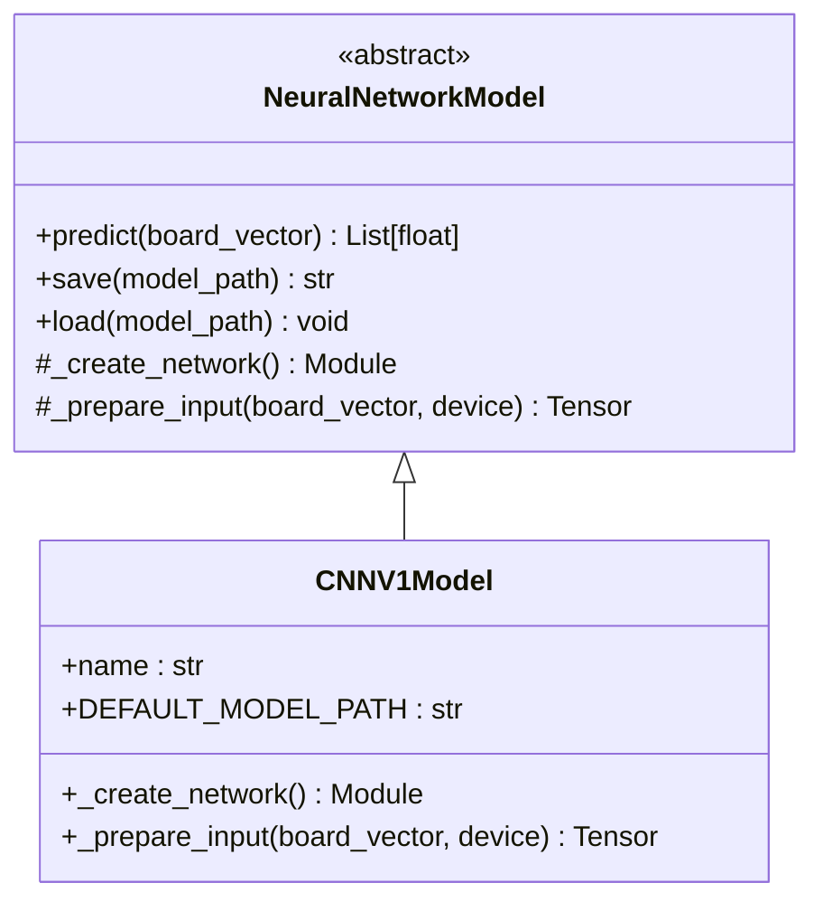
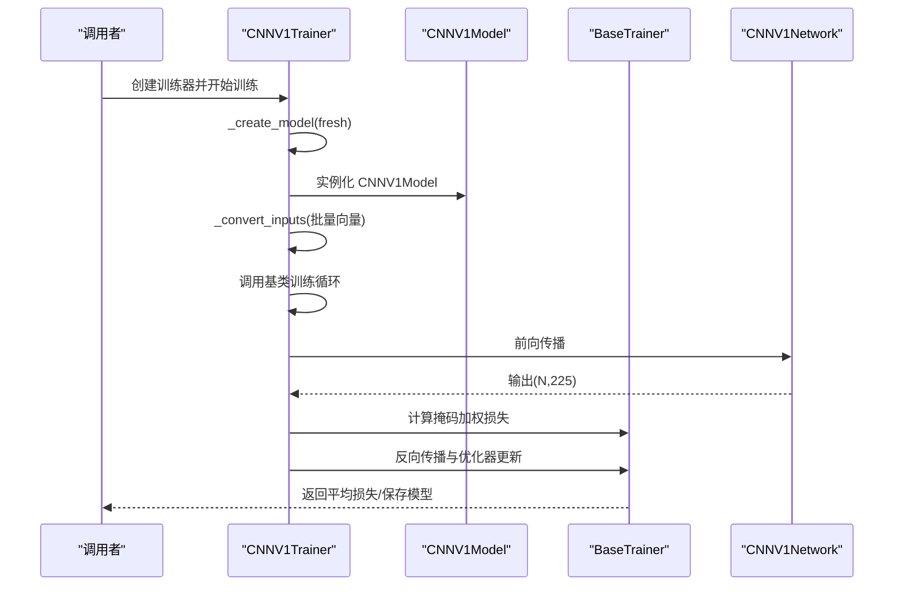
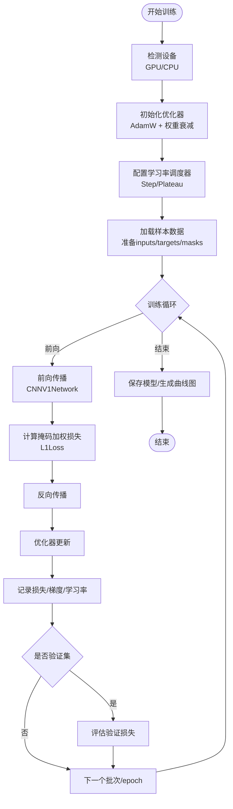
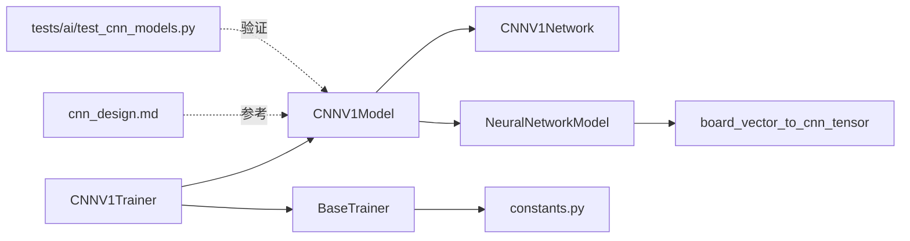

# CNNV1卷积神经网络模型设计

<cite>
**本文引用的文件**
- [ai/models/cnn_v1/model.py](file://ai/models/cnn_v1/model.py)
- [ai/models/cnn_v1/trainer.py](file://ai/models/cnn_v1/trainer.py)
- [ai/base_model.py](file://ai/base_model.py)
- [ai/base_trainer.py](file://ai/base_trainer.py)
- [ai/constants.py](file://ai/constants.py)
- [design/cnn_design.md](file://design/cnn_design.md)
- [ai/models/fc_v1/model.py](file://ai/models/fc_v1/model.py)
- [tests/ai/test_cnn_models.py](file://tests/ai/test_cnn_models.py)
</cite>

## 目录
1. [简介](#简介)
2. [项目结构](#项目结构)
3. [核心组件](#核心组件)
4. [架构总览](#架构总览)
5. [详细组件分析](#详细组件分析)
6. [依赖分析](#依赖分析)
7. [性能考量](#性能考量)
8. [故障排查指南](#故障排查指南)
9. [结论](#结论)
10. [附录](#附录)

## 简介
本设计文档围绕 CNNV1 卷积神经网络模型展开，系统阐述其相较 FCv1 在五子棋棋盘空间结构建模上的架构改进与优势。CNNV1 通过引入卷积层与全连接层组合，能够有效提取棋盘的空间特征、建模局部相关性，并在参数规模上与 FCv1 保持可比性，从而在有限样本条件下实现更好的泛化能力。

## 项目结构
CNNV1 模型位于 ai/models/cnn_v1 目录，包含模型实现与训练器实现；其输入转换逻辑复用 ai/base_model.py 中的共享函数；训练器继承自 ai/base_trainer.py，遵循统一的训练框架；设计文档与测试用例分别位于 design 与 tests 目录。

**图表来源**
- [ai/models/cnn_v1/model.py:1-148](file://ai/models/cnn_v1/model.py#L1-L148)
- [ai/models/cnn_v1/trainer.py:1-72](file://ai/models/cnn_v1/trainer.py#L1-L72)
- [ai/base_model.py:278-323](file://ai/base_model.py#L278-L323)
- [ai/base_trainer.py:1-699](file://ai/base_trainer.py#L1-L699)
- [ai/constants.py:1-26](file://ai/constants.py#L1-L26)
- [design/cnn_design.md:1-285](file://design/cnn_design.md#L1-L285)

**章节来源**
- [ai/models/cnn_v1/model.py:1-148](file://ai/models/cnn_v1/model.py#L1-L148)
- [ai/models/cnn_v1/trainer.py:1-72](file://ai/models/cnn_v1/trainer.py#L1-L72)
- [ai/base_model.py:1-323](file://ai/base_model.py#L1-L323)
- [ai/base_trainer.py:1-699](file://ai/base_trainer.py#L1-L699)
- [ai/constants.py:1-26](file://ai/constants.py#L1-L26)
- [design/cnn_design.md:1-285](file://design/cnn_design.md#L1-L285)

## 核心组件
- CNNV1Network：定义 3 层卷积（3→32→64→128）+ 2 层全连接（28800→150→225）+ Softmax 的前向传播逻辑。
- CNNV1Model：继承 NeuralNetworkModel，封装模型名称、默认保存路径、输入准备（调用共享转换函数）与通用预测流程。
- CNNV1Trainer：继承 BaseTrainer，负责模型创建、输入格式转换（(N,3,15,15)）、训练流程与日志记录。
- 共享输入转换：board_vector_to_cnn_tensor 将 226 维向量转换为 (1,3,15,15) 的张量，通道分别为黑棋、白棋、当前落子方。
- 训练框架：BaseTrainer 提供统一的设备检测、优化器（AdamW）、损失函数（L1Loss，mask 加权）、学习率调度、日志记录与训练循环。

**章节来源**
- [ai/models/cnn_v1/model.py:26-148](file://ai/models/cnn_v1/model.py#L26-L148)
- [ai/models/cnn_v1/trainer.py:13-72](file://ai/models/cnn_v1/trainer.py#L13-L72)
- [ai/base_model.py:278-323](file://ai/base_model.py#L278-L323)
- [ai/base_trainer.py:47-144](file://ai/base_trainer.py#L47-L144)

## 架构总览
CNNV1 的整体架构由“空间特征提取 + 全局映射”两部分组成：卷积层通过小核（3×3，padding=1）提取局部空间特征，BN+ReLU 提升稳定性与非线性，最终展平进入全连接层进行全局映射至 225 维落子位置概率分布。

**图表来源**
- [ai/models/cnn_v1/model.py:39-103](file://ai/models/cnn_v1/model.py#L39-L103)

**章节来源**
- [ai/models/cnn_v1/model.py:26-103](file://ai/models/cnn_v1/model.py#L26-L103)
- [design/cnn_design.md:77-118](file://design/cnn_design.md#L77-L118)

## 详细组件分析

### CNNV1Network 类
- 卷积层设计：3 层卷积核大小均为 3×3，padding=1，保证特征图尺寸不变；通道数逐步增加以捕获更高阶特征。
- 批归一化与激活：每层卷积后接 BN2d 与 ReLU，稳定训练并加速收敛。
- 全连接层设计：展平后经 150 神经元的中间层，最终映射到 225 维输出，Softmax 归一化为概率分布。
- 参数量估算：来自设计文档，总计约 445 万，与 FCv1 相当，便于公平对比。

**图表来源**
- [ai/models/cnn_v1/model.py:26-103](file://ai/models/cnn_v1/model.py#L26-L103)

**章节来源**
- [ai/models/cnn_v1/model.py:26-103](file://ai/models/cnn_v1/model.py#L26-L103)
- [design/cnn_design.md:77-133](file://design/cnn_design.md#L77-L133)

### CNNV1Model 类
- 继承 NeuralNetworkModel，提供模型名称、默认保存路径与输入准备方法。
- 输入准备：调用共享函数将 226 维向量转换为 (1,3,15,15) 的张量，通道含义明确，便于卷积层理解棋盘空间结构。
- 通用预测：基于基类的 predict 流程，自动切换 eval 模式、禁用梯度、输出概率列表。

**图表来源**
- [ai/base_model.py:107-193](file://ai/base_model.py#L107-L193)
- [ai/models/cnn_v1/model.py:106-148](file://ai/models/cnn_v1/model.py#L106-L148)

**章节来源**
- [ai/models/cnn_v1/model.py:106-148](file://ai/models/cnn_v1/model.py#L106-L148)
- [ai/base_model.py:107-193](file://ai/base_model.py#L107-L193)

### CNNV1Trainer 类
- 继承 BaseTrainer，负责模型创建与输入格式转换。
- 输入转换：遍历批量输入，调用共享函数生成 (1,3,15,15) 张量并拼接为 (N,3,15,15)。
- 训练流程：复用基类的单轮次、批量、mini-batch、训练周期等方法，统一损失计算（mask 加权 L1Loss）与日志记录。

**图表来源**
- [ai/models/cnn_v1/trainer.py:13-72](file://ai/models/cnn_v1/trainer.py#L13-L72)
- [ai/base_trainer.py:145-170](file://ai/base_trainer.py#L145-L170)
- [ai/base_trainer.py:257-322](file://ai/base_trainer.py#L257-L322)

**章节来源**
- [ai/models/cnn_v1/trainer.py:13-72](file://ai/models/cnn_v1/trainer.py#L13-L72)
- [ai/base_trainer.py:145-170](file://ai/base_trainer.py#L145-L170)
- [ai/base_trainer.py:257-322](file://ai/base_trainer.py#L257-L322)

### 输入编码与空间相关性建模
- 通道设计：黑棋通道、白棋通道、当前落子方通道，使卷积层能区分棋子身份与落子先后，有助于识别攻防态势。
- 空间相关性：3×3 卷积核在棋盘上滑动，捕获邻域内的连线潜力与阻挡关系，BN+ReLU 提升特征表达稳定性。
- 与 FCv1 对比：FCv1 将棋盘按行展开为一维向量，丢失了空间邻域结构；CNNV1 通过卷积层保留并利用空间拓扑信息，更适合五子棋这种强空间结构的任务。

**章节来源**
- [ai/base_model.py:278-323](file://ai/base_model.py#L278-L323)
- [ai/models/fc_v1/model.py:18-89](file://ai/models/fc_v1/model.py#L18-L89)
- [design/cnn_design.md:134-184](file://design/cnn_design.md#L134-L184)

### 训练流程设计
- 设备与优化：自动检测 GPU/CPU，AdamW 优化器，权重衰减默认值可配置。
- 损失函数：L1Loss（MAE），结合 mask 对有效位置进行加权，避免无效位置干扰。
- 学习率调度：支持 StepLR 与 ReduceLROnPlateau，可按 epoch 或 val_loss 调整。
- 日志与可视化：LossLogger 记录训练/验证损失，按配置生成曲线图。
- 训练方法：支持单轮次、批量全量更新、mini-batch 分批训练与自对弈训练周期。

**图表来源**
- [ai/base_trainer.py:52-144](file://ai/base_trainer.py#L52-L144)
- [ai/base_trainer.py:257-322](file://ai/base_trainer.py#L257-L322)
- [ai/base_trainer.py:409-573](file://ai/base_trainer.py#L409-L573)

**章节来源**
- [ai/base_trainer.py:52-144](file://ai/base_trainer.py#L52-L144)
- [ai/base_trainer.py:257-322](file://ai/base_trainer.py#L257-L322)
- [ai/base_trainer.py:409-573](file://ai/base_trainer.py#L409-L573)

## 依赖分析
- 模型到基础组件：CNNV1Model 依赖 NeuralNetworkModel 的通用逻辑与 board_vector_to_cnn_tensor 的输入转换。
- 训练器到基础组件：CNNV1Trainer 依赖 BaseTrainer 的训练循环、优化器、损失与日志机制。
- 常量与日志：训练日志目录与记录间隔由 constants.py 提供，影响 LossLogger 的行为。
- 设计文档与测试：设计文档给出参数量估算与结构描述，测试用例覆盖网络结构、模型行为与输入转换。

**图表来源**
- [ai/models/cnn_v1/model.py:106-148](file://ai/models/cnn_v1/model.py#L106-L148)
- [ai/models/cnn_v1/trainer.py:13-72](file://ai/models/cnn_v1/trainer.py#L13-L72)
- [ai/base_model.py:107-193](file://ai/base_model.py#L107-L193)
- [ai/base_trainer.py:145-170](file://ai/base_trainer.py#L145-L170)
- [ai/constants.py:1-26](file://ai/constants.py#L1-L26)
- [design/cnn_design.md:1-285](file://design/cnn_design.md#L1-L285)
- [tests/ai/test_cnn_models.py:1-341](file://tests/ai/test_cnn_models.py#L1-L341)

**章节来源**
- [ai/models/cnn_v1/model.py:106-148](file://ai/models/cnn_v1/model.py#L106-L148)
- [ai/models/cnn_v1/trainer.py:13-72](file://ai/models/cnn_v1/trainer.py#L13-L72)
- [ai/base_model.py:107-193](file://ai/base_model.py#L107-L193)
- [ai/base_trainer.py:145-170](file://ai/base_trainer.py#L145-L170)
- [ai/constants.py:1-26](file://ai/constants.py#L1-L26)
- [design/cnn_design.md:1-285](file://design/cnn_design.md#L1-L285)
- [tests/ai/test_cnn_models.py:1-341](file://tests/ai/test_cnn_models.py#L1-L341)

## 性能考量
- 参数规模：CNNV1 参数量约 445 万，与 FCv1 相当，保证公平对比；设计文档提供了详细的参数量拆解。
- 计算复杂度：卷积层在固定感受野内进行局部运算，BN+ReLU 提升数值稳定性；全连接层将高维特征映射到 225 维输出，整体计算开销可控。
- 训练效率：BaseTrainer 支持 mini-batch 训练，显著提升收敛速度与内存利用率；学习率调度与掩码损失有助于稳定训练过程。
- 推理优化：模型输出为 Softmax 概率分布，便于后续采样与决策；可结合 GUI 热力图进行可视化展示。

**章节来源**
- [design/cnn_design.md:120-133](file://design/cnn_design.md#L120-L133)
- [ai/base_trainer.py:409-573](file://ai/base_trainer.py#L409-L573)

## 故障排查指南
- 设备问题：确认 CUDA 可用性，查看训练器初始化时的设备打印信息；若 GPU 不可用，将自动回退 CPU。
- 模型加载：若默认路径不存在或文件损坏，模型会创建新实例；可通过 fresh=True 强制忽略已有权重。
- 输入形状：确保输入向量长度为 226，通道转换函数会将其重塑为 (1,3,15,15)；测试用例验证了通道布局与输出形状。
- 损失异常：检查掩码是否正确覆盖有效位置，避免无效位置参与损失计算；关注梯度范数与学习率变化。
- 日志与可视化：确认 LOSS_LOG_DIR 环境变量设置，确保损失曲线图生成与保存路径正确。

**章节来源**
- [ai/base_trainer.py:21-30](file://ai/base_trainer.py#L21-L30)
- [ai/base_model.py:126-165](file://ai/base_model.py#L126-L165)
- [tests/ai/test_cnn_models.py:228-241](file://tests/ai/test_cnn_models.py#L228-L241)
- [ai/constants.py:17-26](file://ai/constants.py#L17-L26)

## 结论
CNNV1 通过引入卷积层与全连接层的组合，在保持参数规模与 FCv1 相当的前提下，显著增强了对五子棋棋盘空间结构的建模能力。其 3×3 卷积核与 BN+ReLU 的设计提升了特征表达的稳定性与泛化性能；训练器提供的统一框架与日志机制，使得模型训练与部署更加高效可靠。建议在实际应用中结合 mini-batch 训练与学习率调度策略，以获得更优的收敛效果。

## 附录

### 关键参数配置表
- 卷积层
  - Conv1：输入通道 3，输出通道 32，核大小 3×3，padding 1
  - Conv2：输入通道 32，输出通道 64，核大小 3×3，padding 1
  - Conv3：输入通道 64，输出通道 128，核大小 3×3，padding 1
- 全连接层
  - FC1：输入 128×15×15=28800，输出 150
  - FC2：输入 150，输出 225
- 激活与归一化
  - 卷积层：BatchNorm2d + ReLU
  - 输出：Softmax(dim=1)

**章节来源**
- [ai/models/cnn_v1/model.py:39-103](file://ai/models/cnn_v1/model.py#L39-L103)
- [design/cnn_design.md:86-118](file://design/cnn_design.md#L86-L118)

### 与 FCv1 的性能与复杂度对比
- 参数量：CNNV1 约 445 万，FCv1 约 445 万（设计文档估算），两者相当。
- 计算复杂度：CNNV1 通过卷积层提取局部特征，理论上在空间相关性强的任务上更高效；FCv1 作为全连接网络，参数共享程度低，易过拟合于小样本。
- 空间建模：CNNV1 显著优于 FCv1，能更好捕捉棋盘邻域结构与连线潜力。

**章节来源**
- [design/cnn_design.md:77-133](file://design/cnn_design.md#L77-L133)
- [ai/models/fc_v1/model.py:18-89](file://ai/models/fc_v1/model.py#L18-L89)