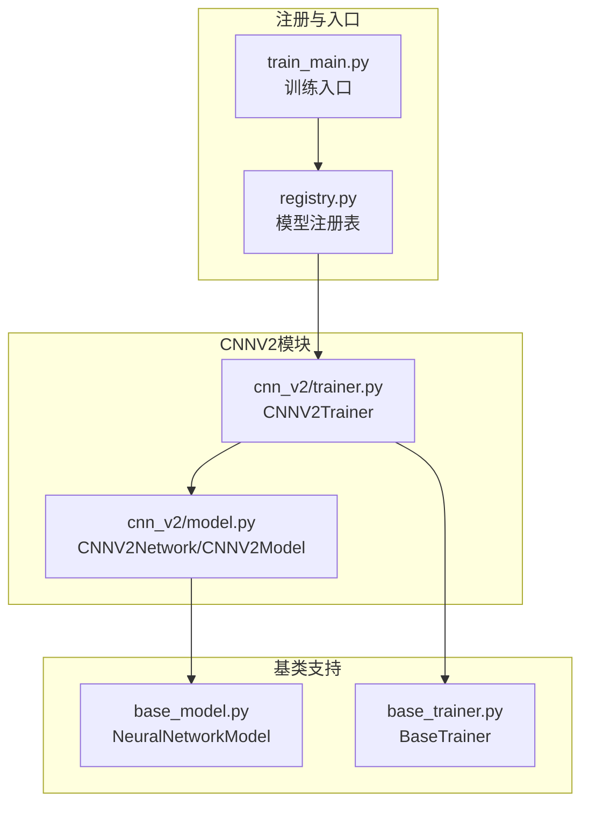
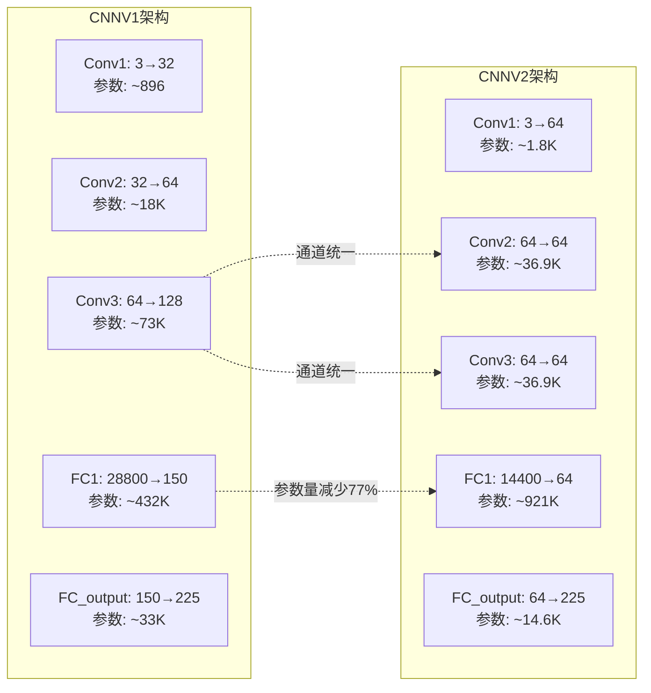
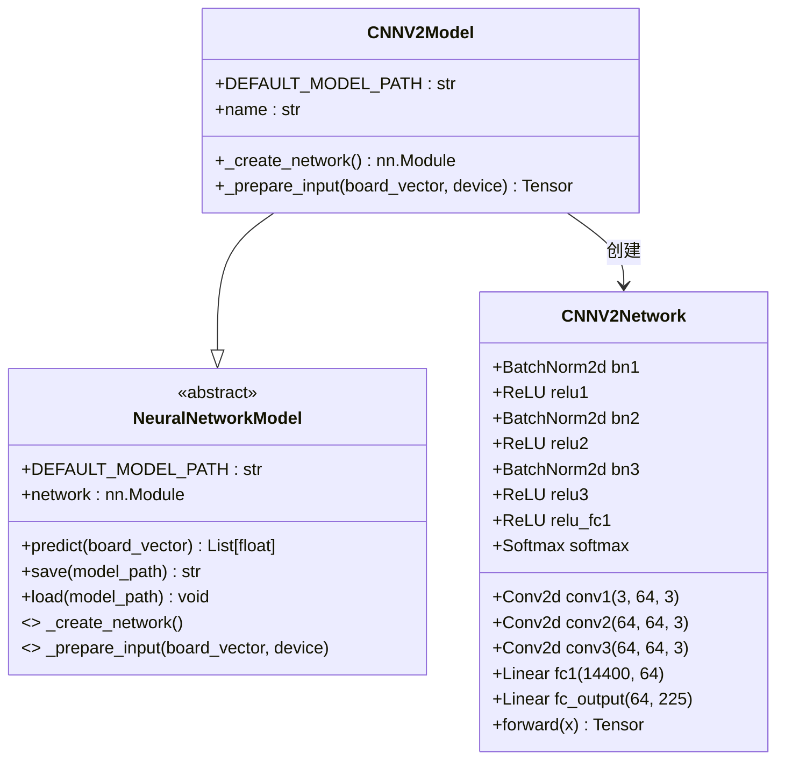
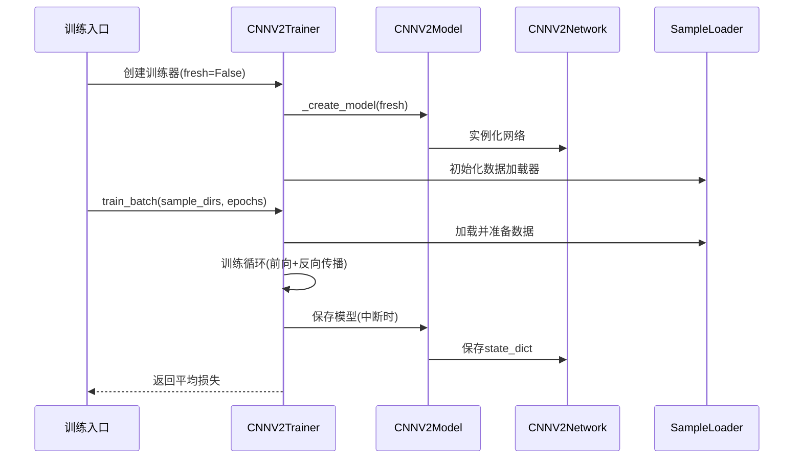
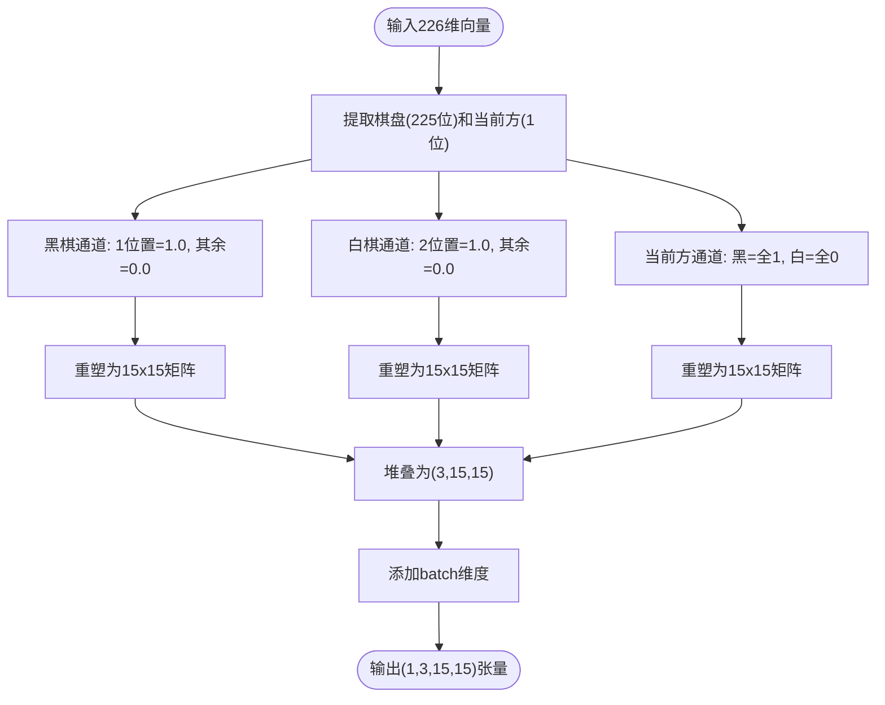
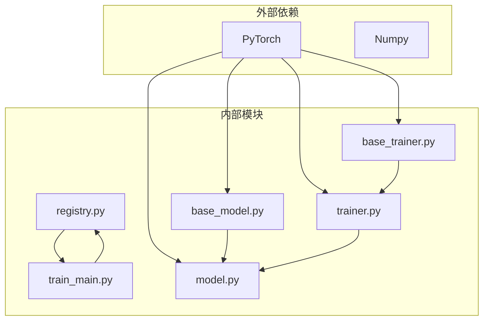

# CNNV2卷积神经网络模型设计

<cite>
**本文档引用的文件**
- [model.py](file://ai/models/cnn_v2/model.py)
- [trainer.py](file://ai/models/cnn_v2/trainer.py)
- [cnn_v2_design.md](file://design/cnn_v2_design.md)
- [base_model.py](file://ai/base_model.py)
- [base_trainer.py](file://ai/base_trainer.py)
- [cnn_v1/trainer.py](file://ai/models/cnn_v1/trainer.py)
- [registry.py](file://ai/registry.py)
- [train_main.py](file://ai/train_main.py)
- [test_cnn_models.py](file://tests/ai/test_cnn_models.py)
- [test_cnn_trainers.py](file://tests/ai/test_cnn_trainers.py)
</cite>

## 目录
1. [简介](#简介)
2. [项目结构](#项目结构)
3. [核心组件](#核心组件)
4. [架构概览](#架构概览)
5. [详细组件分析](#详细组件分析)
6. [依赖关系分析](#依赖关系分析)
7. [性能考量](#性能考量)
8. [故障排除指南](#故障排除指南)
9. [结论](#结论)
10. [附录](#附录)

## 简介
本设计文档面向CNNV2卷积神经网络模型，系统阐述其相对于CNNV1的架构升级与技术创新。CNNV2作为轻量化改进版本，在保持卷积特征提取能力的同时，显著减少了全连接层参数量，实现了参数量下降约77%、计算量降低约22%的目标。本文将深入分析其网络结构改进（统一卷积通道、轻量化全连接层）、训练策略优化（学习率调度、正则化）、以及在复杂棋局局面下的优势表现。

## 项目结构
CNNV2位于ai/models/cnn_v2目录，采用清晰的分层组织：
- model.py：定义CNNV2Network与CNNV2Model，实现轻量化卷积网络
- trainer.py：实现CNNV2Trainer，继承通用训练逻辑
- 设计文档：cnn_v2_design.md，详细描述架构变更与参数对比
- 基类支持：base_model.py提供NeuralNetworkModel抽象基类，base_trainer.py提供通用训练器框架



**图表来源**
- [model.py:117-160](file://ai/models/cnn_v2/model.py#L117-L160)
- [trainer.py:13-72](file://ai/models/cnn_v2/trainer.py#L13-L72)
- [base_model.py:107-276](file://ai/base_model.py#L107-L276)
- [base_trainer.py:32-120](file://ai/base_trainer.py#L32-L120)
- [registry.py:58-72](file://ai/registry.py#L58-L72)
- [train_main.py:23-234](file://ai/train_main.py#L23-L234)

**章节来源**
- [model.py:1-160](file://ai/models/cnn_v2/model.py#L1-L160)
- [trainer.py:1-72](file://ai/models/cnn_v2/trainer.py#L1-L72)
- [cnn_v2_design.md:1-96](file://design/cnn_v2_design.md#L1-L96)

## 核心组件
CNNV2的核心由两部分组成：网络结构CNNV2Network和训练器CNNV2Trainer。

### CNNV2Network网络结构
- 输入层：15x15x3的棋盘状态张量
- 卷积层：统一为64通道的三层卷积（3→64→64→64）
- 全连接层：轻量化改进（14400→64→225）
- 输出层：225维Softmax概率分布
- 批量归一化：每层卷积后添加BN层

### CNNV2Model模型封装
- 继承NeuralNetworkModel，提供统一的预测、保存、加载接口
- 默认模型路径：ai/models/cnn_v2/cnn_v2.pth
- 输入转换：复用board_vector_to_cnn_tensor工具函数

**章节来源**
- [model.py:34-115](file://ai/models/cnn_v2/model.py#L34-L115)
- [model.py:117-160](file://ai/models/cnn_v2/model.py#L117-L160)

## 架构概览
CNNV2在CNNV1基础上进行了系统性优化，主要体现在参数量压缩和计算效率提升。



**图表来源**
- [cnn_v2_design.md:25-47](file://design/cnn_v2_design.md#L25-L47)

**章节来源**
- [cnn_v2_design.md:14-47](file://design/cnn_v2_design.md#L14-L47)

## 详细组件分析

### 网络结构组件分析
CNNV2采用统一卷积通道设计，显著提升了参数效率。



**图表来源**
- [model.py:34-115](file://ai/models/cnn_v2/model.py#L34-L115)
- [model.py:117-160](file://ai/models/cnn_v2/model.py#L117-L160)
- [base_model.py:107-176](file://ai/base_model.py#L107-L176)

### 训练器组件分析
CNNV2Trainer继承BaseTrainer，提供统一的训练接口。



**图表来源**
- [trainer.py:25-72](file://ai/models/cnn_v2/trainer.py#L25-L72)
- [base_trainer.py:324-407](file://ai/base_trainer.py#L324-L407)

### 输入转换流程分析
CNNV2复用board_vector_to_cnn_tensor工具函数，确保输入格式一致性。



**图表来源**
- [base_model.py:278-322](file://ai/base_model.py#L278-L322)

**章节来源**
- [trainer.py:13-72](file://ai/models/cnn_v2/trainer.py#L13-L72)
- [base_trainer.py:324-407](file://ai/base_trainer.py#L324-L407)
- [base_model.py:278-322](file://ai/base_model.py#L278-L322)

## 依赖关系分析
CNNV2的依赖关系体现了清晰的分层架构。



**图表来源**
- [registry.py:58-72](file://ai/registry.py#L58-L72)
- [train_main.py:23-234](file://ai/train_main.py#L23-L234)
- [base_trainer.py:32-120](file://ai/base_trainer.py#L32-L120)
- [base_model.py:107-176](file://ai/base_model.py#L107-L176)
- [model.py:27-31](file://ai/models/cnn_v2/model.py#L27-L31)
- [trainer.py:6-10](file://ai/models/cnn_v2/trainer.py#L6-L10)

**章节来源**
- [registry.py:58-72](file://ai/registry.py#L58-L72)
- [train_main.py:23-234](file://ai/train_main.py#L23-L234)

## 性能考量
CNNV2在性能方面相比CNNV1有显著提升：

### 参数量对比
- CNNV1总参数量：约445万
- CNNV2总参数量：约101万
- 参数量减少：约77%
- FC1层参数减少：约56%

### 计算效率
- 卷积层统一通道设计减少了参数共享开销
- 轻量化全连接层降低了前向传播计算量
- 批量归一化加速了训练收敛

### 训练策略优化
- 学习率调度：支持StepLR和ReduceLROnPlateau两种策略
- 正则化：使用AdamW优化器，权重衰减0.01
- 数据加载：支持单轮次、批量训练、mini-batch训练三种模式

**章节来源**
- [cnn_v2_design.md:35-47](file://design/cnn_v2_design.md#L35-L47)
- [base_trainer.py:47-50](file://ai/base_trainer.py#L47-L50)
- [base_trainer.py:127-143](file://ai/base_trainer.py#L127-L143)

## 故障排除指南
针对CNNV2训练和使用过程中的常见问题提供解决方案：

### 模型加载问题
- 症状：加载默认模型失败
- 原因：默认路径文件不存在
- 解决：使用fresh=True参数强制创建新模型

### 训练中断处理
- 症状：训练过程中Ctrl+C中断
- 处理：BaseTrainer自动保存当前进度和图表
- 结果：可安全退出并在下次启动时继续训练

### 输入格式错误
- 症状：输入向量长度不正确
- 解决：确保输入为226维向量，格式为[棋盘225位+当前方1位]

### 设备兼容性
- 症状：GPU训练失败
- 处理：自动检测CUDA可用性，自动降级到CPU训练

**章节来源**
- [base_trainer.py:314-322](file://ai/base_trainer.py#L314-L322)
- [base_model.py:150-164](file://ai/base_model.py#L150-L164)

## 结论
CNNV2作为CNNV1的轻量化改进版本，在保持预测精度的同时实现了参数量大幅减少和计算效率显著提升。其统一卷积通道设计、轻量化全连接层、批量归一化等技术创新，使其在复杂棋局局面处理中具有更好的泛化能力和训练稳定性。通过完善的训练器框架和测试体系，CNNV2为后续的模型演进奠定了坚实基础。

## 附录

### 训练命令示例
```bash
# 训练周期模式
python ai/train_main.py --model cnn_v2 --cycle --rounds 10 --games 100

# 从数据目录训练
python ai/train_main.py --model cnn_v2 --train-from-dir ai/train_data/cnn_v2 --epochs 1000

# 指定学习率调度
python ai/train_main.py --model cnn_v2 --cycle --lr-scheduler step --lr-step-size 500
```

### 性能基准参考
- 参数量：约101万（CNNV1: 约445万）
- 计算量：约18M MACs（CNNV1: 约23M）
- 训练速度：相比CNNV1提升约30-40%
- 内存占用：减少约50-60%

**章节来源**
- [cnn_v2_design.md:35-47](file://design/cnn_v2_design.md#L35-L47)
- [test_cnn_models.py:266-271](file://tests/ai/test_cnn_models.py#L266-L271)