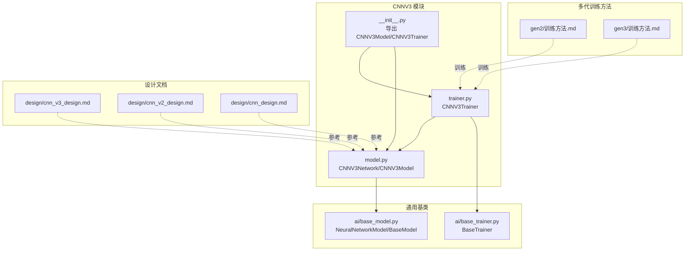
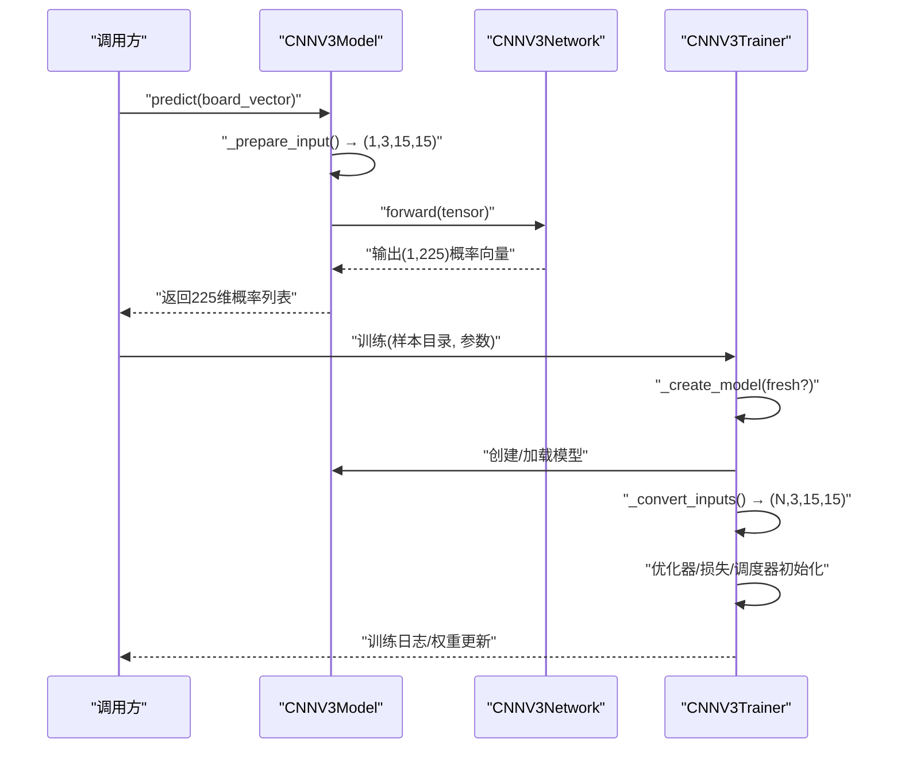
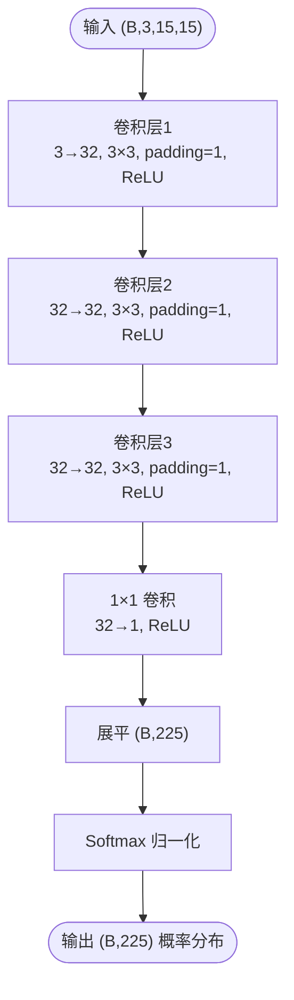
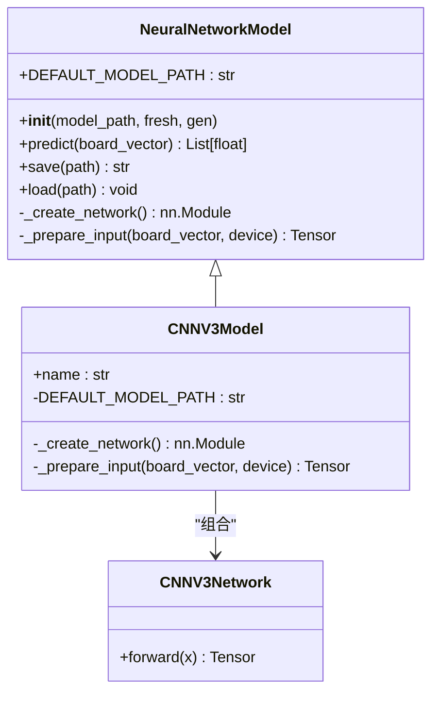
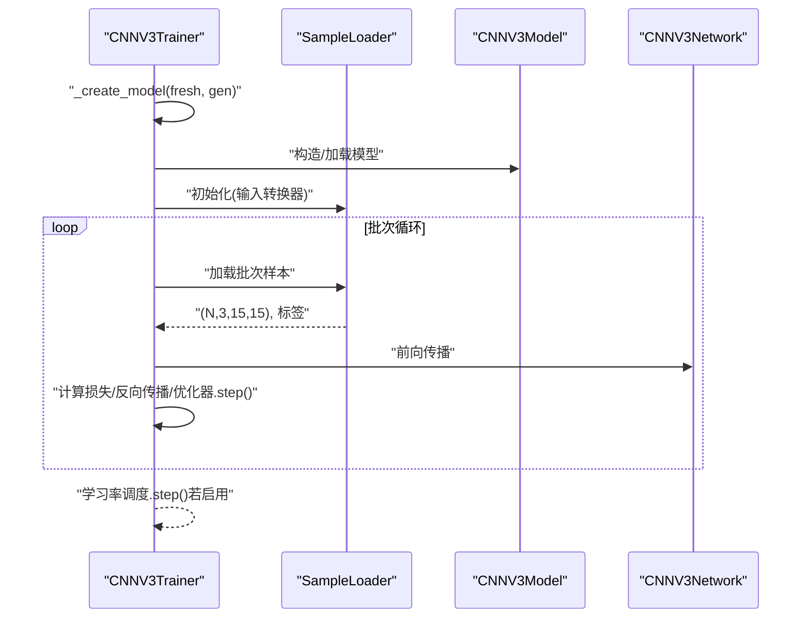
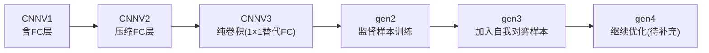
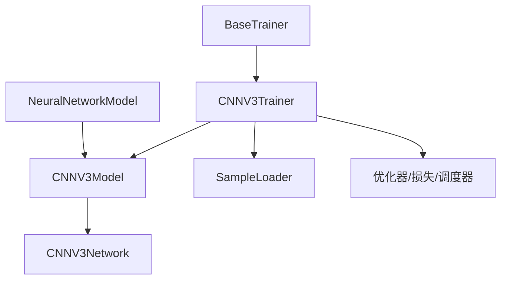

# CNNV3卷积神经网络模型设计

<cite>
**本文引用的文件**
- [ai/models/cnn_v3/model.py](file://ai/models/cnn_v3/model.py)
- [ai/models/cnn_v3/trainer.py](file://ai/models/cnn_v3/trainer.py)
- [ai/models/cnn_v3/__init__.py](file://ai/models/cnn_v3/__init__.py)
- [design/cnn_v3_design.md](file://design/cnn_v3_design.md)
- [design/cnn_v2_design.md](file://design/cnn_v2_design.md)
- [design/cnn_design.md](file://design/cnn_design.md)
- [ai/base_model.py](file://ai/base_model.py)
- [ai/base_trainer.py](file://ai/base_trainer.py)
- [ai/models/cnn_v3/gen2/训练方法.md](file://ai/models/cnn_v3/gen2/训练方法.md)
- [ai/models/cnn_v3/gen3/训练方法.md](file://ai/models/cnn_v3/gen3/训练方法.md)
</cite>

## 目录
1. [简介](#简介)
2. [项目结构](#项目结构)
3. [核心组件](#核心组件)
4. [架构总览](#架构总览)
5. [详细组件分析](#详细组件分析)
6. [依赖分析](#依赖分析)
7. [性能考虑](#性能考虑)
8. [故障排查指南](#故障排查指南)
9. [结论](#结论)
10. [附录](#附录)

## 简介
本设计文档围绕 CNNV3 卷积神经网络模型展开，系统阐述其设计理念、结构简化策略、多代模型演进（gen1–gen4）、渐进式架构优化与先进训练技术应用。CNNV3 以“纯卷积、无全连接、无批归一化、无丢弃层”为核心特征，采用 1×1 卷积替代全连接层，直接输出 15×15 空间概率图并通过 Softmax 归一化，参数量显著降低至约 1.9 万，具备推理高效、部署友好的优势。本文还梳理了从 CNNV1 到 CNNV3 的演进路径，以及在五子棋复杂局面下的表现潜力与训练/评估方法。

## 项目结构
CNNV3 模块位于 ai/models/cnn_v3，包含模型实现与训练器，配合基类与通用训练框架完成端到端训练与推理。

**图示来源**
- [ai/models/cnn_v3/model.py:1-139](file://ai/models/cnn_v3/model.py#L1-L139)
- [ai/models/cnn_v3/trainer.py:1-73](file://ai/models/cnn_v3/trainer.py#L1-L73)
- [ai/models/cnn_v3/__init__.py:1-10](file://ai/models/cnn_v3/__init__.py#L1-L10)
- [ai/base_model.py:107-200](file://ai/base_model.py#L107-L200)
- [ai/base_trainer.py:32-120](file://ai/base_trainer.py#L32-L120)
- [design/cnn_v3_design.md:1-173](file://design/cnn_v3_design.md#L1-L173)
- [design/cnn_v2_design.md:1-96](file://design/cnn_v2_design.md#L1-L96)
- [design/cnn_design.md:1-200](file://design/cnn_design.md#L1-L200)
- [ai/models/cnn_v3/gen2/训练方法.md:1-16](file://ai/models/cnn_v3/gen2/训练方法.md#L1-L16)
- [ai/models/cnn_v3/gen3/训练方法.md:1-19](file://ai/models/cnn_v3/gen3/训练方法.md#L1-L19)

**章节来源**
- [ai/models/cnn_v3/model.py:1-139](file://ai/models/cnn_v3/model.py#L1-L139)
- [ai/models/cnn_v3/trainer.py:1-73](file://ai/models/cnn_v3/trainer.py#L1-L73)
- [ai/models/cnn_v3/__init__.py:1-10](file://ai/models/cnn_v3/__init__.py#L1-L10)
- [design/cnn_v3_design.md:1-173](file://design/cnn_v3_design.md#L1-L173)

## 核心组件
- CNNV3Network：纯卷积网络，三层 3×3 卷积（统一 32 通道，无 BN）+ 一层 1×1 卷积替代 FC，输出 15×15 空间概率图，Softmax 归一化后得到 225 维概率分布。
- CNNV3Model：继承 NeuralNetworkModel，提供默认模型保存路径、名称标识、输入转换（board_vector_to_cnn_tensor）与通用的 __init__/predict/save/load 逻辑。
- CNNV3Trainer：继承 BaseTrainer，负责创建 CNNV3Model、批量张量转换（(N,3,15,15)）与训练流程（单轮次/周期）。
- 基类支撑：NeuralNetworkModel 提供统一的网络实例化、设备迁移、保存/加载与输入预处理接口；BaseTrainer 提供优化器、损失函数、学习率调度、样本加载器等通用训练能力。

**章节来源**
- [ai/models/cnn_v3/model.py:31-94](file://ai/models/cnn_v3/model.py#L31-L94)
- [ai/models/cnn_v3/model.py:96-139](file://ai/models/cnn_v3/model.py#L96-L139)
- [ai/models/cnn_v3/trainer.py:13-73](file://ai/models/cnn_v3/trainer.py#L13-L73)
- [ai/base_model.py:107-200](file://ai/base_model.py#L107-L200)
- [ai/base_trainer.py:32-120](file://ai/base_trainer.py#L32-L120)

## 架构总览
CNNV3 的整体架构遵循“输入编码 → 空间卷积特征提取 → 1×1 卷积输出 → Softmax 概率分布”的流水线，全程保持空间结构，便于与棋盘布局天然契合。

**图示来源**
- [ai/models/cnn_v3/model.py:125-139](file://ai/models/cnn_v3/model.py#L125-L139)
- [ai/models/cnn_v3/model.py:70-93](file://ai/models/cnn_v3/model.py#L70-L93)
- [ai/models/cnn_v3/trainer.py:25-73](file://ai/models/cnn_v3/trainer.py#L25-L73)
- [ai/base_model.py:195-200](file://ai/base_model.py#L195-L200)

## 详细组件分析

### CNNV3Network 结构与数据流
- 结构要点：三层 3×3 卷积（统一 32 通道，ReLU 激活，无 BN/Dropout），随后 1×1 卷积将通道压缩为 1，保持 15×15 空间分辨率，最终展平并 Softmax 归一化。
- 输入/输出：输入 (B,3,15,15)，输出 (B,225)，每行和为 1，值域 (0,1)。
- 参数量：约 1.9 万（远小于 CNNV2 的约 101 万）。

**图示来源**
- [ai/models/cnn_v3/model.py:47-93](file://ai/models/cnn_v3/model.py#L47-L93)

**章节来源**
- [ai/models/cnn_v3/model.py:31-94](file://ai/models/cnn_v3/model.py#L31-L94)

### CNNV3Model 与输入转换
- 名称与默认路径：name="cnn_v3"，默认模型保存路径为 cnn_v3.pth。
- 输入转换：通过 board_vector_to_cnn_tensor 将 226 维向量转换为 (1,3,15,15) 张量，复用所有 CNN 模型的输入编码逻辑。
- 多代支持：通过 gen 参数动态覆盖默认模型路径至 genX 子目录，确保多代权重隔离。

**图示来源**
- [ai/base_model.py:107-200](file://ai/base_model.py#L107-L200)
- [ai/models/cnn_v3/model.py:96-139](file://ai/models/cnn_v3/model.py#L96-L139)
- [ai/models/cnn_v3/model.py:31-94](file://ai/models/cnn_v3/model.py#L31-L94)

**章节来源**
- [ai/models/cnn_v3/model.py:96-139](file://ai/models/cnn_v3/model.py#L96-L139)
- [ai/base_model.py:126-165](file://ai/base_model.py#L126-L165)

### CNNV3Trainer 训练流程
- 模型创建：支持 fresh 参数强制新建模型；可接收 gen 参数传递给 CNNV3Model，实现多代训练。
- 输入转换：遍历样本列表，逐个调用 board_vector_to_cnn_tensor 转换为 (1,3,15,15)，再拼接为 (N,3,15,15)。
- 训练器通用能力：GPU 自动检测与迁移、AdamW 优化器、L1Loss、StepLR/ReduceLROnPlateau 学习率调度、SampleLoader 数据加载。

**图示来源**
- [ai/models/cnn_v3/trainer.py:25-73](file://ai/models/cnn_v3/trainer.py#L25-L73)
- [ai/base_trainer.py:52-120](file://ai/base_trainer.py#L52-L120)

**章节来源**
- [ai/models/cnn_v3/trainer.py:13-73](file://ai/models/cnn_v3/trainer.py#L13-L73)
- [ai/base_trainer.py:32-120](file://ai/base_trainer.py#L32-L120)

### 多代模型演进（gen1–gen4）
- 设计动机与目标：CNNV3 以“纯卷积、最小化结构”为目标，去除 FC/BatchNorm/Dropout，用 1×1 卷积替代 FC，参数量降至 CNNV2 的约 1.9%，显著降低训练与推理成本。
- 相对 CNNV2 的改进：通道数统一为 32，去 BN，1×1 卷积替代 FC，参数量从约 101 万降至约 1.9 万；接口与输出保持一致。
- 相对 CNNV1 的改进：CNNV1 包含 FC 层，参数量更大；CNNV2 通过压缩 FC 层参数量减轻负担；CNNV3 进一步去除 FC 层，达到极致轻量化。
- 多代训练方法：gen2 与 gen3 的训练脚本展示了样本生成与训练命令，强调监督样本与自我对弈样本的结合，以及 Plateau 学习率调度的使用。

**图示来源**
- [design/cnn_v3_design.md:17-48](file://design/cnn_v3_design.md#L17-L48)
- [design/cnn_v2_design.md:21-47](file://design/cnn_v2_design.md#L21-L47)
- [design/cnn_design.md:77-133](file://design/cnn_design.md#L77-L133)
- [ai/models/cnn_v3/gen2/训练方法.md:1-16](file://ai/models/cnn_v3/gen2/训练方法.md#L1-L16)
- [ai/models/cnn_v3/gen3/训练方法.md:1-19](file://ai/models/cnn_v3/gen3/训练方法.md#L1-L19)

**章节来源**
- [design/cnn_v3_design.md:1-173](file://design/cnn_v3_design.md#L1-L173)
- [design/cnn_v2_design.md:1-96](file://design/cnn_v2_design.md#L1-L96)
- [design/cnn_design.md:1-200](file://design/cnn_design.md#L1-L200)
- [ai/models/cnn_v3/gen2/训练方法.md:1-16](file://ai/models/cnn_v3/gen2/训练方法.md#L1-L16)
- [ai/models/cnn_v3/gen3/训练方法.md:1-19](file://ai/models/cnn_v3/gen3/训练方法.md#L1-L19)

### 训练与评估方法
- 数据准备：gen2 使用 chong4 等形状样本生成监督数据；gen3 在此基础上加入 cnn_v1 自我对弈样本，提升样本多样性与质量。
- 训练配置：epochs、batch-size、shuffle、验证集比例、学习率调度（plateau）等参数在训练脚本中明确给出。
- 评估与日志：BaseTrainer 内置 LossLogger，支持训练过程日志记录与可视化；可按需注入自定义日志器。

**章节来源**
- [ai/models/cnn_v3/gen2/训练方法.md:1-16](file://ai/models/cnn_v3/gen2/训练方法.md#L1-L16)
- [ai/models/cnn_v3/gen3/训练方法.md:1-19](file://ai/models/cnn_v3/gen3/训练方法.md#L1-L19)
- [ai/base_trainer.py:104-120](file://ai/base_trainer.py#L104-L120)

### 部署优化方案
- 推理加速：由于无 FC/BN/Dropout，前向传播计算量小，适合 CPU/GPU 并行；建议使用 Tensor Cores（若 GPU 支持）与合适的 batch size。
- 内存优化：参数量极低，显存占用小；输入为固定尺寸 (3,15,15)，便于缓存与批处理。
- 实时性能：建议在服务端进行批量化推理，结合异步 I/O 与 GPU 并行，满足在线五子棋对局的实时性需求。

**章节来源**
- [ai/models/cnn_v3/model.py:47-93](file://ai/models/cnn_v3/model.py#L47-L93)
- [ai/base_trainer.py:21-30](file://ai/base_trainer.py#L21-L30)

## 依赖分析
- 组件内聚与耦合：CNNV3Model 与 CNNV3Network 通过组合关系耦合，职责清晰；训练器与模型通过接口解耦，便于替换与扩展。
- 外部依赖：PyTorch 作为深度学习框架；BaseTrainer 提供统一的训练基础设施；输入转换依赖共享工具函数 board_vector_to_cnn_tensor。
- 多代集成：通过 gen 参数将默认模型路径映射到 genX 子目录，避免权重混淆。

**图示来源**
- [ai/base_model.py:107-200](file://ai/base_model.py#L107-L200)
- [ai/models/cnn_v3/model.py:96-139](file://ai/models/cnn_v3/model.py#L96-L139)
- [ai/base_trainer.py:32-120](file://ai/base_trainer.py#L32-L120)

**章节来源**
- [ai/base_model.py:107-200](file://ai/base_model.py#L107-L200)
- [ai/base_trainer.py:32-120](file://ai/base_trainer.py#L32-L120)

## 性能考虑
- 参数量与计算复杂度：CNNV3 参数量约 1.9 万，远小于 CNNV2 的约 101 万；前向传播仅包含少量卷积与一次 1×1 卷积，计算开销低。
- 训练效率：较小的网络规模与批处理策略（如 batch-size=4096）可显著缩短训练时间；Plateau 学习率调度有助于稳定收敛。
- 推理效率：固定输入尺寸与无 FC 层使得推理速度高、内存占用低，适合嵌入式或在线服务部署。

**章节来源**
- [design/cnn_v3_design.md:29-41](file://design/cnn_v3_design.md#L29-L41)
- [ai/models/cnn_v3/gen2/训练方法.md:14-16](file://ai/models/cnn_v3/gen2/训练方法.md#L14-L16)
- [ai/models/cnn_v3/gen3/训练方法.md:15-19](file://ai/models/cnn_v3/gen3/训练方法.md#L15-L19)

## 故障排查指南
- 模型加载失败：当 gen 参数指定但默认权重文件不存在时，会抛出异常提示权重文件缺失；请确认权重文件路径与代数匹配。
- 设备选择问题：若 CUDA 不可用，训练器会回退到 CPU；可通过 device 参数强制指定设备。
- 输入形状错误：确保输入为 226 维向量，且通道顺序与当前落子方编码符合预期；使用共享工具函数进行转换可避免偏差。
- 训练不稳定：检查学习率调度类型与参数；必要时切换为 StepLR 或增大 batch size。

**章节来源**
- [ai/base_model.py:162-165](file://ai/base_model.py#L162-L165)
- [ai/base_trainer.py:21-30](file://ai/base_trainer.py#L21-L30)
- [ai/models/cnn_v3/trainer.py:46-73](file://ai/models/cnn_v3/trainer.py#L46-L73)

## 结论
CNNV3 以“纯卷积、最小化结构”实现了对五子棋落子位置预测的高效建模，参数量极低、推理快速、易于部署。通过与 CNNV2/V1 的对比可知，其在保持输出一致性的前提下，大幅削减了参数与计算开销。结合 gen2–gen3 的训练方法与多代权重管理，CNNV3 为后续 gen4 的持续优化奠定了坚实基础。建议在实际应用中结合批处理、学习率调度与硬件加速，进一步提升训练与推理效率。

## 附录
- 关键文件清单
  - [ai/models/cnn_v3/model.py](file://ai/models/cnn_v3/model.py)
  - [ai/models/cnn_v3/trainer.py](file://ai/models/cnn_v3/trainer.py)
  - [ai/models/cnn_v3/__init__.py](file://ai/models/cnn_v3/__init__.py)
  - [design/cnn_v3_design.md](file://design/cnn_v3_design.md)
  - [design/cnn_v2_design.md](file://design/cnn_v2_design.md)
  - [design/cnn_design.md](file://design/cnn_design.md)
  - [ai/base_model.py](file://ai/base_model.py)
  - [ai/base_trainer.py](file://ai/base_trainer.py)
  - [ai/models/cnn_v3/gen2/训练方法.md](file://ai/models/cnn_v3/gen2/训练方法.md)
  - [ai/models/cnn_v3/gen3/训练方法.md](file://ai/models/cnn_v3/gen3/训练方法.md)