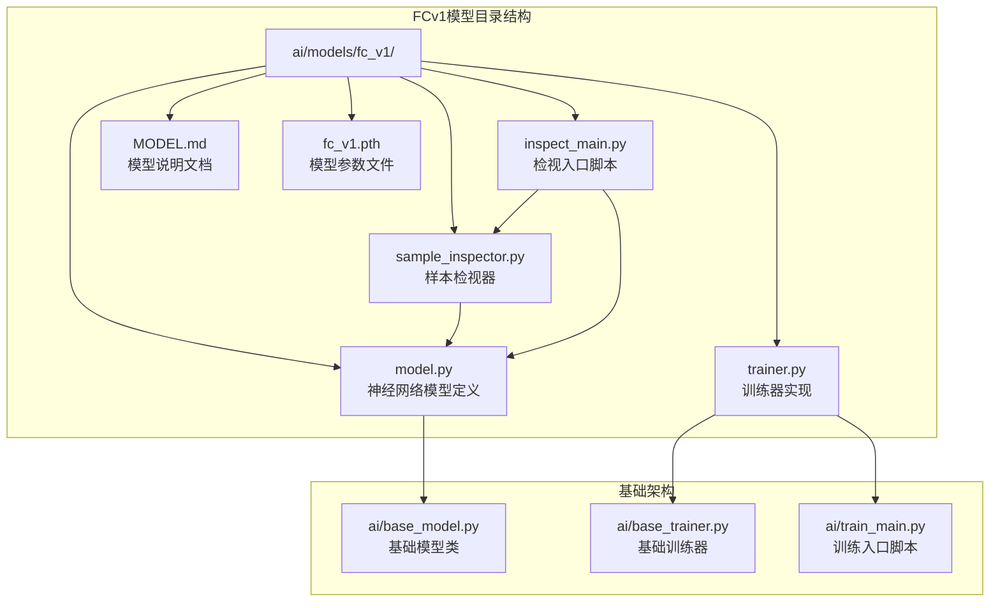
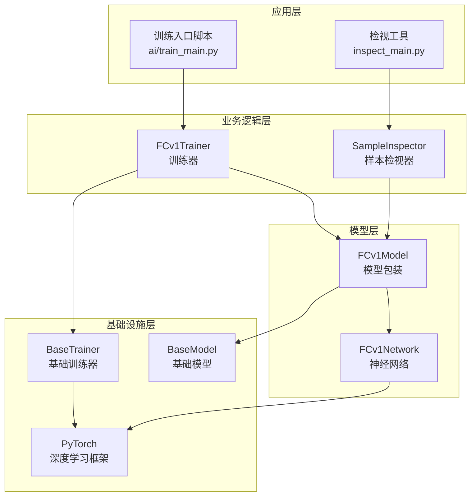
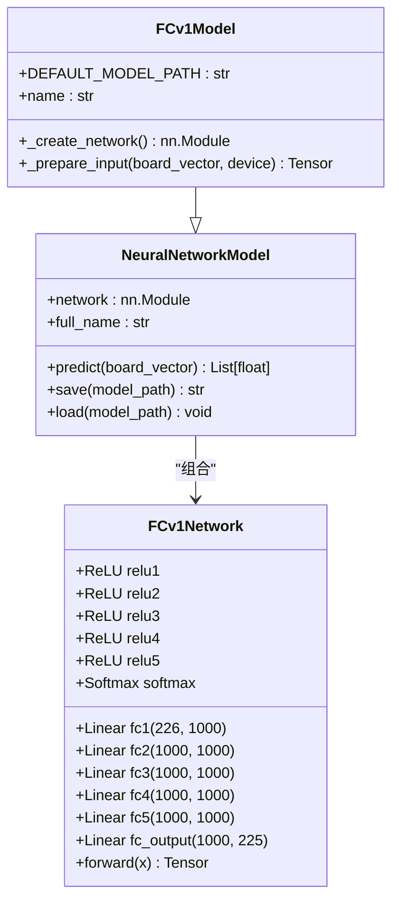
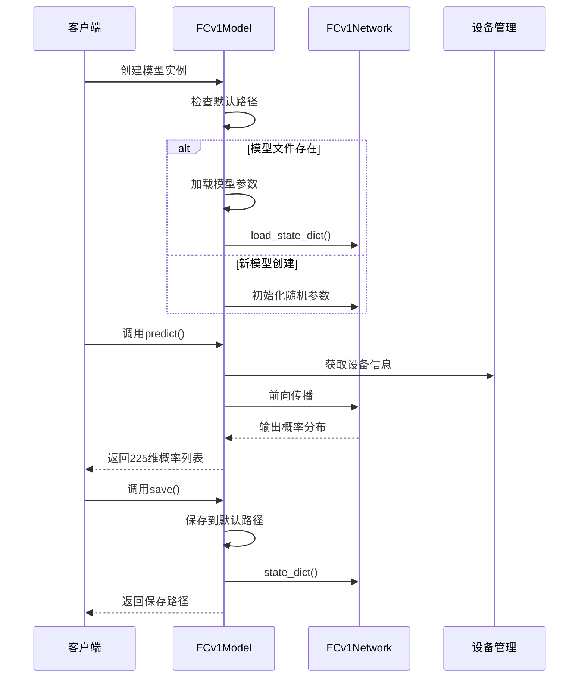
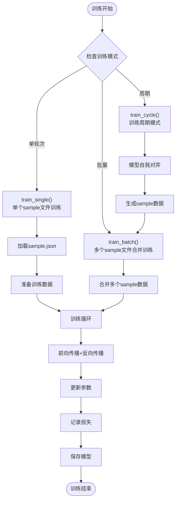
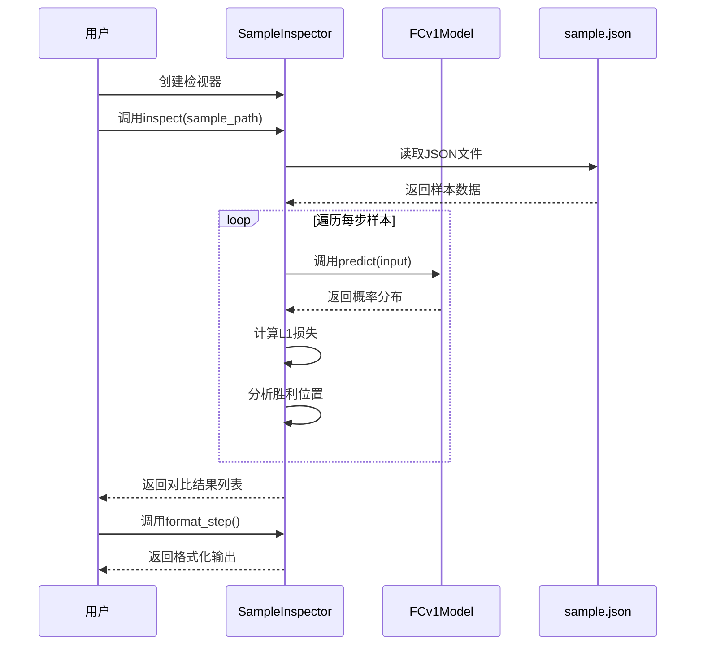
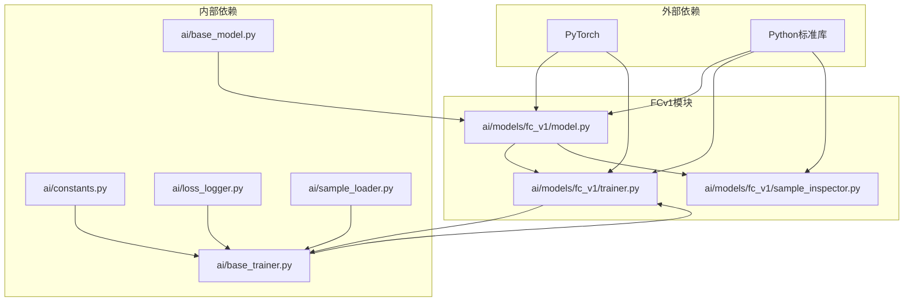

# FCv1全连接网络模型设计

<cite>
**本文档引用的文件**
- [model.py](file://ai/models/fc_v1/model.py)
- [trainer.py](file://ai/models/fc_v1/trainer.py)
- [sample_inspector.py](file://ai/models/fc_v1/sample_inspector.py)
- [inspect_main.py](file://ai/models/fc_v1/inspect_main.py)
- [MODEL.md](file://ai/models/fc_v1/MODEL.md)
- [fc_v1_design.md](file://design/fc_v1_design.md)
- [base_trainer.py](file://ai/base_trainer.py)
- [base_model.py](file://ai/base_model.py)
- [train_main.py](file://ai/train_main.py)
</cite>

## 目录
1. [简介](#简介)
2. [项目结构](#项目结构)
3. [核心组件](#核心组件)
4. [架构概览](#架构概览)
5. [详细组件分析](#详细组件分析)
6. [依赖关系分析](#依赖关系分析)
7. [性能考虑](#性能考虑)
8. [故障排除指南](#故障排除指南)
9. [结论](#结论)
10. [附录](#附录)

## 简介

FCv1（Fully Connected v1）是五子棋AI系统中的第一个深度学习模型，采用全连接神经网络架构。该模型通过监督学习从AI对战中学习落子策略，经过重大架构优化后采用5层隐藏层、每层1000个神经元的独特设计，显著减少了参数量并提升了训练效率。本文档深入分析了FCv1的设计理念、架构实现、训练流程和持久化机制。

## 项目结构

FCv1模型位于AI模块的fc_v1子目录中，包含完整的模型定义、训练器和辅助工具：



**图表来源**
- [model.py:1-132](file://ai/models/fc_v1/model.py#L1-L132)
- [trainer.py:1-44](file://ai/models/fc_v1/trainer.py#L1-L44)
- [base_model.py:1-323](file://ai/base_model.py#L1-L323)
- [base_trainer.py:1-699](file://ai/base_trainer.py#L1-L699)

**章节来源**
- [model.py:1-132](file://ai/models/fc_v1/model.py#L1-L132)
- [trainer.py:1-44](file://ai/models/fc_v1/trainer.py#L1-L44)
- [MODEL.md:1-116](file://ai/models/fc_v1/MODEL.md#L1-L116)

## 核心组件

FCv1系统由三个核心组件构成，每个组件都有明确的职责分工：

### 神经网络结构组件
- **FCv1Network**: 实现5层隐藏层的全连接网络架构
- **输入设计**: 226维向量（225维棋盘状态 + 1维当前落子方）
- **输出设计**: 225维概率分布（Softmax输出）
- **参数优化**: 从10层架构优化为5层，参数量减少约50%

### 模型包装组件
- **FCv1Model**: 继承NeuralNetworkModel，提供预测、保存、加载功能
- **默认行为**: 自动加载fc_v1.pth或创建新模型
- **设备管理**: 支持CPU/GPU自动检测和迁移

### 训练器组件
- **FCv1Trainer**: 继承BaseTrainer，实现具体的训练逻辑
- **训练模式**: 支持单轮次训练、批量训练和训练周期模式
- **优化配置**: AdamW优化器，学习率0.001，L1损失函数

**章节来源**
- [model.py:91-132](file://ai/models/fc_v1/model.py#L91-L132)
- [trainer.py:11-44](file://ai/models/fc_v1/trainer.py#L11-L44)
- [base_model.py:107-323](file://ai/base_model.py#L107-L323)

## 架构概览

FCv1采用了清晰的分层架构设计，实现了高内聚、低耦合的模块化结构：



**图表来源**
- [train_main.py:1-200](file://ai/train_main.py#L1-L200)
- [model.py:18-132](file://ai/models/fc_v1/model.py#L18-L132)
- [trainer.py:11-44](file://ai/models/fc_v1/trainer.py#L11-L44)
- [base_trainer.py:32-699](file://ai/base_trainer.py#L32-L699)
- [base_model.py:24-323](file://ai/base_model.py#L24-L323)

## 详细组件分析

### FCv1Network神经网络结构

FCv1Network实现了5层隐藏层的全连接网络架构，每层包含1000个神经元，使用ReLU激活函数，并在输出层后新增Softmax激活函数：



**图表来源**
- [model.py:18-88](file://ai/models/fc_v1/model.py#L18-L88)
- [model.py:91-132](file://ai/models/fc_v1/model.py#L91-L132)
- [base_model.py:107-276](file://ai/base_model.py#L107-L276)

#### 网络架构设计要点

**输入输出设计**：
- **输入层**: 226维向量
  - 前225维：棋盘状态（按行展开，0=空，1=黑，2=白）
  - 最后1维：当前落子方（1=黑，2=白）
- **输出层**: 225维概率分布
  - 每个位置对应一个概率值
  - 概率范围(0,1)，所有概率之和为1

**激活函数选择**：
- 隐藏层：ReLU激活函数
- 输出层：Softmax激活函数
- 选择理由：ReLU解决梯度消失问题，Softmax确保输出为概率分布

**参数量计算**：
- 每层线性层参数：输入维度 × 输出维度 + 1（偏置）
- 总参数量：约446万个参数（相比之前的946万减少约50%）
- 计算复杂度：显著降低，提升训练效率

**章节来源**
- [model.py:18-88](file://ai/models/fc_v1/model.py#L18-L88)
- [MODEL.md:90-116](file://ai/models/fc_v1/MODEL.md#L90-L116)

### FCv1Model模型包装类

FCv1Model继承自NeuralNetworkModel，提供了完整的模型生命周期管理：



**图表来源**
- [model.py:91-132](file://ai/models/fc_v1/model.py#L91-L132)
- [base_model.py:126-276](file://ai/base_model.py#L126-L276)

#### 模型持久化机制

**保存格式**：
- PyTorch .pth格式
- 保存内容：`network.state_dict()`（所有可学习参数）
- 路径：`ai/models/fc_v1/fc_v1.pth`

**加载行为**：
- 默认自动加载：如果fc_v1.pth存在，自动加载
- 强制新建：使用`fresh=True`参数
- 手动指定：通过`model_path`参数指定路径

**章节来源**
- [model.py:91-132](file://ai/models/fc_v1/model.py#L91-L132)
- [base_model.py:232-276](file://ai/base_model.py#L232-L276)
- [MODEL.md:426-466](file://ai/models/fc_v1/MODEL.md#L426-L466)

### FCv1Trainer训练器

FCv1Trainer继承自BaseTrainer，实现了具体的训练逻辑和优化配置：



**图表来源**
- [trainer.py:23-42](file://ai/models/fc_v1/trainer.py#L23-L42)
- [base_trainer.py:324-660](file://ai/base_trainer.py#L324-L660)

#### 训练配置详解

**优化器配置**：
- 优化器：AdamW（解耦权重衰减）
- 学习率：0.001（默认值）
- 权重衰减：0.01（默认值）
- 损失函数：L1Loss（平均绝对误差）

**训练模式**：
- **单轮次训练**：针对单个sample.json文件，10个epoch
- **批量训练**：合并多个sample文件，1000个epoch
- **训练周期**：模型自我对弈+训练迭代，每轮1000个epoch

**学习率调度**：
- 支持StepLR和ReduceLROnPlateau两种调度器
- StepLR：固定间隔衰减（默认500epoch，衰减系数0.9）
- ReduceLROnPlateau：按性能平台衰减（耐心值100，衰减系数0.5）

**章节来源**
- [base_trainer.py:47-144](file://ai/base_trainer.py#L47-L144)
- [base_trainer.py:324-660](file://ai/base_trainer.py#L324-L660)
- [MODEL.md:47-56](file://ai/models/fc_v1/MODEL.md#L47-L56)

### SampleInspector样本检视器

SampleInspector提供了强大的样本分析和调试功能：



**图表来源**
- [sample_inspector.py:37-97](file://ai/models/fc_v1/sample_inspector.py#L37-L97)
- [sample_inspector.py:99-164](file://ai/models/fc_v1/sample_inspector.py#L99-L164)

#### 功能特性

**样本分析**：
- 逐步处理sample.json中的每步数据
- 对比模型输出与目标概率分布
- 计算每步的L1损失（平均绝对误差）

**统计分析**：
- 已占位位置统计（概率为0.0）
- 空位统计（概率为0-1之间）
- 胜利位置检测（概率最高的位置）

**输出格式**：
- 详细的统计信息
- 概率分布对比
- 胜利位置坐标（行列索引）

**章节来源**
- [sample_inspector.py:22-183](file://ai/models/fc_v1/sample_inspector.py#L22-L183)
- [inspect_main.py:21-97](file://ai/models/fc_v1/inspect_main.py#L21-L97)

## 依赖关系分析

FCv1模型的依赖关系体现了清晰的分层设计：



**图表来源**
- [model.py:11-15](file://ai/models/fc_v1/model.py#L11-L15)
- [trainer.py:6-8](file://ai/models/fc_v1/trainer.py#L6-L8)
- [base_model.py:16-21](file://ai/base_model.py#L16-L21)
- [base_trainer.py:7-18](file://ai/base_trainer.py#L7-L18)

### 关键依赖关系

**模型层依赖**：
- FCv1Model依赖NeuralNetworkModel的基础功能
- FCv1Network依赖PyTorch的nn.Module基类
- 所有组件都依赖Python标准库

**训练器依赖**：
- FCv1Trainer继承BaseTrainer的通用训练逻辑
- 依赖LossLogger进行损失记录
- 依赖SampleLoader进行数据加载
- 依赖constants中的全局配置

**数据流依赖**：
- 模型预测依赖输入向量格式
- 训练过程依赖样本数据结构
- 检视功能依赖模型输出格式

**章节来源**
- [model.py:11-15](file://ai/models/fc_v1/model.py#L11-L15)
- [trainer.py:6-8](file://ai/models/fc_v1/trainer.py#L6-L8)
- [base_trainer.py:7-18](file://ai/base_trainer.py#L7-L18)

## 性能考虑

### 计算效率优化

**内存管理**：
- 使用torch.no_grad()在推理时禁用梯度计算
- 支持GPU加速训练和推理
- 批量处理减少内存碎片

**训练效率**：
- 支持mini-batch训练提高收敛速度
- 学习率调度器适应不同训练阶段
- 损失日志记录优化训练监控

**模型优化**：
- 5层隐藏层设计平衡表达能力和计算复杂度
- ReLU激活函数避免梯度消失问题
- Softmax输出确保概率分布的有效性

### 硬件要求

**GPU需求**：
- 推荐使用NVIDIA GPU（CUDA支持）
- 内存建议：至少8GB VRAM
- 计算能力：支持CUDA 11.0+

**CPU需求**：
- 多核处理器提升数据加载效率
- 内存建议：16GB以上
- 存储空间：至少1GB用于模型文件

## 故障排除指南

### 常见问题及解决方案

**模型加载失败**：
- 检查fc_v1.pth文件是否存在
- 验证文件权限和完整性
- 确认PyTorch版本兼容性

**训练不收敛**：
- 检查学习率设置（默认0.001）
- 验证样本数据质量
- 确认损失函数配置正确

**内存不足**：
- 减少batch_size大小
- 启用GPU训练
- 优化数据加载策略

**训练中断**：
- 检查键盘中断处理
- 确认模型保存机制
- 验证训练数据完整性

### 调试工具

**SampleInspector调试**：
- 逐步分析样本数据
- 对比模型输出与目标
- 统计分析训练效果

**训练监控**：
- LossLogger记录训练过程
- 学习率调度器监控
- 验证集性能评估

**章节来源**
- [sample_inspector.py:46-49](file://ai/models/fc_v1/sample_inspector.py#L46-L49)
- [base_trainer.py:199-212](file://ai/base_trainer.py#L199-L212)

## 结论

FCv1全连接神经网络模型代表了五子棋AI发展的重要里程碑。通过从10层隐藏层架构优化为5层架构，并新增Softmax激活函数，显著减少了参数量（从约946万减少到约446万），提升了训练效率和模型性能。

### 设计优势

**架构优化**：5层隐藏层设计在保持表达能力的同时大幅减少计算复杂度
**功能完整**：从模型定义到训练、推理、调试形成完整生态
**性能可靠**：支持GPU加速和多种训练模式
**易于使用**：提供丰富的API和工具链

### 技术特色

**创新的网络设计**：5层隐藏层的深度网络在当时具有前瞻性
**完善的训练体系**：支持单轮次、批量和周期训练模式
**强大的调试工具**：SampleInspector提供深入的样本分析能力
**灵活的持久化机制**：支持自动加载和手动控制

### 发展前景

FCv1的成功为后续CNN模型的开发积累了宝贵经验，其设计理念和实现方式为五子棋AI技术的发展做出了重要贡献。

## 附录

### 训练配置参考

**默认训练参数**：
- 单轮次训练：10个epoch
- 批量训练：1000个epoch  
- 训练周期：每轮1000个epoch
- 学习率：0.001
- 优化器：AdamW

**模型文件路径**：
- 默认保存路径：`ai/models/fc_v1/fc_v1.pth`
- 支持自定义路径
- 支持多代模型目录结构

### 使用示例

**基本使用**：
```python
# 创建模型实例
model = FCv1Model()

# 进行预测
probabilities = model.predict(board_vector)

# 保存模型
model.save()

# 加载模型
model.load()
```

**训练示例**：
```python
# 创建训练器
trainer = FCv1Trainer()

# 单轮次训练
trainer.train_single(sample_dir, epochs=10)

# 批量训练
trainer.train_batch(sample_dirs, epochs=1000)

# 训练周期
trainer.train_cycle(rounds=10, games=100, epochs=1000)
```

**章节来源**
- [model.py:91-132](file://ai/models/fc_v1/model.py#L91-L132)
- [trainer.py:23-42](file://ai/models/fc_v1/trainer.py#L23-L42)
- [MODEL.md:57-66](file://ai/models/fc_v1/MODEL.md#L57-L66)