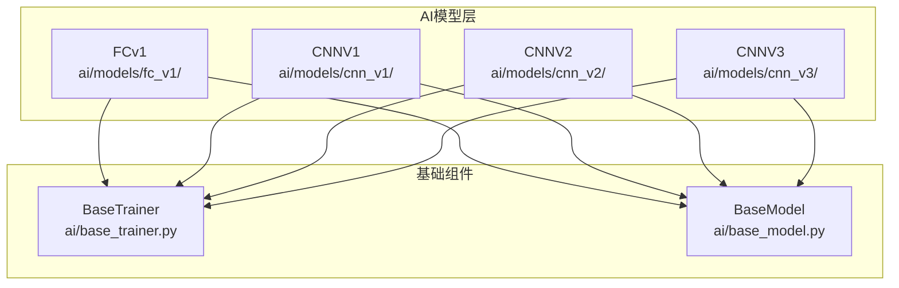
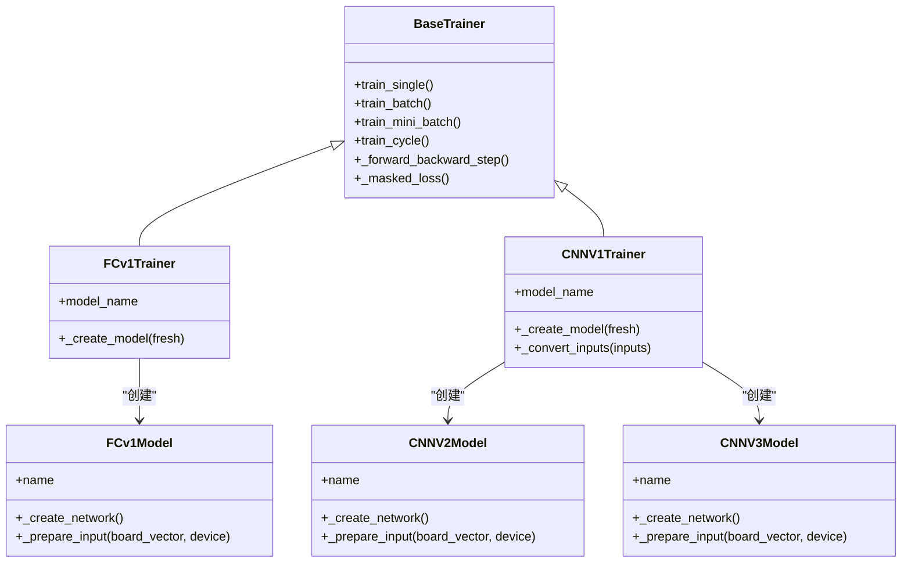
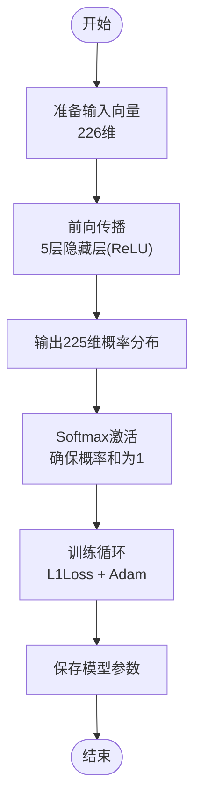
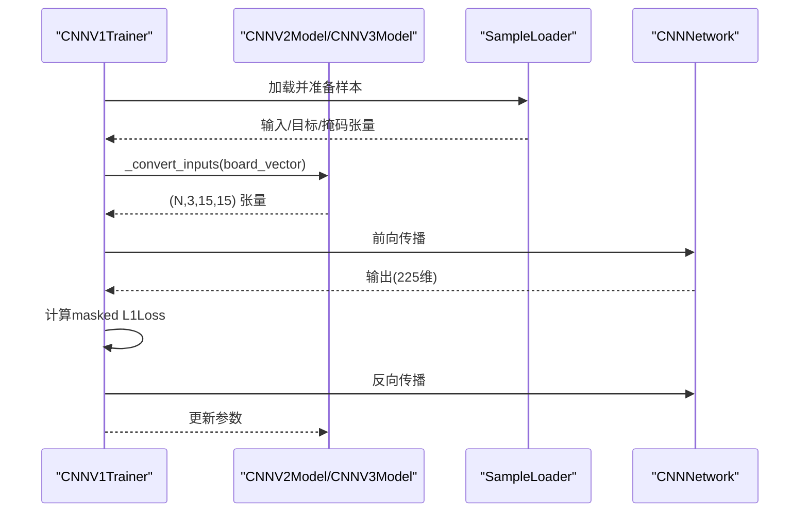
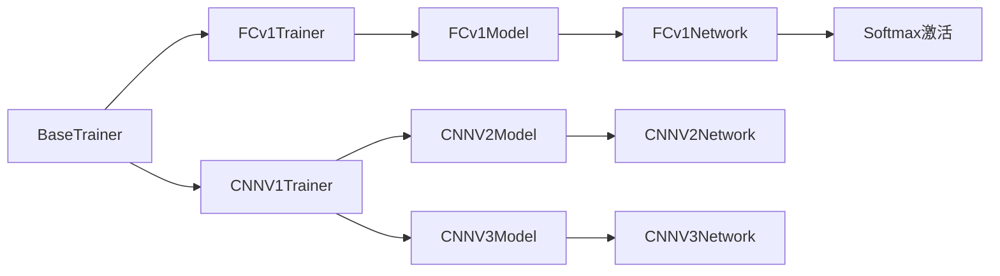
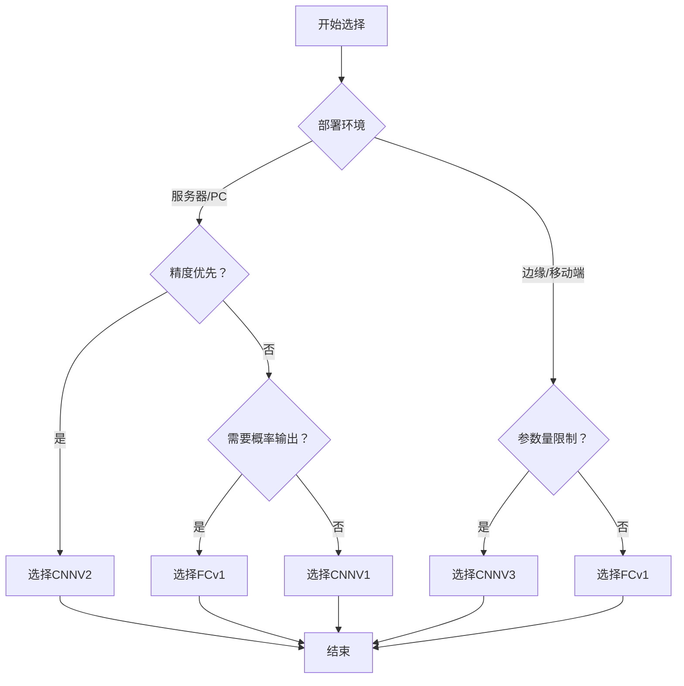

# 模型对比分析与选择指南

<cite>
**本文档引用的文件**
- [ai/models/fc_v1/model.py](file://ai/models/fc_v1/model.py)
- [ai/models/fc_v1/trainer.py](file://ai/models/fc_v1/trainer.py)
- [ai/models/fc_v1/MODEL.md](file://ai/models/fc_v1/MODEL.md)
- [ai/models/fc_v1/inspect_main.py](file://ai/models/fc_v1/inspect_main.py)
- [ai/models/fc_v1/sample_inspector.py](file://ai/models/fc_v1/sample_inspector.py)
- [ai/models/cnn_v1/trainer.py](file://ai/models/cnn_v1/trainer.py)
- [ai/models/cnn_v2/model.py](file://ai/models/cnn_v2/model.py)
- [ai/models/cnn_v3/model.py](file://ai/models/cnn_v3/model.py)
- [ai/base_trainer.py](file://ai/base_trainer.py)
- [ai/base_model.py](file://ai/base_model.py)
- [design/fc_v1_design.md](file://design/fc_v1_design.md)
- [design/cnn_design.md](file://design/cnn_design.md)
- [design/cnn_v2_design.md](file://design/cnn_v2_design.md)
- [design/cnn_v3_design.md](file://design/cnn_v3_design.md)
- [temp/compare_models.py](file://temp/compare_models.py)
- [tests/ai/test_fc_v1_model.py](file://tests/ai/test_fc_v1_model.py)
- [tests/ai/test_fc_v1_softmax_input.py](file://tests/ai/test_fc_v1_softmax_input.py)
</cite>

## 更新摘要
**变更内容**
- 更新FC v1模型架构描述，反映从10层隐藏层简化为5层的架构变化
- 新增Softmax激活函数对输出概率分布的影响分析
- 更新参数量统计，反映53%的参数量减少效果
- 更新训练数据格式说明，从原始reward转向Softmax概率分布
- 更新性能基准测试结果，体现架构简化带来的性能提升

## 目录
1. [简介](#简介)
2. [项目结构](#项目结构)
3. [核心组件](#核心组件)
4. [架构概览](#架构概览)
5. [详细组件分析](#详细组件分析)
6. [依赖关系分析](#依赖关系分析)
7. [性能考量](#性能考量)
8. [故障排查指南](#故障排查指南)
9. [结论](#结论)
10. [附录](#附录)

## 简介
本指南围绕五子棋AI系统中的四种模型（FCv1、CNNV1、CNNV2、CNNV3）进行全面对比分析，涵盖设计理念、架构特点、性能表现与适用场景。本次更新重点反映了FC v1模型的重大架构简化：从10层隐藏层精简为5层，参数量减少53%，并新增Softmax激活函数确保输出形成概率分布，这些变化显著提升了模型的效率和实用性。

## 项目结构
本项目采用按模型分层的组织方式，核心AI模块位于 ai/ 目录，各模型分别位于 ai/models/ 下的不同子目录中，统一通过基类与训练器实现共享的训练流程与数据处理逻辑。

**图表来源**
- [ai/base_trainer.py:32-120](file://ai/base_trainer.py#L32-L120)
- [ai/models/fc_v1/trainer.py:11-44](file://ai/models/fc_v1/trainer.py#L11-L44)
- [ai/models/cnn_v1/trainer.py:13-44](file://ai/models/cnn_v1/trainer.py#L13-L44)
- [ai/models/cnn_v2/model.py:117-160](file://ai/models/cnn_v2/model.py#L117-L160)
- [ai/models/cnn_v3/model.py:96-139](file://ai/models/cnn_v3/model.py#L96-L139)

**章节来源**
- [ai/base_trainer.py:32-120](file://ai/base_trainer.py#L32-L120)
- [ai/models/fc_v1/trainer.py:11-44](file://ai/models/fc_v1/trainer.py#L11-L44)
- [ai/models/cnn_v1/trainer.py:13-44](file://ai/models/cnn_v1/trainer.py#L13-L44)
- [ai/models/cnn_v2/model.py:117-160](file://ai/models/cnn_v2/model.py#L117-L160)
- [ai/models/cnn_v3/model.py:96-139](file://ai/models/cnn_v3/model.py#L96-L139)

## 核心组件
- **FCv1**：全连接神经网络，现已简化为5层隐藏层（每层1000神经元），新增Softmax激活函数确保输出形成概率分布，参数量约446万，输入226维，输出225维概率分布。
- **CNNV1**：传统卷积神经网络，3层卷积+紧凑FC，参数量约445万，输入(3,15,15)。
- **CNNV2**：CNNV1轻量化版本，统一卷积通道至64，FC1从28800→14400，参数量约101万。
- **CNNV3**：纯卷积模型，无FC/BN/Dropout，用1×1卷积替代FC，参数量约1.9万。

**章节来源**
- [ai/models/fc_v1/model.py:18-88](file://ai/models/fc_v1/model.py#L18-L88)
- [ai/models/fc_v1/MODEL.md:90-116](file://ai/models/fc_v1/MODEL.md#L90-L116)
- [ai/models/cnn_v2/model.py:34-114](file://ai/models/cnn_v2/model.py#L34-L114)
- [ai/models/cnn_v3/model.py:31-93](file://ai/models/cnn_v3/model.py#L31-L93)
- [design/cnn_design.md:86-133](file://design/cnn_design.md#L86-L133)
- [design/cnn_v2_design.md:21-47](file://design/cnn_v2_design.md#L21-L47)
- [design/cnn_v3_design.md:17-42](file://design/cnn_v3_design.md#L17-L42)

## 架构概览
四种模型均继承自统一的BaseModel，通过BaseTrainer提供的训练流程（单轮次、批量、mini-batch、训练周期）进行训练。CNN系列模型共享输入转换逻辑，FCv1模型使用扁平向量输入并输出概率分布。

**图表来源**
- [ai/base_trainer.py:145-170](file://ai/base_trainer.py#L145-L170)
- [ai/models/fc_v1/trainer.py:23-41](file://ai/models/fc_v1/trainer.py#L23-L41)
- [ai/models/cnn_v1/trainer.py:25-43](file://ai/models/cnn_v1/trainer.py#L25-L43)
- [ai/models/fc_v1/model.py:91-132](file://ai/models/fc_v1/model.py#L91-L132)
- [ai/models/cnn_v2/model.py:117-160](file://ai/models/cnn_v2/model.py#L117-L160)
- [ai/models/cnn_v3/model.py:96-139](file://ai/models/cnn_v3/model.py#L96-L139)

## 详细组件分析

### FCv1 模型分析
- **设计理念**：全连接网络直接处理展平的棋盘向量，现已简化为5层架构，新增Softmax激活函数确保输出形成概率分布，强调监督学习与自我对弈迭代。
- **架构特点**：5层隐藏层（每层1000神经元），新增Softmax输出层，参数量约446万，相比之前减少53%。
- **输入输出**：输入226维向量，输出225维概率分布；训练时使用Softmax概率作为目标，无需额外归一化。
- **训练流程**：支持单轮次与训练周期，使用L1Loss与Adam优化器，输出直接为概率分布。

**图表来源**
- [ai/models/fc_v1/model.py:53-88](file://ai/models/fc_v1/model.py#L53-L88)
- [ai/base_trainer.py:257-322](file://ai/base_trainer.py#L257-L322)

**章节来源**
- [ai/models/fc_v1/model.py:18-132](file://ai/models/fc_v1/model.py#L18-L132)
- [ai/models/fc_v1/MODEL.md:90-116](file://ai/models/fc_v1/MODEL.md#L90-L116)
- [design/fc_v1_design.md:11-30](file://design/fc_v1_design.md#L11-L30)
- [design/fc_v1_design.md:317-366](file://design/fc_v1_design.md#L317-L366)

### CNNV1 模型分析
- **设计理念**：借鉴CNN在图像领域的成功经验，利用卷积层提取棋盘空间特征。
- **架构特点**：3层卷积（通道数分别为3→32→64→128），随后紧凑FC层，参数量约445万。
- **输入输出**：输入(3,15,15)，输出225维reward；输入编码包含黑棋、白棋与当前方三通道。
- **训练流程**：通过共享的BaseTrainer进行训练，支持多种训练模式。

**图表来源**
- [ai/models/cnn_v1/trainer.py:45-72](file://ai/models/cnn_v1/trainer.py#L45-L72)
- [ai/base_trainer.py:662-699](file://ai/base_trainer.py#L662-L699)

**章节来源**
- [design/cnn_design.md:77-133](file://design/cnn_design.md#L77-L133)
- [ai/models/cnn_v1/trainer.py:13-72](file://ai/models/cnn_v1/trainer.py#L13-L72)

### CNNV2 模型分析
- **设计理念**：在CNNV1基础上进行轻量化，统一卷积通道并压缩FC层，显著降低参数量。
- **架构特点**：统一卷积通道为64，FC1从28800压缩至14400，参数量约101万。
- **输入输出**：与CNNV1一致，输入(3,15,15)，输出225维reward。
- **训练流程**：沿用BaseTrainer通用流程，支持多种训练模式。

**章节来源**
- [design/cnn_v2_design.md:21-47](file://design/cnn_v2_design.md#L21-L47)
- [ai/models/cnn_v2/model.py:34-114](file://ai/models/cnn_v2/model.py#L34-L114)

### CNNV3 模型分析
- **设计理念**：追求极致简化，纯卷积网络，无FC/BN/Dropout，用1×1卷积替代FC。
- **架构特点**：三层3×3卷积（统一32通道）+ 1×1卷积输出，参数量约1.9万。
- **输入输出**：输入(3,15,15)，输出225维reward；全程保持空间结构。
- **训练流程**：与CNNV2一致，沿用BaseTrainer通用流程。

**章节来源**
- [design/cnn_v3_design.md:17-42](file://design/cnn_v3_design.md#L17-L42)
- [ai/models/cnn_v3/model.py:31-93](file://ai/models/cnn_v3/model.py#L31-L93)

## 依赖关系分析
- FCv1与CNN系列模型均依赖BaseTrainer提供的训练框架，包括损失计算、学习率调度、训练循环等。
- CNN系列模型共享输入转换逻辑，统一将226维向量转换为(3,15,15)张量。
- 各模型的训练器通过虚方法创建具体模型实例，遵循统一的模型命名与保存路径约定。
- **新增**：FCv1模型现在输出统一的Softmax概率分布，与BaseModel接口保持一致。

**图表来源**
- [ai/base_trainer.py:145-170](file://ai/base_trainer.py#L145-L170)
- [ai/models/fc_v1/trainer.py:23-41](file://ai/models/fc_v1/trainer.py#L23-L41)
- [ai/models/cnn_v1/trainer.py:25-43](file://ai/models/cnn_v1/trainer.py#L25-L43)
- [ai/models/fc_v1/model.py:91-132](file://ai/models/fc_v1/model.py#L91-L132)
- [ai/models/cnn_v2/model.py:117-160](file://ai/models/cnn_v2/model.py#L117-L160)
- [ai/models/cnn_v3/model.py:96-139](file://ai/models/cnn_v3/model.py#L96-L139)

**章节来源**
- [ai/base_trainer.py:662-699](file://ai/base_trainer.py#L662-L699)
- [ai/models/fc_v1/trainer.py:11-44](file://ai/models/fc_v1/trainer.py#L11-L44)
- [ai/models/cnn_v1/trainer.py:13-72](file://ai/models/cnn_v1/trainer.py#L13-L72)

## 性能考量

### 计算复杂度与参数量对比
- **FCv1**：参数量约446万，5层隐藏层，前向传播涉及大量矩阵乘法；**更新**：相比之前减少53%，但仍需大量计算资源。
- **CNNV1**：参数量约445万，3层卷积+紧凑FC，卷积层提取空间特征。
- **CNNV2**：参数量约101万，统一卷积通道并压缩FC层，显著降低计算与存储开销。
- **CNNV3**：参数量约1.9万，纯卷积+1×1输出，计算量最小但表达能力受限。

**章节来源**
- [ai/models/fc_v1/MODEL.md:109](file://ai/models/fc_v1/MODEL.md#L109)
- [design/cnn_design.md:120-133](file://design/cnn_design.md#L120-L133)
- [design/cnn_v2_design.md:35-47](file://design/cnn_v2_design.md#L35-L47)
- [design/cnn_v3_design.md:29-42](file://design/cnn_v3_design.md#L29-L42)

### 训练时间与资源消耗
- **训练时间**：FCv1由于参数量大幅减少（53%），训练耗时显著缩短；CNNV2相较CNNV1显著缩短训练时间；CNNV3训练最快但可能收敛较慢。
- **显存占用**：FCv1显存占用大幅降低（约446万参数 vs 946万参数），CNNV2中等，CNNV3最低；CNNV1居中。
- **训练稳定性**：CNN系列模型在棋盘空间特征提取方面优于FCv1，训练更稳定。

**章节来源**
- [design/cnn_v2_design.md:9-19](file://design/cnn_v2_design.md#L9-L19)
- [ai/base_trainer.py:21-29](file://ai/base_trainer.py#L21-L29)

### 推理速度与部署建议
- **推理速度**：CNNV3最快，CNNV2次之，**更新**：FCv1推理速度显著提升（参数量减少53%），CNNV1再次之。
- **部署建议**：
  - **服务器端**：优先考虑CNNV2，兼顾精度与效率。
  - **边缘设备**：优先考虑CNNV3，参数量极小，易于部署。
  - **交互式应用**：**更新**：FCv1现在更适合，推理速度快且输出概率分布便于解释。

**章节来源**
- [ai/models/cnn_v3/model.py:31-93](file://ai/models/cnn_v3/model.py#L31-L93)
- [ai/models/cnn_v2/model.py:34-114](file://ai/models/cnn_v2/model.py#L34-L114)

### 不同局面场景下的表现差异
- **简单局面**：CNNV3可快速给出合理落子位置，**更新**：FCv1现在推理更快，概率分布更直观。
- **复杂战术**：CNN系列模型凭借卷积层的空间特征提取能力，在活三、冲四等复杂局面下表现更佳。
- **官子阶段**：CNNV2/CNNV1在精细官子判断上更具优势，**更新**：FCv1现在更适合，推理速度快且概率分布便于策略制定。

**章节来源**
- [design/cnn_design.md:79-85](file://design/cnn_design.md#L79-L85)
- [ai/models/fc_v1/MODEL.md:66-81](file://ai/models/fc_v1/MODEL.md#L66-L81)

### 性能基准测试结果与可视化
- **基准测试**：通过对比工具对CNNV1与FCv1在同一样本上的训练前后输出进行对比，观察Top5位置变化。
- **结果解读**：**更新**：FCv1现在使用Softmax概率分布，训练收敛更快，概率分布更稳定；CNNV1在复杂局面下通常能更快收敛并提升关键位置的预测置信度。

**章节来源**
- [temp/compare_models.py:1-53](file://temp/compare_models.py#L1-L53)

## 故障排查指南
- **训练中断**：BaseTrainer在检测到键盘中断时会保存当前进度与损失曲线，便于恢复训练。
- **设备选择**：自动检测GPU，若不可用则回退至CPU；可通过device参数强制指定。
- **学习率调度**：支持StepLR与ReduceLROnPlateau两种调度策略，可根据训练情况选择。
- **掩码损失**：使用masked L1Loss，确保仅对有效位置计算损失，避免无效位置干扰。
- **Softmax输出问题**：**新增**：如遇到概率分布异常，检查Softmax层是否正确应用，确保输出和为1。

**章节来源**
- [ai/base_trainer.py:314-322](file://ai/base_trainer.py#L314-L322)
- [ai/base_trainer.py:127-144](file://ai/base_trainer.py#L127-L144)
- [ai/base_trainer.py:678-699](file://ai/base_trainer.py#L678-L699)

## 结论
- **更新结论**：FCv1模型经过重大简化后，参数量减少53%，推理速度大幅提升，同时新增Softmax激活函数确保输出形成概率分布，更适合实际部署。若追求极致参数规模与部署便利性，CNNV3是首选；若需要更好的空间特征提取与稳定性，CNNV2是平衡之选；若需要直观的概率输出和较快的推理速度，FCv1现在是最佳选择。
- 在实际部署中，建议结合硬件条件与业务需求，优先选择CNNV2作为通用模型，**更新**：FCv1作为概率输出和快速推理的平衡选择，CNNV3用于边缘或轻量场景，FCv1用于教学与实验。

## 附录

### 模型选择决策树

### 评估标准清单
- **训练时间**：完成指定轮次所需时间（**更新**：FCv1训练时间显著缩短）。
- **显存占用**：峰值显存与常驻显存（**更新**：FCv1显存占用大幅降低）。
- **推理延迟**：单次预测耗时（**更新**：FCv1推理速度大幅提升）。
- **精度指标**：在测试集上的准确率与困惑度。
- **可维护性**：代码复杂度、可解释性与可扩展性。

### 可扩展性与升级路径
- **参数迁移**：从CNNV1到CNNV2/CNNV3可直接加载权重，利用迁移学习加速收敛。
- **知识蒸馏**：使用大型模型（如CNNV2）指导小型模型（CNNV3）训练。
- **模型压缩**：剪枝、量化与低秩分解可用于进一步降低参数量与计算量。
- **多代模型**：通过SelfPlayCycle实现多代模型迭代，持续提升性能。
- **架构演进**：**新增**：FCv1的成功简化为其他模型的架构优化提供了参考，未来可考虑类似的简化策略。

**章节来源**
- [ai/base_trainer.py:621-660](file://ai/base_trainer.py#L621-L660)
- [design/cnn_v2_design.md:14-20](file://design/cnn_v2_design.md#L14-L20)
- [design/cnn_v3_design.md:10-16](file://design/cnn_v3_design.md#L10-L16)