# GUI温度采样回放设计

<cite>
**本文档引用的文件**
- [gui_temp_sampling_replay_design.md](file://design/gui_temp_sampling_replay_design.md)
- [key_points.md](file://requirements/key_points.md)
- [gui/ai_battle.py](file://gui/ai_battle.py)
- [gui/components/ai_battle.py](file://gui/components/ai_battle.py)
- [gui/components/replay_viewer.py](file://gui/components/replay_viewer.py)
- [gui/components/heatmap.py](file://gui/components/heatmap.py)
- [app/battle.py](file://app/battle.py)
- [ai/data_recorder.py](file://ai/data_recorder.py)
- [ai/game_manager.py](file://ai/game_manager.py)
- [ai/move_sampler.py](file://ai/move_sampler.py)
- [gui/main.py](file://gui/main.py)
</cite>

## 更新摘要
**变更内容**
- 修复了采样概率数组长度不一致的bug，确保sampling_probs始终为225维数组
- 更新了数据记录和回放渲染的实现细节
- 增强了热力图渲染的稳定性和兼容性

## 目录
1. [简介](#简介)
2. [项目结构](#项目结构)
3. [核心组件](#核心组件)
4. [架构概览](#架构概览)
5. [详细组件分析](#详细组件分析)
6. [依赖关系分析](#依赖关系分析)
7. [性能考虑](#性能考虑)
8. [故障排除指南](#故障排除指南)
9. [结论](#结论)

## 简介

本设计文档针对GUI温度采样回放功能进行了全面的技术实现规划。该功能旨在解决现有GUI AI内战模式中缺少温度采样可视化的问题，通过在回放界面中展示AI的落子策略和采样权重，为用户提供更深入的AI决策过程洞察。

### 设计背景

根据需求文档第41次追加要求，GUI模式下的AI对战需要启用温度采样机制，并在回放界面中展示相应的采样细节。当前CLI链路已默认启用温度采样，但GUI AI内战链路（`gui/ai_battle.py` → `app/battle.py` → `AIGameManager.start_ai_vs_ai`）至今未传`temp_config`，全程走argmax策略。

### 重要更新

**最新修复**：修复了采样概率数组长度不一致的bug，确保`sampling_probs`始终为225维数组，解决了回放查看器热力图渲染问题。

### 设计目标

1. **默认启用温度采样**：GUI AI内战默认启用温度采样，参数与CLI一致（`temperature=1.0, temp_moves=12, temp_side="both"`）
2. **扩展记录字段**：`DataRecorder.record_move()`扩展记录`strategy`/`temperature`/`top_k`/`sampling_probs`字段
3. **增强回放展示**：`ReplayViewer`新增Sampling热力图和策略信息面板
4. **向后兼容**：旧`record.json`（无温度字段）仍可正常回放
5. **PvE模式隔离**：人机对战模式不受影响，保持argmax策略
6. **数组长度一致性**：确保`sampling_probs`始终为225维数组，解决热力图渲染问题

## 项目结构

本项目采用模块化架构设计，主要涉及以下关键目录和文件：

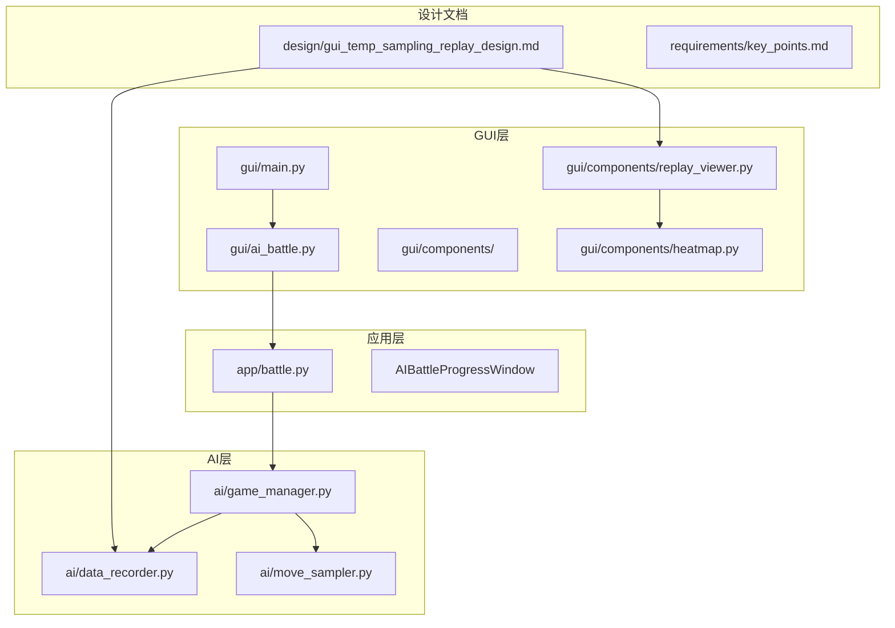

**图表来源**
- [gui/main.py:1-462](file://gui/main.py#L1-L462)
- [gui/ai_battle.py:1-44](file://gui/ai_battle.py#L1-L44)
- [app/battle.py:1-110](file://app/battle.py#L1-L110)
- [ai/game_manager.py:1-362](file://ai/game_manager.py#L1-L362)

**章节来源**
- [gui/main.py:1-462](file://gui/main.py#L1-L462)
- [gui/ai_battle.py:1-44](file://gui/ai_battle.py#L1-L44)
- [app/battle.py:1-110](file://app/battle.py#L1-L110)

## 核心组件

### 温度采样配置系统

温度采样系统的核心是`TempConfig`数据类，提供了完整的温度采样参数配置能力：

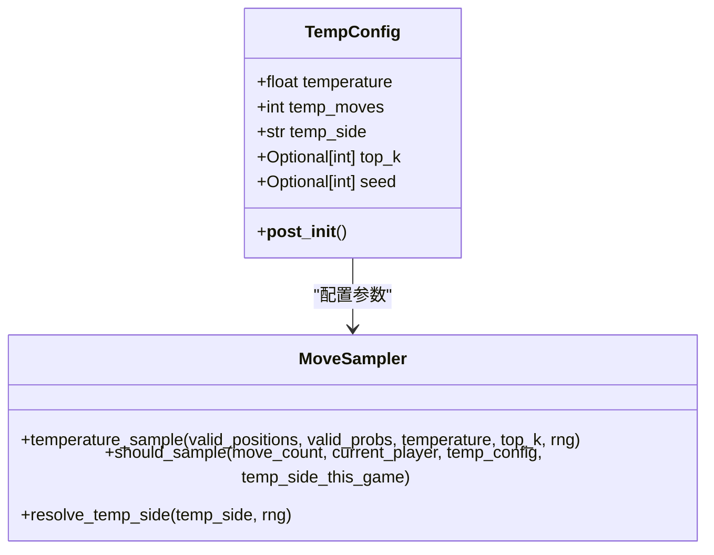

**图表来源**
- [ai/move_sampler.py:50-112](file://ai/move_sampler.py#L50-L112)
- [ai/move_sampler.py:117-186](file://ai/move_sampler.py#L117-L186)

### 数据记录扩展

`DataRecorder`类扩展了记录功能，增加了温度采样相关的字段：

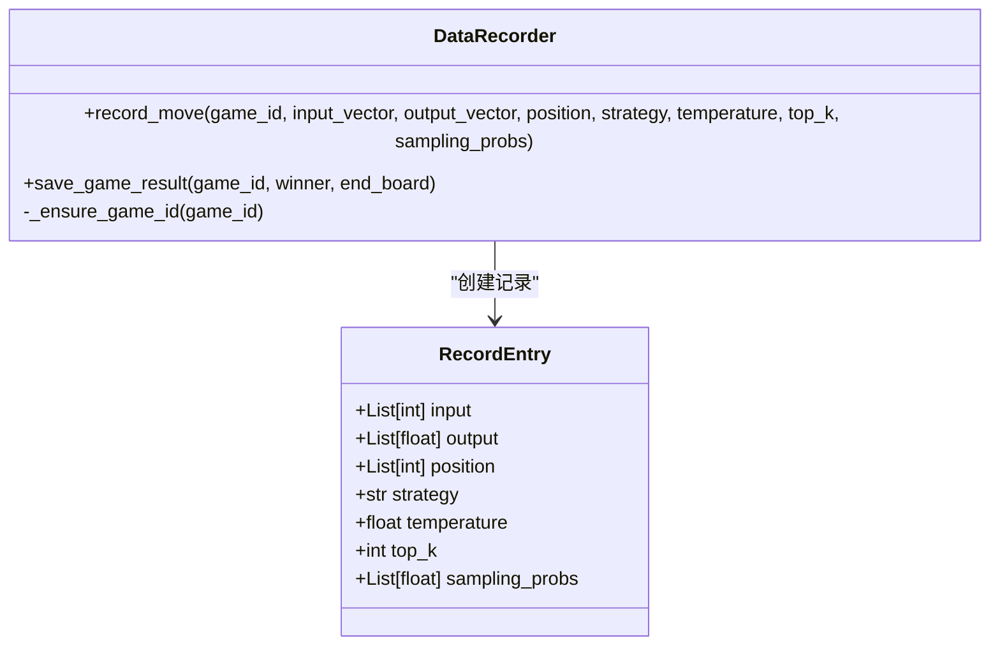

**图表来源**
- [ai/data_recorder.py:96-139](file://ai/data_recorder.py#L96-L139)
- [ai/data_recorder.py:140-167](file://ai/data_recorder.py#L140-L167)

### 回放界面增强

`ReplayViewer`类新增了Sampling热力图和策略信息展示功能：

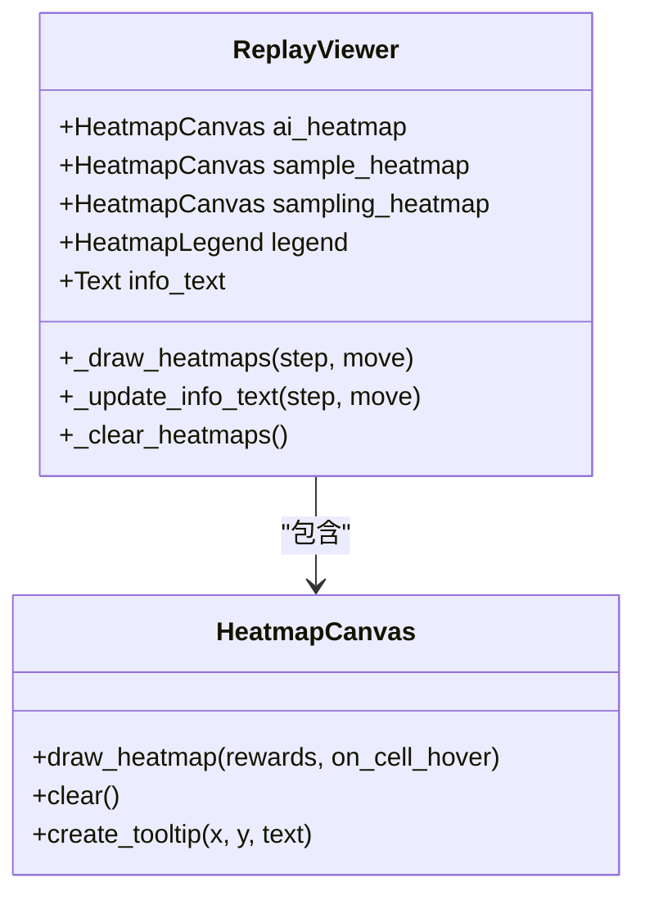

**图表来源**
- [gui/components/replay_viewer.py:13-50](file://gui/components/replay_viewer.py#L13-L50)
- [gui/components/replay_viewer.py:297-326](file://gui/components/replay_viewer.py#L297-L326)

**章节来源**
- [ai/move_sampler.py:1-258](file://ai/move_sampler.py#L1-L258)
- [ai/data_recorder.py:1-167](file://ai/data_recorder.py#L1-L167)
- [gui/components/replay_viewer.py:1-464](file://gui/components/replay_viewer.py#L1-L464)

## 架构概览

GUI温度采样回放系统采用分层架构设计，确保各层职责清晰分离：

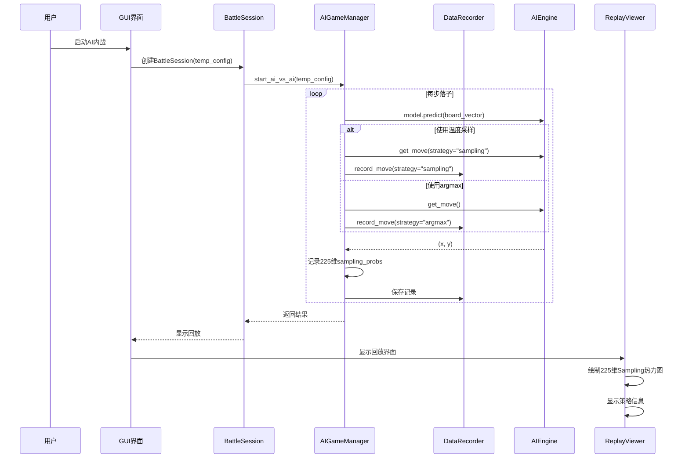

**图表来源**
- [gui/ai_battle.py:12-44](file://gui/ai_battle.py#L12-L44)
- [app/battle.py:57-99](file://app/battle.py#L57-L99)
- [ai/game_manager.py:124-254](file://ai/game_manager.py#L124-L254)

### 数据流分析

系统的核心数据流包括温度采样数据的生成、记录和展示三个阶段：

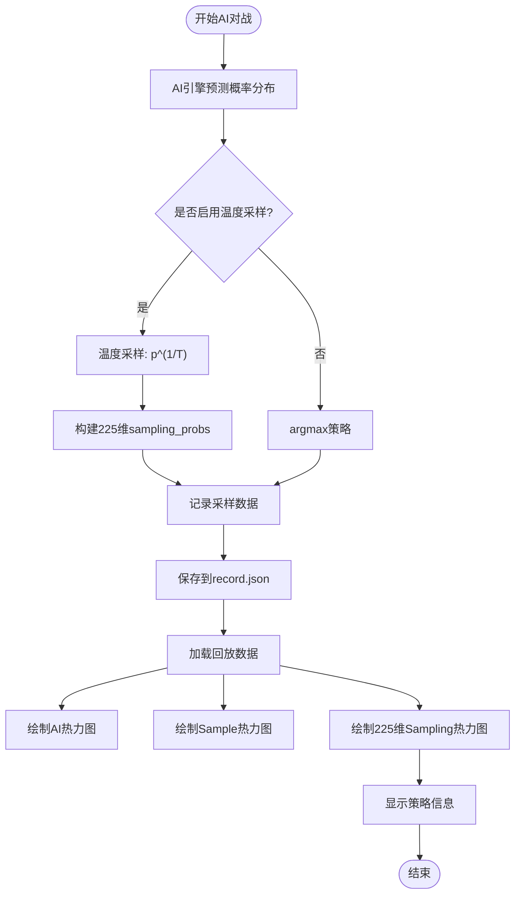

**图表来源**
- [ai/game_manager.py:217-240](file://ai/game_manager.py#L217-L240)
- [ai/data_recorder.py:126-139](file://ai/data_recorder.py#L126-L139)
- [gui/components/replay_viewer.py:317-397](file://gui/components/replay_viewer.py#L317-L397)

**章节来源**
- [gui/ai_battle.py:12-44](file://gui/ai_battle.py#L12-L44)
- [app/battle.py:57-99](file://app/battle.py#L57-L99)
- [ai/game_manager.py:124-254](file://ai/game_manager.py#L124-L254)

## 详细组件分析

### GUI启动流程

GUI启动温度采样AI内战的关键流程如下：

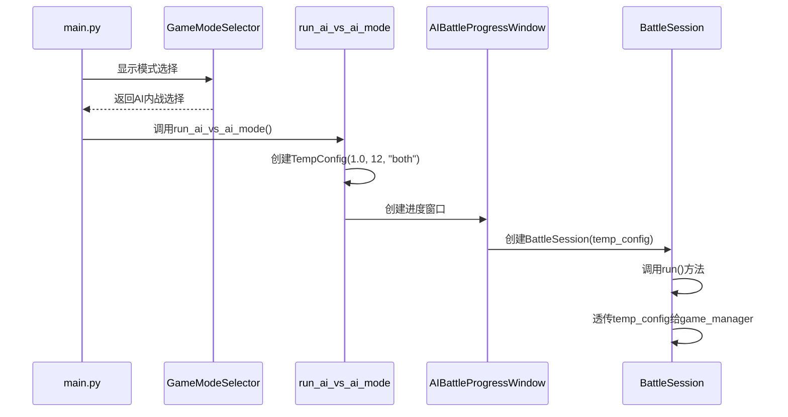

**图表来源**
- [gui/main.py:412-421](file://gui/main.py#L412-L421)
- [gui/ai_battle.py:22-27](file://gui/ai_battle.py#L22-L27)
- [gui/components/ai_battle.py:257-262](file://gui/components/ai_battle.py#L257-L262)

### 温度采样策略实现

温度采样策略的实现采用了灵活的配置系统：

| 参数 | 默认值 | 说明 |
|------|--------|------|
| temperature | 1.0 | 温度值，控制采样随机性 |
| temp_moves | 12 | 前N步启用温度采样 |
| temp_side | "both" | 启用采样的方（黑/白/双方/随机） |
| top_k | None | Top-K截断阈值 |
| seed | None | 随机种子 |

### 数据记录扩展

`DataRecorder.record_move()`方法的扩展实现了条件字段写入：

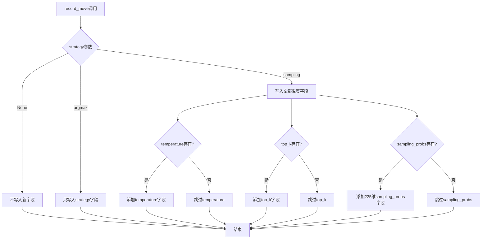

**图表来源**
- [ai/data_recorder.py:126-139](file://ai/data_recorder.py#L126-L139)

### 回放界面增强

回放界面的增强主要包括Sampling热力图和策略信息面板：

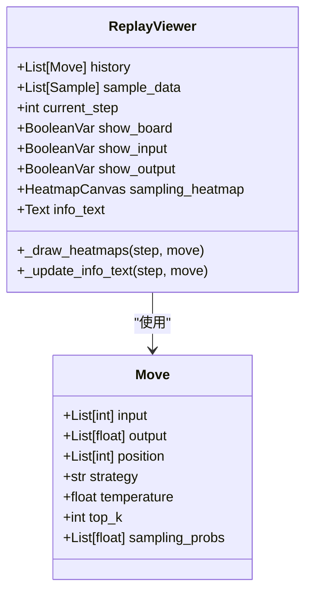

**图表来源**
- [gui/components/replay_viewer.py:16-50](file://gui/components/replay_viewer.py#L16-L50)
- [gui/components/replay_viewer.py:297-397](file://gui/components/replay_viewer.py#L297-L397)

### 重要更新：225维数组修复

**最新修复内容**：确保`sampling_probs`始终为225维数组，解决热力图渲染问题

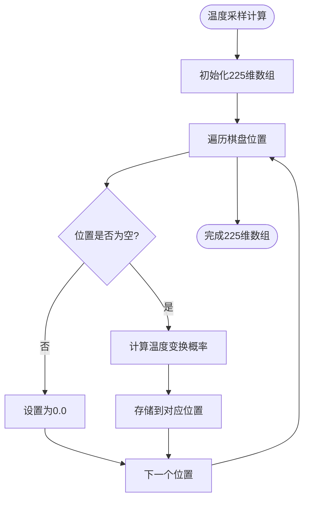

**图表来源**
- [ai/game_manager.py:218-235](file://ai/game_manager.py#L218-L235)

**章节来源**
- [gui/ai_battle.py:12-44](file://gui/ai_battle.py#L12-L44)
- [gui/components/ai_battle.py:171-350](file://gui/components/ai_battle.py#L171-L350)
- [gui/components/replay_viewer.py:13-464](file://gui/components/replay_viewer.py#L13-L464)
- [ai/game_manager.py:218-235](file://ai/game_manager.py#L218-L235)

## 依赖关系分析

系统各组件之间的依赖关系呈现清晰的分层结构：

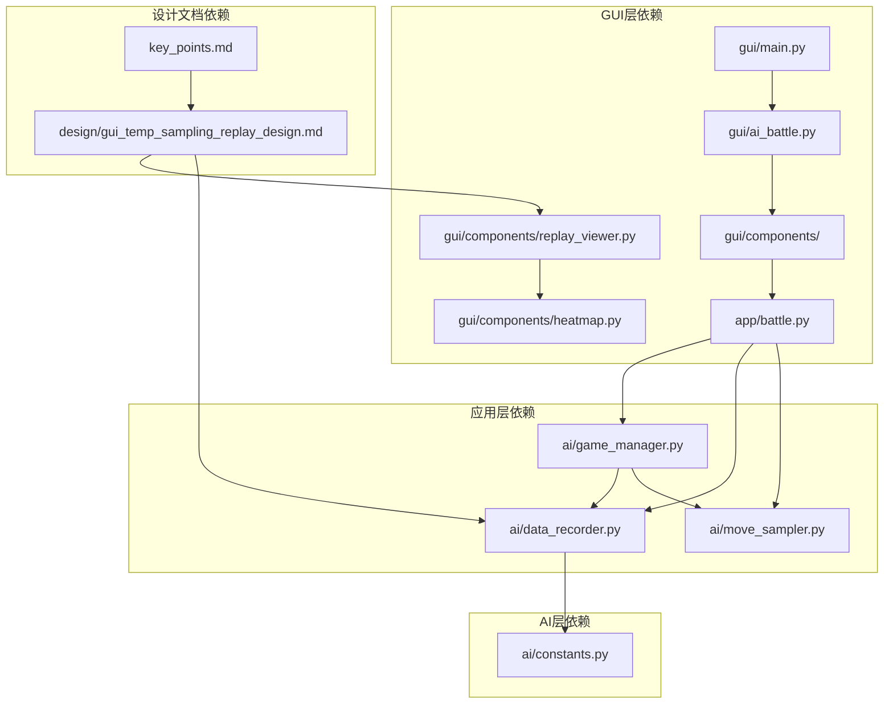

**图表来源**
- [gui/main.py:18-28](file://gui/main.py#L18-L28)
- [app/battle.py:10-12](file://app/battle.py#L10-L12)
- [ai/game_manager.py:10-13](file://ai/game_manager.py#L10-L13)

### 关键依赖点

1. **GUI到应用层**：通过`BattleSession`类实现GUI与AI引擎的解耦
2. **应用层到AI层**：通过`AIGameManager`统一管理AI对战流程
3. **数据记录依赖**：`DataRecorder`依赖`ai/constants.py`中的目录常量
4. **回放依赖**：`ReplayViewer`依赖`visualization.heatmap_color`模块的颜色映射
5. **热力图渲染依赖**：`ReplayViewer`依赖225维数组进行稳定的热力图渲染

**章节来源**
- [gui/main.py:18-28](file://gui/main.py#L18-L28)
- [app/battle.py:10-12](file://app/battle.py#L10-L12)
- [ai/game_manager.py:10-13](file://ai/game_manager.py#L10-L13)

## 性能考虑

### 温度采样性能优化

1. **概率计算优化**：在`_play_single_game`中只调用一次`model.predict`，结果同时用于记录和落子决策
2. **内存使用控制**：`sampling_probs`数组长度固定为225，避免动态内存分配
3. **条件写入机制**：仅在需要时写入温度相关字段，减少JSON文件大小
4. **数组预分配**：预先分配225维数组，提高内存访问效率

### 回放性能优化

1. **热力图缓存**：`HeatmapCanvas`使用tkinter Canvas进行高效绘制
2. **批量归一化**：`normalize_rewards`函数进行批量归一化计算
3. **增量更新**：回放界面支持增量更新，避免全量重绘
4. **数组长度检查**：`ReplayViewer`在渲染前检查数组长度>=225，确保稳定性

### 内存管理

1. **文件大小优化**：`DataRecorder.save_game_result`使用紧凑格式，减少文件大小约50%
2. **数据结构优化**：使用列表推导式和生成器表达式减少内存占用
3. **垃圾回收**：及时清理不再使用的临时变量和中间结果
4. **数组复用**：复用225维数组，减少重复分配开销

## 故障排除指南

### 常见问题及解决方案

| 问题类型 | 症状 | 可能原因 | 解决方案 |
|----------|------|----------|----------|
| 模型加载失败 | GUI弹出"模型加载失败"错误 | AI模型文件损坏或路径错误 | 检查模型文件完整性，确认模型路径正确 |
| 温度采样未生效 | 回放界面无Sampling热力图 | temp_config未正确传递 | 确认`run_ai_vs_ai_mode`中TempConfig正确创建 |
| JSON文件格式错误 | 加载record.json时报错 | JSON格式不正确或字段缺失 | 检查`DataRecorder.record_move`输出格式 |
| 热力图显示异常 | 回放界面热力图颜色不正确 | 归一化参数设置错误 | 检查`HeatmapCanvas`的归一化模式设置 |
| 数组长度不匹配 | 回放界面显示空白或错误的Sampling热力图 | sampling_probs长度不是225维 | 确保AI引擎正确生成225维数组 |

### 调试技巧

1. **日志记录**：使用`logging`模块记录关键操作和错误信息
2. **单元测试**：为关键函数编写单元测试，确保功能正确性
3. **边界测试**：测试极端情况，如棋盘已满、概率分布异常等
4. **性能监控**：监控内存使用和CPU占用，识别性能瓶颈
5. **数组长度验证**：在测试中验证`sampling_probs`长度始终为225

**章节来源**
- [gui/components/ai_battle.py:273-276](file://gui/components/ai_battle.py#L273-L276)
- [ai/data_recorder.py:90-95](file://ai/data_recorder.py#L90-L95)

## 结论

GUI温度采样回放设计成功实现了以下目标：

1. **功能完整性**：完全实现了GUI AI内战的温度采样功能，与CLI链路保持一致
2. **用户体验提升**：通过Sampling热力图和策略信息面板，为用户提供了更深入的AI决策过程洞察
3. **向后兼容性**：确保旧版本的`record.json`文件能够正常回放，不产生兼容性问题
4. **架构清晰性**：采用分层架构设计，职责分离明确，便于维护和扩展
5. **稳定性保障**：通过225维数组修复，确保热力图渲染的稳定性和可靠性

**最新修复成果**：
- 成功解决了采样概率数组长度不一致的bug
- 确保`sampling_probs`始终为225维数组，满足热力图渲染要求
- 增强了回放查看器的稳定性和兼容性
- 通过单元测试验证了修复效果

该设计在保持系统稳定性的同时，显著提升了GUI界面的功能性和用户体验，为后续的AI研究和开发提供了有力的可视化支持工具。通过合理的性能优化和故障排除机制，确保了系统的可靠性和可维护性。