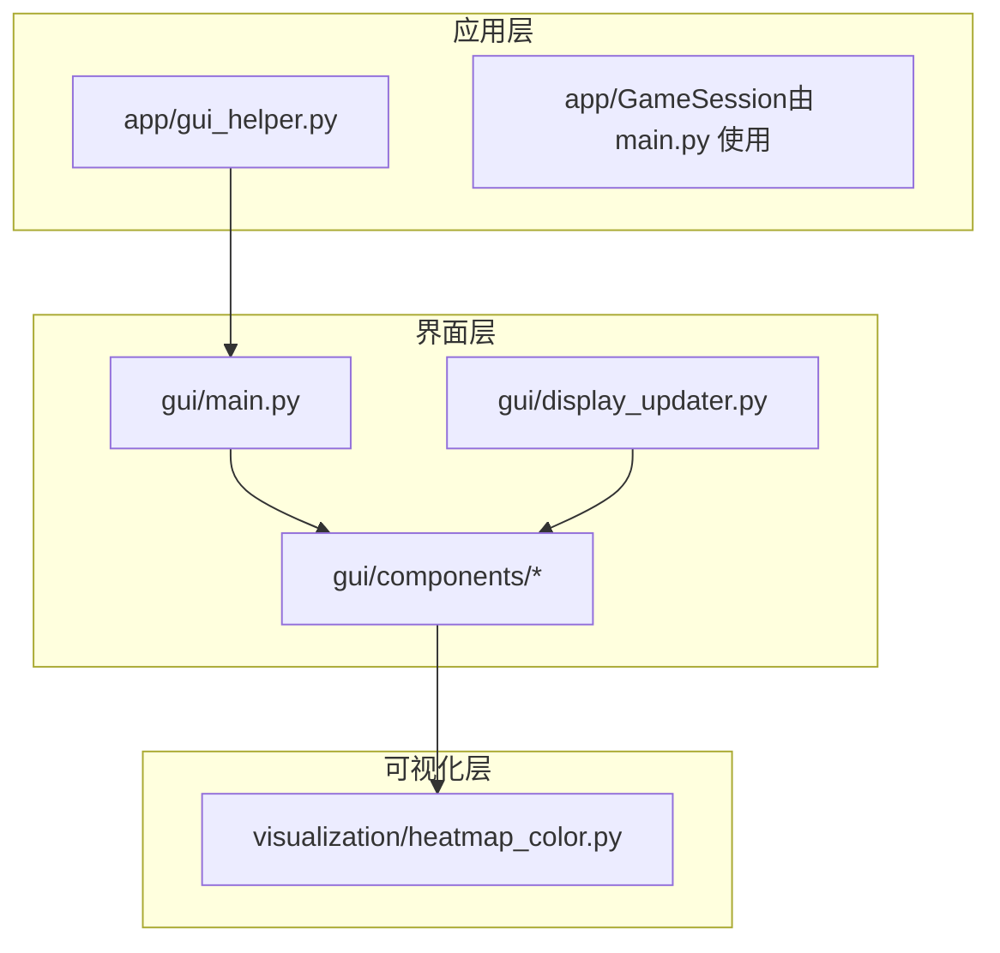
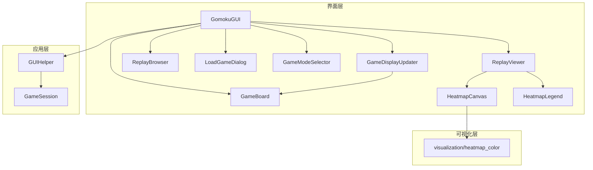
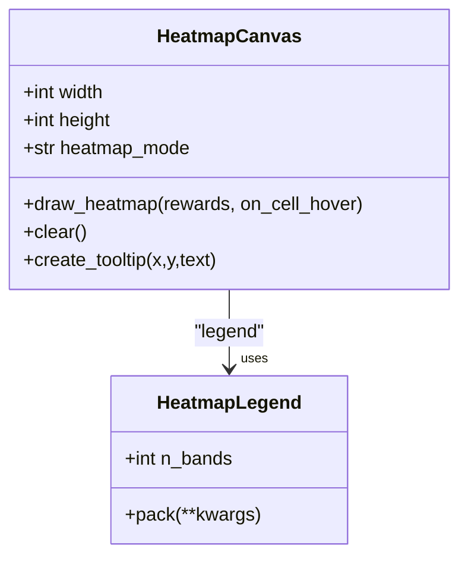
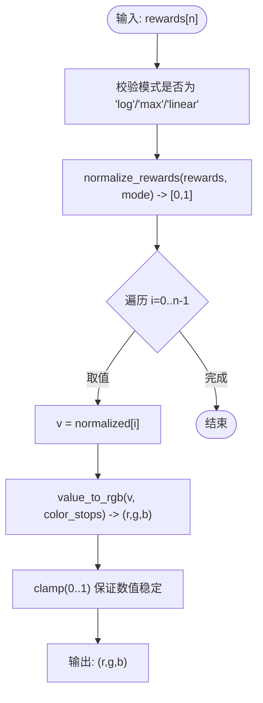
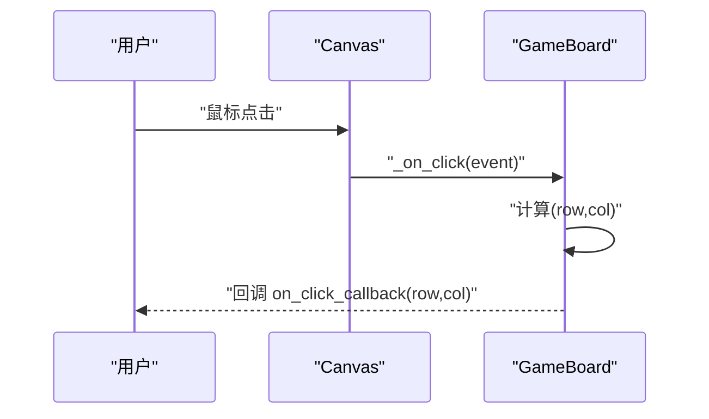
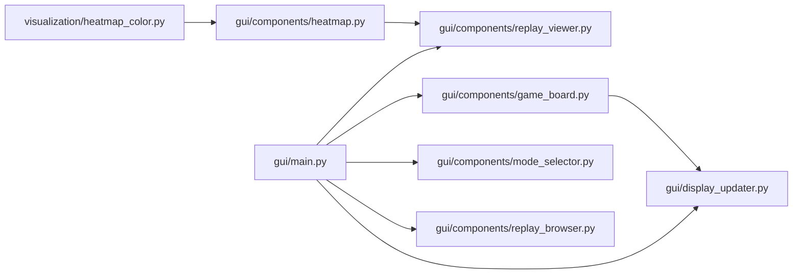

# 可视化设计

<cite>
**本文引用的文件**
- [gui/components/heatmap.py](file://gui/components/heatmap.py)
- [visualization/heatmap_color.py](file://visualization/heatmap_color.py)
- [gui/components/game_board.py](file://gui/components/game_board.py)
- [gui/display_updater.py](file://gui/display_updater.py)
- [gui/main.py](file://gui/main.py)
- [gui/components/constants.py](file://gui/components/constants.py)
- [gui/components/mode_selector.py](file://gui/components/mode_selector.py)
- [gui/components/load_game_dialog.py](file://gui/components/load_game_dialog.py)
- [gui/components/replay_browser.py](file://gui/components/replay_browser.py)
- [gui/components/replay_viewer.py](file://gui/components/replay_viewer.py)
- [app/gui_helper.py](file://app/gui_helper.py)
- [design/gui_heatmap_reuse_design.md](file://design/gui_heatmap_reuse_design.md)
- [design/gui_design.md](file://design/gui_design.md)
- [README.md](file://README.md)
</cite>

## 目录
1. [简介](#简介)
2. [项目结构](#项目结构)
3. [核心组件](#核心组件)
4. [架构总览](#架构总览)
5. [详细组件分析](#详细组件分析)
6. [依赖分析](#依赖分析)
7. [性能考量](#性能考量)
8. [故障排查指南](#故障排查指南)
9. [结论](#结论)
10. [附录](#附录)

## 简介
本设计文档围绕五子棋AI可视化系统，系统性阐述热力图设计理念与实现方案、GUI组件架构、数据流与颜色设计原则、用户交互模式、性能优化策略以及可扩展性设计。重点覆盖：
- 热力图：概率分布可视化、颜色映射、透明度控制与tkinter限制下的适配
- GUI：棋盘显示、按钮控件、对话框等界面元素布局与交互
- 可视化数据流：从AI输出的概率矩阵到像素颜色的转换
- 颜色设计：色彩理论、色盲友好、对比度优化
- 交互设计：鼠标点击、键盘快捷键、拖拽等
- 性能优化：渲染优化、内存管理、刷新频率控制
- 可扩展性：主题系统、自定义样式、插件机制

## 项目结构
本项目采用“应用层-界面层-可视化层”的分层组织：
- 应用层（app/）：会话管理、GUI辅助逻辑
- 界面层（gui/）：主程序、组件（棋盘、热力图、对话框、回放等）
- 可视化层（visualization/）：独立的颜色映射算法，供GUI与AI侧复用

图表来源
- [gui/main.py:1-462](file://gui/main.py#L1-L462)
- [app/gui_helper.py:1-199](file://app/gui_helper.py#L1-L199)
- [gui/components/heatmap.py:1-358](file://gui/components/heatmap.py#L1-L358)
- [visualization/heatmap_color.py:1-204](file://visualization/heatmap_color.py#L1-L204)

章节来源
- [gui/main.py:1-462](file://gui/main.py#L1-L462)
- [design/gui_design.md:1-512](file://design/gui_design.md#L1-L512)

## 核心组件
- 热力图组件（GUI）：HeatmapCanvas、HeatmapLegend，负责将225维奖励向量映射为15×15格颜色块，并提供悬停tooltip
- 热力图颜色算法（可视化层）：提供归一化与RGB映射，支持多种色板与归一化模式
- 棋盘组件：绘制15×15棋盘、星位、棋子与最后落子高亮
- 显示更新器：根据游戏状态刷新棋盘、标签、历史记录
- 主程序与模式选择器：组织界面布局、菜单、按钮与对话框
- 回放浏览器与回放查看器：加载AI对局记录，嵌入式显示棋盘与热力图

章节来源
- [gui/components/heatmap.py:68-358](file://gui/components/heatmap.py#L68-L358)
- [visualization/heatmap_color.py:32-204](file://visualization/heatmap_color.py#L32-L204)
- [gui/components/game_board.py:7-170](file://gui/components/game_board.py#L7-L170)
- [gui/display_updater.py:13-110](file://gui/display_updater.py#L13-L110)
- [gui/main.py:31-462](file://gui/main.py#L31-L462)
- [gui/components/mode_selector.py:12-411](file://gui/components/mode_selector.py#L12-L411)
- [gui/components/replay_viewer.py:13-426](file://gui/components/replay_viewer.py#L13-L426)

## 架构总览
系统采用“组件化+分层”架构：
- 界面层组件通过导入可视化层算法实现颜色映射
- 应用层提供业务逻辑与状态，界面层仅负责渲染与交互
- 回放模块在独立窗口中嵌入热力图组件，实现对比分析

图表来源
- [gui/main.py:31-462](file://gui/main.py#L31-L462)
- [gui/display_updater.py:13-110](file://gui/display_updater.py#L13-L110)
- [gui/components/game_board.py:7-170](file://gui/components/game_board.py#L7-L170)
- [gui/components/heatmap.py:68-358](file://gui/components/heatmap.py#L68-L358)
- [gui/components/replay_viewer.py:13-426](file://gui/components/replay_viewer.py#L13-L426)
- [gui/components/replay_browser.py:12-383](file://gui/components/replay_browser.py#L12-L383)
- [gui/components/load_game_dialog.py:11-56](file://gui/components/load_game_dialog.py#L11-L56)
- [gui/components/mode_selector.py:12-411](file://gui/components/mode_selector.py#L12-L411)
- [app/gui_helper.py:12-199](file://app/gui_helper.py#L12-L199)
- [visualization/heatmap_color.py:32-204](file://visualization/heatmap_color.py#L32-L204)

## 详细组件分析

### 热力图组件（GUI）
- 设计理念
  - 将AI输出的225维奖励向量映射为15×15格颜色块，格子尺寸与边距固定，便于用户直观感知高价值区域
  - tooltip显示原始reward，便于用户理解真实概率分布
  - 默认使用4色渐变（白→黄→橙→红），log归一化突出softmax分布的次高位
- 关键实现
  - 归一化：normalize_rewards(rewards, mode) → [0,1]
  - 颜色映射：value_to_rgb(v, color_stops) → (r,g,b)
  - tk适配：_rgb_float_to_hex(r,g,b) → "#RRGGBB"
  - Legend：按色节点等距生成渐变条，标注色名
- 交互
  - 悬停绑定：矩形tag绑定<Enter>/<Leave>事件，显示tooltip并回调外部hover
  - 清空：clear()删除所有绘制元素，避免残留

图表来源
- [gui/components/heatmap.py:68-358](file://gui/components/heatmap.py#L68-L358)

章节来源
- [gui/components/heatmap.py:68-358](file://gui/components/heatmap.py#L68-L358)
- [visualization/heatmap_color.py:63-122](file://visualization/heatmap_color.py#L63-L122)
- [visualization/heatmap_color.py:128-172](file://visualization/heatmap_color.py#L128-L172)
- [visualization/heatmap_color.py:178-204](file://visualization/heatmap_color.py#L178-L204)
- [design/gui_heatmap_reuse_design.md:1-347](file://design/gui_heatmap_reuse_design.md#L1-L347)

### 热力图颜色映射（可视化层）
- 归一化模式
  - log：针对softmax极端分布，提升次高位可辨识度
  - max：r/max(r)
  - linear：(r-min)/(max-min)
- 色板
  - 默认4色：白→黄→橙→红，信息密度高，与样本可视化一致
  - 支持任意n≥2色节点，等距线性插值
- 输出
  - 浮点RGB（0~1），Legend与GUI分别做tk适配

图表来源
- [visualization/heatmap_color.py:63-122](file://visualization/heatmap_color.py#L63-L122)
- [visualization/heatmap_color.py:128-172](file://visualization/heatmap_color.py#L128-L172)

章节来源
- [visualization/heatmap_color.py:32-204](file://visualization/heatmap_color.py#L32-L204)

### GUI棋盘组件
- 绘制内容
  - 15×15网格线与星位
  - 棋子：黑子#2C2C2C、白子#FFFAF0，带阴影与立体效果
  - 最后落子高亮：橙色圆环
- 交互
  - 绑定< Button-1 >，计算行列坐标，调用回调
  - 边界检查：仅在0..14范围内有效

图表来源
- [gui/components/game_board.py:151-166](file://gui/components/game_board.py#L151-L166)

章节来源
- [gui/components/game_board.py:7-170](file://gui/components/game_board.py#L7-L170)

### 显示更新器
- 职责
  - 根据display_state刷新棋盘、标签、历史记录
  - 统一颜色主题与文本样式
- 流程
  - 重绘棋盘 → 绘制棋子 → 更新玩家与游戏状态 → 更新历史记录列表

章节来源
- [gui/display_updater.py:13-110](file://gui/display_updater.py#L13-L110)

### 主程序与模式选择器
- 主程序GomokuGUI
  - 菜单：新建/保存/加载/退出
  - 信息面板：存档名、当前玩家、游戏状态、历史记录
  - 控制按钮：新建游戏、加载游戏、保存游戏、回放对局
  - 人机对战：AI先行时延时触发AI落子
- 模式选择器
  - PvP/PvE/AI vs AI/回放四种模式
  - PvE：选择AI模型与执棋颜色
  - AI vs AI：选择双方AI与对局数

章节来源
- [gui/main.py:31-462](file://gui/main.py#L31-L462)
- [gui/components/mode_selector.py:12-411](file://gui/components/mode_selector.py#L12-L411)

### 回放浏览器与回放查看器
- 回放浏览器
  - 轮次选择：列出ai_data下各轮次目录及其对局数
  - 对局选择：读取record.json，展示胜负与步数
- 回放查看器
  - 嵌入式布局：左侧棋盘网格，右侧AI热力图与Sample热力图（如有）
  - 控制：上一步/下一步/跳转到结局/重置
  - Legend：颜色标尺
  - 信息文本：显示当前步输入/输出或Sample数据

章节来源
- [gui/components/replay_browser.py:12-383](file://gui/components/replay_browser.py#L12-L383)
- [gui/components/replay_viewer.py:13-426](file://gui/components/replay_viewer.py#L13-L426)

## 依赖分析
- 组件耦合
  - GUI热力图组件依赖可视化层算法，保持无UI依赖契约
  - 回放查看器内嵌热力图组件，形成“组件-组件”依赖
  - 显示更新器依赖棋盘组件，耦合度低，职责清晰
- 外部依赖
  - tkinter：GUI基础库
  - JSON：回放数据加载
  - 无matplotlib依赖（颜色映射算法独立）

图表来源
- [gui/components/heatmap.py:30-34](file://gui/components/heatmap.py#L30-L34)
- [gui/components/replay_viewer.py:9-11](file://gui/components/replay_viewer.py#L9-L11)
- [gui/display_updater.py:16-39](file://gui/display_updater.py#L16-L39)
- [gui/main.py:22-28](file://gui/main.py#L22-L28)

章节来源
- [gui/components/heatmap.py:30-34](file://gui/components/heatmap.py#L30-L34)
- [gui/components/replay_viewer.py:9-11](file://gui/components/replay_viewer.py#L9-L11)
- [gui/display_updater.py:16-39](file://gui/display_updater.py#L16-L39)
- [gui/main.py:22-28](file://gui/main.py#L22-L28)

## 性能考量
- 渲染优化
  - 批量归一化：normalize_rewards仅计算一次全局统计，避免重复计算
  - 逐格映射：value_to_rgb按需取值，避免额外中间结构
  - 清空策略：clear()删除所有元素，避免累积绘制
- 内存管理
  - tooltip复用：仅创建一次窗口，移动时更新geometry与文本
  - Legend档数：默认24档，兼顾平滑与性能
- 刷新频率控制
  - 人机对战AI落子延迟：root.after(500)降低频繁刷新
  - 回放查看器：步骤切换时重绘，避免动画帧级刷新

章节来源
- [gui/components/heatmap.py:161-162](file://gui/components/heatmap.py#L161-L162)
- [gui/components/heatmap.py:222-247](file://gui/components/heatmap.py#L222-L247)
- [gui/main.py:240](file://gui/main.py#L240)
- [gui/components/heatmap.py:254](file://gui/components/heatmap.py#L254)

## 故障排查指南
- 热力图不显示或颜色异常
  - 检查rewards长度是否为225，否则draw_heatmap静默返回
  - 检查heatmap_mode是否为合法值（log/max/linear），非法值在normalize_rewards阶段抛出
- tooltip未显示
  - 确认on_cell_hover回调正确传递
  - 确认矩形tag绑定事件成功
- 棋盘点击无效
  - 确认已绑定< Button-1 >事件
  - 确认边界检查逻辑与BOARD_MARGIN、CELL_SIZE一致
- 回放数据缺失
  - 确认ai_data目录存在且包含record.json
  - 确认sample.json路径映射正确（与record.json同目录train_data替换）

章节来源
- [gui/components/heatmap.py:157-159](file://gui/components/heatmap.py#L157-L159)
- [gui/components/heatmap.py:185-194](file://gui/components/heatmap.py#L185-L194)
- [gui/components/game_board.py:46-48](file://gui/components/game_board.py#L46-L48)
- [gui/components/replay_browser.py:111-126](file://gui/components/replay_browser.py#L111-L126)
- [gui/components/replay_viewer.py:372-377](file://gui/components/replay_viewer.py#L372-L377)

## 结论
本系统通过“可视化层算法复用+GUI组件化”的设计，在保证热力图视觉表达一致性的同时，实现了良好的可维护性与扩展性。颜色映射、归一化策略与tkinter适配均经过实践验证，能够满足五子棋AI可视化的需求。建议后续在主题系统与插件机制方面继续演进，以支持更多定制化场景。

## 附录

### 颜色设计与对比度
- 色板：默认4色（白→黄→橙→红），信息密度高，与样本可视化一致
- 对比度：棋盘线#8B4513与棋子#2C2C2C/#FFFAF0形成良好对比
- 色盲友好：避免使用红绿色系，采用蓝/橙/红组合，减少色觉障碍影响

章节来源
- [visualization/heatmap_color.py:32-39](file://visualization/heatmap_color.py#L32-L39)
- [gui/components/constants.py:15-28](file://gui/components/constants.py#L15-L28)

### 用户交互设计
- 鼠标交互：棋盘点击、热力图悬停tooltip、按钮悬停效果
- 键盘快捷键：当前未实现
- 拖拽操作：当前未实现

章节来源
- [gui/components/game_board.py:46-48](file://gui/components/game_board.py#L46-L48)
- [gui/components/heatmap.py:185-194](file://gui/components/heatmap.py#L185-L194)
- [gui/main.py:317-320](file://gui/main.py#L317-L320)

### 可扩展性设计
- 主题系统：通过constants.py集中管理颜色、尺寸、字体，便于统一修改
- 自定义样式：HeatmapCanvas/HeatmapLegend支持自定义color_stops与n_bands
- 插件机制：当前未实现，建议未来以“颜色映射插件”形式扩展

章节来源
- [gui/components/constants.py:3-66](file://gui/components/constants.py#L3-L66)
- [gui/components/heatmap.py:71-99](file://gui/components/heatmap.py#L71-L99)
- [gui/components/heatmap.py:260-275](file://gui/components/heatmap.py#L260-L275)