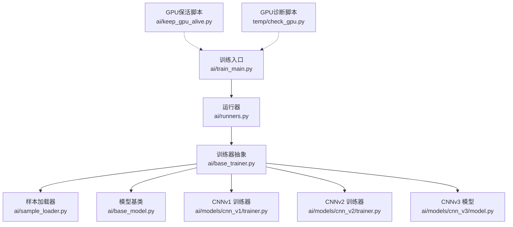
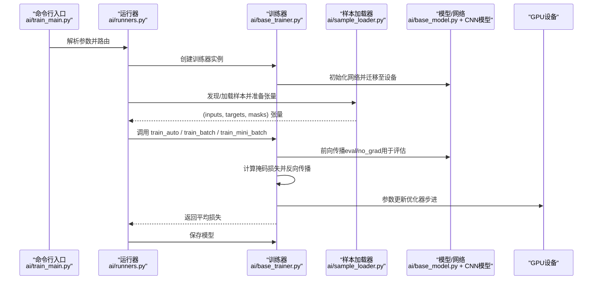
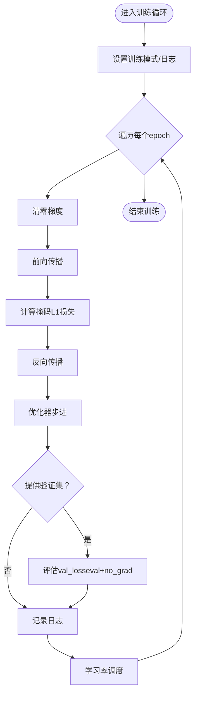
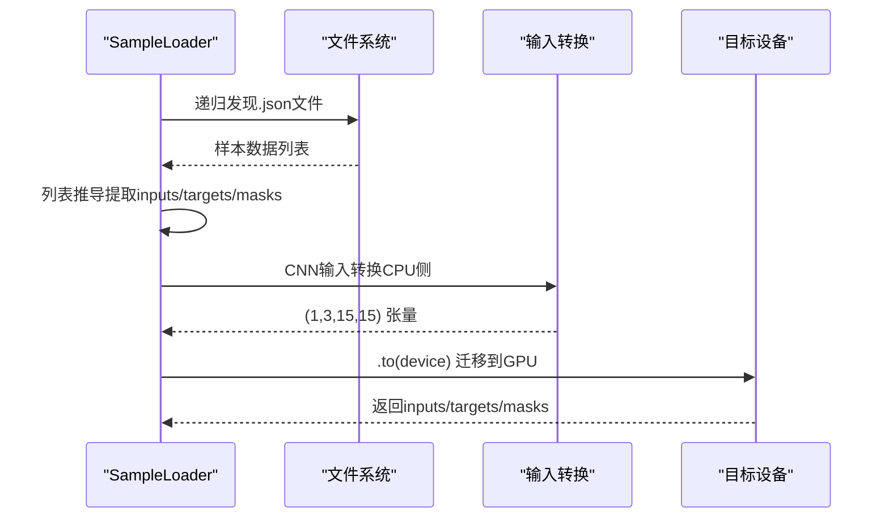
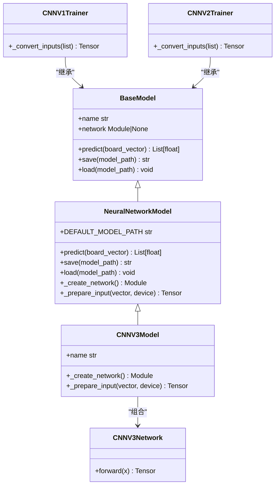
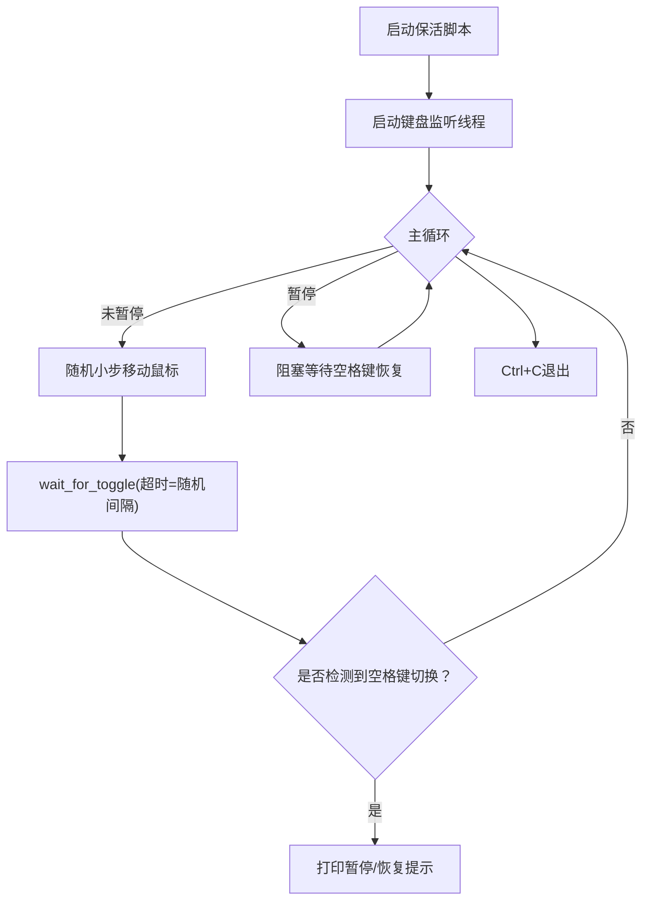
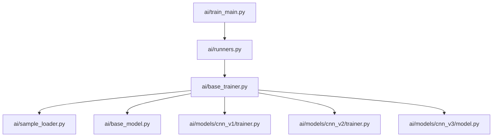

# GPU加速优化

<cite>
**本文引用的文件**
- [ai/keep_gpu_alive.py](file://ai/keep_gpu_alive.py)
- [ai/base_trainer.py](file://ai/base_trainer.py)
- [ai/sample_loader.py](file://ai/sample_loader.py)
- [ai/base_model.py](file://ai/base_model.py)
- [ai/models/cnn_v1/trainer.py](file://ai/models/cnn_v1/trainer.py)
- [ai/models/cnn_v2/trainer.py](file://ai/models/cnn_v2/trainer.py)
- [ai/models/cnn_v3/model.py](file://ai/models/cnn_v3/model.py)
- [ai/train_main.py](file://ai/train_main.py)
- [ai/runners.py](file://ai/runners.py)
- [temp/check_gpu.py](file://temp/check_gpu.py)
- [design/base_trainer_design.md](file://design/base_trainer_design.md)
- [design/cnn_v3_design.md](file://design/cnn_v3_design.md)
</cite>

## 目录
1. [简介](#简介)
2. [项目结构](#项目结构)
3. [核心组件](#核心组件)
4. [架构总览](#架构总览)
5. [详细组件分析](#详细组件分析)
6. [依赖分析](#依赖分析)
7. [性能考虑](#性能考虑)
8. [故障排查指南](#故障排查指南)
9. [结论](#结论)
10. [附录](#附录)

## 简介
本文件面向五子棋AI系统的GPU加速优化，系统梳理训练框架在PyTorch张量操作、CUDA编程实践、混合精度训练、显存管理、GPU持续运行、卷积神经网络优化、分布式训练以及性能监控与调试等方面的实现现状与改进建议。文档以仓库现有代码为依据，结合设计文档与工具脚本，给出可落地的优化策略与最佳实践。

## 项目结构
围绕GPU加速的关键模块与文件如下：
- 训练入口与运行器：ai/train_main.py、ai/runners.py
- 训练器抽象与实现：ai/base_trainer.py、ai/models/cnn_v1/trainer.py、ai/models/cnn_v2/trainer.py、ai/models/cnn_v3/model.py
- 数据加载与预处理：ai/sample_loader.py、ai/base_model.py
- GPU持续运行与诊断：ai/keep_gpu_alive.py、temp/check_gpu.py
- 设计文档：design/base_trainer_design.md、design/cnn_v3_design.md

**图表来源**
- [ai/train_main.py:1-234](file://ai/train_main.py#L1-L234)
- [ai/runners.py:1-255](file://ai/runners.py#L1-L255)
- [ai/base_trainer.py:1-699](file://ai/base_trainer.py#L1-L699)
- [ai/sample_loader.py:1-240](file://ai/sample_loader.py#L1-L240)
- [ai/base_model.py:1-323](file://ai/base_model.py#L1-L323)
- [ai/models/cnn_v1/trainer.py:1-72](file://ai/models/cnn_v1/trainer.py#L1-L72)
- [ai/models/cnn_v2/trainer.py:1-72](file://ai/models/cnn_v2/trainer.py#L1-L72)
- [ai/models/cnn_v3/model.py:1-139](file://ai/models/cnn_v3/model.py#L1-L139)
- [ai/keep_gpu_alive.py:1-246](file://ai/keep_gpu_alive.py#L1-L246)
- [temp/check_gpu.py:1-12](file://temp/check_gpu.py#L1-L12)

**章节来源**
- [ai/train_main.py:1-234](file://ai/train_main.py#L1-L234)
- [ai/runners.py:1-255](file://ai/runners.py#L1-L255)
- [ai/base_trainer.py:1-699](file://ai/base_trainer.py#L1-L699)
- [ai/sample_loader.py:1-240](file://ai/sample_loader.py#L1-L240)
- [ai/base_model.py:1-323](file://ai/base_model.py#L1-L323)
- [ai/models/cnn_v1/trainer.py:1-72](file://ai/models/cnn_v1/trainer.py#L1-L72)
- [ai/models/cnn_v2/trainer.py:1-72](file://ai/models/cnn_v2/trainer.py#L1-L72)
- [ai/models/cnn_v3/model.py:1-139](file://ai/models/cnn_v3/model.py#L1-L139)
- [ai/keep_gpu_alive.py:1-246](file://ai/keep_gpu_alive.py#L1-L246)
- [temp/check_gpu.py:1-12](file://temp/check_gpu.py#L1-L12)

## 核心组件
- 设备选择与模型迁移：训练器自动检测CUDA并把网络迁移到GPU，便于后续张量操作在GPU上执行。
- 样本加载与张量准备：SampleLoader负责从JSON样本构建PyTorch张量，并统一将输入、目标、mask迁移到目标设备。
- 训练循环与优化：BaseTrainer封装了前向+反向+参数更新的通用流程，支持全量更新与mini-batch两种训练方式。
- CNN模型族：提供CNNv1/v2/v3三种实现，输入均为(1,3,15,15)的4D张量，适合GPU并行卷积计算。
- GPU保活与诊断：提供Windows鼠标保活脚本与GPU可用性检查脚本，保障长时间训练不被驱动休眠。

**章节来源**
- [ai/base_trainer.py:21-120](file://ai/base_trainer.py#L21-L120)
- [ai/sample_loader.py:206-240](file://ai/sample_loader.py#L206-L240)
- [ai/base_model.py:278-323](file://ai/base_model.py#L278-L323)
- [ai/models/cnn_v1/trainer.py:45-72](file://ai/models/cnn_v1/trainer.py#L45-L72)
- [ai/models/cnn_v2/trainer.py:45-72](file://ai/models/cnn_v2/trainer.py#L45-L72)
- [ai/models/cnn_v3/model.py:70-94](file://ai/models/cnn_v3/model.py#L70-L94)
- [ai/keep_gpu_alive.py:187-246](file://ai/keep_gpu_alive.py#L187-L246)
- [temp/check_gpu.py:1-12](file://temp/check_gpu.py#L1-L12)

## 架构总览
下图展示训练主流程在GPU上的端到端数据流：入口解析参数 → 选择运行器 → 加载样本 → 构建张量 → 前向/反向/优化 → 评估/日志 → 保存模型。

**图表来源**
- [ai/train_main.py:27-234](file://ai/train_main.py#L27-L234)
- [ai/runners.py:81-171](file://ai/runners.py#L81-L171)
- [ai/base_trainer.py:257-322](file://ai/base_trainer.py#L257-L322)
- [ai/sample_loader.py:206-240](file://ai/sample_loader.py#L206-L240)
- [ai/base_model.py:195-231](file://ai/base_model.py#L195-L231)

## 详细组件分析

### 训练器抽象与设备管理（BaseTrainer）
- 设备选择：优先使用CUDA，否则回退CPU。
- 模型迁移：将网络迁移到选定设备，确保后续张量操作在GPU上执行。
- 训练循环：封装单轮次、批量、mini-batch训练，支持验证集评估与学习率调度。
- 评估模式：使用eval模式与torch.no_grad避免梯度计算，节省显存。
- 损失计算：支持掩码损失，按mask非零位置求平均，避免无效位置影响。

**图表来源**
- [ai/base_trainer.py:257-322](file://ai/base_trainer.py#L257-L322)
- [ai/base_trainer.py:214-239](file://ai/base_trainer.py#L214-L239)
- [ai/base_trainer.py:678-699](file://ai/base_trainer.py#L678-L699)

**章节来源**
- [ai/base_trainer.py:21-120](file://ai/base_trainer.py#L21-L120)
- [ai/base_trainer.py:214-239](file://ai/base_trainer.py#L214-L239)
- [ai/base_trainer.py:257-322](file://ai/base_trainer.py#L257-L322)
- [ai/base_trainer.py:678-699](file://ai/base_trainer.py#L678-L699)

### 样本加载与张量准备（SampleLoader）
- 发现与加载：递归发现目录下所有.json文件，合并为样本列表。
- 张量构建：将输入、目标、mask分别转换为张量，并统一迁移到目标设备。
- 输入转换：CNN模型使用board_vector_to_cnn_tensor将226维向量转换为(1,3,15,15)张量，再由SampleLoader迁移到GPU。

**图表来源**
- [ai/sample_loader.py:36-64](file://ai/sample_loader.py#L36-L64)
- [ai/sample_loader.py:206-240](file://ai/sample_loader.py#L206-L240)
- [ai/base_model.py:278-323](file://ai/base_model.py#L278-L323)

**章节来源**
- [ai/sample_loader.py:36-64](file://ai/sample_loader.py#L36-L64)
- [ai/sample_loader.py:206-240](file://ai/sample_loader.py#L206-L240)
- [ai/base_model.py:278-323](file://ai/base_model.py#L278-L323)

### CNN模型族与输入格式
- CNNv1/CNNv2：输入均为(1,3,15,15)，通道分别为黑棋、白棋、当前方。
- CNNv3：纯卷积结构，无FC/BatchNorm/Dropout，用1×1卷积替代FC，输出15×15空间概率图，再展平Softmax得到225维。
- 训练器覆写输入转换：将输入列表逐个转换为(1,3,15,15)张量并拼接为(N,3,15,15)。

**图表来源**
- [ai/base_model.py:24-106](file://ai/base_model.py#L24-L106)
- [ai/base_model.py:107-276](file://ai/base_model.py#L107-L276)
- [ai/models/cnn_v3/model.py:31-94](file://ai/models/cnn_v3/model.py#L31-L94)
- [ai/models/cnn_v1/trainer.py:45-72](file://ai/models/cnn_v1/trainer.py#L45-L72)
- [ai/models/cnn_v2/trainer.py:45-72](file://ai/models/cnn_v2/trainer.py#L45-L72)

**章节来源**
- [ai/models/cnn_v1/trainer.py:45-72](file://ai/models/cnn_v1/trainer.py#L45-L72)
- [ai/models/cnn_v2/trainer.py:45-72](file://ai/models/cnn_v2/trainer.py#L45-L72)
- [ai/models/cnn_v3/model.py:31-94](file://ai/models/cnn_v3/model.py#L31-L94)
- [ai/base_model.py:278-323](file://ai/base_model.py#L278-L323)

### GPU持续运行与保活（Windows）
- 随机鼠标移动：通过SendInput发送WM_MOUSEMOVE消息，驱动识别为用户活动，防止独显因空闲休眠。
- 可暂停模式：独立线程监听空格键，支持暂停/恢复，避免CPU空转。
- 参数控制：最小/最大移动间隔、最大步幅，兼顾保活效果与用户体验。

**图表来源**
- [ai/keep_gpu_alive.py:187-246](file://ai/keep_gpu_alive.py#L187-L246)
- [ai/keep_gpu_alive.py:89-158](file://ai/keep_gpu_alive.py#L89-L158)
- [ai/keep_gpu_alive.py:160-185](file://ai/keep_gpu_alive.py#L160-L185)

**章节来源**
- [ai/keep_gpu_alive.py:1-246](file://ai/keep_gpu_alive.py#L1-L246)

### GPU可用性检查
- 检查PyTorch版本、CUDA可用性、GPU数量与名称，便于快速定位环境问题。

**章节来源**
- [temp/check_gpu.py:1-12](file://temp/check_gpu.py#L1-L12)

## 依赖分析
- 训练入口与运行器：train_main.py通过注册表获取训练器，runners.py负责参数解析后的业务流程。
- 训练器与数据：BaseTrainer依赖SampleLoader准备设备就绪的张量；模型基类提供predict/save/load等通用逻辑。
- CNN模型：CnnV1/V2/V3共享输入转换逻辑，训练器覆写输入转换以适配4D张量。

**图表来源**
- [ai/train_main.py:23-24](file://ai/train_main.py#L23-L24)
- [ai/runners.py:18-19](file://ai/runners.py#L18-L19)
- [ai/base_trainer.py:14-18](file://ai/base_trainer.py#L14-L18)
- [ai/sample_loader.py:67-79](file://ai/sample_loader.py#L67-L79)
- [ai/base_model.py:16-22](file://ai/base_model.py#L16-L22)
- [ai/models/cnn_v1/trainer.py:6-10](file://ai/models/cnn_v1/trainer.py#L6-L10)
- [ai/models/cnn_v2/trainer.py:6-10](file://ai/models/cnn_v2/trainer.py#L6-L10)
- [ai/models/cnn_v3/model.py:24-28](file://ai/models/cnn_v3/model.py#L24-L28)

**章节来源**
- [ai/train_main.py:23-24](file://ai/train_main.py#L23-L24)
- [ai/runners.py:18-19](file://ai/runners.py#L18-L19)
- [ai/base_trainer.py:14-18](file://ai/base_trainer.py#L14-L18)
- [ai/sample_loader.py:67-79](file://ai/sample_loader.py#L67-L79)
- [ai/base_model.py:16-22](file://ai/base_model.py#L16-L22)
- [ai/models/cnn_v1/trainer.py:6-10](file://ai/models/cnn_v1/trainer.py#L6-L10)
- [ai/models/cnn_v2/trainer.py:6-10](file://ai/models/cnn_v2/trainer.py#L6-L10)
- [ai/models/cnn_v3/model.py:24-28](file://ai/models/cnn_v3/model.py#L24-L28)

## 性能考虑
- 设备选择与迁移
  - 自动检测CUDA并迁移网络，避免CPU训练瓶颈。
  - 建议：在高并发场景下使用torch.cuda.device_count()与多卡策略，结合分布式训练提升吞吐。
- 张量操作与数据传输
  - SampleLoader统一将inputs/targets/masks迁移到目标设备，减少多次迁移带来的上下文切换成本。
  - 建议：在数据管道中尽量减少CPU↔GPU拷贝，采用异步预取与pin_memory（如使用DataLoader）。
- 训练方式选择
  - 全量更新：适合小规模数据，参数更新次数少，收敛稳定。
  - Mini-batch：适合大规模数据，收敛更快，显存占用可控，建议配合梯度累积与学习率调度。
- 掩码损失与评估
  - 评估时使用eval+no_grad，显著降低显存占用与计算开销。
  - 掩码损失仅对mask=1的位置求平均，避免无效位置干扰。
- CNN结构优化
  - CNNv3用1×1卷积替代FC，参数量大幅下降，推理更快；适合部署与在线推理。
  - 建议：卷积核尺寸与通道数可进一步搜索，结合通道注意力或深度可分离卷积提升表达力。
- 混合精度训练
  - 当前未见AMP实现；建议引入torch.cuda.amp GradScaler，配合优化器步骤包装，提升吞吐并降低显存占用。
- 分布式训练
  - 当前未见数据并行/模型并行实现；建议基于torch.nn.parallel.DistributedDataParallel或FSDP，结合梯度同步策略。
- 持续运行与保活
  - 使用鼠标保活脚本防止独显休眠，保障长时间训练稳定性。
  - 建议：结合NVIDIA驱动电源管理策略与系统计划任务，形成闭环保活。

[本节为通用性能讨论，无需“章节来源”]

## 故障排查指南
- GPU不可用
  - 使用GPU诊断脚本检查CUDA可用性与GPU名称，确认驱动与CUDA版本匹配。
- 训练中断与显存不足
  - 检查评估阶段是否使用eval+no_grad；确认掩码损失是否正确归一化。
  - 减小batch_size或启用AMP混合精度；必要时降低网络复杂度。
- 鼠标保活无效
  - 确认以管理员权限运行；检查键盘监听线程是否正常工作；调整移动间隔与步幅参数。
- 训练器初始化异常
  - 确认模型保存路径存在或允许fresh=True；检查注册表与训练器导入路径。

**章节来源**
- [temp/check_gpu.py:1-12](file://temp/check_gpu.py#L1-L12)
- [ai/base_trainer.py:214-239](file://ai/base_trainer.py#L214-L239)
- [ai/base_trainer.py:678-699](file://ai/base_trainer.py#L678-L699)
- [ai/keep_gpu_alive.py:187-246](file://ai/keep_gpu_alive.py#L187-L246)

## 结论
本项目在GPU加速方面已具备良好基础：自动设备检测与迁移、统一的样本加载与张量准备、通用训练循环与评估流程、CNN模型族的4D输入格式。为进一步提升性能与稳定性，建议引入混合精度训练、分布式训练、更精细的显存管理策略，并完善性能监控与调试工具链。同时，持续运行保活机制可有效避免独显休眠导致的训练中断。

[本节为总结性内容，无需“章节来源”]

## 附录
- 设计参考
  - BaseTrainer设计文档概述了训练器抽象与主流程。
  - CNNv3设计文档阐述了纯卷积结构与参数量对比。
- 常用命令
  - 训练入口：ai/train_main.py支持cycle与train-from-dir两种模式，batch-size参数控制训练方式。

**章节来源**
- [design/base_trainer_design.md:1-196](file://design/base_trainer_design.md#L1-L196)
- [design/cnn_v3_design.md:1-173](file://design/cnn_v3_design.md#L1-L173)
- [ai/train_main.py:27-234](file://ai/train_main.py#L27-L234)