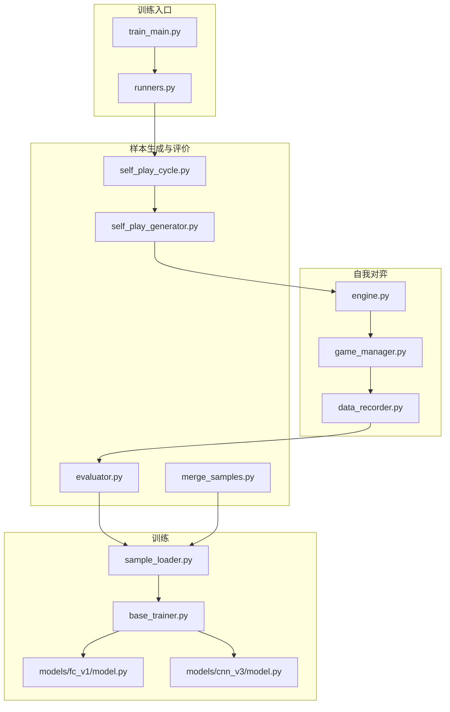
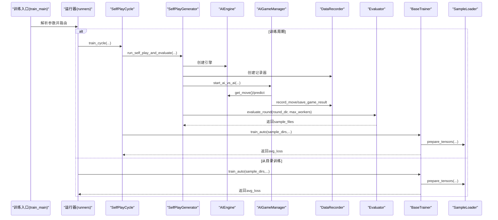
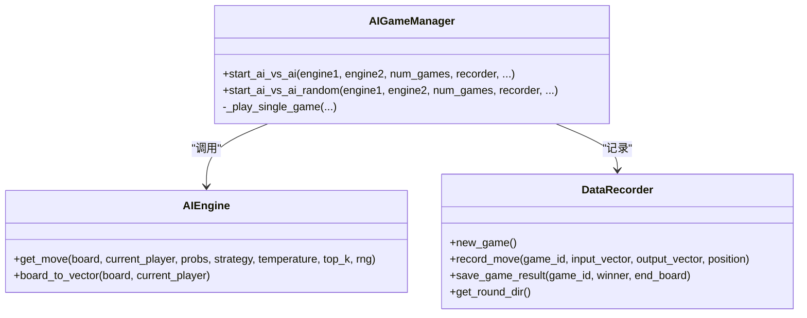
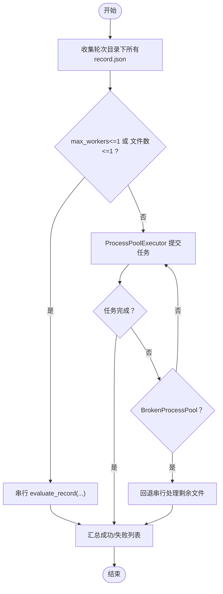
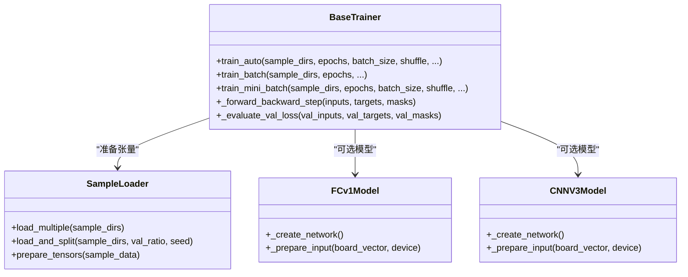
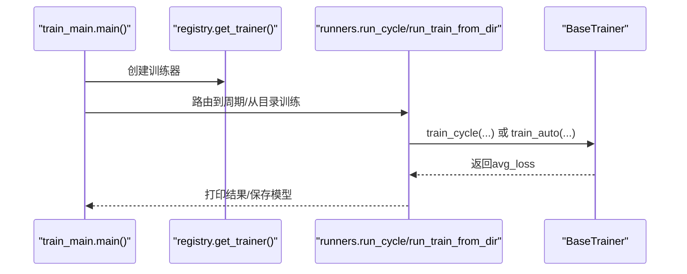
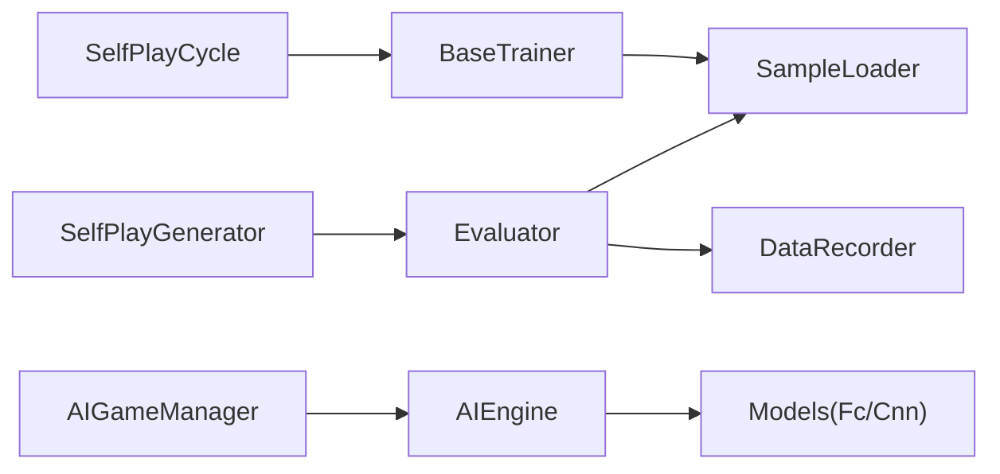

# 并行计算优化

<cite>
**本文引用的文件**
- [ai/train_main.py](file://ai/train_main.py)
- [ai/runners.py](file://ai/runners.py)
- [ai/self_play_cycle.py](file://ai/self_play_cycle.py)
- [ai/self_play_generator.py](file://ai/self_play_generator.py)
- [ai/create_samples.py](file://ai/create_samples.py)
- [ai/battle.py](file://ai/battle.py)
- [ai/game_manager.py](file://ai/game_manager.py)
- [ai/engine.py](file://ai/engine.py)
- [ai/data_recorder.py](file://ai/data_recorder.py)
- [ai/evaluator.py](file://ai/evaluator.py)
- [ai/base_trainer.py](file://ai/base_trainer.py)
- [ai/sample_loader.py](file://ai/sample_loader.py)
- [ai/models/cnn_v3/model.py](file://ai/models/cnn_v3/model.py)
- [ai/models/fc_v1/model.py](file://ai/models/fc_v1/model.py)
- [ai/merge_samples.py](file://ai/merge_samples.py)
- [design/performance/level1_optimization_design.md](file://design/performance/level1_optimization_design.md)
</cite>

## 目录
1. [简介](#简介)
2. [项目结构](#项目结构)
3. [核心组件](#核心组件)
4. [架构总览](#架构总览)
5. [详细组件分析](#详细组件分析)
6. [依赖分析](#依赖分析)
7. [性能考量](#性能考量)
8. [故障排查指南](#故障排查指南)
9. [结论](#结论)
10. [附录](#附录)

## 简介
本文件面向五子棋AI系统的并行计算优化，系统梳理多线程与多进程并行策略在自我对弈、样本生成、训练调度中的应用；总结Python并发模型（多进程、进程池、异常回退）在样本评价阶段的实现；归纳NumPy与PyTorch在向量化、GPU并行、批处理方面的优化实践；并给出训练过程的并行化思路（数据并行、模型并行、流水线并行）与任务调度、负载均衡、性能测试与调优建议。

## 项目结构
围绕“自我对弈—样本生成—训练”的主流程，系统采用模块化组织：
- 训练入口与运行器：解析参数、路由到周期训练或从数据目录训练
- 自我对弈与数据记录：AI引擎、游戏管理器、数据记录器
- 样本生成与评价：样本创建、评价器（多进程并行）
- 训练器与模型：抽象训练器、样本加载器、模型实现（FC/CNN）

**图示来源**
- [ai/train_main.py](file://ai/train_main.py)
- [ai/runners.py](file://ai/runners.py)
- [ai/self_play_cycle.py](file://ai/self_play_cycle.py)
- [ai/self_play_generator.py](file://ai/self_play_generator.py)
- [ai/engine.py](file://ai/engine.py)
- [ai/game_manager.py](file://ai/game_manager.py)
- [ai/data_recorder.py](file://ai/data_recorder.py)
- [ai/evaluator.py](file://ai/evaluator.py)
- [ai/sample_loader.py](file://ai/sample_loader.py)
- [ai/base_trainer.py](file://ai/base_trainer.py)
- [ai/models/fc_v1/model.py](file://ai/models/fc_v1/model.py)
- [ai/models/cnn_v3/model.py](file://ai/models/cnn_v3/model.py)
- [ai/merge_samples.py](file://ai/merge_samples.py)

**章节来源**
- [ai/train_main.py:1-234](file://ai/train_main.py#L1-L234)
- [ai/runners.py:1-255](file://ai/runners.py#L1-L255)
- [ai/self_play_cycle.py:1-195](file://ai/self_play_cycle.py#L1-L195)
- [ai/self_play_generator.py:1-244](file://ai/self_play_generator.py#L1-L244)
- [ai/engine.py:1-194](file://ai/engine.py#L1-L194)
- [ai/game_manager.py:1-339](file://ai/game_manager.py#L1-L339)
- [ai/data_recorder.py:1-145](file://ai/data_recorder.py#L1-L145)
- [ai/evaluator.py:1-350](file://ai/evaluator.py#L1-L350)
- [ai/base_trainer.py:1-699](file://ai/base_trainer.py#L1-L699)
- [ai/sample_loader.py:1-240](file://ai/sample_loader.py#L1-L240)
- [ai/models/fc_v1/model.py:1-132](file://ai/models/fc_v1/model.py#L1-L132)
- [ai/models/cnn_v3/model.py:1-139](file://ai/models/cnn_v3/model.py#L1-L139)
- [ai/merge_samples.py:1-155](file://ai/merge_samples.py#L1-L155)

## 核心组件
- 训练入口与运行器：提供训练周期与从数据目录训练两种模式，参数解析与路由
- 自我对弈：AI引擎封装模型预测与落子策略；游戏管理器驱动单局与多局对弈；数据记录器持久化每步输入输出
- 样本生成与评价：样本生成器产出训练样本；评价器将record.json转换为sample.json，支持多进程并行
- 训练器与模型：抽象训练器统一训练流程；样本加载器完成数据到张量的转换；模型实现FC/CNN两种结构

**章节来源**
- [ai/train_main.py:27-234](file://ai/train_main.py#L27-L234)
- [ai/runners.py:81-255](file://ai/runners.py#L81-L255)
- [ai/self_play_generator.py:21-244](file://ai/self_play_generator.py#L21-L244)
- [ai/engine.py:44-194](file://ai/engine.py#L44-L194)
- [ai/game_manager.py:16-339](file://ai/game_manager.py#L16-L339)
- [ai/data_recorder.py:17-145](file://ai/data_recorder.py#L17-L145)
- [ai/evaluator.py:51-350](file://ai/evaluator.py#L51-L350)
- [ai/base_trainer.py:32-699](file://ai/base_trainer.py#L32-L699)
- [ai/sample_loader.py:67-240](file://ai/sample_loader.py#L67-L240)
- [ai/models/fc_v1/model.py:18-132](file://ai/models/fc_v1/model.py#L18-L132)
- [ai/models/cnn_v3/model.py:31-139](file://ai/models/cnn_v3/model.py#L31-L139)

## 架构总览
训练主流程从入口脚本进入，根据参数选择“训练周期”或“从目录训练”。周期模式下，SelfPlayCycle协调自我对弈与评价，随后调用训练器进行批量/小批量训练；从目录训练模式下，runners直接加载样本并训练。样本生成阶段，Evaluator支持多进程并行，遇到进程池崩溃自动回退串行。

**图示来源**
- [ai/train_main.py:27-234](file://ai/train_main.py#L27-L234)
- [ai/runners.py:173-255](file://ai/runners.py#L173-L255)
- [ai/self_play_cycle.py:38-195](file://ai/self_play_cycle.py#L38-L195)
- [ai/self_play_generator.py:21-244](file://ai/self_play_generator.py#L21-L244)
- [ai/engine.py:67-194](file://ai/engine.py#L67-L194)
- [ai/game_manager.py:233-339](file://ai/game_manager.py#L233-L339)
- [ai/data_recorder.py:66-145](file://ai/data_recorder.py#L66-L145)
- [ai/evaluator.py:224-350](file://ai/evaluator.py#L224-L350)
- [ai/base_trainer.py:575-603](file://ai/base_trainer.py#L575-L603)
- [ai/sample_loader.py:206-240](file://ai/sample_loader.py#L206-L240)

## 详细组件分析

### 自我对弈与数据记录
- AIEngine：封装模型预测与落子策略（argmax/sampling），支持传入预计算概率向量避免重复计算
- AIGameManager：单局/多局对弈流程，按步记录输入、输出、落子位置，保存终局结果
- DataRecorder：轮次目录+局号子目录，记录每步数据并持久化

**图示来源**
- [ai/engine.py:44-194](file://ai/engine.py#L44-L194)
- [ai/game_manager.py:16-339](file://ai/game_manager.py#L16-L339)
- [ai/data_recorder.py:17-145](file://ai/data_recorder.py#L17-L145)

**章节来源**
- [ai/engine.py:67-194](file://ai/engine.py#L67-L194)
- [ai/game_manager.py:123-339](file://ai/game_manager.py#L123-L339)
- [ai/data_recorder.py:66-145](file://ai/data_recorder.py#L66-L145)

### 样本生成与评价（多进程并行）
- SelfPlayGenerator：封装自我对弈+评价流程，支持温度采样配置
- Evaluator：将record.json转换为sample.json，支持多进程并行（ProcessPoolExecutor），Windows spawn模式下使用顶层worker函数；进程池崩溃自动回退串行
- MergeSamples：将分散的sample.json合并为单个大文件，降低训练I/O开销

**图示来源**
- [ai/self_play_generator.py:21-168](file://ai/self_play_generator.py#L21-L168)
- [ai/evaluator.py:224-350](file://ai/evaluator.py#L224-L350)

**章节来源**
- [ai/self_play_generator.py:21-244](file://ai/self_play_generator.py#L21-L244)
- [ai/evaluator.py:51-350](file://ai/evaluator.py#L51-L350)
- [ai/merge_samples.py:13-155](file://ai/merge_samples.py#L13-L155)

### 训练器与模型（GPU并行、批处理）
- BaseTrainer：统一训练接口，自动检测GPU，支持StepLR/ReduceLROnPlateau；提供train_batch、train_mini_batch、train_auto；支持验证集与密集日志
- SampleLoader：将样本数据转换为PyTorch张量，支持输入转换器（如CNN的4D张量）
- FCv1/CNNv3模型：FCv1全连接网络，CNNv3纯卷积网络，均继承NeuralNetworkModel，自动加载/保存参数

**图示来源**
- [ai/base_trainer.py:32-699](file://ai/base_trainer.py#L32-L699)
- [ai/sample_loader.py:67-240](file://ai/sample_loader.py#L67-L240)
- [ai/models/fc_v1/model.py:91-132](file://ai/models/fc_v1/model.py#L91-L132)
- [ai/models/cnn_v3/model.py:96-139](file://ai/models/cnn_v3/model.py#L96-L139)

**章节来源**
- [ai/base_trainer.py:21-120](file://ai/base_trainer.py#L21-L120)
- [ai/base_trainer.py:324-603](file://ai/base_trainer.py#L324-L603)
- [ai/sample_loader.py:206-240](file://ai/sample_loader.py#L206-L240)
- [ai/models/fc_v1/model.py:91-132](file://ai/models/fc_v1/model.py#L91-L132)
- [ai/models/cnn_v3/model.py:96-139](file://ai/models/cnn_v3/model.py#L96-L139)

### 训练入口与运行器
- train_main：参数解析、模式校验、创建训练器并路由到runners
- runners：提供run_cycle与run_train_from_dir，打印训练参数与结果，调用trainer.train_auto或trainer.train_cycle

**图示来源**
- [ai/train_main.py:27-234](file://ai/train_main.py#L27-L234)
- [ai/runners.py:173-255](file://ai/runners.py#L173-L255)
- [ai/base_trainer.py:621-660](file://ai/base_trainer.py#L621-L660)

**章节来源**
- [ai/train_main.py:27-234](file://ai/train_main.py#L27-L234)
- [ai/runners.py:81-255](file://ai/runners.py#L81-L255)

### 独立样本生成与对战脚本
- create_samples：独立CLI，支持winning_move/winner_path两种模式，可控制温度采样与数据增强
- battle：两个AI对战脚本，支持随机执方与结果统计

**章节来源**
- [ai/create_samples.py:23-197](file://ai/create_samples.py#L23-L197)
- [ai/battle.py:136-199](file://ai/battle.py#L136-L199)

## 依赖分析
- 模块耦合
  - SelfPlayCycle依赖BaseTrainer的train_auto与模型保存能力
  - SelfPlayGenerator与SelfPlayCycle共享run_self_play_and_evaluate逻辑
  - Evaluator依赖DataRecorder生成的轮次目录结构
  - BaseTrainer依赖SampleLoader完成数据到张量的转换
- 外部依赖
  - PyTorch用于神经网络训练与GPU加速
  - concurrent.futures.ProcessPoolExecutor用于样本评价并行
  - JSON文件用于数据持久化与跨模块传输

**图示来源**
- [ai/self_play_cycle.py:38-195](file://ai/self_play_cycle.py#L38-L195)
- [ai/self_play_generator.py:21-244](file://ai/self_play_generator.py#L21-L244)
- [ai/evaluator.py:51-350](file://ai/evaluator.py#L51-L350)
- [ai/sample_loader.py:67-240](file://ai/sample_loader.py#L67-L240)
- [ai/engine.py:44-194](file://ai/engine.py#L44-L194)
- [ai/base_trainer.py:32-120](file://ai/base_trainer.py#L32-L120)

**章节来源**
- [ai/self_play_cycle.py:38-195](file://ai/self_play_cycle.py#L38-L195)
- [ai/self_play_generator.py:21-244](file://ai/self_play_generator.py#L21-L244)
- [ai/evaluator.py:51-350](file://ai/evaluator.py#L51-L350)
- [ai/sample_loader.py:67-240](file://ai/sample_loader.py#L67-L240)
- [ai/engine.py:44-194](file://ai/engine.py#L44-L194)
- [ai/base_trainer.py:32-120](file://ai/base_trainer.py#L32-L120)

## 性能考量
- 自我对弈性能优化
  - 消除冗余predict调用：AIEngine.get_move新增probs参数，避免重复model.predict
  - 棋盘拷贝优化：detect_shapes采用“修改-检测-恢复”模式，减少list拷贝
  - JSON去缩进：data_recorder与evaluator使用紧凑格式，显著降低文件体积
  - prepare_tensors向量化：列表推导+批量张量转换，减少Python解释器开销
- 样本评价并行
  - 多进程并行：ProcessPoolExecutor按record文件并行评价；Windows spawn模式使用顶层worker函数
  - 异常回退：BrokenProcessPool时回退串行，保证稳定性
- 训练并行与批处理
  - GPU自动检测与迁移：BaseTrainer自动将模型与张量移动到CUDA
  - 批处理优化：train_mini_batch支持小批量训练，提高收敛速度与内存效率
  - 验证集与学习率调度：支持StepLR与ReduceLROnPlateau，结合验证集监控避免过拟合
- I/O与数据组织
  - 合并样本：merge_samples将分散样本合并为单文件，减少训练时I/O开销

**章节来源**
- [design/performance/level1_optimization_design.md:1-124](file://design/performance/level1_optimization_design.md#L1-L124)
- [ai/evaluator.py:304-350](file://ai/evaluator.py#L304-L350)
- [ai/data_recorder.py:137-140](file://ai/data_recorder.py#L137-L140)
- [ai/sample_loader.py:215-240](file://ai/sample_loader.py#L215-L240)
- [ai/base_trainer.py:21-120](file://ai/base_trainer.py#L21-L120)
- [ai/base_trainer.py:409-573](file://ai/base_trainer.py#L409-L573)
- [ai/merge_samples.py:42-76](file://ai/merge_samples.py#L42-L76)

## 故障排查指南
- 进程池崩溃（OOM/异常）
  - 现象：BrokenProcessPool异常
  - 处理：Evaluator自动回退串行，重试剩余文件
- 训练中断
  - 现象：Ctrl+C中断
  - 处理：BaseTrainer与SelfPlayCycle在中断时保存模型与图表，支持安全退出
- 数据路径与权限
  - 现象：路径不存在或无权限
  - 处理：runners与merge_samples对路径进行校验并报错
- 温度采样与随机性
  - 现象：采样结果不稳定
  - 处理：通过temp_config.seed与随机源控制可复现性

**章节来源**
- [ai/evaluator.py:325-349](file://ai/evaluator.py#L325-L349)
- [ai/base_trainer.py:314-322](file://ai/base_trainer.py#L314-L322)
- [ai/self_play_cycle.py:157-177](file://ai/self_play_cycle.py#L157-L177)
- [ai/runners.py:97-101](file://ai/runners.py#L97-L101)
- [ai/merge_samples.py:134-142](file://ai/merge_samples.py#L134-L142)

## 结论
本系统在自我对弈、样本生成与训练三个层面实现了较为完善的并行化与性能优化：自我对弈通过消除冗余计算与I/O优化提升吞吐；样本评价采用多进程并行并在异常时回退串行，兼顾效率与稳定性；训练侧利用PyTorch的GPU并行与批处理机制，配合学习率调度与验证集监控，形成高效的训练闭环。未来可在分布式训练（数据/模型/流水线并行）与动态任务调度方面进一步扩展。

## 附录
- 并行化策略建议
  - 数据并行：在多GPU环境下，将样本切分为多个分片，分别在不同GPU上计算梯度并聚合
  - 模型并行：将大型模型按层拆分到不同设备，流水线推进前向/反向
  - 流水线并行：将批内样本切分为微批次，在不同阶段重叠计算
- 任务调度与负载均衡
  - 动态任务分配：按GPU显存占用与计算耗时动态分配样本批次
  - 资源调度：限制max_workers，避免过度并行导致上下文切换开销上升
  - 性能监控：结合密集日志与验证集曲线，实时观察吞吐与稳定性
- 性能测试与调优
  - 吞吐量分析：记录每epoch耗时与样本数，计算样本/秒
  - 延迟优化：减少I/O与冗余计算，合理设置批大小与学习率
  - 资源利用率：监控GPU显存峰值与利用率，避免OOM与空闲