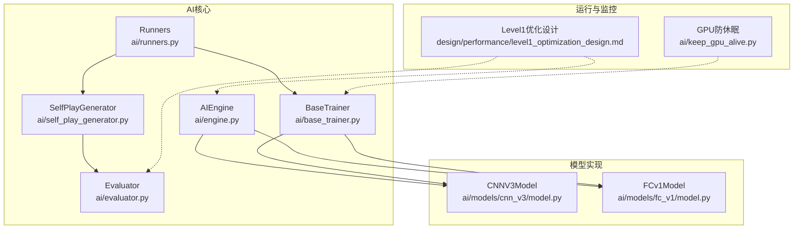
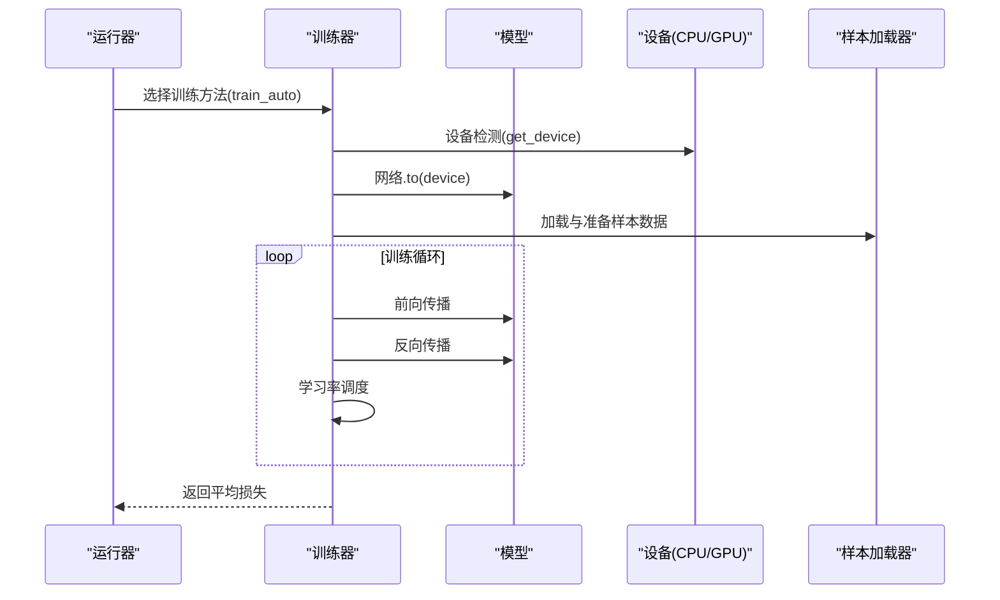
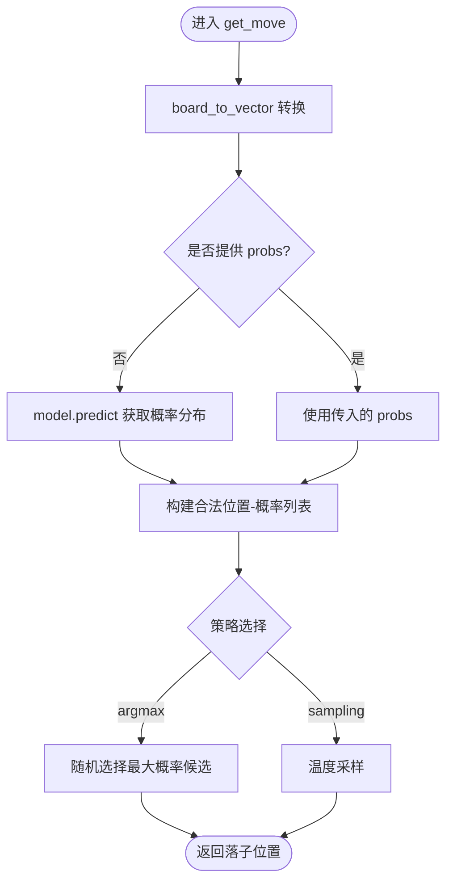
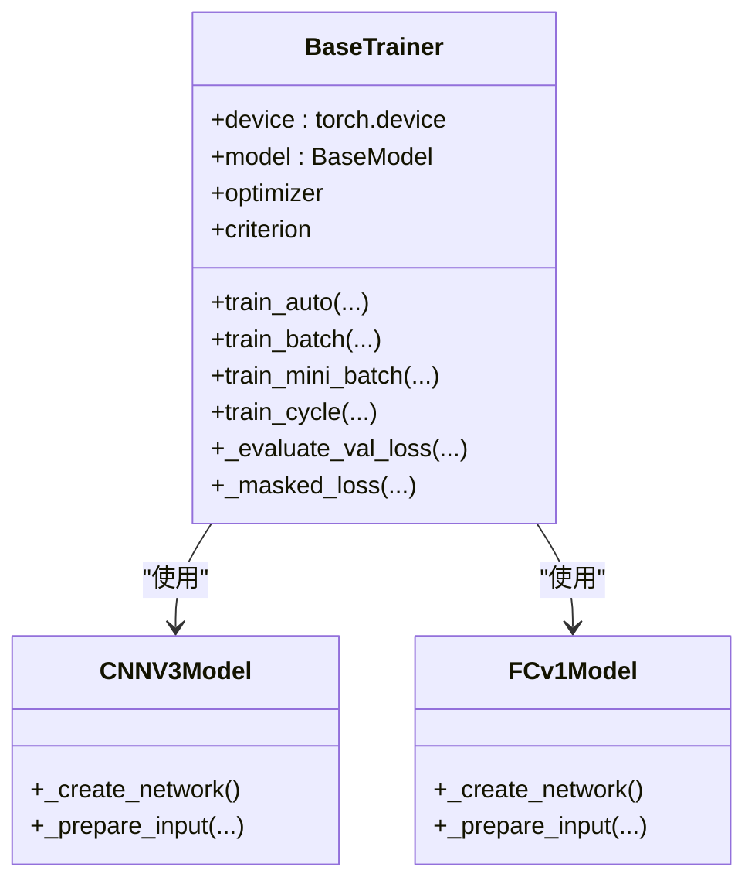
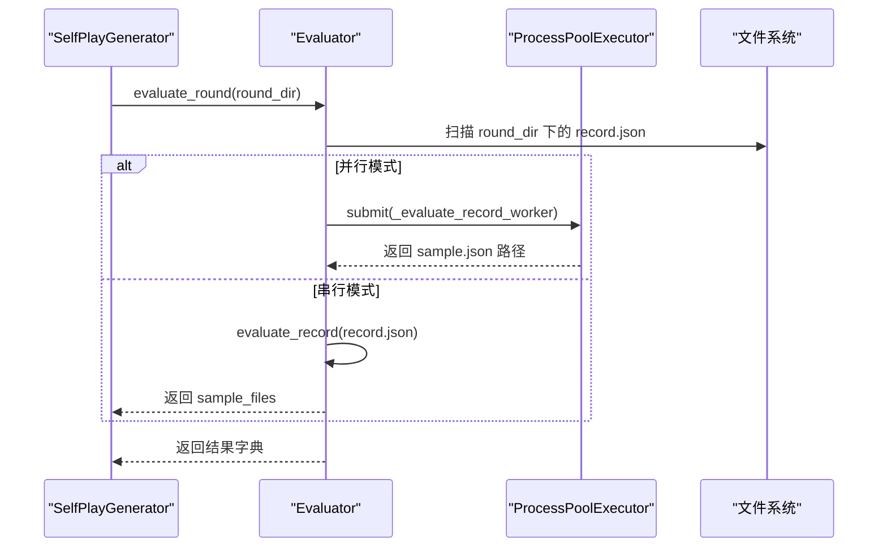
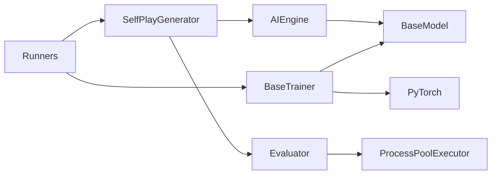
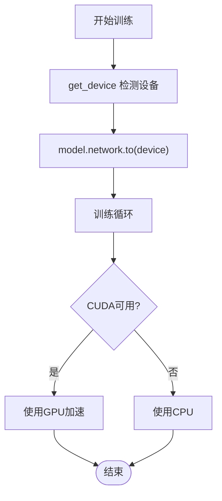

# 性能优化设计

<cite>
**本文引用的文件**
- [ai/engine.py](file://ai/engine.py)
- [ai/base_trainer.py](file://ai/base_trainer.py)
- [ai/evaluator.py](file://ai/evaluator.py)
- [ai/self_play_generator.py](file://ai/self_play_generator.py)
- [ai/runners.py](file://ai/runners.py)
- [ai/keep_gpu_alive.py](file://ai/keep_gpu_alive.py)
- [ai/models/cnn_v3/model.py](file://ai/models/cnn_v3/model.py)
- [ai/models/fc_v1/model.py](file://ai/models/fc_v1/model.py)
- [design/performance/level1_optimization_design.md](file://design/performance/level1_optimization_design.md)
- [tests/ai/test_performance_level1.py](file://tests/ai/test_performance_level1.py)
- [tests/ai/test_performance_level2_parallel.py](file://tests/ai/test_performance_level2_parallel.py)
- [tests/ai/test_performance_level2_numba.py](file://tests/ai/test_performance_level2_numba.py)
</cite>

## 目录
1. [简介](#简介)
2. [项目结构](#项目结构)
3. [核心组件](#核心组件)
4. [架构总览](#架构总览)
5. [详细组件分析](#详细组件分析)
6. [依赖分析](#依赖分析)
7. [性能考量](#性能考量)
8. [故障排查指南](#故障排查指南)
9. [结论](#结论)
10. [附录](#附录)

## 简介
本设计文档面向五子棋AI系统的性能优化，聚焦以下关键目标：
- 识别并评估系统性能瓶颈：CPU密集型计算、GPU加速、内存使用
- 多层级优化策略：算法优化、数据结构优化、并行计算优化
- GPU加速设计：设备检测、模型迁移、训练加速
- 内存优化：张量设备迁移、批处理、日志与数据压缩
- 缓存策略：数据缓存、计算缓存、模型缓存
- 性能监控：指标采集、瓶颈定位、回归检测
- 可扩展性：分布式训练、负载均衡、资源调度

## 项目结构
本项目采用模块化组织，AI核心逻辑集中在 ai 目录，训练与运行入口位于 ai/runners.py，模型实现位于 ai/models，GUI与应用层位于 gui/app。

**图表来源**
- [ai/engine.py:44-194](file://ai/engine.py#L44-L194)
- [ai/base_trainer.py:32-699](file://ai/base_trainer.py#L32-L699)
- [ai/evaluator.py:51-350](file://ai/evaluator.py#L51-L350)
- [ai/self_play_generator.py:21-244](file://ai/self_play_generator.py#L21-L244)
- [ai/runners.py:81-255](file://ai/runners.py#L81-L255)
- [ai/keep_gpu_alive.py:187-246](file://ai/keep_gpu_alive.py#L187-L246)
- [ai/models/cnn_v3/model.py:96-139](file://ai/models/cnn_v3/model.py#L96-L139)
- [ai/models/fc_v1/model.py:91-132](file://ai/models/fc_v1/model.py#L91-L132)
- [design/performance/level1_optimization_design.md:1-124](file://design/performance/level1_optimization_design.md#L1-L124)

**章节来源**
- [ai/engine.py:1-194](file://ai/engine.py#L1-L194)
- [ai/base_trainer.py:1-699](file://ai/base_trainer.py#L1-L699)
- [ai/evaluator.py:1-350](file://ai/evaluator.py#L1-L350)
- [ai/self_play_generator.py:1-244](file://ai/self_play_generator.py#L1-L244)
- [ai/runners.py:1-255](file://ai/runners.py#L1-L255)
- [ai/keep_gpu_alive.py:1-246](file://ai/keep_gpu_alive.py#L1-L246)
- [ai/models/cnn_v3/model.py:1-139](file://ai/models/cnn_v3/model.py#L1-L139)
- [ai/models/fc_v1/model.py:1-132](file://ai/models/fc_v1/model.py#L1-L132)
- [design/performance/level1_optimization_design.md:1-124](file://design/performance/level1_optimization_design.md#L1-L124)

## 核心组件
- AI引擎（AIEngine）：负责将棋盘状态转换为模型输入，调用模型获取概率分布，并基于策略选择落子位置。支持预计算概率以避免重复推理。
- 训练器（BaseTrainer）：提供统一训练流程，自动检测并使用GPU，支持StepLR与ReduceLROnPlateau学习率调度，支持全量与mini-batch训练。
- 评价器（Evaluator）：从AI对局记录生成训练样本，支持多进程并行评价，减少I/O与CPU瓶颈。
- 自我对弈生成器（SelfPlayGenerator）：执行自我对弈与评价，生成训练数据，不参与训练。
- 运行器（Runners）：封装训练与周期模式，提供discover_sample_dirs、run_train_from_dir、run_cycle等公共函数。
- 模型实现：CNNV3Model与FCv1Model分别提供卷积与全连接网络实现，统一继承NeuralNetworkModel，支持设备迁移与输入转换。

**章节来源**
- [ai/engine.py:44-194](file://ai/engine.py#L44-L194)
- [ai/base_trainer.py:32-699](file://ai/base_trainer.py#L32-L699)
- [ai/evaluator.py:51-350](file://ai/evaluator.py#L51-L350)
- [ai/self_play_generator.py:170-244](file://ai/self_play_generator.py#L170-L244)
- [ai/runners.py:21-255](file://ai/runners.py#L21-L255)
- [ai/models/cnn_v3/model.py:96-139](file://ai/models/cnn_v3/model.py#L96-L139)
- [ai/models/fc_v1/model.py:91-132](file://ai/models/fc_v1/model.py#L91-L132)

## 架构总览
系统采用“引擎-模型-训练器-运行器”的分层架构，训练数据通过自我对弈与评价生成，训练器负责模型训练与优化，运行器协调训练流程与周期。

**图表来源**
- [ai/base_trainer.py:21-120](file://ai/base_trainer.py#L21-L120)
- [ai/runners.py:148-171](file://ai/runners.py#L148-L171)

**章节来源**
- [ai/base_trainer.py:21-120](file://ai/base_trainer.py#L21-L120)
- [ai/runners.py:148-171](file://ai/runners.py#L148-L171)

## 详细组件分析

### AI引擎（AIEngine）
- 职责：将棋盘状态转换为向量，调用模型获取概率分布，按策略选择落子。
- 性能优化点：支持传入预计算的概率分布，避免重复调用model.predict；argmax策略随机打破并列，避免确定性路径退化。
- 输入转换：board_to_vector将15×15棋盘与当前玩家拼接为226维向量。

**图表来源**
- [ai/engine.py:67-142](file://ai/engine.py#L67-L142)

**章节来源**
- [ai/engine.py:67-194](file://ai/engine.py#L67-L194)

### 训练器（BaseTrainer）
- 设备检测：优先使用CUDA，否则回退至CPU。
- 训练方法：train_batch（全量更新）、train_mini_batch（mini-batch）、train_auto（自动选择）。
- 损失计算：masked L1Loss，支持mask过滤非法位置。
- 学习率调度：StepLR与ReduceLROnPlateau两种策略。
- 评估：在验证集上评估loss，使用torch.no_grad节省显存。

**图表来源**
- [ai/base_trainer.py:32-699](file://ai/base_trainer.py#L32-L699)
- [ai/models/cnn_v3/model.py:96-139](file://ai/models/cnn_v3/model.py#L96-L139)
- [ai/models/fc_v1/model.py:91-132](file://ai/models/fc_v1/model.py#L91-L132)

**章节来源**
- [ai/base_trainer.py:32-699](file://ai/base_trainer.py#L32-L699)
- [ai/models/cnn_v3/model.py:96-139](file://ai/models/cnn_v3/model.py#L96-L139)
- [ai/models/fc_v1/model.py:91-132](file://ai/models/fc_v1/model.py#L91-L132)

### 评价器（Evaluator）
- 职责：从对局记录生成训练样本，融合棋型评估与五连追溯奖励，通过Softmax生成概率分布。
- 并行：支持ProcessPoolExecutor并行评价，Windows spawn模式下使用顶层worker函数。
- 错误处理：BrokenProcessPool回退到串行，单文件失败不影响其他文件。

**图表来源**
- [ai/evaluator.py:224-350](file://ai/evaluator.py#L224-L350)
- [ai/self_play_generator.py:21-137](file://ai/self_play_generator.py#L21-L137)

**章节来源**
- [ai/evaluator.py:51-350](file://ai/evaluator.py#L51-L350)
- [ai/self_play_generator.py:21-137](file://ai/self_play_generator.py#L21-L137)

### 自我对弈生成器（SelfPlayGenerator）
- 职责：执行AI vs AI对局，记录对局数据，调用Evaluator生成训练样本。
- 与训练器解耦：仅生成数据，不参与训练。

**章节来源**
- [ai/self_play_generator.py:170-244](file://ai/self_play_generator.py#L170-L244)

### 运行器（Runners）
- discover_sample_dirs：发现包含sample.json的子目录。
- run_train_from_dir：从已有数据训练，支持自动选择训练方法。
- run_cycle：训练周期模式，封装温度采样配置与训练循环。

**章节来源**
- [ai/runners.py:21-255](file://ai/runners.py#L21-L255)

### 模型实现（CNNV3Model / FCv1Model）
- CNNV3Model：纯卷积网络，无全连接层、BN与Dropout，使用1×1卷积替代FC，输出15×15空间概率图。
- FCv1Model：5层隐藏层，每层1000神经元，使用ReLU激活，输出225维Softmax概率分布。

**章节来源**
- [ai/models/cnn_v3/model.py:96-139](file://ai/models/cnn_v3/model.py#L96-L139)
- [ai/models/fc_v1/model.py:91-132](file://ai/models/fc_v1/model.py#L91-L132)

## 依赖分析
- AIEngine依赖模型接口（BaseModel），通过registry获取具体模型实例。
- BaseTrainer依赖PyTorch，自动检测CUDA并迁移模型与张量。
- Evaluator依赖多进程并行框架，支持Windows spawn模式。
- SelfPlayGenerator依赖AIEngine与Evaluator，生成训练数据。
- Runners协调训练器与数据生成器，提供训练入口。

**图表来源**
- [ai/engine.py:18-41](file://ai/engine.py#L18-L41)
- [ai/base_trainer.py:10-17](file://ai/base_trainer.py#L10-L17)
- [ai/evaluator.py:17-23](file://ai/evaluator.py#L17-L23)
- [ai/self_play_generator.py:12-15](file://ai/self_play_generator.py#L12-L15)
- [ai/runners.py:18-25](file://ai/runners.py#L18-L25)

**章节来源**
- [ai/engine.py:18-41](file://ai/engine.py#L18-L41)
- [ai/base_trainer.py:10-17](file://ai/base_trainer.py#L10-L17)
- [ai/evaluator.py:17-23](file://ai/evaluator.py#L17-L23)
- [ai/self_play_generator.py:12-15](file://ai/self_play_generator.py#L12-L15)
- [ai/runners.py:18-25](file://ai/runners.py#L18-L25)

## 性能考量

### CPU密集型计算优化
- 棋型检测与奖励计算：通过Numba JIT加速detect_single_direction，提供纯Python回退，确保跨平台兼容。
- 棋盘拷贝消除：detect_shapes采用“修改-检测-恢复”模式，避免list(board)拷贝，减少数百万次拷贝开销。
- JSON序列化优化：去掉indent=2，生成紧凑格式，减少文件体积与I/O时间。
- 样本张量准备：使用列表推导替代逐条append，提升prepare_tensors效率。

**章节来源**
- [tests/ai/test_performance_level2_numba.py:30-387](file://tests/ai/test_performance_level2_numba.py#L30-L387)
- [design/performance/level1_optimization_design.md:47-124](file://design/performance/level1_optimization_design.md#L47-L124)
- [tests/ai/test_performance_level1.py:112-337](file://tests/ai/test_performance_level1.py#L112-L337)

### GPU加速设计
- 设备检测：优先使用CUDA，否则回退CPU。
- 模型迁移：训练器在初始化时将模型网络迁移到目标设备。
- 训练加速：利用GPU并行计算能力，结合mini-batch训练提升吞吐。
- 防休眠：提供keep_gpu_alive脚本，防止独显因空闲休眠，保障GPU稳定占用。

**图表来源**
- [ai/base_trainer.py:21-88](file://ai/base_trainer.py#L21-L88)
- [ai/keep_gpu_alive.py:187-246](file://ai/keep_gpu_alive.py#L187-L246)

**章节来源**
- [ai/base_trainer.py:21-88](file://ai/base_trainer.py#L21-L88)
- [ai/keep_gpu_alive.py:187-246](file://ai/keep_gpu_alive.py#L187-L246)

### 内存优化
- 张量设备迁移：训练器在初始化时将模型迁移到目标设备，避免频繁设备切换。
- 批处理与mask：使用masked L1Loss与mask过滤非法位置，减少无效计算。
- 日志与数据压缩：JSON紧凑格式减少磁盘占用，降低I/O压力。
- 评估并行：多进程并行评价，减少单进程内存峰值。

**章节来源**
- [ai/base_trainer.py:85-101](file://ai/base_trainer.py#L85-L101)
- [ai/evaluator.py:126-129](file://ai/evaluator.py#L126-L129)
- [tests/ai/test_performance_level2_parallel.py:225-393](file://tests/ai/test_performance_level2_parallel.py#L225-L393)

### 缓存策略
- 数据缓存：样本加载器SampleLoader缓存已加载数据，避免重复I/O。
- 计算缓存：AIEngine支持传入预计算的概率分布，避免重复模型推理。
- 模型缓存：模型文件持久化，训练器自动加载已保存参数，减少初始化成本。

**章节来源**
- [ai/engine.py:110-113](file://ai/engine.py#L110-L113)
- [ai/base_trainer.py:80-88](file://ai/base_trainer.py#L80-L88)

### 性能监控
- 指标采集：LossLogger记录训练过程中的loss、grad_norm、学习率等指标。
- 瓶颈分析：通过日志与验证集loss评估，定位收敛慢或过拟合问题。
- 回归检测：单元测试覆盖关键优化点，确保回归问题及时发现。

**章节来源**
- [ai/base_trainer.py:199-212](file://ai/base_trainer.py#L199-L212)
- [tests/ai/test_performance_level1.py:1-337](file://tests/ai/test_performance_level1.py#L1-L337)
- [tests/ai/test_performance_level2_parallel.py:1-393](file://tests/ai/test_performance_level2_parallel.py#L1-L393)
- [tests/ai/test_performance_level2_numba.py:1-387](file://tests/ai/test_performance_level2_numba.py#L1-L387)

### 可扩展性优化
- 分布式训练：通过多进程并行（ProcessPoolExecutor）与多GPU并行（CUDA）扩展训练规模。
- 负载均衡：多进程评价器自动分配任务，避免单点瓶颈。
- 资源调度：训练器支持学习率调度与早停策略，动态调整训练节奏。

**章节来源**
- [ai/evaluator.py:304-350](file://ai/evaluator.py#L304-L350)
- [ai/base_trainer.py:127-144](file://ai/base_trainer.py#L127-L144)

## 故障排查指南
- GPU不可用：检查CUDA可用性与驱动版本，确认模型已迁移到正确设备。
- 进程池崩溃：多进程并行时遇到BrokenProcessPool，系统会回退到串行模式，检查内存与任务粒度。
- 训练中断：支持Ctrl+C优雅中断，自动保存当前进度与图表。
- 样本质量：通过样本验证报告（Hit@N、攻击位概率和、区分度gap）评估标签质量。

**章节来源**
- [ai/base_trainer.py:314-322](file://ai/base_trainer.py#L314-L322)
- [ai/evaluator.py:335-349](file://ai/evaluator.py#L335-L349)
- [tests/ai/test_performance_level1.py:287-337](file://tests/ai/test_performance_level1.py#L287-L337)

## 结论
本设计文档系统梳理了五子棋AI系统的性能优化路径，涵盖算法、数据结构、并行与GPU加速等多个层面。通过第一级优化（消除冗余predict、棋盘拷贝、JSON去缩进、prepare_tensors向量化）与第二级优化（Numba JIT、多进程并行），结合训练器的设备检测与学习率调度，实现了从CPU到GPU的全面加速。配套的监控与测试体系确保优化效果可追踪、可回归，为后续扩展分布式训练与更大规模模型奠定了基础。

## 附录
- 第一级性能优化设计要点：消除SelfPlay冗余predict、棋盘拷贝消除、JSON去缩进、prepare_tensors向量化。
- 第二级性能优化设计要点：Numba JIT加速棋型检测、多进程并行评价。

**章节来源**
- [design/performance/level1_optimization_design.md:1-124](file://design/performance/level1_optimization_design.md#L1-L124)
- [tests/ai/test_performance_level2_numba.py:351-387](file://tests/ai/test_performance_level2_numba.py#L351-L387)
- [tests/ai/test_performance_level2_parallel.py:225-393](file://tests/ai/test_performance_level2_parallel.py#L225-L393)