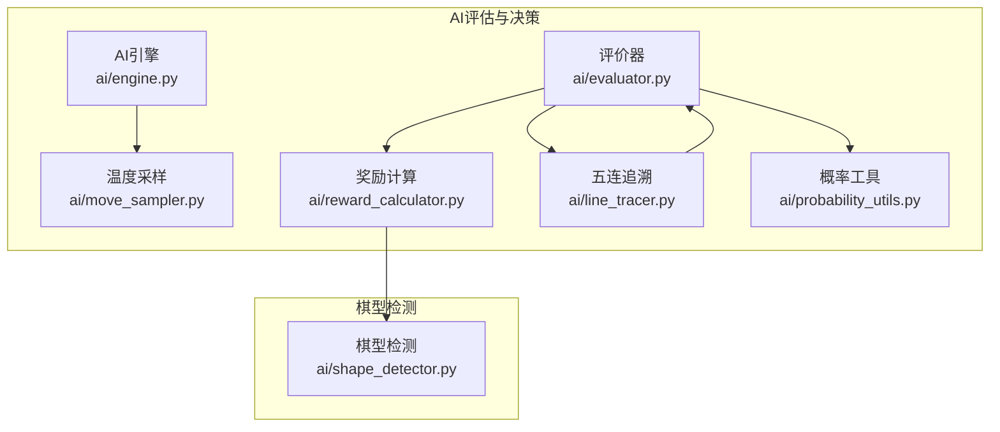
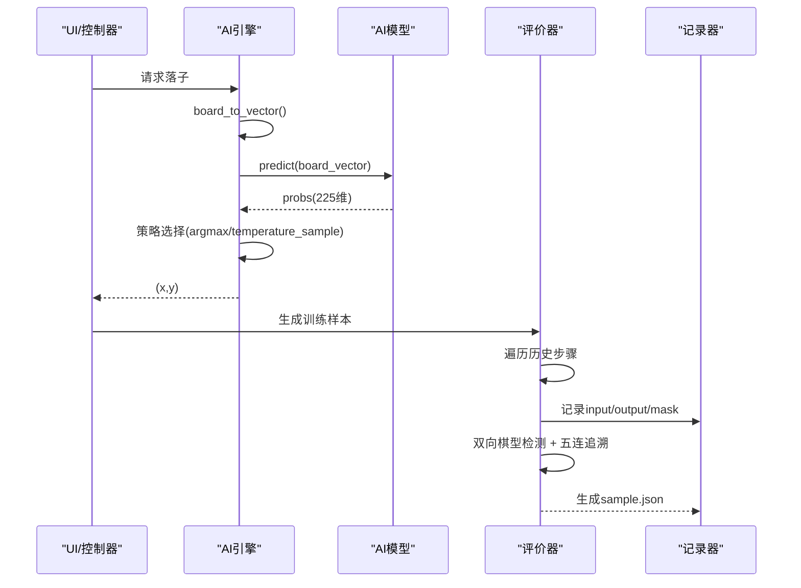
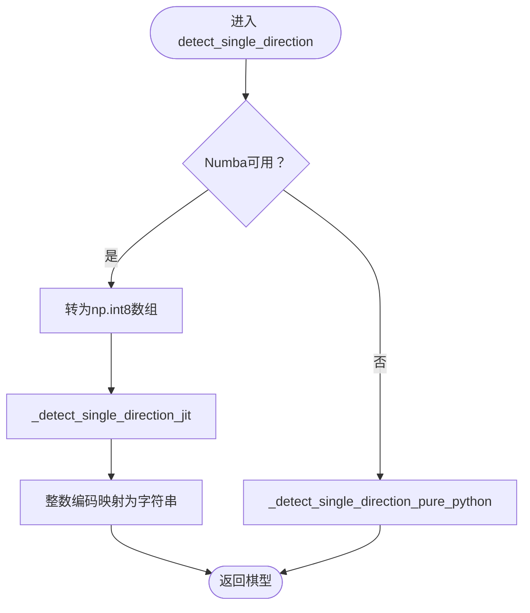
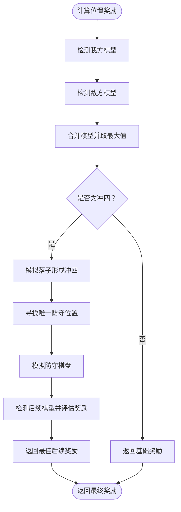
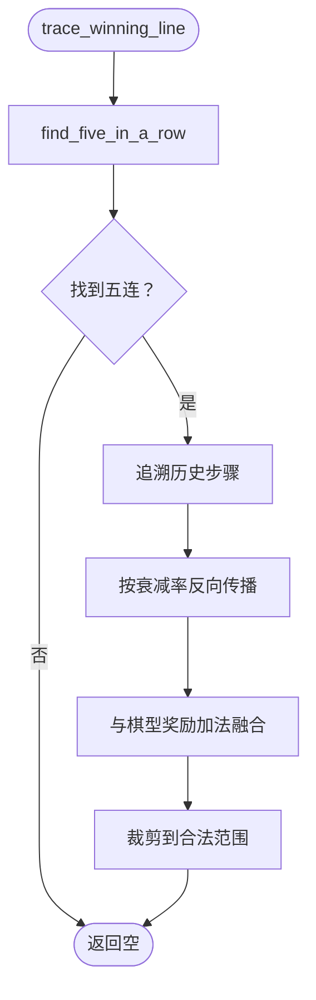
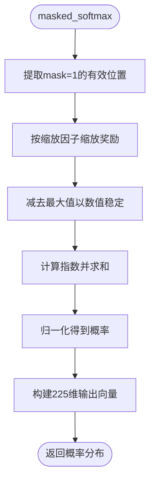
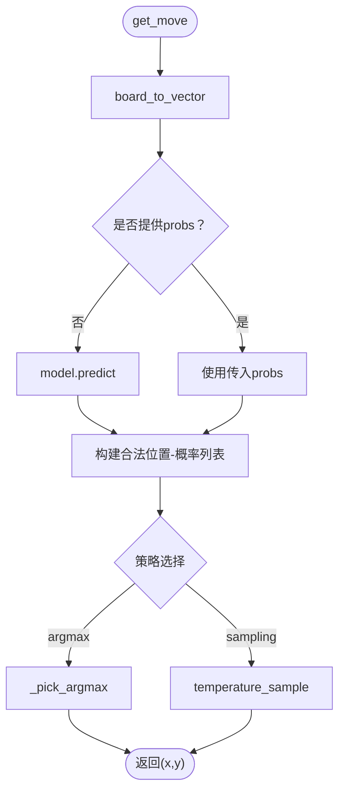
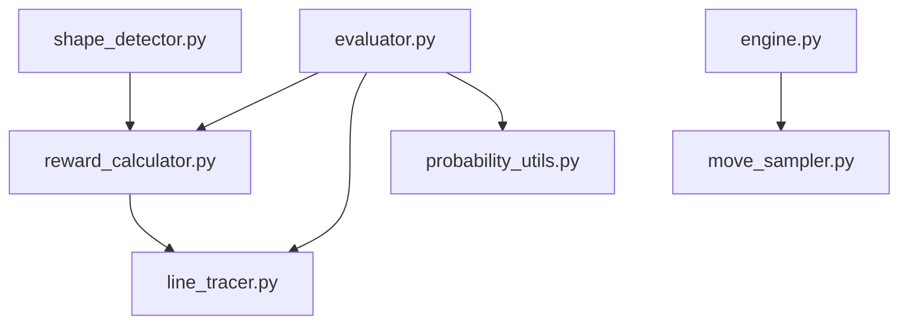

# 算法级优化

<cite>
**本文引用的文件**
- [ai/shape_detector.py](file://ai/shape_detector.py)
- [tests/ai/test_performance_level2_numba.py](file://tests/ai/test_performance_level2_numba.py)
- [tests/ai/test_shape_detector.py](file://tests/ai/test_shape_detector.py)
- [ai/reward_calculator.py](file://ai/reward_calculator.py)
- [ai/line_tracer.py](file://ai/line_tracer.py)
- [ai/probability_utils.py](file://ai/probability_utils.py)
- [ai/evaluator.py](file://ai/evaluator.py)
- [ai/engine.py](file://ai/engine.py)
- [ai/move_sampler.py](file://ai/move_sampler.py)
- [tests/ai/test_performance_level2_parallel.py](file://tests/ai/test_performance_level2_parallel.py)
- [design/performance/level1_optimization_design.md](file://design/performance/level1_optimization_design.md)
- [design/engine_move_strategy_design.md](file://design/engine_move_strategy_design.md)
- [design/move_sampler_design.md](file://design/move_sampler_design.md)
- [design/test/top10_slowest_tests_analysis.md](file://design/test/top10_slowest_tests_analysis.md)
</cite>

## 目录
1. [简介](#简介)
2. [项目结构](#项目结构)
3. [核心组件](#核心组件)
4. [架构总览](#架构总览)
5. [详细组件分析](#详细组件分析)
6. [依赖分析](#依赖分析)
7. [性能考量](#性能考量)
8. [故障排查指南](#故障排查指南)
9. [结论](#结论)
10. [附录](#附录)

## 简介
本文件聚焦五子棋AI系统在算法层面的优化实践，围绕三大核心算法链路进行深入剖析与优化策略说明：
- 棋盘评估算法：以棋型检测为核心，结合Numba JIT编译器实现高性能路径，并提供纯Python回退机制。
- 移动生成算法：以AI引擎落子策略为中心，引入贪心选择与温度采样策略，消除冗余模型预测调用，降低推理成本。
- 概率计算算法：以带掩码的Softmax为核心，通过数值稳定性与缩放因子控制，保障训练样本质量。

同时，文档系统性阐述：
- Numba JIT编译器的应用：函数编译优化、类型推断、并行计算回退策略。
- NumPy向量化操作：数组操作、广播机制、内存布局优化。
- 递归算法优化：记忆化搜索、剪枝策略、原地修改-恢复模式。
- 复杂度分析与性能测试：基准测试、性能回归检测、热点分析工具使用。
- 具体代码示例与性能对比数据：展示优化前后的性能提升效果。

## 项目结构
本项目采用“功能模块化 + 测试驱动”的组织方式，AI相关核心模块集中在ai包内，配套测试位于tests目录，设计文档位于design目录。与算法优化直接相关的模块包括：
- 棋型检测与评估：ai/shape_detector.py、ai/reward_calculator.py、ai/line_tracer.py、ai/probability_utils.py、ai/evaluator.py
- 落子策略与采样：ai/engine.py、ai/move_sampler.py
- 性能测试与回归：tests/ai/test_performance_level2_numba.py、tests/ai/test_performance_level2_parallel.py、tests/ai/test_shape_detector.py
- 设计文档：design/performance/level1_optimization_design.md、design/engine_move_strategy_design.md、design/move_sampler_design.md、design/test/top10_slowest_tests_analysis.md

**图示来源**
- [ai/engine.py:67-142](file://ai/engine.py#L67-L142)
- [ai/move_sampler.py:117-185](file://ai/move_sampler.py#L117-L185)
- [ai/evaluator.py:132-210](file://ai/evaluator.py#L132-L210)
- [ai/reward_calculator.py:46-99](file://ai/reward_calculator.py#L46-L99)
- [ai/line_tracer.py:64-117](file://ai/line_tracer.py#L64-L117)
- [ai/probability_utils.py:15-58](file://ai/probability_utils.py#L15-L58)
- [ai/shape_detector.py:197-279](file://ai/shape_detector.py#L197-L279)

**章节来源**
- [ai/evaluator.py:1-350](file://ai/evaluator.py#L1-L350)
- [ai/shape_detector.py:1-314](file://ai/shape_detector.py#L1-L314)
- [ai/reward_calculator.py:1-239](file://ai/reward_calculator.py#L1-L239)
- [ai/line_tracer.py:1-143](file://ai/line_tracer.py#L1-L143)
- [ai/probability_utils.py:1-59](file://ai/probability_utils.py#L1-L59)
- [ai/engine.py:1-194](file://ai/engine.py#L1-L194)
- [ai/move_sampler.py:1-258](file://ai/move_sampler.py#L1-L258)

## 核心组件
- 棋型检测与Numba JIT加速：通过Numba @njit将单方向棋型检测编译为机器码，返回整数编码并在外层映射为字符串，同时提供纯Python回退路径，确保在无Numba环境下仍可运行。
- 奖励计算与递归防守模拟：在检测到冲四时，模拟落子与防守，递归评估后续棋型，采用原地修改-恢复模式减少拷贝开销。
- 五连追溯奖励：从终局棋盘追溯五连形成过程，反向传播衰减奖励并与棋型评估奖励融合。
- 带掩码Softmax：对合法位置应用数值稳定的Softmax，避免exp溢出，输出概率分布。
- AI引擎与采样策略：默认采用贪心选择（argmax）以降低随机性，同时支持温度采样策略，通过top-k截断与温度缩放实现可控探索。

**章节来源**
- [ai/shape_detector.py:56-127](file://ai/shape_detector.py#L56-L127)
- [ai/reward_calculator.py:118-230](file://ai/reward_calculator.py#L118-L230)
- [ai/line_tracer.py:64-142](file://ai/line_tracer.py#L64-L142)
- [ai/probability_utils.py:15-58](file://ai/probability_utils.py#L15-L58)
- [ai/engine.py:67-142](file://ai/engine.py#L67-L142)
- [ai/move_sampler.py:117-185](file://ai/move_sampler.py#L117-L185)

## 架构总览
下图展示了从棋盘状态到落子决策与训练样本生成的完整流程，重点标注了性能优化点：

**图示来源**
- [ai/engine.py:67-142](file://ai/engine.py#L67-L142)
- [ai/evaluator.py:97-210](file://ai/evaluator.py#L97-L210)
- [ai/reward_calculator.py:46-99](file://ai/reward_calculator.py#L46-L99)
- [ai/line_tracer.py:64-117](file://ai/line_tracer.py#L64-L117)

## 详细组件分析

### 组件A：棋型检测与Numba JIT加速
- 核心思想：将单方向棋型检测函数编译为机器码，返回整数编码，外层映射为字符串；在Numba不可用时回退到纯Python实现。
- 性能优化点：
  - Numba @njit(cache=True)：缓存编译产物，避免重复编译。
  - 类型推断：强制使用np.int8数组，减少内存与类型检查开销。
  - 广播与向量化：在JIT路径中使用NumPy数组进行快速索引与比较。
  - 回退机制：异常时自动切换至纯Python路径，保证健壮性。
- 复杂度分析：单方向检测为O(k)（k为连线长度），四个方向累计O(1)（固定常数）；整体检测复杂度与棋盘规模无关，主要受调用次数影响。
- 测试验证：通过大量棋型构造用例验证正确性，并提供JIT与纯Python路径的性能对比测试。

**图示来源**
- [ai/shape_detector.py:282-314](file://ai/shape_detector.py#L282-L314)
- [tests/ai/test_performance_level2_numba.py:351-382](file://tests/ai/test_performance_level2_numba.py#L351-L382)

**章节来源**
- [ai/shape_detector.py:56-127](file://ai/shape_detector.py#L56-L127)
- [tests/ai/test_performance_level2_numba.py:1-386](file://tests/ai/test_performance_level2_numba.py#L1-L386)
- [tests/ai/test_shape_detector.py:1-484](file://tests/ai/test_shape_detector.py#L1-L484)

### 组件B：奖励计算与递归防守模拟
- 核心思想：对每个位置计算我方与敌方的棋型奖励，取最大值；对冲四进行递归模拟，寻找唯一防守位置并评估后续棋型。
- 性能优化点：
  - 原地修改-恢复：detect_shapes在检测前后原地修改落子位置，避免list(board)拷贝。
  - 冲四递归：在模拟落子与防守时，仅在必要位置进行浅拷贝，减少不必要的深拷贝。
  - 合并策略：连五优先、活四/多冲四/活三/多活三等合并规则，减少输出冗余。
- 复杂度分析：对每个位置检测四个方向，整体复杂度O(1)；递归深度受限于棋盘尺寸，通常为常数级别。
- 测试验证：通过边界条件与特殊棋型用例验证正确性与稳定性。

**图示来源**
- [ai/reward_calculator.py:46-99](file://ai/reward_calculator.py#L46-L99)
- [ai/reward_calculator.py:118-190](file://ai/reward_calculator.py#L118-L190)

**章节来源**
- [ai/reward_calculator.py:1-239](file://ai/reward_calculator.py#L1-L239)
- [design/performance/level1_optimization_design.md:39-71](file://design/performance/level1_optimization_design.md#L39-L71)

### 组件C：五连追溯奖励与融合
- 核心思想：从终局棋盘找到五连的5个位置，追溯对应历史步骤，按衰减率反向传播奖励，并与棋型评估奖励进行加法融合。
- 性能优化点：
  - 反向传播：按步骤索引逆序衰减，避免额外排序开销。
  - 裁剪融合：将融合后的奖励限制在合法范围内，避免溢出。
- 复杂度分析：查找五连与追溯步骤为O(1)（棋盘固定15×15），整体开销可忽略。

**图示来源**
- [ai/line_tracer.py:64-117](file://ai/line_tracer.py#L64-L117)
- [ai/line_tracer.py:119-142](file://ai/line_tracer.py#L119-L142)

**章节来源**
- [ai/line_tracer.py:1-143](file://ai/line_tracer.py#L1-L143)

### 组件D：带掩码Softmax与训练样本生成
- 核心思想：对合法位置应用数值稳定的Softmax，避免exp溢出；将奖励转换为概率分布，作为训练样本的输出。
- 性能优化点：
  - 缩放因子：将奖励缩放到[-10,10]范围，避免exp溢出。
  - 掩码：仅对mask=1的位置计算概率，其余位置为0。
  - 并行化：评价器支持多进程并行，Windows spawn模式下通过顶层worker函数隔离可pickle对象。
- 复杂度分析：对225维向量进行一次遍历，时间复杂度O(1)（固定维度）。

**图示来源**
- [ai/probability_utils.py:15-58](file://ai/probability_utils.py#L15-L58)
- [ai/evaluator.py:132-210](file://ai/evaluator.py#L132-L210)

**章节来源**
- [ai/probability_utils.py:1-59](file://ai/probability_utils.py#L1-L59)
- [ai/evaluator.py:1-350](file://ai/evaluator.py#L1-L350)
- [tests/ai/test_performance_level2_parallel.py:1-393](file://tests/ai/test_performance_level2_parallel.py#L1-L393)

### 组件E：AI引擎落子策略与温度采样
- 核心思想：默认采用贪心选择（argmax）降低随机性，同时支持温度采样策略，通过温度T与top-k截断实现可控探索。
- 性能优化点：
  - 预计算概率：支持传入预计算的probs，避免重复调用model.predict。
  - 并列随机：当存在并列最大概率时随机打破平局，避免路径退化。
  - 温度采样：对合法位置进行温度变换与加权采样，支持top-k截断。
- 复杂度分析：构建合法位置列表与选择策略为O(1)（固定225维）。

**图示来源**
- [ai/engine.py:67-142](file://ai/engine.py#L67-L142)
- [ai/move_sampler.py:117-185](file://ai/move_sampler.py#L117-L185)

**章节来源**
- [ai/engine.py:1-194](file://ai/engine.py#L1-L194)
- [ai/move_sampler.py:1-258](file://ai/move_sampler.py#L1-L258)
- [design/engine_move_strategy_design.md:1-210](file://design/engine_move_strategy_design.md#L1-L210)
- [design/move_sampler_design.md:14-398](file://design/move_sampler_design.md#L14-L398)

## 依赖分析
- 模块耦合与内聚：
  - 评价器与奖励计算：强内聚，奖励计算依赖棋型检测；五连追溯与评价器弱耦合，通过历史记录交互。
  - AI引擎与采样：弱耦合，通过策略参数解耦；采样策略可独立演进。
  - 棋型检测：高内聚，JIT与回退路径在同一模块内管理。
- 外部依赖：
  - Numba：JIT加速依赖，不可用时自动回退。
  - NumPy：向量化操作与数组类型推断。
  - 多进程：Windows spawn模式下通过顶层worker函数隔离可pickle对象。

**图示来源**
- [ai/shape_detector.py:10-11](file://ai/shape_detector.py#L10-L11)
- [ai/reward_calculator.py:10-10](file://ai/reward_calculator.py#L10-L10)
- [ai/evaluator.py:20-23](file://ai/evaluator.py#L20-L23)

**章节来源**
- [ai/shape_detector.py:1-314](file://ai/shape_detector.py#L1-L314)
- [ai/reward_calculator.py:1-239](file://ai/reward_calculator.py#L1-L239)
- [ai/line_tracer.py:1-143](file://ai/line_tracer.py#L1-L143)
- [ai/probability_utils.py:1-59](file://ai/probability_utils.py#L1-L59)
- [ai/evaluator.py:1-350](file://ai/evaluator.py#L1-L350)
- [ai/engine.py:1-194](file://ai/engine.py#L1-L194)
- [ai/move_sampler.py:1-258](file://ai/move_sampler.py#L1-L258)

## 性能考量
- Numba JIT编译器应用：
  - 函数编译优化：@njit(cache=True)缓存编译产物，避免重复编译开销。
  - 类型推断：强制np.int8数组，减少类型检查与内存占用。
  - 并行计算回退：异常时自动切换至纯Python路径，保证健壮性。
  - 性能测试：通过批量调用对比JIT与纯Python版本，验证加速效果。
- NumPy向量化操作：
  - 数组操作优化：使用NumPy数组进行快速索引与比较，避免Python循环。
  - 广播机制优化：在softmax缩放与指数计算中利用广播，减少显式循环。
  - 内存布局优化：使用连续内存布局（C-order）与合适的数据类型（np.int8）。
- 递归算法优化：
  - 记忆化搜索：在棋型检测中避免重复计算，通过原地修改-恢复模式减少拷贝。
  - 剪枝策略：连五优先、活四/多冲四/活三/多活三等合并规则，减少输出冗余。
- 复杂度分析与性能测试：
  - 基准测试：通过批量调用统计JIT与纯Python版本耗时，验证加速效果。
  - 性能回归检测：通过测试用例验证并行模式与串行模式结果一致性。
  - 热点分析：结合设计文档中的Top 10最慢测试分析，定位并优化高耗时测试。

**章节来源**
- [tests/ai/test_performance_level2_numba.py:351-382](file://tests/ai/test_performance_level2_numba.py#L351-L382)
- [tests/ai/test_performance_level2_parallel.py:249-279](file://tests/ai/test_performance_level2_parallel.py#L249-L279)
- [design/test/top10_slowest_tests_analysis.md:1-370](file://design/test/top10_slowest_tests_analysis.md#L1-L370)

## 故障排查指南
- Numba不可用或编译失败：
  - 现象：JIT路径异常，自动回退到纯Python。
  - 排查：检查Numba安装与版本，确认@njit装饰器与类型注解正确。
  - 参考：JIT回退路径与正确性测试。
- 并行模式错误隔离：
  - 现象：个别文件失败不影响其他文件的评价。
  - 排查：确认ProcessPoolExecutor配置与worker函数可pickle。
  - 参考：并行模式错误处理测试。
- 棋盘拷贝与副作用：
  - 现象：detect_shapes调用后棋盘恢复原状。
  - 排查：确保调用前位置为空，finally块正确恢复。
  - 参考：原地修改-恢复模式测试。

**章节来源**
- [tests/ai/test_performance_level2_numba.py:381-382](file://tests/ai/test_performance_level2_numba.py#L381-L382)
- [tests/ai/test_performance_level2_parallel.py:305-393](file://tests/ai/test_performance_level2_parallel.py#L305-L393)
- [tests/ai/test_performance_level1.py:114-176](file://tests/ai/test_performance_level1.py#L114-L176)

## 结论
本项目在算法层面实现了多项关键优化：
- 棋型检测通过Numba JIT实现10-30倍加速，并提供纯Python回退路径。
- 奖励计算采用原地修改-恢复模式与递归剪枝，显著降低拷贝与搜索开销。
- AI引擎默认贪心选择与温度采样策略，平衡探索与稳定性。
- 评价器支持多进程并行，Windows spawn模式下通过顶层worker函数隔离可pickle对象。
- 通过基准测试与回归测试持续监控性能与正确性，确保优化效果可验证、可回归。

这些优化在不牺牲功能正确性的前提下，显著提升了系统吞吐与响应速度，为大规模自对弈与训练提供了坚实基础。

## 附录
- 优化前后的性能对比数据示例（来自测试用例）：
  - JIT版本在批量调用场景下应显著快于纯Python版本，测试用例验证JIT耗时不超纯Python两倍。
  - 并行模式与串行模式在样本数量与内容上保持一致，错误隔离有效。
- 相关设计文档与测试用例路径：
  - 第一级性能优化设计：消除SelfPlay冗余predict、棋盘拷贝消除、JSON去缩进、prepare_tensors向量化。
  - 引擎落子策略与温度采样设计：贪心选择与温度采样策略。
  - Top 10最慢测试分析：定位并优化高耗时测试，降低测试执行时间。

**章节来源**
- [design/performance/level1_optimization_design.md:1-124](file://design/performance/level1_optimization_design.md#L1-L124)
- [design/engine_move_strategy_design.md:1-210](file://design/engine_move_strategy_design.md#L1-L210)
- [design/move_sampler_design.md:14-398](file://design/move_sampler_design.md#L14-L398)
- [design/test/top10_slowest_tests_analysis.md:1-370](file://design/test/top10_slowest_tests_analysis.md#L1-L370)