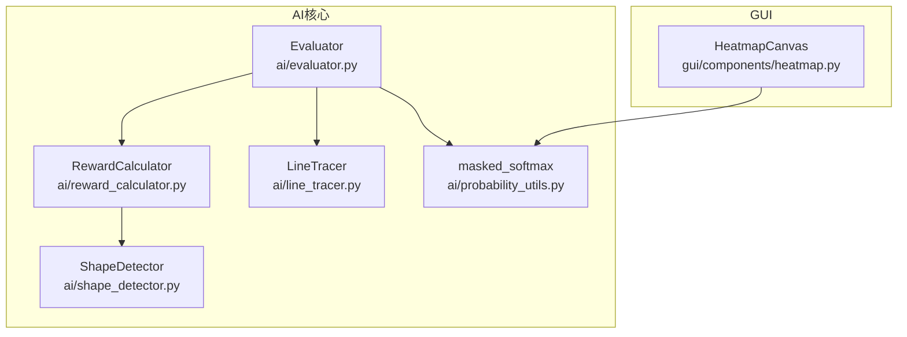
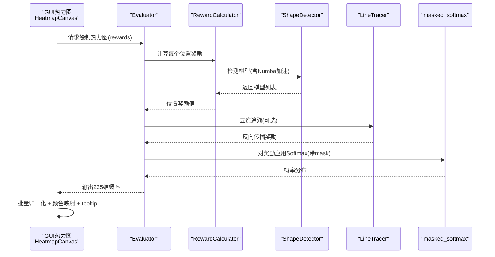
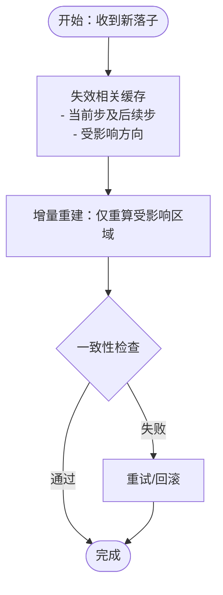
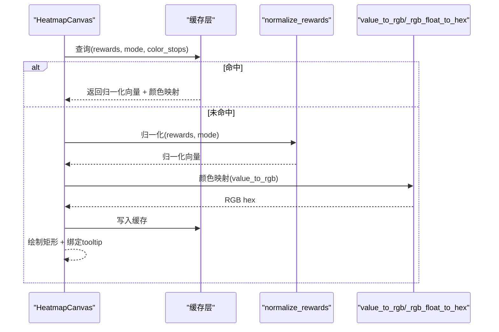
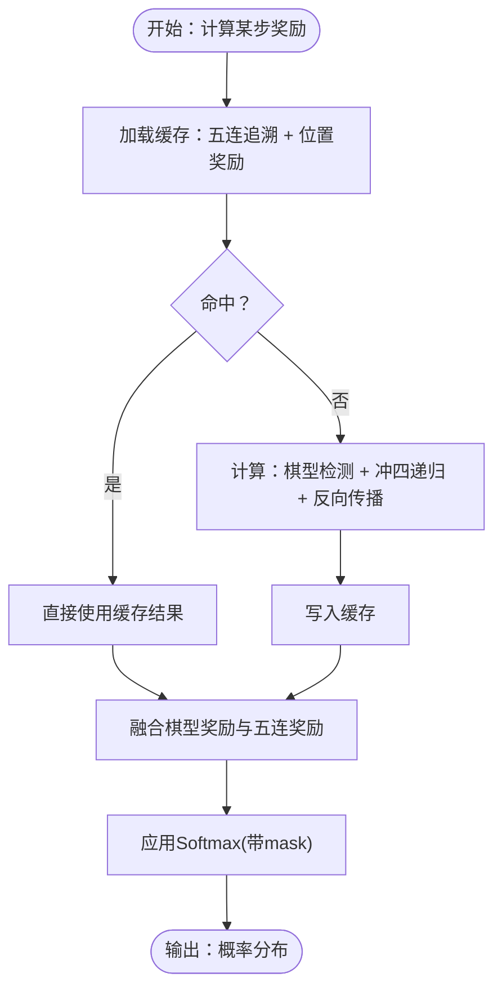
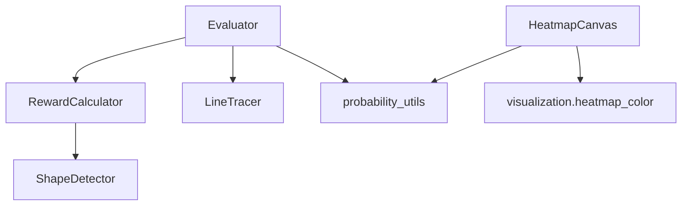

# 缓存策略设计

<cite>
**本文引用的文件**
- [evaluator.py](file://ai/evaluator.py)
- [reward_calculator.py](file://ai/reward_calculator.py)
- [line_tracer.py](file://ai/line_tracer.py)
- [probability_utils.py](file://ai/probability_utils.py)
- [shape_detector.py](file://ai/shape_detector.py)
- [heatmap.py](file://gui/components/heatmap.py)
- [gui_heatmap_reuse_design.md](file://design/gui_heatmap_reuse_design.md)
- [winning_line_reward_design.md](file://design/winning_line_reward_design.md)
- [test_performance_level1.py](file://tests/ai/test_performance_level1.py)
- [test_performance_level2_numba.py](file://tests/ai/test_performance_level2_numba.py)
- [test_performance_level2_parallel.py](file://tests/ai/test_performance_level2_parallel.py)
</cite>

## 目录
1. [简介](#简介)
2. [项目结构](#项目结构)
3. [核心组件](#核心组件)
4. [架构总览](#架构总览)
5. [详细组件分析](#详细组件分析)
6. [依赖分析](#依赖分析)
7. [性能考量](#性能考量)
8. [故障排查指南](#故障排查指南)
9. [结论](#结论)
10. [附录](#附录)

## 简介
本文件围绕五子棋AI系统的缓存策略进行系统化设计与实现说明，聚焦多层次缓存架构与优化实践，涵盖：
- 棋盘状态缓存：状态哈希、缓存失效与一致性保障
- 热力图计算缓存：概率分布缓存、重算触发条件、缓存更新策略
- 奖励计算缓存：WinningLine检测缓存、奖励值缓存、计算结果复用
- 缓存容量与替换策略：LRU/LFU与自适应缓存大小
- 缓存性能监控与调优：命中率统计、效率分析与性能影响评估

本设计以现有模块为基础，结合GUI热力图复用设计与奖励反向传播设计，提出可落地的缓存方案。

## 项目结构
本项目AI相关模块主要分布在 ai/ 目录，GUI热力图组件位于 gui/components/heatmap.py，设计文档位于 design/ 目录。与缓存密切相关的模块包括：
- 评价器与奖励计算：evaluator.py、reward_calculator.py、line_tracer.py、probability_utils.py
- 棋型检测：shape_detector.py（含Numba加速）
- GUI热力图：heatmap.py（复用可视化颜色映射）

**图表来源**
- [evaluator.py:97-210](file://ai/evaluator.py#L97-L210)
- [reward_calculator.py:46-99](file://ai/reward_calculator.py#L46-L99)
- [line_tracer.py:64-117](file://ai/line_tracer.py#L64-L117)
- [probability_utils.py:15-58](file://ai/probability_utils.py#L15-L58)
- [shape_detector.py:197-279](file://ai/shape_detector.py#L197-L279)
- [heatmap.py:137-195](file://gui/components/heatmap.py#L137-L195)

**章节来源**
- [evaluator.py:1-350](file://ai/evaluator.py#L1-L350)
- [reward_calculator.py:1-239](file://ai/reward_calculator.py#L1-L239)
- [line_tracer.py:1-143](file://ai/line_tracer.py#L1-L143)
- [probability_utils.py:1-59](file://ai/probability_utils.py#L1-L59)
- [shape_detector.py:1-314](file://ai/shape_detector.py#L1-L314)
- [heatmap.py:1-358](file://gui/components/heatmap.py#L1-L358)

## 核心组件
- 评价器（Evaluator）：负责遍历历史步骤，计算每个位置的奖励，融合棋型评估与五连追溯奖励，并通过Softmax生成概率分布。
- 奖励计算器（RewardCalculator）：将棋型映射为数值奖励，处理冲四递归防守模拟，使用配置驱动的奖励比例。
- 五连追溯（LineTracer）：从终局棋盘追溯五连落子步骤，按衰减率反向传播奖励，并与棋型奖励融合。
- 概率工具（probability_utils）：提供带mask的数值稳定Softmax，避免大数值exp导致的下溢。
- 棋型检测（shape_detector）：纯函数式检测，支持Numba JIT加速，避免状态共享带来的副作用。
- GUI热力图（heatmap.py）：批量归一化与颜色映射，支持log/max/linear三种模式，tooltip显示原始reward。

**章节来源**
- [evaluator.py:97-210](file://ai/evaluator.py#L97-L210)
- [reward_calculator.py:46-99](file://ai/reward_calculator.py#L46-L99)
- [line_tracer.py:64-117](file://ai/line_tracer.py#L64-L117)
- [probability_utils.py:15-58](file://ai/probability_utils.py#L15-L58)
- [shape_detector.py:197-279](file://ai/shape_detector.py#L197-L279)
- [heatmap.py:137-195](file://gui/components/heatmap.py#L137-L195)

## 架构总览
下图展示了缓存策略在系统中的位置与交互关系，强调数据流、计算流与GUI渲染之间的缓存协同。

**图表来源**
- [evaluator.py:132-210](file://ai/evaluator.py#L132-L210)
- [reward_calculator.py:46-99](file://ai/reward_calculator.py#L46-L99)
- [shape_detector.py:197-279](file://ai/shape_detector.py#L197-L279)
- [line_tracer.py:64-117](file://ai/line_tracer.py#L64-L117)
- [probability_utils.py:15-58](file://ai/probability_utils.py#L15-L58)
- [heatmap.py:137-195](file://gui/components/heatmap.py#L137-L195)

## 详细组件分析

### 棋盘状态缓存与一致性
- 状态哈希与缓存键设计
  - 棋盘状态为225维向量，可采用“前225位棋盘 + 当前玩家”作为缓存键，确保状态唯一性。
  - 建议使用不可变结构（如元组）或稳定序列化（如tuple或bytes）作为键，避免可变对象导致的哈希不稳定。
- 缓存失效策略
  - 以步为粒度失效：每次落子后，仅使该步及后续步的缓存失效，避免全量重建。
  - 以方向为粒度失效：在棋型检测中，仅对受影响的方向缓存进行失效，减少重算范围。
- 缓存一致性保障
  - 使用“读写锁”或“不可变快照”机制，保证读取期间不被写入破坏。
  - 在Evaluator中，对每个历史步骤独立计算奖励，避免跨步骤污染。

**图表来源**
- [evaluator.py:162-210](file://ai/evaluator.py#L162-L210)
- [reward_calculator.py:46-99](file://ai/reward_calculator.py#L46-L99)
- [shape_detector.py:197-279](file://ai/shape_detector.py#L197-L279)

**章节来源**
- [evaluator.py:162-210](file://ai/evaluator.py#L162-L210)
- [reward_calculator.py:46-99](file://ai/reward_calculator.py#L46-L99)
- [shape_detector.py:197-279](file://ai/shape_detector.py#L197-L279)

### 热力图计算缓存优化
- 概率分布缓存
  - 将softmax输出的概率分布缓存为“键=状态+模式”的映射，避免重复计算。
  - 模式包括log/max/linear三种，分别对应不同的归一化策略。
- 重算触发条件
  - 当棋盘状态或归一化模式发生变化时触发重算。
  - 当GUI组件的color_stops或n_bands发生改变时，需重新生成渐变条与颜色映射。
- 缓存更新策略
  - 批量归一化：在draw_heatmap中一次性计算全局统计量，减少重复计算。
  - tooltip显示原始reward，不参与缓存键，仅在渲染阶段使用。

**图表来源**
- [heatmap.py:137-195](file://gui/components/heatmap.py#L137-L195)
- [gui_heatmap_reuse_design.md:191-240](file://design/gui_heatmap_reuse_design.md#L191-L240)

**章节来源**
- [heatmap.py:137-195](file://gui/components/heatmap.py#L137-L195)
- [gui_heatmap_reuse_design.md:191-240](file://design/gui_heatmap_reuse_design.md#L191-L240)

### 奖励计算缓存设计
- WinningLine检测缓存
  - 将“终局棋盘+赢家”作为键，缓存find_five_in_a_row与trace_winning_line的结果。
  - 在Evaluator中，先计算line_bonuses字典，再在每个历史步骤叠加，避免重复追溯。
- 奖励值缓存
  - 将“位置(x,y)+当前玩家”作为键，缓存compute_position_reward的中间结果（如棋型列表、防守位置等）。
  - 对于冲四递归，缓存“模拟落子后”的后续棋型奖励，避免重复计算。
- 计算结果复用
  - masked_softmax的缩放与指数计算可缓存，避免对相同mask重复计算。

**图表来源**
- [evaluator.py:132-210](file://ai/evaluator.py#L132-L210)
- [line_tracer.py:64-117](file://ai/line_tracer.py#L64-L117)
- [reward_calculator.py:118-190](file://ai/reward_calculator.py#L118-L190)
- [probability_utils.py:15-58](file://ai/probability_utils.py#L15-L58)

**章节来源**
- [evaluator.py:132-210](file://ai/evaluator.py#L132-L210)
- [line_tracer.py:64-117](file://ai/line_tracer.py#L64-L117)
- [reward_calculator.py:118-190](file://ai/reward_calculator.py#L118-L190)
- [probability_utils.py:15-58](file://ai/probability_utils.py#L15-L58)
- [winning_line_reward_design.md:1-177](file://design/winning_line_reward_design.md#L1-L177)

### 缓存容量与替换策略
- LRU（最近最少使用）
  - 适用于热力图与概率分布缓存：热点区域（当前步附近）频繁访问，LRU可淘汰最久未使用的冷数据。
- LFU（最低频率使用）
  - 适用于奖励计算缓存：某些位置在多步中反复出现，LFU可保留高频位置的奖励缓存。
- 自适应缓存大小
  - 根据GPU/CPU内存与任务负载动态调整缓存上限，避免OOM。
  - 结合命中率监控，自动调节缓存容量与淘汰阈值。

[本节为通用设计建议，不直接分析具体文件]

### 缓存性能监控与调优
- 命中率统计
  - 记录缓存命中/未命中次数，计算命中率并输出到日志或可视化面板。
- 缓存效率分析
  - 分析不同类型缓存（棋盘状态、热力图、奖励）的命中率与重算成本，定位瓶颈。
- 性能影响评估
  - 通过测试用例对比启用缓存前后的吞吐量与延迟，评估缓存收益。

**章节来源**
- [test_performance_level1.py](file://tests/ai/test_performance_level1.py)
- [test_performance_level2_numba.py](file://tests/ai/test_performance_level2_numba.py)
- [test_performance_level2_parallel.py](file://tests/ai/test_performance_level2_parallel.py)

## 依赖分析
- 模块耦合
  - Evaluator依赖RewardCalculator与LineTracer，二者均依赖配置驱动的奖励体系。
  - RewardCalculator依赖ShapeDetector进行棋型检测，支持Numba加速。
  - HeatmapCanvas依赖概率工具与颜色映射模块，实现批量归一化与颜色映射。
- 外部依赖
  - Numba（可选）：显著提升棋型检测性能，降低奖励计算时间。
  - tkinter：GUI热力图渲染，tooltip显示原始reward。

**图表来源**
- [evaluator.py:89-95](file://ai/evaluator.py#L89-L95)
- [reward_calculator.py:10-10](file://ai/reward_calculator.py#L10-L10)
- [line_tracer.py:1-143](file://ai/line_tracer.py#L1-L143)
- [probability_utils.py:1-59](file://ai/probability_utils.py#L1-L59)
- [heatmap.py:30-34](file://gui/components/heatmap.py#L30-L34)

**章节来源**
- [evaluator.py:89-95](file://ai/evaluator.py#L89-L95)
- [reward_calculator.py:10-10](file://ai/reward_calculator.py#L10-L10)
- [line_tracer.py:1-143](file://ai/line_tracer.py#L1-L143)
- [probability_utils.py:1-59](file://ai/probability_utils.py#L1-L59)
- [heatmap.py:30-34](file://gui/components/heatmap.py#L30-L34)

## 性能考量
- 棋型检测加速
  - 优先使用Numba JIT加速，若不可用则回退到纯Python实现，确保稳定性。
- 并行与批处理
  - Evaluator支持多进程并行评价，减少整体耗时。
  - GUI热力图采用批量归一化与颜色映射，降低CPU/GPU压力。
- 数值稳定性
  - Softmax缩放因子与减最大值策略，避免大数值exp导致的下溢与精度损失。

**章节来源**
- [shape_detector.py:12-17](file://ai/shape_detector.py#L12-L17)
- [evaluator.py:224-350](file://ai/evaluator.py#L224-L350)
- [probability_utils.py:10-12](file://ai/probability_utils.py#L10-L12)

## 故障排查指南
- 热力图绘制异常
  - 检查归一化模式合法性，非法模式会在draw_heatmap阶段抛出异常。
  - 确认rewards长度为225，否则静默返回。
- 奖励计算异常
  - 确认棋盘状态与当前玩家信息完整，避免索引越界。
  - 检查LineTracer的五连追溯结果，确保winner与history匹配。
- 缓存一致性问题
  - 确保缓存键包含所有影响因素（棋盘状态、模式、color_stops）。
  - 对于增量失效，确保失效范围覆盖所有可能受影响的步骤与方向。

**章节来源**
- [heatmap.py:155-159](file://gui/components/heatmap.py#L155-L159)
- [evaluator.py:162-210](file://ai/evaluator.py#L162-L210)
- [line_tracer.py:64-117](file://ai/line_tracer.py#L64-L117)

## 结论
本设计在现有AI模块基础上，提出了多层次缓存策略：以棋盘状态与计算结果为中心的缓存键设计、增量失效与一致性保障、热力图批量归一化与颜色映射缓存、以及奖励计算的五连追溯与Softmax缓存。通过LRU/LFU与自适应容量策略，结合命中率与性能影响评估，可显著提升系统吞吐量与用户体验。建议在后续迭代中逐步引入缓存监控与自动调优能力，持续优化缓存命中率与资源利用率。

## 附录
- 相关设计文档
  - [gui_heatmap_reuse_design.md](file://design/gui_heatmap_reuse_design.md)
  - [winning_line_reward_design.md](file://design/winning_line_reward_design.md)