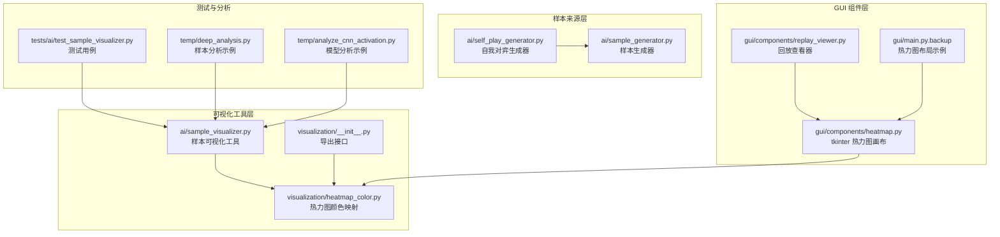
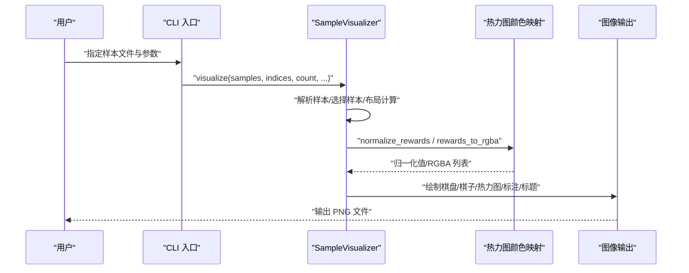
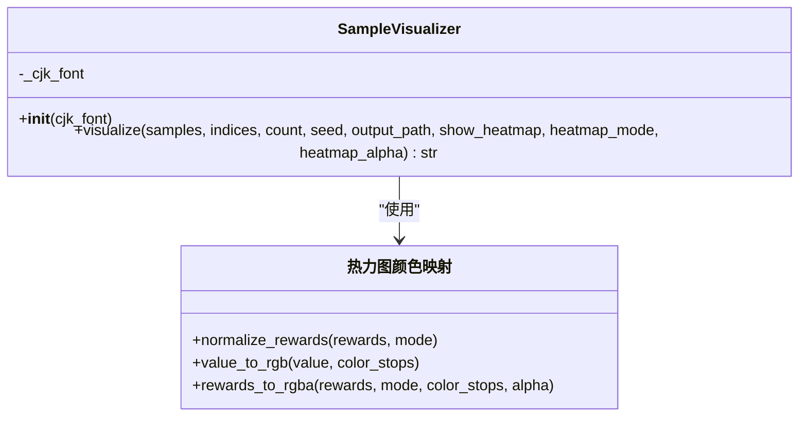
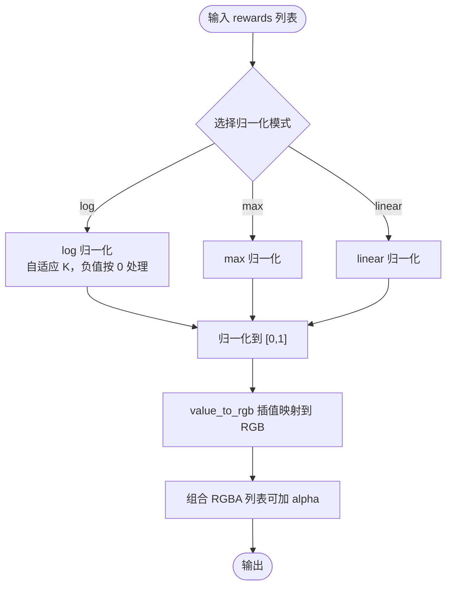
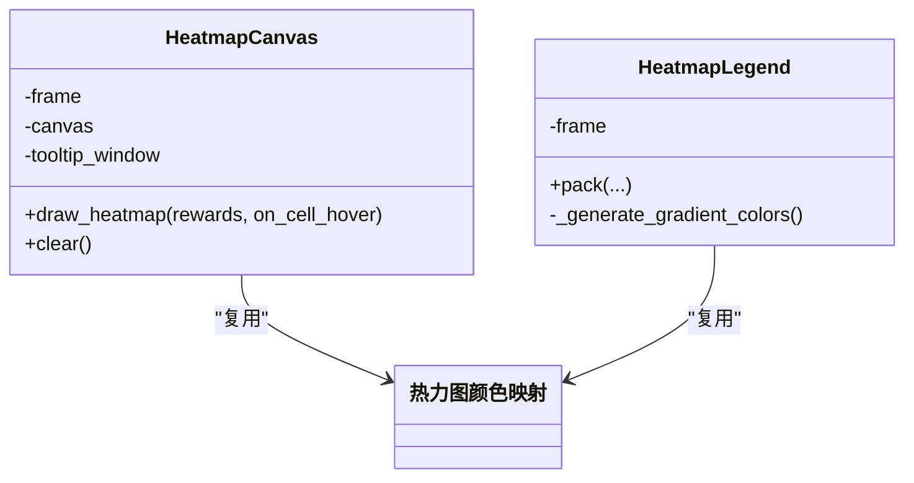
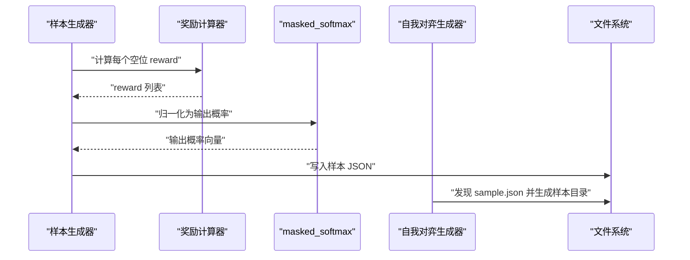
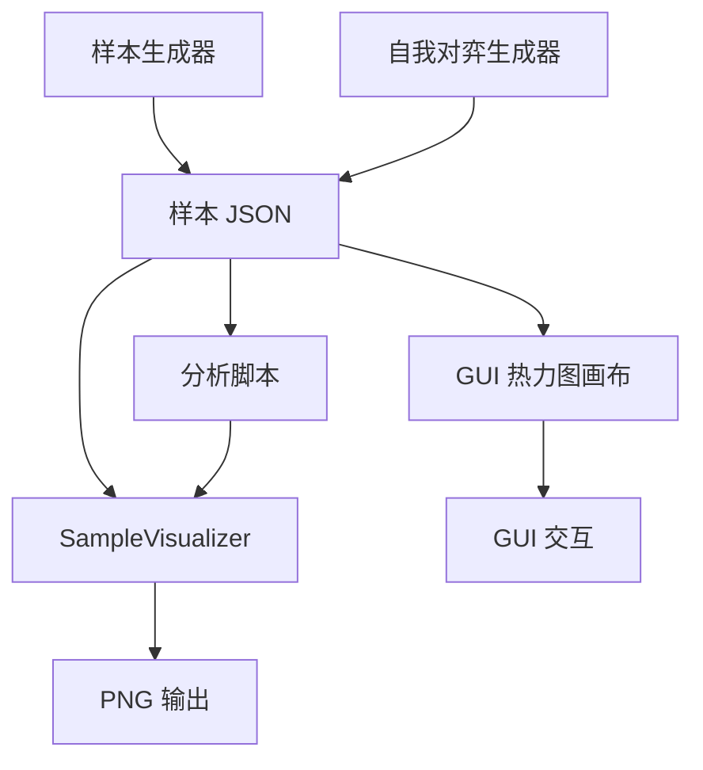
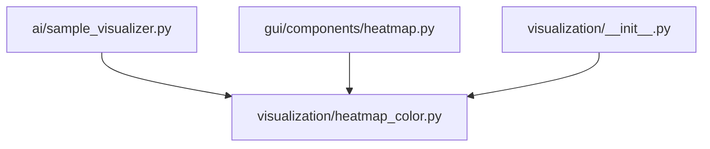

# 数据可视化设计

<cite>
**本文引用的文件**
- [ai/sample_visualizer.py](file://ai/sample_visualizer.py)
- [design/sample_visualizer_design.md](file://design/sample_visualizer_design.md)
- [visualization/heatmap_color.py](file://visualization/heatmap_color.py)
- [visualization/__init__.py](file://visualization/__init__.py)
- [tests/ai/test_sample_visualizer.py](file://tests/ai/test_sample_visualizer.py)
- [gui/components/heatmap.py](file://gui/components/heatmap.py)
- [gui/main.py.backup](file://gui/main.py.backup)
- [gui/components/replay_viewer.py](file://gui/components/replay_viewer.py)
- [ai/sample_generator.py](file://ai/sample_generator.py)
- [ai/self_play_generator.py](file://ai/self_play_generator.py)
- [design/self_play_train_separation_design.md](file://design/self_play_train_separation_design.md)
- [temp/deep_analysis.py](file://temp/deep_analysis.py)
- [temp/analyze_cnn_activation.py](file://temp/analyze_cnn_activation.py)
</cite>

## 目录
1. [简介](#简介)
2. [项目结构](#项目结构)
3. [核心组件](#核心组件)
4. [架构总览](#架构总览)
5. [详细组件分析](#详细组件分析)
6. [依赖分析](#依赖分析)
7. [性能考量](#性能考量)
8. [故障排查指南](#故障排查指南)
9. [结论](#结论)
10. [附录](#附录)

## 简介
本设计文档面向五子棋AI训练样本的数据可视化系统，聚焦“样本可视化”能力，目标是帮助研究人员以直观方式理解训练样本的棋盘状态、获胜位置标注、以及输出概率分布（热力图）的质量与分布特征。系统采用“脚本工具 + 可视化模块 + GUI 组件”的分层设计，既支持命令行快速抽样查看，也支持在图形界面中进行交互式热力图浏览与标注。

## 项目结构
围绕可视化主题，项目中与之直接相关的模块与文件如下：
- 可视化工具与接口
  - ai/sample_visualizer.py：样本可视化主工具，支持新旧样本格式、热力图叠加、随机抽样、CLI 控制等
  - visualization/heatmap_color.py：热力图颜色映射与归一化核心算法
  - visualization/__init__.py：热力图工具的公开导出
- GUI 交互组件
  - gui/components/heatmap.py：tkinter 热力图画布与颜色标尺组件，复用热力图颜色映射
  - gui/main.py.backup、gui/components/replay_viewer.py：GUI 中热力图展示与布局示例
- 样本来源与生成
  - ai/sample_generator.py：样本生成器，输出带元数据的新格式样本
  - ai/self_play_generator.py、design/self_play_train_separation_design.md：自我对弈与样本生成流程
- 测试与分析
  - tests/ai/test_sample_visualizer.py：样本可视化工具的单元与集成测试
  - temp/deep_analysis.py、temp/analyze_cnn_activation.py：训练样本与模型分析示例脚本

**图表来源**
- [ai/sample_visualizer.py:1-496](file://ai/sample_visualizer.py#L1-L496)
- [visualization/heatmap_color.py:1-204](file://visualization/heatmap_color.py#L1-L204)
- [visualization/__init__.py:1-23](file://visualization/__init__.py#L1-L23)
- [gui/components/heatmap.py:1-358](file://gui/components/heatmap.py#L1-L358)
- [gui/components/replay_viewer.py:155-198](file://gui/components/replay_viewer.py#L155-L198)
- [gui/main.py.backup:1487-1535](file://gui/main.py.backup#L1487-L1535)
- [ai/sample_generator.py:1-200](file://ai/sample_generator.py#L1-L200)
- [ai/self_play_generator.py:99-133](file://ai/self_play_generator.py#L99-L133)
- [tests/ai/test_sample_visualizer.py:1-337](file://tests/ai/test_sample_visualizer.py#L1-L337)
- [temp/deep_analysis.py:1-76](file://temp/deep_analysis.py#L1-L76)
- [temp/analyze_cnn_activation.py:46-306](file://temp/analyze_cnn_activation.py#L46-L306)

**章节来源**
- [ai/sample_visualizer.py:1-496](file://ai/sample_visualizer.py#L1-L496)
- [visualization/heatmap_color.py:1-204](file://visualization/heatmap_color.py#L1-L204)
- [visualization/__init__.py:1-23](file://visualization/__init__.py#L1-L23)
- [gui/components/heatmap.py:1-358](file://gui/components/heatmap.py#L1-L358)
- [gui/components/replay_viewer.py:155-198](file://gui/components/replay_viewer.py#L155-L198)
- [gui/main.py.backup:1487-1535](file://gui/main.py.backup#L1487-L1535)
- [ai/sample_generator.py:1-200](file://ai/sample_generator.py#L1-L200)
- [ai/self_play_generator.py:99-133](file://ai/self_play_generator.py#L99-L133)
- [tests/ai/test_sample_visualizer.py:1-337](file://tests/ai/test_sample_visualizer.py#L1-L337)
- [temp/deep_analysis.py:1-76](file://temp/deep_analysis.py#L1-L76)
- [temp/analyze_cnn_activation.py:46-306](file://temp/analyze_cnn_activation.py#L46-L306)

## 核心组件
- 样本可视化器（SampleVisualizer）
  - 功能：读取样本 JSON，按索引或随机抽样，绘制棋盘、棋子、获胜位置标记、可选热力图叠加，输出 PNG
  - 关键特性：兼容新旧样本格式、支持多种热力图归一化模式、布局自适应、CLI 参数控制
- 热力图颜色映射（visualization.heatmap_color）
  - 功能：提供 normalize_rewards、value_to_rgb、rewards_to_rgba 三个核心函数，支持 log/max/linear 三种归一化模式与可配置色板
  - 设计要点：纯函数、无 UI 依赖、可复用性强
- GUI 热力图画布（gui/components/heatmap）
  - 功能：在 tkinter Canvas 上绘制 15×15 热力图网格，支持悬停提示与颜色标尺
  - 设计要点：复用热力图颜色映射，tk 不支持 alpha，仅取 RGB

**章节来源**
- [ai/sample_visualizer.py:296-404](file://ai/sample_visualizer.py#L296-L404)
- [visualization/heatmap_color.py:63-204](file://visualization/heatmap_color.py#L63-L204)
- [gui/components/heatmap.py:68-247](file://gui/components/heatmap.py#L68-L247)

## 架构总览
可视化系统的整体架构分为三层：
- 数据层：样本 JSON（新格式含元数据，旧格式仅含 input/output）
- 可视化层：SampleVisualizer 负责解析与绘制；热力图颜色映射提供统一的颜色映射与归一化
- 交互层：GUI 组件复用热力图颜色映射，提供实时热力图浏览与标注

**图表来源**
- [ai/sample_visualizer.py:312-403](file://ai/sample_visualizer.py#L312-L403)
- [visualization/heatmap_color.py:63-204](file://visualization/heatmap_color.py#L63-L204)

## 详细组件分析

### 样本可视化器（SampleVisualizer）设计
- 输入与格式兼容
  - 新格式：包含 _attack_positions、_shape、mask 等元数据
  - 旧格式：仅 input/output，通过 argmax 兜底获取攻击位
- 核心流程
  - 参数校验（样本非空、热力图模式与透明度范围）
  - 样本选择（indices 优先，否则按 count 随机抽样）
  - 布局计算（尽量接近正方形的网格）
  - 绘制顺序：棋盘底色 → 热力图（仅空位）→ 网格与星位 → 棋子 → 攻击标记 → 标题
- CLI 参数
  - --sample：样本文件路径
  - --count/--indices/--seed：抽样控制
  - --output：输出 PNG 路径
  - --no-heatmap/--heatmap-mode/--heatmap-alpha：热力图开关与样式

**图表来源**
- [ai/sample_visualizer.py:296-404](file://ai/sample_visualizer.py#L296-L404)
- [visualization/heatmap_color.py:63-204](file://visualization/heatmap_color.py#L63-L204)

**章节来源**
- [ai/sample_visualizer.py:86-131](file://ai/sample_visualizer.py#L86-L131)
- [ai/sample_visualizer.py:135-162](file://ai/sample_visualizer.py#L135-L162)
- [ai/sample_visualizer.py:180-292](file://ai/sample_visualizer.py#L180-L292)
- [ai/sample_visualizer.py:312-403](file://ai/sample_visualizer.py#L312-L403)
- [ai/sample_visualizer.py:421-491](file://ai/sample_visualizer.py#L421-L491)

### 热力图颜色映射（visualization.heatmap_color）
- 归一化策略
  - log：针对“1 个高峰 + 大片接近 0”的极端分布，提升次高位可辨识度
  - max：r / max(r)
  - linear：(r - min)/(max - min)
- 颜色插值
  - 色节点等距分布在 [0,1]，RGB 空间线性插值
  - 默认色板：白 → 黄 → 橙 → 红
- 组合 API
  - rewards_to_rgba：一次性将奖励序列转换为 RGBA 列表，支持统一 alpha

**图表来源**
- [visualization/heatmap_color.py:63-204](file://visualization/heatmap_color.py#L63-L204)

**章节来源**
- [visualization/heatmap_color.py:63-204](file://visualization/heatmap_color.py#L63-L204)

### GUI 热力图画布（gui/components/heatmap）
- 组件构成
  - HeatmapCanvas：15×15 网格热力图画布，支持鼠标悬停提示
  - HeatmapLegend：颜色标尺（渐变条 + 色名标签）
- 设计要点
  - 复用 visualization.heatmap_color 的归一化与颜色映射
  - tkinter 不支持 alpha，仅取 RGB；通过十六进制颜色填充矩形
  - 悬停显示原始 reward 值，便于用户理解真实概率

**图表来源**
- [gui/components/heatmap.py:68-247](file://gui/components/heatmap.py#L68-L247)
- [gui/components/heatmap.py:257-358](file://gui/components/heatmap.py#L257-L358)
- [visualization/heatmap_color.py:63-204](file://visualization/heatmap_color.py#L63-L204)

**章节来源**
- [gui/components/heatmap.py:68-247](file://gui/components/heatmap.py#L68-L247)
- [gui/components/heatmap.py:257-358](file://gui/components/heatmap.py#L257-L358)

### 样本来源与生成（样本生成器与自我对弈）
- 样本生成器（ai/sample_generator.py）
  - 生成指定棋型（进攻/防守）的棋盘，标注进攻位/防守位，计算 reward 并经 masked_softmax 归一化为输出
  - 提供 CLI 入口，支持参数化生成
- 自我对弈生成器（ai/self_play_generator.py）
  - 生成训练样本并写入 sample.json，供后续可视化与训练使用
- 设计文档（design/self_play_train_separation_design.md）
  - 明确了 --self-play 与 --train-from-dir 等参数的互斥与使用场景

**图表来源**
- [ai/sample_generator.py:1-200](file://ai/sample_generator.py#L1-L200)
- [ai/self_play_generator.py:99-133](file://ai/self_play_generator.py#L99-L133)
- [design/self_play_train_separation_design.md:90-121](file://design/self_play_train_separation_design.md#L90-L121)

**章节来源**
- [ai/sample_generator.py:1-200](file://ai/sample_generator.py#L1-L200)
- [ai/self_play_generator.py:99-133](file://ai/self_play_generator.py#L99-L133)
- [design/self_play_train_separation_design.md:90-121](file://design/self_play_train_separation_design.md#L90-L121)

### 可视化功能实现方案
- 样本分布直方图
  - 当前 SampleVisualizer 未内置直方图绘制；可在 CLI 或脚本中结合 numpy/matplotlib 额外统计输出
- 特征相关性分析
  - 可在样本加载后对 output 与 board/mask 进行相关性统计（例如皮尔逊相关），作为独立分析脚本
- 异常样本识别
  - 攻击位越界、output 全零、mask 与 board 不一致等可通过参数校验与数据检查识别
- 统计指标计算
  - 可计算命中率（Hit@N）、区分度 gap、概率和等指标，作为样本质量评估

**章节来源**
- [ai/sample_visualizer.py:341-352](file://ai/sample_visualizer.py#L341-L352)
- [tests/ai/test_sample_visualizer.py:265-274](file://tests/ai/test_sample_visualizer.py#L265-L274)

### 可视化界面设计思路
- 图表类型选择
  - 棋盘 + 棋子 + 攻击标记：直观展示棋局状态与目标位置
  - 热力图叠加：突出输出概率分布，log 归一化增强次高位可辨识度
- 交互操作设计
  - GUI 热力图画布支持悬停提示，显示原始 reward 值
  - 颜色标尺帮助用户理解颜色与数值映射
- 响应式布局
  - GUI 组件支持 pack 布局，热力图画布与颜色标尺组合展示
- 用户体验优化
  - 自动字体探测与标题显示
  - 透明度与色板可调，满足不同场景需求

**章节来源**
- [gui/components/heatmap.py:137-247](file://gui/components/heatmap.py#L137-L247)
- [gui/components/replay_viewer.py:155-198](file://gui/components/replay_viewer.py#L155-L198)
- [gui/main.py.backup:1487-1535](file://gui/main.py.backup#L1487-L1535)
- [ai/sample_visualizer.py:66-82](file://ai/sample_visualizer.py#L66-L82)

### 与数据分析流程的集成
- 数据来源
  - 样本生成器与自我对弈生成器产出样本 JSON，供可视化与训练使用
- 可视化链路
  - CLI/脚本读取样本 → SampleVisualizer 解析与绘制 → 输出 PNG
  - GUI 组件读取样本 → 热力图画布渲染 → 交互浏览
- 分析脚本
  - 示例脚本可对样本与模型进行深入分析，辅助理解样本质量与模型行为

**图表来源**
- [ai/sample_generator.py:1-200](file://ai/sample_generator.py#L1-L200)
- [ai/self_play_generator.py:99-133](file://ai/self_play_generator.py#L99-L133)
- [ai/sample_visualizer.py:312-403](file://ai/sample_visualizer.py#L312-L403)
- [gui/components/heatmap.py:137-247](file://gui/components/heatmap.py#L137-L247)
- [temp/deep_analysis.py:1-76](file://temp/deep_analysis.py#L1-76)

**章节来源**
- [ai/sample_generator.py:1-200](file://ai/sample_generator.py#L1-L200)
- [ai/self_play_generator.py:99-133](file://ai/self_play_generator.py#L99-L133)
- [ai/sample_visualizer.py:312-403](file://ai/sample_visualizer.py#L312-L403)
- [gui/components/heatmap.py:137-247](file://gui/components/heatmap.py#L137-L247)
- [temp/deep_analysis.py:1-76](file://temp/deep_analysis.py#L1-76)

## 依赖分析
- 模块耦合
  - SampleVisualizer 依赖 visualization.heatmap_color 完成颜色映射与归一化
  - GUI 组件同样依赖 visualization.heatmap_color，实现热力图复用
- 外部依赖
  - matplotlib（Agg 后端用于非 GUI 环境）、numpy、PIL（在 GUI 中用于图像处理）
- 可能的循环依赖
  - 当前模块结构清晰，无循环导入迹象

**图表来源**
- [ai/sample_visualizer.py:36-39](file://ai/sample_visualizer.py#L36-L39)
- [visualization/heatmap_color.py:1-20](file://visualization/heatmap_color.py#L1-L20)
- [gui/components/heatmap.py:30-34](file://gui/components/heatmap.py#L30-L34)
- [visualization/__init__.py:10-22](file://visualization/__init__.py#L10-L22)

**章节来源**
- [ai/sample_visualizer.py:36-39](file://ai/sample_visualizer.py#L36-L39)
- [visualization/heatmap_color.py:1-20](file://visualization/heatmap_color.py#L1-L20)
- [gui/components/heatmap.py:30-34](file://gui/components/heatmap.py#L30-L34)
- [visualization/__init__.py:10-22](file://visualization/__init__.py#L10-L22)

## 性能考量
- 绘图性能
  - 使用 Agg 后端避免 GUI 初始化开销，适合批量生成 PNG
  - 热力图绘制采用向量化颜色映射，避免逐格循环查找
- 内存与 I/O
  - 样本读取与解析在内存中完成，建议控制单次抽样数量，避免内存峰值过高
- 归一化效率
  - 归一化与颜色映射为纯函数，可复用中间结果，减少重复计算

[本节为通用指导，无需特定文件分析]

## 故障排查指南
- 常见问题与定位
  - 样本为空：visualize 会抛出 ValueError，检查输入 JSON 是否为非空列表
  - 热力图模式非法：heatmap_mode 必须为 "log"/"max"/"linear"，否则抛出 ValueError
  - 透明度越界：heatmap_alpha 必须在 [0,1]，否则抛出 ValueError
  - 攻击位越界：_attack_positions 索引必须在 [0,225)，否则抛出 ValueError
  - CLI 参数错误：--indices 格式错误或文件不存在会导致程序退出码非 0
- 测试覆盖
  - 单元测试覆盖空样本、非法参数、索引越界、CLI 基本功能等场景

**章节来源**
- [ai/sample_visualizer.py:341-352](file://ai/sample_visualizer.py#L341-L352)
- [tests/ai/test_sample_visualizer.py:227-274](file://tests/ai/test_sample_visualizer.py#L227-L274)
- [tests/ai/test_sample_visualizer.py:280-337](file://tests/ai/test_sample_visualizer.py#L280-L337)

## 结论
本可视化系统以“样本可视化器 + 热力图颜色映射 + GUI 组件”为核心，实现了从样本到图像/界面的完整可视化链路。它既能满足快速抽样查看的需求，又能在 GUI 中进行交互式浏览与标注。通过复用热力图颜色映射，系统具备良好的一致性与可扩展性。建议在实际使用中结合样本生成与分析脚本，形成从数据采集、可视化到质量评估的闭环。

[本节为总结性内容，无需特定文件分析]

## 附录
- 使用指南与解读方法
  - 命令行使用
    - 指定样本文件：--sample
    - 控制抽样：--count/--indices/--seed
    - 控制输出：--output
    - 控制热力图：--no-heatmap/--heatmap-mode/--heatmap-alpha
  - 样本解读
    - 棋盘：15×15，星位为标准位置
    - 棋子：黑子/白子，已落子位置
    - 攻击标记：红色星号，表示获胜位置
    - 热力图：仅在空位叠加，颜色越深表示概率越高
  - 质量评估建议
    - 检查攻击位是否合理（与棋型预期一致）
    - 观察热力图分布是否集中（过分散可能表示标签噪声）
    - 对比新旧样本格式差异，关注元数据完整性

**章节来源**
- [ai/sample_visualizer.py:421-491](file://ai/sample_visualizer.py#L421-L491)
- [design/sample_visualizer_design.md:78-94](file://design/sample_visualizer_design.md#L78-L94)