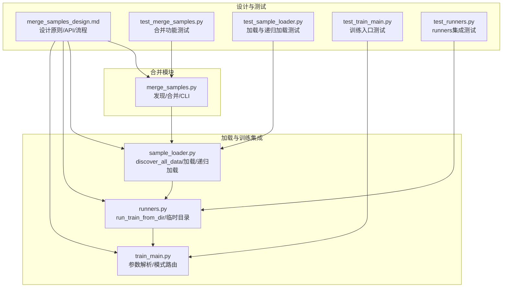
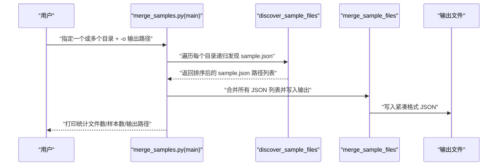
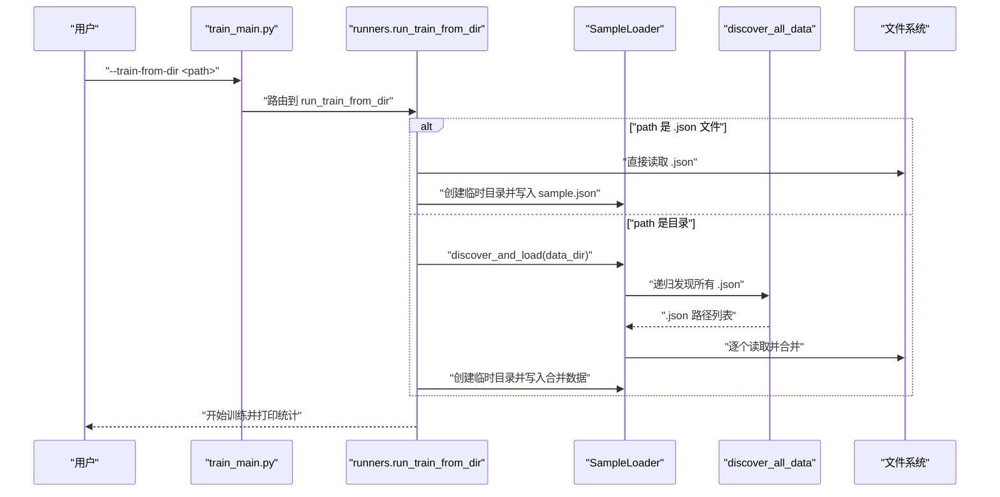
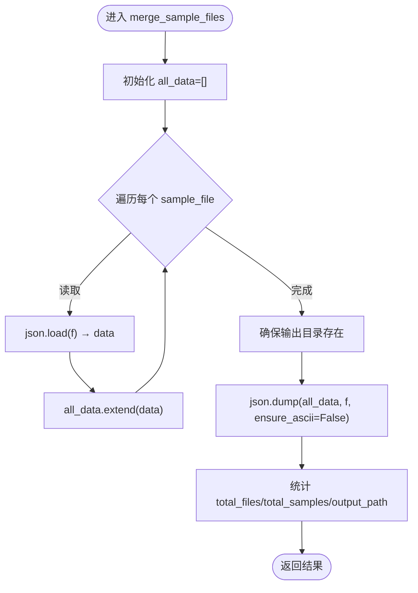
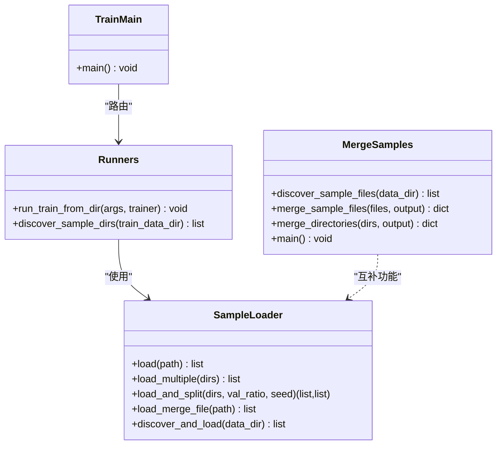
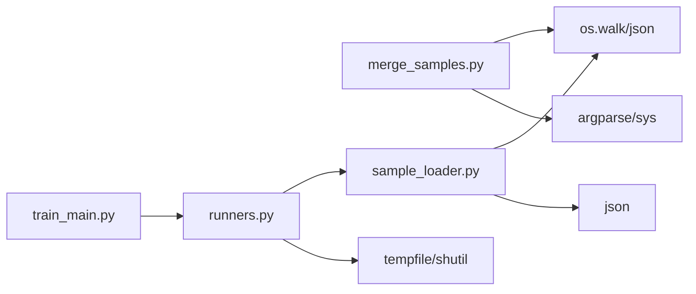

# 数据合并设计

<cite>
**本文引用的文件**
- [merge_samples.py](file://ai/merge_samples.py)
- [merge_samples_design.md](file://design/merge_samples_design.md)
- [sample_loader.py](file://ai/sample_loader.py)
- [train_main.py](file://ai/train_main.py)
- [runners.py](file://ai/runners.py)
- [test_merge_samples.py](file://tests/ai/test_merge_samples.py)
- [test_sample_loader.py](file://tests/ai/test_sample_loader.py)
- [test_train_main.py](file://tests/ai/test_train_main.py)
- [test_runners.py](file://tests/ai/unit/test_runners.py)
</cite>

## 目录
1. [简介](#简介)
2. [项目结构](#项目结构)
3. [核心组件](#核心组件)
4. [架构总览](#架构总览)
5. [详细组件分析](#详细组件分析)
6. [依赖分析](#依赖分析)
7. [性能考量](#性能考量)
8. [故障排查指南](#故障排查指南)
9. [结论](#结论)
10. [附录](#附录)

## 简介
本设计文档围绕“五子棋AI数据合并系统”展开，目标是将分散在多目录中的 sample.json 训练样本合并为单一大文件，以降低训练时的 I/O 与 JSON 解析开销，提升加载效率。文档涵盖设计理念、API 设计、架构实现、性能优化、与训练流程的集成方式，以及使用指南与最佳实践。

## 项目结构
与数据合并直接相关的模块与文件如下：
- 合并模块：ai/merge_samples.py
- 训练加载与集成：ai/sample_loader.py、ai/runners.py、ai/train_main.py
- 设计说明：design/merge_samples_design.md
- 测试：tests/ai/test_merge_samples.py、tests/ai/test_sample_loader.py、tests/ai/test_train_main.py、tests/ai/unit/test_runners.py

**图表来源**
- [merge_samples.py:1-155](file://ai/merge_samples.py#L1-L155)
- [sample_loader.py:36-240](file://ai/sample_loader.py#L36-L240)
- [runners.py:21-171](file://ai/runners.py#L21-L171)
- [train_main.py:27-234](file://ai/train_main.py#L27-L234)
- [merge_samples_design.md:1-247](file://design/merge_samples_design.md#L1-L247)
- [test_merge_samples.py:1-249](file://tests/ai/test_merge_samples.py#L1-L249)
- [test_sample_loader.py:99-114](file://tests/ai/test_sample_loader.py#L99-L114)
- [test_train_main.py:147-177](file://tests/ai/test_train_main.py#L147-L177)
- [test_runners.py:108-196](file://tests/ai/unit/test_runners.py#L108-L196)

**章节来源**
- [merge_samples.py:1-155](file://ai/merge_samples.py#L1-L155)
- [merge_samples_design.md:1-247](file://design/merge_samples_design.md#L1-L247)

## 核心组件
- 合并模块（ai/merge_samples.py）
  - discover_sample_files：递归发现目录下所有 sample.json，忽略以 merge_ 开头的 .json 文件，按路径排序返回。
  - merge_sample_files：逐个读取 JSON 列表并合并，输出为紧凑格式（无换行/缩进），自动创建输出目录。
  - merge_directories：对多个目录分别调用 discover_sample_files，去重后统一合并。
  - main：CLI 入口，参数校验、调用 merge_directories 并打印统计。
- 加载与集成（ai/sample_loader.py、ai/runners.py、ai/train_main.py）
  - discover_all_data：递归发现目录下所有 .json 文件，不限文件名前缀，返回排序列表。
  - SampleLoader.discover_and_load：基于 discover_all_data 递归加载所有 .json 文件并合并。
  - runners.run_train_from_dir：支持直接传入 .json 文件或目录路径；目录路径下自动递归加载所有 .json 文件；训练完成后清理临时目录。
  - train_main：参数解析与模式路由，支持 --train-from-dir 与 --cycle；--train-from-dir 可直接指向 .json 文件或目录。

**章节来源**
- [merge_samples.py:13-102](file://ai/merge_samples.py#L13-L102)
- [sample_loader.py:36-204](file://ai/sample_loader.py#L36-L204)
- [runners.py:81-171](file://ai/runners.py#L81-L171)
- [train_main.py:27-234](file://ai/train_main.py#L27-L234)

## 架构总览
数据合并与训练加载的整体流程如下：

**图表来源**
- [merge_samples.py:105-151](file://ai/merge_samples.py#L105-L151)
- [merge_samples.py:13-39](file://ai/merge_samples.py#L13-L39)
- [merge_samples.py:42-76](file://ai/merge_samples.py#L42-L76)

训练加载集成流程（--train-from-dir）：

**图表来源**
- [train_main.py:226-229](file://ai/train_main.py#L226-L229)
- [runners.py:81-171](file://ai/runners.py#L81-L171)
- [sample_loader.py:36-64](file://ai/sample_loader.py#L36-L64)
- [sample_loader.py:185-204](file://ai/sample_loader.py#L185-L204)

## 详细组件分析

### 合并模块（ai/merge_samples.py）
- 发现机制
  - 使用 os.walk 递归遍历目录，收集名为 sample.json 的文件，忽略以 merge_ 开头的 .json 文件，最终按路径字符串排序，保证结果稳定。
- 合并算法
  - 逐个读取 JSON 列表并 extend 到 all_data，输出采用紧凑格式（无换行/缩进），减少文件体积。
  - 输出前确保输出目录存在，不存在则自动创建。
- 去重与多目录合并
  - merge_directories 对每个目录调用 discover_sample_files，收集后使用 dict.fromkeys 去重并保持顺序，再统一调用 merge_sample_files。
- 错误处理
  - CLI 对目录存在性与类型进行校验，不存在或非目录时打印错误并退出。
- 输出管理
  - 返回统计信息：总文件数、总样本数、输出路径。

**图表来源**
- [merge_samples.py:42-76](file://ai/merge_samples.py#L42-L76)

**章节来源**
- [merge_samples.py:13-102](file://ai/merge_samples.py#L13-L102)
- [test_merge_samples.py:18-77](file://tests/ai/test_merge_samples.py#L18-L77)
- [test_merge_samples.py:79-164](file://tests/ai/test_merge_samples.py#L79-L164)
- [test_merge_samples.py:166-195](file://tests/ai/test_merge_samples.py#L166-L195)

### 加载与训练集成（ai/sample_loader.py、ai/runners.py、ai/train_main.py）
- discover_all_data
  - 递归扫描目录，收集所有 .json 文件，按路径排序返回，不限文件名前缀。
- SampleLoader.discover_and_load
  - 基于 discover_all_data 递归加载所有 .json 文件并合并，作为 --train-from-dir 的统一加载入口。
- runners.run_train_from_dir
  - 支持两种输入：直接 .json 文件或目录路径。
  - 目录路径下自动递归加载所有 .json 文件；训练完成后清理临时目录。
- train_main
  - 参数解析与模式路由，--train-from-dir 可直接指向 .json 文件或目录；--cycle 与 --train-from-dir 互斥。

**图表来源**
- [sample_loader.py:67-204](file://ai/sample_loader.py#L67-L204)
- [runners.py:21-171](file://ai/runners.py#L21-L171)
- [train_main.py:27-234](file://ai/train_main.py#L27-L234)
- [merge_samples.py:13-102](file://ai/merge_samples.py#L13-L102)

**章节来源**
- [sample_loader.py:36-204](file://ai/sample_loader.py#L36-L204)
- [runners.py:81-171](file://ai/runners.py#L81-L171)
- [train_main.py:226-229](file://ai/train_main.py#L226-L229)
- [test_sample_loader.py:99-114](file://tests/ai/test_sample_loader.py#L99-L114)
- [test_runners.py:108-196](file://tests/ai/unit/test_runners.py#L108-L196)
- [test_train_main.py:147-177](file://tests/ai/test_train_main.py#L147-L177)

## 依赖分析
- 模块耦合
  - merge_samples.py 与 sample_loader.py 在“发现与加载”的职责上互补：前者专注多目录合并与去重，后者专注递归加载与训练集成。
  - runners.run_train_from_dir 依赖 SampleLoader.discover_and_load，实现“目录路径下递归加载所有 .json”的统一入口。
- 外部依赖
  - 标准库：os、json、argparse、sys、tempfile、shutil、random、typing。
- 潜在风险
  - 多目录合并时的去重依赖 dict.fromkeys 保持顺序，需确保路径唯一性。
  - 递归加载 discover_all_data 对目录权限与磁盘 IO 的健壮性依赖，已在异常情况下返回空列表。

**图表来源**
- [merge_samples.py:6-10](file://ai/merge_samples.py#L6-L10)
- [sample_loader.py:6-11](file://ai/sample_loader.py#L6-L11)
- [runners.py:12-18](file://ai/runners.py#L12-L18)
- [train_main.py:16-24](file://ai/train_main.py#L16-L24)

**章节来源**
- [merge_samples.py:6-10](file://ai/merge_samples.py#L6-L10)
- [sample_loader.py:6-11](file://ai/sample_loader.py#L6-L11)
- [runners.py:12-18](file://ai/runners.py#L12-L18)
- [train_main.py:16-24](file://ai/train_main.py#L16-L24)

## 性能考量
- I/O 优化
  - 合并为单文件后，训练时只需一次打开与解析，显著降低文件句柄与解析开销。
  - 输出采用紧凑格式（无换行/缩进），减少文件体积与磁盘读取时间。
- 文件组织
  - merge 文件与个体 sample.json 物理隔离，合并后直接加载，无需去重。
- 内存与并发
  - 合并阶段采用逐个读取并 extend 的方式，内存占用与样本数线性相关；未引入并发。
- 批量处理
  - discover_sample_files 一次性收集所有路径并排序，避免多次目录扫描。
- 建议
  - 大规模数据合并建议在空闲时段执行，避免与训练高峰冲突。
  - 输出目录尽量位于高性能存储介质（如 SSD）。

[本节为通用性能讨论，不直接分析具体文件，故无“章节来源”]

## 故障排查指南
- CLI 参数问题
  - 缺少 -o 输出路径或缺少目录位置参数时，main 将打印错误并退出。
  - 目录不存在或非目录时，立即终止并提示错误。
- 合并结果验证
  - 输出文件可被 json.load 正确读取；空文件列表合并后输出空数组。
  - 输出目录不存在时自动创建。
- 训练加载问题
  - --train-from-dir 指向空目录或无 .json 文件时，run_train_from_dir 将打印错误并退出。
  - 目录路径下递归加载所有 .json 文件，确保未遗漏任何样本。
- 临时目录清理
  - run_train_from_dir 在训练成功或失败后都会清理临时目录，避免残留。

**章节来源**
- [merge_samples.py:134-151](file://ai/merge_samples.py#L134-L151)
- [test_merge_samples.py:104-164](file://tests/ai/test_merge_samples.py#L104-L164)
- [test_merge_samples.py:224-244](file://tests/ai/test_merge_samples.py#L224-L244)
- [runners.py:97-128](file://ai/runners.py#L97-L128)
- [runners.py:168-171](file://ai/runners.py#L168-L171)
- [test_runners.py:141-174](file://tests/ai/unit/test_runners.py#L141-L174)

## 结论
数据合并系统通过“多目录样本文件合并 + 单文件加载”的设计，在不改变既有训练流程的前提下，显著降低了训练时的 I/O 与解析成本。合并模块与加载模块职责清晰、边界明确，既可独立运行，也可无缝集成到训练流程中。配合递归发现与去重机制，系统具备良好的扩展性与稳定性。

[本节为总结性内容，不直接分析具体文件，故无“章节来源”]

## 附录

### API 设计要点
- 合并模块 API
  - discover_sample_files：递归发现 sample.json，忽略 merge_*.json，按路径排序。
  - merge_sample_files：合并多个 JSON 列表为单文件，紧凑格式输出。
  - merge_directories：多目录合并，去重后统一合并。
  - main：CLI 入口，参数校验与统计输出。
- 加载模块 API
  - discover_all_data：递归发现所有 .json 文件，不限前缀。
  - SampleLoader.discover_and_load：递归加载并合并。
- 训练入口
  - --train-from-dir：支持 .json 文件或目录路径；目录路径下递归加载所有 .json。

**章节来源**
- [merge_samples_design.md:16-150](file://design/merge_samples_design.md#L16-L150)
- [merge_samples.py:13-102](file://ai/merge_samples.py#L13-L102)
- [sample_loader.py:36-204](file://ai/sample_loader.py#L36-L204)
- [runners.py:81-171](file://ai/runners.py#L81-L171)
- [train_main.py:98-103](file://ai/train_main.py#L98-L103)

### 使用指南与最佳实践
- 目录结构建议
  - 将个体 sample.json 放置在子目录中，合并文件放置在父级目录，实现物理隔离。
- 文件命名规范
  - 个体样本文件命名为 sample.json；合并文件以 merge_ 前缀命名，避免被再次发现。
- 合并时机选择
  - 在自我对弈或外部样本生成完成后，集中执行合并，减少频繁小文件 I/O。
- 与训练流程集成
  - --train-from-dir 可直接指向合并文件或包含合并文件的目录，系统自动识别并加载。
  - 若目录下同时存在 merge_* 与 sample.json，合并文件优先，避免重复加载。

**章节来源**
- [merge_samples_design.md:9-14](file://design/merge_samples_design.md#L9-L14)
- [merge_samples.py:33-35](file://ai/merge_samples.py#L33-L35)
- [runners.py:116-128](file://ai/runners.py#L116-L128)